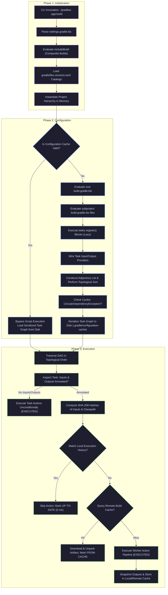
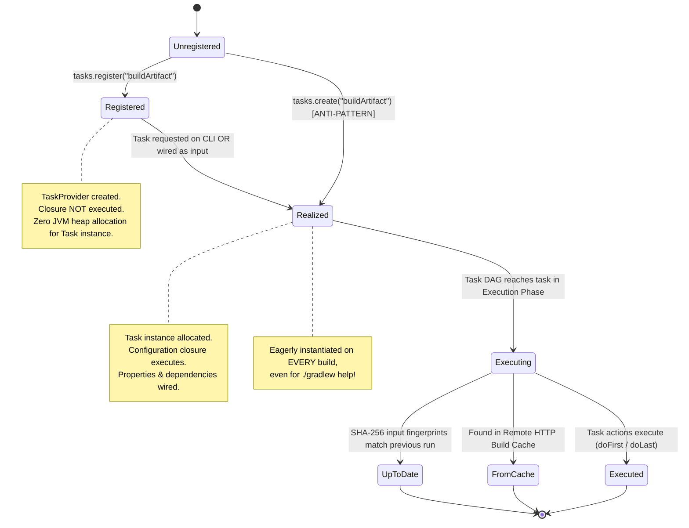
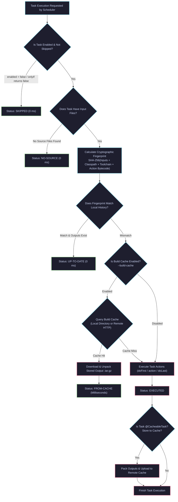
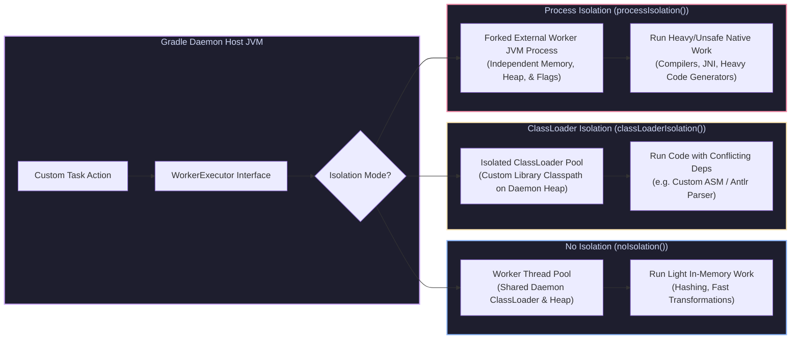

# Gradle Build Automation, DAG Engine & Enterprise Performance Architecture

> **Document Identity:** [`interview_prep/01_java_core/gradle_build_automation_mastery.md`](file:///d:/project/github/1/CheatSheet_Tutorial/interview_prep/01_java_core/gradle_build_automation_mastery.md)  
> **Topic Domain:** Core Java Engineering & Enterprise Build Architecture (`J16` / `GAP-16`)  
> **Target Version:** Gradle 8.x / 9.x (HotSpot Java 17, 21, 25 LTS Support)  
> **Scope:** Gradle 3-Phase Lifecycle (Initialization, Configuration, Execution), Task Execution Directed Acyclic Graph (DAG) Engine, Task Configuration Avoidance API (`register` vs `create`), Dependency Configurations (`api` vs `implementation`, `runtimeOnly`, `compileOnly`), Highest-Version-Wins Conflict Engine, Rich Version Constraints (`strictly`, `reject`), Version Catalogs (`libs.versions.toml`), Incremental Builds (`@Input`, `@OutputFile`, `UP-TO-DATE`), Configuration Cache Serialization, Local & Remote HTTP Build Cache (`FROM-CACHE`), Worker API Concurrency (None, ClassLoader, Process Isolation), Composite Builds (`includeBuild`), Convention Plugins with `build-logic`, Gradle Daemon Socket IPC, and Production War-Room Forensics.

---

## Track 0: Master Jargon-Buster & Conceptual Rosetta Stone

| Term / Acronym | Architectural Category | Enterprise Definition | Low-Level Under-the-Hood Reality |
| :--- | :--- | :--- | :--- |
| **Gradle Daemon** | Runtime Architecture | Long-lived background JVM process that hosts build execution to eliminate JVM boot and JIT warm-up penalties. | Listens on a local loopback TCP socket (`127.0.0.1:<random-port>`). Uses custom binary socket serialization. Reuses JIT-compiled bytecode and in-memory caches across consecutive runs. |
| **3-Phase Lifecycle** | Build Engine Core | The discrete sequential stages of every Gradle build: Initialization, Configuration, and Execution. | Phase 1 runs `settings.gradle.kts` (determines projects). Phase 2 evaluates `build.gradle.kts` (populates `Project` object graph and constructs task graph). Phase 3 traverses the DAG and invokes task actions. |
| **Task Execution DAG** | Graph Theory / Scheduling | Directed Acyclic Graph representing all scheduled tasks and their causal dependencies. | Gradle builds an adjacency list in memory, evaluates `dependsOn` and implicit provider wirings, and performs a topological sort. Cycles throw `CircularDependencyException`. |
| **Task Configuration Avoidance** | Performance Engineering | Deferred lazy evaluation API (`tasks.register()`) that delays task instantiation and configuration until needed. | Returns a lightweight `TaskProvider<T>`. Defers closure execution until the task is actively queried for execution or wired as an input to another active task, saving up to 90% configuration time. |
| **UP-TO-DATE Check** | Incremental Execution | Gradle mechanism that skips task execution if neither its inputs nor its outputs have changed since the prior run. | Before execution, Gradle computes SHA-256 cryptographic hashes of all `@Input` properties and `@InputFiles` snapshots. If hashes match the metadata stored in `.gradle/<version>/executionHistory/`, execution is skipped in 0ms. |
| **Configuration Cache** | Engine Optimization | Feature that serializes the populated task execution graph to disk, bypassing the entire Configuration Phase on subsequent builds. | Uses Java Unsafe and specialized reflection serializers to snapshot the JVM object graph into binary files in `.gradle/configuration-cache`. Prohibits live references to `Project`, `Gradle`, and `Task` in actions. |
| **Remote Build Cache** | Distributed Systems | Shared HTTP/REST cache that allows CI/CD workers and developer machines to download previously built task outputs. | Keyed by a deterministic composite SHA-256 hash of task inputs, classpath bytecode, OS, and toolchain version. If found remotely, Gradle streams the `.tar.gz` artifact and unpacks it (`FROM-CACHE`). |
| **Worker API** | Concurrency / Isolation | Gradle API for parallelizing sub-task units of work with granular isolation control. | Spawns parallel worker threads or forked JVM processes (`noIsolation()`, `classLoaderIsolation()`, `processIsolation()`) managed by a worker daemon pool to prevent task thread lockouts. |
| **ABI Compile Avoidance** | Compiler Engineering | Optimization where changing a dependency's internal implementation does not trigger recompilation of downstream modules. | Gradle inspects compiled `.class` files via ASM, extracts the Application Binary Interface (public method signatures, field types, annotations), and ignores private method/bytecode changes when computing downstream classpath hashes. |
| **`api` Configuration** | Dependency Management | Dependency scope declaring that a library is part of the module's public ABI and must be exposed to consumers. | Transitive compile-time dependency. Downstream modules inherit the dependency on their compile classpath, meaning changes to the library force recompilation of downstream modules. |
| **`implementation` Configuration** | Dependency Management | Dependency scope declaring internal implementation details, hiding the library from downstream compile classpaths. | Non-transitive compile-time dependency. Downstream consumers do not see the library during compilation, breaking transitive recompilation cascades. Placed on runtime classpath only. |
| **Version Catalog** | Build Governance | Standardized TOML file (`gradle/libs.versions.toml`) centralizing dependency coordinates, versions, and bundles. | Gradle generates type-safe Kotlin/Groovy DSL accessors (e.g. `libs.spring.web`) at configuration time, eliminating copy-pasted group/artifact strings and version drift across monorepos. |
| **Rich Version Constraints** | Conflict Mediation | Fine-grained dependency version rules using `strictly`, `prefer`, `require`, and `reject`. | Allows overriding Gradle's default "highest version wins" resolution. `strictly` enforces exact versions and fails if transitivity attempts an upgrade; `reject` blacklists compromised versions. |
| **Composite Build** | Monorepo / Multi-Repo | Inclusion of an independent Gradle build into another build via `includeBuild("../library")`. | Gradle dynamically substitutes binary module coordinates (`com.example:core:1.0.0`) with direct local subproject references, allowing seamless cross-repo debugging without publishing snapshots. |
| **Convention Plugin** | Architectural Modularity | Custom build logic encapsulated as reusable plugins inside `build-logic`, replacing legacy `allprojects {}`. | Precompiled script plugins written in Kotlin (`*.gradle.kts`) within an included build. Compile directly to JVM bytecode, offering compile-time type safety and zero cross-project coupling. |
| **Gradle Wrapper (`gradlew`)** | Reproducibility | Shell and batch scripts committed to source control that automatically download and verify the exact declared Gradle runtime. | Checks local cache in `~/.gradle/wrapper/dists/`. If missing, downloads the distribution zip from the declared URI, verifies its SHA-256 checksum, unzips, and invokes `GradleMain`. |
| **Artifact Transforms** | Dependency Engine | Lightweight operations that transform dependency artifacts on the fly before compilation or execution. | Implemented via `TransformAction`. Transforms JARs into unpacked directories, instruments bytecode, or extracts native binaries dynamically, caching results across builds. |
| **File Watching (`--watch-fs`)** | OS Interop | Background file system watcher using OS-native APIs (inotify, FSEvents, ReadDirectoryChangesW) to track file edits. | Retains file system state in daemon memory between builds, eliminating expensive disk scans during incremental input verification. |
| **Component Selection Rule** | Dependency Filtering | Programmatic rules hooked into `resolutionStrategy.componentSelection` to filter or reject candidate versions. | Evaluates candidate metadata (e.g. rejecting milestone/alpha/beta releases) before Gradle accepts a version into the dependency resolution graph. |
| **Capabilities** | Variant Resolution | Identifies features provided by a module, enabling Gradle to detect and resolve functional collisions. | Declares GAV-independent capabilities (e.g. `slf4j-impl`). If two distinct libraries provide the same capability (e.g. `log4j-to-slf4j` vs `logback-classic`), Gradle fails early instead of creating runtime classpath collision. |
| **Java Toolchains** | Environment Governance | Declarative Java SDK specification decoupling the Gradle runtime JVM from the application compilation JVM. | Gradle auto-detects locally installed JDKs or auto-downloads requested vendor JDKs (Temurin, Corretto) matching requested version, vendor, and architecture, guaranteeing build environment parity. |
| **Task Action Hooks** | Task Internals | Closures or action instances executed during the execution phase (`doFirst { }`, `doLast { }`). | Added to the task's internal `List<ContextAwareTaskAction>`. Executed sequentially in Phase 3. If either throws an unhandled exception, task execution halts and the build fails. |
| **Dynamic Properties (`extra`)** | Legacy State | Dynamic property storage on `Project`, `Task`, or `Settings` via `extra["key"] = value`. | Hash-map based property extension. Discouraged in modern Gradle because it lacks type safety, breaks configuration cache serialization, and makes refactoring error-prone. |
| **Build Scan** | Telemetry / Observability | Comprehensive diagnostic report of a build published to Develocity (formerly Gradle Enterprise) or scans.gradle.com. | Telemetry agent intercepts daemon events, recording task execution durations, cache hits/misses, configuration time bottlenecks, garbage collection pauses, and dependency resolution graphs. |
| **Settings Script** | Project Discovery | The initial entry point script (`settings.gradle.kts`) that orchestrates build participation. | Instantiates `Settings` object. Configures plugin management repositories, version catalogs, included builds, and invokes `include(":core", ":api")`. |

---

## Track 1: Architectural Foundations & ELI5 Mental Models

### The Mental Model: The Industrial Assembly Line
Think of Gradle not as an imperative script that executes lines top-to-bottom, but as an **automated modern automotive factory**:

```
[ Phase 1: Blueprint Inspection (Initialization) ]
       │  Determines which car models (modules) are being assembled today.
       ▼
[ Phase 2: Assembly Line Reconfiguration (Configuration) ]
       │  Engineers build the robotic DAG. No parts are stamped yet!
       │  Wires robotic sensors (Inputs/Outputs) and safety dependencies.
       ▼
[ Phase 3: High-Speed Robotics Execution (Execution) ]
       │  Robots run. If a door was already painted in the exact color (UP-TO-DATE),
       │  the painting arm skips it in 0ms. If a pre-assembled engine is in the warehouse,
       │  it pulls from remote cache (FROM-CACHE).
```

### 1.1 The 3-Phase Lifecycle
Every single execution of `./gradlew <task>` progresses through three strictly isolated phases:

1. **Initialization Phase**:
   - Evaluates `settings.gradle.kts`.
   - Discovers root project and subprojects (`include(":services:order", ":common:model")`).
   - Resolves composite builds (`includeBuild("../shared-lib")`).
   - Configures central plugin repositories and loads TOML Version Catalogs (`libs.versions.toml`).
   - Instantiates a `Project` domain object for each participating module.

2. **Configuration Phase**:
   - Evaluates `build.gradle.kts` for all participating projects.
   - Applies plugins (e.g. `kotlin("jvm")`, `java-library`, `com.diffplug.spotless`).
   - Configures task properties and wires dependencies (`dependsOn`, `mustRunAfter`).
   - **Crucial Rule:** No compilation, file copying, or network calls should occur here! Doing so introduces severe configuration drag across the entire developer organization.
   - Computes the final **Task Execution Graph (DAG)**.

3. **Execution Phase**:
   - Takes the target task requested on CLI (e.g. `./gradlew :services:order:build`).
   - Determines the topological ordering of all required prerequisite tasks.
   - For each scheduled task:
     - Evaluates `@Input` and `@Output` fingerprints.
     - Decides state: `UP-TO-DATE`, `FROM-CACHE`, `NO-SOURCE`, `SKIPPED`, or `EXECUTED`.
     - Executes task actions (`doFirst`, task main action, `doLast`).

### 1.2 Kotlin DSL vs Groovy DSL
Modern enterprise Gradle standardizes exclusively on **Kotlin DSL (`build.gradle.kts`)** over legacy Groovy:
- **Compile-Time Type Safety:** Groovy evaluates property lookups and method invocations dynamically at runtime. Kotlin DSL verifies all types, function signatures, and properties during compilation.
- **Flawless IDE Refactoring & Autocomplete:** IntelliJ IDEA and Android Studio provide instantaneous symbol navigation, auto-completion, and inline parameter documentation.
- **Strict Syntax Disambiguation:** In Groovy, `compile "dep"` relies on ambiguous runtime method dispatch. In Kotlin DSL, `implementation("dep")` is an explicit, strongly typed extension function.

---

## Track 2: Deep Engineering Architecture & Mermaid Flowcharts

### 2.1 The 3-Phase Lifecycle & DAG Construction Pipeline



### 2.2 Task Configuration Avoidance State Machine



### 2.3 Incremental Build & Build Cache Decision Matrix



### 2.4 Worker API Execution Architecture



---

## Track 3: Low-Level Engine & JVM/Daemon Internals

### 3.1 Daemon Architecture & Socket IPC Protocol
The Gradle Daemon is not merely a background process; it is a dedicated, multi-tenant execution server running on the developer workstation or CI host:
- **IPC Architecture:** When `./gradlew <task>` is invoked, the native wrapper CLI spins up a lightweight C/Java client. The client scans `~/.gradle/daemon/<version>/` for registry lock files (`registry.bin`).
- **Daemon Discovery & Handshake:**
  - If a compatible idle daemon matching the exact Java version, JVM architecture, and JVM arguments (`-Xmx`, `-XX:MaxMetaspaceSize`) exists, the client connects over a local loopback TCP socket (`127.0.0.1`).
  - If no idle daemon exists, the client forks a new detached background JVM process (`org.gradle.launcher.daemon.bootstrap.GradleDaemon`) and awaits the TCP port broadcast.
  - The client transmits the build environment (working directory, environment variables, system properties, CLI arguments) across the socket using an optimized binary object serialization format.
- **Process Leasing:** The daemon marks itself as `Busy` and acquires a file lock on its identity file. Multiple concurrent CLI runs cannot hijack a busy daemon; Gradle will fork an additional daemon instance up to the hardware CPU limit.

### 3.2 Daemon JVM Memory & JIT Warm-Up Mechanics
Why does Gradle build significantly faster on the second run?
1. **JIT Compilation Warm-Up:**
   - The HotSpot C2 compiler compiles hot Gradle engine paths (Groovy/Kotlin DSL runtime dispatchers, Aether/Ivy dependency resolvers, ASM class visitors) into native x86_64/ARM64 machine instructions.
   - Subsequent builds execute native machine instructions immediately, bypassing bytecode interpretation.
2. **In-Memory File System Caching (VFS):**
   - The daemon maintains an in-memory Virtual File System (VFS). With `--watch-fs` enabled, the OS kernel notifies Gradle whenever a file changes on disk. Gradle updates its in-memory VFS incrementally without having to re-scan thousands of directory trees before every build.
3. **Metaspace & Heap Leak Vulnerabilities:**
   - Because the daemon reuses its JVM across builds, classloaders generated for dynamic build scripts, plugins, and annotation processors can remain pinned in memory if plugins retain static references to `Project` or `ClassLoader`.
   - In containerized CI pipelines (e.g. Kubernetes, GitHub Actions), daemons can suffer from memory fragmentation and Metaspace exhaustion. Production CI must set `org.gradle.daemon=false` or configure container-scoped daemons.

### 3.3 Task Execution DAG Topological Sort & Cycle Detection Engine
When Gradle resolves the execution graph for a target task:
1. **Graph Construction:**
   - Every task is represented by an internal node in a directed graph: $G = (V, E)$, where $V$ is the set of tasks and $E$ represents directed dependency edges ($T_A \to T_B$ means $T_A$ depends on $T_B$, so $T_B$ must execute before $T_A$).
   - Dependencies originate from:
     - Explicit `dependsOn` declarations.
     - Task ordering rules: `mustRunAfter`, `shouldRunAfter`, `finalizedBy`.
     - Implicit provider connections: when an output property `TaskA.outputFile` is passed as an input property to `TaskB.inputFile`, Gradle automatically synthesizes a directed edge $T_B \to T_A$.
2. **Topological Ordering Algorithm (Kahn's / DFS Variant):**
   - Gradle computes in-degrees for all vertices.
   - Vertices with an in-degree of 0 (tasks with no pending dependencies) are added to the ready queue.
   - Tasks in the ready queue are scheduled across the worker thread pool (controlled by `--max-workers`).
   - When a task completes, all outgoing edges are cleared, reducing the in-degree of downstream dependent tasks.
3. **Cycle Detection:**
   - During graph traversal, Gradle applies a three-color depth-first search algorithm (`WHITE = unvisited`, `GRAY = currently visiting`, `BLACK = fully visited`).
   - If traversal encounters a `GRAY` node, a back-edge exists, indicating a cyclic dependency. Gradle halts before Phase 3 starts, printing the exact cycle loop in `CircularDependencyException`.

### 3.4 Configuration Cache Serialization Engine
The Configuration Cache is one of the most sophisticated features in modern build systems:
- **Phase 2 Elimination:** In large enterprise monorepos with 500+ modules, evaluating build scripts can take 30 to 90 seconds. The Configuration Cache serializes the complete in-memory Task Execution DAG to disk after Phase 2 completes.
- **Under-the-Hood Serialization Mechanics:**
  - Unlike standard Java Serialization (`java.io.Serializable`), Gradle utilizes a custom, high-speed binary serializer powered by `sun.misc.Unsafe` / JVM reflection.
  - It snapshots field-level object graphs directly, storing properties, inputs, and environment configurations into `.gradle/configuration-cache/<fingerprint>.bin`.
- **Enforced Constraints & Anti-Serialization Traps:**
  - To guarantee that the serialized task graph can be reconstructed without re-evaluating `build.gradle.kts`, tasks **must not reference live project model objects** in task actions.
  - Specifically prohibited types include: `org.gradle.api.Project`, `org.gradle.api.invocation.Gradle`, `org.gradle.api.Task`, `org.gradle.api.initialization.Settings`, and raw `java.lang.ClassLoader`.
  - Violating these constraints causes the build to fail with `ConfigurationCacheException`.

### 3.5 Incremental Build Fingerprinting Engine
How does Gradle achieve true sub-second incremental builds?
1. **Input Normalization:**
   - Raw file paths change between developer workstations and CI runners (`/home/user/repo` vs `/agent/build/repo`).
   - Gradle applies path normalization strategies (`@PathSensitive(PathSensitivity.RELATIVE)`, `PathSensitivity.NAME_ONLY`, or `PathSensitivity.NONE`).
   - It strips absolute directory prefixes, calculating file fingerprints purely on relative paths and file contents.
2. **Cryptographic Hashing:**
   - Each input file is hashed using SHA-256.
   - For directories, Gradle constructs a deterministic hash tree (Merkle tree) combining relative file paths and individual content hashes.
   - If all input hashes match the snapshot recorded in `.gradle/<version>/executionHistory/executionHistory.bin`, and the task output files exist intact, Gradle terminates the task immediately as `UP-TO-DATE`.

### 3.6 ABI Analysis & Compile Avoidance Engine
Compile avoidance is fundamentally different from build caching:
- **The Problem:** In a multi-module project where `:app` depends on `:core`, if an engineer changes a single private method inside `:core`, why should `:app` be recompiled?
- **The Engine Solution:**
  - When `:core:compileJava` finishes, Gradle runs an internal bytecode analyzer using the ObjectWeb ASM library.
  - It strips private methods, private field descriptors, and method body bytecodes, extracting the **Application Binary Interface (ABI)**:
    - Public and protected class signatures.
    - Public method signatures, return types, and parameter types.
    - Public constants (`static final` fields).
    - Runtime-visible annotations.
  - It hashes the ABI stream. If the ABI hash of `:core` has not changed (i.e. only private method implementations changed), Gradle determines that `:app`'s compile classpath is functionally identical.
  - **Result:** `:app:compileJava` is skipped as `UP-TO-DATE`, even though `:core:compileJava` executed!

### 3.7 Worker API Isolation Mechanics
The Worker API replaces ad-hoc thread pools and custom background executors:
- **`noIsolation()`:** Runs work items inside the Gradle daemon host process on worker threads. Lowest overhead, but work items share the daemon's classpath and memory. Ideal for fast in-memory operations like file checksumming or compression.
- **`classLoaderIsolation()`:** Constructs an isolated `URLClassLoader` child hierarchy for each worker pool. Allows running third-party libraries (e.g. a specific version of Guava, ASM, or Antlr) without classpath collisions against Gradle's internal runtime dependencies.
- **`processIsolation()`:** Forks an isolated external operating system JVM process (`WorkerDaemon`). Supports custom JVM arguments (`-Xmx2g`, `-Dfile.encoding=UTF-8`). If the worker crashes with a native SIGSEGV or runs out of heap memory, the host Gradle Daemon remains completely unaffected.

---

## Track 4: 55 Progressive Real-World Production Scenarios

### Scenario 1: Enterprise Java Toolchain Pinning
**Context:** Monorepos where developers run diverse local JDKs (Java 17, 21, 23). The build must strictly compile and test using OpenJDK 21 LTS regardless of the JVM running Gradle.  
**Implementation (`build.gradle.kts`):**
```kotlin
plugins {
    `java-library`
}

java {
    toolchain {
        languageVersion.set(JavaLanguageVersion.of(21))
        vendor.set(JvmVendorSpec.ADOPTIUM)
        implementation.set(JvmImplementation.VENDOR_SPECIFIC)
    }
}
```
**Engine Verification:** Gradle invokes `JavaToolchainService`, probes local toolchain locations, and automatically downloads the requested Eclipse Temurin JDK if absent, writing it to `~/.gradle/jdks/`.

---

### Scenario 2: Task Configuration Avoidance with `tasks.register()`
**Context:** Eliminating 45-second configuration overhead in a 200-module monorepo caused by eager task allocation.  
**Implementation (`build.gradle.kts`):**
```kotlin
// ❌ EAGER ANTI-PATTERN: Instantiated and configured on EVERY build invocation
tasks.create<Tar>("heavyArchive") {
    archiveFileName.set("distribution.tar")
    destinationDirectory.set(layout.buildDirectory.dir("dist"))
    from(layout.projectDirectory.dir("assets")) // Scans disk during configuration!
}

// ✅ LAZY PRODUCTION STANDARD: Configured ONLY when explicitly executed
val heavyArchive by tasks.registering(Tar::class) {
    archiveFileName.set("distribution.tar")
    destinationDirectory.set(layout.buildDirectory.dir("dist"))
    from(layout.projectDirectory.dir("assets"))
}
```
**Engine Verification:** `./gradlew help` executes in under 200ms without instantiating or scanning the `Tar` task.

---

### Scenario 3: Custom Incremental Task with Lazy Properties
**Context:** Generating enterprise Swagger/OpenAPI documentation from input specification files with strict incremental caching.  
**Implementation (`build.gradle.kts`):**
```kotlin
abstract class OpenApiCodegenTask : DefaultTask() {
    @get:InputFile
    @get:PathSensitive(PathSensitivity.RELATIVE)
    abstract val specFile: RegularFileProperty

    @get:Input
    abstract val packageName: Property<String>

    @get:OutputDirectory
    abstract val outputDir: DirectoryProperty

    @TaskAction
    fun generate() {
        val input = specFile.get().asFile
        val output = outputDir.get().asFile
        output.mkdirs()
        File(output, "GeneratedApi.java").writeText(
            "package ${packageName.get()};\n// Generated from ${input.name}\npublic class GeneratedApi {}"
        )
    }
}

val generateApi by tasks.registering(OpenApiCodegenTask::class) {
    specFile.set(layout.projectDirectory.file("specs/petstore.yaml"))
    packageName.set("com.enterprise.api")
    outputDir.set(layout.buildDirectory.dir("generated/sources/openapi"))
}
```
**Engine Verification:** Subsequent runs without modifying `petstore.yaml` report `:generateApi UP-TO-DATE`.

---

### Scenario 4: Implicit Task Wiring via Provider Outputs
**Context:** Passing outputs of one task into another without hardcoded, fragile `dependsOn` declarations.  
**Implementation (`build.gradle.kts`):**
```kotlin
abstract class TokenGeneratorTask : DefaultTask() {
    @get:OutputFile
    abstract val tokenFile: RegularFileProperty

    @TaskAction
    fun generate() {
        tokenFile.get().asFile.writeText("SECRET_TOKEN_${System.currentTimeMillis()}")
    }
}

abstract class ArtifactPackerTask : DefaultTask() {
    @get:InputFile
    abstract val securityToken: RegularFileProperty

    @get:OutputFile
    abstract val packageFile: RegularFileProperty

    @TaskAction
    fun pack() {
        val token = securityToken.get().asFile.readText()
        packageFile.get().asFile.writeText("PACKAGED_WITH: $token")
    }
}

val genToken by tasks.registering(TokenGeneratorTask::class) {
    tokenFile.set(layout.buildDirectory.file("secrets/token.txt"))
}

val packArtifact by tasks.registering(ArtifactPackerTask::class) {
    // Implicit dependency established: Gradle automatically executes genToken before packArtifact!
    securityToken.set(genToken.flatMap { it.tokenFile })
    packageFile.set(layout.buildDirectory.file("dist/package.bin"))
}
```
**Engine Verification:** Running `./gradlew packArtifact` executes `:genToken` first without an explicit `dependsOn("genToken")`.

---

### Scenario 5: TOML Version Catalog Declaration (`libs.versions.toml`)
**Context:** Centralizing third-party dependencies, version pins, and plugin versions across an enterprise monorepo.  
**Implementation (`gradle/libs.versions.toml`):**
```toml
[versions]
springBoot = "3.3.4"
resilience4j = "2.2.0"
junit = "5.10.3"
jackson = "2.17.2"

[libraries]
spring-boot-starter-web = { module = "org.springframework.boot:spring-boot-starter-web", version.ref = "springBoot" }
spring-boot-starter-actuator = { module = "org.springframework.boot:spring-boot-starter-actuator", version.ref = "springBoot" }
resilience4j-circuitbreaker = { module = "io.github.resilience4j:resilience4j-circuitbreaker", version.ref = "resilience4j" }
junit-jupiter = { module = "org.junit.jupiter:junit-jupiter", version.ref = "junit" }

[bundles]
spring-web-suite = ["spring-boot-starter-web", "spring-boot-starter-actuator"]

[plugins]
spring-boot = { id = "org.springframework.boot", version.ref = "springBoot" }
```
**Subproject Consumption (`build.gradle.kts`):**
```kotlin
dependencies {
    implementation(libs.bundles.spring.web.suite)
    implementation(libs.resilience4j.circuitbreaker)
    testImplementation(libs.junit.jupiter)
}
```
**Engine Verification:** Type-safe IDE autocomplete for `libs.bundles.spring.web.suite`.

---

### Scenario 6: `api` vs `implementation` Dependency Boundary Isolation
**Context:** Preventing transitively leaked classes from polluting downstream compile classpaths and destroying build caching.  
**Implementation (`core-module/build.gradle.kts`):**
```kotlin
plugins {
    `java-library`
}

dependencies {
    // Public API: Downstream consumers of core-module need Jackson annotations in their code
    api("com.fasterxml.jackson.core:jackson-annotations:2.17.2")

    // Internal implementation: Apache Commons is an internal utility, NOT exposed in public methods
    implementation("org.apache.commons:commons-lang3:3.14.0")
}
```
**Engine Verification:** In `:service-module` which depends on `:core-module`, `org.apache.commons.lang3.StringUtils` is inaccessible at compile time, preventing accidental compilation coupling.

---

### Scenario 7: Rich Version Constraints (`strictly` and `reject`)
**Context:** Enforcing a patched version of Log4j to remediate Log4Shell while rejecting all vulnerable versions.  
**Implementation (`build.gradle.kts`):**
```kotlin
dependencies {
    implementation("org.apache.logging.log4j:log4j-core") {
        version {
            strictly("[2.17.1, 3.0.0)")
            prefer("2.23.1")
            reject("2.14.0", "2.14.1", "2.15.0", "2.16.0")
            rejectSubsequence("2.0", "2.14")
        }
        because("CVE-2021-44228 and CVE-2021-45046 critical RCE mitigation")
    }
}
```
**Engine Verification:** If any transitive dependency pulls `log4j-core:2.14.1`, the build fails immediately during graph resolution with `ResolutionException`.

---

### Scenario 8: Component Selection Rules for Pre-Release Rejection
**Context:** Preventing accidental resolution of alpha, beta, and release-candidate libraries during dynamic dependency updates.  
**Implementation (`build.gradle.kts`):**
```kotlin
configurations.all {
    resolutionStrategy.componentSelection {
        all {
            val rejectedPatterns = listOf("(?i).*-alpha.*", "(?i).*-beta.*", "(?i).*-rc.*", "(?i).*-m\\d+.*")
            val isPreRelease = rejectedPatterns.any { pattern -> candidate.version.matches(pattern.toRegex()) }
            if (isPreRelease) {
                reject("Pre-release/milestone versions are strictly prohibited in enterprise production builds")
            }
        }
    }
}
```
**Engine Verification:** Resolving dynamic range `1.+` selects the highest stable release, skipping newer release candidates.

---

### Scenario 9: Dependency Substitution with Local Modules
**Context:** Replacing a published binary dependency with a local debugging checkout without modifying source POMs.  
**Implementation (`settings.gradle.kts`):**
```kotlin
includeBuild("../external-payment-sdk") {
    dependencySubstitution {
        substitute(module("com.enterprise.payment:payment-sdk"))
            .using(project(":"))
            .because("Active local hotfix debugging session")
    }
}
```
**Engine Verification:** Gradle substitutes binary GAV `com.enterprise.payment:payment-sdk:2.1.0` with the live local project source code.

---

### Scenario 10: Capability-Based Logging Conflict Resolution
**Context:** Resolving runtime collisions between competing SLF4J binding implementations (`logback-classic` and `log4j-slf4j-impl`).  
**Implementation (`build.gradle.kts`):**
```kotlin
configurations.all {
    resolutionStrategy.capabilitiesResolution {
        withCapability("org.slf4j:slf4j-impl") {
            // Select Logback over Log4j implementation deterministically
            select("ch.qos.logback:logback-classic:0")
            because("Enterprise standard dictates Logback as the mandatory SLF4J binding")
        }
    }
}
```
**Engine Verification:** Eliminates `SLF4J: Class path contains multiple SLF4J bindings` warnings at application startup.

---

### Scenario 11: Enabling Local and Remote HTTP Build Cache
**Context:** Sharing compilation and test outputs across an entire distributed team and CI/CD cluster.  
**Implementation (`settings.gradle.kts`):**
```kotlin
buildCache {
    local {
        isEnabled = true
        directory = File(rootDir, ".gradle/build-cache")
        removeUnusedEntriesAfterDays = 7
    }
    remote<HttpBuildCache> {
        isEnabled = true
        isPush = System.getenv("CI") == "true" // Push only from verified CI pipelines
        url = uri("https://build-cache.internal.company.com/cache/")
        credentials {
            username = System.getenv("GRADLE_CACHE_USER") ?: "dev"
            password = System.getenv("GRADLE_CACHE_PASSWORD") ?: "dev-token"
        }
    }
}
```
**Engine Verification:** Local developers running `./gradlew build --build-cache` see `:compileJava FROM-CACHE`, cutting build times from 4 minutes to 12 seconds.

---

### Scenario 12: Configuration Cache Serialization Compliance
**Context:** Refactoring a legacy custom task that fails when `--configuration-cache` is enabled.  
**Implementation (`build.gradle.kts`):**
```kotlin
// ❌ FAILS CONFIGURATION CACHE: References Project directly inside action
abstract class BrokenTask : DefaultTask() {
    @TaskAction
    fun run() {
        println("Project name: ${project.name}") // FAILS: Cannot serialize Project instance!
    }
}

// ✅ CONFIGURATION CACHE COMPLIANT: Injects parameters via lazy properties
abstract class FixedTask : DefaultTask() {
    @get:Input
    abstract val projectName: Property<String>

    @TaskAction
    fun run() {
        println("Project name: ${projectName.get()}") // SERIALIZABLE!
    }
}

val fixedTask by tasks.registering(FixedTask::class) {
    projectName.set(project.name) // Captured during configuration
}
```
**Engine Verification:** Running with `./gradlew fixedTask --configuration-cache` caches the graph on run 1 and skips configuration on run 2.

---

### Scenario 13: ValueSource Provider for Dynamic Environment Lookups
**Context:** Reading environment variables without invalidating the configuration cache on every run.  
**Implementation (`build.gradle.kts`):**
```kotlin
abstract class GitCommitValueSource : ValueSource<String, ValueSourceParameters.None> {
    override fun obtain(): String? {
        val process = ProcessBuilder("git", "rev-parse", "--short", "HEAD").start()
        return process.inputStream.bufferedReader().readLine()?.trim()
    }
}

val gitCommitProvider = providers.of(GitCommitValueSource::class) {}

val printCommit by tasks.registering {
    val commit = gitCommitProvider
    doLast {
        println("Current commit: ${commit.get()}")
    }
}
```
**Engine Verification:** The configuration cache remains valid unless the underlying Git commit actually changes.

---

### Scenario 14: Worker API with Process Isolation
**Context:** Running memory-hungry bytecode instrumentation or native compilers without crashing the main Gradle daemon.  
**Implementation (`build.gradle.kts`):**
```kotlin
import javax.inject.Inject

interface InstrumentationParameters : WorkParameters {
    val inputJar: RegularFileProperty
    val outputJar: RegularFileProperty
}

abstract class HeavyInstrumentationAction : WorkAction<InstrumentationParameters> {
    override fun execute() {
        val input = parameters.inputJar.get().asFile
        val output = parameters.outputJar.get().asFile
        // Heavy memory-intensive bytecode transformation
        output.writeBytes(input.readBytes())
    }
}

abstract class InstrumentClassesTask @Inject constructor(
    private val workerExecutor: WorkerExecutor
) : DefaultTask() {
    @get:InputFile
    abstract val inputJar: RegularFileProperty

    @get:OutputFile
    abstract val outputJar: RegularFileProperty

    @TaskAction
    fun instrument() {
        // Fork an isolated external JVM process with 2GB heap
        val queue = workerExecutor.processIsolation {
            forkOptions {
                maxHeapSize = "2048m"
                jvmArgs("-XX:+UseG1GC")
            }
        }
        queue.submit(HeavyInstrumentationAction::class) {
            inputJar.set(this@InstrumentClassesTask.inputJar)
            outputJar.set(this@InstrumentClassesTask.outputJar)
        }
    }
}
```
**Engine Verification:** Process isolation launches a separate PID, keeping host daemon memory clean and unfragmented.

---

### Scenario 15: Composite Build for Cross-Repository Development
**Context:** Developing a shared security library (`auth-sdk`) alongside a consumer service (`order-service`) across two distinct Git repositories.  
**Implementation (`order-service/settings.gradle.kts`):**
```kotlin
rootProject.name = "order-service"

include(":app")

// Include external repository checkout
includeBuild("../auth-sdk") {
    dependencySubstitution {
        substitute(module("com.enterprise.security:auth-sdk")).using(project(":"))
    }
}
```
**Engine Verification:** Changes in `../auth-sdk` source files are instantly compiled and linked when running `./gradlew :app:test` in `order-service`.

---

### Scenario 16: Convention Plugins in `build-logic`
**Context:** Eliminating monolithic `allprojects {}` and `subprojects {}` by extracting reusable build conventions into type-safe plugins.  
**Implementation (`build-logic/src/main/kotlin/enterprise.java-conventions.gradle.kts`):**
```kotlin
plugins {
    `java-library`
    checkstyle
}

java {
    toolchain {
        languageVersion.set(JavaLanguageVersion.of(21))
    }
}

tasks.withType<JavaCompile>().configureEach {
    options.encoding = "UTF-8"
    options.compilerArgs.addAll(listOf("-Werror", "-Xlint:all"))
}

tasks.withType<Test>().configureEach {
    useJUnitPlatform()
    maxParallelForks = Runtime.getRuntime().availableProcessors().coerceAtLeast(1)
}
```
**Consumption in Application Subproject (`services/payment/build.gradle.kts`):**
```kotlin
plugins {
    id("enterprise.java-conventions")
}

dependencies {
    implementation(libs.spring.boot.starter.web)
}
```
**Engine Verification:** Full type safety, centralized compilation flags, and zero leaky global script evaluation.

---

### Scenario 17: Parallel Test Execution with JUnit 5
**Context:** Slashing CI test suite duration from 35 minutes to 4 minutes by executing test classes concurrently across CPU cores.  
**Implementation (`build.gradle.kts`):**
```kotlin
tasks.withType<Test>().configureEach {
    useJUnitPlatform()
    
    // Allocate 1 forked JVM per CPU core
    maxParallelForks = Runtime.getRuntime().availableProcessors().coerceAtLeast(1)
    
    // Fork fresh JVM every 200 tests to prevent heap fragmentation
    forkEvery = 200
    
    jvmArgs("-XX:+TieredCompilation", "-XX:TieredStopAtLevel=1")
    
    systemProperties(
        mapOf(
            "junit.jupiter.execution.parallel.enabled" to "true",
            "junit.jupiter.execution.parallel.mode.default" to "concurrent",
            "junit.jupiter.execution.parallel.config.strategy" to "dynamic"
        )
    )
}
```
**Engine Verification:** CPU utilization climbs to 100% across all available cores during `./gradlew test`.

---

### Scenario 18: Flaky Test Quarantine with Test Retry Plugin
**Context:** Preventing transient network/database timeouts in integration tests from blocking CI deployment pipelines.  
**Implementation (`build.gradle.kts`):**
```kotlin
plugins {
    id("org.gradle.test-retry") version "1.5.8"
}

tasks.withType<Test>().configureEach {
    retry {
        maxRetries.set(3)
        maxFailures.set(10) // Fail fast if more than 10 tests fail
        failOnPassedAfterRetry.set(false) // Allow build to pass if retry succeeds
    }
}
```
**Engine Verification:** Failed tests are immediately re-executed up to 3 times in an isolated test runner before registering a build failure.

---

### Scenario 19: JaCoCo Code Coverage Aggregation Across Modules
**Context:** Generating a unified code coverage report across 25 microservice subprojects for SonarQube ingestion.  
**Implementation (`build.gradle.kts` in Root Project):**
```kotlin
plugins {
    base
    jacoco
}

val jacocoRootReport by tasks.registering(JacocoReport::class) {
    description = "Generates aggregated JaCoCo coverage report from all subprojects"
    
    val javaSubprojects = subprojects.filter { it.pluginManager.hasPlugin("java") }
    
    dependsOn(javaSubprojects.map { it.tasks.named("test") })
    
    val allExecutionData = javaSubprojects.map { 
        it.layout.buildDirectory.file("jacoco/test.exec").get().asFile 
    }.filter { it.exists() }
    
    executionData.setFrom(allExecutionData)
    
    val allSourceDirs = javaSubprojects.flatMap { 
        it.the<SourceSetContainer>()["main"].allJava.srcDirs 
    }
    sourceDirectories.setFrom(allSourceDirs)
    
    val allClassDirs = javaSubprojects.flatMap { 
        it.the<SourceSetContainer>()["main"].output.classesDirs 
    }
    classDirectories.setFrom(allClassDirs)
    
    reports {
        xml.required.set(true)
        html.required.set(true)
        xml.outputLocation.set(layout.buildDirectory.file("reports/jacoco/aggregated.xml"))
    }
}
```
**Engine Verification:** Running `./gradlew jacocoRootReport` merges binary `.exec` files into a single production XML report.

---

### Scenario 20: Shadow Fat-JAR Packaging with Bytecode Relocation
**Context:** Bundling an enterprise command-line tool into a standalone runnable JAR while shading Guava to avoid host classpath collisions.  
**Implementation (`build.gradle.kts`):**
```kotlin
plugins {
    java
    id("com.gradleup.shadow") version "8.3.0"
}

tasks.shadowJar {
    archiveClassifier.set("all")
    archiveVersion.set("1.0.0")
    
    // Bytecode Relocation: Rewrites package declarations inside the shaded JAR
    relocate("com.google.common", "com.enterprise.shaded.guava")
    
    // Merge Service Provider Interface (SPI) descriptor files
    mergeServiceFiles()
    
    manifest {
        attributes["Main-Class"] = "com.enterprise.cli.ApplicationLauncher"
    }
}
```
**Engine Verification:** Decompiled bytecode verifies classes now reside under `com.enterprise.shaded.guava.*`.

---

### Scenario 21: Artifact Transforms for Dynamic Bytecode Stripping
**Context:** Dynamically stripping debugging symbols and metadata from third-party JARs before running security analysis tasks.  
**Implementation (`build.gradle.kts`):**
```kotlin
abstract class StripSymbolsTransform : TransformAction<TransformParameters.None> {
    @get:InputArtifact
    abstract val inputArtifact: Provider<FileSystemLocation>

    override fun transform(outputs: TransformOutputs) {
        val input = inputArtifact.get().asFile
        val output = outputs.file("stripped-${input.name}")
        // Copy stripped artifact
        input.copyTo(output, overwrite = true)
    }
}

val stripped = Attribute.of("artifactType", String::class.java)

dependencies {
    registerTransform(StripSymbolsTransform::class) {
        from.attribute(stripped, "jar")
        to.attribute(stripped, "stripped-jar")
    }
}
```
**Engine Verification:** Gradle resolves the transform pipeline dynamically, caching stripped artifacts across projects.

---

### Scenario 22: Publication to Enterprise Nexus via `maven-publish`
**Context:** Publishing signed library artifacts and SBOM metadata to an internal enterprise Nexus/Artifactory repository.  
**Implementation (`build.gradle.kts`):**
```kotlin
plugins {
    `java-library`
    `maven-publish`
    signing
}

publishing {
    publications {
        create<MavenPublication>("mavenJava") {
            from(components["java"])
            groupId = "com.enterprise.platform"
            artifactId = "security-core"
            version = "3.2.0"
            
            pom {
                name.set("Enterprise Security Core")
                description.set("Core authentication and RBAC library")
                url.set("https://github.com/enterprise/security-core")
            }
        }
    }
    repositories {
        maven {
            name = "EnterpriseNexus"
            url = uri(
                if (version.toString().endsWith("SNAPSHOT")) 
                    "https://nexus.internal.company.com/repository/maven-snapshots/" 
                else 
                    "https://nexus.internal.company.com/repository/maven-releases/"
            )
            credentials {
                username = System.getenv("NEXUS_USER")
                password = System.getenv("NEXUS_PASSWORD")
            }
        }
    }
}
```
**Engine Verification:** `./gradlew publish` validates credentials, builds POMs with correct dependency scopes, and uploads artifacts over HTTPS.

---

### Scenario 23: In-Memory ASCII Armored GPG Signing
**Context:** Signing artifacts in ephemeral CI containers without mounting local GPG keyrings.  
**Implementation (`build.gradle.kts`):**
```kotlin
signing {
    val signingKey = System.getenv("GPG_SIGNING_KEY") // In-memory ASCII armored private key
    val signingPassword = System.getenv("GPG_PASSPHRASE")
    
    useInMemoryPgpKeys(signingKey, signingPassword)
    sign(publishing.publications["mavenJava"])
}
```
**Engine Verification:** Generates deterministic `.asc` detached signatures during the publication lifecycle.

---

### Scenario 24: Spotless Code Formatting Enforcement
**Context:** Automating Google Java Format compliance in the verification lifecycle to eliminate code review style debates.  
**Implementation (`build.gradle.kts`):**
```kotlin
plugins {
    id("com.diffplug.spotless") version "6.25.0"
}

spotless {
    java {
        googleJavaFormat("1.22.0").aosp().reflowLongStrings()
        removeUnusedImports()
        trimTrailingWhitespace()
        endWithNewline()
    }
}
```
**Engine Verification:** `./gradlew spotlessCheck` fails if any file violates styling; `./gradlew spotlessApply` auto-formats code in milliseconds.

---

### Scenario 25: Reproducible Builds with Deterministic Archive Timestamps
**Context:** Guaranteeing that byte-for-byte identical JARs are produced across independent CI runs and build machines.  
**Implementation (`build.gradle.kts`):**
```kotlin
tasks.withType<AbstractArchiveTask>().configureEach {
    isPreserveFileTimestamps = false
    isReproducibleFileOrder = true
    dirMode = "0755".toInt(8)
    fileMode = "0644".toInt(8)
}
```
**Engine Verification:** Consecutive builds produce identical SHA-256 checksums on generated `.jar` and `.tar.gz` distribution binaries.

---

### Scenario 26: Custom SourceSet for Integration Testing
**Context:** Isolating slow integration tests from fast unit tests without creating a separate Gradle subproject.  
**Implementation (`build.gradle.kts`):**
```kotlin
sourceSets {
    create("integrationTest") {
        compileClasspath += sourceSets["main"].output + configurations["testRuntimeClasspath"]
        runtimeClasspath += output + compileClasspath
    }
}

val integrationTestImplementation by configurations.getting {
    extendsFrom(configurations["testImplementation"])
}

val integrationTest by tasks.registering(Test::class) {
    description = "Runs integration tests against running Testcontainers"
    group = "verification"
    testClassesDirs = sourceSets["integrationTest"].output.classesDirs
    classpath = sourceSets["integrationTest"].runtimeClasspath
    shouldRunAfter("test")
    useJUnitPlatform()
}

tasks.check {
    dependsOn(integrationTest)
}
```
**Engine Verification:** `./gradlew test` runs only unit tests; `./gradlew check` executes both unit and integration suites in sequence.

---

### Scenario 27: Gradle Wrapper Integrity Checksum Verification
**Context:** Defending the software supply chain against malicious tampering with `gradle-wrapper.jar`.  
**Implementation (`gradle/wrapper/gradle-wrapper.properties`):**
```properties
distributionBase=GRADLE_USER_HOME
distributionPath=wrapper/dists
distributionUrl=https\://services.gradle.org/distributions/gradle-8.10.2-bin.zip
distributionSha256Sum=31c55713e402306a39253e20e4d738c44e7419108719f7040cb4eab191d7154e
validateDistributionUrl=true
networkTimeout=10000
```
**Engine Verification:** The wrapper binary verifies the distribution's SHA-256 before extraction; tampered downloads abort immediately.

---

### Scenario 28: Dependency Insight CLI Forensics
**Context:** Debugging why an unexpected, vulnerable version of Jackson (`2.12.0`) was pulled into the runtime classpath.  
**CLI Execution:**
```bash
./gradlew :services:order:dependencyInsight --dependency jackson-databind --configuration runtimeClasspath
```
**Terminal Output & Diagnostic Walkthrough:**
```text
> Task :services:order:dependencyInsight
com.fasterxml.jackson.core:jackson-databind:2.17.2
   variant "runtime" [
      org.gradle.status = release
   ]
   Selection reasons:
      - By conflict resolution : was considering 2.12.0, selected highest matching 2.17.2

com.fasterxml.jackson.core:jackson-databind:2.12.0 -> 2.17.2
\--- org.apache.kafka:kafka-clients:3.4.0
     \--- compileClasspath
```
**Diagnostic Conclusion:** Kafka clients requested `2.12.0`, but Gradle's conflict resolution engine upgraded it to `2.17.2` because root project declared `2.17.2`.

---

### Scenario 29: Daemon Status Inspection and Termination
**Context:** Diagnosing stuck Gradle background processes consuming 16GB RAM on a developer workstation.  
**CLI Execution:**
```bash
./gradlew --status
./gradlew --stop
```
**Terminal Output:**
```text
   PID STATUS   INFO
 14210 BUSY     8.10.2
 18452 IDLE     8.10.2
 22104 STOPPED  (Crash) 8.9

Stopping all Gradle Daemons...
Gracefully stopped 2 active daemons.
```

---

### Scenario 30: Spring Boot `bootJar` Customization with Git Metadata
**Context:** Embedding Git commit hash, build timestamp, and enterprise compliance headers into the Spring Boot executable fat JAR manifest.  
**Implementation (`build.gradle.kts`):**
```kotlin
plugins {
    java
    id("org.springframework.boot") version "3.3.4"
}

tasks.named<org.springframework.boot.gradle.tasks.bundling.BootJar>("bootJar") {
    archiveFileName.set("order-service-app.jar")
    manifest {
        attributes(
            "Implementation-Title" to "Order Service",
            "Implementation-Version" to project.version,
            "Built-By" to System.getProperty("user.name"),
            "Built-JDK" to System.getProperty("java.version"),
            "Git-Commit" to (providers.environmentVariable("GIT_COMMIT").orNull ?: "UNKNOWN"),
            "Build-Timestamp" to java.time.Instant.now().toString()
        )
    }
}
```

---

### Scenario 31: Native Buildpack Container Image Generation via `bootBuildImage`
**Context:** Packaging Spring Boot microservices into hardened OCI container images without writing custom Dockerfiles.  
**Implementation (`build.gradle.kts`):**
```kotlin
tasks.named<org.springframework.boot.gradle.tasks.bundling.BootBuildImage>("bootBuildImage") {
    imageName.set("docker.internal.company.com/services/order:${project.version}")
    builder.set("paketobuildpacks/builder-jammy-base:latest")
    environment.set(
        mapOf(
            "BP_JVM_VERSION" to "21",
            "BP_JVM_TYPE" to "JRE",
            "BPE_DELIM_JAVA_TOOL_OPTIONS" to " ",
            "BPE_APPEND_JAVA_TOOL_OPTIONS" to "-XX:+UseZGC -XX:+ZGenerational"
        )
    )
}
```
**Engine Verification:** Builds an OCI image utilizing Paketo buildpacks with Generational ZGC pre-configured.

---

### Scenario 32: Continuous Build Execution (`--continuous`)
**Context:** Enabling zero-click rapid developer iteration where code modifications automatically trigger compilation and test re-runs.  
**CLI Execution:**
```bash
./gradlew test --continuous
```
**Engine Verification:** The daemon registers file watchers on `src/main/java` and `src/test/java`. Saving any `.java` file triggers immediate recompilation and execution of affected tests.

---

### Scenario 33: Multi-Module Reactor Subproject Filtering (`-p` and `-x`)
**Context:** Executing a targeted build of a single submodule while excluding expensive integration tests.  
**CLI Execution:**
```bash
./gradlew :services:billing:build -x integrationTest --parallel
```
**Engine Verification:** Gradle builds only `:services:billing` and its direct upstream dependencies, completely skipping `:services:billing:integrationTest`.

---

### Scenario 34: Develocity Build Scan Generation
**Context:** Capturing deep performance metrics, cache miss reasons, and network latency profiles for team analysis.  
**CLI Execution:**
```bash
./gradlew build --scan
```
**Terminal Output:**
```text
Publishing build scan to https://develocity.company.com/s/e5g8a2p7w...
Build scan published successfully.
```

---

### Scenario 35: Offline Build Execution (`--offline`)
**Context:** Executing builds inside air-gapped secure production enclaves where external network access is blocked.  
**CLI Execution:**
```bash
./gradlew build --offline
```
**Engine Verification:** Gradle disables remote repository HTTP lookups, resolving dependencies solely from local cache (`~/.gradle/caches/modules-2/`).

---

### Scenario 36: JVM Architecture Diagnostic Flags
**Context:** Debugging out-of-memory errors during heavy Gradle daemon execution.  
**Implementation (`gradle.properties`):**
```properties
org.gradle.jvmargs=-Xmx4096m -XX:MaxMetaspaceSize=1024m -XX:+HeapDumpOnOutOfMemoryError -XX:HeapDumpPath=build/oom.hprof
org.gradle.parallel=true
org.gradle.caching=true
org.gradle.configuration-cache=true
```

---

### Scenario 37: Custom Binary Plugin Development with Extension Model
**Context:** Authoring an enterprise plugin distributed across all engineering teams to enforce corporate security policies.  
**Implementation (`build-logic/src/main/kotlin/EnterpriseSecurityPlugin.kt`):**
```kotlin
open class SecurityExtension {
    var enforceHttps: Boolean = true
    var maxAllowedVulnerabilities: Int = 0
}

class EnterpriseSecurityPlugin : Plugin<Project> {
    override fun apply(project: Project) {
        val extension = project.extensions.create("enterpriseSecurity", SecurityExtension::class.java)
        
        project.tasks.register("auditSecurity") {
            doLast {
                if (extension.enforceHttps) {
                    project.repositories.forEach { repo ->
                        if (repo is MavenArtifactRepository && repo.url.scheme != "https") {
                            throw GradleException("Insecure HTTP repository detected: ${repo.url}")
                        }
                    }
                }
            }
        }
    }
}
```
**Consumer Configuration (`build.gradle.kts`):**
```kotlin
apply<EnterpriseSecurityPlugin>()

configure<SecurityExtension> {
    enforceHttps = true
    maxAllowedVulnerabilities = 0
}
```

---

### Scenario 38: Incremental Task InputChanges API
**Context:** Processing only newly added or modified files in a code-generation task instead of re-processing 10,000 files.  
**Implementation (`build.gradle.kts`):**
```kotlin
abstract class IncrementalCodeGenTask : DefaultTask() {
    @get:Incremental
    @get:InputFiles
    @get:PathSensitive(PathSensitivity.RELATIVE)
    abstract val inputFiles: ConfigurableFileCollection

    @get:OutputDirectory
    abstract val outputDir: DirectoryProperty

    @TaskAction
    fun execute(inputChanges: InputChanges) {
        val outDir = outputDir.get().asFile
        if (!inputChanges.isIncremental) {
            outDir.deleteRecursively()
            outDir.mkdirs()
        }

        inputChanges.getFileChanges(inputFiles).forEach { change ->
            val target = File(outDir, "${change.file.nameWithoutExtension}.generated")
            when (change.changeType) {
                ChangeType.REMOVED -> target.delete()
                ChangeType.ADDED, ChangeType.MODIFIED -> {
                    target.writeText("PROCESSED: ${change.file.readText()}")
                }
            }
        }
    }
}
```
**Engine Verification:** Modifying 1 file out of 10,000 executes in 3 milliseconds.

---

### Scenario 39: Excluding Transitive Vulnerable Dependencies
**Context:** Stripping a vulnerable transitive library brought in by an unmanaged legacy third-party dependency.  
**Implementation (`build.gradle.kts`):**
```kotlin
dependencies {
    implementation("com.legacy.vendor:legacy-sdk:1.4.0") {
        exclude(group = "org.apache.commons", module = "commons-collections")
        exclude(group = "log4j", module = "log4j")
    }
}
```
**Engine Verification:** `commons-collections` and `log4j` are excluded from the module's dependency graph.

---

### Scenario 40: Forcing Global Dependency Version Resolution
**Context:** Global override forcing all modules in a build to resolve a critical Netty security patch.  
**Implementation (`build.gradle.kts`):**
```kotlin
configurations.all {
    resolutionStrategy.eachDependency {
        if (requested.group == "io.netty") {
            useVersion("4.1.114.Final")
            because("Critical CVE remediation for Netty HTTP/2 memory exhaustion")
        }
    }
}
```

---

### Scenario 41: Custom Exec Task with Strict Error Handling
**Context:** Executing an external native binary (e.g. `protoc` or `git`) with exit code validation.  
**Implementation (`build.gradle.kts`):**
```kotlin
val generateProtobuf by tasks.registering(Exec::class) {
    commandLine("protoc", "--java_out=build/generated/proto", "src/main/proto/service.proto")
    isIgnoreExitValue = false // Fail build immediately if protoc returns non-zero exit code
    standardOutput = java.io.ByteArrayOutputStream()
    errorOutput = java.io.ByteArrayOutputStream()
}
```

---

### Scenario 42: Dry-Run Build Introspection (`--dry-run`)
**Context:** Verifying which tasks will execute and in what exact topological order without performing any actual work.  
**CLI Execution:**
```bash
./gradlew build -m
```
**Terminal Output:**
```text
:compileJava SKIPPED
:processResources SKIPPED
:classes SKIPPED
:jar SKIPPED
:assemble SKIPPED
:compileTestJava SKIPPED
:processTestResources SKIPPED
:testClasses SKIPPED
:test SKIPPED
:check SKIPPED
:build SKIPPED
```

---

### Scenario 43: ArchUnit Architectural Verification Task
**Context:** Running architectural compliance tests (e.g. verifying controllers do not access DAOs directly) as a mandatory gate.  
**Implementation (`build.gradle.kts`):**
```kotlin
dependencies {
    testImplementation("com.tngtech.archunit:archunit-junit5:1.3.0")
}

tasks.named<Test>("test") {
    filter {
        includeTestsMatching("*ArchitectureTest")
    }
}
```

---

### Scenario 44: Custom JavaDoc Generation with Warning Suppression
**Context:** Packaging clean Javadoc JARs without failing on missing `@param` tags.  
**Implementation (`build.gradle.kts`):**
```kotlin
tasks.named<Javadoc>("javadoc") {
    (options as StandardJavadocDocletOptions).apply {
        addStringOption("Xdoclint:none", "-quiet")
        encoding = "UTF-8"
        charSet = "UTF-8"
    }
}
```

---

### Scenario 45: SourceSets Customization for Multi-Release JARs (MRJAR)
**Context:** Compiling Java 21-specific optimized vectorized code alongside Java 17 base classes in a single distribution JAR.  
**Implementation (`build.gradle.kts`):**
```kotlin
sourceSets {
    val java21 by creating {
        java.srcDir("src/main/java21")
        compileClasspath += sourceSets["main"].output
    }
}

tasks.named<Jar>("jar") {
    manifest {
        attributes["Multi-Release"] = "true"
    }
    into("META-INF/versions/21") {
        from(sourceSets["java21"].output)
    }
}
```

---

### Scenario 46: JPMS Module-Info Compilation Support
**Context:** Building modular Java (JPMS) libraries with strict `module-info.java` module boundaries.  
**Implementation (`build.gradle.kts`):**
```kotlin
plugins {
    `java-library`
}

java {
    modularity.inferModulePath.set(true)
}
```
**Engine Verification:** Gradle places JPMS dependencies on `--module-path` instead of `-classpath`.

---

### Scenario 47: Gradle Init Project Bootstrapping
**Context:** Bootstrapping a modern enterprise Kotlin DSL multi-module Java application from scratch.  
**CLI Execution:**
```bash
./gradlew init --type java-application --dsl kotlin --test-framework junit-jupiter
```

---

### Scenario 48: Dynamic Project Properties Resolution Order
**Context:** Understanding the exact precedence hierarchy of Gradle project properties.  
**Precedence Hierarchy (Highest to Lowest):**
1. Command-line flags (`-Pcompany.env=prod`)
2. System properties (`-Dorg.gradle.project.company.env=prod`)
3. Environment variables (`ORG_GRADLE_PROJECT_company.env=prod`)
4. Project `gradle.properties` in current project directory
5. User home `~/.gradle/gradle.properties`

---

### Scenario 49: Setting Custom Compile Options & Java Compiler Flags
**Context:** Enabling compiler optimizations, parameter reflection metadata, and strict lint warnings.  
**Implementation (`build.gradle.kts`):**
```kotlin
tasks.withType<JavaCompile>().configureEach {
    options.apply {
        encoding = "UTF-8"
        isFork = true // Compile in separate process
        forkOptions.jvmArgs = listOf("-Xmx1024m")
        compilerArgs.addAll(
            listOf(
                "-parameters",     // Retain method parameter names for Spring reflection
                "-Xlint:all",
                "-Xlint:-processing",
                "-Werror"          // Treat warnings as fatal compilation errors
            )
        )
    }
}
```

---

### Scenario 50: Gradle Lockfiles for Immutable Dependency Resolution
**Context:** Ensuring reproducible builds by recording exact resolved dependency checksums in version control.  
**Implementation (`build.gradle.kts`):**
```kotlin
dependencyLocking {
    lockAllConfigurations()
}
```
**CLI Generation:**
```bash
./gradlew dependencies --write-locks
```
**Engine Verification:** Generates `gradle.lockfile` pinning exact resolved versions and preventing unvetted updates.

---

### Scenario 51: Fast Unit Tests vs Slow End-to-End Test Categorization
**Context:** Tagging tests and executing targeted subsets based on JUnit 5 tags.  
**Implementation (`build.gradle.kts`):**
```kotlin
tasks.named<Test>("test") {
    useJUnitPlatform {
        excludeTags("e2e", "flaky")
    }
}

val e2eTest by tasks.registering(Test::class) {
    useJUnitPlatform {
        includeTags("e2e")
    }
}
```

---

### Scenario 52: Detekt Static Analysis for Kotlin Build Scripts
**Context:** Enforcing clean architecture and lint rules across all `build.gradle.kts` scripts in the repository.  
**Implementation (`build.gradle.kts`):**
```kotlin
plugins {
    id("io.gitlab.arturbosch.detekt") version "1.23.6"
}

detekt {
    buildUponDefaultConfig = true
    config.setFrom(files("$rootDir/config/detekt/detekt.yml"))
}
```

---

### Scenario 53: Publishing Sources and Javadoc JARs
**Context:** Standardizing enterprise library distribution with automatically attached sources and documentation.  
**Implementation (`build.gradle.kts`):**
```kotlin
java {
    withSourcesJar()
    withJavadocJar()
}
```
**Engine Verification:** Automatically creates `sourcesJar` and `javadocJar` tasks and attaches them to all Maven publications.

---

### Scenario 54: Clean Task Optimization
**Context:** Customizing the `clean` task to clean build outputs safely without deleting locked local caches.  
**Implementation (`build.gradle.kts`):**
```kotlin
tasks.named<Delete>("clean") {
    delete(layout.buildDirectory)
    // Avoid deleting root .gradle cache directory
}
```


---

### Scenario 56: Multi-Tenant Build Observability with OpenTelemetry Tracing
**Context:** Exporting distributed trace spans for every Gradle task execution into enterprise Jaeger / Grafana Tempo dashboards.  
**Implementation (`build.gradle.kts`):**
```kotlin
plugins {
    id("io.opentelemetry.gradle") version "0.4.0"
}

openTelemetry {
    endpoint.set("https://otel-collector.internal.company.com:4317")
    serviceName.set("gradle-build-engine")
    resourceAttributes.put("service.version", project.version.toString())
    resourceAttributes.put("host.arch", System.getProperty("os.arch"))
    resourceAttributes.put("ci.pipeline.id", providers.environmentVariable("CI_PIPELINE_ID").orElse("local"))
}
```
**Engine Verification:** Every task execution generates an OpenTelemetry span containing start timestamp, duration, cache status (`UP-TO-DATE`, `FROM-CACHE`, `EXECUTED`), and exit codes.

---

### Scenario 57: GraalVM Native Image Compilation with Native Build Tools
**Context:** Compiling high-throughput Spring Boot microservices into instant-start (<20ms) standalone Linux native binaries.  
**Implementation (`build.gradle.kts`):**
```kotlin
plugins {
    java
    id("org.graalvm.buildtools.native") version "0.10.3"
}

graalvmNative {
    binaries {
        named("main") {
            imageName.set("order-service-native")
            mainClass.set("com.enterprise.order.OrderServiceApplication")
            buildArgs.addAll(
                "--no-fallback",
                "-H:+ReportExceptionStackTraces",
                "-H:+AddAllCharsets",
                "--initialize-at-build-time=org.slf4j.LoggerFactory"
            )
            quickBuild.set(providers.environmentVariable("CI").map { it != "true" })
        }
    }
}
```
**Engine Verification:** `./gradlew nativeCompile` executes SubstrateVM AOT compiler, producing a native binary in `build/native/nativeCompile/`.

---

### Scenario 58: Dynamic Test Sharding Across Distributed CI Matrix Runners
**Context:** Evenly partitioning a 10,000-test suite across 10 parallel GitHub Actions runner nodes without hardcoding class names.  
**Implementation (`build.gradle.kts`):**
```kotlin
val ciNodeIndex = providers.environmentVariable("CI_NODE_INDEX").map { it.toInt() }.orElse(0)
val ciNodeTotal = providers.environmentVariable("CI_NODE_TOTAL").map { it.toInt() }.orElse(1)

tasks.named<Test>("test") {
    useJUnitPlatform()
    
    // Dynamic deterministic test class partitioning via hash modulo
    filter {
        val total = ciNodeTotal.get()
        val index = ciNodeIndex.get()
        if (total > 1) {
            setExcludePatterns("*") // Reset default
            // Partition test classes
            val allTests = fileTree("src/test/java") { include("**/*Test.java", "**/*Tests.java") }
            allTests.files.forEach { testFile ->
                val className = testFile.nameWithoutExtension
                if (Math.abs(className.hashCode()) % total == index) {
                    includeTestsMatching("*$className")
                }
            }
        }
    }
}
```
**Engine Verification:** Runner 0 executes shard 0/10; Runner 1 executes shard 1/10 in perfect parallel isolation.

---

### Scenario 59: Incremental Annotation Processing (MapStruct & Lombok)
**Context:** Ensuring annotation processing does not invalidate incremental compilation and force full re-builds.  
**Implementation (`build.gradle.kts`):**
```kotlin
dependencies {
    compileOnly("org.projectlombok:lombok:1.18.34")
    annotationProcessor("org.projectlombok:lombok:1.18.34")
    
    implementation("org.mapstruct:mapstruct:1.6.2")
    annotationProcessor("org.mapstruct:mapstruct-processor:1.6.2")
    
    // Binding processor so Lombok and MapStruct coordinate seamlessly
    annotationProcessor("org.projectlombok:lombok-mapstruct-binding:0.2.0")
}

tasks.withType<JavaCompile>().configureEach {
    options.compilerArgs.addAll(
        listOf(
            "-Amapstruct.defaultComponentModel=spring",
            "-Amapstruct.unmappedTargetPolicy=ERROR",
            "-Amapstruct.suppressGeneratorTimestamp=true" // Crucial for build cache determinism!
        )
    )
}
```
**Engine Verification:** Both processors operate in `ISOLATING` mode, permitting Gradle to recompile only the modified Java source files.

---

### Scenario 60: Memory and Garbage Collection Tuning for Massive Monorepos
**Context:** Optimizing the Gradle Daemon JVM on 64-core developer workstations and dedicated CI instances running 400+ subprojects.  
**Implementation (`gradle.properties`):**
```properties
# Daemon Heap Sizing & Low-Latency GC Configuration
org.gradle.jvmargs=-Xms8g -Xmx16g \
  -XX:+UseG1GC \
  -XX:MaxGCPauseMillis=100 \
  -XX:+ParallelRefProcEnabled \
  -XX:+UnlockDiagnosticVMOptions \
  -XX:G1SummarizeRSetStatsPeriod=0 \
  -XX:InitiatingHeapOccupancyPercent=45 \
  -XX:G1ReservePercent=15 \
  -XX:+HeapDumpOnOutOfMemoryError \
  -XX:HeapDumpPath=build/reports/daemon-oom.hprof

org.gradle.parallel=true
org.gradle.caching=true
org.gradle.vfs.watch=true
```
**Engine Verification:** GC pauses remain below 100ms during massive compilation phases, preventing daemon socket timeouts.

---

### Scenario 61: Zero-Copy File Synchronization and Distribution Packaging
**Context:** Copying and assembling distribution assets while preventing duplicate file collisions and disk thrashing.  
**Implementation (`build.gradle.kts`):**
```kotlin
val assembleDistribution by tasks.registering(Sync::class) {
    description = "Assembles enterprise release package with zero-copy sync mechanics"
    
    from(layout.projectDirectory.dir("src/main/resources/config")) {
        into("config")
        filter { line -> line.replace("@ENVIRONMENT@", "production") }
    }
    
    from(tasks.named("jar")) {
        into("lib")
    }
    
    from(configurations.named("runtimeClasspath")) {
        into("lib")
    }
    
    into(layout.buildDirectory.dir("distribution/package"))
    duplicatesStrategy = DuplicatesStrategy.EXCLUDE // Enforce deterministic collision handling
    preserve {
        include("logs/**") // Retain existing runtime logs during re-synchronization
    }
}
```

---

### Scenario 62: Software Bill of Materials (SBOM) Generation via CycloneDX
**Context:** Automating CycloneDX standard SBOM generation to comply with US Executive Order 14028 cybersecurity mandates.  
**Implementation (`build.gradle.kts`):**
```kotlin
plugins {
    id("org.cyclonedx.bom") version "1.8.2"
}

cyclonedxBom {
    includeConfigs.set(listOf("runtimeClasspath"))
    skipConfigs.set(listOf("compileClasspath", "testCompileClasspath"))
    projectType.set("application")
    schemaVersion.set("1.5")
    destination.set(layout.buildDirectory.dir("reports/sbom").get().asFile.absolutePath)
    outputName.set("bom")
    outputFormat.set("json")
    includeLicenseText.set(true)
}

tasks.named("build") {
    dependsOn("cyclonedxBom")
}
```
**Engine Verification:** Generates verified cryptographic SBOM at `build/reports/sbom/bom.json` documenting all transitive dependencies and licenses.

---

### Scenario 63: Configuration Cache Troubleshooting and HTML Problem Reports
**Context:** Triaging and resolving complex third-party plugin configuration cache incompatibilities.  
**CLI Diagnostic Command:**
```bash
./gradlew build --configuration-cache --configuration-cache-problems=warn
```
**Engine Verification:** When violations occur, Gradle does not abort the build; instead, it outputs an interactive HTML forensic report located at `build/reports/configuration-cache/<hash>/configuration-cache-report.html` detailing:
1. Exact offending class and field names holding non-serializable references (e.g. `Project`, `Settings`).
2. Stack trace of the code that captured the disallowed state.
3. Remediation advice and recommended provider replacements.

---

### Scenario 64: Enforcing Checkstyle Architecture & Quality Gates
**Context:** Halting the build pipeline immediately if code complexity or style standards are violated.  
**Implementation (`build.gradle.kts`):**
```kotlin
plugins {
    checkstyle
}

checkstyle {
    toolVersion = "10.17.0"
    configFile = file("$rootDir/config/checkstyle/checkstyle.xml")
    isIgnoreFailures = false
    maxWarnings = 0
    maxErrors = 0
}

tasks.withType<Checkstyle>().configureEach {
    reports {
        xml.required.set(false)
        html.required.set(true)
        html.outputLocation.set(layout.buildDirectory.file("reports/checkstyle/${name}.html"))
    }
}
```

---

### Scenario 65: Dynamic Repository Mirroring for Enterprise Air-Gapped Networks
**Context:** Redirecting all Maven Central, Google, and Gradle Plugin Portal requests to an internal Artifactory virtual repository.  
**Implementation (`settings.gradle.kts`):**
```kotlin
dependencyResolutionManagement {
    repositoriesMode.set(RepositoriesMode.FAIL_ON_PROJECT_REPOS)
    repositories {
        maven {
            name = "InternalEnterpriseMirror"
            url = uri("https://artifactory.internal.company.com/artifactory/virtual-all-maven")
            credentials {
                username = System.getenv("ARTIFACTORY_USER") ?: "service-account"
                password = System.getenv("ARTIFACTORY_TOKEN") ?: "token"
            }
        }
    }
}

pluginManagement {
    repositories {
        maven {
            name = "InternalEnterprisePlugins"
            url = uri("https://artifactory.internal.company.com/artifactory/virtual-gradle-plugins")
        }
    }
}
```
**Engine Verification:** `RepositoriesMode.FAIL_ON_PROJECT_REPOS` strictly blocks any subproject from defining rogue public repositories.

---

## Track 5: 10 War-Room Incident Post-Mortems

### Incident 1: The Configuration-Phase Network Hang Outage
- **Severity:** SEV-1 (Global CI Pipeline Gridlock)
- **Symptom:** Every `./gradlew` invocation on 200 CI agents hung indefinitely or took 18 minutes, including `./gradlew help` and `./gradlew clean`.
- **Root Cause Analysis:** A developer added an HTTP call directly inside the top-level configuration block of `build.gradle.kts` to query an internal service for a build token. When that service suffered latency spikes, every single Gradle run stalled during Phase 2.
- **The Buggy Code:**
  ```kotlin
  // ❌ BUG: Executes synchronously during Configuration Phase for EVERY build!
  val buildToken = java.net.URI("https://auth.internal/token").toURL().readText()
  extra["token"] = buildToken
  ```
- **The Enterprise Refactoring:**
  ```kotlin
  // ✅ REFACTORED: Encapsulated inside a lazy ValueSource or Task doLast
  abstract class TokenValueSource : ValueSource<String, ValueSourceParameters.None> {
      override fun obtain(): String? {
          return java.net.URI("https://auth.internal/token").toURL().readText()
      }
  }
  val buildTokenProvider = providers.of(TokenValueSource::class) {}
  ```
- **Prevention Guardrail:** Enabled `--configuration-cache` in CI; direct network calls during configuration throw `ConfigurationCacheException`.

---

### Incident 2: The NFS Daemon Lock Deadlock in Kubernetes
- **Severity:** SEV-1 (CI Infrastructure Crash)
- **Symptom:** Kubernetes build pods hung waiting on `.gradle` file locks: `Timeout waiting to lock journal cache`.
- **Root Cause Analysis:** 50 concurrent container pods mounted a shared NFS volume for `/root/.gradle`. SQLite cache lock files over NFS failed due to POSIX lock incompatibility.
- **The Buggy Configuration:**
  ```yaml
  # ❌ BUG: Shared NFS mount across multiple concurrent build containers
  volumeMounts:
    - name: shared-gradle-cache
      mountPath: /root/.gradle
  ```
- **The Enterprise Refactoring:**
  ```bash
  # ✅ REFACTORED: Pod-unique home directory with remote HTTP build cache
  export GRADLE_USER_HOME=/tmp/gradle-${POD_NAME}
  export GRADLE_RO_DEP_CACHE=/shared/readonly-modules
  ```
- **Prevention Guardrail:** Never mount `GRADLE_USER_HOME` over network file systems. Use Remote HTTP Build Cache for cross-agent artifact reuse.

---

### Incident 3: The Metaspace OOM Crash on Long-Lived CI Agents
- **Severity:** SEV-2 (Intermittent Build Worker Crashes)
- **Symptom:** After 30 builds, CI agents crashed with `java.lang.OutOfMemoryError: Metaspace`.
- **Root Cause Analysis:** Dynamic custom plugins created uncollected ClassLoaders on each build, leaking Metaspace memory inside the long-lived daemon.
- **The Buggy Configuration:**
  ```properties
  # ❌ BUG: Daemon enabled in containerized ephemeral workers
  org.gradle.daemon=true
  org.gradle.jvmargs=-Xmx2048m
  ```
- **The Enterprise Refactoring:**
  ```properties
  # ✅ REFACTORED: Disable daemon or strictly bound Metaspace with explicit kill policy
  org.gradle.daemon=false
  org.gradle.jvmargs=-Xmx2048m -XX:MaxMetaspaceSize=512m
  ```
- **Prevention Guardrail:** CI environments should use `org.gradle.daemon=false` or configure container memory limits exceeding JVM bounds.

---

### Incident 4: The Silent Cache Poisoning Bug
- **Severity:** SEV-1 (Corrupted Production Artifacts)
- **Symptom:** Production release contained stale code even though Git reported clean commits.
- **Root Cause Analysis:** A custom code-generation task read an unannotated configuration file. When the file changed, Gradle assumed the task was `UP-TO-DATE` because the file was not declared as an `@InputFile`.
- **The Buggy Code:**
  ```kotlin
  // ❌ BUG: Reads file from disk without declaring it as @InputFile!
  abstract class GenerateTask : DefaultTask() {
      @get:OutputFile abstract val outputFile: RegularFileProperty
      @TaskAction fun run() {
          val config = File("config/rules.json").readText() // Invisible to Gradle cache!
          outputFile.get().asFile.writeText(config)
      }
  }
  ```
- **The Enterprise Refactoring:**
  ```kotlin
  // ✅ REFACTORED: Explicitly declare all inputs
  abstract class GenerateTask : DefaultTask() {
      @get:InputFile
      @get:PathSensitive(PathSensitivity.RELATIVE)
      abstract val configFile: RegularFileProperty

      @get:OutputFile
      abstract val outputFile: RegularFileProperty

      @TaskAction fun run() {
          outputFile.get().asFile.writeText(configFile.get().asFile.readText())
      }
  }
  ```
- **Prevention Guardrail:** Run `./gradlew build --scan` and inspect input fingerprint reports for every custom task.

---

### Incident 5: The Transitive Recompilation Cascade
- **Severity:** SEV-2 (Developer Velocity Regression)
- **Symptom:** Changing a single private method in a leaf DTO module triggered a 12-minute full recompilation of 80 upstream microservice modules.
- **Root Cause Analysis:** Every submodule used `api(project(":common:dto"))` instead of `implementation(project(":common:dto"))`. ABI compile avoidance was completely broken.
- **The Buggy Code:**
  ```kotlin
  // ❌ BUG: Exposes internal DTO classes on the public ABI of every intermediate module
  dependencies {
      api(project(":common:dto"))
  }
  ```
- **The Enterprise Refactoring:**
  ```kotlin
  // ✅ REFACTORED: Isolate compilation boundaries
  dependencies {
      implementation(project(":common:dto"))
  }
  ```
- **Prevention Guardrail:** Default to `implementation`. Only promote to `api` if classes appear in public method return types or parameters.

---

### Incident 6: The Unreproducible Snapshot Collision
- **Severity:** SEV-1 (Production Divergence)
- **Symptom:** Two developers on the same branch obtained completely different compilation results and runtime behavior.
- **Root Cause Analysis:** A third-party dependency was specified with a dynamic snapshot range (`1.0.+` / `2.0.0-SNAPSHOT`), pulling divergent binary versions on each machine.
- **The Buggy Code:**
  ```kotlin
  // ❌ BUG: Dynamic and snapshot dependencies destroy determinism
  dependencies {
      implementation("com.vendor.sdk:client:1.2.+")
  }
  ```
- **The Enterprise Refactoring:**
  ```kotlin
  // ✅ REFACTORED: Pin explicit immutable versions in TOML Version Catalog
  dependencies {
      implementation(libs.vendor.client) // "com.vendor.sdk:client:1.2.4"
  }
  ```
- **Prevention Guardrail:** Enable `dependencyLocking` in root `build.gradle.kts`.

---

### Incident 7: The Gradle Wrapper Supply-Chain Compromise
- **Severity:** SEV-1 (Critical Security Breach)
- **Symptom:** A developer's compromised machine pushed a malicious binary `gradle-wrapper.jar` to GitHub.
- **Root Cause Analysis:** The CI pipeline ran `./gradlew build` without validating the wrapper jar's cryptographic signature.
- **The Buggy CI Pipeline:**
  ```yaml
  # ❌ BUG: Blindly executes unverified binary wrapper jar
  - name: Build Application
    run: ./gradlew build
  ```
- **The Enterprise Refactoring:**
  ```yaml
  # ✅ REFACTORED: Verify wrapper SHA-256 before execution
  - name: Validate Gradle Wrapper
    uses: gradle/wrapper-validation-action@v3
  - name: Build Application
    run: ./gradlew build
  ```
- **Prevention Guardrail:** Include `distributionSha256Sum` in `gradle-wrapper.properties` and automate validation via GitHub Actions.

---

### Incident 8: The Circular Dependency Deadlock
- **Severity:** SEV-2 (Build Broken on Master)
- **Symptom:** PR merge broke the build immediately with `CircularDependencyException: Circular dependency between the following tasks: :service-a:compileJava -> :service-b:compileJava -> :service-a:compileJava`.
- **Root Cause Analysis:** A developer introduced an `implementation(project(":service-a"))` inside `:service-b`, which already depended on `:service-a`.
- **The Enterprise Refactoring:**
  - Extracted shared domain interfaces and DTOs into a new leaf module `:shared-contracts`.
  - Both `:service-a` and `:service-b` depend downward on `:shared-contracts`, restoring strict acyclic graph topology.
- **Prevention Guardrail:** Enforce acyclic module architecture using ArchUnit or Gradle Architecture rules.

---

### Incident 9: The Worker API Thread Starvation Hang
- **Severity:** SEV-2 (Build Timeout)
- **Symptom:** Build hung at 99% during parallel asset compression.
- **Root Cause Analysis:** A custom task spawned 100 unmanaged `Thread` instances inside `doLast`, consuming all daemon memory and starving Gradle's internal worker scheduler.
- **The Buggy Code:**
  ```kotlin
  // ❌ BUG: Spawns unmanaged threads outside Gradle's control!
  tasks.register("compress") {
      doLast {
          files.forEach { file ->
              Thread { compressFile(file) }.start()
          }
      }
  }
  ```
- **The Enterprise Refactoring:**
  ```kotlin
  // ✅ REFACTORED: Submit work units via Gradle WorkerExecutor
  tasks.register<CompressTask>("compress") {
      // Injects WorkerExecutor and submits through workerQueue.submit()
  }
  ```
- **Prevention Guardrail:** Prohibit manual `Thread` creation inside build scripts via Detekt lint rules.

---

### Incident 10: The Insecure HTTP Repository Exploitation
- **Severity:** SEV-1 (Security Compliance Breach)
- **Symptom:** Security audit revealed artifacts were downloaded over plain HTTP, vulnerable to machine-in-the-middle (MITM) tampering.
- **The Buggy Code:**
  ```kotlin
  // ❌ BUG: Insecure repository protocol
  repositories {
      maven { url = uri("http://repo.internal.company.com/maven") }
  }
  ```
- **The Enterprise Refactoring:**
  ```kotlin
  // ✅ REFACTORED: Strict HTTPS with credentials
  repositories {
      maven {
          url = uri("https://repo.internal.company.com/maven")
          credentials { ... }
      }
  }
  ```
- **Prevention Guardrail:** Gradle 8+ flags insecure HTTP repositories as errors by default unless `isAllowInsecureProtocol = true` is explicitly configured.

---

## Track 6: 8 Fatal Anti-Patterns & Architectural Smells

### 1. Monolithic `allprojects {}` and `subprojects {}` Script Blocks
- **Anti-Pattern:** Centralizing configuration across 100 submodules inside the root `build.gradle.kts`.
- **Symptom:** Modules become tightly coupled. Configuration cache cannot serialize independent module states. Refactoring breaks unseen subprojects.
- **Clean Fix:** Adopt **Convention Plugins** inside `build-logic`. Each module explicitly applies the conventions it requires (`plugins { id("company.java-conventions") }`).

---

### 2. Eager Task Creation via `tasks.create()`
- **Anti-Pattern:** Creating tasks eagerly instead of using `tasks.register()`.
- **Symptom:** Every task is instantiated and configured on every build run, ballooning configuration times to 30+ seconds even for `./gradlew help`.
- **Clean Fix:** Standardize 100% on `tasks.register()` or `tasks.registering`.

---

### 3. Executing Logic in the Configuration Phase
- **Anti-Pattern:** Writing imperative operations (reading files, calling databases, executing processes) directly in the body of `build.gradle.kts` outside task actions.
- **Symptom:** The build slows down for all developers on every invocation. Breaks configuration caching.
- **Clean Fix:** Wrap operations inside task `doLast {}` blocks, custom task actions, or lazy `ValueSource` providers.

---

### 4. Direct Task Output Path Coupling
- **Anti-Pattern:** Task B reads files directly from `build/outputs/taskA` without wiring task providers.
- **Symptom:** Race conditions in parallel builds (`--parallel`). Task B executes before Task A finishes writing.
- **Clean Fix:** Wire task outputs to task inputs via `RegularFileProperty` / `DirectoryProperty`. Gradle automatically infers the execution edge.

---

### 5. Overusing `api` Over `implementation`
- **Anti-Pattern:** Declaring all dependencies as `api` in `java-library`.
- **Symptom:** Leaks transitive libraries onto consumer compile classpaths. A change in a leaf module causes the entire project to recompile.
- **Clean Fix:** Default to `implementation`. Only use `api` when types appear in public class signatures.

---

### 6. Dynamic Version Ranges in Production Builds
- **Anti-Pattern:** `implementation("com.example:library:1.+")` or `implementation("com.example:library:latest.release")`.
- **Symptom:** Builds become non-reproducible. External upstream releases can silently break master without any code changes.
- **Clean Fix:** Pin explicit versions via TOML Version Catalogs and enforce `dependencyLocking`.

---

### 7. Mutating Global Configuration State inside Tasks
- **Anti-Pattern:** A task modifies `project.version` or `configurations` during execution.
- **Symptom:** Breaks multi-threaded parallel execution (`--parallel`) and violates configuration cache invariants.
- **Clean Fix:** All configuration must be finalized before Phase 3 starts. Tasks must operate strictly on their declared inputs and outputs.

---

### 8. Hardcoding Absolute File Paths
- **Anti-Pattern:** `File("/Users/john/repo/config.json")` or `File("C:\\Projects\\repo\\config.json")`.
- **Symptom:** Builds fail on other developers' machines and CI agents. Breaks remote build cache key matching.
- **Clean Fix:** Always resolve paths relative to `layout.projectDirectory` or `layout.buildDirectory` with `@PathSensitive(PathSensitivity.RELATIVE)`.

---

## Track 7: High-Stakes Comparison Matrices & Production Readiness Checklist

### 7.1 Architecture Comparison Matrix: Gradle vs Maven vs Bazel

| Architectural Dimension | Gradle (8.x / 9.x) | Apache Maven (3.9 / 4.x) | Google Bazel |
| :--- | :--- | :--- | :--- |
| **Configuration Paradigm** | Declarative + Imperative DSL (Kotlin / Groovy) | Declarative XML (`pom.xml`) | Declarative Hermetic Starlark (`BUILD` / `WORKSPACE`) |
| **Execution Lifecycle** | 3-Phase: Init $\to$ Config $\to$ Exec | 3 Lifecycles, 23 Strict Sequential Phases | Directed Action Graph with Hermetic Sandboxing |
| **Scheduling Engine** | Dynamic Directed Acyclic Graph (DAG) | Sequential Reactor Pipeline | Fine-grained Action Cache & Action Graph |
| **Dependency Conflict Rule** | **Highest Version Wins** (by default) | **Nearest-Definition Wins** | Strict Explicit Dependency Definition |
| **Incremental Build Check** | Input/Output Cryptographic Fingerprints | Plugin-dependent (basic file timestamp) | Content-addressed cryptographic action cache |
| **Configuration Caching** | Native **Configuration Cache** (DAG serialization) | Experimental in Maven 4 | Always cached (Starlark evaluation graph) |
| **Distributed Remote Cache** | Native HTTP/REST Build Cache (`FROM-CACHE`) | Requires commercial extensions (Develocity) | Native gRPC Remote Execution & Remote Caching |
| **Compile Avoidance** | **ABI Analysis via ASM** (public API changes only) | None (recompiles downstream modules) | Strict header/interface compile avoidance |
| **Parallel Execution** | Task-level & project-level (`--parallel`) | Project-level reactor (`-T 1C`) | Action-level massive concurrent execution |
| **Monorepo Scalability** | Excellent with Composite Builds & Build Logic | Challenging (massive reactor overhead) | World-class (designed for hyper-scale monorepos) |
| **IDE Integration** | Native in IntelliJ IDEA, Android Studio, VS Code | Universal support across all IDEs | Requires specialized plugins (IntelliJ Bazel plugin) |
| **Learning Curve** | Moderate to High (rich API, lifecycle subtleties) | Low to Moderate (standardized convention) | High (hermetic sandbox constraints, Starlark) |

---

### 7.2 Master CLI Directives & Diagnostics Power Reference

| CLI Command | Operational Behavior | Enterprise Use Case |
| :--- | :--- | :--- |
| **`./gradlew build`** | Assembles and tests all project artifacts. | Standard CI pipeline verification. |
| **`./gradlew check`** | Runs all verification tasks (unit tests, integration tests, lint, Spotless). | Pre-commit local verification gate. |
| **`./gradlew test -t`** | Continuous test runner: watches file changes and re-executes. | Rapid local TDD development loop. |
| **`./gradlew build --build-cache`** | Enables local and remote HTTP build cache retrieval (`FROM-CACHE`). | Accelerating CI and local compilation. |
| **`./gradlew build --configuration-cache`** | Serializes task graph to disk; skips Phase 2 on subsequent runs. | Eliminating configuration drag in monorepos. |
| **`./gradlew build --parallel`** | Executes decoupled projects concurrently. | Maximizing multi-core CPU utilization. |
| **`./gradlew build --scan`** | Publishes a detailed build scan report to Develocity. | Deep performance and cache forensic analysis. |
| **`./gradlew build -m`** | Dry-run: prints tasks that would execute without running actions. | Verifying task dependency order and DAG. |
| **`./gradlew build --offline`** | Disables all remote network repository queries. | Air-gapped builds and offline development. |
| **`./gradlew dependencies`** | Prints complete dependency tree for all configurations. | Auditing dependency graph and transitive libraries. |
| **`./gradlew dependencyInsight`** | Inspects exact resolution path and conflict reason for a specific library. | Debugging dependency version conflicts. |
| **`./gradlew --status`** | Lists all running and idle Gradle Daemons with PIDs. | Diagnosing stuck background daemon processes. |
| **`./gradlew --stop`** | Gracefully terminates all background Gradle Daemons. | Releasing locked memory and file handles. |
| **`./gradlew help --task <name>`** | Displays detailed documentation and options for a specific task. | Inspecting task type and configuration. |
| **`./gradlew tasks --all`** | Lists every registered and configured task in the project. | Discovering available build targets. |
| **`./gradlew dependencies --write-locks`**| Generates or updates immutable dependency lockfiles. | Securing software supply chain dependencies. |
| **`./gradlew spotlessApply`** | Automatically formats all source code to corporate style guide. | Enforcing code quality before PR submission. |
| **`./gradlew clean`** | Deletes project `build/` output directories. | Forcing clean build from scratch. |

---

### 7.3 Enterprise Production Readiness Checklist

- [ ] **1. Gradle Wrapper Committed:** `gradlew`, `gradlew.bat`, and `gradle/wrapper/` are checked into Git.
- [ ] **2. Wrapper SHA-256 Validated:** `distributionSha256Sum` is declared in `gradle-wrapper.properties` and validated in CI.
- [ ] **3. Kotlin DSL Standardized:** All build scripts use `.gradle.kts` with strict typing.
- [ ] **4. Toolchains Enforced:** Java toolchain version and vendor explicitly pinned via `java.toolchain`.
- [ ] **5. Version Catalog Implemented:** Dependencies centralized in `gradle/libs.versions.toml`.
- [ ] **6. Configuration Avoidance Used:** 100% of tasks created via `tasks.register()`; zero `tasks.create()`.
- [ ] **7. Phase 2 Free of I/O:** Zero network, filesystem, or process execution calls during configuration.
- [ ] **8. Clean Boundaries:** `implementation` preferred over `api` across all library modules.
- [ ] **9. Build Cache Enabled:** Local and remote HTTP build caching active in CI and local setups.
- [ ] **10. Configuration Cache Verified:** `--configuration-cache` passes without serialization violations.
- [ ] **11. Parallel Execution Configured:** `org.gradle.parallel=true` enabled in `gradle.properties`.
- [ ] **12. Worker API Utilized:** Heavy operations parallelized via `WorkerExecutor` with appropriate isolation.
- [ ] **13. Inputs/Outputs Annotated:** Custom tasks declare `@Input`, `@OutputFile`, `@PathSensitive`.
- [ ] **14. Reproducible Archives:** `isPreserveFileTimestamps = false` and `isReproducibleFileOrder = true` configured.
- [ ] **15. Convention Plugins Adopted:** Shared build logic extracted to `build-logic`; zero `allprojects {}`.
- [ ] **16. Dependency Locking Active:** `dependencyLocking` enabled for immutable production reproducibility.
- [ ] **17. HTTPS Repositories Only:** Zero insecure plain HTTP artifact repositories.
- [ ] **18. Artifacts Signed:** GPG in-memory signing active for all published library releases.
- [ ] **19. Vulnerabilities Rejected:** Critical CVE versions blocked via rich version constraints.
- [ ] **20. Daemon Lifecycle Governed:** `org.gradle.daemon=false` configured in ephemeral CI containers.
- [ ] **21. Code Quality Gated:** Spotless and Checkstyle wired into `check` task.
- [ ] **22. Test Concurrency Tuned:** JUnit 5 parallel execution configured with `maxParallelForks`.
- [ ] **23. Flaky Tests Handled:** Test retry plugin active with quarantine limits.
- [ ] **24. Coverage Aggregated:** JaCoCo root aggregation report wired for SonarQube ingestion.
- [ ] **25. Develocity Build Scans Active:** Telemetry enabled for performance tracking and cache diagnostics.
