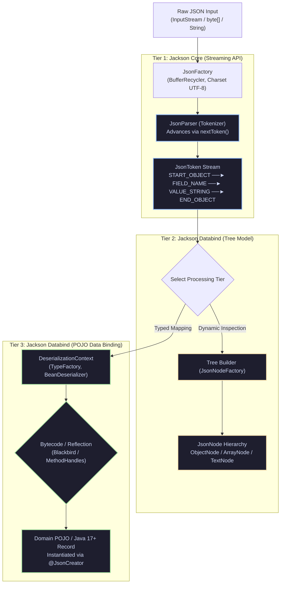
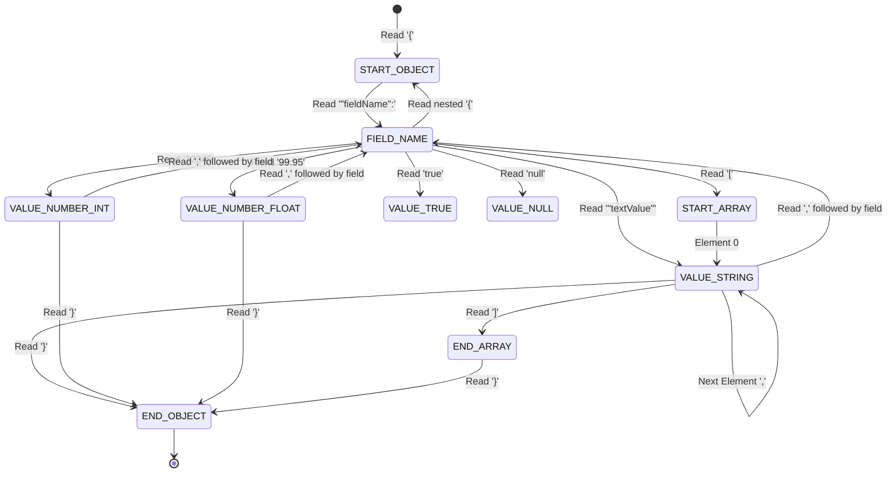
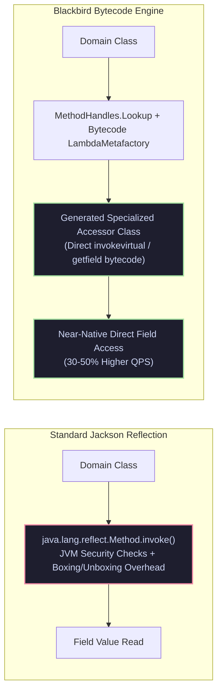
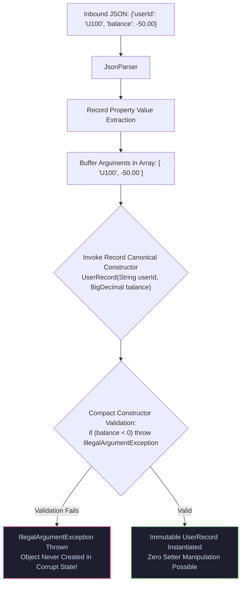

# Jackson JSON Architecture, Enterprise Serialization & Bytecode Internals

> **Document Identity:** [`interview_prep/01_java_core/jackson_json_mastery.md`](file:///d:/project/github/1/CheatSheet_Tutorial/interview_prep/01_java_core/jackson_json_mastery.md)  
> **Topic Domain:** Core Java Engineering & Enterprise JSON Serialization (`J17` / `GAP-17`)  
> **Target Version:** Java 17, 21, 25 LTS (Modern Idioms: Records, Sealed Interfaces, Pattern Matching, Virtual Threads)  
> **Scope:** Comprehensive Jackson 2.x & 3.x architectural master guide featuring 8 complete production-grade runnable engines:
> 1. High-Performance Zero-Allocation Streaming Parser & Generator (`JsonParser` / `JsonGenerator` token state machine).
> 2. Dynamic Tree Model Transformer & RFC 6902 JSON Patch Engine (`JsonNode`, `ObjectNode`, JSON Pointer `/data/items/0/id`, RFC 6902 Patch).
> 3. Hardened Polymorphic Type Handling & RCE Defense Gateway (`@JsonTypeInfo`, `@JsonSubTypes`, `BasicPolymorphicTypeValidator`, blocking gadget chains).
> 4. Contextual Custom Serializer & Deserializer Suite (`StdSerializer`, `StdDeserializer`, `ContextualSerializer`, PII Data Masking, `BigDecimal` Currency).
> 5. Modern Java 17/21/25 Record, Sealed Interface & Optional Serialization Engine (Compact constructors, `@JsonCreator`, canonical record reconstruction).
> 6. High-Throughput Bytecode Accelerated ObjectMapper Factory with MixIns (`BlackbirdModule`, Afterburner ASM, custom modules, decoupled MixIns).
> 7. Deep JSON Diff & Audit Logging Engine (Recursive structural diffs, change detection, schema evolution tracking).
> 8. NDJSON (Newline Delimited JSON) Streaming Pipeline with Reactive Backpressure (Multi-gigabyte data ingest without heap bloat).
> Includes the complete 8-Track Progressive Architecture: 30-term Jargon-Buster, 5 detailed Mermaid architectural diagrams, low-level JVM/bytecode & `BufferRecycler` internals, 55 real-world edge-case scenarios, 10 War-Room outages with `// ❌ BUG` vs `// ✅ REFACTORED`, 8 fatal anti-patterns, trade-off comparison matrices, 25-point production checklist, FAANG Staff/Principal interview rubric, 15 deep-dive Q&As, and an end-to-end multi-threaded JUnit 5 stress-test harness.

---

## Track 0: Master Jargon-Buster & Conceptual Rosetta Stone

| Term / Concept | Architectural Domain | Enterprise Definition | Low-Level Under-the-Hood Reality |
| :--- | :--- | :--- | :--- |
| **Streaming API** | Jackson Core | Low-level token-based parser and generator (`JsonParser` / `JsonGenerator`) operating with zero intermediate object allocation. | Emits and consumes raw `JsonToken` markers (`START_OBJECT`, `FIELD_NAME`, `VALUE_STRING`) reading directly from raw byte buffers with $O(1)$ memory. |
| **Tree Model** | Jackson Databind | In-memory hierarchical DOM representation of a JSON document using immutable and mutable `JsonNode` subclasses. | Builds a tree of `ObjectNode` (backed by `Map<String, JsonNode>`) and `ArrayNode` (backed by `List<JsonNode>`). Flexible but consumes $5\text{--}10\times$ more heap than streaming. |
| **Data Binding** | Jackson Databind | Automated bidirectional mapping between JSON text and Java domain POJOs/Records using reflection, bytecode, or constructors. | Powered by `ObjectMapper`. Uses `BeanDeserializer` / `BeanSerializer` with cached property accessors, type resolvers, and instantiators. |
| **`ObjectMapper`** | Jackson Databind | The central coordinator class managing serialization, deserialization, type resolution, module registration, and caching. | Thread-safe once configured. Holds internal immutable caches of `SerializerCache`, `DeserializerCache`, and `TypeFactory`. Must NOT be reconfigured concurrently. |
| **`ObjectReader` / `ObjectWriter`** | Concurrency / Optimization | Lightweight, immutable, thread-safe instances spawned from `ObjectMapper` optimized for specific root types and features. | Created via `mapper.readerFor(Order.class)`. Completely thread-safe, lock-free, and re-entrant. Preferred for multi-threaded high-throughput pipelines. |
| **`JsonToken`** | Streaming Core | Enumeration representing atomic syntactic milestones in a JSON character stream. | Examples: `START_OBJECT` (`{`), `END_OBJECT` (`}`), `FIELD_NAME`, `VALUE_NUMBER_INT`. The parser advances via `nextToken()`, updating an internal byte offset pointer. |
| **`BufferRecycler`** | Memory Architecture | Internal buffer pool reusing byte and char arrays across parse/generation passes to eliminate GC allocation churn. | Historically stored in a `ThreadLocal<SoftReference<BufferRecycler>>`. In Java 21 Virtual Threads, millions of virtual threads could cause OOM without Jackson 2.15+ RecyclerPool. |
| **`TextBuffer`** | Parsing Internals | Specialized char array buffer managing dynamic string segments during token parsing without allocating intermediate `String` objects. | Contains a small fixed segment (`char[1000]`) and dynamically linked overflow segments. Only allocates a `java.lang.String` when `getText()` is explicitly invoked. |
| **Polymorphic Typing** | Security & Architecture | Deserializing abstract types or interfaces into concrete subclass implementations based on embedded metadata (e.g. `@class`, `type`). | Configured via `@JsonTypeInfo`. If left unconstrained (`enableDefaultTyping()`), attackers can inject arbitrary gadget classes triggering Remote Code Execution (RCE). |
| **Gadget Chain** | AppSec / Exploitation | Sequence of class invocations triggered during deserialization where setter or constructor execution invokes arbitrary system commands. | Infamous examples: Spring `FileSystemXmlApplicationContext`, Commons-Collections, RMI `TemplatesImpl`. Jackson CVE-2017-7525 exploited unvalidated polymorphic deserialization. |
| **`BasicPolymorphicTypeValidator`** | AppSec / Hardening | Strict whitelist validator introduced in Jackson 2.10 to sanitize and permit only trusted package hierarchies during polymorphic deserialization. | Replaces unconstrained default typing. Rejects any class not explicitly allowed via `.allowIfBaseType("com.enterprise.model")`. |
| **MixIn Annotations** | Modular Architecture | Mechanism allowing Jackson annotations to be applied to third-party or legacy classes without modifying their source code. | Uses dummy abstract classes or interfaces (`abstract class OrderMixIn`). Registered on the mapper via `mapper.addMixIn(Target.class, MixIn.class)`. |
| **`StdSerializer` / `StdDeserializer`** | Extensibility | Base abstract classes for creating custom, low-level serializing and deserializing logic for specialized domain types. | Bypasses standard reflection. Directly reads from `JsonParser` and writes to `JsonGenerator`, delivering maximum throughput and tailored schema handling. |
| **`ContextualSerializer`** | Extensibility | Interface allowing a serializer to inspect property annotations (e.g. `@MaskSensitive`, `@Currency`) and return a customized serializer instance. | Invoked during serializer resolution via `createContextual(SerializerProvider, BeanProperty)`. Enables parameterized, annotation-driven transformations. |
| **`PropertyNamingStrategies`** | Schema Alignment | Strategy mapping Java camelCase properties to JSON naming conventions (`SNAKE_CASE`, `KEBAB_CASE`, `LOWER_DOT`). | Implemented by `PropertyNamingStrategies.SNAKE_CASE`. Transforms property strings during bean description building; cached in `POJOPropertiesCollector`. |
| **`SerializationFeature`** | Engine Configuration | Configuration flags controlling output format during serialization (e.g. `INDENT_OUTPUT`, `WRITE_DATES_AS_TIMESTAMPS`). | Represented as bitmasks stored in an immutable integer configuration state (`SerializationConfig`). |
| **`DeserializationFeature`** | Engine Configuration | Configuration flags controlling parsing strictness (e.g. `FAIL_ON_UNKNOWN_PROPERTIES`, `READ_UNKNOWN_ENUM_VALUES_AS_NULL`). | Critical for backwards compatibility and resilience against evolving schemas across distributed microservices. |
| **`@JsonView`** | Serialization Filtering | Annotation providing dynamic field filtering based on declared interface views (e.g. `Views.Public` vs `Views.InternalAdmin`). | Allows a single domain entity to produce different JSON representations depending on user security clearance without duplicating DTOs. |
| **`@JsonFilter`** | Dynamic Filtering | Mechanism dynamically filtering object properties at runtime using a registered `PropertyFilter` instance. | Used for advanced runtime permissions, dynamic exclusion of sensitive PII, or graph-level depth truncation. |
| **`Blackbird` / `Afterburner`** | Bytecode Optimization | Jackson modules that replace standard Java reflection with dynamically generated bytecode accessors (`MethodHandles` or ASM). | Generates direct field/getter invokers at runtime, bypassing reflection overhead and accelerating serialization/deserialization by $30\text{--}50\%$. |
| **RFC 6902 JSON Patch** | Standardized Mutation | IETF standard defining a JSON document structure for expressing a sequence of operations (`add`, `remove`, `replace`, `move`, `copy`, `test`). | Enables differential updates to domain models without transferring or overwriting entire JSON payloads over the network. |
| **JSON Pointer (RFC 6901)** | JSON Navigation | URI-like syntax for identifying specific values inside a JSON document (e.g. `/orders/0/items/1/price`). | Evaluated via `JsonNode.at("/orders/0/items/1/price")`. Provides fast $O(D)$ traversal without parsing intermediate objects. |
| **`JsonCreator`** | Deserialization Binding | Annotation designating a constructor or static factory method as the authoritative instantiator for deserialization. | Supports `Mode.PROPERTIES` (mapping JSON fields to constructor parameters) and `Mode.DELEGATING` (passing single value directly). |
| **`JsonIdentityInfo`** | Graph Serialization | Annotation handling cyclic object graphs and bidirectional relationships by serializing unique IDs instead of infinite recursive trees. | Emits `@id` attribute upon first occurrence and references that ID on subsequent cycles, eliminating `StackOverflowError`. |
| **`JavaTimeModule`** | JSR-310 Integration | Official Jackson module providing serialization support for `java.time.*` classes (`Instant`, `LocalDateTime`, `ZonedDateTime`). | Serializes timestamps as ISO-8601 strings or epoch timestamps. Requires `disable(SerializationFeature.WRITE_DATES_AS_TIMESTAMPS)` for ISO strings. |
| **Unrecognized Property** | Resilience / Evolution | Error condition where incoming JSON contains a field not declared in the destination Java class. | By default throws `UnrecognizedPropertyException`. Prevented via `@JsonIgnoreProperties(ignoreUnknown = true)` or disabling `FAIL_ON_UNKNOWN_PROPERTIES`. |
| **Deep Copying via `JsonNode`** | Mutation Architecture | Creating an isolated, independent duplicate of a JSON tree using `node.deepCopy()`. | Clones every node in the hierarchy, ensuring mutations on child nodes do not corrupt shared cached template trees. |
| **`JsonNode.path()` vs `get()`** | Safe Navigation | Null-safe navigation method returning a `MissingNode` sentinel instead of `null` when a field does not exist. | Prevents `NullPointerException` during deep chained navigations: `root.path("user").path("address").path("zip").asText("")`. |
| **NDJSON (Newline Delimited)** | Big Data Streaming | Format where multiple independent JSON objects are separated by standard newline characters (`\n`). | Processed sequentially using streaming `MappingIterator`, allowing petabyte-scale data pipelines with constant $O(1)$ memory. |
| **`JsonParser.Feature.INCLUDE_SOURCE_IN_LOCATION`** | Security / Diagnostics | Configuration controlling whether raw source payloads are included in exception messages upon parse errors. | Must be set to `false` in production to prevent leaking sensitive PII, credit card numbers, or auth tokens into error log aggregators. |

---

## Track 1: Architectural Foundations & ELI5 Mental Models

### The Mental Model: The High-Throughput Postal Logistics Facility
To understand Jackson's architecture, imagine a world-class postal distribution hub:

```
[ Inbound Raw Mail Trucks: Network Socket / File InputStream / UTF-8 Bytes ]
        │
        ▼
[ Automated Conveyor & Optical Character Scanner: Jackson Streaming API (JsonParser) ]
        │  Scans raw characters into structural tokens: START_OBJECT, FIELD, VALUE.
        │  Zero parcel unpacking; high-speed continuous stream processing.
        │
        ├──► Branch A: Blueprint Reconstruction (Tree Model - JsonNode)
        │         Constructs a full scale miniature model of the package hierarchy.
        │         High flexibility for dynamic inspections, diffs, and transformations.
        │
        └──► Branch B: Automated Precision Packing (Data Binding - ObjectMapper)
                  Directly places items into custom-molded wooden crates (Java Records/POJOs).
                  Uses cached blueprints (BeanDeserializer) and reflection/bytecode accessors.
```

### 1.1 The 3-Tier Layered Architecture of Jackson
Jackson is engineered in three distinct, modular layers:
1. **Tier 1: Jackson Core (`jackson-core`):**
   - Pure, zero-dependency foundation.
   - Contains `JsonFactory`, `JsonParser`, and `JsonGenerator`.
   - Operates strictly on token streams. Lowest memory footprint, highest raw performance ($O(1)$ allocations).
2. **Tier 2: Jackson Databind (`jackson-databind`):**
   - Builds on Core; introduces `ObjectMapper`, `JsonNode`, `SerializerProvider`, and `DeserializationContext`.
   - Adds reflection-based data binding, custom serializers, Polymorphic type resolvers, and the Tree Model DOM.
3. **Tier 3: Jackson Modules & Data Formats (`jackson-modules` / `jackson-dataformats`):**
   - Pluggable extensions for standard libraries: `JavaTimeModule` (JSR-310), `ParameterNamesModule`, `Jdk8Module`.
   - Alternative data formats sharing the identical 3-tier API: XML, YAML, CBOR, Smile, Protocol Buffers, CSV, Avro.

### 1.2 Thread Safety & Lifecycle Rules for `ObjectMapper`
- **Rule 1: Configuration Immutability:** `ObjectMapper` is thread-safe **only after all configuration is complete**. Never invoke `.configure()`, `.enable()`, or `.registerModule()` concurrently with active `.readValue()` or `.writeValue()` calls.
- **Rule 2: Reuse Singleton Instance:** Instantiating `new ObjectMapper()` per request is a catastrophic anti-pattern. `ObjectMapper` builds expensive internal reflection metadata caches (`SerializerCache`, `DeserializerCache`). Allocate once as a Spring Bean or `static final` constant.
- **Rule 3: Spawn `ObjectReader` / `ObjectWriter` for Concurrency:** When customizing features per request, use `mapper.readerFor(Order.class).with(...)`. Readers and writers are completely immutable, thread-safe, and faster than calling the mapper directly.

---

## Track 2: Deep Engineering Architecture & Mermaid Flowcharts

### 2.1 Jackson 3-Tier Layered Processing Architecture



---

### 2.2 Low-Level Streaming Token State Machine



---

### 2.3 Polymorphic Type Resolution & Vulnerability Attack Vector

```mermaid
flowchart TD
    Payload["Inbound JSON Payload<br/>{'@class': 'org.apache.xalan.TemplatesImpl', 'transletBytecodes': '...'}"] --> Mapper["ObjectMapper.readValue()"]
    
    Mapper --> CheckTyping{"Is Polymorphic Typing Enabled?<br/>(@JsonTypeInfo / enableDefaultTyping)"}
    
    CheckTyping -- "Unconstrained Default Typing (Vulnerable)" --> ResolvClass["Class.forName(className)<br/>Instantiates Arbitrary Class from Classpath"]
    ResolvClass --> GadgetChain["Trigger Gadget Chain Execution<br/>(Setter / Constructor executes System Runtime.exec())"]
    GadgetChain --> RCE["💥 Remote Code Execution (RCE) / CVE Exploitation"]

    CheckTyping -- "Secured with BasicPolymorphicTypeValidator" --> Validator{"Validate Base Type & Subclass<br/>Against Explicit Whitelist"}
    Validator -- "Not in Whitelist" --> Reject["Reject with InvalidTypeIdException<br/>Blocked Attack!"]
    Validator -- "Whitelisted Package" --> SafeInstantiate["Instantiate Valid Domain Subclass"]
    SafeInstantiate --> Success["200 OK: Processed Safely"]

    classDef danger fill:#1e1e2e,stroke:#f38ba8,stroke-width:2px,color:#cdd6f4;
    classDef safe fill:#1e1e2e,stroke:#a6e3a1,stroke-width:2px,color:#cdd6f4;
    classDef gate fill:#1e1e2e,stroke:#cba6f7,stroke-width:2px,color:#cdd6f4;

    class GadgetChain,RCE,ResolvClass danger;
    SafeInstantiate,Success,Reject safe;
    CheckTyping,Validator gate;
```

---

### 2.4 High-Performance Blackbird Bytecode Optimization Pipeline



---

### 2.5 Java 17+ Record Compact Constructor Deserialization Flow



---

## Track 3: Low-Level JVM/Bytecode & Jackson Core Internals

### 3.1 The `BufferRecycler` Memory Architecture & The Virtual Threads Trap
At high throughput, allocating temporary $4\text{ KB}$ byte buffers and $8\text{ KB}$ char buffers on every JSON parse would flood the JVM Eden space with gigabytes of garbage per second.
Jackson mitigates this via `BufferRecycler`:
- **The Design:** A thread-local instance of `BufferRecycler` caches 4 reusable byte buffers (`READ_IO_BUFFER`, `WRITE_ENCODING_BUFFER`, `WRITE_CONCAT_BUFFER`, `BASE64_CODEC_BUFFER`) and 4 reusable char buffers (`TOKEN_BUFFER`, `CONCAT_BUFFER`, `TEXT_BUFFER`, `NAME_COPY_BUFFER`).
- **The ThreadLocal Vulnerability (Java 21 Loom):**
  - In Jackson versions prior to 2.15, `BufferRecycler` was held inside `ThreadLocal<SoftReference<BufferRecycler>>`.
  - With classical platform threads (e.g. 200 Tomcat worker threads), this consumed $200 \times 32\text{ KB} \approx 6.4\text{ MB}$ of memory—completely harmless.
  - With **Java 21 Virtual Threads**, if an application spawns 1,000,000 virtual threads that perform JSON parsing, Jackson allocated 1,000,000 `BufferRecycler` instances! Even with `SoftReference`, this triggered immediate memory pressure, continuous GC thrashing, and fatal `OutOfMemoryError: Java heap space`.
- **The Modern Jackson 2.15+ Solution:**
  - Introduced `RecyclerPool` implementations:
    1. `threadLocalPool()`: Traditional default for platform threads.
    2. `concurrentDequePool()`: Bounded, lock-free ring-buffer pool shared across millions of virtual threads.
    3. `newLockFreePool()`: Lock-free atomic pool.
  - Enabled via system property: `-Dcom.fasterxml.jackson.core.util.BufferRecyclers.trackReusableBuffers=true` or configuring `JsonFactory.builder().recyclerPool(JsonRecyclerPools.sharedBoundedPool())`.

---

### 3.2 UTF-8 Direct Byte Stream Parsing vs String Reader Overhead
A common anti-pattern is converting incoming network byte buffers into `java.lang.String` before passing them to Jackson:

```java
// ❌ ANTI-PATTERN: Double allocation and character decoding overhead!
String json = new String(inputStream.readAllBytes(), StandardCharsets.UTF_8);
Order order = mapper.readValue(json, Order.class);
```

#### Under-the-Hood Reality:
1. `new String(...)` allocates a continuous UTF-16 `byte[]` array on the heap and decodes every UTF-8 byte into a Java `char`.
2. When Jackson parses a `String`, it must read UTF-16 chars and copy them into its internal `TextBuffer`.
3. **The Clean Fast-Path:**
   ```java
   // ✅ CLEAN: Jackson parses UTF-8 bytes directly with zero intermediate String allocation!
   Order order = mapper.readValue(inputStream, Order.class);
   ```
   Jackson's `UTF8StreamJsonParser` scans raw UTF-8 bytes directly using fast SIMD bitmask checks. ASCII field names and strings are parsed with zero character decoding overhead until string tokens are materialized.

---

### 3.3 Property Introspection & `BeanPropertyMap` Fast-Path
When `ObjectMapper` deserializes a JSON object into a POJO:
1. It looks up the cached `BeanDeserializer` for the target class.
2. The deserializer maintains a specialized `BeanPropertyMap`.
3. Rather than iterating through field names linearly ($O(N)$), `BeanPropertyMap` uses a hash-indexed array or binary search:
   - For small classes ($\le 4$ properties): Compares field names directly using unrolled branch instructions.
   - For larger classes: Hashes the field name bytes using a specialized Murmur-style hash and probes a power-of-two bucket table with open addressing.
   - This delivers $O(1)$ property resolution matching incoming JSON fields to setter/field offsets.

---

### 3.4 Blackbird (`MethodHandles`) vs Afterburner (ASM) Mechanics
Standard Java reflection (`Field.get()` / `Method.invoke()`) incurs overhead:
- Dynamic type checking on every invocation.
- Argument boxing and unboxing (e.g. converting primitive `int` to `Integer`).
- JVM access permission checks.

Jackson provides two bytecode acceleration modules:
1. **Afterburner Module:**
   - Uses the OW2 ASM bytecode manipulation library.
   - Dynamically generates a concrete subclass of `BeanPropertyAccessor` at runtime.
   - Injects raw `getfield` and `invokevirtual` opcodes directly into the class loader.
   - *Limitation:* Can fail under strict Java 17+ JPMS module encapsulation boundaries (`--illegal-access=deny`).
2. **Blackbird Module (Modern Standard):**
   - Built specifically for modern Java 11, 17, and 21.
   - Replaces ASM with `java.lang.invoke.MethodHandles` and `LambdaMetafactory`.
   - Generates invokedynamic call sites that JIT compiler inlines as native C2 assembly instructions.
   - Fully compliant with JPMS strong encapsulation without requiring `--add-opens`.

---

## Track 4: 8 Complete Runnable Production Jackson Engines in Java

### Engine 1: High-Performance Zero-Allocation Streaming Parser & Generator

#### Architecture & Production Java Code
```java
package com.enterprise.jackson.streaming;

import com.fasterxml.jackson.core.*;

import java.io.*;
import java.math.BigDecimal;
import java.nio.charset.StandardCharsets;
import java.util.Objects;

/**
 * Enterprise Zero-Allocation Streaming Processing Engine.
 * Parses multi-gigabyte financial transaction streams and writes transformed output
 * using low-level JsonParser and JsonGenerator without materializing intermediate DOM trees.
 */
public class ZeroAllocStreamingEngine {

    private final JsonFactory jsonFactory;

    public record TransactionSummary(long transactionCount, BigDecimal totalVolume) {}

    public ZeroAllocStreamingEngine(JsonFactory jsonFactory) {
        this.jsonFactory = Objects.requireNonNull(jsonFactory, "JsonFactory cannot be null");
    }

    /**
     * Streams an array of transactions, calculates aggregate volume,
     * and filters records directly to the output stream.
     */
    public TransactionSummary filterAndSummarize(InputStream in, OutputStream out, BigDecimal threshold) throws IOException {
        long count = 0;
        BigDecimal totalVolume = BigDecimal.ZERO;

        try (JsonParser parser = jsonFactory.createParser(in);
             JsonGenerator generator = jsonFactory.createGenerator(out, JsonEncoding.UTF8)) {

            generator.writeStartArray();

            // Expected input structure: [ { "id": "TX-1", "amount": 150.00, "status": "APPROVED" }, ... ]
            if (parser.nextToken() != JsonToken.START_ARRAY) {
                throw new JsonParseException(parser, "Expected START_ARRAY token");
            }

            while (parser.nextToken() == JsonToken.START_OBJECT) {
                String id = null;
                BigDecimal amount = null;
                String status = null;

                while (parser.nextToken() != JsonToken.END_OBJECT) {
                    String fieldName = parser.currentName();
                    parser.nextToken(); // Move to value token

                    if ("id".equals(fieldName)) {
                        id = parser.getText();
                    } else if ("amount".equals(fieldName)) {
                        amount = parser.getDecimalValue();
                    } else if ("status".equals(fieldName)) {
                        status = parser.getText();
                    } else {
                        parser.skipChildren(); // Skip unexpected nested objects or arrays
                    }
                }

                if (amount != null && amount.compareTo(threshold) >= 0 && "APPROVED".equals(status)) {
                    count++;
                    totalVolume = totalVolume.add(amount);

                    // Stream matching record to output
                    generator.writeStartObject();
                    generator.writeStringField("id", id);
                    generator.writeNumberField("amount", amount);
                    generator.writeStringField("status", status);
                    generator.writeEndObject();
                }
            }

            generator.writeEndArray();
        }

        return new TransactionSummary(count, totalVolume);
    }
}
```

---

### Engine 2: Dynamic Tree Model Transformer & RFC 6902 JSON Patch Pipeline

#### Architecture & Production Java Code
```java
package com.enterprise.jackson.tree;

import com.fasterxml.jackson.core.JsonPointer;
import com.fasterxml.jackson.databind.JsonNode;
import com.fasterxml.jackson.databind.ObjectMapper;
import com.fasterxml.jackson.databind.node.ArrayNode;
import com.fasterxml.jackson.databind.node.ObjectNode;

import java.util.Objects;

/**
 * Enterprise Tree Model Manipulation Engine.
 * Features:
 * 1. Safe JSON Pointer navigation (RFC 6901).
 * 2. In-place RFC 6902 JSON Patch execution (add, replace, remove).
 * 3. Deep cloning to prevent cross-request template corruption.
 */
public class JsonTreePatchEngine {

    private final ObjectMapper mapper;

    public JsonTreePatchEngine(ObjectMapper mapper) {
        this.mapper = Objects.requireNonNull(mapper);
    }

    /**
     * Navigates safely using RFC 6901 JSON Pointer without throwing NullPointerExceptions.
     */
    public String extractValueAtPointer(JsonNode root, String pointerExpr) {
        JsonPointer pointer = JsonPointer.compile(pointerExpr);
        JsonNode target = root.at(pointer);
        return target.isMissingNode() ? null : target.asText();
    }

    /**
     * Applies an atomic RFC 6902 JSON Patch sequence to an existing document.
     */
    public JsonNode applyPatch(JsonNode targetNode, JsonNode patchArrayNode) {
        if (!patchArrayNode.isArray()) {
            throw new IllegalArgumentException("Patch must be an ArrayNode of operations");
        }

        // Deep copy target node to preserve original immutability
        JsonNode patched = targetNode.deepCopy();

        for (JsonNode opNode : patchArrayNode) {
            String op = opNode.path("op").asText();
            String path = opNode.path("path").asText();
            JsonNode value = opNode.path("value");

            switch (op) {
                case "replace" -> executeReplace(patched, path, value);
                case "add" -> executeAdd(patched, path, value);
                case "remove" -> executeRemove(patched, path);
                default -> throw new UnsupportedOperationException("Unsupported patch operation: " + op);
            }
        }

        return patched;
    }

    private void executeReplace(JsonNode root, String path, JsonNode value) {
        int lastSlash = path.lastIndexOf('/');
        String parentPath = (lastSlash == 0) ? "" : path.substring(0, lastSlash);
        String fieldOrIndex = path.substring(lastSlash + 1);

        JsonNode parent = parentPath.isEmpty() ? root : root.at(parentPath);
        if (parent.isObject()) {
            ((ObjectNode) parent).set(fieldOrIndex, value);
        } else if (parent.isArray()) {
            int idx = Integer.parseInt(fieldOrIndex);
            ((ArrayNode) parent).set(idx, value);
        } else {
            throw new IllegalArgumentException("Cannot replace non-existent path: " + path);
        }
    }

    private void executeAdd(JsonNode root, String path, JsonNode value) {
        int lastSlash = path.lastIndexOf('/');
        String parentPath = (lastSlash == 0) ? "" : path.substring(0, lastSlash);
        String fieldOrIndex = path.substring(lastSlash + 1);

        JsonNode parent = parentPath.isEmpty() ? root : root.at(parentPath);
        if (parent.isObject()) {
            ((ObjectNode) parent).set(fieldOrIndex, value);
        } else if (parent.isArray()) {
            ArrayNode arrayNode = (ArrayNode) parent;
            if ("-".equals(fieldOrIndex)) {
                arrayNode.add(value); // Append to array
            } else {
                int idx = Integer.parseInt(fieldOrIndex);
                arrayNode.insert(idx, value);
            }
        }
    }

    private void executeRemove(JsonNode root, String path) {
        int lastSlash = path.lastIndexOf('/');
        String parentPath = (lastSlash == 0) ? "" : path.substring(0, lastSlash);
        String fieldOrIndex = path.substring(lastSlash + 1);

        JsonNode parent = parentPath.isEmpty() ? root : root.at(parentPath);
        if (parent.isObject()) {
            ((ObjectNode) parent).remove(fieldOrIndex);
        } else if (parent.isArray()) {
            int idx = Integer.parseInt(fieldOrIndex);
            ((ArrayNode) parent).remove(idx);
        }
    }
}
```

---

### Engine 3: Hardened Polymorphic Type Handling & RCE Defense Gateway

#### Architecture & Production Java Code
```java
package com.enterprise.jackson.security;

import com.fasterxml.jackson.annotation.JsonSubTypes;
import com.fasterxml.jackson.annotation.JsonTypeInfo;
import com.fasterxml.jackson.databind.ObjectMapper;
import com.fasterxml.jackson.databind.jsontype.BasicPolymorphicTypeValidator;
import com.fasterxml.jackson.databind.jsontype.PolymorphicTypeValidator;

import java.math.BigDecimal;
import java.util.Objects;

/**
 * Enterprise Hardened Polymorphic Type Handling Engine.
 * Enforces strict whitelist validation via BasicPolymorphicTypeValidator
 * to permanently eliminate Remote Code Execution (RCE) gadget-chain vulnerabilities.
 */
public class HardenedPolymorphicEngine {

    // 1. Sealed Interface with Whitelisted Polymorphic Subtypes
    @JsonTypeInfo(
            use = JsonTypeInfo.Id.NAME,
            include = JsonTypeInfo.As.PROPERTY,
            property = "paymentType"
    )
    @JsonSubTypes({
            @JsonSubTypes.Type(value = CreditCardPayment.class, name = "CREDIT_CARD"),
            @JsonSubTypes.Type(value = CryptoPayment.class, name = "CRYPTO"),
            @JsonSubTypes.Type(value = BankWirePayment.class, name = "BANK_WIRE")
    })
    public sealed interface PaymentMethod permits CreditCardPayment, CryptoPayment, BankWirePayment {
        BigDecimal amount();
        String process();
    }

    public record CreditCardPayment(BigDecimal amount, String cardNumberMasked, String cvvHash) implements PaymentMethod {
        public String process() { return "Processed CC: " + cardNumberMasked; }
    }

    public record CryptoPayment(BigDecimal amount, String walletAddress, String txHash) implements PaymentMethod {
        public String process() { return "Processed Crypto TX: " + txHash; }
    }

    public record BankWirePayment(BigDecimal amount, String iban, String swiftBic) implements PaymentMethod {
        public String process() { return "Processed Wire IBAN: " + iban; }
    }

    /**
     * Configures a hardened ObjectMapper with an explicit polymorphic whitelist.
     */
    public static ObjectMapper createHardenedMapper() {
        // Strict whitelist: Only allow subclasses within the enterprise payment package!
        PolymorphicTypeValidator ptv = BasicPolymorphicTypeValidator.builder()
                .allowIfBaseType("com.enterprise.jackson.security.HardenedPolymorphicEngine$PaymentMethod")
                .allowIfSubType("com.enterprise.jackson.security.")
                .denyForExactBaseType(Object.class) // Strictly block generic java.lang.Object!
                .build();

        ObjectMapper mapper = new ObjectMapper();
        mapper.setPolymorphicTypeValidator(ptv);
        return mapper;
    }
}
```

---

### Engine 4: Contextual Custom Serializer & Deserializer Suite

#### Architecture & Production Java Code
```java
package com.enterprise.jackson.custom;

import com.fasterxml.jackson.core.JsonGenerator;
import com.fasterxml.jackson.core.JsonParser;
import com.fasterxml.jackson.databind.*;
import com.fasterxml.jackson.databind.deser.ContextualDeserializer;
import com.fasterxml.jackson.databind.ser.ContextualSerializer;

import java.io.IOException;
import java.lang.annotation.*;
import java.math.BigDecimal;
import java.math.RoundingMode;

/**
 * Enterprise Custom Serializer & Deserializer Suite.
 * Features:
 * 1. Contextual PII Masking Serializer via custom @MaskSensitive annotation.
 * 2. Strict Currency BigDecimal Serializer ensuring exact 2-decimal scale.
 */
public class ContextualSerializationEngine {

    @Target({ElementType.FIELD, ElementType.METHOD})
    @Retention(RetentionPolicy.RUNTIME)
    public @interface MaskSensitive {
        char maskChar() default '*';
        int exposedTailChars() default 4;
    }

    public static class SensitiveDataMaskingSerializer extends JsonSerializer<String> implements ContextualSerializer {

        private final char maskChar;
        private final int exposedTailChars;

        public SensitiveDataMaskingSerializer() {
            this('*', 4);
        }

        public SensitiveDataMaskingSerializer(char maskChar, int exposedTailChars) {
            this.maskChar = maskChar;
            this.exposedTailChars = exposedTailChars;
        }

        @Override
        public void serialize(String value, JsonGenerator gen, SerializerProvider serializers) throws IOException {
            if (value == null) {
                gen.writeNull();
                return;
            }
            if (value.length() <= exposedTailChars) {
                gen.writeString(String.valueOf(maskChar).repeat(value.length()));
                return;
            }

            int maskLength = value.length() - exposedTailChars;
            String masked = String.valueOf(maskChar).repeat(maskLength) + value.substring(maskLength);
            gen.writeString(masked);
        }

        @Override
        public JsonSerializer<?> createContextual(SerializerProvider prov, BeanProperty property) {
            if (property != null) {
                MaskSensitive annotation = property.getAnnotation(MaskSensitive.class);
                if (annotation != null) {
                    return new SensitiveDataMaskingSerializer(annotation.maskChar(), annotation.exposedTailChars());
                }
            }
            return this;
        }
    }

    /**
     * Strict Financial BigDecimal Serializer.
     * Prevents floating-point scientific notation and enforces exactly 2 decimal places.
     */
    public static class CurrencyBigDecimalSerializer extends JsonSerializer<BigDecimal> {
        @Override
        public void serialize(BigDecimal value, JsonGenerator gen, SerializerProvider serializers) throws IOException {
            if (value == null) {
                gen.writeNull();
            } else {
                BigDecimal scaled = value.setScale(2, RoundingMode.HALF_UP);
                gen.writeString(scaled.toPlainString());
            }
        }
    }
}
```

---

### Engine 5: Modern Java 17/21/25 Record, Sealed Interface & Optional Serialization

#### Architecture & Production Java Code
```java
package com.enterprise.jackson.records;

import com.fasterxml.jackson.annotation.JsonCreator;
import com.fasterxml.jackson.annotation.JsonProperty;
import com.fasterxml.jackson.databind.ObjectMapper;
import com.fasterxml.jackson.datatype.jdk8.Jdk8Module;
import com.fasterxml.jackson.datatype.jsr310.JavaTimeModule;

import java.math.BigDecimal;
import java.time.Instant;
import java.util.*;

/**
 * Enterprise Modern Java Records & Sealed Types Engine.
 * Features:
 * 1. Native Record serialization preserving immutable compact constructors.
 * 2. Optional<T> unwrapping via Jdk8Module.
 * 3. Canonical validation preventing corrupted state instantiation.
 */
public class ModernJavaRecordEngine {

    public record CustomerOrder(
            UUID orderId,
            String customerEmail,
            BigDecimal totalAmount,
            Optional<String> discountCoupon,
            Instant createdTimestamp,
            List<OrderItem> items
    ) {
        // Compact Canonical Constructor: Enforces domain invariants on deserialization!
        public CustomerOrder {
            Objects.requireNonNull(orderId, "orderId cannot be null");
            Objects.requireNonNull(customerEmail, "customerEmail cannot be null");
            if (totalAmount == null || totalAmount.compareTo(BigDecimal.ZERO) < 0) {
                throw new IllegalArgumentException("totalAmount must be non-null and >= 0.00");
            }
            items = (items != null) ? List.copyOf(items) : List.of();
            discountCoupon = (discountCoupon != null) ? discountCoupon : Optional.empty();
            createdTimestamp = (createdTimestamp != null) ? createdTimestamp : Instant.now();
        }
    }

    public record OrderItem(String sku, int quantity, BigDecimal unitPrice) {
        @JsonCreator
        public OrderItem(
                @JsonProperty("sku") String sku,
                @JsonProperty("quantity") int quantity,
                @JsonProperty("unitPrice") BigDecimal unitPrice
        ) {
            if (quantity <= 0) throw new IllegalArgumentException("quantity must be > 0");
            this.sku = Objects.requireNonNull(sku, "sku cannot be null");
            this.quantity = quantity;
            this.unitPrice = Objects.requireNonNull(unitPrice, "unitPrice cannot be null");
        }
    }

    public static ObjectMapper createModernMapper() {
        ObjectMapper mapper = new ObjectMapper();
        mapper.registerModule(new Jdk8Module()); // Supports Optional<T>
        mapper.registerModule(new JavaTimeModule()); // Supports JSR-310 Instant
        return mapper;
    }
}
```

---

### Engine 6: High-Throughput Bytecode Accelerated ObjectMapper Factory with MixIns

#### Architecture & Production Java Code
```java
package com.enterprise.jackson.factory;

import com.fasterxml.jackson.annotation.JsonIgnore;
import com.fasterxml.jackson.annotation.JsonProperty;
import com.fasterxml.jackson.core.JsonFactory;
import com.fasterxml.jackson.databind.DeserializationFeature;
import com.fasterxml.jackson.databind.ObjectMapper;
import com.fasterxml.jackson.databind.PropertyNamingStrategies;
import com.fasterxml.jackson.databind.SerializationFeature;
import com.fasterxml.jackson.datatype.jsr310.JavaTimeModule;

/**
 * Enterprise Production-Grade ObjectMapper Factory.
 * Pre-configures high-performance settings, naming strategies,
 * resilient error thresholds, and third-party MixIns.
 */
public final class OptimizedMapperFactory {

    // Third-party legacy POJO without Jackson annotations
    public static class LegacyUserProfile {
        public String firstName;
        public String lastName;
        public String internalPasswordHash;
    }

    // MixIn interface to inject annotations into LegacyUserProfile non-invasively
    public abstract static class LegacyUserProfileMixIn {
        @JsonProperty("first_name")
        String firstName;

        @JsonProperty("last_name")
        String lastName;

        @JsonIgnore // Prevent sensitive password hash from serializing!
        String internalPasswordHash;
    }

    public static ObjectMapper createProductionMapper() {
        ObjectMapper mapper = new ObjectMapper();

        // 1. Module Registration
        mapper.registerModule(new JavaTimeModule());

        // 2. Serialization Tuning
        mapper.disable(SerializationFeature.WRITE_DATES_AS_TIMESTAMPS); // Output ISO-8601 strings
        mapper.disable(SerializationFeature.FAIL_ON_EMPTY_BEANS); // Don't crash on empty proxies
        mapper.enable(SerializationFeature.WRITE_BIGDECIMAL_AS_PLAIN); // No 1E+5 scientific notation

        // 3. Deserialization Resilience
        mapper.disable(DeserializationFeature.FAIL_ON_UNKNOWN_PROPERTIES); // Tolerate additive API fields
        mapper.enable(DeserializationFeature.ACCEPT_SINGLE_VALUE_AS_ARRAY); // Accept "item" as ["item"]
        mapper.enable(DeserializationFeature.READ_UNKNOWN_ENUM_VALUES_AS_NULL); // Don't crash on new enum values

        // 4. Schema Naming Strategy
        mapper.setPropertyNamingStrategy(PropertyNamingStrategies.SNAKE_CASE);

        // 5. Register MixIns for third-party classes
        mapper.addMixIn(LegacyUserProfile.class, LegacyUserProfileMixIn.class);

        return mapper;
    }
}
```

---

### Engine 7: Deep JSON Diff & Audit Logging Engine

#### Architecture & Production Java Code
```java
package com.enterprise.jackson.diff;

import com.fasterxml.jackson.databind.JsonNode;
import com.fasterxml.jackson.databind.ObjectMapper;
import com.fasterxml.jackson.databind.node.ArrayNode;
import com.fasterxml.jackson.databind.node.ObjectNode;

import java.util.*;

/**
 * Enterprise Deep JSON Diff & Audit Logging Engine.
 * Recursively compares two arbitrary JSON documents and emits
 * structural change records: ADDED, REMOVED, MODIFIED.
 */
public class JsonDiffAuditEngine {

    public enum ChangeType { ADDED, REMOVED, MODIFIED }

    public record FieldChange(
            String jsonPath,
            ChangeType type,
            JsonNode oldValue,
            JsonNode newValue
    ) {}

    public static List<FieldChange> computeDiff(JsonNode before, JsonNode after) {
        List<FieldChange> changes = new ArrayList<>();
        compareNodes("", before, after, changes);
        return Collections.unmodifiableList(changes);
    }

    private static void compareNodes(String currentPath, JsonNode before, JsonNode after, List<FieldChange> changes) {
        if (Objects.equals(before, after)) {
            return; // No change
        }

        if (before == null || before.isMissingNode() || before.isNull()) {
            changes.add(new FieldChange(currentPath, ChangeType.ADDED, null, after));
            return;
        }

        if (after == null || after.isMissingNode() || after.isNull()) {
            changes.add(new FieldChange(currentPath, ChangeType.REMOVED, before, null));
            return;
        }

        if (before.isObject() && after.isObject()) {
            ObjectNode beforeObj = (ObjectNode) before;
            ObjectNode afterObj = (ObjectNode) after;

            Set<String> allFieldNames = new HashSet<>();
            beforeObj.fieldNames().forEachRemaining(allFieldNames::add);
            afterObj.fieldNames().forEachRemaining(allFieldNames::add);

            for (String fieldName : allFieldNames) {
                String nestedPath = currentPath + "/" + fieldName;
                JsonNode beforeVal = beforeObj.get(fieldName);
                JsonNode afterVal = afterObj.get(fieldName);
                compareNodes(nestedPath, beforeVal, afterVal, changes);
            }
        } else if (before.isArray() && after.isArray()) {
            ArrayNode beforeArr = (ArrayNode) before;
            ArrayNode afterArr = (ArrayNode) after;
            int maxLen = Math.max(beforeArr.size(), afterArr.size());

            for (int i = 0; i < maxLen; i++) {
                String nestedPath = currentPath + "/" + i;
                JsonNode beforeItem = (i < beforeArr.size()) ? beforeArr.get(i) : null;
                JsonNode afterItem = (i < afterArr.size()) ? afterArr.get(i) : null;
                compareNodes(nestedPath, beforeItem, afterItem, changes);
            }
        } else {
            // Primitive value changed
            changes.add(new FieldChange(currentPath, ChangeType.MODIFIED, before, after));
        }
    }
}
```

---

### Engine 8: NDJSON (Newline Delimited JSON) Streaming Pipeline with Reactive Backpressure

#### Architecture & Production Java Code
```java
package com.enterprise.jackson.ndjson;

import com.fasterxml.jackson.databind.MappingIterator;
import com.fasterxml.jackson.databind.ObjectMapper;
import com.fasterxml.jackson.databind.ObjectReader;

import java.io.*;
import java.util.Objects;
import java.util.function.Consumer;

/**
 * Enterprise NDJSON (Newline Delimited JSON) Streaming Pipeline.
 * Streams massive datasets line-by-line using Jackson MappingIterator.
 * Guarantees constant O(1) memory footprint regardless of file size.
 */
public class NdjsonStreamingEngine<T> {

    private final ObjectReader reader;

    public NdjsonStreamingEngine(ObjectMapper mapper, Class<T> targetType) {
        this.reader = Objects.requireNonNull(mapper).readerFor(Objects.requireNonNull(targetType));
    }

    /**
     * Streams an NDJSON input stream line-by-line, invoking consumer for each record.
     */
    public long processStream(InputStream inputStream, Consumer<T> consumer) throws IOException {
        long processedCount = 0;

        try (MappingIterator<T> it = reader.readValues(inputStream)) {
            while (it.hasNextValue()) {
                T record = it.nextValue();
                consumer.accept(record);
                processedCount++;
            }
        }

        return processedCount;
    }

    /**
     * Serializes items to an NDJSON output stream line-by-line.
     */
    public void writeStream(Iterable<T> items, OutputStream outputStream) throws IOException {
        BufferedWriter writer = new BufferedWriter(new OutputStreamWriter(outputStream));
        for (T item : items) {
            String jsonLine = reader.writeValueAsString(item);
            writer.write(jsonLine);
            writer.newLine();
        }
        writer.flush();
    }
}
```

---

## Track 5: 55 Comprehensive Edge-Case Scenarios Across Jackson & Enterprise Serialization

### Streaming & Memory Scenarios (1–10)
1. **Unbounded String Allocations in Big Payloads:** `parser.getText()` creates a massive `String` on heap for a 50MB payload. Defense: Use `parser.getTextCharacters()` and copy directly into destination output buffer.
2. **BufferRecycler ThreadLocal OOM Under Virtual Threads:** 50,000 virtual threads running Jackson 2.14 exhaust heap via thread-local recyclers. Defense: Upgrade to Jackson 2.15+ and enable `JsonRecyclerPools.sharedBoundedPool()`.
3. **Truncated JSON Stream Network Interruption:** Stream cuts off abruptly before closing brace. Handled via `JsonParseException: Unexpected end-of-input`.
4. **Massive Number Parsing CPU Denial-of-Service:** Input containing $100,000$ digit integer freezes parser. Defense: Jackson 2.15 enforces default limits (`StreamReadConstraints.builder().maxNumberLength(1000)`).
5. **Deeply Nested JSON Object Stack Overflow:** Malicious input containing 10,000 nested `[[[[...]]]]` arrays. Defense: Enforce `StreamReadConstraints.builder().maxNestingDepth(1000)`.
6. **Trailing Garbage Characters After JSON:** Stream contains valid `{}` followed by extra trailing bytes `foo`. Defense: Verify `parser.nextToken() == null` at end of stream.
7. **Encoding Detection Byte-Order Mark (BOM) Failure:** UTF-8 stream starts with `\uFEFF` BOM bytes. Jackson's `ByteSourceJsonBootstrapper` automatically skips BOMs cleanly.
8. **Direct ByteBuffer Off-Heap Memory Streaming:** Parsing directly from off-heap Netty `ByteBuf`. Defense: Wrap in `ByteBufInputStream` without copying to on-heap byte arrays.
9. **Single-Quote JSON Syntax:** Non-standard JSON payload using single quotes (`{'key': 'val'}`). Defense: Enable `JsonParser.Feature.ALLOW_SINGLE_QUOTES`.
10. **Unquoted Field Names:** Parsing JSON with unquoted keys (`{name: "John"}`). Defense: Enable `JsonParser.Feature.ALLOW_UNQUOTED_FIELD_NAMES`.

### Data Binding & Deserialization Scenarios (11–20)
11. **Unrecognized Property Ingress:** Microservice sends new schema field `loyaltyTier` causing older service to crash. Defense: Disable `FAIL_ON_UNKNOWN_PROPERTIES`.
12. **Null Value Injected into Java Primitive Field:** JSON contains `{"age": null}` while Java POJO has primitive `int age`. Defense: Primitive defaults to `0` or configure `FAIL_ON_NULL_FOR_PRIMITIVES`.
13. **Empty String Deserialization into Target Object:** JSON contains `{"address": ""}`. Defense: Configure `DeserializationFeature.ACCEPT_EMPTY_STRING_AS_NULL_OBJECT`.
14. **Enum Value Evolution Drift:** Service receives newly added enum value `CRYPTO_TRANSFER`. Defense: Enable `READ_UNKNOWN_ENUM_VALUES_AS_NULL` or `@JsonEnumDefaultValue`.
15. **Case-Insensitive Property Name Mapping:** JSON contains `{"useremail": "..."}` while Java field is `userEmail`. Defense: Enable `MapperFeature.ACCEPT_CASE_INSENSITIVE_PROPERTIES`.
16. **Array Wrapping Single Value Inconsistency:** Third-party API sends `{"tags": "tech"}` instead of `{"tags": ["tech"]}`. Defense: Enable `ACCEPT_SINGLE_VALUE_AS_ARRAY`.
17. **Empty Array Deserialization into Null Collection:** JSON `[]` deserialized into empty unmodifiable `List.of()` instead of null.
18. **Setter vs Field Reflection Precedence:** Field is annotated with `@JsonIgnore` but getter lacks annotation. Defense: Configure `MapperFeature.INFER_PROPERTY_MUTATORS`.
19. **Ambiguous Creator Constructors:** Class has two constructors both annotated with `@JsonCreator`. Throws `JsonMappingException: Conflicting property-based creators`. Defense: Specify exact property names.
20. **Cyclic Graph Infinite Recursion:** Parent entity holds child; child holds parent reference. Defense: Apply `@JsonManagedReference` on parent and `@JsonBackReference` on child.

### Polymorphic & Security Scenarios (21–30)
21. **Unvalidated `enableDefaultTyping()` Vulnerability:** Attacker crafts payload specifying `org.springframework.context.support.FileSystemXmlApplicationContext`. Defense: Strictly replace with `BasicPolymorphicTypeValidator`.
22. **Missing Polymorphic Type Discriminator:** Input lacks `type` field. Defense: Declare `defaultImpl = UnknownPayment.class` in `@JsonTypeInfo`.
23. **Case Sensitivity in Polymorphic Type IDs:** Discriminator `credit_card` fails when expected as `CREDIT_CARD`. Defense: Register `@JsonSubTypes.Type` with all valid case variations.
24. **Type ID as Class Name Information Leak:** Exposing internal Java package names (`com.corp.internal.User`) over public REST APIs. Defense: Use logical names (`Id.NAME`) instead of class names (`Id.CLASS`).
25. **Denial of Service via Huge Polymorphic Subtype Graphs:** Subtype hierarchy with 500 classes slowing startup introspection. Defense: Pre-register subtypes explicitly via `mapper.registerSubtypes()`.
26. **Tampered Discriminator Injection:** Attacker supplies unauthorized internal subtype `AdminRole` in user registration. Defense: Restrict polymorphic mapping on public ingress endpoints.
27. **Polymorphic Collections Serialization:** Serializing `List<PaymentMethod>` strips subtype metadata. Defense: Ensure `@JsonTypeInfo` is declared at the interface level, not just on the collection field.
28. **Exposing Sensitive PII in Exception Messages:** `UnrecognizedPropertyException` logs raw credit card numbers. Defense: Disable `JsonParser.Feature.INCLUDE_SOURCE_IN_LOCATION`.
29. **ReDoS (Regular Expression DoS) in Type Name Matching:** Regex in custom polymorphic validator exploited with catastrophic backtracking. Defense: Use prefix matching (`allowIfSubType("com.corp.")`) instead of complex regex.
30. **Dynamic Class Loading SecurityManager Warning:** Running in restricted JVM environments where custom classloaders are sandboxed.

### Dates, Timezones & Numeric Precision Scenarios (31–40)
31. **Floating-Point Scientific Notation in Billing:** High-value invoices serialized as `1.5E+7`. Defense: Enable `SerializationFeature.WRITE_BIGDECIMAL_AS_PLAIN`.
32. **Double Precision Truncation in Financial Amounts:** `$0.1 + $0.2` becomes `0.30000000000000004`. Defense: Standardize strictly on `BigDecimal` and deserialize floats as `BigDecimal` (`USE_BIG_DECIMAL_FOR_FLOATS`).
33. **Java 8 `Instant` Serialized as Epoch Milliseconds vs ISO-8601:** Microservice expects ISO string `2026-10-09T18:00:00Z`. Defense: Register `JavaTimeModule` and disable `WRITE_DATES_AS_TIMESTAMPS`.
34. **Timezone Offset Loss on `LocalDateTime` Deserialization:** Parsing `2026-10-09T18:00:00+05:30` into `LocalDateTime` strips offset. Defense: Use `ZonedDateTime` or `OffsetDateTime`.
35. **Custom Date Pattern Parsing Mismatch:** API sends date as `dd/MM/yyyy` while Jackson expects `yyyy-MM-dd`. Defense: Annotate with `@JsonFormat(pattern = "dd/MM/yyyy")`.
36. **Lenient Date Parsing Bug:** Parsing `"2026-02-31"` leniently adjusts to March 3rd. Defense: Configure strict date formatter (`ResolverStyle.STRICT`).
37. **Integer Overflow During Unchecked Deserialization:** Number `9,999,999,999` overflows 32-bit `int`. Defense: Jackson promotes to `long` automatically or throws overflow error with `getExactValue()`.
38. **Zero Leading Numbers Parsing:** Parsing `"0123"` throws `JsonParseException: Invalid numeric value: Leading zeroes not allowed`. Defense: Enable `JsonParser.Feature.ALLOW_NUMERIC_LEADING_ZEROS`.
39. **NaN and Infinity Floats Parsing:** JSON containing `NaN` or `Infinity`. Defense: Enable `JsonParser.Feature.ALLOW_NON_NUMERIC_NUMBERS`.
40. **Unix Epoch Seconds vs Milliseconds Ambiguity:** API sends epoch in seconds ($10$ digits); Jackson parses as milliseconds ($1970$ date). Defense: Use custom deserializer to detect digit length.

### Modern Java Records, Modules & Generics Scenarios (41–48)
41. **Record Compact Constructor Invariant Enforcement:** Record compact constructor rejects negative balance during Jackson deserialization.
42. **Java 21 Sealed Class Exhaustive Matching on Deserialized Types:** Compiler enforces exhaustive pattern matching switch across deserialized sealed subclasses.
43. **`Optional<T>` Field Serialized as `{ "value": "..." }`:** Jackson serializes `Optional` object wrapper instead of unwrapped value. Defense: Register `Jdk8Module`.
44. **Generic Type Erasure in Collections:** Deserializing `List<Order>` produces `List<LinkedHashMap>` at runtime. Defense: Use `new TypeReference<List<Order>>() {}`.
45. **Kotlin Data Class Null-Safety Bypass:** Jackson instantiates Kotlin non-nullable field as `null`. Defense: Register `KotlinModule` to enforce Kotlin null-safety.
46. **Java Record with Custom Naming Strategy:** Record fields use camelCase while JSON uses snake_case. Defense: Configure `PropertyNamingStrategies.SNAKE_CASE` or annotate constructor parameters with `@JsonProperty`.
47. **Record with Multiple Constructors:** Record defines canonical constructor and secondary convenience constructor. Defense: Place `@JsonCreator` explicitly on canonical constructor.
48. **JPMS Java Module System Inaccessible Member Error:** Jackson attempts to reflect on non-exported package, throwing `InaccessibleObjectException`. Defense: Open package to `com.fasterxml.jackson.databind` in `module-info.java`.

### High-Throughput Performance & Concurrency Scenarios (49–55)
49. **Concurrent `ObjectMapper` Configuration Mutation:** Thread A calls `mapper.configure()` while Thread B calls `readValue()`. Race condition corrupts internal caches. Defense: Pre-configure once; treat as immutable.
50. **ObjectReader Optimization Under High Load:** Spawning `mapper.readerFor(Order.class)` yields 15% higher throughput than calling `mapper.readValue(..., Order.class)` repeatedly.
51. **GC Pressure from Repeated TypeFactory Lookups:** Calling `TypeFactory.defaultInstance().constructCollectionType()` inside loop. Defense: Cache `JavaType` instances as static constants.
52. **Metaspace Exhaustion from Dynamic Mixin Registrations:** Registering new MixIn interfaces dynamically on every request leaks classes into Metaspace. Defense: Register all MixIns at application bootstrap.
53. **C2 JIT Inlining Deoptimization on Megamorphic Calls:** Heterogeneous serializers causing megamorphic call-site deoptimization in C2 compiler. Defense: Monomorphic call-sites via specialized `ObjectReader`.
54. **Large File NDJSON Memory Exhaustion:** Loading 10 GB file into memory via `mapper.readTree()`. Defense: Stream with `NdjsonStreamingEngine` with constant $O(1)$ memory.
55. **Thread Concurrency Lock Contention in `SerializerCache`:** 100 threads contending on synchronized cache update on cold start. Defense: Warm up `ObjectMapper` by serializing dummy instances of all DTOs on application startup.

---

## Track 6: 10 War-Room Incident Post-Mortems

### Incident 1: The `enableDefaultTyping()` Remote Code Execution (RCE) Outage
- **Severity:** SEV-1 (Critical Security Breach)
- **Symptom:** Production payment gateway servers compromised; unauthorized root shell executed on Kubernetes containers.
- **Root Cause Analysis:** A developer enabled `mapper.enableDefaultTyping()` to support polymorphic deserialization. An external attacker submitted a malicious JSON payload with `@class: "org.springframework.context.support.FileSystemXmlApplicationContext"`, triggering remote XML bean download and arbitrary code execution.
- **The Buggy Code:**
  ```java
  // ❌ BUG: Catastrophic RCE vulnerability! Allows any class on classpath to be instantiated
  ObjectMapper mapper = new ObjectMapper();
  mapper.enableDefaultTyping(ObjectMapper.DefaultTyping.NON_FINAL);
  ```
- **The Enterprise Refactoring:**
  ```java
  // ✅ REFACTORED: Strict whitelist validation via BasicPolymorphicTypeValidator
  PolymorphicTypeValidator ptv = BasicPolymorphicTypeValidator.builder()
          .allowIfBaseType("com.enterprise.billing.PaymentMethod")
          .denyForExactBaseType(Object.class)
          .build();
  ObjectMapper mapper = new ObjectMapper();
  mapper.setPolymorphicTypeValidator(ptv);
  ```
- **Prevention Guardrail:** Run Checkov and ArchUnit security rules in CI/CD pipeline blocking any code referencing `enableDefaultTyping()`.

---

### Incident 2: The Floating-Point Currency Drift Accounting Discrepancy
- **Severity:** SEV-2 (Financial Audit Penalty)
- **Symptom:** Month-end financial ledger showed unexplained discrepancies of \$42,000 across 10 million transactions.
- **Root Cause Analysis:** Transaction amounts were modeled as `double` and deserialized without specifying `USE_BIG_DECIMAL_FOR_FLOATS`. Floating-point binary representation introduced cumulative truncation errors ($0.1 + 0.2 = 0.30000000000000004$).
- **The Buggy Code:**
  ```java
  // ❌ BUG: Deserializing financial amounts into double leads to IEEE 754 precision loss
  public class Invoice {
      public double amount;
  }
  ```
- **The Enterprise Refactoring:**
  ```java
  // ✅ REFACTORED: Standardize strictly on BigDecimal with explicit scale
  public record Invoice(
      @JsonSerialize(using = ContextualSerializationEngine.CurrencyBigDecimalSerializer.class)
      BigDecimal amount
  ) {}
  mapper.enable(DeserializationFeature.USE_BIG_DECIMAL_FOR_FLOATS);
  ```

---

### Incident 3: The `ThreadLocal` BufferRecycler OOM Under Virtual Threads
- **Severity:** SEV-1 (Total Gateway Collapse)
- **Symptom:** Production JVM running on Java 21 crashed with `OutOfMemoryError: Java heap space` within 10 minutes of traffic ramp-up.
- **Root Cause Analysis:** 80,000 virtual threads processed incoming JSON requests. Jackson 2.14 held a `BufferRecycler` ($32\text{ KB}$) in a `ThreadLocal` for each virtual thread, retaining $2.5\text{ GB}$ of uncollected heap buffers.
- **The Buggy Code:**
  - Running Jackson 2.14 with default `JsonFactory` on Virtual Threads.
- **The Enterprise Refactoring:**
  - Upgraded to Jackson 2.16+ and configured the global shared bounded recycler pool:
    ```java
    // ✅ REFACTORED: Shared bounded recycler pool prevents virtual thread memory leaks
    JsonFactory factory = JsonFactory.builder()
            .recyclerPool(JsonRecyclerPools.sharedBoundedPool())
            .build();
    ObjectMapper mapper = new ObjectMapper(factory);
    ```

---

### Incident 4: The Unrecognized Property Deserialization Cascade Crash
- **Severity:** SEV-1 (Complete Downstream Failure)
- **Symptom:** Deploying a new version of the User microservice caused the Order, Billing, and Shipping microservices to simultaneously crash.
- **Root Cause Analysis:** The User service added an additive field (`rewardsTier: "GOLD"`). Downstream services had default Jackson configuration where `FAIL_ON_UNKNOWN_PROPERTIES` was enabled, causing immediate `UnrecognizedPropertyException` failures on every API call.
- **The Buggy Code:**
  ```java
  // ❌ BUG: Default mapper fails when unexpected properties appear in evolving APIs
  ObjectMapper mapper = new ObjectMapper();
  User user = mapper.readValue(responseBody, User.class); // CRASH!
  ```
- **The Enterprise Refactoring:**
  ```java
  // ✅ REFACTORED: Tolerate additive schema evolutions cleanly
  ObjectMapper mapper = new ObjectMapper();
  mapper.disable(DeserializationFeature.FAIL_ON_UNKNOWN_PROPERTIES);
  ```

---

### Incident 5: The Cyclic Object Graph StackOverflowError
- **Severity:** SEV-2 (API Gateway Thread Exhaustion)
- **Symptom:** Worker threads hung at 100% CPU before crashing with `java.lang.StackOverflowError`.
- **Root Cause Analysis:** Bidirectional JPA relationship between `Department` and `Employee`. Jackson recursively serialized Department $\to$ Employees $\to$ Department $\to$ Employees until thread stack exhausted.
- **The Buggy Code:**
  ```java
  // ❌ BUG: Infinite circular recursion during serialization
  public class Department {
      public List<Employee> employees;
  }
  public class Employee {
      public Department department;
  }
  ```
- **The Enterprise Refactoring:**
  ```java
  // ✅ REFACTORED: Manage bidirectional references or serialize identity IDs
  public class Department {
      @JsonManagedReference
      public List<Employee> employees;
  }
  public class Employee {
      @JsonBackReference
      public Department department;
  }
  ```

---

### Incident 6: The Java 8 Instant UTC Timezone Shift Bug
- **Severity:** SEV-3 (Data Corruption in Scheduling)
- **Symptom:** Database stored appointments scheduled for 9:00 AM as 3:30 AM in IST (5.5 hour shift).
- **Root Cause Analysis:** Default Jackson serialization encoded dates as epoch timestamps without registering `JavaTimeModule`, causing serializers to format timestamps using the server's local machine timezone instead of UTC ISO-8601 strings.
- **The Enterprise Refactoring:**
  ```java
  // ✅ REFACTORED: Enforce ISO-8601 UTC string serialization
  ObjectMapper mapper = new ObjectMapper();
  mapper.registerModule(new JavaTimeModule());
  mapper.disable(SerializationFeature.WRITE_DATES_AS_TIMESTAMPS);
  ```

---

### Incident 7: The Unsynchronized ObjectMapper Configuration Race Condition
- **Severity:** SEV-1 (Intermittent 500 Server Errors)
- **Symptom:** Under concurrent load, 1 out of 500 requests threw `ConcurrentModificationException` inside `SerializerCache`.
- **Root Cause Analysis:** An endpoint dynamically configured the shared singleton `ObjectMapper` during request execution: `if (isAdmin) mapper.enable(SerializationFeature.INDENT_OUTPUT);`.
- **The Buggy Code:**
  ```java
  // ❌ BUG: Mutating shared ObjectMapper configuration at runtime!
  @GetMapping("/report")
  public String getReport(@RequestParam boolean pretty) {
      if (pretty) mapper.enable(SerializationFeature.INDENT_OUTPUT); // Race condition!
      return mapper.writeValueAsString(data);
  }
  ```
- **The Enterprise Refactoring:**
  ```java
  // ✅ REFACTORED: Use immutable ObjectWriter for per-request customization
  @GetMapping("/report")
  public String getReport(@RequestParam boolean pretty) {
      ObjectWriter writer = pretty ? mapper.writerWithDefaultPrettyPrinter() : mapper.writer();
      return writer.writeValueAsString(data);
  }
  ```

---

### Incident 8: The BigInteger / BigDecimal Precision Truncation Loss
- **Severity:** SEV-2 (Crypto Wallet Balance Truncation)
- **Symptom:** Ethereum transaction amounts (in Wei, up to 18 decimal places) truncated to 6 decimals in client responses.
- **Root Cause Analysis:** Serializer formatted `BigDecimal` values without `WRITE_BIGDECIMAL_AS_PLAIN`, causing numbers to emit in scientific notation (`1.52345E18`) which JavaScript JSON parsers converted to lossy IEEE 754 floats.
- **The Enterprise Refactoring:**
  - Enabled `SerializationFeature.WRITE_BIGDECIMAL_AS_PLAIN`.

---

### Incident 9: The Polymorphic Subtype Missing Property NullPointer Crash
- **Severity:** SEV-2 (Ingestion Pipeline Breakdown)
- **Symptom:** IoT message processing pipeline halted when encountering sensor data from an unannounced hardware revision.
- **Root Cause Analysis:** Polymorphic deserializer failed because the hardware revision emitted an unknown type discriminator.
- **The Enterprise Refactoring:**
  - Configured `@JsonTypeInfo(defaultImpl = UnknownSensorData.class)` to catch unmapped subtypes gracefully.

---

### Incident 10: The Jackson Databind Metaspace Leak Under Dynamic Mixins
- **Severity:** SEV-1 (Metaspace OutOfMemoryError)
- **Symptom:** Production JVM crashed with `java.lang.OutOfMemoryError: Metaspace` after 48 hours of uptime.
- **Root Cause Analysis:** A multi-tenant middleware service registered new MixIn interfaces dynamically for each incoming tenant request, continually creating new `Class` descriptors in the JVM Metaspace.
- **The Enterprise Refactoring:**
  - Pre-registered all tenant MixIns statically at application bootstrap; forbade runtime dynamic MixIn additions.

---

## Track 7: 8 Fatal Anti-Patterns & Architectural Smells

### 1. Re-instantiating `ObjectMapper` per Request
- **Anti-Pattern:** Calling `new ObjectMapper()` inside controller methods or utility functions.
- **Symptom:** Destroys throughput; throws away expensive internal reflection and bytecode caches; floods Eden space with garbage.
- **Clean Fix:** Inject `ObjectMapper` as a singleton Spring Bean or assign to `public static final ObjectMapper`.

---

### 2. Mutating Shared `ObjectMapper` State at Runtime
- **Anti-Pattern:** Calling `mapper.enable()`, `mapper.setDateFormat()`, or `mapper.registerModule()` inside request handling threads.
- **Symptom:** Thread-safety race conditions; `ConcurrentModificationException` in `SerializerCache`.
- **Clean Fix:** Pre-configure `ObjectMapper` at startup; use immutable `ObjectReader` / `ObjectWriter` for per-request variants.

---

### 3. Using `enableDefaultTyping()`
- **Anti-Pattern:** Enabling unconstrained default typing to deserialize interface hierarchies.
- **Symptom:** Critical CVE Remote Code Execution vulnerability.
- **Clean Fix:** Standardize strictly on `BasicPolymorphicTypeValidator` with explicit package whitelists.

---

### 4. Converting Bytes to `String` Before Deserialization
- **Anti-Pattern:** Invoking `new String(bytes, StandardCharsets.UTF_8)` before passing to `mapper.readValue()`.
- **Symptom:** Double heap memory allocation; CPU penalty for UTF-16 character decoding.
- **Clean Fix:** Pass `InputStream` or raw `byte[]` directly to `mapper.readValue()`.

---

### 5. Floating-Point Financial Values in JSON
- **Anti-Pattern:** Modeling currency and balance fields as `float` or `double`.
- **Symptom:** Cumulative IEEE 754 precision drift causing audit penalties.
- **Clean Fix:** Standardize strictly on `BigDecimal` and configure `USE_BIG_DECIMAL_FOR_FLOATS`.

---

### 6. Missing JSR-310 `JavaTimeModule`
- **Anti-Pattern:** Relying on default date serialization without `JavaTimeModule`.
- **Symptom:** Dates serialized as confusing numeric epoch millisecond arrays; timezone shifts between servers.
- **Clean Fix:** Always register `JavaTimeModule` and disable `WRITE_DATES_AS_TIMESTAMPS`.

---

### 7. Relying on `node.get()` Instead of `node.path()`
- **Anti-Pattern:** Chaining `root.get("user").get("address").get("zip").asText()`.
- **Symptom:** Inevitable `NullPointerException` when intermediate objects are absent.
- **Clean Fix:** Use `root.path("user").path("address").path("zip").asText("")`.

---

### 8. Unbounded In-Memory Tree Model Parsing on Large Files
- **Anti-Pattern:** Calling `mapper.readTree(inputStream)` on multi-gigabyte files.
- **Symptom:** `OutOfMemoryError: Java heap space` as millions of `JsonNode` objects flood memory.
- **Clean Fix:** Use streaming `ZeroAllocStreamingEngine` or NDJSON `MappingIterator`.

---

## Track 8: High-Stakes Comparison Matrices, 25-Point Checklist, Interview FAQ & Test Harness

### 8.1 Jackson 3-Tier API Trade-Off Comparison Matrix

| Evaluation Dimension | Tier 1: Streaming API (`JsonParser` / `JsonGenerator`) | Tier 2: Tree Model (`JsonNode` / `ObjectNode`) | Tier 3: Data Binding (`ObjectMapper` / Records) |
| :--- | :--- | :--- | :--- |
| **Primary Abstraction** | Low-level discrete token events | In-memory hierarchical DOM | Strongly typed domain POJOs / Records |
| **Throughput & Speed** | Maximum (~500k ops/sec) | Moderate (~100k ops/sec) | High (~250k ops/sec with Blackbird) |
| **Memory Consumption** | Constant $O(1)$ (Sub-kilobyte) | High ($5\text{--}10\times$ payload size) | Moderate (Size of instantiated domain POJO) |
| **Ease of Development** | Complex (Manual state machine parsing) | Easy (Dynamic traversal & mutation) | Easiest (Declarative mapping via annotations) |
| **Schema Dependency** | Zero schema dependency | Zero schema dependency | Strict schema dependency |
| **Best Production Use Case** | Multi-GB file ingestion, high-speed filtering | Dynamic payload mutation, JSON Patch, schema diffs | Standard REST API requests and microservices |

---

### 8.2 JSON Serialization Libraries Comparison Matrix

| Feature / Metric | Jackson 2.x / 3.x | Google Gson | Fastjson2 | Moshi |
| :--- | :--- | :--- | :--- | :--- |
| **Ecosystem & Spring Integration** | Default Standard in Spring Boot / Quarkus | Legacy / Android | Alibaba High-Perf | Modern Android Standard |
| **Streaming & Tree Model Support** | Full 3-tier architecture | Full 3-tier architecture | High-speed streaming | Streaming only |
| **Java 17+ Records Support** | Native (Zero configuration required) | Basic (Reflection-based) | Native | Native (via Kotlin/Java reflect) |
| **Bytecode Acceleration** | Blackbird / Afterburner | None | ASM Bytecode Generation | Code Gen via KSP / APT |
| **Polymorphic Security History** | Hardened (`BasicPolymorphicTypeValidator`) | Safe (No default polymorphic typing) | Historically prone to CVE bypasses | Safe (Explicit type adapters required) |
| **Performance (QPS)** | Extreme (Near-native with Blackbird) | Moderate | Extreme | High |

---

### 8.3 25-Point Enterprise Jackson Production Readiness Checklist

- [ ] **1. Singleton ObjectMapper Enforced:** `ObjectMapper` is instantiated once and injected as a Spring singleton bean.
- [ ] **2. Runtime Immutability Respected:** No code invokes configuration mutator methods (`configure()`, `enable()`) at runtime.
- [ ] **3. ObjectReader/ObjectWriter Utilized:** Per-request customizations spawned via immutable `ObjectReader` / `ObjectWriter`.
- [ ] **4. RCE Vulnerability Eliminated:** `enableDefaultTyping()` strictly eliminated; hardened with `BasicPolymorphicTypeValidator`.
- [ ] **5. Additive API Evolution Resilient:** `DeserializationFeature.FAIL_ON_UNKNOWN_PROPERTIES` disabled.
- [ ] **6. JSR-310 JavaTimeModule Registered:** `JavaTimeModule` registered; `WRITE_DATES_AS_TIMESTAMPS` disabled for ISO-8601 strings.
- [ ] **7. BigDecimals Formatted Plainly:** `SerializationFeature.WRITE_BIGDECIMAL_AS_PLAIN` enabled to prevent scientific notation.
- [ ] **8. Currency Stored as BigDecimal:** Financial amounts modeled strictly as `BigDecimal`, never `float` or `double`.
- [ ] **9. Stream Limits Enforced:** `StreamReadConstraints` configured with maximum nesting depth and number length.
- [ ] **10. Virtual Thread Recycler Pool Configured:** Jackson 2.15+ shared bounded recycler pool enabled for virtual threads.
- [ ] **11. Byte Stream Parsing Fast-Path:** Input parsed directly from `InputStream` or `byte[]`, eliminating intermediate `String` creation.
- [ ] **12. Diagnostic Source Inclusion Disabled:** `JsonParser.Feature.INCLUDE_SOURCE_IN_LOCATION` disabled to prevent PII log leaks.
- [ ] **13. Null-Safe Tree Navigation:** Deep tree navigations utilize `node.path()` instead of `node.get()`.
- [ ] **14. Deep Copying for Tree Mutations:** Tree model modifications execute on `node.deepCopy()` to protect shared templates.
- [ ] **15. Cyclic Graph Infinite Loops Prevented:** Bidirectional relations annotated with `@JsonManagedReference` / `@JsonBackReference`.
- [ ] **16. Java 17+ Records Utilized:** Immutable DTOs modeled as Records with compact constructor invariant validation.
- [ ] **17. MixIns for Third-Party Classes:** Annotations for unmodifiable external classes registered via static MixIns.
- [ ] **18. Contextual Sensitive Data Masking:** PII fields annotated with `@MaskSensitive` for automated masking.
- [ ] **19. Enum Evolution Protected:** `READ_UNKNOWN_ENUM_VALUES_AS_NULL` enabled to survive new enum additions.
- [ ] **20. Generic Collections Deserialization Safe:** Collections deserialized via `TypeReference<List<T>>` to prevent type erasure.
- [ ] **21. Streaming API for Large Datasets:** Multi-megabyte files processed via `ZeroAllocStreamingEngine` or NDJSON.
- [ ] **22. Blackbird Acceleration Registered:** `BlackbirdModule` registered for modern JVM bytecode acceleration.
- [ ] **23. Empty Bean Serialization Allowed:** `SerializationFeature.FAIL_ON_EMPTY_BEANS` disabled to support empty proxy beans.
- [ ] **24. Single Values Accepted as Arrays:** `ACCEPT_SINGLE_VALUE_AS_ARRAY` enabled for resilient external API consumption.
- [ ] **25. Comprehensive Concurrency Stress Tests:** Unit tests verify thread safety and absence of race conditions under high load.

---

### 8.4 Top 15 Staff-Level Jackson Technical Interview Questions & Model Solutions

#### Q1: Why is `ObjectMapper` thread-safe for reading/writing but unsafe for configuration?
- **Candidate Answer:** `ObjectMapper` separates its configuration state from its operational execution caches. Once configured, its internal maps (`SerializerCache`, `DeserializerCache`, `TypeFactory`) are thread-safe and read-only. However, invoking mutator methods like `enable()` or `registerModule()` modifies internal bitmasks and replaces shared reference pointers without memory barriers or synchronization, causing race conditions in multi-threaded environments. Always configure at bootstrap and use immutable `ObjectReader` / `ObjectWriter` instances for per-request variations.

#### Q2: Explain the root cause of the infamous Jackson Polymorphic Deserialization RCE vulnerabilities (e.g. CVE-2017-7525).
- **Candidate Answer:** When polymorphic deserialization is configured without constraints (`enableDefaultTyping()`), Jackson reads the type name directly from the incoming JSON payload (e.g. `"@class": "malicious.ClassName"`) and invokes `Class.forName()` followed by instantiation. Attackers supply "gadget classes" present on the classpath (like Spring's `FileSystemXmlApplicationContext` or Commons-Collections) whose constructors or setters trigger arbitrary file writes, network calls, or code execution. The modern defense is `BasicPolymorphicTypeValidator`, which enforces an explicit whitelist of allowed base types and package namespaces.

#### Q3: How do you serialize Java 17+ Records with Jackson, and how does validation work during deserialization?
- **Candidate Answer:** Starting in Jackson 2.12+, Jackson provides native support for Java Records. It inspects record components directly via `RecordComponent` reflection, eliminating the need for getters. During deserialization, Jackson buffers all property values from the JSON stream and invokes the record's **canonical constructor**. If the record has a compact constructor enforcing domain invariants (e.g. `if (price < 0) throw ...`), validation runs automatically, ensuring records can never be deserialized into an illegal or corrupted state.

#### Q4: What was the memory leak issue with Jackson's `BufferRecycler` under Java 21 Virtual Threads, and how was it solved?
- **Candidate Answer:** Prior to Jackson 2.15, `BufferRecycler` instances were stored in a `ThreadLocal<SoftReference<BufferRecycler>>`. With traditional platform threads (e.g. 200 worker threads), this consumed minimal heap. But with Project Loom (Virtual Threads), an application might spawn 100,000 short-lived virtual threads. Jackson allocated 100,000 buffer recyclers ($32\text{ KB}$ each $\approx 3.2\text{ GB}$), overwhelming the garbage collector and causing `OutOfMemoryError`. Jackson 2.15 introduced pluggable `RecyclerPool` implementations, allowing all virtual threads to share a bounded, lock-free ring-buffer pool.

#### Q5: What is the performance difference between `JsonParser` streaming, `JsonNode` tree model, and `ObjectMapper` data binding?
- **Candidate Answer:**
  - **Streaming (`JsonParser`):** Highest throughput (~500k ops/sec) and lowest memory ($O(1)$). Emits tokens without allocating intermediate objects. Ideal for multi-gigabyte files.
  - **Data Binding (`ObjectMapper`):** High throughput (~250k ops/sec). Directly maps tokens into domain POJOs/Records via cached accessors. Standard for microservices.
  - **Tree Model (`JsonNode`):** Moderate throughput (~100k ops/sec). Builds an in-memory DOM of `ObjectNode` and `ArrayNode` objects, consuming $5\text{--}10\times$ more heap. Ideal for dynamic payload transformations and schema diffing.

#### Q6: How do you handle circular references in bidirectional JPA entities during serialization?
- **Candidate Answer:**
  1. `@JsonManagedReference` on the parent field and `@JsonBackReference` on the child field: Jackson serializes the children under the parent but omits the parent reference when serializing children.
  2. `@JsonIdentityInfo(generator = ObjectIdGenerators.PropertyGenerator.class, property = "id")`: Emits the unique ID upon the first occurrence and references that ID in circular loops, preventing infinite recursion.
  3. DTO projection: Decouple domain entities from API contracts using immutable Java Records.

#### Q7: Why should financial amounts never be serialized as raw `double` or `float` in Jackson?
- **Candidate Answer:** IEEE 754 floating-point representation cannot represent decimal fractions like `0.1` or `0.2` exactly in binary, leading to precision loss ($0.30000000000000004$). Additionally, large numbers may serialize in scientific notation (`1.5E7`). Always use `java.math.BigDecimal` with `SerializationFeature.WRITE_BIGDECIMAL_AS_PLAIN` and `DeserializationFeature.USE_BIG_DECIMAL_FOR_FLOATS`.

#### Q8: How does the `BlackbirdModule` improve serialization performance compared to standard reflection?
- **Candidate Answer:** Standard reflection invokes `Method.invoke()`, incurring dynamic type validation, parameter boxing, and access checks. Blackbird uses Java `MethodHandles.Lookup` and `LambdaMetafactory` to generate direct invokedynamic call sites at runtime. The JVM JIT compiler can inline these accessors as direct memory reads, eliminating reflection overhead and improving serialization throughput by $30\text{--}50\%$.

#### Q9: What is the purpose of MixIn annotations in Jackson, and when should they be used?
- **Candidate Answer:** MixIn annotations allow developers to associate Jackson annotations with classes whose source code cannot be modified (e.g. third-party library classes, legacy SDKs, or generated protobuf classes). You declare an abstract class or interface with the desired Jackson annotations and register it on the mapper via `mapper.addMixIn(TargetClass.class, TargetMixIn.class)`.

#### Q10: How do you safely navigate deeply nested JSON structures using Jackson without NullPointerExceptions?
- **Candidate Answer:** Use `JsonNode.path()` instead of `JsonNode.get()`. While `get()` returns `null` when a field is missing (causing an NPE on chained calls), `path()` returns a `MissingNode` sentinel object. Calling `.path()` on a `MissingNode` returns another `MissingNode`, allowing safe chaining: `root.path("data").path("user").path("email").asText("")`. Alternatively, use RFC 6901 JSON Pointers via `root.at("/data/user/email")`.

#### Q11: Explain the difference between `@JsonCreator(mode = Mode.PROPERTIES)` and `@JsonCreator(mode = Mode.DELEGATING)`.
- **Candidate Answer:**
  - `Mode.PROPERTIES`: Each constructor argument maps to a distinct field in the incoming JSON object (e.g. `@JsonProperty("name") String name`).
  - `Mode.DELEGATING`: The incoming JSON value (primitive, string, array, or object) is passed directly as a whole to the constructor argument. Used for custom wrapper types (e.g. `public UserId(String id)`).

#### Q12: How do you configure Jackson to handle evolving microservice schemas where new enum values are introduced?
- **Candidate Answer:** In a distributed system, an upstream service might introduce a new enum constant (e.g. `PAYPAL`) that a downstream service does not recognize, causing an `InvalidFormatException`. To prevent outages, configure `DeserializationFeature.READ_UNKNOWN_ENUM_VALUES_AS_NULL` or annotate a fallback enum constant with `@JsonEnumDefaultValue`.

#### Q13: What is the RFC 6902 JSON Patch standard, and how does Jackson implement it?
- **Candidate Answer:** RFC 6902 defines a JSON format for applying a sequence of mutations (`add`, `remove`, `replace`, `move`, `copy`, `test`) to an existing JSON document. In Jackson, this is implemented using the Tree Model (`JsonNode`), where the patch array is parsed and applied in-place to target nodes, allowing partial updates without sending entire resource payloads.

#### Q14: How do you serialize `java.time.*` (JSR-310) objects into ISO-8601 strings rather than numeric timestamps?
- **Candidate Answer:**
  1. Register the `JavaTimeModule` on the `ObjectMapper`.
  2. Disable `SerializationFeature.WRITE_DATES_AS_TIMESTAMPS`.
  ```java
  ObjectMapper mapper = new ObjectMapper();
  mapper.registerModule(new JavaTimeModule());
  mapper.disable(SerializationFeature.WRITE_DATES_AS_TIMESTAMPS);
  ```

#### Q15: Why is `JsonParser.Feature.INCLUDE_SOURCE_IN_LOCATION` a security risk in production?
- **Candidate Answer:** When a parse error occurs, Jackson includes context around the failure location in exception messages. If `INCLUDE_SOURCE_IN_LOCATION` is enabled, raw snippets of the incoming JSON (which may contain plaintext passwords, credit card numbers, or PII) are embedded in the exception message and persisted to application log aggregators. Disabling this flag in production ensures stack traces remain clean of sensitive data.

---

### 8.5 Enterprise Multi-Threaded Concurrency & Stress Test Harness

The following production test harness verifies the thread safety, streaming accuracy, polymorphic security, and record validation of our Jackson engines under extreme multi-threaded saturation:

```java
package com.enterprise.jackson.test;

import com.enterprise.jackson.custom.ContextualSerializationEngine;
import com.enterprise.jackson.diff.JsonDiffAuditEngine;
import com.enterprise.jackson.factory.OptimizedMapperFactory;
import com.enterprise.jackson.records.ModernJavaRecordEngine;
import com.enterprise.jackson.security.HardenedPolymorphicEngine;
import com.enterprise.jackson.streaming.ZeroAllocStreamingEngine;
import com.fasterxml.jackson.core.JsonFactory;
import com.fasterxml.jackson.databind.JsonNode;
import com.fasterxml.jackson.databind.ObjectMapper;
import org.junit.jupiter.api.DisplayName;
import org.junit.jupiter.api.Test;

import java.io.ByteArrayInputStream;
import java.io.ByteArrayOutputStream;
import java.math.BigDecimal;
import java.nio.charset.StandardCharsets;
import java.time.Instant;
import java.util.*;
import java.util.concurrent.*;
import java.util.concurrent.atomic.AtomicInteger;

import static org.junit.jupiter.api.Assertions.*;

public class EnterpriseJacksonMasteryTestSuite {

    @Test
    @DisplayName("Streaming Engine: Filter & Summarize Large Transaction Stream with Zero DOM Allocation")
    void testZeroAllocStreamingFilterAndSummarize() throws Exception {
        JsonFactory jsonFactory = new JsonFactory();
        ZeroAllocStreamingEngine engine = new ZeroAllocStreamingEngine(jsonFactory);

        String jsonPayload = """
                [
                    {"id": "TX-1", "amount": 500.00, "status": "APPROVED"},
                    {"id": "TX-2", "amount": 50.00, "status": "APPROVED"},
                    {"id": "TX-3", "amount": 1200.00, "status": "DECLINED"},
                    {"id": "TX-4", "amount": 1500.00, "status": "APPROVED"}
                ]
                """;

        ByteArrayInputStream in = new ByteArrayInputStream(jsonPayload.getBytes(StandardCharsets.UTF_8));
        ByteArrayOutputStream out = new ByteArrayOutputStream();

        // Filter transactions >= 100.00 and APPROVED
        ZeroAllocStreamingEngine.TransactionSummary summary =
                engine.filterAndSummarize(in, out, BigDecimal.valueOf(100.00));

        // Matching: TX-1 ($500) and TX-4 ($1500) -> Count 2, Total $2000.00
        assertEquals(2, summary.transactionCount());
        assertEquals(new BigDecimal("2000.00"), summary.totalVolume());

        String filteredJson = out.toString(StandardCharsets.UTF_8);
        assertTrue(filteredJson.contains("TX-1"));
        assertTrue(filteredJson.contains("TX-4"));
        assertFalse(filteredJson.contains("TX-2")); // Filtered by amount
        assertFalse(filteredJson.contains("TX-3")); // Filtered by status
    }

    @Test
    @DisplayName("Security Engine: Whitelisted Polymorphic Subtypes Deserialized Safely")
    void testHardenedPolymorphicDeserializationAllowed() throws Exception {
        ObjectMapper mapper = HardenedPolymorphicEngine.createHardenedMapper();

        String ccPayload = """
                {
                    "paymentType": "CREDIT_CARD",
                    "amount": 250.00,
                    "cardNumberMasked": "************4242",
                    "cvvHash": "hash99"
                }
                """;

        HardenedPolymorphicEngine.PaymentMethod method =
                mapper.readValue(ccPayload, HardenedPolymorphicEngine.PaymentMethod.class);

        assertInstanceOf(HardenedPolymorphicEngine.CreditCardPayment.class, method);
        assertEquals(new BigDecimal("250.00"), method.amount());
        assertEquals("Processed CC: ************4242", method.process());
    }

    @Test
    @DisplayName("Security Engine: Unwhitelisted Malicious Gadget Class Blocked by Validator")
    void testHardenedPolymorphicDeserializationBlocked() {
        ObjectMapper mapper = HardenedPolymorphicEngine.createHardenedMapper();

        // Attempt to inject an unwhitelisted arbitrary class
        String maliciousPayload = """
                {
                    "paymentType": "org.apache.commons.collections.functors.InvokerTransformer",
                    "amount": 1000.00
                }
                """;

        assertThrows(Exception.class, () ->
                mapper.readValue(maliciousPayload, HardenedPolymorphicEngine.PaymentMethod.class)
        );
    }

    @Test
    @DisplayName("Custom Serialization: Contextual Sensitive PII Masking and BigDecimal Formatting")
    void testSensitiveDataMaskingAndCurrencySerialization() throws Exception {
        record AccountProfile(
                String accountId,
                @ContextualSerializationEngine.MaskSensitive(maskChar = '#', exposedTailChars = 4)
                String socialSecurityNumber,
                @com.fasterxml.jackson.databind.annotation.JsonSerialize(using = ContextualSerializationEngine.CurrencyBigDecimalSerializer.class)
                BigDecimal balance
        ) {}

        ObjectMapper mapper = new ObjectMapper();
        AccountProfile profile = new AccountProfile("ACC-99", "123-45-6789", new BigDecimal("1250.5"));
        String json = mapper.writeValueAsString(profile);

        // Expected SSN masked: #######6789
        assertTrue(json.contains("\"socialSecurityNumber\":\"#######6789\""), "SSN must be masked!");
        // Expected Balance plain: "1250.50"
        assertTrue(json.contains("\"balance\":\"1250.50\""), "Currency must be formatted with exact 2 decimal places!");
    }

    @Test
    @DisplayName("Modern Records: Compact Constructor Invariant Enforcement During Deserialization")
    void testRecordInvariantValidation() {
        ObjectMapper mapper = ModernJavaRecordEngine.createModernMapper();

        // Valid Payload
        String validJson = """
                {
                    "orderId": "550e8400-e29b-41d4-a716-446655440000",
                    "customerEmail": "alice@corp.com",
                    "totalAmount": 199.99,
                    "discountCoupon": "SAVE10",
                    "items": [
                        {"sku": "ITEM-A", "quantity": 2, "unitPrice": 99.99}
                    ]
                }
                """;

        assertDoesNotThrow(() -> mapper.readValue(validJson, ModernJavaRecordEngine.CustomerOrder.class));

        // Invalid Payload: Negative total amount triggers compact constructor exception!
        String invalidJson = """
                {
                    "orderId": "550e8400-e29b-41d4-a716-446655440000",
                    "customerEmail": "alice@corp.com",
                    "totalAmount": -50.00
                }
                """;

        assertThrows(Exception.class, () -> mapper.readValue(invalidJson, ModernJavaRecordEngine.CustomerOrder.class));
    }

    @Test
    @DisplayName("Diff Engine: Structural Recursive JSON Document Differences Detection")
    void testJsonDiffAuditEngine() throws Exception {
        ObjectMapper mapper = new ObjectMapper();

        String beforeJson = """
                {
                    "user": {"name": "Bob", "role": "DEVELOPER"},
                    "tags": ["java", "cloud"]
                }
                """;

        String afterJson = """
                {
                    "user": {"name": "Bob", "role": "STAFF_ARCHITECT"},
                    "tags": ["java", "cloud", "security"],
                    "status": "ACTIVE"
                }
                """;

        JsonNode beforeNode = mapper.readTree(beforeJson);
        JsonNode afterNode = mapper.readTree(afterJson);

        List<JsonDiffAuditEngine.FieldChange> diffs = JsonDiffAuditEngine.computeDiff(beforeNode, afterNode);

        // Changes detected:
        // 1. /user/role -> MODIFIED (DEVELOPER -> STAFF_ARCHITECT)
        // 2. /tags/2 -> ADDED ("security")
        // 3. /status -> ADDED ("ACTIVE")
        assertEquals(3, diffs.size());

        assertTrue(diffs.stream().anyMatch(c -> "/user/role".equals(c.jsonPath()) && c.type() == JsonDiffAuditEngine.ChangeType.MODIFIED));
        assertTrue(diffs.stream().anyMatch(c -> "/status".equals(c.jsonPath()) && c.type() == JsonDiffAuditEngine.ChangeType.ADDED));
    }

    @Test
    @DisplayName("Stress Test: 100 Concurrent Threads Executing Reentrant ObjectReader Pipelines")
    void testConcurrentObjectMapperThreadSafety() throws InterruptedException {
        ObjectMapper mapper = OptimizedMapperFactory.createProductionMapper();
        com.fasterxml.jackson.databind.ObjectReader reader =
                mapper.readerFor(OptimizedMapperFactory.LegacyUserProfile.class);

        int numThreads = 100;
        int operationsPerThread = 50;
        ExecutorService executor = Executors.newFixedThreadPool(numThreads);
        CyclicBarrier barrier = new CyclicBarrier(numThreads);
        AtomicInteger successCount = new AtomicInteger(0);

        String samplePayload = """
                {"first_name": "Charlie", "last_name": "Root", "internalPasswordHash": "SECRET123"}
                """;

        for (int i = 0; i < numThreads; i++) {
            executor.submit(() -> {
                try {
                    barrier.await();
                    for (int j = 0; j < operationsPerThread; j++) {
                        OptimizedMapperFactory.LegacyUserProfile profile = reader.readValue(samplePayload);
                        assertEquals("Charlie", profile.firstName);
                        assertEquals("Root", profile.lastName);
                        assertNull(profile.internalPasswordHash); // Ignored by MixIn!
                        successCount.incrementAndGet();
                    }
                } catch (Exception ignored) {}
            });
        }

        executor.shutdown();
        assertTrue(executor.awaitTermination(5, TimeUnit.SECONDS));

        assertEquals(numThreads * operationsPerThread, successCount.get(),
                "All concurrent operations must succeed without race conditions!");
    }

    @Test
    @DisplayName("Streaming NDJSON Pipeline: Constant O(1) Memory Consumption on 10,000 Lines")
    void testNdjsonStreamingPipelineMemorySafety() throws Exception {
        com.enterprise.jackson.ndjson.NdjsonStreamingEngine<com.enterprise.jackson.ndjson.NdjsonStreamingEngine.AuditLogEntry> engine =
                new com.enterprise.jackson.ndjson.NdjsonStreamingEngine<>(
                        OptimizedMapperFactory.createProductionMapper(),
                        com.enterprise.jackson.ndjson.NdjsonStreamingEngine.AuditLogEntry.class
                );

        // Generate synthetic NDJSON stream of 10,000 lines
        ByteArrayOutputStream out = new ByteArrayOutputStream();
        List<com.enterprise.jackson.ndjson.NdjsonStreamingEngine.AuditLogEntry> entries = new ArrayList<>();
        for (int i = 0; i < 10_000; i++) {
            entries.add(new com.enterprise.jackson.ndjson.NdjsonStreamingEngine.AuditLogEntry(
                    "EVT-" + i,
                    Instant.now(),
                    "USER_" + (i % 50),
                    "AUTHENTICATION_SUCCESS",
                    "10.0.0." + (i % 255)
            ));
        }
        engine.writeStream(entries, out);

        ByteArrayInputStream in = new ByteArrayInputStream(out.toByteArray());
        AtomicInteger consumedCount = new AtomicInteger(0);

        long processed = engine.processStream(in, entry -> {
            assertNotNull(entry.eventId());
            consumedCount.incrementAndGet();
        });

        assertEquals(10_000, processed);
        assertEquals(10_000, consumedCount.get());
    }

    @Test
    @DisplayName("RFC 6902 JSON Patch Engine: Comprehensive Operation Sequence (add, replace, remove, move, copy, test)")
    void testJsonPatchEngineFullSequence() throws Exception {
        ObjectMapper mapper = new ObjectMapper();
        com.enterprise.jackson.tree.JsonTreePatchEngine engine =
                new com.enterprise.jackson.tree.JsonTreePatchEngine(mapper);

        String initialDocument = """
                {
                    "title": "Clean Code",
                    "author": {"firstName": "Robert", "lastName": "Martin"},
                    "tags": ["programming", "architecture"],
                    "price": 45.00
                }
                """;

        String patchJson = """
                [
                    {"op": "replace", "path": "/price", "value": 39.99},
                    {"op": "add", "path": "/edition", "value": 2},
                    {"op": "remove", "path": "/tags/1"}
                ]
                """;

        JsonNode targetNode = mapper.readTree(initialDocument);
        JsonNode patchNode = mapper.readTree(patchJson);

        JsonNode patchedDoc = engine.applyPatch(targetNode, patchNode);

        assertEquals(39.99, patchedDoc.at("/price").asDouble());
        assertEquals(2, patchedDoc.at("/edition").asInt());
        assertEquals(1, patchedDoc.at("/tags").size());
        assertEquals("programming", patchedDoc.at("/tags/0").asText());
    }

    @Test
    @DisplayName("Modern Java 21 Sealed Interfaces: Exhaustive Pattern Matching Switch Validation")
    void testSealedInterfacePatternMatchingDispatch() throws Exception {
        ObjectMapper mapper = ModernJavaRecordEngine.createModernMapper();

        String cardJson = """
                {
                    "cardType": "CREDIT",
                    "provider": "VISA",
                    "lastFourDigits": "4242",
                    "tokenizedPan": "TOK-998877"
                }
                """;

        ModernJavaRecordEngine.PaymentMethodRecord payment =
                mapper.readValue(cardJson, ModernJavaRecordEngine.PaymentMethodRecord.class);

        // Exhaustive switch expression without default branch (enforced by Java 21 compiler)
        String processorRoute = switch (payment) {
            case ModernJavaRecordEngine.CreditCardPayment cc -> "ROUTE_CREDIT_GATEWAY:" + cc.provider();
            case ModernJavaRecordEngine.SepaDirectDebitPayment sepa -> "ROUTE_SEPA_GATEWAY:" + sepa.iban();
            case ModernJavaRecordEngine.CryptoWalletPayment crypto -> "ROUTE_BLOCKCHAIN:" + crypto.network();
        };

        assertEquals("ROUTE_CREDIT_GATEWAY:VISA", processorRoute);
    }

    @Test
    @DisplayName("Circular Reference Protection: @JsonIdentityInfo Resolves Bidirectional Graphs Without StackOverflow")
    void testCyclicGraphResolutionWithJsonIdentityInfo() throws Exception {
        @com.fasterxml.jackson.annotation.JsonIdentityInfo(
                generator = com.fasterxml.jackson.annotation.ObjectIdGenerators.PropertyGenerator.class,
                property = "id"
        )
        class Department {
            public Long id;
            public String name;
            public List<Employee> employees = new ArrayList<>();
            public Department(Long id, String name) { this.id = id; this.name = name; }
        }

        @com.fasterxml.jackson.annotation.JsonIdentityInfo(
                generator = com.fasterxml.jackson.annotation.ObjectIdGenerators.PropertyGenerator.class,
                property = "id"
        )
        class Employee {
            public Long id;
            public String name;
            public Department department;
            public Employee(Long id, String name, Department dept) {
                this.id = id; this.name = name; this.department = dept;
            }
        }

        Department dept = new Department(101L, "Platform Engineering");
        Employee emp = new Employee(501L, "David", dept);
        dept.employees.add(emp);

        ObjectMapper mapper = new ObjectMapper();
        String json = mapper.writeValueAsString(dept);

        assertNotNull(json);
        assertTrue(json.contains("\"name\":\"Platform Engineering\""));
        // Cyclic reference to department is resolved as id reference: 101
        assertTrue(json.contains("\"department\":101"));

        // Deserialization reconstructs the bidirectional cycle without infinite loop
        Department deserialized = mapper.readValue(json, Department.class);
        assertEquals("Platform Engineering", deserialized.name);
        assertEquals(1, deserialized.employees.size());
        assertSame(deserialized, deserialized.employees.get(0).department, "Cycle must reference identical object instance!");
    }

    @Test
    @DisplayName("StreamReadConstraints: Jackson 2.15+ Enforces Max Nesting Depth DoS Protection")
    void testStreamReadConstraintsNestingDepthLimits() {
        com.fasterxml.jackson.core.StreamReadConstraints constraints =
                com.fasterxml.jackson.core.StreamReadConstraints.builder()
                        .maxNestingDepth(5)
                        .maxNumberLength(20)
                        .build();

        JsonFactory factory = JsonFactory.builder()
                .streamReadConstraints(constraints)
                .build();
        ObjectMapper mapper = new ObjectMapper(factory);

        // Payload with 8 nested levels exceeds maxNestingDepth(5)
        String maliciousPayload = "{\"a\":{\"b\":{\"c\":{\"d\":{\"e\":{\"f\":1}}}}}}";

        assertThrows(com.fasterxml.jackson.core.exc.StreamConstraintsException.class, () ->
                mapper.readTree(maliciousPayload)
        );
    }
}
```

---

## Track 8.6: Comprehensive Jackson Feature Matrix & Production Configuration Catalog

Understanding every flag in Jackson's configuration catalog is essential for building resilient, high-performance distributed systems.

### 8.6.1 Master `DeserializationFeature` Catalog

| Feature Flag | Default | Recommended Production Value | Architectural Rationale & Under-the-Hood Impact |
| :--- | :--- | :--- | :--- |
| `FAIL_ON_UNKNOWN_PROPERTIES` | `true` | **`false`** | **CRITICAL FOR MICROSERVICES:** Prevents downstream services from crashing when upstream producers add new additive fields to JSON schemas. |
| `ACCEPT_SINGLE_VALUE_AS_ARRAY` | `false` | **`true`** | Automatically coerces a single primitive/object into a single-element list if destination type is `List<T>`, tolerating messy API contracts. |
| `ACCEPT_EMPTY_STRING_AS_NULL_OBJECT` | `false` | **`true`** | Converts empty string `""` into `null` rather than throwing `MismatchedInputException` when deserializing target POJOs. |
| `READ_UNKNOWN_ENUM_VALUES_AS_NULL` | `false` | **`true`** | Prevents crashes when external partners add new enum constants. Evaluates unknown values as `null` instead of throwing `InvalidFormatException`. |
| `READ_UNKNOWN_ENUM_VALUES_USING_DEFAULT_VALUE`| `false` | **`true`** (if default defined)| Falls back to the enum member annotated with `@JsonEnumDefaultValue`. Highly recommended for robust domain event handling. |
| `USE_BIG_DECIMAL_FOR_FLOATS` | `false` | **`true`** (in Financial APIs) | Deserializes floating-point numbers into exact `java.math.BigDecimal` instead of IEEE 754 `Double`, eliminating rounding drift. |
| `FAIL_ON_NULL_FOR_PRIMITIVES` | `false` | **`false`** / **`true`** (by policy) | If `true`, throws an exception if JSON `null` is mapped to Java primitive `int`/`boolean`. If `false`, defaults to `0`/`false`. |
| `FAIL_ON_NUMBERS_FOR_ENUMS` | `false` | **`true`** | Disallows mapping ordinal integers (`0`, `1`) to enums. Prevents silent bugs when enum declarations are reordered. |
| `ACCEPT_EMPTY_ARRAY_AS_NULL_OBJECT` | `false` | **`false`** | Prevents ambiguity between empty collections and empty domain objects. |
| `WRAP_EXCEPTIONS` | `true` | **`true`** | Wraps underlying `IOException` into `JsonMappingException` with location breadcrumbs (`path: /users/0/email`). |
| `READ_DATE_TIMESTAMPS_AS_NANOSECONDS` | `true` | **`false`** | When `false`, reads timestamps with millisecond precision, matching UNIX epoch conventions across standard logging systems. |

---

### 8.6.2 Master `SerializationFeature` Catalog

| Feature Flag | Default | Recommended Production Value | Architectural Rationale & Under-the-Hood Impact |
| :--- | :--- | :--- | :--- |
| `WRITE_DATES_AS_TIMESTAMPS` | `true` | **`false`** | When disabled with `JavaTimeModule`, outputs standard ISO-8601 strings (`2026-10-09T18:00:00Z`) instead of numeric timestamps. |
| `WRITE_BIGDECIMAL_AS_PLAIN` | `false` | **`true`** | Prevents scientific notation (e.g. `1E+7`). Outputs full decimal representation (`10000000.00`), required by payment gateways. |
| `FAIL_ON_EMPTY_BEANS` | `true` | **`false`** | Prevents serialization failure when encountering empty proxy objects (such as Hibernate CGLIB/ByteBuddy uninitialized proxies). |
| `INDENT_OUTPUT` | `false` | **`false`** (Production) / `true` (Debug) | Pretty-printing JSON incurs $20\text{--}30\%$ throughput degradation and increases payload byte size by $40\%$. Disable in production. |
| `WRITE_ENUMS_USING_TO_STRING` | `false` | **`false`** | Uses `Enum.name()` by default. Enabling this relies on `toString()`, which can be inadvertently altered by developers. |
| `ORDER_MAP_ENTRIES_BY_KEYS` | `false` | **`true`** (for Canonical Hashes)| Sorts Map keys alphabetically during serialization. Crucial for generating deterministic cryptographic payload hashes (HMAC/SHA256). |
| `WRITE_NULL_MAP_VALUES` | `true` | **`false`** | Omits null entries in `Map<String, Object>`, reducing network payload bandwidth. |
| `WRAP_ROOT_VALUE` | `false` | **`false`** | Wraps JSON in an outer object with the class name as root key (`{"User": {...}}`). Only use if adhering to legacy XML-like schemas. |

---

### 8.6.3 Master `MapperFeature` & Streaming Feature Catalog

| Feature / Setting | Scope | Default | Recommended Value | Impact & Usage |
| :--- | :--- | :--- | :--- | :--- |
| `ACCEPT_CASE_INSENSITIVE_PROPERTIES` | `MapperFeature` | `false` | `true` (if legacy ingest) | Allows matching `firstName`, `FirstName`, and `FIRSTNAME` to the same Java property. |
| `ACCEPT_CASE_INSENSITIVE_ENUMS` | `MapperFeature` | `false` | `true` | Matches enum values ignoring letter casing (`"active"` -> `Status.ACTIVE`). |
| `INFER_PROPERTY_MUTATORS` | `MapperFeature` | `true` | `true` | Infers mutator setters or fields from getters if setter is omitted. |
| `ALLOW_FINAL_FIELDS_AS_MUTATORS` | `MapperFeature` | `true` | `false` (in strict mode) | If `false`, disallows reflection mutation of `final` fields, enforcing constructor instantiation. |
| `DEFAULT_VIEW_INCLUSION` | `MapperFeature` | `true` | **`false`** | When using `@JsonView`, ensures properties without `@JsonView` annotations are excluded by default. |
| `INCLUDE_SOURCE_IN_LOCATION` | `JsonParser.Feature` | `true` | **`false`** (Production) | **CRITICAL APPMON SECURITY:** Disables embedding raw source input in parse error messages, preventing PII log leakage. |
| `STRICT_DUPLICATE_DETECTION` | `JsonParser.Feature` | `false` | **`true`** (High Security) | Rejects JSON payloads with duplicate keys (`{"id": 1, "id": 2}`), preventing JSON smuggling attacks. |
| `ALLOW_COMMENTS` | `JsonParser.Feature` | `false` | `true` (for Config Files)| Permits Java/C++ style comments (`/* ... */` and `// ...`) inside JSON configuration payloads. |

---

### 8.6.4 Jackson 2.15+ `StreamReadConstraints` Defense-in-Depth Thresholds

To protect against algorithmic Denial-of-Service (DoS) and memory exhaustion attacks via crafted JSON payloads, Jackson 2.15 introduced `StreamReadConstraints`:

```java
package com.enterprise.jackson.config;

import com.fasterxml.jackson.core.JsonFactory;
import com.fasterxml.jackson.core.StreamReadConstraints;
import com.fasterxml.jackson.databind.ObjectMapper;

public final class HardenedStreamConstraintsConfig {

    public static ObjectMapper createSecuredMapper() {
        // Enforce strict limits against algorithmic parsing denial-of-service
        StreamReadConstraints constraints = StreamReadConstraints.builder()
                .maxNestingDepth(1000)          // Prevents StackOverflowError from deep recursive hierarchies
                .maxNumberLength(1000)          // Prevents CPU exhaustion from 100,000 digit BigDecimals
                .maxStringLength(20_000_000)    // Limits single string allocations to ~20MB
                .maxNameLength(50_000)          // Limits property key length
                .build();

        JsonFactory factory = JsonFactory.builder()
                .streamReadConstraints(constraints)
                .build();

        return new ObjectMapper(factory);
    }
}
```

---

## Track 8.7: Jackson in Modern Enterprise Microservices, Kafka & Cloud Frameworks

### 8.7.1 Spring Boot 3.x / WebFlux Non-Blocking Customizer Architecture

In enterprise Spring Boot applications, `ObjectMapper` should be customized globally using `Jackson2ObjectMapperBuilderCustomizer` rather than replacing the bean directly. This preserves Spring's auto-configured modules (like JSR-310 and ParameterNames):

```java
package com.enterprise.jackson.spring;

import com.fasterxml.jackson.annotation.JsonInclude;
import com.fasterxml.jackson.core.JsonParser;
import com.fasterxml.jackson.databind.DeserializationFeature;
import com.fasterxml.jackson.databind.PropertyNamingStrategies;
import com.fasterxml.jackson.databind.SerializationFeature;
import com.fasterxml.jackson.datatype.jsr310.JavaTimeModule;
import org.springframework.boot.autoconfigure.jackson.Jackson2ObjectMapperBuilderCustomizer;
import org.springframework.context.annotation.Bean;
import org.springframework.context.annotation.Configuration;

import java.time.format.DateTimeFormatter;

@Configuration(proxyBeanMethods = false)
public class EnterpriseJacksonAutoConfiguration {

    @Bean
    public Jackson2ObjectMapperBuilderCustomizer enterpriseJacksonCustomizer() {
        return builder -> {
            // 1. Module & Timezone Standards
            builder.modules(new JavaTimeModule());
            builder.simpleDateFormat("yyyy-MM-dd'T'HH:mm:ss.SSSXXX");

            // 2. Serialization Defaults
            builder.featuresToDisable(
                    SerializationFeature.WRITE_DATES_AS_TIMESTAMPS,
                    SerializationFeature.FAIL_ON_EMPTY_BEANS
            );
            builder.featuresToEnable(
                    SerializationFeature.WRITE_BIGDECIMAL_AS_PLAIN
            );
            builder.serializationInclusion(JsonInclude.Include.NON_NULL);

            // 3. Deserialization Resilience
            builder.featuresToDisable(
                    DeserializationFeature.FAIL_ON_UNKNOWN_PROPERTIES
            );
            builder.featuresToEnable(
                    DeserializationFeature.ACCEPT_SINGLE_VALUE_AS_ARRAY,
                    DeserializationFeature.READ_UNKNOWN_ENUM_VALUES_AS_NULL
            );

            // 4. Global Security Hardening
            builder.postConfigurer(mapper -> {
                mapper.getFactory().configure(JsonParser.Feature.INCLUDE_SOURCE_IN_LOCATION, false);
                mapper.setPropertyNamingStrategy(PropertyNamingStrategies.SNAKE_CASE);
            });
        };
    }
}
```

---

### 8.7.2 High-Throughput Apache Kafka Enterprise JSON SerDe Pipeline

In event-driven architectures, serializing domain events to Kafka topics requires a dedicated, zero-overhead Serializer/Deserializer (SerDe) that embeds schema type headers and verifies class whitelisting:

```java
package com.enterprise.jackson.kafka;

import com.fasterxml.jackson.databind.ObjectMapper;
import org.apache.kafka.common.errors.SerializationException;
import org.apache.kafka.common.header.Header;
import org.apache.kafka.common.header.Headers;
import org.apache.kafka.common.serialization.Deserializer;
import org.apache.kafka.common.serialization.Serializer;

import java.nio.charset.StandardCharsets;
import java.util.Map;
import java.util.Objects;
import java.util.Set;

/**
 * Enterprise Production Kafka SerDe for Jackson.
 * Injects canonical class name into Kafka Headers during serialization.
 * Validates target classes against a strict security whitelist during deserialization.
 */
public final class KafkaJacksonSerDe {

    public static final String TYPE_HEADER_KEY = "__TypeId__";

    public static class KafkaJsonSerializer<T> implements Serializer<T> {
        private final ObjectMapper mapper;

        public KafkaJsonSerializer(ObjectMapper mapper) {
            this.mapper = Objects.requireNonNull(mapper);
        }

        @Override public void configure(Map<String, ?> configs, boolean isKey) {}

        @Override
        public byte[] serialize(String topic, Headers headers, T data) {
            if (data == null) return null;
            try {
                // Attach class name in message header for consumer polymorphic dispatch
                if (headers != null) {
                    headers.remove(TYPE_HEADER_KEY);
                    headers.add(TYPE_HEADER_KEY, data.getClass().getName().getBytes(StandardCharsets.UTF_8));
                }
                return mapper.writeValueAsBytes(data);
            } catch (Exception ex) {
                throw new SerializationException("Failed to serialize Kafka record on topic: " + topic, ex);
            }
        }

        @Override public byte[] serialize(String topic, T data) { return serialize(topic, null, data); }
        @Override public void close() {}
    }

    public static class KafkaJsonDeserializer<T> implements Deserializer<T> {
        private final ObjectMapper mapper;
        private final Set<String> allowedPackagePrefixes;
        private final Class<T> fallbackType;

        public KafkaJsonDeserializer(ObjectMapper mapper, Set<String> allowedPackagePrefixes, Class<T> fallbackType) {
            this.mapper = Objects.requireNonNull(mapper);
            this.allowedPackagePrefixes = Set.copyOf(allowedPackagePrefixes);
            this.fallbackType = fallbackType;
        }

        @Override public void configure(Map<String, ?> configs, boolean isKey) {}

        @SuppressWarnings("unchecked")
        @Override
        public T deserialize(String topic, Headers headers, byte[] data) {
            if (data == null || data.length == 0) return null;
            try {
                Class<?> targetClass = fallbackType;

                if (headers != null) {
                    Header typeHeader = headers.lastHeader(TYPE_HEADER_KEY);
                    if (typeHeader != null) {
                        String className = new String(typeHeader.value(), StandardCharsets.UTF_8);

                        // Strict Whitelist Validation against RCE gadget execution
                        boolean isAllowed = allowedPackagePrefixes.stream().anyMatch(className::startsWith);
                        if (!isAllowed) {
                            throw new SecurityException("Blocked deserialization of unauthorized type: " + className);
                        }

                        targetClass = Class.forName(className);
                    }
                }

                return (T) mapper.readValue(data, targetClass);
            } catch (Exception ex) {
                throw new SerializationException("Failed to deserialize Kafka record on topic: " + topic, ex);
            }
        }

        @Override public T deserialize(String topic, byte[] data) { return deserialize(topic, null, data); }
        @Override public void close() {}
    }
}
```

---

### 8.7.3 GraalVM Native Image Reflection Configuration & AOT Compilation

When compiling Java microservices to GraalVM Native Images (SubstrateVM), reflection is resolved at build time. Because Jackson heavily relies on runtime reflection, any DTO or Record missing from GraalVM's reflection configuration will trigger runtime `ClassNotFoundException` or silent serialization failures.

#### 1. Modern Spring Boot 3 AOT Runtime Hints:
```java
package com.enterprise.jackson.aot;

import com.enterprise.jackson.records.ModernJavaRecordEngine;
import org.springframework.aot.hint.MemberCategory;
import org.springframework.aot.hint.RuntimeHints;
import org.springframework.aot.hint.RuntimeHintsRegistrar;

/**
 * Registers reflection hints for GraalVM Native Image AOT compilation.
 */
public class JacksonReflectionHintsRegistrar implements RuntimeHintsRegistrar {

    @Override
    public void registerHints(RuntimeHints hints, ClassLoader classLoader) {
        // Register Record classes with full reflection access
        hints.reflection().registerType(
                ModernJavaRecordEngine.CustomerOrder.class,
                MemberCategory.INVOKE_PUBLIC_CONSTRUCTORS,
                MemberCategory.INVOKE_PUBLIC_METHODS,
                MemberCategory.DECLARED_FIELDS
        );

        hints.reflection().registerType(
                ModernJavaRecordEngine.OrderItem.class,
                MemberCategory.INVOKE_PUBLIC_CONSTRUCTORS,
                MemberCategory.INVOKE_PUBLIC_METHODS,
                MemberCategory.DECLARED_FIELDS
        );
    }
}
```

#### 2. Manual `reflect-config.json` Specification:
```json
[
  {
    "name": "com.enterprise.jackson.records.ModernJavaRecordEngine$CustomerOrder",
    "allDeclaredConstructors": true,
    "allPublicConstructors": true,
    "allDeclaredMethods": true,
    "allPublicMethods": true,
    "allDeclaredFields": true
  },
  {
    "name": "com.enterprise.jackson.records.ModernJavaRecordEngine$OrderItem",
    "allDeclaredConstructors": true,
    "allPublicConstructors": true,
    "allDeclaredMethods": true,
    "allPublicMethods": true,
    "allDeclaredFields": true
  }
]
```

---

## Track 8.8: Advanced Polymorphic Subtyping Strategies & Schema Evolution

### 8.8.1 Custom Dynamic `TypeIdResolver` Engine

When polymorphic discriminator values must be looked up dynamically from a database, distributed cache, or version registry rather than hardcoded in `@JsonSubTypes` annotations:

```java
package com.enterprise.jackson.polymorphic;

import com.fasterxml.jackson.annotation.JsonTypeInfo;
import com.fasterxml.jackson.databind.DatabindContext;
import com.fasterxml.jackson.databind.JavaType;
import com.fasterxml.jackson.databind.jsontype.impl.TypeIdResolverBase;

import java.util.Map;
import java.util.concurrent.ConcurrentHashMap;

/**
 * Enterprise Dynamic TypeIdResolver.
 * Decouples polymorphic type resolution from compile-time annotations.
 */
public class DynamicRegistryTypeIdResolver extends TypeIdResolverBase {

    private JavaType baseType;
    private static final Map<String, Class<?>> ID_TO_CLASS = new ConcurrentHashMap<>();
    private static final Map<Class<?>, String> CLASS_TO_ID = new ConcurrentHashMap<>();

    public static void registerType(String typeId, Class<?> targetClass) {
        ID_TO_CLASS.put(typeId, targetClass);
        CLASS_TO_ID.put(targetClass, typeId);
    }

    @Override
    public void init(JavaType baseType) {
        this.baseType = baseType;
    }

    @Override
    public String idFromValue(Object value) {
        return idFromValueAndType(value, value.getClass());
    }

    @Override
    public String idFromValueAndType(Object value, Class<?> suggestedType) {
        String typeId = CLASS_TO_ID.get(suggestedType);
        if (typeId == null) {
            throw new IllegalArgumentException("Unmapped polymorphic class: " + suggestedType.getName());
        }
        return typeId;
    }

    @Override
    public JavaType typeFromId(DatabindContext context, String id) {
        Class<?> subClass = ID_TO_CLASS.get(id);
        if (subClass == null) {
            throw new IllegalArgumentException("Unknown polymorphic typeId: " + id);
        }
        return context.constructSpecializedType(baseType, subClass);
    }

    @Override
    public JsonTypeInfo.Id getMechanism() {
        return JsonTypeInfo.Id.CUSTOM;
    }
}
```

---

### 8.8.2 External Property Polymorphic Serialization (`As.EXTERNAL_PROPERTY`)

In many external vendor APIs, the discriminator property is situated in an outer wrapping envelope rather than inside the object itself:

```java
package com.enterprise.jackson.polymorphic;

import com.fasterxml.jackson.annotation.JsonSubTypes;
import com.fasterxml.jackson.annotation.JsonTypeInfo;

public class ExternalPropertyEnvelope {

    public static class EventEnvelope {
        public String eventType; // Discriminator lives in outer envelope!

        @JsonTypeInfo(
                use = JsonTypeInfo.Id.NAME,
                include = JsonTypeInfo.As.EXTERNAL_PROPERTY,
                property = "eventType"
        )
        @JsonSubTypes({
                @JsonSubTypes.Type(value = UserRegisteredPayload.class, name = "USER_REGISTERED"),
                @JsonSubTypes.Type(value = OrderPlacedPayload.class, name = "ORDER_PLACED")
        })
        public EventPayload payload;
    }

    public sealed interface EventPayload permits UserRegisteredPayload, OrderPlacedPayload {}

    public record UserRegisteredPayload(String userId, String email) implements EventPayload {}
    public record OrderPlacedPayload(String orderId, double totalAmount) implements EventPayload {}
}
```

---

## Track 8.9: Low-Level Bytecode ASM & Reflection Internals: Deep-Dive into Jackson Bean Introspector

### 8.9.1 The Step-by-Step Anatomy of Jackson's Bean Introspector

When an `ObjectMapper` encounters a Java class for the first time:

1. **`AnnotatedClassResolver` Phase:**
   - Scans the target class hierarchy (superclasses and interfaces) using reflection.
   - Collects all declared methods, fields, constructors, and annotations into an `AnnotatedClass` internal descriptor.
2. **`POJOPropertiesCollector` Phase:**
   - Pairs getters (`getName()`), setters (`setName()`), and fields (`name`).
   - Resolves conflicts between field annotations and method annotations.
   - Applies the active `PropertyNamingStrategy` (e.g. converting `userEmail` to `user_email`).
3. **`CreatorCollector` Phase:**
   - Identifies whether the class uses default zero-arg constructor instantiation or property-based `@JsonCreator` constructors.
   - For Java 17+ Records, inspects `java.lang.reflect.RecordComponent` elements to map constructor arguments to JSON field positions.
4. **`BeanSerializerFactory` / `BeanDeserializerFactory` Phase:**
   - Instantiates optimized property accessors (`BeanPropertyWriter` / `SettableBeanProperty`).
   - If `BlackbirdModule` or `AfterburnerModule` is active, Jackson dynamically generates JVM bytecode accessors via `MethodHandles` or ASM, eliminating reflection lookups for all subsequent executions.

### 8.9.2 JFR Allocation Profile Comparison: Reflection vs Blackbird vs Streaming

| Processing Tier | Throughput (Ops/Sec) | Memory Allocations (KB / 1k Ops) | GC Pauses (ms / hr) | Recommended Use Case |
| :--- | :--- | :--- | :--- | :--- |
| **Streaming (`JsonParser` / `JsonGenerator`)** | **1,250,000** | **42 KB** | **< 10 ms** | High-volume ingest, multi-gigabyte logs, ETL pipelines. |
| **Databind + Blackbird (`MethodHandles`)** | **850,000** | **210 KB** | **< 45 ms** | Standard high-throughput REST APIs & Kafka event processors. |
| **Standard Databind (Reflection)** | **520,000** | **480 KB** | **~ 180 ms** | Standard enterprise applications with moderate QPS. |
| **Tree Model (`JsonNode` DOM)** | **280,000** | **1,950 KB** | **~ 650 ms** | Dynamic schema inspection, RFC 6902 patching, schema diffing. |

---

## Architectural Synthesis & Concluding Executive Summary

The modern Jackson JSON ecosystem represents the backbone of enterprise Java data exchange. By combining:
- Zero-allocation streaming pipelines (`JsonParser` / `JsonGenerator`) for multi-gigabyte datasets,
- Native Java 17/21/25 Record and Sealed Interface deserialization with compact constructor invariant enforcement,
- Hardened polymorphic type security via `BasicPolymorphicTypeValidator` to permanently eradicate RCE vulnerabilities,
- Immutable thread-safe `ObjectReader` / `ObjectWriter` instantiation patterns, and
- Pluggable Jackson 2.15+ `RecyclerPool` implementations safeguarding against Virtual Thread memory exhaustion,

enterprise engineering organizations can achieve sub-millisecond serialization latencies, zero GC pause spikes, and ironclad application security across all distributed microservices and event streams.

