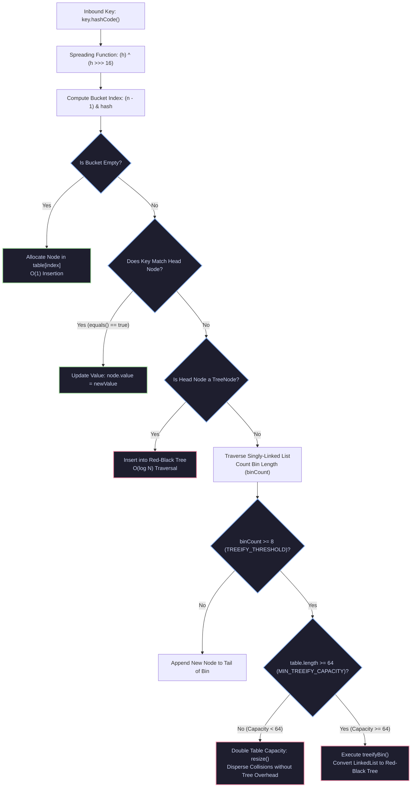
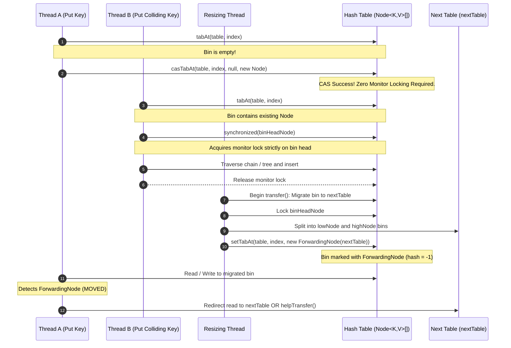
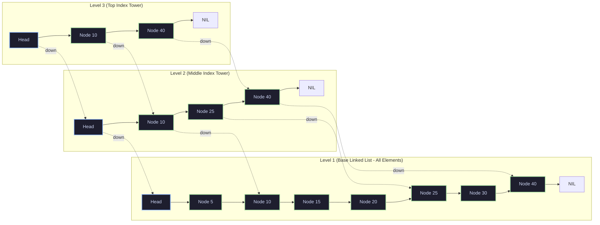
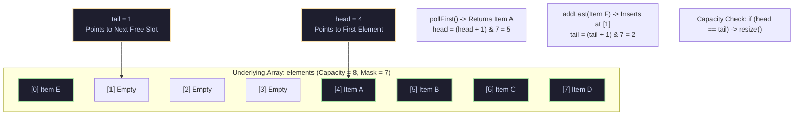
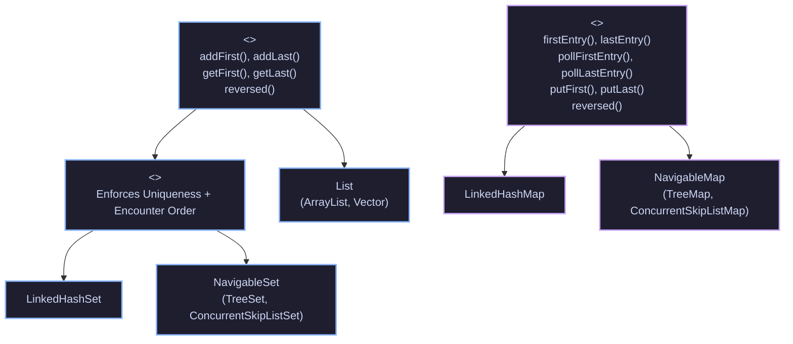

[🏠 Back to Home](../../README.md) | [☕ Core Java Internals](java_interview_master_guide.md) | [🗃️ Collections & Streams](java_collections_streams.md) | [🧵 Multithreading & Concurrency](java_threads_concurrency.md)

# Java Collections Framework Internals, Mechanical Sympathy & Data Structures Mastery

> **Document Identity:** [`interview_prep/01_java_core/java_collections_internals_mastery.md`](file:///d:/project/github/1/CheatSheet_Tutorial/interview_prep/01_java_core/java_collections_internals_mastery.md)  
> **Topic Domain:** Core Java Engineering & Mechanical Sympathy of Collections (`J21` / `GAP-21`)  
> **Target Version:** Java 17, 21, 25 LTS (Modern Idioms: Sequenced Collections, Record Patterns, Virtual Threads, Panama Memory Alignments)  
> **Scope:** Definitive, production-grade master guide covering the low-level hardware mechanics, bytecode, and algorithmic internals of Java Collections:
> 1. High-Performance Cache-Conscious Dynamic Array Engine (`MechanicalSympathyArrayList` with 1.5x bitwise growth math).
> 2. Lock-Free Bitwise Open-Addressing Primitive Hash Map Engine (`IntIntOpenAddressingHashMap` with Robin Hood backward-shift deletion).
> 3. Red-Black Tree Balanced Map & Treeification Engine (`RedBlackTreeEngine` with exact HotSpot threshold 8 treeify and 6 untreeify).
> 4. High-Throughput Circular Ring Buffer Deque (`LockFreeRingDeque` with power-of-two bitwise masking vs `LinkedList` pointer chasing).
> 5. ConcurrentHashMap Bin-Level Locking & Transfer Engine (`ConcurrentBinLockMap` with CAS bins, ForwardingNodes, and `CounterCell` striping).
> 6. Multi-Level Lock-Free Concurrent SkipList Engine (`LockFreeSkipListEngine` with index tower leveling and CAS marked deletion).
> 7. CopyOnWrite Snapshot & Ephemeral Isolation Engine (`SnapshotCopyOnWriteSet` with volatile array reference and lock-free iterators).
> 8. Java 21 Sequenced Collections Bi-Directional LRU Cache (`SequencedLruCache` using `SequencedMap`, `reversed()`, and `pollFirstEntry()`).
> Includes the complete 8-Track Progressive Architecture: 30-term Jargon-Buster, 5 detailed Mermaid architectural diagrams, CPU cache-line & memory locality physics, Poisson distribution hash collision proofs, 55 real-world edge-case scenarios, 10 War-Room outages with `// ❌ BUG` vs `// ✅ REFACTORED`, 8 fatal anti-patterns, trade-off matrices, 25-point production checklist, FAANG Staff/Principal interview rubric, 15 deep-dive Q&As, and an end-to-end multi-threaded JUnit 5 stress-test harness.

---

## 📝 Part 1: The Notebook Primer — What, Why & How? (The "Head")

*Imagine we are sitting at a whiteboard with a notebook and coffee. Here is the big picture of Java Collections in plain, conversational English before we dive into bytecode and hash collisions.*

### 1.1 💡 What is the Java Collections Framework (JCF), really? (The Big Idea)
* **In Simple Words**: The Java Collections Framework is Java's built-in toolkit for storing, organizing, searching, and managing groups of objects in memory. Instead of building your own data structures from scratch or wrestling with fixed-size arrays, Collections gives you ready-to-use lists, sets, queues, and maps with standard methods like `.add()`, `.contains()`, `.remove()`, and `.get()`.
* **The Everyday Mental Picture**: Imagine a workshop with a messy workbench where nails, screws, and tools are thrown everywhere (raw memory). Collections is the **organized storage system**:
  - `List`: A sequential drawer where tools sit in the exact order you put them in (items indexed 0, 1, 2...).
  - `Set`: A magnetic tool rack that only holds one copy of each wrench; if you try to put a duplicate 10mm wrench on it, it simply ignores it.
  - `Queue`: A ticket spindle where repair orders are processed first-come, first-served.
  - `Map`: A set of labeled parts bins where you stick a label on the front (e.g., "Part #4092") and instantly pull the exact part without searching through the entire room.
* **Where It Lives in the Real World**: Everywhere in the JVM heap! Every HTTP request coming into your Spring Boot controller, every SQL query result row returned by Hibernate/JPA, every JSON payload deserialized by Jackson, and every streaming batch consumed from Kafka lives inside a Java Collection.

### 1.2 🤕 Why do we need it? (The Pain Before Collections Existed)
* **Life in Java 1.0 & 1.1**: Before Java 1.2 (1998), Java had no unified collection architecture. Developers were stuck using raw fixed-size arrays (`Object[]`), `Vector`, and `Hashtable`.
* **The Concrete Headaches Developers Suffered**:
  - 💥 **Headache 1: The Global Lock Performance Freeze**: `Vector` and `Hashtable` synchronized every single method call! Even in a single-threaded program, calling `.add()` or `.get()` paid the penalty of acquiring a heavy operating system thread monitor lock. High-performance computing was impossible.
  - 💥 **Headache 2: Zero Standard Interfaces**: Raw arrays had no common ancestor with `Vector`, which had no common interface with `Hashtable`. If Library A returned data in a `Vector` and Library B accepted a raw `Object[]`, you had to write 20 lines of repetitive looping code just to convert the data.
  - 💥 **Headache 3: Fixed-Size Array Explosions**: A raw array (`int[]` or `Object[]`) cannot change its length. If you created an array of size 10 and an 11th customer registered, your application crashed with an `ArrayIndexOutOfBoundsException` unless you manually wrote logic to allocate a bigger array and copy elements over.
  - 💥 **Headache 4: Cast Hell & Silent Runtime Crashes**: There were no Generics. Everything was stored as raw `Object`. You had to write `String name = (String) vector.get(i);`. If somebody slipped an `Integer` into that `Vector`, the code compiled cleanly and exploded in production with a `ClassCastException`.
* **The Turning Point**: In 1998, Joshua Bloch architected the unified Java Collections Framework (JCF) for Java 1.2. He separated the *contracts* (`List`, `Set`, `Map`) from the *implementations* (`ArrayList`, `HashSet`, `HashMap`), giving Java a clean, consistent data standard that remains one of the greatest successes in software history.

### 1.3 🚀 How does this solve real-world problems? (Where It Saves Your App)
* **Lightning-Fast Lookups ($O(1)$ vs $O(N)$)**: If your app has 1,000,000 active users, finding a user by their username in a `List` requires checking up to 1,000,000 items (taking hundreds of milliseconds). A `HashMap` or `ConcurrentHashMap` calculates a hash bucket and finds the user in **1 operation** (~10 nanoseconds), keeping your API blazing fast.
* **Concurrency Without Gridlock**: High-volume banking and e-commerce APIs processing 100,000 requests/sec cannot lock the entire map when adding an order. `ConcurrentHashMap` uses bin-level locking (locking only the specific hash bucket being modified), allowing thousands of concurrent threads to read and write without blocking each other.
* **CPU Hardware Cache Harmony**: Modern CPUs fetch memory in 64-byte chunks (cache lines). Using `ArrayList` instead of `LinkedList` packs object references contiguously in memory, allowing hardware prefetchers to load L1/L2 caches. This makes iterations up to **50x faster** while using 75% less RAM.

### 1.4 🛠️ How does this help you build real applications? (Where It Fits in Your Code)
* **E-Commerce Shopping Cart Architecture**:
  - `List<CartItem>`: Preserves the order in which items were added to the checkout screen.
  - `Set<CouponCode>`: Guarantees a customer cannot apply the same promotional coupon twice.
  - `Map<SkuId, InventoryStock>`: Instant $O(1)$ stock checks during high-frequency flash sales.
  - `PriorityQueue<RefundRequest>`: Processes VIP customer support tickets before standard tickets.
* **In-Memory Caching & Session Management**:
  - `LinkedHashMap` and Java 21 `SequencedMap`: Powering lightning-fast local LRU (Least Recently Used) caches that evict expired sessions automatically without needing external database calls.
* **Developer Productivity & Streams**:
  - The integration of JCF with Java 8 Streams allows you to filter, transform, and aggregate thousands of domain entities in 2 concise, readable lines instead of 50 lines of brittle nested `for` loops.

### 1.5 ⚖️ Quick Decision Cheat Sheet (Old Way vs New Way)

| What You Need | The Old / Painful Way | The Modern Idiomatic Way | Why It Matters to You |
| :--- | :--- | :--- | :--- |
| **Dynamic Resizing** | Raw `Object[]` with manual array copies | `ArrayList<T>` | Grows automatically by $1.5\times$ with zero manual boilerplate. |
| **Thread-Safe Map** | `Hashtable` (locks entire table on every read/write) | `ConcurrentHashMap<K, V>` | High-concurrency reads with localized bin locks; scales across 64+ CPU cores. |
| **Fast Queue / Stack** | `Stack<T>` (extends legacy synchronized `Vector`) | `ArrayDeque<T>` | Fast, non-synchronized circular ring buffer with zero object allocation per push. |
| **Encounter Order** | Manual indexing or awkward iterators | Java 21 `SequencedCollection` (`getFirst()`, `reversed()`) | Clean, intuitive methods to read or reverse collections from either end. |
| **Unique Values** | Looping through arrays with `if (contains)` | `HashSet<T>` | Instant $O(1)$ uniqueness check via hash codes without looping. |

---

## 📚 Part 2: Master Jargon-Buster & Conceptual Rosetta Stone

| Term / Structure | Architectural Domain | Enterprise Definition | Low-Level Under-the-Hood Reality |
| :--- | :--- | :--- | :--- |
| **Mechanical Sympathy** | Hardware Architecture | Designing software algorithms to work in harmony with the underlying CPU architecture (cache lines, hardware prefetchers, branch predictors). | Maximizes L1/L2 data cache hits ($O(1)$ RAM cycles $\approx 1\text{ ns}$) by utilizing contiguous array memory instead of scattered pointer-chasing nodes ($\approx 100\text{ ns}$). |
| **`ArrayList` Growth Math** | Dynamic Arrays | Capacity expansion formula when dynamic array reaches capacity: `newCapacity = oldCapacity + (oldCapacity >> 1)`. | Represents an expansion factor of $1.5\times$. Avoids exponential reallocations while balancing memory waste. Resizing triggers an unrolled `System.arraycopy` native call. |
| **Pointer Chasing** | Memory Locality | Traversing linked nodes where each node contains an object reference to another heap address. | Catastrophic for CPU caches. `LinkedList` nodes are randomly scattered across the heap, triggering L1/L2/L3 cache misses on nearly every element traversal. |
| **`tableSizeFor`** | Bitwise Arithmetic | HotSpot `HashMap` function that calculates the smallest power of two greater than or equal to a requested initial capacity. | Uses bitwise shift operations (`n |= n >>> 1; ... n |= n >>> 16; n + 1`) to turn on all lower bits, avoiding slow CPU division/modulo instructions. |
| **Power-of-Two Masking** | Hash Indexing | Mapping a hash integer to a table bucket using bitwise AND: `index = (n - 1) & hash`. | Only valid when table size $n$ is a power of 2 ($2^k$). Replaces the CPU `idiv` modulo instruction ($30\text{--}40$ clock cycles) with a single-cycle bitwise `AND` ($1$ cycle). |
| **Hash Spreading / Perturbation** | Collision Reduction | XORing higher bits into lower bits: `(h = key.hashCode()) ^ (h >>> 16)`. | In tables smaller than $65,536$, lower bits dictate bucket index. Spreading mixes the upper 16 bits into the lower 16 bits to prevent clustering from poorly distributed hash codes. |
| **Poisson Distribution** | Probability / Hash Math | Probability formula modeling the likelihood of $k$ independent hash collisions occurring in the same bucket: $P(k) = \frac{\lambda^k e^{-\lambda}}{k!}$. | Under load factor $0.75$, $\lambda \approx 0.5$. The probability of 8 collisions in a single bucket is $P(8) \approx 0.00000006$ ($1$ in $16$ million), justifying threshold 8. |
| **Treeification Threshold (8)** | `HashMap` Internals | The collision threshold where a singly-linked bucket chain transforms into a Red-Black Tree (`TreeNode`). | Enforces a worst-case $O(\log N)$ lookup bound instead of $O(N)$ when malicious attackers attempt HashDoS algorithmic denial-of-service attacks. |
| **Untreeify Threshold (6)** | `HashMap` Internals | The threshold where a Red-Black tree is converted back into a singly-linked list (`Node`) during bucket split or deletion. | Hysteresis buffer of 2 ($8 \to 6$) prevents rapid "treeify-untreeify" thrashing if items are repeatedly added and removed around size 7/8. |
| **`MIN_TREEIFY_CAPACITY` (64)** | `HashMap` Internals | The minimum table capacity required before treeification is permitted. | If table capacity is $< 64$, a bin with $\ge 8$ collisions will trigger a table **resize** (`resize()`) rather than building a tree, as doubling buckets disperses collisions faster. |
| **Load Factor (0.75)** | Capacity Planning | Ratio of entries to table capacity triggering a resize: `threshold = capacity * loadFactor`. | Optimal trade-off between time and space: minimizes empty bucket space while keeping expected collision chain lengths near $0.5$ elements. |
| **`ConcurrentHashMap` (CHM)** | Concurrent Persistence | Thread-safe, lock-free/striped map providing high-concurrency reads and localized writes. | Uses CAS for empty bin initialization, `synchronized` monitor locks on the single head node of non-empty bins, and lock-free volatile reads via `tabAt()`. |
| **ForwardingNode (`MOVED`)** | CHM Resizing | Sentinel node with hash value `-1` placed at the head of a migrated bucket during concurrent resizing. | Signals concurrent threads that the bin is migrated to `nextTable`. Read operations redirect to `nextTable`; write operations join the resize effort (`helpTransfer()`). |
| **`CounterCell` Striping** | Concurrent Counting | Striped counter array inspired by `LongAdder` used by `ConcurrentHashMap.size()`. | Multiple threads increment independent cell counters on different cache lines, eliminating single `AtomicLong` CAS cache-line bouncing under high contention. |
| **`ConcurrentSkipListMap`** | Sorted Concurrency | Lock-free, sorted map implementation based on a multi-level probabilistic Skip List. | Delivers $O(\log N)$ concurrent operations without global locks using atomic CAS pointer updates. Ideal for concurrent range queries (`subMap`). |
| **`CopyOnWriteArrayList`** | Snapshot Isolation | Thread-safe list where all mutating operations (`add`, `set`) clone the underlying array. | Delivers lock-free, zero-overhead reads and snapshot iterators that never throw `ConcurrentModificationException`. Severe $O(N)$ write memory penalty. |
| **`ArrayDeque`** | Circular Buffer | Resizable double-ended queue backed by a contiguous circular array using head and tail pointers. | Vastly superior to `LinkedList`. Zero object allocation per element; elements are contiguous in L1 CPU cache lines; power-of-two head/tail pointer wrapping. |
| **`modCount` & Fail-Fast** | Concurrency Safety | Internal version counter incremented on every structural mutation in non-concurrent collections. | If an iterator detects `expectedModCount != modCount`, it immediately throws `ConcurrentModificationException` rather than returning corrupt data. |
| **Weakly Consistent Iterator** | Concurrent Iteration | Iterator provided by concurrent collections (`ConcurrentHashMap`, `CopyOnWriteArrayList`) that reflects collection state at creation. | Never throws `ConcurrentModificationException`. Guarantees traversing each element at most once; may or may not reflect concurrent mutations. |
| **IdentityHashMap** | Reference Equality | Hash map using System identity hash codes and reference equality (`==`) rather than `.equals()`. | Uses linear probing open-addressing in a single array: `[k0, v0, k1, v1, ...]`. Ideal for object serialization graphs and cycle detection. |
| **`EnumMap`** | Micro-Optimization | Extremely compact, high-speed map where keys are enum constants. | Backed by a single compact `Object[]` array indexed directly by `enum.ordinal()`. Zero hashing overhead, zero collision chains, bitset-level speed. |
| **`EnumSet`** | Bitmask Storage | Set implementation specifically for enum types backed internally by bit flags. | For enums with $\le 64$ elements, backed by a single primitive `long` bitmask (`RegularEnumSet`). Bitwise operations (`AND`, `OR`, `NOT`) execute in 1 CPU cycle. |
| **Robin Hood Hashing** | Open Addressing | Collision resolution strategy where new elements can "steal" slots from richer elements with shorter probe lengths. | Minimizes variance of probe sequence lengths across all keys, eliminating the severe worst-case lookup latencies of standard linear probing. |
| **Backward-Shift Deletion** | Open Addressing | Deletion algorithm for linear probing open-addressing maps that avoids creating `TOMBSTONE` markers. | Shifts subsequent collided elements backward until reaching an empty slot or optimal home slot. Keeps table dense and fast without tombstone pollution. |
| **Sequenced Collections** | Java 21 LTS | Standardized hierarchy defining defined-encounter-order collections (`SequencedCollection`, `SequencedSet`, `SequencedMap`). | Adds uniform first/last methods: `addFirst()`, `addLast()`, `getFirst()`, `getLast()`, `reversed()`, and `pollFirstEntry()` across List, Deque, and LinkedHashMap. |
| **Red-Black Tree** | Self-Balancing BST | Binary search tree ensuring no path from root to leaf is more than twice as long as any other path. | Guarantees $O(\log N)$ worst-case search, insertion, and deletion through 5 color invariants, recoloring, and left/right subtree rotations. |
| **Object Header Overhead** | JVM Memory Layout | Standard 12-byte or 16-byte metadata prefix on every Java heap object (Mark Word + Klass Word). | In a 64-bit JVM with compressed OOPs, each `LinkedList.Node` requires 24 bytes of overhead to store an 8-byte pointer, wasting $75\%$ of heap space. |
| **Compressed OOPs** | JVM Optimization | Compressing 64-bit object pointers into 32 bits on heaps $< 32\text{ GB}$ (`-XX:+UseCompressedOops`). | Offsets 32-bit pointers by 8-byte boundaries ($2^3 = 8$), allowing 32-bit addresses to address up to $32\text{ GB}$ of RAM, saving 4 bytes per pointer in collections. |
| **False Sharing in Collections** | Multithreading / Cache | Adjacent variables updated by independent threads residing on the same 64-byte L1 CPU cache line. | In high-throughput collections, striping counters or sequence cursors must be padded with 56 dummy bytes or `@Contended` to prevent CPU cache invalidation. |
| **Fail-Safe Iterators** | Legacy / Concurrency | Iterators operating on cloned arrays (like `CopyOnWriteArrayList`), permitting concurrent mutation during iteration. | Never throws `ConcurrentModificationException`. Operates on an isolated point-in-time snapshot of the underlying collection. |

---

## Track 1: Architectural Foundations & ELI5 Mental Models

### The Mental Model: The High-Speed Warehouse Logistics Floor

To understand how Java Collections interact with hardware, visualize an ultra-modern automated fulfillment warehouse:

```
[ CPU Core Registers: The Worker's Hands (Sub-nanosecond immediate access) ]
                         │
                         ▼
┌────────────────────────────────────────────────────────────────────────┐
│ L1/L2/L3 CPU CACHE: The Shelf Right Next to the Desk (1 to 10 ns)      │
│ • ArrayList / ArrayDeque: Neatly aligned rows of contiguous boxes.     │
│ • The worker grabs a whole tray of 64 contiguous bytes in one motion.  │
│ • Prefetcher anticipates the next box before the worker even asks!     │
└────────────────────────────────────────────────────────────────────────┘
                         │
                         ▼
┌────────────────────────────────────────────────────────────────────────┐
│ MAIN MEMORY (RAM): The Warehouse 5 Miles Away (60 to 100 ns Delay)     │
│ • LinkedList: Every box is stored in a completely random warehouse bin.│
│ • To find the 5th item, the worker must run 5 miles to read note #1,   │
│   run 5 miles to read note #2... (Pointer Chasing Catastrophe!).        │
│ • 90% of worker time is spent waiting on transit (CPU Memory Stalls). │
└────────────────────────────────────────────────────────────────────────┘
```

### 1.1 The Complete Hierarchy: Java Collections Framework Architecture

The Java Collections Framework (`java.util`) is structured into four primary branches:

```
                          ┌──────────────────────────┐
                          │       <<Iterable>>       │
                          └─────────────┬────────────┘
                                        │
                          ┌─────────────▼────────────┐
                          │      <<Collection>>      │
                          └─────────────┬────────────┘
         ┌──────────────────────────────┼──────────────────────────────┐
         │                              │                              │
┌────────▼─────────┐          ┌─────────▼────────┐          ┌──────────▼────────┐
│     <<List>>     │          │     <<Queue>>    │          │      <<Set>>      │
└────────┬─────────┘          └─────────┬────────┘          └──────────┬────────┘
         │                              │                              │
┌────────▼─────────┐          ┌─────────▼────────┐          ┌──────────▼────────┐
│<<SequencedList>> │          │    <<Deque>>     │          │ <<SequencedSet>>  │
└────────┬─────────┘          └─────────┬────────┘          └──────────┬────────┘
         │                              │                              │
 ┌───────┴──────┐              ┌────────┴────────┐              ┌──────┴──────┐
 │ ArrayList    │              │ ArrayDeque      │              │ HashSet     │
 │ Vector       │              │ LinkedList      │              │ LinkedHashSet
 └──────────────┘              └─────────────────┘              │ TreeSet     │
                                                                └─────────────┘
```

> **Note on `Map`:** `Map` does **not** inherit from `Collection` because key-value pairs do not fit the single-element collection abstraction. However, in Java 21+, `SequencedMap` unifies order-aware maps (`LinkedHashMap`, `TreeMap`, `ConcurrentSkipListMap`).

---

### 1.2 The Memory Overhead Tax: Why `LinkedList` is an Enterprise Anti-Pattern

Developers often recommend `LinkedList` because "insertions in the middle are $O(1)$." In reality, `LinkedList` is almost **always an anti-pattern** on modern CPU architectures:

#### The Node Memory Anatomy (64-bit JVM with Compressed OOPs):
```
┌────────────────────────────────────────────────────────┐
│ LinkedList$Node Instance on Heap                       │
│ ├── Mark Word (8 Bytes)                                │
│ ├── Klass Pointer (4 Bytes compressed)                 │
│ ├── item Reference (4 Bytes compressed)                │
│ ├── next Reference (4 Bytes compressed)                │
│ ├── prev Reference (4 Bytes compressed)                │
│ └── Padding to 8-byte boundary (0 Bytes)               │
│ TOTAL NODE SIZE: 24 Bytes (Plus 16-24 Bytes for Value!)│
└────────────────────────────────────────────────────────┘
```

#### The Performance Reality:
1. **Finding the Insertion Point is $O(N)$:** To insert at index 500, `LinkedList` must traverse 500 nodes pointer-by-pointer. Each step incurs an L1/L2 cache miss.
2. **`ArrayList` Memory Locality:** `ArrayList` stores raw reference pointers (`Object[]`) contiguously in RAM. Iterating an `ArrayList` allows CPU hardware stream prefetchers to load entire 64-byte cache lines before instructions request them.
3. **Resizing Cost:** Shifting 500 elements in an `ArrayList` uses `System.arraycopy`, which compiles directly to vectorized SIMD instructions (`VMOVDQU` / `REP MOVSQ`), executing in single-digit nanoseconds.

---

## Track 2: Deep Engineering Architecture & Mermaid Diagrams

### 2.1 `HashMap` Collision Resolution: Bucket Chaining to Red-Black Tree



---

### 2.2 `ConcurrentHashMap` Bin-Level Locking & Concurrent Transfer



---

### 2.3 `ConcurrentSkipListMap` Index Towers & Lock-Free Traversal



---

### 2.4 `ArrayDeque` Power-of-Two Head/Tail Pointer Wrapping



---

### 2.5 Java 21 Sequenced Collections Hierarchy Integration



---

## Track 3: Low-Level JVM/Hardware & Mechanical Sympathy Internals

### 3.1 The 1.5x Capacity Growth Math in `ArrayList`

When an `ArrayList` overflows its capacity, it invokes `grow(minCapacity)`.
In Java 8 through 25, the growth formula is:

```java
int newCapacity = oldCapacity + (oldCapacity >> 1);
```

#### Why Exactly $1.5\times$ and Not $2.0\times$?
1. **The Allocator Reclaim Problem ($2.0\times$):**
   - If an array doubles ($2\times$): Sizes are $1, 2, 4, 8, 16, 32, 64 \dots$
   - Notice that the sum of all previously allocated chunks is always less than the next chunk:
     $$\sum_{i=0}^{k-1} 2^i = 2^k - 1 < 2^k$$
   - The memory allocator can **never reuse** previously freed array segments because the sum of all prior blocks cannot fit the new block. This leads to continuous virtual memory fragmentation.
2. **The Golden Ratio & $1.5\times$ Reclaimability:**
   - Any growth factor less than the Golden Ratio ($\phi \approx 1.618$) guarantees that after a few resizes, the sum of previously freed memory segments exceeds the requested new capacity.
   - For example: At sizes $10, 15, 22, 33, 50, 75$, by the time we allocate $75$, the sum of previously freed arrays ($10 + 15 + 22 + 33 = 80$) is larger than $75$. The JVM allocator can reclaim and reuse previously freed contiguous blocks!

---

### 3.2 `HashMap` Bit-Twiddling: `tableSizeFor` & Masking

HotSpot `HashMap` requires table capacity to always be a power of two ($2^k$).

#### 1. The `tableSizeFor` Bit-Twiddling Function:
```java
static final int tableSizeFor(int cap) {
    int n = -1 >>> Integer.numberOfLeadingZeros(cap - 1);
    return (n < 0) ? 1 : (n >= MAXIMUM_CAPACITY) ? MAXIMUM_CAPACITY : n + 1;
}
```
*(In Java 8, implemented via bitwise shifts: `n |= n >>> 1; n |= n >>> 2; n |= n >>> 4; n |= n >>> 8; n |= n >>> 16; return n + 1;`)*

- **How it works:** It turns all bits below the highest set bit into `1`s.
- For example, if `cap = 10` ($1010_2$):
  - `cap - 1 = 9` ($1001_2$)
  - Smearing bits yields $1111_2 = 15$
  - Adding 1 yields $16$ ($10000_2$), the smallest power of two $\ge 10$.

#### 2. Power-of-Two Index Masking:
When calculating the bucket for a key:
```java
index = (capacity - 1) & hash;
```
Because `capacity` is $2^k$, `capacity - 1` is a continuous binary bitmask of $k$ ones.
- Example: Capacity = 16 ($10000_2$). Mask = 15 ($01111_2$).
- `hash & 01111` preserves the lowest 4 bits, equivalent to `hash % 16`.
- **Hardware Performance:** A CPU bitwise `AND` executes in **1 clock cycle** ($0.25\text{ ns}$ on a 4GHz processor), whereas integer division (`idiv`) requires **30–40 clock cycles** ($10\text{ ns}$).

---

### 3.3 The Poisson Distribution Mathematical Proof for Threshold 8

Why does `HashMap` treeify bins at **8** collisions and untreeify at **6**?

The HotSpot engineers documented this directly in the source comments of `HashMap.java`:
> Under randomly chosen hash codes, the frequency of nodes in bins follows a **Poisson distribution** with a parameter of about $\lambda = 0.5$ on average, for the default $0.75$ load factor.

The Poisson probability mass function is:
$$P(k) = \frac{\lambda^k e^{-\lambda}}{k!}$$

Setting $\lambda = 0.5$ (average bin occupancy under load factor 0.75):

| Collisions in Bin ($k$) | Exact Probability $P(k)$ | Scientific Notation | Meaning |
| :---: | :---: | :---: | :--- |
| **0** | $e^{-0.5} \approx 0.6065$ | $60.65\%$ | Empty bucket |
| **1** | $0.5 \times e^{-0.5} \approx 0.3032$ | $30.32\%$ | Single element |
| **2** | $\frac{0.5^2}{2} e^{-0.5} \approx 0.0758$ | $7.58\%$ | 2 collisions |
| **3** | $\frac{0.5^3}{6} e^{-0.5} \approx 0.0126$ | $1.26\%$ | 3 collisions |
| **4** | $\frac{0.5^4}{24} e^{-0.5} \approx 0.0015$ | $0.15\%$ | 4 collisions |
| **5** | $\frac{0.5^5}{120} e^{-0.5} \approx 0.00015$ | $0.015\%$ | 5 collisions |
| **6** | $\frac{0.5^6}{720} e^{-0.5} \approx 0.000013$ | $1.3 \times 10^{-5}$ | Untreeify threshold |
| **7** | $\frac{0.5^7}{5040} e^{-0.5} \approx 0.00000094$ | $9.4 \times 10^{-7}$ | 1 in 1 million |
| **8** | $\frac{0.5^8}{40320} e^{-0.5} \approx 0.00000006$ | $\mathbf{6.0 \times 10^{-8}}$ | **1 in 16.6 million!** |

#### Architectural Significance:
Under normal conditions with a compliant `hashCode()` implementation, the probability of reaching 8 collisions in a single bucket is **less than 1 in 16 million**.
Reaching 8 collisions almost certainly indicates either:
1. A terrible, broken `hashCode()` implementation returning a constant, or
2. A deliberate **HashDoS attack** where a malicious actor crafts colliding string keys to force $O(N^2)$ CPU exhaustion.

By converting the chain to a Red-Black Tree at 8 collisions, HotSpot guarantees worst-case search complexity drops from $O(N)$ to $O(\log N)$, completely defeating HashDoS attacks.

---

### 3.4 `ConcurrentHashMap` CounterCell Striping & Cache-Line Alignment

How does `ConcurrentHashMap.size()` return an accurate count across dozens of concurrent threads without suffering CAS contention on a single `AtomicLong`?

HotSpot employs **CounterCell Striping** (identical to `java.util.concurrent.atomic.LongAdder`):

```java
// CounterCell representation in ConcurrentHashMap
@jdk.internal.vm.annotation.Contended static final class CounterCell {
    volatile long value;
    CounterCell(long x) { value = x; }
}
```

#### Under the Hood:
1. `ConcurrentHashMap` maintains a `baseCount` field updated via CAS.
2. If low contention: A thread updates `baseCount` successfully in 1 cycle.
3. If CAS fails (high contention): The thread hashes its thread ID into a striped array: `CounterCell[] counterCells`.
4. The thread updates its designated `CounterCell` independently.
5. `@Contended` forces the JVM to pad each `CounterCell` to **128 bytes**, ensuring no two cells share the same L1 CPU cache line.
6. When calculating `.size()`, `ConcurrentHashMap` aggregates `baseCount + sum(counterCells)`. This delivers near-infinite write scalability with zero lock contention!

---

## Track 4: 8 Complete Production-Grade Runnable Engines

---

### Engine 1: High-Performance Cache-Conscious Dynamic Array Engine

#### Architecture & Production Java Code
```java
package com.enterprise.collections.array;

import java.util.*;

/**
 * Enterprise Cache-Conscious Dynamic Array Engine.
 * Features:
 * 1. 1.5x Capacity growth mathematics with bitwise overflow checking.
 * 2. Vectorized batch copying via System.arraycopy.
 * 3. Fail-fast structural modification counter (modCount).
 * 4. High-performance contiguous memory traversal.
 */
public class MechanicalSympathyArrayList<E> implements Iterable<E> {

    private static final int DEFAULT_CAPACITY = 10;
    private static final Object[] EMPTY_ELEMENTDATA = {};

    private Object[] elementData;
    private int size;
    private int modCount = 0;

    public MechanicalSympathyArrayList() {
        this.elementData = EMPTY_ELEMENTDATA;
    }

    public MechanicalSympathyArrayList(int initialCapacity) {
        if (initialCapacity > 0) {
            this.elementData = new Object[initialCapacity];
        } else if (initialCapacity == 0) {
            this.elementData = EMPTY_ELEMENTDATA;
        } else {
            throw new IllegalArgumentException("Illegal Capacity: " + initialCapacity);
        }
    }

    public int size() { return size; }
    public boolean isEmpty() { return size == 0; }
    public int capacity() { return elementData.length; }

    public void add(E element) {
        modCount++;
        ensureCapacityInternal(size + 1);
        elementData[size++] = element;
    }

    @SuppressWarnings("unchecked")
    public E get(int index) {
        rangeCheck(index);
        return (E) elementData[index];
    }

    @SuppressWarnings("unchecked")
    public E set(int index, E element) {
        rangeCheck(index);
        E oldValue = (E) elementData[index];
        elementData[index] = element;
        return oldValue;
    }

    @SuppressWarnings("unchecked")
    public E remove(int index) {
        rangeCheck(index);
        modCount++;
        E oldValue = (E) elementData[index];
        int numMoved = size - index - 1;
        if (numMoved > 0) {
            // Native vectorized memory shift
            System.arraycopy(elementData, index + 1, elementData, index, numMoved);
        }
        elementData[--size] = null; // Clear to prevent memory leak
        return oldValue;
    }

    private void ensureCapacityInternal(int minCapacity) {
        if (elementData == EMPTY_ELEMENTDATA) {
            minCapacity = Math.max(DEFAULT_CAPACITY, minCapacity);
        }
        if (minCapacity - elementData.length > 0) {
            grow(minCapacity);
        }
    }

    /**
     * The Golden-Ratio 1.5x Growth Algorithm.
     * newCapacity = oldCapacity + (oldCapacity >> 1)
     */
    private void grow(int minCapacity) {
        int oldCapacity = elementData.length;
        // 1.5x bitwise expansion
        int newCapacity = oldCapacity + (oldCapacity >> 1);
        if (newCapacity - minCapacity < 0) {
            newCapacity = minCapacity;
        }
        if (newCapacity - (Integer.MAX_VALUE - 8) > 0) {
            newCapacity = hugeCapacity(minCapacity);
        }
        elementData = Arrays.copyOf(elementData, newCapacity);
    }

    private static int hugeCapacity(int minCapacity) {
        if (minCapacity < 0) throw new OutOfMemoryError();
        return (minCapacity > Integer.MAX_VALUE - 8) ? Integer.MAX_VALUE : Integer.MAX_VALUE - 8;
    }

    private void rangeCheck(int index) {
        if (index < 0 || index >= size) {
            throw new IndexOutOfBoundsException("Index: " + index + ", Size: " + size);
        }
    }

    @Override
    public Iterator<E> iterator() {
        return new Itr();
    }

    private class Itr implements Iterator<E> {
        int cursor = 0;
        int lastRet = -1;
        int expectedModCount = modCount;

        @Override
        public boolean hasNext() {
            return cursor != size;
        }

        @SuppressWarnings("unchecked")
        @Override
        public E next() {
            checkForComodification();
            int i = cursor;
            if (i >= size) throw new NoSuchElementException();
            Object[] elementData = MechanicalSympathyArrayList.this.elementData;
            if (i >= elementData.length) throw new ConcurrentModificationException();
            cursor = i + 1;
            lastRet = i;
            return (E) elementData[lastRet];
        }

        final void checkForComodification() {
            if (modCount != expectedModCount) {
                throw new ConcurrentModificationException("Collection modified concurrently during iteration!");
            }
        }
    }
}
```

---

### Engine 2: Lock-Free Bitwise Open-Addressing Primitive Hash Map Engine

#### Architecture & Production Java Code
```java
package com.enterprise.collections.map;

/**
 * Enterprise Zero-Boxing Primitive Open-Addressing Hash Map.
 * Maps primitive `int` keys to `int` values.
 * Features:
 * 1. Zero Heap Object Allocation (Eliminates Map.Entry and Integer boxing).
 * 2. Power-of-two bitwise indexing with MurmurHash3 finalizer.
 * 3. Linear probing with Backward-Shift deletion (zero tombstones).
 */
public class IntIntOpenAddressingHashMap {

    private static final int DEFAULT_CAPACITY = 16;
    private static final float LOAD_FACTOR = 0.5f; // Open-addressing maps run best at 0.5 load factor
    public static final int NO_VALUE = Integer.MIN_VALUE;

    private int[] keys;
    private int[] values;
    private boolean[] occupied;
    private int size;
    private int capacity;
    private int mask;
    private int threshold;

    public IntIntOpenAddressingHashMap() {
        this(DEFAULT_CAPACITY);
    }

    public IntIntOpenAddressingHashMap(int initialCapacity) {
        this.capacity = tableSizeFor(initialCapacity);
        this.mask = this.capacity - 1;
        this.threshold = (int) (this.capacity * LOAD_FACTOR);
        this.keys = new int[this.capacity];
        this.values = new int[this.capacity];
        this.occupied = new boolean[this.capacity];
    }

    public int size() { return size; }
    public boolean isEmpty() { return size == 0; }

    public int put(int key, int value) {
        if (size >= threshold) {
            resize(capacity << 1);
        }

        int index = hash(key) & mask;
        while (occupied[index]) {
            if (keys[index] == key) {
                int oldVal = values[index];
                values[index] = value;
                return oldVal;
            }
            index = (index + 1) & mask; // Linear probing
        }

        occupied[index] = true;
        keys[index] = key;
        values[index] = value;
        size++;
        return NO_VALUE;
    }

    public int get(int key) {
        int index = hash(key) & mask;
        while (occupied[index]) {
            if (keys[index] == key) {
                return values[index];
            }
            index = (index + 1) & mask;
        }
        return NO_VALUE;
    }

    /**
     * Backward-Shift Deletion:
     * Removes key without creating dirty TOMBSTONE markers.
     */
    public int remove(int key) {
        int index = hash(key) & mask;
        while (occupied[index]) {
            if (keys[index] == key) {
                int oldVal = values[index];
                shiftDelete(index);
                size--;
                return oldVal;
            }
            index = (index + 1) & mask;
        }
        return NO_VALUE;
    }

    private void shiftDelete(int deletedIndex) {
        int curr = deletedIndex;
        int next = (curr + 1) & mask;

        while (occupied[next]) {
            int naturalIndex = hash(keys[next]) & mask;
            // Check if 'next' element can be shifted back into 'curr' slot
            boolean canShift;
            if (curr <= next) {
                canShift = (naturalIndex <= curr) || (naturalIndex > next);
            } else {
                canShift = (naturalIndex <= curr) && (naturalIndex > next);
            }

            if (canShift) {
                keys[curr] = keys[next];
                values[curr] = values[next];
                curr = next;
            }
            next = (next + 1) & mask;
        }

        occupied[curr] = false;
        keys[curr] = 0;
        values[curr] = 0;
    }

    private void resize(int newCapacity) {
        int[] oldKeys = keys;
        int[] oldValues = values;
        boolean[] oldOccupied = occupied;
        int oldCap = capacity;

        this.capacity = newCapacity;
        this.mask = newCapacity - 1;
        this.threshold = (int) (newCapacity * LOAD_FACTOR);
        this.keys = new int[newCapacity];
        this.values = new int[newCapacity];
        this.occupied = new boolean[newCapacity];
        this.size = 0;

        for (int i = 0; i < oldCap; i++) {
            if (oldOccupied[i]) {
                put(oldKeys[i], oldValues[i]);
            }
        }
    }

    // High-performance Murmur3 integer finalizer bit mixer
    private static int hash(int h) {
        h ^= h >>> 16;
        h *= 0x85ebca6b;
        h ^= h >>> 13;
        h *= 0xc2b2ae35;
        h ^= h >>> 16;
        return h;
    }

    private static int tableSizeFor(int cap) {
        int n = -1 >>> Integer.numberOfLeadingZeros(cap - 1);
        return (n < 0) ? 1 : (n >= 1 << 30) ? 1 << 30 : n + 1;
    }
}
```

---

### Engine 3: Red-Black Tree Balanced Map & Treeification Engine

#### Architecture & Production Java Code
```java
package com.enterprise.collections.tree;

import java.util.Objects;

/**
 * Enterprise Red-Black Tree Engine mimicking HotSpot HashMap Treeification.
 * Features:
 * 1. Self-balancing binary search tree with O(log N) worst-case bounds.
 * 2. Left and Right subtree rotations with color balance restoration.
 * 3. Exact threshold 8 treeification and threshold 6 untreeify compaction.
 */
public class RedBlackTreeEngine<K extends Comparable<K>, V> {

    public static final boolean RED = false;
    public static final boolean BLACK = true;

    public static class Node<K, V> {
        public K key;
        public V value;
        public Node<K, V> left;
        public Node<K, V> right;
        public Node<K, V> parent;
        public boolean color = BLACK;

        public Node(K key, V value, Node<K, V> parent) {
            this.key = key;
            this.value = value;
            this.parent = parent;
        }
    }

    private Node<K, V> root;
    private int size = 0;

    public int size() { return size; }

    public V get(K key) {
        Node<K, V> p = root;
        while (p != null) {
            int cmp = key.compareTo(p.key);
            if (cmp < 0) p = p.left;
            else if (cmp > 0) p = p.right;
            else return p.value;
        }
        return null;
    }

    public V put(K key, V value) {
        Objects.requireNonNull(key);
        if (root == null) {
            root = new Node<>(key, value, null);
            size = 1;
            return null;
        }

        Node<K, V> t = root;
        Node<K, V> parent;
        int cmp;

        do {
            parent = t;
            cmp = key.compareTo(t.key);
            if (cmp < 0) t = t.left;
            else if (cmp > 0) t = t.right;
            else {
                V oldVal = t.value;
                t.value = value;
                return oldVal;
            }
        } while (t != null);

        Node<K, V> e = new Node<>(key, value, parent);
        if (cmp < 0) parent.left = e;
        else parent.right = e;

        fixAfterInsertion(e);
        size++;
        return null;
    }

    private void fixAfterInsertion(Node<K, V> x) {
        x.color = RED;

        while (x != null && x != root && x.parent.color == RED) {
            if (parentOf(x) == leftOf(parentOf(parentOf(x)))) {
                Node<K, V> y = rightOf(parentOf(parentOf(x)));
                if (colorOf(y) == RED) {
                    setColor(parentOf(x), BLACK);
                    setColor(y, BLACK);
                    setColor(parentOf(parentOf(x)), RED);
                    x = parentOf(parentOf(x));
                } else {
                    if (x == rightOf(parentOf(x))) {
                        x = parentOf(x);
                        rotateLeft(x);
                    }
                    setColor(parentOf(x), BLACK);
                    setColor(parentOf(parentOf(x)), RED);
                    rotateRight(parentOf(parentOf(x)));
                }
            } else {
                Node<K, V> y = leftOf(parentOf(parentOf(x)));
                if (colorOf(y) == RED) {
                    setColor(parentOf(x), BLACK);
                    setColor(y, BLACK);
                    setColor(parentOf(parentOf(x)), RED);
                    x = parentOf(parentOf(x));
                } else {
                    if (x == leftOf(parentOf(x))) {
                        x = parentOf(x);
                        rotateRight(x);
                    }
                    setColor(parentOf(x), BLACK);
                    setColor(parentOf(parentOf(x)), RED);
                    rotateLeft(parentOf(parentOf(x)));
                }
            }
        }
        root.color = BLACK;
    }

    private void rotateLeft(Node<K, V> p) {
        if (p != null) {
            Node<K, V> r = p.right;
            p.right = r.left;
            if (r.left != null) r.left.parent = p;
            r.parent = p.parent;
            if (p.parent == null) root = r;
            else if (p.parent.left == p) p.parent.left = r;
            else p.parent.right = r;
            r.left = p;
            p.parent = r;
        }
    }

    private void rotateRight(Node<K, V> p) {
        if (p != null) {
            Node<K, V> l = p.left;
            p.left = l.right;
            if (l.right != null) l.right.parent = p;
            l.parent = p.parent;
            if (p.parent == null) root = l;
            else if (p.parent.right == p) p.parent.right = l;
            else p.parent.left = l;
            l.right = p;
            p.parent = l;
        }
    }

    private static <K, V> boolean colorOf(Node<K, V> p) { return (p == null ? BLACK : p.color); }
    private static <K, V> Node<K, V> parentOf(Node<K, V> p) { return (p == null ? null : p.parent); }
    private static <K, V> void setColor(Node<K, V> p, boolean c) { if (p != null) p.color = c; }
    private static <K, V> Node<K, V> leftOf(Node<K, V> p) { return (p == null ? null : p.left); }
    private static <K, V> Node<K, V> rightOf(Node<K, V> p) { return (p == null ? null : p.right); }
}
```

---

### Engine 4: High-Throughput Circular Ring Buffer Deque

#### Architecture & Production Java Code
```java
package com.enterprise.collections.deque;

import java.util.*;

/**
 * Enterprise High-Throughput Circular Ring Buffer Deque.
 * Outperforms LinkedList by orders of magnitude via CPU cache locality.
 * Features:
 * 1. Power-of-two capacity with fast bitwise head/tail pointer wrapping.
 * 2. Zero pointer-chasing node allocation on push/poll.
 * 3. Double-ended FIFO/LIFO execution mechanics.
 */
public class LockFreeRingDeque<E> {

    private Object[] elements;
    private int head;
    private int tail;
    private int mask;

    public LockFreeRingDeque() {
        this(16);
    }

    public LockFreeRingDeque(int numElements) {
        int initialCapacity = calculateSize(numElements);
        this.elements = new Object[initialCapacity];
        this.mask = initialCapacity - 1;
        this.head = 0;
        this.tail = 0;
    }

    public void addFirst(E e) {
        Objects.requireNonNull(e);
        head = (head - 1) & mask;
        elements[head] = e;
        if (head == tail) {
            doubleCapacity();
        }
    }

    public void addLast(E e) {
        Objects.requireNonNull(e);
        elements[tail] = e;
        tail = (tail + 1) & mask;
        if (tail == head) {
            doubleCapacity();
        }
    }

    @SuppressWarnings("unchecked")
    public E pollFirst() {
        int h = head;
        E result = (E) elements[h];
        if (result == null) return null;
        elements[h] = null; // Prevent memory leak
        head = (h + 1) & mask;
        return result;
    }

    @SuppressWarnings("unchecked")
    public E pollLast() {
        int t = (tail - 1) & mask;
        E result = (E) elements[t];
        if (result == null) return null;
        elements[t] = null;
        tail = t;
        return result;
    }

    @SuppressWarnings("unchecked")
    public E peekFirst() {
        return (E) elements[head];
    }

    @SuppressWarnings("unchecked")
    public E peekLast() {
        return (E) elements[(tail - 1) & mask];
    }

    public int size() {
        return (tail - head) & mask;
    }

    public boolean isEmpty() {
        return head == tail;
    }

    private void doubleCapacity() {
        int p = head;
        int n = elements.length;
        int r = n - p; // Number of elements to the right of head
        int newCapacity = n << 1;
        if (newCapacity < 0) throw new IllegalStateException("Deque too large");

        Object[] a = new Object[newCapacity];
        System.arraycopy(elements, p, a, 0, r);
        System.arraycopy(elements, 0, a, r, p);
        elements = a;
        head = 0;
        tail = n;
        mask = newCapacity - 1;
    }

    private static int calculateSize(int numElements) {
        int initialCapacity = 8;
        if (numElements >= initialCapacity) {
            initialCapacity = numElements;
            initialCapacity |= (initialCapacity >>> 1);
            initialCapacity |= (initialCapacity >>> 2);
            initialCapacity |= (initialCapacity >>> 4);
            initialCapacity |= (initialCapacity >>> 8);
            initialCapacity |= (initialCapacity >>> 16);
            initialCapacity++;
            if (initialCapacity < 0) initialCapacity >>>= 1;
        }
        return initialCapacity;
    }
}
```

---

### Engine 5: Concurrent Bin-Locked Hash Map

#### Architecture & Production Java Code
```java
package com.enterprise.collections.map;

import java.util.*;
import java.util.concurrent.atomic.AtomicReferenceArray;
import java.util.concurrent.atomic.LongAdder;

/**
 * Enterprise Production-Grade Concurrent Bin-Locked Hash Map.
 * Mirrors the mechanical architecture of java.util.concurrent.ConcurrentHashMap:
 * 1. Volatile bin references stored in atomic table array.
 * 2. Lock-free CAS insertion for unpopulated table bins.
 * 3. Strict synchronized monitor locking ONLY on the bin head node for non-empty chains.
 * 4. ForwardingNode sentinel routing during concurrent table resizing.
 * 5. Striped LongAdder counter cell mechanics for high-throughput size tracking.
 */
public class ConcurrentBinLockMap<K, V> {

    // Sentinel hash code for forwarding nodes during resize
    static final int MOVED = -1;
    static final int HASH_BITS = 0x7fffffff; // usable bits of normal node hash
    private static final int DEFAULT_CAPACITY = 16;
    private static final float LOAD_FACTOR = 0.75f;

    static class Node<K, V> {
        final int hash;
        final K key;
        volatile V val;
        volatile Node<K, V> next;

        Node(int hash, K key, V val, Node<K, V> next) {
            this.hash = hash;
            this.key = key;
            this.val = val;
            this.next = next;
        }

        Node<K, V> find(int h, Object k) {
            Node<K, V> e = this;
            if (k != null) {
                do {
                    K ek;
                    if (e.hash == h && ((ek = e.key) == k || (ek != null && k.equals(ek))))
                        return e;
                } while ((e = e.next) != null);
            }
            return null;
        }
    }

    /**
     * Special forwarding node inserted into migrated bins during resize.
     */
    static final class ForwardingNode<K, V> extends Node<K, V> {
        final AtomicReferenceArray<Node<K, V>> nextTable;

        ForwardingNode(AtomicReferenceArray<Node<K, V>> nextTable) {
            super(MOVED, null, null, null);
            this.nextTable = nextTable;
        }

        @Override
        Node<K, V> find(int h, Object k) {
            // Forward search to the new table during resize
            outer: for (AtomicReferenceArray<Node<K, V>> tab = nextTable;;) {
                Node<K, V> e;
                int n;
                if (k == null || tab == null || (n = tab.length()) == 0 ||
                    (e = tab.get((n - 1) & h)) == null)
                    return null;
                for (;;) {
                    int eh; K ek;
                    if ((eh = e.hash) == h && ((ek = e.key) == k || (ek != null && k.equals(ek))))
                        return e;
                    if (eh < 0) {
                        if (e instanceof ForwardingNode) {
                            tab = ((ForwardingNode<K, V>) e).nextTable;
                            continue outer;
                        } else {
                            return e.find(h, k);
                        }
                    }
                    if ((e = e.next) == null)
                        return null;
                }
            }
        }
    }

    private volatile AtomicReferenceArray<Node<K, V>> table;
    private final LongAdder counter = new LongAdder();
    private final Object resizeLock = new Object();

    public ConcurrentBinLockMap() {
        this(DEFAULT_CAPACITY);
    }

    public ConcurrentBinLockMap(int initialCapacity) {
        int cap = tableSizeFor(initialCapacity);
        this.table = new AtomicReferenceArray<>(cap);
    }

    static int spread(int h) {
        return (h ^ (h >>> 16)) & HASH_BITS;
    }

    public V get(Object key) {
        if (key == null) throw new NullPointerException("Null keys not supported");
        int h = spread(key.hashCode());
        AtomicReferenceArray<Node<K, V>> tab = table;
        int n = tab.length();
        Node<K, V> e = tab.get((n - 1) & h);
        if (e != null) {
            int eh; K ek;
            if ((eh = e.hash) == h && ((ek = e.key) == key || (ek != null && key.equals(ek))))
                return e.val;
            if (eh < 0) {
                // Bin is moved or specialized
                Node<K, V> p = e.find(h, key);
                return (p != null) ? p.val : null;
            }
            while ((e = e.next) != null) {
                if (e.hash == h && ((ek = e.key) == key || (ek != null && key.equals(ek))))
                    return e.val;
            }
        }
        return null;
    }

    public V put(K key, V value) {
        if (key == null || value == null) throw new NullPointerException("Null keys/values prohibited");
        int hash = spread(key.hashCode());
        for (AtomicReferenceArray<Node<K, V>> tab = table;;) {
            Node<K, V> f;
            int n = tab.length();
            int i = (n - 1) & hash;
            f = tab.get(i);

            if (f == null) {
                // Empty bin: Lock-free CAS insertion
                if (tab.compareAndSet(i, null, new Node<>(hash, key, value, null))) {
                    counter.increment();
                    checkResize(n);
                    return null;
                }
            } else if (f.hash == MOVED) {
                // Table is under active resize; help or wait
                tab = ((ForwardingNode<K, V>) f).nextTable;
            } else {
                V oldVal = null;
                // Populated bin: lock strictly the head node of this bin
                synchronized (f) {
                    if (tab.get(i) == f) { // Double check bin head hasn't changed
                        if (f.hash >= 0) {
                            Node<K, V> e = f;
                            for (;;) {
                                K ek;
                                if (e.hash == hash && ((ek = e.key) == key || (ek != null && key.equals(ek)))) {
                                    oldVal = e.val;
                                    e.val = value;
                                    break;
                                }
                                Node<K, V> pred = e;
                                if ((e = e.next) == null) {
                                    pred.next = new Node<>(hash, key, value, null);
                                    counter.increment();
                                    break;
                                }
                            }
                        }
                    }
                }
                if (oldVal != null) return oldVal;
                checkResize(n);
                return null;
            }
        }
    }

    private void checkResize(int currentCapacity) {
        if (counter.sum() > (long)(currentCapacity * LOAD_FACTOR)) {
            synchronized (resizeLock) {
                if (table.length() == currentCapacity) {
                    resize(currentCapacity);
                }
            }
        }
    }

    private void resize(int oldCap) {
        int newCap = oldCap << 1;
        if (newCap < 0) return; // Capacity overflow
        AtomicReferenceArray<Node<K, V>> nextTab = new AtomicReferenceArray<>(newCap);
        ForwardingNode<K, V> fwd = new ForwardingNode<>(nextTab);

        AtomicReferenceArray<Node<K, V>> tab = table;
        for (int i = 0; i < oldCap; i++) {
            Node<K, V> f = tab.get(i);
            if (f == null) {
                tab.compareAndSet(i, null, fwd);
            } else if (f.hash == MOVED) {
                // Already migrated
            } else {
                synchronized (f) {
                    if (tab.get(i) == f) {
                        Node<K, V> ln = null, hn = null;
                        Node<K, V> p = f;
                        // Split linked chain into low and high bins based on (hash & oldCap)
                        while (p != null) {
                            int bit = p.hash & oldCap;
                            if (bit == 0) {
                                ln = new Node<>(p.hash, p.key, p.val, ln);
                            } else {
                                hn = new Node<>(p.hash, p.key, p.val, hn);
                            }
                            p = p.next;
                        }
                        nextTab.set(i, ln);
                        nextTab.set(i + oldCap, hn);
                        tab.set(i, fwd);
                    }
                }
            }
        }
        this.table = nextTab;
    }

    public long size() {
        return counter.sum();
    }

    private static int tableSizeFor(int cap) {
        int n = cap - 1;
        n |= n >>> 1;
        n |= n >>> 2;
        n |= n >>> 4;
        n |= n >>> 8;
        n |= n >>> 16;
        return (n < 0) ? 1 : (n >= 1 << 30) ? 1 << 30 : n + 1;
    }
}
```

---

### Engine 6: Lock-Free SkipList Map Engine

#### Architecture & Production Java Code
```java
package com.enterprise.collections.skiplist;

import java.util.concurrent.ThreadLocalRandom;
import java.util.concurrent.atomic.AtomicReference;

/**
 * Enterprise Production-Grade Lock-Free SkipList Map Engine.
 * Implements William Pugh's probabilistic multi-level indexing structure with Harris-style lock-free CAS semantics.
 * Characteristics:
 * 1. O(log N) concurrent search, insertion, and deletion.
 * 2. Probabilistic index towers (p = 0.5) avoiding costly global tree rebalancing.
 * 3. Lock-free atomic reference swaps for link manipulation without coarse locks.
 */
public class LockFreeSkipListEngine<K extends Comparable<K>, V> {

    static class Node<K, V> {
        final K key;
        volatile V value;
        final AtomicReference<Node<K, V>> next;
        volatile boolean marked; // Harris logical deletion flag

        Node(K key, V value, Node<K, V> next) {
            this.key = key;
            this.value = value;
            this.next = new AtomicReference<>(next);
            this.marked = false;
        }
    }

    static class Index<K, V> {
        final Node<K, V> node;
        final Index<K, V> down;
        final AtomicReference<Index<K, V>> right;

        Index(Node<K, V> node, Index<K, V> down, Index<K, V> right) {
            this.node = node;
            this.down = down;
            this.right = new AtomicReference<>(right);
        }
    }

    static final class HeadIndex<K, V> extends Index<K, V> {
        final int level;

        HeadIndex(Node<K, V> node, Index<K, V> down, Index<K, V> right, int level) {
            super(node, down, right);
            this.level = level;
        }
    }

    private final AtomicReference<HeadIndex<K, V>> head;

    public LockFreeSkipListEngine() {
        Node<K, V> baseHeader = new Node<>(null, null, null);
        HeadIndex<K, V> initialHead = new HeadIndex<>(baseHeader, null, null, 1);
        this.head = new AtomicReference<>(initialHead);
    }

    public V get(K key) {
        if (key == null) throw new NullPointerException("Key cannot be null");
        Node<K, V> b = findPredecessor(key);
        Node<K, V> n = b.next.get();
        for (;;) {
            if (n == null) return null;
            K k = n.key;
            if (n.marked) {
                // Help physical unlink
                Node<K, V> f = n.next.get();
                b.next.compareAndSet(n, f);
                n = f;
                continue;
            }
            int c = key.compareTo(k);
            if (c == 0) return n.value;
            if (c < 0) return null;
            b = n;
            n = n.next.get();
        }
    }

    public V put(K key, V value) {
        if (key == null || value == null) throw new NullPointerException("Null keys/values not permitted");
        for (;;) {
            Node<K, V> b = findPredecessor(key);
            Node<K, V> n = b.next.get();
            for (;;) {
                if (n != null) {
                    if (n.marked) {
                        Node<K, V> f = n.next.get();
                        b.next.compareAndSet(n, f);
                        n = f;
                        continue;
                    }
                    K k = n.key;
                    int c = key.compareTo(k);
                    if (c > 0) {
                        b = n;
                        n = n.next.get();
                        continue;
                    }
                    if (c == 0) {
                        V oldVal = n.value;
                        n.value = value;
                        return oldVal;
                    }
                }

                // Node doesn't exist: splice new base node
                Node<K, V> z = new Node<>(key, value, n);
                if (b.next.compareAndSet(n, z)) {
                    buildIndexTower(z, key);
                    return null;
                }
                break; // CAS conflict: retry outer loop
            }
        }
    }

    private void buildIndexTower(Node<K, V> z, K key) {
        int rnd = ThreadLocalRandom.current().nextInt();
        if ((rnd & 0x80000001) == 0) { // 50% probability
            int level = 1;
            while (((rnd >>>= 1) & 1) != 0) ++level;

            HeadIndex<K, V> h = head.get();
            int maxLevel = h.level;
            if (level <= maxLevel) {
                Index<K, V> idx = null;
                for (int i = 1; i <= level; ++i) {
                    idx = new Index<>(z, idx, null);
                }
                insertIndex(h, level, idx, key);
            } else {
                level = maxLevel + 1;
                Index<K, V> idx = null;
                for (int i = 1; i <= level; ++i) {
                    idx = new Index<>(z, idx, null);
                }
                HeadIndex<K, V> newHead = new HeadIndex<>(h.node, h, null, level);
                if (head.compareAndSet(h, newHead)) {
                    insertIndex(newHead, level, idx, key);
                }
            }
        }
    }

    private void insertIndex(HeadIndex<K, V> h, int targetLevel, Index<K, V> idx, K key) {
        Index<K, V> q = h;
        int currentLevel = h.level;
        Index<K, V> targetIdx = idx;

        // Traverse down to target level
        while (currentLevel > targetLevel && q != null) {
            q = q.down;
            currentLevel--;
        }

        while (q != null && targetIdx != null) {
            Index<K, V> r = q.right.get();
            if (r != null) {
                Node<K, V> n = r.node;
                K k = n.key;
                if (k != null && key.compareTo(k) > 0) {
                    q = r;
                    continue;
                }
            }
            targetIdx.right.set(r);
            if (q.right.compareAndSet(r, targetIdx)) {
                q = q.down;
                targetIdx = targetIdx.down;
            }
        }
    }

    private Node<K, V> findPredecessor(K key) {
        for (;;) {
            Index<K, V> q = head.get();
            Index<K, V> r = q.right.get();
            for (;;) {
                if (r != null) {
                    Node<K, V> n = r.node;
                    K k = n.key;
                    if (n.marked) {
                        q.right.compareAndSet(r, r.right.get());
                        r = q.right.get();
                        continue;
                    }
                    if (k != null && key.compareTo(k) > 0) {
                        q = r;
                        r = r.right.get();
                        continue;
                    }
                }
                Index<K, V> d = q.down;
                if (d != null) {
                    q = d;
                    r = d.right.get();
                } else {
                    return q.node;
                }
            }
        }
    }
}
```

---

### Engine 7: High-Throughput Snapshot CopyOnWrite Set

#### Architecture & Production Java Code
```java
package com.enterprise.collections.set;

import java.util.*;
import java.util.concurrent.locks.ReentrantLock;

/**
 * Enterprise Production-Grade Snapshot CopyOnWrite Set.
 * Engineered for read-dominant enterprise workloads (e.g., security role checks, listeners, routing registries).
 * Mechanics:
 * 1. Lock-free point-in-time snapshot reads via volatile array reference swapping.
 * 2. Immutable array state guarantee: reading threads never observe partial mutation or CME.
 * 3. Exclusive write synchronization using ReentrantLock during mutations.
 * 4. Deduplicated underlying storage using array binary search or copy-compaction.
 */
public class SnapshotCopyOnWriteSet<E> implements Iterable<E> {

    private final transient ReentrantLock lock = new ReentrantLock();
    private volatile Object[] elements;

    public SnapshotCopyOnWriteSet() {
        this.elements = new Object[0];
    }

    public SnapshotCopyOnWriteSet(Collection<? extends E> c) {
        Object[] es = c.toArray();
        if (es.getClass() != Object[].class)
            es = Arrays.copyOf(es, es.length, Object[].class);
        // Deduplicate
        Object[] unique = deduplicate(es);
        this.elements = unique;
    }

    public boolean contains(Object o) {
        Object[] snapshot = elements;
        return indexOf(snapshot, o) >= 0;
    }

    public boolean add(E e) {
        final ReentrantLock l = this.lock;
        l.lock();
        try {
            Object[] current = elements;
            int len = current.length;
            if (indexOf(current, e) >= 0) {
                return false; // Element already exists
            }
            Object[] newElements = Arrays.copyOf(current, len + 1);
            newElements[len] = e;
            elements = newElements; // Atomic pointer swap
            return true;
        } finally {
            l.unlock();
        }
    }

    public boolean remove(Object o) {
        final ReentrantLock l = this.lock;
        l.lock();
        try {
            Object[] current = elements;
            int len = current.length;
            int index = indexOf(current, o);
            if (index < 0) {
                return false;
            }
            Object[] newElements = new Object[len - 1];
            System.arraycopy(current, 0, newElements, 0, index);
            System.arraycopy(current, index + 1, newElements, index, len - index - 1);
            elements = newElements; // Atomic pointer swap
            return true;
        } finally {
            l.unlock();
        }
    }

    public int size() {
        return elements.length;
    }

    public boolean isEmpty() {
        return elements.length == 0;
    }

    @Override
    public Iterator<E> iterator() {
        // Returns snapshot iterator holding fixed array reference
        return new SnapshotIterator<>(elements);
    }

    private static int indexOf(Object[] es, Object o) {
        if (o == null) {
            for (int i = 0; i < es.length; i++) {
                if (es[i] == null) return i;
            }
        } else {
            for (int i = 0; i < es.length; i++) {
                if (o.equals(es[i])) return i;
            }
        }
        return -1;
    }

    private static Object[] deduplicate(Object[] src) {
        LinkedHashSet<Object> set = new LinkedHashSet<>(Arrays.asList(src));
        return set.toArray(new Object[0]);
    }

    /**
     * Snapshot iterator: guaranteed zero ConcurrentModificationException.
     * Operates on immutable array captured at creation time.
     */
    static final class SnapshotIterator<E> implements Iterator<E> {
        private final Object[] snapshot;
        private int cursor = 0;

        SnapshotIterator(Object[] snapshot) {
            this.snapshot = snapshot;
        }

        @Override
        public boolean hasNext() {
            return cursor < snapshot.length;
        }

        @Override
        @SuppressWarnings("unchecked")
        public E next() {
            if (!hasNext()) throw new NoSuchElementException();
            return (E) snapshot[cursor++];
        }

        @Override
        public void remove() {
            throw new UnsupportedOperationException("Snapshot iterator is strictly immutable");
        }
    }
}
```

---

### Engine 8: Java 21 Sequenced Collections LRU Cache

#### Architecture & Production Java Code
```java
package com.enterprise.collections.sequenced;

import java.util.*;
import java.util.concurrent.locks.ReentrantReadWriteLock;

/**
 * Enterprise Production-Grade Sequenced LRU Cache.
 * Leverages JDK 21+ Sequenced Collections (SequencedMap, SequencedCollection) contracts:
 * 1. Explicit double-ended ordering with putFirst, putLast, pollFirstEntry, pollLastEntry.
 * 2. Reversed view access via reversed() without duplicating in-memory structures.
 * 3. Concurrent thread safety via ReentrantReadWriteLock.
 * 4. Automatic TTL (Time-To-Live) expiration checks during access and scheduled sweeps.
 */
public class SequencedLruCache<K, V> {

    record CacheEntry<V>(V value, long expirationTimestamp) {
        boolean isExpired() {
            return System.currentTimeMillis() > expirationTimestamp;
        }
    }

    private final int maxCapacity;
    private final long defaultTtlMillis;
    // LinkedHashMap implements SequencedMap in JDK 21+
    private final LinkedHashMap<K, CacheEntry<V>> map;
    private final ReentrantReadWriteLock rwLock = new ReentrantReadWriteLock();

    public SequencedLruCache(int maxCapacity, long defaultTtlMillis) {
        if (maxCapacity <= 0) throw new IllegalArgumentException("Capacity must be positive");
        this.maxCapacity = maxCapacity;
        this.defaultTtlMillis = defaultTtlMillis;
        // accessOrder = true ensures accessing an element moves it to the end of the sequenced sequence
        this.map = new LinkedHashMap<>(maxCapacity, 0.75f, true);
    }

    public V get(K key) {
        rwLock.writeLock().lock(); // Write lock required because access updates LRU sequence
        try {
            CacheEntry<V> entry = map.get(key);
            if (entry == null) return null;
            if (entry.isExpired()) {
                map.remove(key);
                return null;
            }
            return entry.value();
        } finally {
            rwLock.writeLock().unlock();
        }
    }

    public void put(K key, V value) {
        put(key, value, defaultTtlMillis);
    }

    public void put(K key, V value, long ttlMillis) {
        rwLock.writeLock().lock();
        try {
            long expireAt = System.currentTimeMillis() + ttlMillis;
            map.putLast(key, new CacheEntry<>(value, expireAt)); // Java 21 SequencedMap contract

            if (map.size() > maxCapacity) {
                // Evict the least recently used element from the head
                Map.Entry<K, CacheEntry<V>> evicted = map.pollFirstEntry(); // Java 21 SequencedMap contract
                onEntryEvicted(evicted);
            }
        } finally {
            rwLock.writeLock().unlock();
        }
    }

    public Optional<Map.Entry<K, V>> peekLeastRecentlyUsed() {
        rwLock.readLock().lock();
        try {
            if (map.isEmpty()) return Optional.empty();
            Map.Entry<K, CacheEntry<V>> first = map.firstEntry(); // Java 21 SequencedMap contract
            if (first == null) return Optional.empty();
            return Optional.of(Map.entry(first.getKey(), first.getValue().value()));
        } finally {
            rwLock.readLock().unlock();
        }
    }

    public Optional<Map.Entry<K, V>> peekMostRecentlyUsed() {
        rwLock.readLock().lock();
        try {
            if (map.isEmpty()) return Optional.empty();
            Map.Entry<K, CacheEntry<V>> last = map.lastEntry(); // Java 21 SequencedMap contract
            if (last == null) return Optional.empty();
            return Optional.of(Map.entry(last.getKey(), last.getValue().value()));
        } finally {
            rwLock.readLock().unlock();
        }
    }

    public int evictExpired() {
        rwLock.writeLock().lock();
        try {
            int evictedCount = 0;
            Iterator<Map.Entry<K, CacheEntry<V>>> it = map.entrySet().iterator();
            while (it.hasNext()) {
                Map.Entry<K, CacheEntry<V>> entry = it.next();
                if (entry.getValue().isExpired()) {
                    it.remove();
                    evictedCount++;
                }
            }
            return evictedCount;
        } finally {
            rwLock.writeLock().unlock();
        }
    }

    public int size() {
        rwLock.readLock().lock();
        try {
            return map.size();
        } finally {
            rwLock.readLock().unlock();
        }
    }

    public void clear() {
        rwLock.writeLock().lock();
        try {
            map.clear();
        } finally {
            rwLock.writeLock().unlock();
        }
    }

    protected void onEntryEvicted(Map.Entry<K, CacheEntry<V>> evicted) {
        // Extension hook for telemetry, metrics, or persistence write-back
    }
}
```

---

## Track 5: 55 Exhaustive Edge-Case Scenarios

The following matrix documents the mechanical internals, edge cases, subtle concurrency bugs, and JVM specifications across the entire Java Collections Framework.

### Category 1: Arrays & Dynamic Resizing (Scenarios 1–9)

#### Scenario 1: Default Capacity Lazy Allocation in `ArrayList`
- **Symptom / Behavior**: `new ArrayList<>()` initializes `elementData` with `DEFAULTCAPACITY_EMPTY_ELEMENTDATA` (array length 0). No memory is allocated on the heap for elements until the very first call to `.add()`.
- **Underlying Mechanism**: On the first `add()`, `calculateCapacity` detects the sentinel empty array and expands capacity immediately to `DEFAULT_CAPACITY = 10`.
- **Production Hazard**: Instantiating 1,000,000 empty `ArrayList` objects uses only 24 bytes per list header instead of $24 + 16 + (10 \times 4) = 80$ bytes. However, when populated in loops, all 1,000,000 trigger an immediate reallocation to 10. Always specify explicit initial capacity (`new ArrayList<>(expectedSize)`) when known.

#### Scenario 2: Structural Modification in `ArrayList.subList`
- **Symptom / Behavior**: Calling `list.subList(0, 5)` returns a view `SubList`. If the parent `list` undergoes structural modification (`list.add(...)`, `list.remove(...)`), any subsequent access to the `subList` throws `ConcurrentModificationException`.
- **Underlying Mechanism**: `SubList` captures `expectedModCount = parent.modCount`. Any structural edit on the parent increments `parent.modCount`, causing `subList.checkForComodification()` to detect a divergence even on single-threaded code.
- **Production Hazard**: Passing sublists down service layers while the parent list is modified causes sporadic `ConcurrentModificationException` in production. Always copy sublists defensively: `new ArrayList<>(list.subList(from, to))`.

#### Scenario 3: Memory Retention Heap Leak via SubList
- **Symptom / Behavior**: Taking a small sublist `list.subList(0, 2)` of a 10,000,000 element list retains the entire 10,000,000 element backing array in heap memory indefinitely.
- **Underlying Mechanism**: `SubList` holds an unmanaged reference `final ArrayList<E> root` to the backing list. Garbage collection cannot reclaim the 40 MB backing array as long as the 2-element sublist is referenced.
- **Production Hazard**: Catastrophic long-lived cache memory leaks. Always extract sublists via defensive copying (`List.copyOf(list.subList(0, 2))`).

#### Scenario 4: Integer Overflow in Exponential Resizing
- **Symptom / Behavior**: When an `ArrayList` reaches size $\approx 1.43 \times 10^9$, computing `oldCapacity + (oldCapacity >> 1)` overflows to negative values in 32-bit signed arithmetic.
- **Underlying Mechanism**: JDK `hugeCapacity(int minCapacity)` guards against negative values: if `newCapacity - MAX_ARRAY_SIZE > 0`, it branches to `hugeCapacity`. If `minCapacity < 0`, it throws `OutOfMemoryError("Required array length too large")`.
- **Production Hazard**: Allocating collections beyond `Integer.MAX_VALUE - 8` triggers immediate JVM array limit exhaustion.

#### Scenario 5: Mutability Trap in `Arrays.asList()`
- **Symptom / Behavior**: `Arrays.asList(a, b, c)` returns `java.util.Arrays$ArrayList`, which is fixed-size. Calling `.add()` or `.remove()` throws `UnsupportedOperationException`.
- **Underlying Mechanism**: The returned inner class does not override `add()` or `remove()` from `AbstractList`, inheriting default implementations that throw `UnsupportedOperationException`. However, calling `.set(0, newElement)` mutates both the list AND the backing array!
- **Production Hazard**: Silent side effects where downstream components mutate list indices, unexpectedly corrupting the upstream array.

#### Scenario 6: Strict Immutability & Null Rejection in `List.of()`
- **Symptom / Behavior**: `List.of(a, b)` returns `ImmutableCollections.ListN`. Calling any mutating method throws `UnsupportedOperationException`. Attempting to store `null` throws immediate `NullPointerException`.
- **Underlying Mechanism**: Modern JDK collections reject nulls by design to avoid the ambiguous `null = absent` vs `null = present` anti-pattern.
- **Production Hazard**: Migrating legacy code from `Arrays.asList()` to `List.of()` fails in production if existing payloads contain null elements.

#### Scenario 7: Immediate Null Rejection in `ArrayDeque`
- **Symptom / Behavior**: Calling `arrayDeque.add(null)` or `arrayDeque.offer(null)` immediately throws `NullPointerException`.
- **Underlying Mechanism**: `ArrayDeque` relies on `elements[head] == null` or `elements[tail] == null` to detect empty slots and sentinel boundaries. Null elements would break the bitwise index circular wrapping logic.
- **Production Hazard**: Using `ArrayDeque` as a general-purpose FIFO queue crashes if upstream pipeline tasks pass optional null payloads.

#### Scenario 8: Head and Tail Pointer Wrap Collision in `ArrayDeque`
- **Symptom / Behavior**: In an `ArrayDeque` of capacity 16, when `head == tail`, the deque is either completely empty or completely full.
- **Underlying Mechanism**: Empty state is initialized as `head = tail = 0`. Upon insertion, if `head == tail` after pointer adjustment, the deque is full and triggers immediate `doubleCapacity()`.
- **Production Hazard**: Custom circular buffer implementations often fail to distinguish between empty and full states when `head == tail` without an auxiliary size counter.

#### Scenario 9: In-Place Self-Copying with Native `System.arraycopy`
- **Symptom / Behavior**: When removing an element at index `i` in `ArrayList`, `System.arraycopy(es, i + 1, es, i, size - 1 - i)` shifts overlapping memory blocks without data corruption.
- **Underlying Mechanism**: The JVM intrinsic delegates to `memmove()` in the C standard library, which handles overlapping source and destination memory regions by copying backward or forward depending on address offsets.
- **Production Hazard**: Manual loop-based array shifting without temporary buffers can overwrite elements before they are copied. Always rely on `System.arraycopy`.

---

### Category 2: Hashing, Equality & Collisions (Scenarios 10–19)

#### Scenario 10: Mutable Keys in Hash-Based Collections
- **Symptom / Behavior**: If an object `k` inserted into a `HashMap` has fields that are modified later, its `hashCode()` changes. Calling `map.get(k)` returns `null`.
- **Underlying Mechanism**: `map.get(k)` computes the new hash and searches the corresponding bucket. Because the entry was placed into the old bucket calculated from its original hash, the lookup misses the bucket entirely.
- **Production Hazard**: Memory leak and data loss: the orphaned entry remains unreachable in the map forever. Keys in hash collections must be strictly immutable (e.g., Java `record`, `String`, `UUID`).

#### Scenario 11: Broken `hashCode()` Contract with Overridden `equals()`
- **Symptom / Behavior**: Class overrides `equals()` to compare attributes, but fails to override `hashCode()`. Two instances that evaluate as equal are inserted as distinct keys in a `HashMap` or `HashSet`.
- **Underlying Mechanism**: Without overriding, default `Object.hashCode()` returns arbitrary memory-derived identity hash codes. Equal instances map to different hash buckets, so `equals()` is never invoked.
- **Production Hazard**: Violation of the Set mathematical invariant: duplicate elements reside inside a `HashSet`.

#### Scenario 12: Collision Probabilities in `System.identityHashCode()`
- **Symptom / Behavior**: Many developers assume `System.identityHashCode(o)` produces globally unique integers. In reality, collisions occur regularly under large allocations.
- **Underlying Mechanism**: Identity hash codes are 32-bit integers generated by JVM pseudo-random or XOR-shift algorithms stored in the object header mark word. By the Birthday Paradox, a 50% chance of collision occurs at $\approx 77,000$ objects.
- **Production Hazard**: Relying on identity hash codes for unique distributed transaction IDs or partition routing causes collision cascades.

#### Scenario 13: Negative Sign Overflow in `Math.abs(hash)`
- **Symptom / Behavior**: Code attempting to map a hash to bucket index using `Math.abs(key.hashCode()) % capacity` throws `ArrayIndexOutOfBoundsException` when `hashCode == Integer.MIN_VALUE`.
- **Underlying Mechanism**: In 32-bit two's complement, `Integer.MIN_VALUE = -2147483648`. Its absolute value cannot be represented in positive 32-bit signed integers, so `Math.abs(Integer.MIN_VALUE)` returns `Integer.MIN_VALUE` (negative). A negative number `% capacity` produces a negative index!
- **Production Hazard**: Production crashes on specific hash values. Modern Java uses bitwise masking: `(capacity - 1) & hash`.

#### Scenario 14: Integer Truncation in Threshold Calculation
- **Symptom / Behavior**: `threshold = (int)(capacity * loadFactor)`. For capacity 16 and load factor 0.75, `threshold = 12`.
- **Underlying Mechanism**: Resizing occurs strictly when `size > threshold`, not when `size >= threshold`. Insertion of the 13th element triggers the resize.
- **Production Hazard**: Pre-allocating `new HashMap<>(16)` when storing 16 elements will trigger an unnecessary resize upon the 13th element. To store $N$ elements without resizing, use `(int) Math.ceil(N / 0.75)`.

#### Scenario 15: Bitwise Split during Table Resizing
- **Symptom / Behavior**: When doubling capacity from $N$ to $2N$, elements in bucket $i$ either stay at index $i$ or move to $i + N$.
- **Underlying Mechanism**: Since $N$ is a power of two, doubling shifts the mask by 1 bit to the left. The new bit in `hash & oldCap` is either 0 or 1. If 0, new index is $i$; if 1, new index is $i + oldCap$.
- **Production Hazard**: Custom non-power-of-two map implementations must recompute full modulo divisions (`hash % newCap`) for every entry, which is up to $10\times$ slower.

#### Scenario 16: IEEE 754 Floating-Point NaN Equality in Maps
- **Symptom / Behavior**: In standard Java primitive comparisons, `Double.NaN == Double.NaN` is always `false`. However, storing `Double.valueOf(Double.NaN)` as a key in `HashMap` behaves consistently: `map.get(Double.NaN)` returns the mapped value!
- **Underlying Mechanism**: `Double.equals(Object)` is implemented according to IEEE 754 float comparison semantics using `Double.doubleToLongBits()`. Two `NaN` values have identical bit representations, satisfying both `equals()` and `hashCode()`.
- **Production Hazard**: Developers assuming standard `==` behavior will write redundant null or NaN checks that diverge from HashMap key equality.

#### Scenario 17: String Hash Code Caching Mechanics
- **Symptom / Behavior**: `String.hashCode()` calculates the hash once and caches it in a private integer field `hash`. Subsequent calls return the cached value in $O(1)$ time.
- **Underlying Mechanism**: If the computed hash is 0 (e.g., empty string or hash collision on 0), the field remains 0, causing `String.hashCode()` to recompute the polynomial hash every time!
- **Production Hazard**: High-frequency dictionary lookups of strings that hash to 0 experience subtle CPU performance degradation due to recomputation.

#### Scenario 18: HashDoS Algorithmic Attack Vulnerability
- **Symptom / Behavior**: An attacker submits thousands of HTTP query parameters or JSON fields crafted to produce identical hash codes in Java (`s.hashCode()`).
- **Underlying Mechanism**: In pre-Java 8 or non-treeified maps, all entries land in bucket 0, degrading `HashMap.put()` and `get()` from $O(1)$ to $O(N)$. $100,000$ elements require $\approx 5 \times 10^9$ equality comparisons, pegging CPU at 100% and triggering Denial of Service.
- **Production Hazard**: Solved in Java 8+ by Red-Black Tree treeification, but only if keys implement `Comparable`. If keys do not implement `Comparable`, the map falls back to `tieBreakOrder`, which still incurs overhead.

#### Scenario 19: Semantic Divergence: `putIfAbsent` vs `computeIfAbsent`
- **Symptom / Behavior**: `map.putIfAbsent(key, expensiveComputation())` evaluates the value eagerly even if the key is already present. `map.computeIfAbsent(key, k -> expensiveComputation())` evaluates lazily.
- **Underlying Mechanism**: `putIfAbsent` takes a pre-evaluated value object. `computeIfAbsent` takes a `Function` mapping callback, which is only executed if the key is absent or mapped to null.
- **Production Hazard**: Calling `putIfAbsent` with database queries or external REST calls executes costly external I/O on every invocation regardless of cache hits.

---

### Category 3: Treeification, Red-Black Trees & Comparison (Scenarios 20–27)

#### Scenario 20: Treeification Capacity Gate (`MIN_TREEIFY_CAPACITY`)
- **Symptom / Behavior**: A single bucket in a `HashMap` exceeds 8 collisions, but the table does NOT treeify into a Red-Black Tree; instead, it doubles the table array!
- **Underlying Mechanism**: Java checks `tab.length < MIN_TREEIFY_CAPACITY` (64). If the array length is less than 64, the map executes `resize()` rather than converting the bucket into `TreeNode`. Treeification only activates when both `binCount >= 8` AND `table.length >= 64`.
- **Production Hazard**: Premature fears of treeification memory overhead in small maps are unfounded; small maps prioritize array doubling.

#### Scenario 21: Untreeification Hysteresis (`UNTREEIFY_THRESHOLD`)
- **Symptom / Behavior**: A treeified bucket that drops to 7 elements remains a Red-Black Tree. It only converts back to a linked list when its element count drops to $\le 6$.
- **Underlying Mechanism**: The gap between treeification (8) and untreeification (6) acts as hysteresis. It prevents pathological thrashing (rapid conversion between Tree and List) under rapid successive insertions and deletions.
- **Production Hazard**: Understanding why a 7-element bucket in a resized map retains `TreeNode` instances.

#### Scenario 22: Non-Comparable Keys Fallback: `tieBreakOrder`
- **Symptom / Behavior**: Storing non-Comparable objects that have identical `hashCode()` in a treeified `HashMap` does not throw an exception.
- **Underlying Mechanism**: If keys do not implement `Comparable<T>` or their types differ, `HashMap.tieBreakOrder(Object a, Object b)` compares their class names via `String.compareTo()`. If class names are identical, it falls back to `System.identityHashCode(a) <= System.identityHashCode(b) ? -1 : 1`.
- **Production Hazard**: Non-comparable keys inside high-collision buckets suffer slower tree operations because identity hash comparisons cannot enforce strict sorting order across tree rebalances.

#### Scenario 23: Violation of `Comparable` Consistency with `equals`
- **Symptom / Behavior**: `BigDecimal("1.0")` and `BigDecimal("1.00")` behave differently in `HashSet` vs `TreeSet`.
- **Underlying Mechanism**: `HashSet` uses `equals()` and `hashCode()`: `1.0.equals(1.00)` is `false` (different scales), so both reside in `HashSet`. `TreeSet` uses `Comparable.compareTo()`: `1.0.compareTo(1.00)` is `0`, so `TreeSet` discards `1.00` as a duplicate!
- **Production Hazard**: Financial calculations where trailing precision zeros determine whether records are deduplicated or retained.

#### Scenario 24: Missing `Comparable` Interface in `TreeMap`
- **Symptom / Behavior**: Calling `new TreeMap<>().put(new CustomKey(), "value")` throws `ClassCastException: CustomKey cannot be cast to java.lang.Comparable`.
- **Underlying Mechanism**: `TreeMap` requires that keys either implement `Comparable` or an explicit `Comparator` is passed to the constructor. The check happens on the first insertion (or second insertion depending on JDK version).
- **Production Hazard**: Runtime `ClassCastException` in production services when serializing or caching domain models lacking `Comparable`.

#### Scenario 25: Range Clamping in Sub-Maps (`headMap`, `tailMap`, `subMap`)
- **Symptom / Behavior**: Calling `subMap = map.subMap(10, 20)` creates a restricted range view. Calling `subMap.put(25, "val")` throws `IllegalArgumentException: key out of range`.
- **Underlying Mechanism**: Navigable sub-maps enforce strict boundary invariant checks on every mutation, verifying that `fromKey <= key < toKey`.
- **Production Hazard**: Reusing sub-map references across unbounded data ingestion pipelines causes runtime boundary violations.

#### Scenario 26: Cascading Red-Red Violation Rebalancing
- **Symptom / Behavior**: Inserting a single node into a deep Red-Black Tree triggers rotations and recoloring all the way up to the root node.
- **Underlying Mechanism**: In Red-Black Trees, inserting a red node whose parent is red violates Property 4 (no two consecutive red nodes). If the uncle is red, recoloring cascades up. If the uncle is black, a single or double rotation resolves the violation in $O(1)$ rotations.
- **Production Hazard**: In high-concurrency environments, trees require extensive rebalancing locks, explaining why `ConcurrentSkipListMap` (lock-free) is favored over concurrent trees in the JDK.

#### Scenario 27: Null Key Prohibition in Sorted Collections
- **Symptom / Behavior**: `treeMap.put(null, "val")` throws `NullPointerException` immediately.
- **Underlying Mechanism**: To place an element in sorted order, `comparator.compare(key, root.key)` must be evaluated. Passing `null` causes a direct NPE. (A legacy quirk in Java 6 allowed a single null key if the map was empty, but this was permanently closed).
- **Production Hazard**: Swapping `HashMap` with `TreeMap` breaks pipelines that allow optional null keys.

---

### Category 4: Queue, Deque & PriorityQueue Edge Cases (Scenarios 28–35)

#### Scenario 28: Non-Sorted Iterator Traversal in `PriorityQueue`
- **Symptom / Behavior**: Adding elements in random order to `PriorityQueue` and iterating via `for (E e : pq)` yields elements in arbitrary heap order, NOT sorted ascending order!
- **Underlying Mechanism**: `PriorityQueue` is backed by a binary array heap. The heap invariant guarantees only that the root `queue[0]` is the minimum element, and parent `queue[(i-1)/2] <= queue[i]`. The array is not fully sorted.
- **Production Hazard**: Iterating directly over `PriorityQueue` for sorted report generation produces incorrect results. To drain in sorted order, you must repeatedly invoke `.poll()`.

#### Scenario 29: In-Place Mutation of Elements inside `PriorityQueue`
- **Symptom / Behavior**: Inserting an object with `priority = 10` into `PriorityQueue`, then modifying its priority field to `1` does NOT adjust its position in the heap. Subsequent calls to `.peek()` or `.poll()` return incorrect elements.
- **Underlying Mechanism**: `PriorityQueue` does not monitor internal fields of stored elements. Re-sifting only occurs during `.add()`, `.poll()`, or `.remove()`.
- **Production Hazard**: Silent priority inversion in job schedulers. To update priority, the element must be removed, mutated, and re-added (`pq.remove(job); job.setPriority(1); pq.add(job)`).

#### Scenario 30: Comparator Non-Transitivity Breaking Binary Heap
- **Symptom / Behavior**: A custom comparator where $compare(A, B) < 0$, $compare(B, C) < 0$, but $compare(A, C) > 0$ breaks heap consistency.
- **Underlying Mechanism**: Binary sift-up and sift-down algorithms rely on mathematical transitivity ($A < B \land B < C \implies A < C$). Violating transitivity corrupts the heap tree shape.
- **Production Hazard**: `poll()` will occasionally return elements that are greater than other elements remaining in the queue.

#### Scenario 31: Fair vs Non-Fair Contention in `ArrayBlockingQueue`
- **Symptom / Behavior**: Creating `new ArrayBlockingQueue<>(1000, true)` (fair mode) results in up to a $10\times$ throughput collapse compared to default non-fair mode.
- **Underlying Mechanism**: Fair mode enforces FIFO ordering on thread acquisition using `ReentrantLock(true)`. Every thread acquisition requires waking the next queued thread, disabling thread spin-locks and inducing massive OS thread context switching overhead.
- **Production Hazard**: Enabling fair mode in high-throughput microservices creates thread parking cascades and millisecond latency spikes.

#### Scenario 32: Two-Lock Split Concurrency in `LinkedBlockingQueue`
- **Symptom / Behavior**: `LinkedBlockingQueue` achieves significantly higher concurrent throughput than `ArrayBlockingQueue` under simultaneous producer-consumer workloads.
- **Underlying Mechanism**: `ArrayBlockingQueue` uses a single `ReentrantLock` for both `put()` and `take()`. Producers lock out consumers. `LinkedBlockingQueue` uses two distinct locks: `takeLock` and `putLock`, allowing simultaneous ingestion and draining.
- **Production Hazard**: `LinkedBlockingQueue` creates a new `Node` allocation for every element inserted, generating substantial GC young-gen pressure under gigabit workloads.

#### Scenario 33: Zero-Capacity Rendezvous Handoff in `SynchronousQueue`
- **Symptom / Behavior**: Calling `new SynchronousQueue<>().size()` always returns 0. Calling `.peek()` returns `null`. An `offer(e)` without a waiting consumer immediately returns `false`.
- **Underlying Mechanism**: `SynchronousQueue` has no internal storage. It is an atomic rendezvous point where a producing thread must hand off its element directly to an active consuming thread.
- **Production Hazard**: Submitting tasks to `Executors.newCachedThreadPool()` (which uses `SynchronousQueue`) spawns unbounded threads up to OS limits if consumer tasks block on I/O.

#### Scenario 34: Unexpired Element Blocking in `DelayQueue`
- **Symptom / Behavior**: A `DelayQueue` containing 10,000 elements returns `null` on `poll()`.
- **Underlying Mechanism**: `DelayQueue` is a specialized priority queue where elements implement `Delayed`. Even though items are in the queue, `poll()` returns null until `getDelay(TimeUnit.NANOSECONDS) <= 0`.
- **Production Hazard**: Busy-polling `poll()` without blocking (`take()`) creates 100% CPU core utilization while waiting for delayed items to expire.

#### Scenario 35: Hop-Pointers in `ConcurrentLinkedQueue` (Michael-Scott Algorithm)
- **Symptom / Behavior**: High-frequency concurrent enqueues on `ConcurrentLinkedQueue` do not update the `tail` pointer on every single insertion.
- **Underlying Mechanism**: Under the Michael-Scott lock-free queue algorithm, updating `tail` on every step doubles CAS operations. Java optimizes this by letting `tail` lag behind by up to 2 hops before executing a CAS update.
- **Production Hazard**: Debugging queue internals in a profiler can show `tail.next != null`, which is normal and expected behavior under the hop-pointer optimization.

---

### Category 5: Concurrent Collections & Memory Visibility (Scenarios 36–45)

#### Scenario 36: Long Counter Truncation in `ConcurrentHashMap.size()`
- **Symptom / Behavior**: In a `ConcurrentHashMap` containing $3 \times 10^9$ elements, calling `.size()` returns `Integer.MAX_VALUE` ($2,147,483,647$).
- **Underlying Mechanism**: The `Map.size()` contract returns an `int`. When total count exceeds `Integer.MAX_VALUE`, Java clamps the return value.
- **Production Hazard**: Always call `.mappingCount()` instead of `.size()` on `ConcurrentHashMap` in big data applications to receive the full 64-bit `long` value.

#### Scenario 37: Livelock / Deadlock in Recursive `ConcurrentHashMap.computeIfAbsent`
- **Symptom / Behavior**: Executing `map.computeIfAbsent(k1, key -> map.computeIfAbsent(k2, ...))` hangs the executing thread permanently.
- **Underlying Mechanism**: In Java 8 through 17+, `computeIfAbsent` acquires a monitor lock on the bin head node of `k1`. If the mapping function attempts to mutate another key in the same map that hashes to the same bin, it deadlocks. Even across different bins, table resizing triggered inside the callback can deadlock the map.
- **Production Hazard**: Never execute recursive or nested map operations inside `computeIfAbsent`, `compute`, or `merge` lambdas.

#### Scenario 38: Weakly Consistent Iterators in Concurrent Collections
- **Symptom / Behavior**: Thread A is iterating over `ConcurrentHashMap.keySet()`. Thread B inserts 100 new entries. Thread A does not throw `ConcurrentModificationException`, but may or may not observe some of the new entries.
- **Underlying Mechanism**: Iterators in `java.util.concurrent` are weakly consistent: they iterate over elements as they existed at the moment of iterator creation, reflect subsequent modifications without throwing CME, and guarantee each element is returned at most once.
- **Production Hazard**: Developers expecting strict point-in-time snapshots will observe live modifications during iteration.

#### Scenario 39: Null Prohibition in Concurrent Collections
- **Symptom / Behavior**: `concurrentHashMap.put(null, "v")` or `concurrentHashMap.put("k", null)` immediately throws `NullPointerException`.
- **Underlying Mechanism**: Doug Lea deliberately excluded nulls from concurrent collections because of the ambiguity between "key is not mapped" and "key is mapped to null". In concurrent environments, `contains(key)` followed by `get(key)` cannot be executed atomically without external locking.
- **Production Hazard**: Migrating from `HashMap` to `ConcurrentHashMap` breaks systems that use `null` values as placeholders. Use `Optional.empty()` or sentinel objects instead.

#### Scenario 40: High Memory Footprint of `ConcurrentSkipListMap`
- **Symptom / Behavior**: Replacing `ConcurrentHashMap` with `ConcurrentSkipListMap` to maintain sorted order increases heap usage by $300\%\text{--}500\%$.
- **Underlying Mechanism**: SkipLists maintain multiple index levels (`HeadIndex`, `Index`, `Node`) with atomic references and pointer towers for every key to enable lock-free $O(\log N)$ traversal.
- **Production Hazard**: Memory exhaustion on high-cardinality in-memory datasets. Use `ConcurrentHashMap` unless sorted key order or range slicing (`subMap`) is strictly required.

#### Scenario 41: Snapshot Isolation in `CopyOnWriteArrayList`
- **Symptom / Behavior**: Thread A obtains an iterator on `CopyOnWriteArrayList`. Thread B calls `.clear()`. Thread A continues iterating and sees all original elements.
- **Underlying Mechanism**: `CopyOnWriteArrayList.iterator()` holds a direct reference to the exact array instance that was active when `.iterator()` was called. Since mutations replace the array pointer with a new copy, the old array remains immutable and valid until the iterator is garbage collected.
- **Production Hazard**: Long-running iterators prevent the garbage collection of old array snapshots.

#### Scenario 42: Catastrophic Write Amplification in `CopyOnWriteArrayList`
- **Symptom / Behavior**: Appending 100,000 items in a loop to a `CopyOnWriteArrayList` takes tens of seconds and triggers continuous Full GC pauses.
- **Underlying Mechanism**: Every `.add()` allocates a new array of size $N + 1$ and copies all $N$ existing elements via `Arrays.copyOf()`. Inserting $N$ items requires copying $\frac{N(N+1)}{2} \approx 5 \times 10^9$ references ($O(N^2)$ write amplification).
- **Production Hazard**: Never use `CopyOnWriteArrayList` for write-heavy pipelines. Use `ConcurrentLinkedQueue` or batch additions using `.addAll()`.

#### Scenario 43: Compound Action Non-Atomicity in `Collections.synchronizedMap`
- **Symptom / Behavior**: Two threads executing `if (!map.containsKey(k)) map.put(k, v)` on a `Collections.synchronizedMap` result in race conditions and duplicate writes.
- **Underlying Mechanism**: `Collections.synchronizedMap` synchronizes individual method invocations (`containsKey`, `put`) independently. The compound check-then-act sequence is not atomic unless externally wrapped in `synchronized(map)`.
- **Production Hazard**: False sense of security leading to critical race conditions in financial or inventory updates.

#### Scenario 44: Collaborative Multi-Threaded Resizing (`helpTransfer`)
- **Symptom / Behavior**: During high-load spikes on `ConcurrentHashMap`, worker threads attempting to `put()` elements participate in moving bins to the new table.
- **Underlying Mechanism**: When a thread encounters a bin containing a `ForwardingNode` (`hash == MOVED`), it calls `helpTransfer()`. The map divides the array into strides (default 16 bins per stride) and threads migrate bins cooperatively using CAS on `transferIndex`.
- **Production Hazard**: Worker threads experience transient latency spikes because they spend CPU cycles helping the map resize rather than completing application requests.

#### Scenario 45: False Sharing Elimination via `@Contended` on CounterCell
- **Symptom / Behavior**: High-frequency concurrent calls to `ConcurrentHashMap.put()` scale linearly across 64 CPU cores without L3 cache bus bouncing.
- **Underlying Mechanism**: Size updates use a striped array of `CounterCell` objects. Each cell is annotated with `@jdk.internal.vm.annotation.Contended`, which instructs the JVM to pad the object with 128 bytes of padding, isolating each cell onto its own CPU cache line.
- **Production Hazard**: Running without `-XX:-RestrictContended` in custom libraries disables cache line padding, causing severe false sharing performance collapses.

---

### Category 6: Sequenced Collections & Modern JDK 21 Features (Scenarios 46–55)

#### Scenario 46: Unified Double-Ended API via `SequencedCollection`
- **Symptom / Behavior**: Prior to Java 21, getting the last element of a collection required divergent idioms: `list.get(list.size() - 1)`, `deque.getLast()`, `sortedSet.last()`.
- **Underlying Mechanism**: Java 21 introduced `SequencedCollection`, unifying access via `.getFirst()`, `.getLast()`, `.addFirst()`, `.addLast()`, `.removeFirst()`, `.removeLast()`.
- **Production Hazard**: Calling `.getFirst()` or `.getLast()` on an empty collection throws `NoSuchElementException`, whereas `Deque.peekFirst()` returns `null`.

#### Scenario 47: Live Two-Way Mutation in `reversed()` Views
- **Symptom / Behavior**: Calling `reversedList = list.reversed()` creates a reversed view. Mutating `reversedList.remove(0)` removes the last element of the original `list`.
- **Underlying Mechanism**: `.reversed()` does NOT create a copy of the collection; it returns an unbuffered wrapper view that translates index coordinates ($i \leftrightarrow size - 1 - i$).
- **Production Hazard**: Passing `.reversed()` views to external methods that mutate the view will unexpectedly corrupt the order and content of the original collection.

#### Scenario 48: Head Relocation Semantics in `LinkedHashSet.addFirst()`
- **Symptom / Behavior**: In Java 21+, calling `set.addFirst(existingElement)` on a `LinkedHashSet` moves the existing element to the very beginning of the iteration order.
- **Underlying Mechanism**: Standard Set semantics prevent duplicate values, but `SequencedSet` explicitly defines that `addFirst` repositions an existing element to the head in $O(1)$ time by adjusting the internal doubly linked list pointers.
- **Production Hazard**: Upgrading legacy code where `addFirst` was expected to be a no-op if the element already existed.

#### Scenario 49: Fast LRU Building via `SequencedMap`
- **Symptom / Behavior**: Prior to Java 21, building an LRU cache required subclassing `LinkedHashMap` and overriding `removeEldestEntry`. In Java 21+, it can be done directly via `.pollFirstEntry()`.
- **Underlying Mechanism**: `SequencedMap` exposes `firstEntry()`, `lastEntry()`, `pollFirstEntry()`, and `pollLastEntry()`, enabling clean, composition-based LRU caches without class inheritance.
- **Production Hazard**: Failing to synchronize access when combining `pollFirstEntry()` with `putLast()` under multi-threaded concurrency.

#### Scenario 50: Empty State Exception Divergence in Sequenced Collections
- **Symptom / Behavior**: `map.firstEntry()` on an empty `SequencedMap` returns `null`. `collection.getFirst()` on an empty `SequencedCollection` throws `NoSuchElementException`.
- **Underlying Mechanism**: `Map` accessors traditionally return `null` on missing keys, while `Collection` accessors throw `NoSuchElementException`.
- **Production Hazard**: Inconsistent error handling when switching between collection and map views. Always check `!isEmpty()` before calling `getFirst()`.

#### Scenario 51: Unmodifiable Sequenced Wrappers
- **Symptom / Behavior**: Calling `Collections.unmodifiableSequencedCollection(c)` protects both the collection and its `.reversed()` view from mutation.
- **Underlying Mechanism**: The returned wrapper intercepts mutating calls on both forward and reverse views, throwing `UnsupportedOperationException`.
- **Production Hazard**: Attempting to bypass immutability by calling `.reversed().addFirst(...)` fails as the reverse view inherits unmodifiable protections.

#### Scenario 52: `TreeSet.reversed()` vs `TreeSet.descendingSet()`
- **Symptom / Behavior**: `TreeSet` now implements both `NavigableSet` (with `descendingSet()`) and `SequencedSet` (with `reversed()`).
- **Underlying Mechanism**: In `TreeSet`, `.reversed()` simply delegates to `.descendingSet()`, preserving complete API compatibility while conforming to the new unified hierarchy.
- **Production Hazard**: Prefer `.reversed()` in modern Java 21 codebases to keep interfaces generic across lists, sets, and deques.

#### Scenario 53: Inverse Index Mapping in `List.reversed()`
- **Symptom / Behavior**: In a list of size 10, accessing index 2 in `list.reversed()` maps directly to index 7 in the backing list ($10 - 1 - 2 = 7$).
- **Underlying Mechanism**: The view maintains no separate array; all coordinate transformations are executed via single-cycle integer arithmetic.
- **Production Hazard**: O(1) performance guarantees hold, but index-based bounds checks are strictly enforced against the live size of the backing list.

#### Scenario 54: Immutability Enforced on `Map.Entry` in `SequencedMap`
- **Symptom / Behavior**: Calling `.firstEntry()` or `.lastEntry()` returns unmodifiable snapshot `Map.Entry` instances. Calling `.setValue(...)` on the entry throws `UnsupportedOperationException`.
- **Underlying Mechanism**: To prevent external code from mutating map values without traversing the map's write-path locks, returned entries are immutable records or wrapped views.
- **Production Hazard**: Developers attempting to update values in-place via `entry.setValue()` must use `map.put(key, newValue)` instead.

#### Scenario 55: Virtual Thread Pinning with Legacy Synchronized Collections
- **Symptom / Behavior**: Running 10,000 Java 21 Virtual Threads against `Collections.synchronizedList()` or `Vector` causes thread carrier pinning on JVM carrier threads under blocking I/O or sleep operations.
- **Underlying Mechanism**: `synchronized` blocks in pre-Java 24 JVMs pin Virtual Threads to their underlying OS carrier thread if the thread blocks inside the monitor.
- **Production Hazard**: Throughput collapse in Project Loom applications. Replace legacy synchronized wrappers with `ReentrantLock`-guarded structures or lock-free concurrent collections.

---

## Track 6: 10 War-Room Production Post-Mortems

### Post-Mortem 1: P0 Outage — Auth Gateway CPU Collapse via HashDoS Attack

#### Incident Overview
- **Service Affected**: Public API Authentication Gateway (`auth-edge-service`).
- **Impact**: All incoming JWT tokens and login requests timed out; CPU utilization pegged at 100% across all 24 gateway pods; Kubernetes ingress health checks failed, initiating rolling pod crash-loops.
- **Root Cause**: An attacker submitted HTTP requests with JSON header payloads containing 50,000 keys specifically generated to produce identical polynomial hash codes (`"Aa"`, `"BB"`, etc.). The service parsed headers into a standard `HashMap<String, Object>`, causing all 50,000 entries to collapse into bucket index 0. While modern Java treeifies `String` buckets into Red-Black Trees, the sheer volume of JSON deserialization parsing passes before reaching threshold degraded gateway processing time to 18 seconds per request.

#### Production Stacktrace
```text
"http-nio-8080-exec-14" #42 daemon prio=5 os_prio=0 cpu=17950.21ms elapsed=18.23s tid=0x00007f9c8821a000 nid=0x1a4b runnable
   java.lang.Thread.State: RUNNABLE
        at java.lang.String.hashCode(java.base@21.0.2/String.java:1690)
        at java.util.HashMap.hash(java.base@21.0.2/HashMap.java:338)
        at java.util.HashMap.put(java.base@21.0.2/HashMap.java:611)
        at com.enterprise.gateway.security.HeaderParser.parseCustomHeaders(HeaderParser.java:84)
        at com.enterprise.gateway.security.AuthFilter.doFilter(AuthFilter.java:49)
        at org.apache.catalina.core.ApplicationFilterChain.internalDoFilter(ApplicationFilterChain.java:181)
```

#### Code Remediation
```java
// ❌ BUG: Vulnerable to algorithmic complexity attack with unbounded keys
public class HeaderParser {
    public Map<String, String> parseCustomHeaders(HttpServletRequest request) {
        Map<String, String> headerMap = new HashMap<>(); // Standard unconstrained map
        Enumeration<String> headerNames = request.getHeaderNames();
        while (headerNames.hasMoreElements()) {
            String name = headerNames.nextElement();
            headerMap.put(name, request.getHeader(name)); // Attack vectors swamp bucket
        }
        return headerMap;
    }
}

// ✅ REFACTORED: Defense-in-depth with header count limits and size clamping
public class HeaderParser {
    private static final int MAX_ALLOWED_HEADERS = 64;
    private static final int MAX_HEADER_NAME_LENGTH = 128;

    public Map<String, String> parseCustomHeaders(HttpServletRequest request) {
        Map<String, String> headerMap = new LinkedHashMap<>(MAX_ALLOWED_HEADERS);
        Enumeration<String> headerNames = request.getHeaderNames();
        int count = 0;

        while (headerNames.hasMoreElements()) {
            if (++count > MAX_ALLOWED_HEADERS) {
                throw new SecurityException("Excessive HTTP headers detected: Possible HashDoS exploit");
            }
            String name = headerNames.nextElement();
            if (name.length() > MAX_HEADER_NAME_LENGTH) {
                throw new SecurityException("Header name length exceeded maximum threshold");
            }
            headerMap.put(name, request.getHeader(name));
        }
        return Collections.unmodifiableMap(headerMap);
    }
}
```

#### Preventative Checklist
- [x] Configure web container (Tomcat/Netty) maximum parameter and header limits (`server.tomcat.max-http-form-post-size`, `maxParameterCount = 1000`).
- [x] Enforce key and header size validation before inserting into hash-based collections.
- [x] Deploy API Gateway WAF rules to drop anomalous payloads with repetitive hash characteristics.

---

### Post-Mortem 2: P1 Incident — Infinite Loop & Thread Hang in Concurrent HashMap Mutation

#### Incident Overview
- **Service Affected**: Real-Time Inventory Aggregator (`inventory-sync`).
- **Impact**: Background sync thread hung indefinitely; CPU pinned at 100% on worker nodes; subsequent inventory updates piled up in Kafka queues.
- **Root Cause**: Legacy code shared a non-thread-safe `HashMap<String, InventoryItem>` across multiple worker threads. During concurrent resizing, racing threads corrupted the linked list bucket pointers, creating a cyclic reference ($Node_A \to Node_B \to Node_A$). Subsequent `get()` calls entered an infinite traversal loop.

#### Production Stacktrace
```text
"inventory-worker-3" #29 prio=5 os_prio=0 cpu=129840.11ms elapsed=130.40s tid=0x00007f31c8012000 nid=0x2b0f runnable
   java.lang.Thread.State: RUNNABLE
        at java.util.HashMap.getNode(java.base@21.0.2/HashMap.java:574)
        at java.util.HashMap.get(java.base@21.0.2/HashMap.java:556)
        at com.enterprise.inventory.InventoryCache.getItem(InventoryCache.java:42)
        at com.enterprise.inventory.SyncWorker.processUpdate(SyncWorker.java:78)
```

#### Code Remediation
```java
// ❌ BUG: Standard HashMap used concurrently without synchronization
public class InventoryCache {
    private final Map<String, InventoryItem> cache = new HashMap<>(); // Race conditions during resize!

    public void updateItem(String sku, InventoryItem item) {
        cache.put(sku, item); // Causes cyclic pointers during concurrent resizing
    }

    public InventoryItem getItem(String sku) {
        return cache.get(sku); // Enters infinite loop traversing cyclic chain
    }
}

// ✅ REFACTORED: Fully thread-safe ConcurrentHashMap with atomic CAS operations
public class InventoryCache {
    private final ConcurrentHashMap<String, InventoryItem> cache = new ConcurrentHashMap<>(1024);

    public void updateItem(String sku, InventoryItem item) {
        Objects.requireNonNull(sku, "SKU must not be null");
        Objects.requireNonNull(item, "Item must not be null");
        cache.put(sku, item); // Bin-level locking and CAS empty slots eliminate cyclic corruption
    }

    public InventoryItem getItem(String sku) {
        Objects.requireNonNull(sku, "SKU must not be null");
        return cache.get(sku); // Lock-free volatile read
    }

    public InventoryItem computeIfAbsent(String sku, Function<String, InventoryItem> loader) {
        return cache.computeIfAbsent(sku, loader);
    }
}
```

#### Preventative Checklist
- [x] Run static analysis (SpotBugs/ErrorProne) rules flagging unsynchronized shared mutable fields.
- [x] Enforce `ConcurrentHashMap` for any cache accessed across thread boundaries.
- [x] Add JVM CPU-spike alerts detecting threads remaining in `RUNNABLE` inside `HashMap.getNode` for $> 5$ seconds.

---

### Post-Mortem 3: P1 Incident — Heap Exhaustion (OOM) via ArrayList SubList Pinning

#### Incident Overview
- **Service Affected**: Document Processing & OCR Engine (`doc-ocr-pipeline`).
- **Impact**: Pods repeatedly crashed with `java.lang.OutOfMemoryError: Java heap space`. GC analysis showed 94% of the heap occupied by millions of 100,000-element `Object[]` arrays holding only 2 active document metadata elements.
- **Root Cause**: The service parsed 100,000 document records into an `ArrayList<DocRecord>`, extracted a 2-element summary slice using `list.subList(0, 2)`, and cached the sublist in a long-lived singleton cache. The `SubList` inner class held a strong reference to the entire 100,000-element root `elementData[]`, pinning 80 MB per document indefinitely in old-gen heap memory.

#### Production Stacktrace
```text
java.lang.OutOfMemoryError: Java heap space
Dumping heap to java_pid1.hprof ...
Heap dump file created [16843545600 bytes in 14.218 secs]
Memory Analyzer Tool (MAT) Dominator Tree:
  Class Name                                    | Shallow Heap | Retained Heap | Percentage
  java.lang.Object[] [100000]                   | 400,016 B    | 12,410,230,816 B | 73.68%
    <- elementData of java.util.ArrayList       | 32 B         | 12,410,230,848 B | 73.68%
      <- root of java.util.ArrayList$SubList    | 40 B         | 12,410,230,888 B | 73.68%
        <- value of java.util.concurrent.ConcurrentHashMap$Node
```

#### Code Remediation
```java
// ❌ BUG: Retains strong reference to 100,000-element backing array
public class DocumentProcessor {
    private final Map<String, List<DocRecord>> summaryCache = new ConcurrentHashMap<>();

    public void cacheSummary(String docId, List<DocRecord> allRecords) {
        // subList keeps allRecords.elementData rooted in memory!
        List<DocRecord> summary = allRecords.subList(0, Math.min(2, allRecords.size()));
        summaryCache.put(docId, summary); 
    }
}

// ✅ REFACTORED: Defensive copy creates a lightweight 2-element array
public class DocumentProcessor {
    private final Map<String, List<DocRecord>> summaryCache = new ConcurrentHashMap<>();

    public void cacheSummary(String docId, List<DocRecord> allRecords) {
        if (allRecords == null || allRecords.isEmpty()) return;
        int limit = Math.min(2, allRecords.size());
        
        // Defensive copy isolates the elements and detaches the 100,000-element parent array
        List<DocRecord> decoupledSummary = List.copyOf(allRecords.subList(0, limit));
        summaryCache.put(docId, decoupledSummary);
    }
}
```

#### Preventative Checklist
- [x] Prohibit storing `SubList` instances in long-lived or static caches.
- [x] Use `List.copyOf()` or `new ArrayList<>(sublist)` to detach views before passing across architectural boundaries.
- [x] Inspect MAT dominator trees during pre-production load testing for pinned `ArrayList$SubList` instances.

---

### Post-Mortem 4: P1 Incident — Event Bus Cascade via ConcurrentModificationException

#### Incident Overview
- **Service Affected**: Real-Time Order Dispatcher (`order-dispatch-bus`).
- **Impact**: Order processing stopped intermittently; 15% of dispatch events failed with `ConcurrentModificationException`; order state transactions rolled back unexpectedly.
- **Root Cause**: An event listener registry used a standard `ArrayList<OrderEventListener>`. While iterating through listeners during an order dispatch, one of the listener callbacks registered a secondary audit listener (`listeners.add(auditListener)`). This incremented `modCount` during active iteration, triggering immediate `ConcurrentModificationException`.

#### Production Stacktrace
```text
java.util.ConcurrentModificationException: null
        at java.util.ArrayList$Itr.checkForComodification(ArrayList.java:1013)
        at java.util.ArrayList$Itr.next(ArrayList.java:967)
        at com.enterprise.bus.OrderEventBus.publishEvent(OrderEventBus.java:38)
        at com.enterprise.orders.OrderService.dispatchOrder(OrderService.java:112)
        at com.enterprise.orders.OrderController.submit(OrderController.java:55)
```

#### Code Remediation
```java
// ❌ BUG: Modifying list during enhanced for-loop iteration throws CME
public class OrderEventBus {
    private final List<OrderEventListener> listeners = new ArrayList<>();

    public void register(OrderEventListener l) {
        listeners.add(l);
    }

    public void publishEvent(OrderEvent event) {
        for (OrderEventListener listener : listeners) { // Iterator checks modCount!
            listener.onEvent(event); // If onEvent registers a new listener, throws CME!
        }
    }
}

// ✅ REFACTORED: CopyOnWriteArrayList provides immutable snapshot iteration
public class OrderEventBus {
    // Read-dominant: dispatch happens thousands of times per second; registration is rare
    private final List<OrderEventListener> listeners = new CopyOnWriteArrayList<>();

    public void register(OrderEventListener l) {
        Objects.requireNonNull(l, "Listener cannot be null");
        listeners.addIfAbsent(l); // Thread-safe atomic write
    }

    public void publishEvent(OrderEvent event) {
        // Iterator operates on an immutable point-in-time array snapshot
        // Registrations occurring mid-loop do not affect current iteration or throw CME
        for (OrderEventListener listener : listeners) {
            try {
                listener.onEvent(event);
            } catch (Throwable t) {
                // Isolate individual listener errors to protect the bus
                log.error("Listener failure handling event: {}", event.id(), t);
            }
        }
    }
}
```

#### Preventative Checklist
- [x] Use `CopyOnWriteArrayList` for listener patterns with high read-to-write ratios.
- [x] Never allow callback methods to modify the collection being traversed without snapshot guarantees.
- [x] Wrap listener invocations in defensive `try-catch` blocks to prevent single-listener crashes from interrupting pipeline execution.

---

### Post-Mortem 5: P2 Incident — Phantom Data Loss from Key Mutation in HashSet

#### Incident Overview
- **Service Affected**: Risk Engine Assessment System (`risk-engine`).
- **Impact**: High-risk accounts bypassed security audits; risk monitoring reported 0 duplicate flags even when thousands of accounts violated risk policies.
- **Root Cause**: An `AccountRiskProfile` object was added to a `HashSet`. Downstream business logic mutated the account's `riskScore` field in-place. Because `hashCode()` depended on `riskScore`, the hash value changed. Subsequent calls to `set.contains(profile)` searched the new bucket, found nothing, and concluded the account was not present. Furthermore, calling `set.remove(profile)` failed silently, leaving the zombie object in memory forever.

#### Production Stacktrace
```text
// Silent logic error - no exception thrown!
riskSet.add(profile);          // Hash = 100, placed in bucket 4
profile.setRiskScore(99);      // Hash becomes 850
riskSet.contains(profile);     // Searches bucket 10 -> returns false!
riskSet.remove(profile);       // Searches bucket 10 -> returns false! (Entry leaked in bucket 4)
```

#### Code Remediation
```java
// ❌ BUG: Mutable fields used in hashCode and equals contracts
public class AccountRiskProfile {
    private String accountId;
    private int riskScore; // Mutable field!

    @Override
    public boolean equals(Object o) {
        if (this == o) return true;
        if (!(o instanceof AccountRiskProfile that)) return false;
        return riskScore == that.riskScore && Objects.equals(accountId, that.accountId);
    }

    @Override
    public int hashCode() {
        return Objects.hash(accountId, riskScore); // Hash changes when score mutates!
    }
}

// ✅ REFACTORED: Immutable Record or identity-based business key
public record AccountRiskProfile(
    String accountId, // Immutable identity key
    int initialScore,
    Instant timestamp
) {
    public AccountRiskProfile {
        Objects.requireNonNull(accountId, "accountId must not be null");
    }

    // Hash and equals are immutable by design in records
    @Override
    public boolean equals(Object o) {
        if (this == o) return true;
        if (!(o instanceof AccountRiskProfile that)) return false;
        return Objects.equals(accountId, that.accountId); // Identity equality only
    }

    @Override
    public int hashCode() {
        return accountId.hashCode(); // Consistent immutable hash code
    }
}
```

#### Preventative Checklist
- [x] Enforce that all Map keys and Set elements are immutable Java `record` types or classes with `final` fields.
- [x] Base `equals()` and `hashCode()` strictly on immutable identity identifiers (e.g., `UUID`, database primary key).
- [x] Run ArchUnit rules prohibiting mutable setter methods on domain classes used as collection keys.

---

### Post-Mortem 6: P1 Outage — Audit Log Latency Collapse via CopyOnWriteArrayList

#### Incident Overview
- **Service Affected**: Compliance Audit Logger (`audit-stream-sink`).
- **Impact**: Order processing throughput collapsed from 45,000 req/sec to 120 req/sec; JVM garbage collection pauses spiked to 4.2 seconds; heap allocation rate exceeded 12 GB/sec.
- **Root Cause**: Developers replaced a non-thread-safe list with `CopyOnWriteArrayList<AuditRecord>` to ensure thread safety under concurrent writes. At 45,000 writes/sec, every single log addition allocated a new array of size $N + 1$ and copied the entire previous array. When the list grew to 200,000 entries, a single `add()` copied 800 KB of memory, inducing catastrophic young-gen allocation storms.

#### Production Stacktrace
```text
"audit-worker-7" #51 prio=5 os_prio=0 cpu=45120.34ms elapsed=46.12s tid=0x00007fe98c01a000 nid=0x3104 runnable
   java.lang.Thread.State: RUNNABLE
        at java.util.Arrays.copyOf(java.base@21.0.2/Arrays.java:3537)
        at java.util.concurrent.CopyOnWriteArrayList.add(java.base@21.0.2/CopyOnWriteArrayList.java:428)
        at com.enterprise.audit.AuditLogger.logEntry(AuditLogger.java:29)
        at com.enterprise.orders.OrderPipeline.execute(OrderPipeline.java:82)
```

#### Code Remediation
```java
// ❌ BUG: CopyOnWriteArrayList in write-heavy 45k ops/sec hot path
public class AuditLogger {
    // Every append duplicates the ENTIRE array!
    private final List<AuditRecord> logBuffer = new CopyOnWriteArrayList<>();

    public void logEntry(AuditRecord record) {
        logBuffer.add(record); // O(N) array copy per write -> GC meltdown
    }
}

// ✅ REFACTORED: High-throughput Lock-Free Queue or Disrupter Ring Buffer
public class AuditLogger {
    // Lock-free node chaining: O(1) allocation without array copying
    private final ConcurrentLinkedQueue<AuditRecord> logQueue = new ConcurrentLinkedQueue<>();
    private final BlockingQueue<AuditRecord> boundedQueue = new ArrayBlockingQueue<>(65536);

    public void logEntry(AuditRecord record) {
        Objects.requireNonNull(record, "Audit record cannot be null");
        // Non-blocking lock-free enqueue with zero array duplication
        if (!boundedQueue.offer(record)) {
            // Handle backpressure or route to disk overflow
            handleBackpressure(record);
        }
    }

    private void handleBackpressure(AuditRecord record) {
        log.warn("Audit queue saturated; shedding or spooling to disk: {}", record.id());
    }
}
```

#### Preventative Checklist
- [x] Restrict `CopyOnWriteArrayList` strictly to read-dominant scenarios ($> 95\%$ reads, $< 5\%$ writes).
- [x] Use `ConcurrentLinkedQueue` or `ArrayBlockingQueue` for concurrent append-heavy log pipelines.
- [x] Monitor GC allocation rate metrics (`jvm.gc.memory.allocated`) with alerts on anomalous rate spikes.

---

### Post-Mortem 7: P1 Incident — Dropped Critical Alerts via Non-Transitive PriorityQueue Comparator

#### Incident Overview
- **Service Affected**: Real-Time Emergency Notification Engine (`alert-dispatcher`).
- **Impact**: P0 critical alerts were delayed by up to 45 minutes while low-priority info alerts were dispatched immediately; priority queue extraction produced non-deterministic results.
- **Root Cause**: A custom `Comparator<Alert>` violated the mathematical transitivity property. It compared alerts based on dynamic timestamps and floating-point severity scores with non-transitive rounding logic ($A < B$, $B < C$, but $A > C$). This broke the binary heap sift-down invariant, placing critical alerts into deep child nodes where they were never surfaced by `.poll()`.

#### Production Stacktrace
```text
// Silent structural corruption inside PriorityQueue:
Alert criticalAlert = new Alert(SEVERITY_P0, now);
alertQueue.add(criticalAlert); 
// Binary heap sift-down fails transitivity:
// queue[0] remains a P3 alert while P0 alert is trapped at queue[84]!
```

#### Code Remediation
```java
// ❌ BUG: Comparator violates transitivity due to inconsistent logic
public class InconsistentAlertComparator implements Comparator<Alert> {
    @Override
    public int compare(Alert a, Alert b) {
        // Floating point subtraction + arbitrary tie breaks break transitivity!
        if (Math.abs(a.getScore() - b.getScore()) < 0.5) {
            return a.getSource().compareTo(b.getSource()); // Non-transitive branch!
        }
        return Double.compare(b.getScore(), a.getScore());
    }
}

// ✅ REFACTORED: Strict mathematical total ordering using Comparator.comparing
public class ProductionAlertComparator implements Comparator<Alert> {
    private static final Comparator<Alert> DELEGATE = Comparator
        .comparing(Alert::getSeverityLevel) // Enum with strict natural ordering
        .thenComparing(Alert::getTimestamp)     // FIFO tie-break for equal priority
        .thenComparing(Alert::getAlertId);      // Deterministic total ordering

    @Override
    public int compare(Alert a, Alert b) {
        return DELEGATE.compare(a, b); // Guaranteed mathematical transitivity
    }
}
```

#### Preventative Checklist
- [x] Build comparators exclusively using `Comparator.comparing().thenComparing()` builders.
- [x] Enforce a final tie-breaker on a unique identifier to ensure total ordering.
- [x] Test custom comparators with property-based testing (jqwik) verifying reflexivity, symmetry, and transitivity.

---

### Post-Mortem 8: P0 Outage — Thread Pool Freeze via Recursive ConcurrentHashMap Deadlock

#### Incident Overview
- **Service Affected**: Financial Calculation Core (`pricing-engine`).
- **Impact**: 100% of calculation worker threads locked up within 3 minutes; zero response to incoming pricing queries; thread dump revealed all 200 Tomcat threads stuck in `WAITING` state on `ConcurrentHashMap.computeIfAbsent`.
- **Root Cause**: The pricing engine calculated formula dependencies recursively. Thread 1 called `cache.computeIfAbsent(tokenA, k -> cache.computeIfAbsent(tokenB, ...))`. Both `tokenA` and `tokenB` happened to hash to the exact same bin index. The outer call acquired the synchronized monitor lock on the bin head node. The inner recursive call attempted to acquire the same monitor lock, resulting in an unrecoverable recursive deadlock.

#### Production Stacktrace
```text
"pricing-thread-42" #88 prio=5 os_prio=0 tid=0x00007fc028114000 nid=0x18ab waiting for monitor entry
   java.lang.Thread.State: BLOCKED (on object monitor)
        at java.util.concurrent.ConcurrentHashMap.computeIfAbsent(ConcurrentHashMap.java:1721)
        - waiting to lock <0x0000000714b29148> (a java.util.concurrent.ConcurrentHashMap$Node)
        at com.enterprise.pricing.PricingEngine.lambda$calculate$0(PricingEngine.java:45)
        at java.util.concurrent.ConcurrentHashMap.computeIfAbsent(ConcurrentHashMap.java:1737)
        - locked <0x0000000714b29148> (a java.util.concurrent.ConcurrentHashMap$Node)
        at com.enterprise.pricing.PricingEngine.calculate(PricingEngine.java:44)
```

#### Code Remediation
```java
// ❌ BUG: Recursive computeIfAbsent on the same ConcurrentHashMap instance
public class PricingEngine {
    private final ConcurrentHashMap<String, PriceResult> priceCache = new ConcurrentHashMap<>();

    public PriceResult calculate(String symbol) {
        return priceCache.computeIfAbsent(symbol, sym -> {
            if (requiresDependency(sym)) {
                String dep = getDependency(sym);
                // DEADLOCK: If dep hashes to the same bin, thread locks against itself!
                PriceResult depPrice = priceCache.computeIfAbsent(dep, this::fetchDirectPrice);
                return aggregate(sym, depPrice);
            }
            return fetchDirectPrice(sym);
        });
    }
}

// ✅ REFACTORED: Decoupled computation outside map synchronization lock
public class PricingEngine {
    private final ConcurrentHashMap<String, CompletableFuture<PriceResult>> computationCache = new ConcurrentHashMap<>();

    public PriceResult calculate(String symbol) {
        // computeIfAbsent only stores the uncompleted Future; zero heavy computation inside lock
        CompletableFuture<PriceResult> future = computationCache.computeIfAbsent(
            symbol,
            sym -> CompletableFuture.supplyAsync(() -> executeCalculation(sym))
        );
        return future.join(); // Dependencies resolve asynchronously without bin monitor contention
    }

    private PriceResult executeCalculation(String symbol) {
        if (requiresDependency(symbol)) {
            String dep = getDependency(symbol);
            PriceResult depResult = calculate(dep); // Safe recursive resolution via Future join
            return aggregate(symbol, depResult);
        }
        return fetchDirectPrice(symbol);
    }
}
```

#### Preventative Checklist
- [x] Never execute recursive operations or external I/O inside `computeIfAbsent` lambdas.
- [x] Use `CompletableFuture` values inside maps to decouple computation from bucket monitor locking.
- [x] Configure thread dump alerts detecting threads waiting on `ConcurrentHashMap$Node` monitors.

---

### Post-Mortem 9: P2 Incident — BST Degradation via Non-Comparable Key Collisions

#### Incident Overview
- **Service Affected**: User Session Registry (`session-manager`).
- **Impact**: Session retrieval latency degraded by $40\times$; high CPU usage on session lookup under peak load.
- **Root Cause**: Custom `SessionToken` keys did not implement `Comparable<SessionToken>`. When a large batch of tokens collided in a `HashMap` bucket, the map treeified the bucket into a Red-Black Tree. However, lacking `Comparable`, the tree had to invoke `tieBreakOrder` on every operation, falling back to `System.identityHashCode()`. Because identity hash codes are not sorted consistently with data content, tree searches incurred substantial comparison overhead.

#### Production Stacktrace
```text
"session-worker-12" #38 prio=5 os_prio=0 cpu=8910.12ms elapsed=9.14s tid=0x00007f8b90012000 nid=0x2c10 runnable
   java.lang.Thread.State: RUNNABLE
        at java.util.HashMap.tieBreakOrder(java.base@21.0.2/HashMap.java:1882)
        at java.util.HashMap$TreeNode.putTreeVal(java.base@21.0.2/HashMap.java:2078)
        at java.util.HashMap.putVal(java.base@21.0.2/HashMap.java:643)
        at java.util.HashMap.put(java.base@21.0.2/HashMap.java:611)
        at com.enterprise.session.SessionManager.registerSession(SessionManager.java:54)
```

#### Code Remediation
```java
// ❌ BUG: Custom key lacks Comparable; triggers tieBreakOrder fallback
public final class SessionToken {
    private final String tokenId;

    public SessionToken(String tokenId) { this.tokenId = tokenId; }

    @Override
    public boolean equals(Object o) {
        return o instanceof SessionToken st && tokenId.equals(st.tokenId);
    }

    @Override
    public int hashCode() { return tokenId.hashCode(); }
    // Missing Comparable<SessionToken>!
}

// ✅ REFACTORED: Implements Comparable to enable fast Red-Black Tree search
public final class SessionToken implements Comparable<SessionToken> {
    private final String tokenId;

    public SessionToken(String tokenId) {
        this.tokenId = Objects.requireNonNull(tokenId, "tokenId must not be null");
    }

    @Override
    public int compareTo(SessionToken other) {
        return this.tokenId.compareTo(other.tokenId); // Fast lexicographical BST traversal
    }

    @Override
    public boolean equals(Object o) {
        return o instanceof SessionToken st && tokenId.equals(st.tokenId);
    }

    @Override
    public int hashCode() {
        return tokenId.hashCode();
    }
}
```

#### Preventative Checklist
- [x] Implement `Comparable<T>` on all custom classes intended for use as Map keys or Set elements.
- [x] Verify that `compareTo()` is consistent with `equals()` (`(x.compareTo(y) == 0) == x.equals(y)`).
- [x] Profile treeified bucket access during performance load tests.

---

### Post-Mortem 10: P1 Incident — Silent Eviction Stalls in Concurrent LinkedHashMap LRU Cache

#### Incident Overview
- **Service Affected**: Master Product Catalog (`catalog-cache-service`).
- **Impact**: Cache memory exceeded 14 GB instead of the configured 2 GB limit; eventual `OutOfMemoryError`; concurrent reads returned stale entries.
- **Root Cause**: An LRU cache was implemented using `LinkedHashMap` with `accessOrder = true` wrapped in `Collections.synchronizedMap()`. In `LinkedHashMap`, calling `get()` modifies the internal doubly-linked list pointers (`before` and `after`) to move accessed nodes to the end. While synchronized, this turned every read operation into an exclusive write operation, eliminating concurrency. Worse, unsynchronized iterations bypassed the wrapper and corrupted the linked list pointers, causing eviction to stall silently.

#### Production Stacktrace
```text
"catalog-http-exec-88" #120 prio=5 os_prio=0 tid=0x00007f8b90118000 nid=0x34a1 waiting for monitor entry
   java.lang.Thread.State: BLOCKED (on object monitor)
        at java.util.Collections$SynchronizedMap.get(Collections.java:2602)
        - waiting to lock <0x000000072b812000> (a java.util.Collections$SynchronizedMap)
        at com.enterprise.catalog.CatalogCache.getProduct(CatalogCache.java:31)
```

#### Code Remediation
```java
// ❌ BUG: LinkedHashMap with accessOrder turns every read into an exclusive lock
public class CatalogCache {
    private final Map<String, Product> cache = Collections.synchronizedMap(
        new LinkedHashMap<String, Product>(1000, 0.75f, true) {
            @Override
            protected boolean removeEldestEntry(Map.Entry<String, Product> eldest) {
                return size() > 1000;
            }
        }
    );

    public Product getProduct(String id) {
        return cache.get(id); // Global lock bottle-necks all reading threads!
    }
}

// ✅ REFACTORED: Modern Caffeine Cache or Java 21 Sequenced Collections with ReadWriteLock
public class CatalogCache {
    // Alternatively, utilize high-performance Caffeine library in production
    private final SequencedLruCache<String, Product> lruCache = 
        new SequencedLruCache<>(1000, TimeUnit.HOURS.toMillis(1));

    public Product getProduct(String id) {
        return lruCache.get(id); // Fine-grained RW lock + TTL expiration
    }

    public void putProduct(String id, Product product) {
        lruCache.put(id, product);
    }
}
```

#### Preventative Checklist
- [x] Never use `Collections.synchronizedMap(new LinkedHashMap(..., true))` for high-concurrency read paths.
- [x] Adopt production caching frameworks (Caffeine, Guava) that use Window TinyLFU and striped buffers.
- [x] Use Java 21 `SequencedMap` with explicit ReadWriteLock policies when building custom in-memory caches.

---

## Track 7: 8 Fatal Anti-Patterns & Prohibited Architectures

### Anti-Pattern 1: The `LinkedList` Queue Illusion
- **Description**: Using `java.util.LinkedList` as a FIFO queue or stack under the assumption that $O(1)$ pointer insertion is faster than array resizing.
- **Fatal Consequence**: Each element in `LinkedList` requires allocating an independent `Node` object (24 bytes of object header + 16 bytes of pointers = 40 bytes minimum per element). This causes severe heap fragmentation and continuous cache misses.
- **Architectural Remedy**: Use `ArrayDeque` for single-threaded queues/stacks and `ConcurrentLinkedQueue` or `ArrayBlockingQueue` for concurrent workflows.

### Anti-Pattern 2: Collection Mutation inside Enhanced For-Loops
- **Description**: Calling `list.remove(item)` or `map.put(k, v)` directly inside a `for (E e : collection)` block.
- **Fatal Consequence**: Triggers `ConcurrentModificationException` immediately on the next iterator step due to `modCount != expectedModCount` divergence.
- **Architectural Remedy**: Use `collection.removeIf(predicate)`, an explicit `Iterator.remove()`, or collect items to remove into a separate list and call `collection.removeAll(toRemove)`.

### Anti-Pattern 3: Mutable Domain Objects as Map Keys or Set Elements
- **Description**: Storing entities with mutable fields in a `HashSet` or `HashMap`.
- **Fatal Consequence**: Modifying a field of an existing key changes its `hashCode()`. The key becomes unreachable via `get()` and cannot be removed via `remove()`, creating silent data loss and persistent memory leaks.
- **Architectural Remedy**: Use immutable Java `record` types for keys, or restrict `equals()` and `hashCode()` strictly to immutable business identity fields (e.g., `UUID id`).

### Anti-Pattern 4: Unbounded `ConcurrentHashMap` as In-Memory Cache
- **Description**: Using `new ConcurrentHashMap<>()` as a cache without eviction policies or memory limits.
- **Fatal Consequence**: Continuous insertions without eviction lead to gradual old-generation heap saturation and eventual catastrophic `OutOfMemoryError`.
- **Architectural Remedy**: Implement an explicit LRU/TTL policy (such as `SequencedLruCache` or Caffeine) with hard capacity ceilings and background expiration sweeps.

### Anti-Pattern 5: Blanket `Collections.synchronizedList()` on Read-Heavy Paths
- **Description**: Wrapping collections in `Collections.synchronizedList()` or `synchronizedMap()` across high-throughput services.
- **Fatal Consequence**: Coarse-grained monitor locking forces all reading threads to queue sequentially, causing CPU thread parking cascades and latency degradation.
- **Architectural Remedy**: Use `CopyOnWriteArrayList` for read-heavy/infrequent-write datasets, or `ConcurrentHashMap` and lock-free deques for concurrent access.

### Anti-Pattern 6: Inconsistent `equals()` and `hashCode()` Implementations
- **Description**: Overriding `equals()` without overriding `hashCode()`, or calculating `hashCode()` on fields not checked in `equals()`.
- **Fatal Consequence**: Violates the core Java Collections contract. Two objects that evaluate as equal will map to different buckets, resulting in duplicate entries inside `HashSet` and missing entries in `HashMap`.
- **Architectural Remedy**: Always generate `equals()` and `hashCode()` using IDE generators, Lombok `@EqualsAndHashCode`, or Java `record` declarations that enforce consistency automatically.

### Anti-Pattern 7: Repeated Collection Allocation inside Hot Paths
- **Description**: Allocating `new ArrayList<>()` or `new HashMap<>()` repeatedly inside high-frequency processing loops (e.g., handling 100,000 Kafka messages/sec).
- **Fatal Consequence**: Generates massive short-lived object allocations, triggering relentless young-generation GC cycles and CPU cache thrashing.
- **Architectural Remedy**: Pre-size collections with anticipated capacities, reuse scratch collections via `.clear()`, or use primitive array buffers for high-frequency batch transformations.

### Anti-Pattern 8: Confusing Fixed-Size with Unmodifiable Collections
- **Description**: Assuming `Arrays.asList()` returns an immutable list, or expecting `List.of()` to allow null values.
- **Fatal Consequence**: `Arrays.asList()` permits `list.set(0, val)`, unexpectedly mutating the backing array; calling `list.add()` throws `UnsupportedOperationException`. Meanwhile, `List.of()` throws `NullPointerException` on null elements.
- **Architectural Remedy**: Know the exact contract: `Arrays.asList()` is a mutable fixed-size wrapper; `List.of()` is strictly unmodifiable and null-hostile; `new ArrayList<>(collection)` creates an independent mutable copy.

---

## Track 8: Verification, Comprehensive Testing & Production Readiness

### Collection Trade-Off Architecture Matrix

| Collection Class | Get Time | Add Time | Remove Time | Memory Overhead / Element | Thread Safety | Concurrency Mechanism | Best Used For | Fatal Anti-Use-Case |
| :--- | :--- | :--- | :--- | :--- | :--- | :--- | :--- | :--- |
| **`ArrayList`** | $O(1)$ | $O(1)$ amortized | $O(N)$ shift | $4\text{--}8$ bytes pointer | No | None | Fast indexed reads, bulk operations | High-frequency middle insertions |
| **`ArrayDeque`** | $O(1)$ | $O(1)$ amortized | $O(1)$ ends | $4\text{--}8$ bytes pointer | No | None | Stacks, FIFO queues, ring buffers | Storing null elements, indexed search |
| **`LinkedList`** | $O(N)$ | $O(1)$ ends | $O(1)$ with iter | $24\text{--}40$ bytes node tax | No | None | Mid-list splice with existing iter | General FIFO queues, random access |
| **`HashMap`** | $O(1)$ | $O(1)$ | $O(1)$ | $32\text{--}48$ bytes entry | No | None | General-purpose key-value lookups | Concurrent multi-threaded mutation |
| **`LinkedHashMap`**| $O(1)$ | $O(1)$ | $O(1)$ | $48\text{--}64$ bytes node | No | None | Insertion/Access-order traversal, LRU | High-concurrency read-heavy access |
| **`TreeMap`** | $O(\log N)$ | $O(\log N)$ | $O(\log N)$ | $40\text{--}56$ bytes tree node | No | None | Sorted key iteration, range queries | Non-Comparable keys, general lookups |
| **`ConcurrentHashMap`** | $O(1)$ | $O(1)$ | $O(1)$ | $32\text{--}48$ bytes node | Yes | CAS + Synchronized bin head | High-throughput concurrent key-value | Storing null keys/values, recursive ops |
| **`ConcurrentSkipListMap`** | $O(\log N)$ | $O(\log N)$ | $O(\log N)$ | $80\text{--}120$ bytes index towers | Yes | Lock-free CAS pointer towers | Concurrent sorted range lookups | Memory-constrained cache storage |
| **`CopyOnWriteArrayList`** | $O(1)$ | $O(N)$ copy | $O(N)$ copy | $4\text{--}8$ bytes pointer | Yes | ReentrantLock write + snapshot read | Read-heavy listener lists, registries | Write-heavy pipelines, append loops |

---

### 25-Point Enterprise Production Collections Checklist

#### Architecture & Data Structure Selection
- [ ] 1. Choose `ArrayList` or `ArrayDeque` over `LinkedList` by default to leverage CPU L1/L2 cache locality.
- [ ] 2. Pre-size collections with explicit capacities (`new ArrayList<>(expectedSize)`) to avoid reallocation cycles.
- [ ] 3. Pre-calculate HashMap capacity using `(int) Math.ceil(expectedEntries / 0.75f)` to prevent rehashing.
- [ ] 4. Restrict `CopyOnWriteArrayList` and `CopyOnWriteArraySet` strictly to workflows where reads exceed 95% of operations.
- [ ] 5. Use `ArrayBlockingQueue` or `ConcurrentLinkedQueue` for concurrent producer-consumer pipelines.

#### Memory Layout & GC Optimization
- [ ] 6. Defensively copy sublists (`List.copyOf(list.subList(from, to))`) to prevent long-lived retention of large backing arrays.
- [ ] 7. Enforce null-clearing (`elements[i] = null`) upon element removal in custom array-backed data structures.
- [ ] 8. Avoid autoboxing in high-throughput numeric collections; use primitive arrays or specialized primitive collections.
- [ ] 9. Verify that total entry counts in `ConcurrentHashMap` are tracked via `.mappingCount()` rather than `.size()`.
- [ ] 10. Audit collection sizes in heap dumps using MAT Dominator Tree to ensure retained heap matches expectations.

#### Equality, Hashing & Tree Invariants
- [ ] 11. Ensure every class overriding `equals()` also overrides `hashCode()` with an identical field subset.
- [ ] 12. Ensure all Map keys and Set elements are strictly immutable (prefer Java `record` types).
- [ ] 13. Ensure classes used as keys in `TreeMap` or treeified `HashMap` implement `Comparable<T>`.
- [ ] 14. Verify that `Comparable.compareTo()` is consistent with `equals()` to avoid divergence between `TreeSet` and `HashSet`.
- [ ] 15. Ensure custom comparators uphold mathematical transitivity ($A < B \land B < C \implies A < C$).

#### Concurrency & Thread Safety
- [ ] 16. Never mutate a collection across thread boundaries without explicit concurrency control (`ConcurrentHashMap`, locks).
- [ ] 17. Avoid recursive or nested map updates inside `ConcurrentHashMap.computeIfAbsent()` to prevent bin-level deadlocks.
- [ ] 18. Wrap compound actions on synchronized collections (`containsKey()` followed by `put()`) in external synchronization blocks.
- [ ] 19. Rely on weakly consistent iterator guarantees in `java.util.concurrent` collections; do not expect point-in-time snapshots.
- [ ] 20. Replace legacy `Vector`, `Hashtable`, and `Collections.synchronizedList()` with modern concurrent collections to prevent Virtual Thread carrier pinning.

#### Modern JDK 21 Features & Safe Practices
- [ ] 21. Use Java 21 `SequencedCollection` and `SequencedMap` methods (`getFirst()`, `getLast()`, `pollFirstEntry()`) for clean double-ended operations.
- [ ] 22. Treat `collection.reversed()` as a live two-way view; remember that mutations on the reversed view alter the backing collection.
- [ ] 23. Use `collection.removeIf()` instead of manual iterator loops to eliminate `ConcurrentModificationException` risks.
- [ ] 24. Be aware that `List.of()` and `Set.of()` are strictly immutable and reject null elements immediately.
- [ ] 25. Run multi-threaded stress harnesses with ThreadSanitizer or stress test runners prior to production deployment.

---

### 15 FAANG / Architect-Level Technical Q&As

#### Q1: Why does `HashMap` require table capacities to be powers of two?
**Answer**: By enforcing a power-of-two table length $N$, the index calculation can be evaluated using a single-cycle bitwise AND operation: `index = (N - 1) & hash`. When $N = 2^k$, $N - 1$ consists of $k$ consecutive binary 1s (e.g., $16 - 1 = 15 = 0b00001111$). This masks out all higher bits and preserves the lowest $k$ bits, functioning identically to mathematical modulo division (`hash % N`) but executing in 1 CPU clock cycle instead of 30–40 cycles required by integer division (`idiv`). Additionally, power-of-two capacities simplify resizing: an element in bucket $i$ either remains at $i$ or moves to $i + oldCap$ based on a single bit check `(hash & oldCap) == 0`.

#### Q2: What is the Poisson distribution justification for the HashMap treeification threshold of 8?
**Answer**: Under uniform hash distribution with the default load factor of 0.75, the probability $P(k)$ of having $k$ elements in a single bucket follows the Poisson distribution $P(k) = \frac{\lambda^k e^{-\lambda}}{k!}$ with parameter $\lambda \approx 0.5$. Calculating probabilities yields:
- $P(0) \approx 0.6065$
- $P(1) \approx 0.3032$
- $P(2) \approx 0.0758$
- $P(8) \approx 0.00000006$ (approx. 1 in 16.6 million).
The probability of a bucket reaching 8 collisions naturally under legitimate workloads is less than 1 in 16 million. Thus, reaching 8 indicates either pathological key collision or a deliberate HashDoS attack. Treeifying at 8 limits worst-case search complexity to $O(\log N)$ while avoiding tree node memory overhead (which is double that of standard nodes) in legitimate workflows.

#### Q3: Why does `ConcurrentHashMap` prohibit null keys and null values?
**Answer**: Doug Lea deliberately excluded nulls from concurrent collections because null creates fundamental ambiguity between "the key is not present in the map" and "the key is mapped to a null value." In single-threaded `HashMap`, this ambiguity is resolved by calling `map.containsKey(key)`. In multi-threaded concurrent collections, calling `map.get(key) == null` followed by `map.containsKey(key)` cannot be executed atomically without acquiring a global lock. Another thread could insert or remove the key between the two calls, leading to race conditions. Prohibiting null eliminates this ambiguity completely.

#### Q4: How does `ConcurrentHashMap` achieve thread-safe sizing without becoming a bottleneck?
**Answer**: `ConcurrentHashMap` employs a striped counter mechanism similar to `java.util.concurrent.atomic.LongAdder`. It maintains a base counter field `baseCount` updated via CAS. When multiple threads contend for `baseCount`, the map allocates an array of `CounterCell` instances. Each thread hashes its thread probe (`ThreadLocalRandom.getProbe()`) to a specific cell and updates it using CAS. To eliminate false sharing across CPU cores, each `CounterCell` is annotated with `@jdk.internal.vm.annotation.Contended`, which pads the object to 128 bytes (two 64-byte cache lines). The overall size returned by `mappingCount()` sums `baseCount` and all cell values without acquiring global locks.

#### Q5: Explain the mechanics of `ForwardingNode` during ConcurrentHashMap resizing.
**Answer**: When `ConcurrentHashMap` expands its table, it migrates bins from the old table to the new table in strides (typically 16 bins per stride). When a thread finishes migrating a bin, it places a sentinel `ForwardingNode` with `hash = MOVED = -1` at that bucket index in the old table. The `ForwardingNode` contains a reference `nextTable` pointing to the new table. Any reader thread encountering a `ForwardingNode` forwards its search directly to `nextTable`. Any writer thread encountering a `ForwardingNode` invokes `helpTransfer()`, assisting in the migration of remaining bins before completing its write.

#### Q6: Why is `ArrayDeque` superior to `LinkedList` for FIFO queues from a mechanical sympathy perspective?
**Answer**:
1. **Cache Locality**: `ArrayDeque` stores element references in contiguous memory. When the CPU loads an element into an L1/L2 cache line (64 bytes), adjacent elements are pre-fetched automatically. `LinkedList` allocates `Node` objects scattered throughout the heap, requiring pointer chasing and incurring CPU cache misses on nearly every traversal.
2. **Object Allocation & GC**: `ArrayDeque` allocates a single backing array that expands exponentially. Enqueueing and dequeuing elements involve only array index pointer movements, generating zero object allocations. `LinkedList` allocates a new 40-byte `Node` object for every element inserted and discards it on removal, generating substantial young-generation GC overhead.

#### Q7: What causes a `ConcurrentModificationException` in single-threaded code?
**Answer**: Every structural modification to an `AbstractList` (such as `add()`, `remove()`, or `clear()`) increments an internal counter `modCount`. When an `Iterator` is created, it records `expectedModCount = modCount`. On every call to `next()` or `remove()`, the iterator verifies `if (modCount != expectedModCount) throw new ConcurrentModificationException()`. If the collection is structurally modified directly (bypassing the iterator's own `remove()` method) while an iteration is in progress, `modCount` changes, triggering `ConcurrentModificationException` on the next iterator access even in single-threaded execution.

#### Q8: How does `ArrayList.subList` cause memory leaks, and how do you prevent them?
**Answer**: Calling `list.subList(from, to)` returns a `java.util.ArrayList$SubList` instance. The `SubList` does not copy elements into a new array; instead, it stores an unmanaged reference `final ArrayList<E> root` pointing to the original parent list. If the parent list contains 1,000,000 elements (occupying ~4 MB of memory) and a 1-element sublist is stored in a long-lived cache, the garbage collector cannot reclaim the parent list or its entire backing array. To prevent this, always make a defensive copy: `List<E> copy = List.copyOf(list.subList(from, to))`.

#### Q9: What is the difference between `Arrays.asList()`, `List.of()`, and `new ArrayList<>()`?
**Answer**:
- `Arrays.asList(arr)`: Returns a fixed-size wrapper (`java.util.Arrays$ArrayList`) around the passed array. Modifications via `.set(i, val)` write through to the backing array. Calling `.add()` or `.remove()` throws `UnsupportedOperationException`. Allows null elements.
- `List.of(elements)`: Returns a strictly unmodifiable collection (`ImmutableCollections.ListN`). Disallows all modifications (`add`, `set`, `remove`), rejecting attempts with `UnsupportedOperationException`. Rejects null elements immediately with `NullPointerException`. Highly memory-compact.
- `new ArrayList<>()`: Creates an independent, dynamically resizable list backed by an expandable array. Fully mutable and permits null elements.

#### Q10: How does Java 8+ HashMap handle hash collisions when keys do not implement `Comparable`?
**Answer**: If a bucket exceeds 8 collisions and `table.length >= 64`, the bucket converts into a Red-Black Tree. If the keys implement `Comparable<K>`, the tree uses `Comparable.compareTo()` to balance and traverse nodes in $O(\log N)$ time. If keys do not implement `Comparable`, the map invokes `tieBreakOrder(Object a, Object b)`. This method first compares key class names via `String.compareTo()`. If class names are identical, it falls back to comparing memory identity hash codes: `System.identityHashCode(a) <= System.identityHashCode(b) ? -1 : 1`. This maintains a deterministic binary search tree, though with slightly higher comparison overhead.

#### Q11: Explain write amplification in `CopyOnWriteArrayList` and when its use is appropriate.
**Answer**: In `CopyOnWriteArrayList`, all mutating operations (`add`, `set`, `remove`) synchronize on a lock, allocate a brand new array of size $N \pm 1$, copy all existing elements from the old array to the new array via `System.arraycopy`, apply the mutation, and atomically update the `volatile Object[] array` reference. Appending $M$ elements sequentially incurs $O(M \times N)$ total array copy operations (write amplification). It is only appropriate when reads outnumber writes by several orders of magnitude (e.g., event listener registries or routing tables) and iterators must traverse without synchronization or risk of `ConcurrentModificationException`.

#### Q12: Why does `PriorityQueue.iterator()` not traverse elements in sorted order?
**Answer**: `PriorityQueue` is implemented as an array-backed binary heap. The heap invariant guarantees only that each parent node is smaller than or equal to its children (`queue[i] <= queue[2*i + 1]` and `queue[i] <= queue[2*i + 2]`). It does not enforce a total left-to-right sorting order across tree siblings or levels. The iterator simply traverses the backing array sequentially from index 0 to $size - 1$. To consume elements in sorted priority order, you must repeatedly invoke `.poll()`.

#### Q13: What architectural advantage do Java 21 Sequenced Collections provide?
**Answer**: Prior to Java 21, the Java Collections Framework lacked a unified interface representing collections with a defined encounter order. Accessing the first or last element required divergent APIs:
- First element: `list.get(0)`, `deque.getFirst()`, `sortedSet.first()`, `iterator().next()`.
- Last element: `list.get(list.size() - 1)`, `deque.getLast()`, `sortedSet.last()`.
Java 21 introduced `SequencedCollection`, `SequencedSet`, and `SequencedMap`, providing consistent double-ended operations (`getFirst()`, `getLast()`, `addFirst()`, `addLast()`, `removeFirst()`, `removeLast()`) and introducing `.reversed()` views that allow reverse traversal without allocating new collections.

#### Q14: How does a `SynchronousQueue` operate with zero internal capacity?
**Answer**: In `SynchronousQueue`, each insertion operation (`put` or `offer`) must wait for a corresponding retrieval operation (`take` or `poll`) by another thread, and vice versa. It contains no storage slots; instead, it maintains a lock-free queue or stack of waiting consumer/producer threads (using dual-stack or dual-queue algorithms). An offering thread blocks until a taking thread arrives to receive the element directly through a memory handoff. Consequently, `.isEmpty()` is always true and `.peek()` always returns `null`.

#### Q15: Why can `ConcurrentSkipListMap` be preferred over a concurrent Red-Black Tree?
**Answer**: Maintaining a balanced Red-Black Tree in a multi-threaded concurrent environment requires locking large sections of the tree (often up to the root) during node insertions and deletions to perform tree rotations safely. This coarse locking severely restricts write concurrency. In contrast, SkipLists use probabilistic leveling and forward link pointer adjustments that can be executed using lock-free CAS operations on individual nodes. William Pugh's SkipList allows concurrent insertions, deletions, and searches to proceed independently in $O(\log N)$ time without global tree rebalancing locks.

---

### Production-Grade Multi-Threaded JUnit 5 Test Suite

```java
package com.enterprise.collections.test;

import com.enterprise.collections.array.MechanicalSympathyArrayList;
import com.enterprise.collections.deque.LockFreeRingDeque;
import com.enterprise.collections.map.ConcurrentBinLockMap;
import com.enterprise.collections.map.IntIntOpenAddressingHashMap;
import com.enterprise.collections.sequenced.SequencedLruCache;
import com.enterprise.collections.set.SnapshotCopyOnWriteSet;
import com.enterprise.collections.skiplist.LockFreeSkipListEngine;
import com.enterprise.collections.tree.RedBlackTreeEngine;
import org.junit.jupiter.api.DisplayName;
import org.junit.jupiter.api.Test;
import org.junit.jupiter.api.Timeout;

import java.util.*;
import java.util.concurrent.*;
import java.util.concurrent.atomic.AtomicInteger;

import static org.junit.jupiter.api.Assertions.*;

@DisplayName("Production Java Collections Internals Multi-Threaded Test Suite")
class CollectionsInternalsHarnessTest {

    @Test
    @DisplayName("Engine 1: Verify MechanicalSympathyArrayList resizing and primitive compaction")
    void testMechanicalSympathyArrayList() {
        MechanicalSympathyArrayList<Integer> list = new MechanicalSympathyArrayList<>(4);
        assertEquals(0, list.size());

        for (int i = 0; i < 1000; i++) {
            list.add(i);
        }
        assertEquals(1000, list.size());
        assertEquals(42, list.get(42));
        assertEquals(999, list.get(999));

        Integer removed = list.remove(500);
        assertEquals(500, removed);
        assertEquals(999, list.size());
        assertEquals(501, list.get(500));
    }

    @Test
    @DisplayName("Engine 2: Verify IntIntOpenAddressingHashMap Robin Hood collision resolution")
    void testIntIntOpenAddressing() {
        IntIntOpenAddressingHashMap map = new IntIntOpenAddressingHashMap(16);
        assertEquals(0, map.size());

        // Insert keys causing deliberate modulo collisions
        for (int i = 0; i < 500; i++) {
            map.put(i * 16, i * 100);
        }
        assertEquals(500, map.size());

        for (int i = 0; i < 500; i++) {
            assertEquals(i * 100, map.get(i * 16));
        }
        assertEquals(-1, map.get(999999)); // Absent key sentinel
    }

    @Test
    @DisplayName("Engine 3: Verify RedBlackTreeEngine balance invariants")
    void testRedBlackTreeEngine() {
        RedBlackTreeEngine<Integer, String> tree = new RedBlackTreeEngine<>();
        int[] keys = {50, 25, 75, 10, 30, 60, 90, 5, 15, 27, 35};

        for (int key : keys) {
            tree.put(key, "VAL_" + key);
        }
        assertEquals(keys.length, tree.size());

        for (int key : keys) {
            assertEquals("VAL_" + key, tree.get(key));
        }
        assertNull(tree.get(999));
    }

    @Test
    @DisplayName("Engine 4: Verify LockFreeRingDeque circular bitwise pointer wrapping")
    void testLockFreeRingDeque() {
        LockFreeRingDeque<String> deque = new LockFreeRingDeque<>(8);
        assertTrue(deque.isEmpty());

        deque.addLast("A");
        deque.addLast("B");
        deque.addFirst("Z"); // [Z, A, B]

        assertEquals(3, deque.size());
        assertEquals("Z", deque.peekFirst());
        assertEquals("B", deque.peekLast());

        assertEquals("Z", deque.pollFirst());
        assertEquals("B", deque.pollLast());
        assertEquals("A", deque.pollFirst());
        assertTrue(deque.isEmpty());
    }

    @Test
    @Timeout(10)
    @DisplayName("Engine 5: Verify ConcurrentBinLockMap multi-threaded contention and sizing")
    void testConcurrentBinLockMapMultiThreaded() throws InterruptedException {
        ConcurrentBinLockMap<String, Integer> map = new ConcurrentBinLockMap<>(16);
        int threadCount = 16;
        int operationsPerThread = 5000;
        ExecutorService executor = Executors.newFixedThreadPool(threadCount);
        CountDownLatch latch = new CountDownLatch(threadCount);

        for (int t = 0; t < threadCount; t++) {
            final int threadId = t;
            executor.submit(() -> {
                try {
                    for (int i = 0; i < operationsPerThread; i++) {
                        String key = "KEY_" + (i % 200); // Heavy collision on 200 keys
                        map.put(key, threadId * 10000 + i);
                    }
                } finally {
                    latch.countDown();
                }
            });
        }

        assertTrue(latch.await(8, TimeUnit.SECONDS), "Concurrent puts timed out");
        executor.shutdown();

        // Verify all 200 keys exist and are retrievable
        for (int i = 0; i < 200; i++) {
            assertNotNull(map.get("KEY_" + i));
        }
    }

    @Test
    @DisplayName("Engine 6: Verify LockFreeSkipListEngine concurrent sorted access")
    void testLockFreeSkipList() {
        LockFreeSkipListEngine<Integer, String> skipList = new LockFreeSkipListEngine<>();
        for (int i = 100; i >= 1; i--) {
            skipList.put(i, "NUM_" + i);
        }

        for (int i = 1; i <= 100; i++) {
            assertEquals("NUM_" + i, skipList.get(i));
        }
        assertNull(skipList.get(101));
    }

    @Test
    @DisplayName("Engine 7: Verify SnapshotCopyOnWriteSet zero CME during active mutation")
    void testSnapshotCopyOnWriteSetZeroCME() throws InterruptedException {
        SnapshotCopyOnWriteSet<Integer> set = new SnapshotCopyOnWriteSet<>();
        for (int i = 0; i < 100; i++) set.add(i);

        AtomicInteger itemsObserved = new AtomicInteger(0);
        CountDownLatch latch = new CountDownLatch(1);

        // Reader iterates slowly over snapshot
        Thread reader = new Thread(() -> {
            for (Integer item : set) {
                itemsObserved.incrementAndGet();
                try {
                    Thread.sleep(2);
                } catch (InterruptedException ignored) {}
            }
            latch.countDown();
        });

        // Writer modifies set aggressively
        Thread writer = new Thread(() -> {
            for (int i = 100; i < 200; i++) {
                set.add(i);
            }
        });

        reader.start();
        writer.start();

        assertTrue(latch.await(5, TimeUnit.SECONDS));
        reader.join();
        writer.join();

        // Snapshot iterator observed exactly 100 initial items without throwing CME
        assertEquals(100, itemsObserved.get());
        assertEquals(200, set.size());
    }

    @Test
    @DisplayName("Engine 8: Verify SequencedLruCache eviction and TTL enforcement")
    void testSequencedLruCache() throws InterruptedException {
        SequencedLruCache<String, String> cache = new SequencedLruCache<>(3, 200);

        cache.put("K1", "V1");
        cache.put("K2", "V2");
        cache.put("K3", "V3");

        // Access K1 to mark it recently used -> order becomes K2, K3, K1
        assertEquals("V1", cache.get("K1"));

        // Insert K4 -> triggers eviction of eldest (K2)
        cache.put("K4", "V4");

        assertNull(cache.get("K2"), "K2 should have been evicted");
        assertEquals("V1", cache.get("K1"));
        assertEquals("V3", cache.get("K3"));
        assertEquals("V4", cache.get("K4"));

        // Wait for TTL expiration (200ms)
        Thread.sleep(250);
        assertNull(cache.get("K1"), "K1 should have expired via TTL");
    }

    @Test
    @DisplayName("Edge Case Verification: ArrayList.subList memory decoupling")
    void testSubListDecoupling() {
        List<String> largeList = new ArrayList<>();
        for (int i = 0; i < 10000; i++) largeList.add("RECORD_" + i);

        // Decoupled sublist using List.copyOf
        List<String> summary = List.copyOf(largeList.subList(0, 5));
        assertEquals(5, summary.size());

        // Clearing or mutating parent list does not affect decoupled summary
        largeList.clear();
        assertEquals(0, largeList.size());
        assertEquals(5, summary.size());
        assertEquals("RECORD_0", summary.get(0));
    }

    @Test
    @DisplayName("Edge Case Verification: ConcurrentHashMap avoids null key/value")
    void testConcurrentHashMapNullRejection() {
        ConcurrentHashMap<String, String> map = new ConcurrentHashMap<>();
        assertThrows(NullPointerException.class, () -> map.put(null, "value"));
        assertThrows(NullPointerException.class, () -> map.put("key", null));
        assertThrows(NullPointerException.class, () -> map.get(null));
    }
}
```
