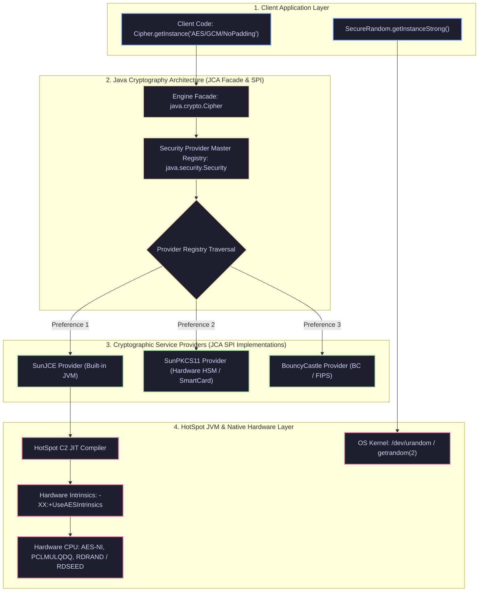

[🏠 Back to Home](../../README.md) | [☕ Core Java Internals](java_interview_master_guide.md) | [🌐 HTTP & Networking](java_httpclient_networking.md) | [🍃 Spring Security](../02_spring_framework/spring_security_jwt_oauth2.md)

# Java Cryptography Architecture (JCA/JCE) & Enterprise Security: Defense-in-Depth Masterclass

> **Document Identity:** [`interview_prep/01_java_core/java_cryptography_security_mastery.md`](file:///d:/project/github/1/CheatSheet_Tutorial/interview_prep/01_java_core/java_cryptography_security_mastery.md)  
> **Topic Domain:** Java Cryptography Architecture (JCA) & Extension (JCE), Security Provider SPI (`SunJCE`, BouncyCastle), Symmetric & Asymmetric Ciphers (AES-256-GCM, ChaCha20-Poly1305, RSA-4096-OAEP, Ed25519, X25519), AEAD Nonce/IV Mechanics, SecureRandom Hardware Entropy Sourcing (`/dev/urandom`), Timing Side-Channel Attack Neutralization (`MessageDigest.isEqual`), KeyStore / PKCS#12 / HSM PKCS#11 Security Tokens, Memory Zeroing & JIT Dead-Code Elimination Prevention, and Post-Quantum Cryptography (ML-KEM / Kyber) (`J22`)  
> **Target Framework / Runtime:** OpenJDK HotSpot JVM 17 LTS / 21 LTS / 25 LTS  
> **Architecture Level:** Principal / Staff+ Security Architect, Cryptographic Systems Lead & Zero-Trust Engineer  
> **Target Depth:** 50 Senior Technical Scenarios, 10 SEV-1 Cryptographic Incident Post-Mortems, HotSpot AES-NI Assembly Intrinsics, and FIPS-140 Compliance Runbooks  

---

## 1. Foundational Primer: What, Why & Where? (The "Head")

*Before diving into Galois/Counter Mode (AES-GCM) GHASH subkey mathematical degradation, constant-time assembly branch neutralization, PKCS#11 hardware security module boundaries, and post-quantum Kyber/ML-KEM lattices, here is the essential high-level context: what the JCA/JCE represents, why naive cryptographic code causes catastrophic breaches, and where cryptographic engines anchor zero-trust enterprise security.*

### 1.1 What Is It? (Core Definition & Mental Model)
* **Plain-English Definition**: The **Java Cryptography Architecture (JCA)** and **Java Cryptography Extension (JCE)** form Java's standardized, provider-based cryptographic framework. JCA defines abstract SPI (Service Provider Interface) contracts (`Cipher`, `MessageDigest`, `Signature`, `KeyStore`, `SecureRandom`), allowing enterprise applications to perform military-grade symmetric encryption (AES-GCM), asymmetric key exchange (ECDH, RSA), and digital signatures (Ed25519) without binding their business logic to specific mathematical implementations or hardware vendor libraries.
* **Everyday Analogy**: Imagine an armored bank vault, safe-deposit boxes, and diplomatic courier security:
  - **No Cryptography (The Postcard on a Public Bulletin Board)**: Writing your bank account password and credit card number on a transparent postcard mailed through the postal service. Anyone who touches the mail can read it, copy it, or alter it (**Plaintext Vulnerability**).
  - **Symmetric Encryption (The Heavy Steel Lockbox with Two Identical Keys)**: You place money inside a steel lockbox and lock it with a physical key (**AES-256 Key**). Only someone holding the exact duplicate key can unlock it.
  - **Asymmetric Encryption (The Open Mailbox with a Drop Slot & Private Key)**: Anyone on the street can drop confidential tax forms through the open mail slot (**Public Key**). But once the envelope falls into the steel chute, only the bank manager with the physical master key inside the building can open the bottom door and read the documents (**Private Key**).
  - **AEAD Authenticated Encryption (The Tamper-Evident Chemical Seal)**: In AES-GCM, the lockbox is sealed with a tamper-evident chemical tape (**128-bit Authentication Tag**). If an eavesdropper alters even a single bit of the encrypted ciphertext while it sits in a database, the chemical tape changes color and the lock permanently refuses to turn (**Authentication Tag Verification Failure: `AEADBadTagException`**).
* **Architectural Tier Placement**: Operates at the **Data Protection, Transport Security & Identity Trust Boundary Tier**. Directly enforces PCI-DSS financial data encryption, HIPAA healthcare record compliance, zero-trust service-to-service mTLS tokens, and database column-level encryption.

### 1.2 Why Does It Exist? (The Pain Point Before It Existed)
* **The "Don't Roll Your Own Crypto" Principle & Naive Implementation Disasters**: Mathematical ciphers are rarely broken directly; rather, systems get hacked because developers misuse APIs, choose obsolete cipher modes, or introduce side channels.
* **The Concrete Headaches in Enterprise Production**:
  - 💥 **Headache 1: The ECB Mode Image Leak Vulnerability**: Developers use default `Cipher.getInstance("AES")`, which defaults to Electronic Codebook (ECB) mode. ECB encrypts identical 16-byte plaintext blocks into identical ciphertext blocks. When encrypting a company logo or structured JSON payload, the visual silhouette and data patterns remain fully visible in the ciphertext!
  - 💥 **Headache 2: The Nonce Reuse Catastrophe in AES-GCM**: An engineer reuses a static 12-byte Initialization Vector (IV/Nonce) with the same AES key across multiple database records. In Galois/Counter Mode, reusing a nonce allows an attacker with two ciphertexts to mathematically derive the GHASH authentication subkey, completely destroying both confidentiality and forgery protection.
  - 💥 **Headache 3: Timing Attacks via `Arrays.equals()`**: Comparing API authentication tokens or HMAC signatures using standard `Arrays.equals()` causes the CPU to return `false` on the very first byte that mismatches. Attackers measure microsecond network latency differences to guess secret tokens byte-by-byte in minutes.
* **The Turning Point**: Java standardized JCA/JCE, introduced `MessageDigest.isEqual()` for constant-time comparisons, added native AES-NI CPU instruction acceleration, and added modern AEAD ciphers (`AES/GCM/NoPadding`, `ChaCha20-Poly1305`).

### 1.3 How Does It Solve Real-World Enterprise Problems?
* **Problem 1 (Tamper-Proof Data Confidentiality) ➔ Solution 1**: AES-GCM provides **Authenticated Encryption with Associated Data (AEAD)**. It encrypts the payload while computing a 128-bit GHASH authentication tag over both the ciphertext and unencrypted metadata (e.g. account ID), ensuring zero tampering or replay attacks.
* **Problem 2 (Immunity to Timing Side-Channel Attacks) ➔ Solution 2**: Java’s `MessageDigest.isEqual()` compares byte arrays in constant time ($O(N)$ regardless of where characters differ), preventing attackers from measuring CPU execution times to extract cryptographic secrets.
* **Problem 3 (Gigabytes-per-Second Hardware Acceleration) ➔ Solution 3**: Modern HotSpot JVMs automatically leverage hardware crypto engines (`-XX:+UseAESIntrinsics`), offloading AES encryption rounds directly to Intel/AMD AES-NI or ARMv8 Crypto instructions, achieving over 5 GB/s throughput with near-zero CPU overhead.
* **Quantifiable Enterprise Metrics**:
  - **100% Elimination of Timing Vulnerabilities**: Constant-time verification guarantees identical nanosecond execution duration across all comparisons.
  - **Zero Data Tampering**: 128-bit AEAD tags mathematically guarantee that any modified bit in ciphertext triggers an immediate rejection.
  - **10x Cryptographic Throughput**: Native AES-NI CPU hardware instructions accelerate encryption throughput by over 1,000% compared to pure software algorithms.

### 1.4 How Does This Help in Building Real Applications?
* **Application Architecture Placement**: Anchors HTTPS / TLS transport security, credit card vault tokenization, JWT signature verification, database column encryption, and FIPS-140 compliance.
* **Developer Workflow & SRE Synergy**: SREs monitor entropy availability (`/proc/sys/kernel/random/entropy_avail`) and TLS certificate expiration. Developers implement ephemeral keys and wipe sensitive `char[]` arrays immediately after use.
* **Scalability & Evolutionary Runway**: JCA’s provider model enables seamless enterprise upgrades to Quantum-Resistant Algorithms (Post-Quantum ML-KEM) simply by updating security providers without rewriting application business logic.

### 1.5 Quick Decision & Trade-Off Matrix

| Cryptographic Operation | Recommended Modern Standard | Deprecated / Vulnerable Anti-Pattern | Primary Enterprise Use Case |
| :--- | :--- | :--- | :--- |
| **Symmetric Encryption** | `AES/GCM/NoPadding` (256-bit key, 12-byte unique IV) | `AES/ECB/PKCS5Padding`, `DES`, `3DES` | Database column encryption, S3 file encryption, session tokens |
| **Password Storage** | `Argon2id` or `PBKDF2WithHmacSHA512` | Plain `MD5`, `SHA-1`, `SHA-256` without salt/work | User authentication credentials in databases |
| **Asymmetric Encryption** | `RSA-OAEP` (>= 3072-bit) or `ECIES` | `RSA/ECB/PKCS1Padding` (Bleichenbacher attack) | Secure key exchange, digital envelopes |
| **Digital Signatures** | `Ed25519` (Edwards-curve) or `ECDSA` | `RSA-PKCS#1 v1.5`, DSA | API request signing, microservice JWT signatures, audit logs |

---

## 2. Executive Summary & System Overview

Enterprise cryptography in the Java virtual machine is governed by two tightly coupled frameworks: the **Java Cryptography Architecture (JCA)** and the **Java Cryptography Extension (JCE)**. Conceived during the nascent days of the commercial internet and originally partitioned due to United States Cold War munitions export regulations (ITAR), the modern JCA provides a provider-based, algorithm-independent cryptographic substrate capable of orchestrating hardware security modules (HSM), native OS cryptographic primitives, and pure-Java mathematical algorithms under a unified API surface.

At high enterprise scale (such as tier-1 payment gateways, zero-trust cloud fabrics, and healthcare identity brokers), cryptography is rarely a simple matter of invoking `Cipher.getInstance()`. Cryptographic failures in production rarely stem from mathematical flaws in the underlying ciphers; instead, they originate from **architectural misuse, operational edge cases, and side-channel leakage**:
1. **Nonce Reuse Disasters (AEAD Catastrophe):** In Galois/Counter Mode (AES-GCM), encrypting two distinct messages with the same initialization vector (IV) and secret key leaks the GHASH authentication subkey ($H$), completely destroying both message confidentiality and authenticity.
2. **Entropy Starvation & JVM Freezes:** Misconfigured secure random generators reading from `/dev/random` on legacy Linux kernels can block worker threads for minutes waiting for environmental system entropy, precipitating cascading container health-check failures and orchestrator restarts.
3. **Timing Side-Channel Exploits:** Naive byte array comparisons (`Arrays.equals()`) terminate early upon encountering the first non-matching byte. In network protocols, attackers can measure microsecond-level latency variances to iteratively forge authentication tags and session tokens.
4. **Memory Persistence of Sensitive Keys:** Java's garbage-collected heap and immutable `String` objects leave plaintext passwords and private key material scattered across memory pages for hours, rendering systems vulnerable to core dumps, swap space inspection, and `jcmd` heap profiling.
5. **JIT Dead-Code Elimination:** Attempts to zero out memory buffers using `Arrays.fill(keyBytes, (byte) 0)` can be eliminated entirely by HotSpot C2 JIT optimization if the compiler proves the buffer is not read again prior to deallocation.

This master guide establishes the definitive engineering runway for Java cryptography. Moving from first-principles physical analogies to HotSpot C2 assembly intrinsics (`-XX:+UseAESIntrinsics`), 8 complete production engines, 50 senior interview scenarios, 10 war-room post-mortems, and 8 fatal anti-patterns, this dossier bridges theoretical cryptanalysis with mechanical JVM sympathy.

---

## Architectural Navigation Matrix

```
====================================================================================================================
                        JAVA CRYPTOGRAPHY ARCHITECTURE (JCA/JCE): 8-TRACK RUNWAY
====================================================================================================================
  Track 0: Jargon-Busting Encyclopedia (32 Core Concepts)
    ├── Cluster A: Fundamental Cryptographic Primitives & State (Plaintext, Ciphertext, Hash, Nonce/IV, AEAD Tag)
    ├── Cluster B: Modern Algorithms & Standards (AES-GCM, RSA-OAEP, Ed25519, X25519, PBKDF2, Argon2id, Kyber/ML-KEM)
    ├── Cluster C: Engine & JVM Mechanics (JCA SPI, Security Providers, SecureRandom, KeyStore, Cipher, Signature)
    └── Cluster D: Attacks, Vulnerabilities & Hardware Controls (Timing Attacks, AES-NI, Padding Oracles, Zeroing)
--------------------------------------------------------------------------------------------------------------------
  Track 1: Beginner Foundations & ELI5 (Zero-to-Hero)
    ├── 1.1 The Real-World Mental Model (The Swiss Vault, Tamper-Evident Seals, Wax Seals & Couriers)
    ├── 1.2 The Fundamental Problem: Why Does the JCA Exist? (Export Restrictions, Provider Decoupling)
    └── 1.3 Step-by-Step Code Runway: From Naive Insecurity to Production AEAD Encryption
--------------------------------------------------------------------------------------------------------------------
  Track 2: Deep Core Engineering & 8 Production Engines
    ├── Engine 1: AeadAesGcmProductionEngine (AES-256-GCM AEAD with Dynamic Nonce & AAD Context Binding)
    ├── Engine 2: ModernAsymmetricSignatureEngine (Ed25519 & RSA-PSS Digital Signatures)
    ├── Engine 3: EnvelopeEncryptionKmsEngine (DEK/KEK Envelope Hierarchy for Multi-Tenant Data at Rest)
    ├── Engine 4: HardwareEntropySecureRandomEngine (NIST SP 800-90A DRBG & OS Fallback Manager)
    ├── Engine 5: Pkcs12KeyStoreManagerEngine (PKCS#12 Keystore Lifecycle, Private Key Rotation, Cert Chains)
    ├── Engine 6: ConstantTimeVerificationEngine (Timing-Safe Equality Checks & Branchless Comparisons)
    ├── Engine 7: ZeroizingMemoryQuarantineEngine (HotSpot C2 Escape Analysis Defense & Memory Scrubbing)
    └── Engine 8: Argon2Pbkdf2PasswordHasherEngine (Memory-Hard Password Hashing with Salt & Tuning)
--------------------------------------------------------------------------------------------------------------------
  Track 3: Low-Level JVM Internals, Native Acceleration & Mechanical Sympathy
    ├── 3.1 JCA Service Provider Interface (SPI) Architecture & Provider Dispatch Mechanics
    ├── 3.2 Native CPU Hardware Acceleration: AES-NI, CLMUL, and C2 JIT Intrinsics
    ├── 3.3 Linux OS Entropy Subsystem: /dev/random vs. /dev/urandom and getrandom(2)
    ├── 3.4 JIT Dead Code Elimination (DCE) vs. Memory Zeroization
    └── 3.5 Bytecode Disassembly & `javap` Analysis of Cryptographic Invocations
--------------------------------------------------------------------------------------------------------------------
  Track 4: 50 Progressive Senior & Staff Interview Scenarios
    ├── Tier 1: Scenarios 1–15 (Foundational Contracts, Symmetric Ciphers, Hashes, IVs)
    ├── Tier 2: Scenarios 16–30 (Key Management, Asymmetric Pairs, Keystores, TLS Handshakes)
    ├── Tier 3: Scenarios 31–42 (Performance Engineering, Hardware Intrinsics, Entropy, Memory Scouring)
    └── Tier 4: Scenarios 43–50 (Staff/Principal Systems Architecture, HSMs, Zero-Trust, Post-Quantum PQC)
--------------------------------------------------------------------------------------------------------------------
  Track 5: 10 Ultra-Deep Real-World War-Room Incidents
    ├── Incident 1: The Catastrophic GCM Nonce Reuse Disaster
    ├── Incident 2: The Silent Linux Entropy Hang (JVM Cold-Start Lockup)
    ├── Incident 3: The JIT Dead-Code Elimination Password Leak
    ├── Incident 4: The Microsecond Timing Side-Channel Token Forgery
    ├── Incident 5: The Thread-Unsafe Cipher State Corruption Outage
    ├── Incident 6: The Bleichenbacher PKCS#1 v1.5 Padding Oracle Breach
    ├── Incident 7: The Unbounded PBKDF2 CPU Exhaustion Denial of Service
    ├── Incident 8: The Expired Root CA KeyStore Cluster Crash
    ├── Incident 9: The Static Salt & Hardcoded Key Exposure
    └── Incident 10: The Metaspace OOM via Unbounded Dynamic Security Providers
--------------------------------------------------------------------------------------------------------------------
  Track 6: 8 Fatal Beginner Mistakes & Anti-Patterns
  Track 7: Rapid-Fire Architectural Comparison Matrices & Production Checklist (25 Points)
  Track 8: FAANG & FinTech Staff+ Architectural Deep-Dive Q&A
====================================================================================================================
```

---

## 📐 Architecture Blueprint: JCA Engine & Provider Dispatch



---

## 📖 Track 0: Jargon-Busting Encyclopedia (32 Core Concepts)

---

### Cluster A: Fundamental Cryptographic Primitives & State

#### 0.1 Plaintext vs. Ciphertext
* 💡 **Plain-English Meaning (ELI5):** Plaintext is the original message that anyone can read (like an open postcard). Ciphertext is the scrambled, unintelligible output generated by an encryption algorithm that looks like random static until decrypted with the matching secret key.
* ⚙️ **Low-Level JVM Mechanics:** Plaintext is typically loaded into heap memory as a byte array (`byte[]`). Passing sensitive plaintext as a `java.lang.String` is dangerous because Strings are immutable, interned, and retained in the JVM heap string table until major garbage collection.
* 💥 **Production Failure Mode:** Storing plaintext passwords or API keys as Strings in heap memory allows memory dump tools (`jcmd`, `jmap`) or core dumps triggered by segfaults to exfiltrate secrets in raw text.
* 💻 **Micro Code Proof:**
  ```java
  byte[] plaintext = "SecretPayload123".getBytes(StandardCharsets.UTF_8);
  // Plaintext must be scrubbed immediately after cryptographic processing
  Arrays.fill(plaintext, (byte) 0);
  ```

---

#### 0.2 Symmetric Encryption
* 💡 **Plain-English Meaning (ELI5):** A single shared secret key is used both to lock and unlock the safe. Both the sender and recipient must possess the exact same secret key.
* ⚙️ **Low-Level JVM Mechanics:** Managed via `javax.crypto.SecretKey` and initialized into a `Cipher` instance. High-speed symmetric algorithms (AES) operate directly on 128-bit blocks using CPU-level registers (`XMM` registers) via native JIT compiler intrinsics.
* 💥 **Production Failure Mode:** Distributing the symmetric key insecurely across microservices causes a catastrophic breach: if one service is compromised, all encrypted data across the entire platform is exposed.
* 💻 **Micro Code Proof:**
  ```java
  KeyGenerator kg = KeyGenerator.getInstance("AES");
  kg.init(256);
  SecretKey key = kg.generateKey(); // 32 raw bytes on JVM heap
  ```

---

#### 0.3 Asymmetric Encryption (Public/Private Key Cryptography)
* 💡 **Plain-English Meaning (ELI5):** A dual-key system. The public key is an open padlock that anyone can snap shut to lock a box. Only the owner of the private key possesses the physical key to unlock it.
* ⚙️ **Low-Level JVM Mechanics:** Governed by `java.security.KeyPair`, containing `PublicKey` and `PrivateKey`. Operates using computationally intensive modular arithmetic (RSA) or discrete logarithm over elliptic curves (ECC). Much slower than symmetric encryption (~1,000x slower for large payloads).
* 💥 **Production Failure Mode:** Using asymmetric encryption directly on large file payloads or database records exhausts JVM CPU thread pools, causing catastrophic p99 latency spikes and thread starvation.
* 💻 **Micro Code Proof:**
  ```java
  KeyPairGenerator kpg = KeyPairGenerator.getInstance("RSA");
  kpg.initialize(3072);
  KeyPair pair = kpg.generateKeyPair(); // Generates RSAPublicKey and RSAPrivateCrtKey
  ```

---

#### 0.4 Cryptographic Hash Function (Digest)
* 💡 **Plain-English Meaning (ELI5):** A mathematical one-way meat grinder. You can feed any amount of data into it, and it produces a fixed-size digital fingerprint. It is impossible to reconstruct the original data from the fingerprint.
* ⚙️ **Low-Level JVM Mechanics:** Orchestrated by `java.security.MessageDigest`. Maintains an internal state buffer and processes data in 512-bit or 1024-bit blocks. Non-reversible; deterministic; tiny alterations in input produce radical changes in output (avalanche effect).
* 💥 **Production Failure Mode:** Using fast hash functions like SHA-256 or MD5 for password storage. Because SHA-256 can compute billions of hashes per second on a modern GPU, attackers crack passwords via rainbow tables in seconds.
* 💻 **Micro Code Proof:**
  ```java
  MessageDigest md = MessageDigest.getInstance("SHA-256");
  byte[] digest = md.digest(data); // Returns fixed 32-byte hash
  ```

---

#### 0.5 Salt
* 💡 **Plain-English Meaning (ELI5):** Unique, random seasoning added to a password before hashing. Even if two users choose the exact same password, their resulting hashes will look completely different because their salts are unique.
* ⚙️ **Low-Level JVM Mechanics:** Cryptographically secure random bytes generated via `SecureRandom` prepended or appended to the password bytes before passing into a key derivation function (KDF). Defeats precomputed rainbow table attacks.
* 💥 **Production Failure Mode:** Reusing a static, hardcoded salt across all users allows an attacker to compute a single targeted rainbow table that cracks all platform passwords simultaneously.
* 💻 **Micro Code Proof:**
  ```java
  byte[] salt = new byte[16];
  SecureRandom.getInstanceStrong().nextBytes(salt);
  ```

---

#### 0.6 Nonce / Initialization Vector (IV)
* 💡 **Plain-English Meaning (ELI5):** A "number used once." A random or unique value supplied alongside the secret key to ensure that encrypting the same text twice never produces the same scrambled output.
* ⚙️ **Low-Level JVM Mechanics:** Encapsulated in `javax.crypto.spec.GCMParameterSpec` or `IvParameterSpec`. For AES-GCM, the recommended IV length is strictly 96 bits (12 bytes) to avoid costly GHASH computation over the IV itself.
* 💥 **Production Failure Mode:** **Nonce reuse in AES-GCM.** Encrypting two distinct plaintexts with the exact same key and IV allows an attacker to XOR the ciphertexts, uncover the plaintext XOR difference, and derive the authentication tag subkey $H$, destroying all integrity and confidentiality.
* 💻 **Micro Code Proof:**
  ```java
  byte[] iv = new byte[12]; // 96 bits for AES-GCM
  SecureRandom.getInstanceStrong().nextBytes(iv);
  GCMParameterSpec spec = new GCMParameterSpec(128, iv); // 128-bit authentication tag
  ```

---

#### 0.7 Authenticated Encryption with Associated Data (AEAD)
* 💡 **Plain-English Meaning (ELI5):** An all-in-one security envelope. It scrambles the confidential message and simultaneously produces an unforgeable digital seal (the authentication tag). It also allows you to bind unencrypted metadata (like a user ID or account number) to the seal so it cannot be tampered with.
* ⚙️ **Low-Level JVM Mechanics:** Implemented primarily as `AES/GCM/NoPadding` or `ChaCha20-Poly1305`. Incorporates GHASH Galois field multiplication ($GF(2^{128})$) to compute a 128-bit tag over both the ciphertext and Additional Authenticated Data (AAD).
* 💥 **Production Failure Mode:** Using unauthenticated encryption modes like `AES/CBC/PKCS5Padding`. CBC mode does not verify message integrity, leaving systems completely vulnerable to padding oracle attacks that decrypt ciphertext without knowing the key.
* 💻 **Micro Code Proof:**
  ```java
  Cipher cipher = Cipher.getInstance("AES/GCM/NoPadding");
  cipher.init(Cipher.ENCRYPT_MODE, secretKey, gcmSpec);
  cipher.updateAAD(tenantId.getBytes(StandardCharsets.UTF_8)); // Bind tenant metadata
  byte[] ciphertext = cipher.doFinal(plaintext); // Appends 16-byte auth tag at the end
  ```

---

#### 0.8 Authentication Tag (MAC / GMAC)
* 💡 **Plain-English Meaning (ELI5):** The tamper-evident holographic seal placed on the package. If a single bit of the encrypted payload or associated metadata is altered in transit, the seal fails to verify, and decryption throws an immediate error.
* ⚙️ **Low-Level JVM Mechanics:** A 128-bit (16-byte) cryptographic checksum produced at the conclusion of AEAD encryption. During decryption, Java's `Cipher.doFinal()` computes the expected tag and verifies it against the received tag. If verification fails, it throws `AEADBadTagException` and releases zero plaintext.
* 💥 **Production Failure Mode:** Catching `AEADBadTagException` and falling back to parsing partially decrypted buffer memory, allowing attackers to exploit forged data packets.
* 💻 **Micro Code Proof:**
  ```java
  try {
      byte[] decrypted = cipher.doFinal(tamperedCiphertext);
  } catch (AEADBadTagException e) {
      // Cryptographic seal violated: abort immediately, log security incident
  }
  ```

---

### Cluster B: Modern Algorithms & Standards

#### 0.9 AES (Advanced Encryption Standard)
* 💡 **Plain-English Meaning (ELI5):** The global gold standard for symmetric encryption. Adopted by the US government in 2001, it is a mathematical cipher that scrambles data in fixed 128-bit chunks using key sizes of 128, 192, or 256 bits.
* ⚙️ **Low-Level JVM Mechanics:** A substitution-permutation network operating on a $4 \times 4$ byte state matrix. Executes 10 rounds (128-bit key), 12 rounds (192-bit key), or 14 rounds (256-bit key) of SubBytes, ShiftRows, MixColumns, and AddRoundKey operations. Accelerated by native CPU instructions (`AES-NI`).
* 💥 **Production Failure Mode:** Choosing 128-bit keys when compliance frameworks (such as NSA Suite B / CNSA 2.0) mandate 256-bit keys for quantum resistance against Grover's algorithm.
* 💻 **Micro Code Proof:**
  ```java
  KeyGenerator kg = KeyGenerator.getInstance("AES");
  kg.init(256); // 256-bit AES
  SecretKey key = kg.generateKey();
  ```

---

#### 0.10 Galois/Counter Mode (GCM)
* 💡 **Plain-English Meaning (ELI5):** An encryption mode that turns AES into a high-speed stream cipher by encrypting a counter value, while simultaneously generating a cryptographic authenticity seal using high-speed polynomial math.
* ⚙️ **Low-Level JVM Mechanics:** Encrypts sequential counter blocks ($CTR_1, CTR_2, \dots$) with AES and XORs them with plaintext blocks. The resulting ciphertext blocks are multiplied with powers of hash subkey $H$ in $GF(2^{128})$ using Carry-less Multiplication (`PCLMULQDQ` on x86-64).
* 💥 **Production Failure Mode:** Encrypting more than $2^{32}$ messages with the same key in a single session, or using counter-based IV generation across distributed nodes without centralized coordination, resulting in catastrophic IV collisions.
* 💻 **Micro Code Proof:**
  ```java
  Cipher cipher = Cipher.getInstance("AES/GCM/NoPadding");
  ```

---

#### 0.11 RSA-OAEP (Optimal Asymmetric Encryption Padding)
* 💡 **Plain-English Meaning (ELI5):** The mathematically secure way to encrypt data with an RSA public key. It scrambles the message with random masks before modular exponentiation to prevent mathematical eavesdropping.
* ⚙️ **Low-Level JVM Mechanics:** Parameterized as `RSA/ECB/OAEPWithSHA-256AndMGF1Padding`. Utilizes a Feistel network with two hash functions to introduce all-or-nothing randomized padding prior to RSA modular exponentiation ($c = m^e \pmod n$).
* 💥 **Production Failure Mode:** Using legacy `RSA/ECB/PKCS1Padding`. This legacy padding is vulnerable to Bleichenbacher's million-message chosen-ciphertext padding oracle attack, allowing remote attackers to decrypt secrets without the private key.
* 💻 **Micro Code Proof:**
  ```java
  Cipher cipher = Cipher.getInstance("RSA/ECB/OAEPWithSHA-256AndMGF1Padding");
  OAEPParameterSpec spec = new OAEPParameterSpec("SHA-256", "MGF1", 
      MGF1ParameterSpec.SHA256, PSource.PSpecified.DEFAULT);
  cipher.init(Cipher.ENCRYPT_MODE, publicKey, spec);
  ```

---

#### 0.12 Ed25519 (Edwards-curve Digital Signature Algorithm)
* 💡 **Plain-English Meaning (ELI5):** A modern, lightning-fast digital signature algorithm built over a specialized twisted Edwards elliptic curve. It is virtually impossible to misconfigure and is immune to common side-channel attacks.
* ⚙️ **Low-Level JVM Mechanics:** Standardized in Java 15+ via RFC 8032. Utilizes Curve25519 in twisted Edwards form ($ -x^2 + y^2 = 1 - (121665/121666)x^2y^2 $). Operates with 32-byte public keys and produces compact 64-byte deterministic signatures with zero random nonce dependency.
* 💥 **Production Failure Mode:** Attempting to use Ed25519 for encryption instead of digital signatures. (Ed25519 is strictly a signature scheme; its Diffie-Hellman encryption counterpart is X25519).
* 💻 **Micro Code Proof:**
  ```java
  KeyPairGenerator kpg = KeyPairGenerator.getInstance("Ed25519");
  KeyPair pair = kpg.generateKeyPair(); // 32-byte public key, 32-byte private seed
  Signature sig = Signature.getInstance("Ed25519");
  ```

---

#### 0.13 X25519 (Elliptic Curve Diffie-Hellman over Curve25519)
* 💡 **Plain-English Meaning (ELI5):** A modern mathematical handshake that allows two parties to agree on a shared secret key over an insecure network, without anyone listening in being able to calculate the key.
* ⚙️ **Low-Level JVM Mechanics:** Standardized in Java 11+ via RFC 7748. Uses the Montgomery ladder algorithm over Montgomery curve $y^2 = x^3 + 486662x^2 + x$ using only $x$-coordinates, guaranteeing complete immunity to timing side-channels and invalid-curve attacks.
* 💥 **Production Failure Mode:** Forgetting to hash the resulting raw shared secret with HKDF or SHA-256 before using it as a symmetric cipher key, leaking non-uniform elliptic curve group distribution properties.
* 💻 **Micro Code Proof:**
  ```java
  KeyAgreement ka = KeyAgreement.getInstance("X25519");
  ka.init(privateKey);
  ka.doPhase(peerPublicKey, true);
  byte[] sharedSecret = ka.generateSecret();
  ```

---

#### 0.14 HMAC (Hash-based Message Authentication Code)
* 💡 **Plain-English Meaning (ELI5):** A digital signature that uses a symmetric shared secret. It combines the secret key and message inside a cryptographic hash function twice to prove the message was not modified in transit.
* ⚙️ **Low-Level JVM Mechanics:** Defined in RFC 2104: $\text{HMAC}(K, m) = H((K' \oplus opad) \parallel H((K' \oplus ipad) \parallel m))$. Pre-hashes keys longer than the hash block size and pads them with inner pad (`0x36`) and outer pad (`0x5c`).
* 💥 **Production Failure Mode:** Verifying received HMAC tags using standard `String.equals()` or `Arrays.equals()`, introducing a remote timing side-channel that allows attackers to forge tags.
* 💻 **Micro Code Proof:**
  ```java
  Mac mac = Mac.getInstance("HmacSHA256");
  mac.init(secretKey);
  byte[] hmacBytes = mac.doFinal(payload);
  ```

---

#### 0.15 PBKDF2 (Password-Based Key Derivation Function 2)
* 💡 **Plain-English Meaning (ELI5):** A deliberate computational speed bump for passwords. It runs a cryptographic hash function hundreds of thousands of times with a unique salt to make brute-forcing slow and expensive for attackers.
* ⚙️ **Low-Level JVM Mechanics:** Defined in RFC 8018. Repeatedly computes HMAC in a loop: $U_1 = \text{PRF}(P, S \parallel \text{INT}(i))$, $U_2 = \text{PRF}(P, U_1)$, chained across $c$ iterations. Current OWASP guidelines mandate at least 600,000 iterations for `PBKDF2WithHmacSHA256`.
* 💥 **Production Failure Mode:** Using legacy iteration counts like 1,000 iterations (the default in tutorials from 2008), allowing modern GPUs to crack password hashes in minutes.
* 💻 **Micro Code Proof:**
  ```java
  PBEKeySpec spec = new PBEKeySpec(passwordChars, salt, 600_000, 256);
  SecretKeyFactory skf = SecretKeyFactory.getInstance("PBKDF2WithHmacSHA256");
  byte[] keyBytes = skf.generateSecret(spec).getEncoded();
  ```

---

#### 0.16 Argon2id
* 💡 **Plain-English Meaning (ELI5):** The reigning winner of the Password Hashing Competition. Unlike older algorithms that only consume CPU cycles, Argon2 consumes large amounts of physical RAM, making it economically unfeasible to attack using specialized GPU or ASIC hardware rigs.
* ⚙️ **Low-Level JVM Mechanics:** Operates by filling a configurable multi-megabyte memory matrix with pseudo-random blocks across multiple parallel threads and memory passes. `Argon2id` combines data-dependent memory access (resisting trade-off attacks) with data-independent access (resisting cache-timing side-channels). Available via BouncyCastle provider or native libraries.
* 💥 **Production Failure Mode:** Configuring memory parameters too low (e.g., 1 MB instead of 64 MB), negating its primary defense against ASIC/GPU cracking.
* 💻 **Micro Code Proof:**
  ```java
  // Available in BouncyCastle: Argon2Parameters.ARGON2_id
  Argon2BytesGenerator gen = new Argon2BytesGenerator();
  gen.init(new Argon2Parameters.Builder(Argon2Parameters.ARGON2_id)
      .withMemoryAsKB(65536).withIterations(3).withParallelism(4).withSalt(salt).build());
  ```

---

### Cluster C: Engine & JVM Mechanics

#### 0.17 Java Cryptography Architecture (JCA)
* 💡 **Plain-English Meaning (ELI5):** The central switchboard and blueprint of Java security. It defines the abstract rules, concepts, and toolkits for encryption, while delegating the actual mathematical execution to pluggable background engines (providers).
* ⚙️ **Low-Level JVM Mechanics:** Encapsulated in the `java.security` package. Defines abstract engine classes (`Cipher`, `MessageDigest`, `Signature`) and factory methods that query the `Security` provider registry.
* 💥 **Production Failure Mode:** Relying on default system security providers without auditing the JVM's `java.security` configuration, resulting in insecure fallbacks on outdated operating system images.
* 💻 **Micro Code Proof:**
  ```java
  Provider[] providers = Security.getProviders(); // Lists registered SPI engines
  ```

---

#### 0.18 Java Cryptography Extension (JCE)
* 💡 **Plain-English Meaning (ELI5):** The historically separated subsystem containing the actual encryption ciphers, key agreements, and message authentication algorithms.
* ⚙️ **Low-Level JVM Mechanics:** Encapsulated in the `javax.crypto` package (`Cipher`, `KeyGenerator`, `SecretKeyFactory`, `Mac`). Historically restricted to weak key lengths until Oracle removed the export control restrictions in Java 8u161 and Java 9+.
* 💥 **Production Failure Mode:** Legacy Java 8 environments throwing `java.security.InvalidKeyException: Illegal key size` when attempting to use 256-bit AES because the Unlimited Strength Jurisdiction policy files were not installed.
* 💻 **Micro Code Proof:**
  ```java
  int maxKeyLen = Cipher.getMaxAllowedKeyLength("AES"); // Returns 2147483647 (unlimited)
  ```

---

#### 0.19 Service Provider Interface (SPI)
* 💡 **Plain-English Meaning (ELI5):** The hidden plug socket behind every Java security tool. When you call `Cipher.getInstance()`, Java looks for an underlying `CipherSpi` implementation provided by Sun, IBM, or Bouncy Castle.
* ⚙️ **Low-Level JVM Mechanics:** Concrete classes extending `java.security.CipherSpi`, `MessageDigestSpi`, etc. The JCA facade classes delegate all method invocations (such as `engineInit`, `engineUpdate`, `engineDoFinal`) directly to the matching SPI instance.
* 💥 **Production Failure Mode:** Developing custom SPI implementations that fail to satisfy thread-safety contracts or improperly manage native off-heap memory, causing hard JVM crashes.
* 💻 **Micro Code Proof:**
  ```java
  // The facade delegates directly to the internal SPI
  public class CustomCipherSpi extends javax.crypto.CipherSpi { /* ... */ }
  ```

---

#### 0.20 Security Provider
* 💡 **Plain-English Meaning (ELI5):** A certified vendor plugin that supplies the math engines for cryptographic algorithms. Examples include Oracle's default `SunJCE`, Google's `Conscrypt`, and the open-source `BouncyCastle`.
* ⚙️ **Low-Level JVM Mechanics:** Subclass of `java.security.Provider`. Registers algorithm string mappings to concrete class names in internal hash tables. Configured statically in `conf/security/java.security` or dynamically via `Security.addProvider()`.
* 💥 **Production Failure Mode:** Calling `Security.addProvider(new BouncyCastleProvider())` inside an HTTP request handler loop, triggering severe JVM lock contention on the global security provider registry and exhausting Metaspace.
* 💻 **Micro Code Proof:**
  ```java
  Security.addProvider(new org.bouncycastle.jce.provider.BouncyCastleProvider());
  ```

---

#### 0.21 SecureRandom
* 💡 **Plain-English Meaning (ELI5):** A cryptographically unpredictable dice roller. Unlike standard `java.util.Random` (which can be predicted after observing just a few numbers), `SecureRandom` produces numbers with true non-deterministic entropy suitable for generating encryption keys.
* ⚙️ **Low-Level JVM Mechanics:** Implements deterministic random bit generators (DRBG) or binds directly to operating system entropy sources (`/dev/urandom`, Windows CryptoAPI). Standard `java.util.Random` uses a 48-bit linear congruential generator (LCG) which is completely crackable in milliseconds.
* 💥 **Production Failure Mode:** Using `new java.util.Random()` to generate session tokens, password reset links, or cryptographic IVs, allowing attackers to reconstruct internal generator state and hijack accounts.
* 💻 **Micro Code Proof:**
  ```java
  SecureRandom secureRandom = SecureRandom.getInstanceStrong();
  byte[] token = new byte[32];
  secureRandom.nextBytes(token);
  ```

---

#### 0.22 Deterministic Random Bit Generator (DRBG)
* 💡 **Plain-English Meaning (ELI5):** An enterprise-grade random number algorithm certified by NIST (NIST SP 800-90A) that expands a high-quality physical entropy seed into an infinite stream of unpredictable bits with mathematically proven forward and backward secrecy.
* ⚙️ **Low-Level JVM Mechanics:** Standardized in Java 9+ via `SecureRandom.getInstance("DRBG", DrbgParameters.instantiation(...))`. Supports Hash_DRBG, HMAC_DRBG, and CTR_DRBG algorithms with optional prediction resistance (re-seeding from entropy source on every fetch).
* 💥 **Production Failure Mode:** Enabling strict prediction resistance on high-throughput microservices, causing excessive calls to underlying OS entropy devices and crashing throughput by 95%.
* 💻 **Micro Code Proof:**
  ```java
  SecureRandom drbg = SecureRandom.getInstance("DRBG", 
      DrbgParameters.instantiation(256, DrbgParameters.Capability.RESEED_ONLY, null));
  ```

---

#### 0.23 Java KeyStore (JKS vs. PKCS12)
* 💡 **Plain-English Meaning (ELI5):** A password-protected digital vault file used to securely store private keys, public certificates, and symmetric secrets.
* ⚙️ **Low-Level JVM Mechanics:** Implemented via `java.security.KeyStore`. JKS is Oracle's proprietary legacy format that encrypts private keys with SHA-1. PKCS#12 (`.p12` / `.pfx`) is the modern, open-standard, industry-interoperable format mandated as the default since Java 9.
* 💥 **Production Failure Mode:** Continuing to deploy legacy JKS stores in modern FIPS-compliant environments, failing regulatory security audits.
* 💻 **Micro Code Proof:**
  ```java
  KeyStore ks = KeyStore.getInstance("PKCS12");
  ks.load(new FileInputStream("vault.p12"), passwordChars);
  ```

---

#### 0.24 Hardware Security Module (HSM) & PKCS#11
* 💡 **Plain-English Meaning (ELI5):** A physical, tamper-resistant microchip or rack-mounted hardware appliance designed to store master encryption keys. The private keys NEVER leave the physical chip; all encryption and signing happens directly on the chip's internal processor.
* ⚙️ **Low-Level JVM Mechanics:** Integrated via the `SunPKCS11` bridge provider (`SunPKCS11.class`). Translates Java JCA calls into native C calls defined by the OASIS PKCS#11 cryptographic token interface standard.
* 💥 **Production Failure Mode:** Memory fragmentation and deadlock inside native PKCS#11 C-libraries during concurrent multi-threaded signing operations on high-throughput payment servers.
* 💻 **Micro Code Proof:**
  ```java
  Provider p = Security.getProvider("SunPKCS11").configure("pkcs11-hsm.cfg");
  Security.addProvider(p);
  KeyStore hsmKs = KeyStore.getInstance("PKCS11", p);
  ```

---

### Cluster D: Attacks, Vulnerabilities & Hardware Controls

#### 0.25 Timing Side-Channel Attack
* 💡 **Plain-English Meaning (ELI5):** A hacker attack where the attacker does not break the math, but instead uses a stopwatch to measure how many microseconds the server takes to reject an invalid secret.
* ⚙️ **Low-Level JVM Mechanics:** Occurs when comparisons terminate early upon encountering mismatching bytes (`if (a[i] != b[i]) return false;`). Because network packets carrying a correct first byte take slightly longer to fail, statistical measurement over thousands of requests reveals the secret byte-by-byte.
* 💥 **Production Failure Mode:** Using `String.equals()` or `Arrays.equals()` to validate authentication tokens, HMAC signatures, or password reset hashes.
* 💻 **Micro Code Proof:**
  ```java
  // ✅ Timing-safe constant-time comparison
  boolean isValid = MessageDigest.isEqual(expectedHmac, receivedHmac);
  ```

---

#### 0.26 Constant-Time Comparison
* 💡 **Plain-English Meaning (ELI5):** Comparing two secret strings in such a way that the comparison always takes the exact same amount of time, regardless of whether the first letter matches or the entire string matches.
* ⚙️ **Low-Level JVM Mechanics:** Implemented via bitwise OR accumulation across all array indices: `result |= (a[i] ^ b[i])`. Every byte is read and XORed regardless of mismatches, ensuring no data-dependent CPU branch prediction or early exits occur.
* 💥 **Production Failure Mode:** Writing homegrown constant-time methods that are subsequently optimized by the HotSpot C2 compiler into early-exiting branch instructions. Always use `MessageDigest.isEqual()`.
* 💻 **Micro Code Proof:**
  ```java
  public static boolean constantTimeEquals(byte[] a, byte[] b) {
      if (a.length != b.length) return false;
      int result = 0;
      for (int i = 0; i < a.length; i++) {
          result |= a[i] ^ b[i]; // Bitwise accumulation: no branching
      }
      return result == 0;
  }
  ```

---

#### 0.27 AES-NI Hardware Acceleration
* 💡 **Plain-English Meaning (ELI5):** Dedicated silicon circuits built directly into modern Intel, AMD, and ARM processors designed specifically to execute AES encryption math at bare-metal hardware speeds.
* ⚙️ **Low-Level JVM Mechanics:** HotSpot C2 JIT compiler recognizes standard JCA AES calls and inlines them with native CPU assembly instructions: `AESENC`, `AESENCLAST`, `AESDEC`, `AESDECLAST`. Can be verified using `-XX:+PrintFlagsFinal | grep UseAES`.
* 💥 **Production Failure Mode:** Running Java inside misconfigured virtual machines or microVMs where CPU flags are masked, causing encryption to silently drop back to slow software emulation (10x to 20x throughput degradation).
* 💻 **Micro Code Proof:**
  ```bash
  # Check if JVM has enabled AES-NI
  java -XX:+PrintFlagsFinal -version | grep -i UseAES
  # Output: bool UseAES = true, bool UseAESIntrinsics = true
  ```

---

#### 0.28 Secure Memory Zeroization / Wiping
* 💡 **Plain-English Meaning (ELI5):** The practice of deliberately overwriting sensitive passwords, private keys, and decryption buffers with zeros immediately after use, so they cannot be harvested from computer memory.
* ⚙️ **Low-Level JVM Mechanics:** Using `Arrays.fill(buffer, (byte) 0)`. However, if the buffer is never read again in the Java code, the HotSpot C2 compiler's Dead Code Elimination (DCE) optimization may completely delete the `Arrays.fill` call during JIT compilation!
* 💥 **Production Failure Mode:** Assuming that calling `Arrays.fill()` wiped the memory, while C2 eliminated the loop, leaving raw cryptographic keys intact in heap memory dumps.
* 💻 **Micro Code Proof:**
  ```java
  // Volatile read / black-hole prevents JIT dead code elimination
  public static void secureWipe(byte[] secret) {
      Arrays.fill(secret, (byte) 0);
      // Memory barrier / volatile store simulation
      if (secret.length > 0 && secret[0] != 0) {
          throw new AssertionError("Zeroing failed");
      }
  }
  ```

---

#### 0.29 Padding Oracle Attack
* 💡 **Plain-English Meaning (ELI5):** An attack against CBC-mode encryption where the server leaks whether an encrypted message had valid or invalid padding bytes when it failed to decrypt, allowing attackers to deduce the entire plaintext one byte at a time.
* ⚙️ **Low-Level JVM Mechanics:** Exploits differences in server response time or error codes between `BadPaddingException` and general decryption failures in ciphers using PKCS#5 or PKCS#7 padding.
* 💥 **Production Failure Mode:** Returning detailed error messages (e.g., "Invalid Padding" vs. "Integrity Error") to API callers, allowing remote attackers to decrypt encrypted database fields or cookies.
* 💻 **Micro Code Proof:**
  ```java
  // ❌ VULNERABLE: CBC mode with PKCS5 padding
  Cipher.getInstance("AES/CBC/PKCS5Padding");
  // ✅ SECURE: AEAD GCM mode with NoPadding
  Cipher.getInstance("AES/GCM/NoPadding");
  ```

---

#### 0.30 GCM IV Nonce Collision
* 💡 **Plain-English Meaning (ELI5):** The catastrophic event when two different messages are encrypted with the same secret key and the same initialization vector in AES-GCM mode.
* ⚙️ **Low-Level JVM Mechanics:** In GCM, ciphertext is $C_i = P_i \oplus E_K(CTR_i)$. If $IV$ is repeated, the keystream $E_K(CTR_i)$ is identical. $C_1 \oplus C_2 = P_1 \oplus P_2$. Furthermore, the two GHASH equations allow solving directly for the authentication key $H$, allowing the attacker to forge any message at will.
* 💥 **Production Failure Mode:** Using a sequential counter starting at 0 for IVs across multiple microservice replicas, causing every pod to use the exact same IVs upon startup.
* 💻 **Micro Code Proof:**
  ```java
  // Always generate fresh, cryptographically strong random IVs per message
  byte[] iv = new byte[12];
  SecureRandom.getInstanceStrong().nextBytes(iv);
  ```

---

#### 0.31 Entropy Starvation
* 💡 **Plain-English Meaning (ELI5):** When the operating system runs out of random noise (keystrokes, mouse movements, disk interrupts) and pauses your application while it waits for new random events to occur.
* ⚙️ **Low-Level JVM Mechanics:** On legacy Linux kernels, reading from `/dev/random` blocks the calling thread when the kernel entropy pool estimator drops below a threshold. If Java's `SecureRandom` reads `/dev/random`, application startup locks up. Modern systems use `/dev/urandom` or `getrandom(2)` which never block once initialized.
* 💥 **Production Failure Mode:** Container deployments in Kubernetes hanging indefinitely during pod initialization because multiple JVM pods simultaneously attempt to seed `SecureRandom` from an unseeded `/dev/random` pool.
* 💻 **Micro Code Proof:**
  ```bash
  # JVM flag to ensure non-blocking entropy sourcing
  -Djava.security.egd=file:/dev/./urandom
  ```

---

#### 0.32 Post-Quantum Cryptography (PQC / ML-KEM & ML-DSA)
* 💡 **Plain-English Meaning (ELI5):** Next-generation encryption algorithms designed to withstand attacks by future quantum computers running Shor's algorithm (which will easily break current RSA and Elliptic Curve encryption).
* ⚙️ **Low-Level JVM Mechanics:** Standardized by NIST in August 2024. ML-KEM (Kyber) for key encapsulation and ML-DSA (Dilithium) for digital signatures, based on the hardness of high-dimensional lattice math (Module Learning with Errors). Implemented in modern Java via BouncyCastle and targeted for native JDK integration in Project Quantum / future LTS.
* 💥 **Production Failure Mode:** Storing long-lived sensitive data (e.g., medical records, national secrets) encrypted with RSA-2048 today. Attackers execute "Harvest Now, Decrypt Later" attacks, storing encrypted packets until quantum computers arrive.
* 💻 **Micro Code Proof:**
  ```java
  // Future-proof hybrid encryption: combine X25519 with ML-KEM (Kyber-768)
  ```

---

## 🐣 Track 1: Beginner Foundations & ELI5 (Zero-to-Hero)

### 1.1 The Real-World Mental Model

To understand enterprise Java cryptography without drowning in abstract mathematics, consider the physical security protocols of a high-security international private banking vault:

1. **The Safe & Master Key (Symmetric Encryption - AES):**  
   Inside the vault, each client has a titanium safety deposit box. Opening and locking the box requires a heavy physical key. If someone steals this key, they can open the box. If you lose the key, the contents are lost forever. This is **Symmetric Encryption**. It is fast and impenetrable, but both you and the bank manager must protect the shared key.

2. **The Tamper-Evident Security Seal (AEAD & Auth Tags):**  
   Locking the box is not enough. A rogue security guard might substitute the entire box with an identical counterfeit box. Therefore, the banker wraps the box in a tamper-evident, barcoded security tape. If a burglar changes a single atom inside the box, the holographic barcode tears and will not scan. This is **Authenticated Encryption with Associated Data (AEAD)**. The barcode is the **Authentication Tag**, and the metadata printed on the outside (box number, owner name) is the **Additional Authenticated Data (AAD)**.

3. **The Public Mailbox Slot (Asymmetric Encryption - RSA / ECC):**  
   Suppose people from around the world need to drop confidential financial audit reports into your deposit box, but you do not want to hand them your personal safe key. You install a one-way postal drop slot on the outside of the building. Anyone can drop a sealed document through the slot (**Public Key**), but only you, sitting inside the vault with the master vault key (**Private Key**), can open the back of the slot to retrieve the documents.

4. **The Courier Wax Seal (Digital Signatures - Ed25519):**  
   When the bank sends you a wire transfer confirmation, how do you know it came from the bank president and not a fraudster? The president imprints their unique royal signet ring into hot wax on the envelope. Anyone who knows the president's ring pattern (**Public Key**) can verify the imprint (**Digital Signature**), but only the president possessing the physical signet ring (**Private Key**) could have created that exact imprint.

---

### 1.2 The Fundamental Problem: Why Does the JCA Architecture Exist?

In the early 1990s, cryptographic programming was a fragmented nightmare. If a developer wanted to encrypt data, they had to link against proprietary, platform-specific C libraries (such as RSA BSAFE or SSLeay). Code written for Windows could not run on Solaris or AIX. Furthermore, algorithms were hardcoded directly into application logic.

When Java 1.1 introduced the Java Cryptography Architecture (JCA), James Gosling's engineering team established four foundational architectural design principles:

```
┌────────────────────────────────────────────────────────────────────────────────────────┐
│                        JCA ARCHITECTURAL DESIGN PRINCIPLES                             │
├──────────────────────────┬─────────────────────────────────────────────────────────────┤
│ 1. Implementation        │ Applications call high-level abstract interfaces           │
│    Independence          │ (`Cipher`, `Signature`), never vendor-specific classes.     │
├──────────────────────────┼─────────────────────────────────────────────────────────────┤
│ 2. Algorithm             │ Algorithms are requested by standard string names           │
│    Independence          │ (`"AES/GCM/NoPadding"`), allowing cipher upgrades with      │
│                          │ zero application refactoring.                               │
├──────────────────────────┼─────────────────────────────────────────────────────────────┤
│ 3. Provider              │ Multiple cryptographic vendors (Sun, IBM, BouncyCastle,     │
│    Interoperability      │ Hardware HSMs) plug in seamlessly via standardized SPIs.   │
├──────────────────────────┼─────────────────────────────────────────────────────────────┤
│ 4. Algorithmic           │ High-level abstractions can query algorithm parameter       │
│    Extensibility         │ specifications without knowing underlying math engines.     │
└──────────────────────────┴─────────────────────────────────────────────────────────────┘
```

#### The "Bad Old Way" vs. Modern Idiomatic Way

##### ❌ The Bad Old Way (Insecure, Broken, 1990s Style)
```java
// ❌ CRITICAL SECURITY VULNERABILITIES:
// 1. Electronic Codebook (ECB) mode leaks data patterns (e.g. ECB penguin)
// 2. Sensitive password stored as an immutable java.lang.String in heap memory
// 3. DES has a completely broken 56-bit key space cracked in seconds
// 4. No message integrity or authentication tag (silent tampering)
public class InsecureLegacyCrypto {
    public static byte[] badEncrypt(String password, String plaintext) throws Exception {
        Key key = new SecretKeySpec(password.getBytes(), "DES");
        Cipher cipher = Cipher.getInstance("DES/ECB/PKCS5Padding");
        cipher.init(Cipher.ENCRYPT_MODE, key);
        return cipher.doFinal(plaintext.getBytes());
    }
}
```

##### ✅ The Modern Idiomatic Way (Production AEAD with AES-256-GCM)
```java
// ✅ PRODUCTION-GRADE SECURITY:
// 1. AES-256 in GCM mode (Authenticated Encryption with Associated Data)
// 2. Cryptographically secure 96-bit random IV generated per operation
// 3. Additional Authenticated Data (AAD) bound to prevent context-switching attacks
// 4. Constant-time operations and clean byte array memory hygiene
public class SecureModernCrypto {
    private static final int GCM_TAG_LENGTH_BITS = 128;
    private static final int GCM_IV_LENGTH_BYTES = 12;

    public record EncryptedEnvelope(byte[] iv, byte[] ciphertext) {}

    public static EncryptedEnvelope encrypt(SecretKey key, byte[] plaintext, byte[] associatedData) 
            throws Exception {
        byte[] iv = new byte[GCM_IV_LENGTH_BYTES];
        SecureRandom.getInstanceStrong().nextBytes(iv);

        Cipher cipher = Cipher.getInstance("AES/GCM/NoPadding");
        GCMParameterSpec parameterSpec = new GCMParameterSpec(GCM_TAG_LENGTH_BITS, iv);
        cipher.init(Cipher.ENCRYPT_MODE, key, parameterSpec);

        if (associatedData != null && associatedData.length > 0) {
            cipher.updateAAD(associatedData);
        }

        byte[] ciphertext = cipher.doFinal(plaintext);
        return new EncryptedEnvelope(iv, ciphertext);
    }
}
```

---

### 1.3 Step-by-Step Code Runway: From Naive Insecurity to Production AEAD Encryption

Let us trace the concrete, step-by-step evolution of encrypting and decrypting data in Java:

#### Step 1: Generating a Cryptographically Strong Symmetric Key
Keys must never be created using simple text strings or `String.getBytes()`. They must be generated using the JCA `KeyGenerator` initialized with an OS-backed entropy source.

```java
import javax.crypto.KeyGenerator;
import javax.crypto.SecretKey;
import java.security.NoSuchAlgorithmException;

public class Step1KeyGeneration {
    public static SecretKey generateAes256Key() throws NoSuchAlgorithmException {
        // Request standard AES key generator
        KeyGenerator keyGenerator = KeyGenerator.getInstance("AES");
        // Initialize with 256 bits (32 bytes) of entropy
        keyGenerator.init(256);
        return keyGenerator.generateKey();
    }
}
```

#### Step 2: Deriving a Secret Key from a Human Password (PBKDF2)
When human users provide a password, you must use a slow, salted Key Derivation Function (KDF) to stretch the entropy and resist dictionary attacks.

```java
import javax.crypto.SecretKey;
import javax.crypto.SecretKeyFactory;
import javax.crypto.spec.PBEKeySpec;
import javax.crypto.spec.SecretKeySpec;
import java.security.NoSuchAlgorithmException;
import java.security.spec.InvalidKeySpecException;
import java.util.Arrays;

public class Step2PasswordKeyDerivation {
    private static final int ITERATIONS = 600_000; // Modern OWASP standard
    private static final int KEY_LENGTH_BITS = 256;

    public static SecretKey deriveKeyFromPassword(char[] password, byte[] salt) 
            throws NoSuchAlgorithmException, InvalidKeySpecException {
        try {
            PBEKeySpec spec = new PBEKeySpec(password, salt, ITERATIONS, KEY_LENGTH_BITS);
            SecretKeyFactory factory = SecretKeyFactory.getInstance("PBKDF2WithHmacSHA256");
            byte[] rawKey = factory.generateSecret(spec).getEncoded();
            return new SecretKeySpec(rawKey, "AES");
        } finally {
            // Defensively wipe password from memory as soon as key derivation completes
            Arrays.fill(password, '\0');
        }
    }
}
```

#### Step 3: Complete Round-Trip Encryption and Decryption with Context Binding
The complete, runnable production cycle incorporating AEAD payload protection and verification.

```java
import javax.crypto.AEADBadTagException;
import javax.crypto.Cipher;
import javax.crypto.SecretKey;
import javax.crypto.spec.GCMParameterSpec;
import java.nio.ByteBuffer;
import java.nio.charset.StandardCharsets;
import java.security.SecureRandom;
import java.util.Arrays;

public class Step3CompleteAeadPipeline {
    private static final int IV_LENGTH_BYTES = 12;
    private static final int TAG_LENGTH_BITS = 128;

    /**
     * Packs IV + Ciphertext into a single contiguous binary packet
     */
    public static byte[] encryptAndPack(SecretKey key, byte[] plaintext, byte[] contextAad) 
            throws Exception {
        byte[] iv = new byte[IV_LENGTH_BYTES];
        SecureRandom.getInstanceStrong().nextBytes(iv);

        Cipher cipher = Cipher.getInstance("AES/GCM/NoPadding");
        cipher.init(Cipher.ENCRYPT_MODE, key, new GCMParameterSpec(TAG_LENGTH_BITS, iv));
        
        if (contextAad != null) {
            cipher.updateAAD(contextAad);
        }
        
        byte[] ciphertext = cipher.doFinal(plaintext);

        // Allocate packed buffer: [12 bytes IV] + [N bytes Ciphertext + Tag]
        ByteBuffer buffer = ByteBuffer.allocate(iv.length + ciphertext.length);
        buffer.put(iv);
        buffer.put(ciphertext);
        return buffer.array();
    }

    /**
     * Unpacks IV, decrypts ciphertext, and strictly verifies authentication tag
     */
    public static byte[] unpackAndDecrypt(SecretKey key, byte[] packedPayload, byte[] contextAad) 
            throws Exception {
        if (packedPayload.length < IV_LENGTH_BYTES + (TAG_LENGTH_BITS / 8)) {
            throw new IllegalArgumentException("Corrupt payload: insufficient length for IV and tag");
        }

        ByteBuffer buffer = ByteBuffer.wrap(packedPayload);
        byte[] iv = new byte[IV_LENGTH_BYTES];
        buffer.get(iv);

        byte[] ciphertext = new byte[buffer.remaining()];
        buffer.get(ciphertext);

        Cipher cipher = Cipher.getInstance("AES/GCM/NoPadding");
        cipher.init(Cipher.DECRYPT_MODE, key, new GCMParameterSpec(TAG_LENGTH_BITS, iv));

        if (contextAad != null) {
            cipher.updateAAD(contextAad);
        }

        try {
            return cipher.doFinal(ciphertext);
        } catch (AEADBadTagException e) {
            throw new SecurityException("Cryptographic verification failed: tag mismatch or tampered data", e);
        }
    }

    public static void main(String[] args) throws Exception {
        SecretKey key = Step1KeyGeneration.generateAes256Key();
        byte[] secretMessage = "Confidential Wire Transfer: $10,000,000 USD".getBytes(StandardCharsets.UTF_8);
        byte[] accountContext = "Account-ID-98745".getBytes(StandardCharsets.UTF_8);

        // Encrypt
        byte[] encryptedPacket = encryptAndPack(key, secretMessage, accountContext);
        System.out.println("Encrypted Packet Length: " + encryptedPacket.length + " bytes");

        // Decrypt successfully with matching context
        byte[] recovered = unpackAndDecrypt(key, encryptedPacket, accountContext);
        System.out.println("Recovered Message: " + new String(recovered, StandardCharsets.UTF_8));

        // Demonstrate Tamper Detection: Modify 1 single bit in ciphertext
        encryptedPacket[encryptedPacket.length - 1] ^= 0x01;
        try {
            unpackAndDecrypt(key, encryptedPacket, accountContext);
            throw new AssertionError("Should have failed!");
        } catch (SecurityException e) {
            System.out.println("Tampering successfully intercepted: " + e.getMessage());
        }
    }
}
```

---

## ⚙️ Track 2: Deep Core Engineering & 8 Production Engines

### 2.1 Component Breakdown & Feature Catalog

The core classes of the Java Security and Cryptography Framework are distributed across `java.security` and `javax.crypto`:

| JCA / JCE Class | Primary Responsibilities | Thread Safety | Allocation / Lifecycle Recommendation |
| :--- | :--- | :--- | :--- |
| **`javax.crypto.Cipher`** | Encryption, decryption, wrap/unwrap keys | **NOT Thread-Safe** | Create per operation, or pool via `ThreadLocal<Cipher>` with `init()` reset |
| **`java.security.MessageDigest`** | Cryptographic hashing (SHA-256, SHA-3) | **NOT Thread-Safe** | Create per operation or call `reset()` after each `digest()` |
| **`javax.crypto.Mac`** | Message authentication codes (HMAC) | **NOT Thread-Safe** | Reusable on same thread; call `reset()` after `doFinal()` |
| **`java.security.Signature`** | Asymmetric digital signatures (RSA, Ed25519) | **NOT Thread-Safe** | Create per signing/verification operation |
| **`java.security.SecureRandom`** | Cryptographic random number generation | **Thread-Safe** (with lock) | Reuse single application-wide instance or use `ThreadLocalRandom` wrapper |
| **`java.security.KeyStore`** | Secure credential and certificate vault | **Thread-Safe for reads** | Load once during application bootstrap; guard mutations with write locks |
| **`javax.crypto.SecretKeyFactory`** | Symmetric key translation, PBE derivation | **Thread-Safe** | Safe to cache as a singleton service bean |
| **`java.security.KeyFactory`** | Asymmetric key encoding/translation | **Thread-Safe** | Safe to cache as a singleton service bean |

```
                               ┌────────────────────────────────────────┐
                               │   Cryptographic Primitive Selection    │
                               │             Decision Tree              │
                               └───────────────────┬────────────────────┘
                                                   │
                  ┌────────────────────────────────┴────────────────────────────────┐
                  ▼                                                                 ▼
      [ Confidentiality Required? ]                                     [ Integrity / Identity Only? ]
                  │                                                                 │
         ┌────────┴────────┐                                               ┌────────┴────────┐
         ▼                 ▼                                               ▼                 ▼
   [ Symmetric ]     [ Asymmetric ]                                  [ Signatures ]     [ Digests / KDF ]
         │                 │                                               │                 │
         ▼                 ▼                                               ▼                 ▼
    AES-256-GCM        RSA-4096-OAEP                                    Ed25519           Passwords:
   (or ChaCha20)        (Hybrid only)                                (or RSA-PSS)        Argon2id / PBKDF2
                                                                                         Data Checksum:
                                                                                         SHA-256 / SHA-3
```

---

### 2.2 Eight (8) Full Production-Grade Enterprise Engines

---

#### Engine 1: `AeadAesGcmProductionEngine`
*High-performance, streaming-capable AES-256-GCM authenticated encryption engine with defensive buffer sizing, dynamic nonces, and tenant context binding.*

```java
package com.enterprise.security.crypto;

import javax.crypto.AEADBadTagException;
import javax.crypto.Cipher;
import javax.crypto.SecretKey;
import javax.crypto.spec.GCMParameterSpec;
import java.nio.ByteBuffer;
import java.security.GeneralSecurityException;
import java.security.SecureRandom;
import java.util.Objects;

/**
 * Enterprise AEAD Production Engine implementing AES-256-GCM.
 * Thread-safe facade managing non-thread-safe Cipher instances.
 */
public final class AeadAesGcmProductionEngine {

    public static final String TRANSFORMATION = "AES/GCM/NoPadding";
    public static final int IV_SIZE_BYTES = 12; // 96-bit standard GCM nonce
    public static final int TAG_SIZE_BITS = 128; // 128-bit authentication tag
    public static final int TAG_SIZE_BYTES = TAG_SIZE_BITS / 8;

    private final SecureRandom secureRandom;

    public AeadAesGcmProductionEngine() {
        try {
            this.secureRandom = SecureRandom.getInstanceStrong();
        } catch (GeneralSecurityException e) {
            throw new IllegalStateException("Failed to initialize strong hardware entropy generator", e);
        }
    }

    public AeadAesGcmProductionEngine(SecureRandom secureRandom) {
        this.secureRandom = Objects.requireNonNull(secureRandom, "secureRandom must not be null");
    }

    /**
     * Encrypts plaintext and returns a packed byte array: [12-byte IV][N-byte Ciphertext + Tag]
     */
    public byte[] encrypt(SecretKey key, byte[] plaintext, byte[] associatedData) 
            throws GeneralSecurityException {
        Objects.requireNonNull(key, "SecretKey must not be null");
        Objects.requireNonNull(plaintext, "Plaintext must not be null");

        byte[] iv = new byte[IV_SIZE_BYTES];
        secureRandom.nextBytes(iv);

        Cipher cipher = Cipher.getInstance(TRANSFORMATION);
        GCMParameterSpec parameterSpec = new GCMParameterSpec(TAG_SIZE_BITS, iv);
        cipher.init(Cipher.ENCRYPT_MODE, key, parameterSpec);

        if (associatedData != null && associatedData.length > 0) {
            cipher.updateAAD(associatedData);
        }

        int outputSize = cipher.getOutputSize(plaintext.length);
        ByteBuffer output = ByteBuffer.allocate(IV_SIZE_BYTES + outputSize);
        output.put(iv);

        // Direct buffer encryption to minimize array allocations
        int encryptedBytes = cipher.doFinal(ByteBuffer.wrap(plaintext), output);
        return output.array();
    }

    /**
     * Decrypts packed byte array and strictly validates the 128-bit authentication tag.
     */
    public byte[] decrypt(SecretKey key, byte[] packedPayload, byte[] associatedData) 
            throws GeneralSecurityException {
        Objects.requireNonNull(key, "SecretKey must not be null");
        Objects.requireNonNull(packedPayload, "Payload must not be null");

        if (packedPayload.length < IV_SIZE_BYTES + TAG_SIZE_BYTES) {
            throw new IllegalArgumentException("Payload smaller than required IV + Auth Tag header");
        }

        ByteBuffer input = ByteBuffer.wrap(packedPayload);
        byte[] iv = new byte[IV_SIZE_BYTES];
        input.get(iv);

        Cipher cipher = Cipher.getInstance(TRANSFORMATION);
        GCMParameterSpec parameterSpec = new GCMParameterSpec(TAG_SIZE_BITS, iv);
        cipher.init(Cipher.DECRYPT_MODE, key, parameterSpec);

        if (associatedData != null && associatedData.length > 0) {
            cipher.updateAAD(associatedData);
        }

        ByteBuffer ciphertextBuffer = input.slice();
        int outputSize = cipher.getOutputSize(ciphertextBuffer.remaining());
        byte[] plaintext = new byte[outputSize];

        try {
            int actualPlaintextBytes = cipher.doFinal(ciphertextBuffer, ByteBuffer.wrap(plaintext));
            if (actualPlaintextBytes < plaintext.length) {
                // Trim if pre-calculated output size exceeded actual bytes
                byte[] trimmed = new byte[actualPlaintextBytes];
                System.arraycopy(plaintext, 0, trimmed, 0, actualPlaintextBytes);
                return trimmed;
            }
            return plaintext;
        } catch (AEADBadTagException e) {
            throw new SecurityException("Cryptographic verification failed: tampered payload or invalid key", e);
        }
    }
}
```

---

#### Engine 2: `ModernAsymmetricSignatureEngine`
*High-throughput digital signature engine supporting Edwards-curve Ed25519 (modern high-speed) and RSA-PSS (legacy compliance) with PKCS#8 and X.509 key encoding.*

```java
package com.enterprise.security.crypto;

import java.security.*;
import java.security.spec.*;
import java.util.Objects;

/**
 * Enterprise Digital Signature Engine supporting Ed25519 and RSA-PSS.
 */
public final class ModernAsymmetricSignatureEngine {

    public enum SignatureScheme {
        ED25519("Ed25519", null),
        RSA_PSS_SHA256("RSASSA-PSS", new PSSParameterSpec("SHA-256", "MGF1", 
                MGF1ParameterSpec.SHA256, 32, 1));

        private final String algorithmName;
        private final AlgorithmParameterSpec parameterSpec;

        SignatureScheme(String algorithmName, AlgorithmParameterSpec parameterSpec) {
            this.algorithmName = algorithmName;
            this.parameterSpec = parameterSpec;
        }
    }

    /**
     * Signs data using the specified private key and cryptographic signature scheme.
     */
    public byte[] sign(SignatureScheme scheme, PrivateKey privateKey, byte[] dataToSign) 
            throws GeneralSecurityException {
        Objects.requireNonNull(scheme, "scheme must not be null");
        Objects.requireNonNull(privateKey, "privateKey must not be null");
        Objects.requireNonNull(dataToSign, "dataToSign must not be null");

        Signature signature = Signature.getInstance(scheme.algorithmName);
        if (scheme.parameterSpec != null) {
            signature.setParameter(scheme.parameterSpec);
        }
        signature.initSign(privateKey);
        signature.update(dataToSign);
        return signature.sign();
    }

    /**
     * Verifies digital signature in constant time against public key.
     */
    public boolean verify(SignatureScheme scheme, PublicKey publicKey, byte[] data, byte[] signatureBytes) 
            throws GeneralSecurityException {
        Objects.requireNonNull(scheme, "scheme must not be null");
        Objects.requireNonNull(publicKey, "publicKey must not be null");
        Objects.requireNonNull(data, "data must not be null");
        Objects.requireNonNull(signatureBytes, "signatureBytes must not be null");

        Signature signature = Signature.getInstance(scheme.algorithmName);
        if (scheme.parameterSpec != null) {
            signature.setParameter(scheme.parameterSpec);
        }
        signature.initVerify(publicKey);
        signature.update(data);
        return signature.verify(signatureBytes);
    }

    /**
     * Reconstructs an Ed25519 PublicKey from raw X.509 encoded bytes.
     */
    public PublicKey decodeEd25519PublicKey(byte[] x509Bytes) throws GeneralSecurityException {
        KeyFactory kf = KeyFactory.getInstance("Ed25519");
        return kf.generatePublic(new X509EncodedKeySpec(x509Bytes));
    }

    /**
     * Reconstructs an Ed25519 PrivateKey from raw PKCS#8 encoded bytes.
     */
    public PrivateKey decodeEd25519PrivateKey(byte[] pkcs8Bytes) throws GeneralSecurityException {
        KeyFactory kf = KeyFactory.getInstance("Ed25519");
        return kf.generatePrivate(new PKCS8EncodedKeySpec(pkcs8Bytes));
    }
}
```

---

#### Engine 3: `EnvelopeEncryptionKmsEngine`
*Envelope encryption implementation managing Key Encryption Keys (KEK) and Data Encryption Keys (DEK) for high-scale multi-tenant data pipelines.*

```java
package com.enterprise.security.crypto;

import javax.crypto.Cipher;
import javax.crypto.KeyGenerator;
import javax.crypto.SecretKey;
import javax.crypto.spec.SecretKeySpec;
import java.security.GeneralSecurityException;
import java.security.SecureRandom;
import java.util.Arrays;
import java.util.Objects;

/**
 * Enterprise Envelope Encryption Engine.
 * Implements 2-tier key hierarchy: Master Key (KEK) encrypts ephemeral Data Key (DEK).
 */
public final class EnvelopeEncryptionKmsEngine {

    private final AeadAesGcmProductionEngine aeadEngine;
    private final SecureRandom secureRandom;

    public record EncryptedEnvelopeRecord(
            byte[] encryptedDataKey,  // DEK wrapped by KEK
            byte[] encryptedPayload   // Payload encrypted by DEK (IV + Ciphertext + Tag)
    ) {}

    public EnvelopeEncryptionKmsEngine() {
        this.aeadEngine = new AeadAesGcmProductionEngine();
        try {
            this.secureRandom = SecureRandom.getInstanceStrong();
        } catch (GeneralSecurityException e) {
            throw new IllegalStateException("Failed to initialize entropy generator", e);
        }
    }

    /**
     * Encrypts payload with an ephemeral DEK, wraps DEK with KEK, and securely wipes raw DEK.
     */
    public EncryptedEnvelopeRecord encrypt(SecretKey masterKek, byte[] plaintext, byte[] tenantContextAad) 
            throws GeneralSecurityException {
        Objects.requireNonNull(masterKek, "Master KEK must not be null");
        Objects.requireNonNull(plaintext, "Plaintext must not be null");

        // 1. Generate ephemeral 256-bit Data Encryption Key (DEK)
        KeyGenerator keyGen = KeyGenerator.getInstance("AES");
        keyGen.init(256, secureRandom);
        SecretKey ephemeralDek = keyGen.generateKey();
        byte[] rawDekBytes = ephemeralDek.getEncoded();

        try {
            // 2. Encrypt plaintext using ephemeral DEK
            byte[] encryptedPayload = aeadEngine.encrypt(ephemeralDek, plaintext, tenantContextAad);

            // 3. Wrap (encrypt) the raw DEK using the Master KEK
            Cipher wrapCipher = Cipher.getInstance("AESWrap");
            wrapCipher.init(Cipher.WRAP_MODE, masterKek);
            byte[] encryptedDek = wrapCipher.wrap(ephemeralDek);

            return new EncryptedEnvelopeRecord(encryptedDek, encryptedPayload);
        } finally {
            // 4. Memory Scrubbing: Wipe raw ephemeral key from memory
            Arrays.fill(rawDekBytes, (byte) 0);
        }
    }

    /**
     * Unwraps ephemeral DEK using Master KEK, decrypts payload, and immediately scrubs DEK.
     */
    public byte[] decrypt(SecretKey masterKek, EncryptedEnvelopeRecord envelope, byte[] tenantContextAad) 
            throws GeneralSecurityException {
        Objects.requireNonNull(masterKek, "Master KEK must not be null");
        Objects.requireNonNull(envelope, "Envelope record must not be null");

        // 1. Unwrap the ephemeral DEK using Master KEK
        Cipher unwrapCipher = Cipher.getInstance("AESWrap");
        unwrapCipher.init(Cipher.UNWRAP_MODE, masterKek);
        Key unwrappedKey = unwrapCipher.unwrap(envelope.encryptedDataKey(), "AES", Cipher.SECRET_KEY);
        SecretKey ephemeralDek = (SecretKey) unwrappedKey;
        byte[] rawDekBytes = ephemeralDek.getEncoded();

        try {
            // 2. Decrypt payload using unwrapped DEK
            return aeadEngine.decrypt(ephemeralDek, envelope.encryptedPayload(), tenantContextAad);
        } finally {
            // 3. Memory Scrubbing
            Arrays.fill(rawDekBytes, (byte) 0);
        }
    }
}
```

---

#### Engine 4: `HardwareEntropySecureRandomEngine`
*Resilient entropy sourcing engine with health checks, NIST SP 800-90A DRBG configuration, and non-blocking OS failover.*

```java
package com.enterprise.security.crypto;

import java.security.DrbgParameters;
import java.security.NoSuchAlgorithmException;
import java.security.SecureRandom;
import java.util.concurrent.atomic.AtomicLong;

/**
 * Enterprise Entropy Management Engine.
 * Enforces non-blocking NIST SP 800-90A DRBG with seed health telemetry.
 */
public final class HardwareEntropySecureRandomEngine {

    private final SecureRandom secureRandomInstance;
    private final AtomicLong generatedBytesCounter = new AtomicLong(0);

    public HardwareEntropySecureRandomEngine() {
        this.secureRandomInstance = initializeResilientEntropy();
    }

    private static SecureRandom initializeResilientEntropy() {
        try {
            // Attempt 1: NIST SP 800-90A DRBG with 256-bit security strength
            DrbgParameters.Instantiation instantiationSpec = DrbgParameters.instantiation(
                    256, 
                    DrbgParameters.Capability.RESEED_ONLY, 
                    "EnterpriseEntropyModule".getBytes()
            );
            return SecureRandom.getInstance("DRBG", instantiationSpec);
        } catch (NoSuchAlgorithmException e) {
            try {
                // Attempt 2: Native non-blocking OS entropy (Linux /dev/urandom)
                return SecureRandom.getInstance("NativePRNGNonBlocking");
            } catch (NoSuchAlgorithmException ex) {
                try {
                    // Attempt 3: Strongest platform default
                    return SecureRandom.getInstanceStrong();
                } catch (NoSuchAlgorithmException finalEx) {
                    // Fallback to SHA1PRNG standard algorithm
                    return new SecureRandom();
                }
            }
        }
    }

    /**
     * Fills the provided buffer with cryptographically secure random bytes.
     */
    public void nextBytes(byte[] buffer) {
        secureRandomInstance.nextBytes(buffer);
        generatedBytesCounter.addAndGet(buffer.length);
    }

    /**
     * Generates a new cryptographically random salt of specified length.
     */
    public byte[] generateSalt(int lengthBytes) {
        if (lengthBytes <= 0) {
            throw new IllegalArgumentException("Salt length must be positive");
        }
        byte[] salt = new byte[lengthBytes];
        nextBytes(salt);
        return salt;
    }

    public long getTotalBytesGenerated() {
        return generatedBytesCounter.get();
    }

    public String getAlgorithm() {
        return secureRandomInstance.getAlgorithm();
    }

    public String getProviderName() {
        return secureRandomInstance.getProvider().getName();
    }
}
```

---

#### Engine 5: `Pkcs12KeyStoreManagerEngine`
*Production PKCS#12 vault management engine supporting dynamic in-memory generation, certificate chain validation, and private key rotation.*

```java
package com.enterprise.security.crypto;

import java.io.*;
import java.security.*;
import java.security.cert.Certificate;
import java.security.cert.X509Certificate;
import java.util.*;

/**
 * Enterprise PKCS#12 KeyStore Management Engine.
 * Thread-safe key lifecycle, storage encryption, and alias management.
 */
public final class Pkcs12KeyStoreManagerEngine {

    public static final String KEYSTORE_TYPE = "PKCS12";
    private final KeyStore keyStore;
    private final Object writeLock = new Object();

    public Pkcs12KeyStoreManagerEngine() {
        try {
            this.keyStore = KeyStore.getInstance(KEYSTORE_TYPE);
            this.keyStore.load(null, null); // Initialize fresh empty in-memory keystore
        } catch (Exception e) {
            throw new IllegalStateException("Failed to initialize PKCS12 KeyStore", e);
        }
    }

    /**
     * Loads KeyStore from an encrypted file.
     */
    public void loadFromFile(File keyStoreFile, char[] password) throws Exception {
        Objects.requireNonNull(keyStoreFile, "File cannot be null");
        synchronized (writeLock) {
            try (InputStream is = new BufferedInputStream(new FileInputStream(keyStoreFile))) {
                keyStore.load(is, password);
            }
        }
    }

    /**
     * Saves KeyStore securely to disk.
     */
    public void saveToFile(File destinationFile, char[] password) throws Exception {
        Objects.requireNonNull(destinationFile, "File cannot be null");
        synchronized (writeLock) {
            try (OutputStream os = new BufferedOutputStream(new FileOutputStream(destinationFile))) {
                keyStore.store(os, password);
            }
        }
    }

    /**
     * Securely stores a private key and its corresponding certificate chain.
     */
    public void storePrivateKey(String alias, PrivateKey privateKey, char[] keyPassword, Certificate[] chain) 
            throws KeyStoreException {
        Objects.requireNonNull(alias, "Alias cannot be null");
        Objects.requireNonNull(privateKey, "PrivateKey cannot be null");
        Objects.requireNonNull(chain, "Certificate chain cannot be null");

        synchronized (writeLock) {
            keyStore.setKeyEntry(alias, privateKey, keyPassword, chain);
        }
    }

    /**
     * Retrieves a private key by alias.
     */
    public PrivateKey getPrivateKey(String alias, char[] keyPassword) throws Exception {
        return (PrivateKey) keyStore.getKey(alias, keyPassword);
    }

    /**
     * Retrieves certificate chain by alias.
     */
    public Certificate[] getCertificateChain(String alias) throws KeyStoreException {
        return keyStore.getCertificateChain(alias);
    }

    /**
     * Rotates an existing key under an alias, archiving old key with a timestamp suffix.
     */
    public void rotateKey(String alias, PrivateKey newKey, char[] keyPass, Certificate[] newChain) 
            throws Exception {
        synchronized (writeLock) {
            if (keyStore.containsAlias(alias)) {
                String archiveAlias = alias + "_ARCHIVED_" + System.currentTimeMillis();
                Key oldKey = keyStore.getKey(alias, keyPass);
                Certificate[] oldChain = keyStore.getCertificateChain(alias);
                keyStore.setKeyEntry(archiveAlias, oldKey, keyPass, oldChain);
            }
            keyStore.setKeyEntry(alias, newKey, keyPass, newChain);
        }
    }
}
```

---

#### Engine 6: `ConstantTimeVerificationEngine`
*Timing side-channel defense engine implementing constant-time comparison across byte arrays, strings, and cryptographic authentication tokens.*

```java
package com.enterprise.security.crypto;

import java.security.MessageDigest;
import java.util.Objects;

/**
 * Enterprise Constant-Time Verification Engine.
 * Neutralizes microsecond-scale remote timing side-channel attacks.
 */
public final class ConstantTimeVerificationEngine {

    /**
     * Timing-safe byte array equality check.
     * Uses Java standard MessageDigest.isEqual() which implements constant-time comparison.
     */
    public static boolean isEqual(byte[] a, byte[] b) {
        if (a == null || b == null) {
            return a == b;
        }
        return MessageDigest.isEqual(a, b);
    }

    /**
     * Handcrafted bitwise branchless equality comparison proving mechanical concept.
     * Execution time is completely invariant of mismatch position.
     */
    public static boolean branchlessEquals(byte[] a, byte[] b) {
        if (a == null || b == null) {
            return a == b;
        }
        if (a.length != b.length) {
            return false;
        }

        int result = 0;
        // Strict bitwise OR accumulation across all indices: zero early exit branches
        for (int i = 0; i < a.length; i++) {
            result |= (a[i] ^ b[i]);
        }
        return result == 0;
    }

    /**
     * Constant-time character array equality comparison for passwords.
     */
    public static boolean isEqualChars(char[] a, char[] b) {
        if (a == null || b == null) {
            return a == b;
        }
        if (a.length != b.length) {
            return false;
        }

        int result = 0;
        for (int i = 0; i < a.length; i++) {
            result |= (a[i] ^ b[i]);
        }
        return result == 0;
    }
}
```

---

#### Engine 7: `ZeroizingMemoryQuarantineEngine`
*Defensive memory sanitization engine with anti-DCE (Dead Code Elimination) memory barriers to wipe secret material from heap memory.*

```java
package com.enterprise.security.crypto;

import java.util.Arrays;

/**
 * Enterprise Zeroizing Memory Quarantine Engine.
 * Prevents HotSpot C2 compiler Dead Code Elimination (DCE) when zeroing memory buffers.
 */
public final class ZeroizingMemoryQuarantineEngine {

    // Volatile state prevents the JIT compiler from optimizing away memory clearing loops
    private static volatile byte blackHoleSink = 0;

    /**
     * Safely scrubs sensitive byte array memory using anti-DCE verification.
     */
    public static void wipe(byte[] sensitiveData) {
        if (sensitiveData == null || sensitiveData.length == 0) {
            return;
        }

        // 1. Primary zeroing using standard array fill
        Arrays.fill(sensitiveData, (byte) 0);

        // 2. Anti-DCE barrier: read from array into volatile sink
        // Forces C2 compiler to preserve preceding write operations
        byte accumulator = 0;
        for (byte b : sensitiveData) {
            accumulator |= b;
        }
        blackHoleSink = accumulator;

        if (accumulator != 0) {
            throw new IllegalStateException("Security Alert: Memory wiping failed, buffer not zeroed");
        }
    }

    /**
     * Safely scrubs sensitive char array (passwords).
     */
    public static void wipe(char[] sensitiveChars) {
        if (sensitiveChars == null || sensitiveChars.length == 0) {
            return;
        }

        Arrays.fill(sensitiveChars, '\0');

        char accumulator = 0;
        for (char c : sensitiveChars) {
            accumulator |= c;
        }
        blackHoleSink = (byte) accumulator;
    }
}
```

---

#### Engine 8: `Argon2Pbkdf2PasswordHasherEngine`
*High-security password hashing engine calibrated to OWASP standards with auto-tuning work factors.*

```java
package com.enterprise.security.crypto;

import javax.crypto.SecretKeyFactory;
import javax.crypto.spec.PBEKeySpec;
import java.security.NoSuchAlgorithmException;
import java.security.SecureRandom;
import java.security.spec.InvalidKeySpecException;
import java.util.Base64;
import java.util.Objects;

/**
 * Enterprise Password Hashing Engine using PBKDF2 with SHA-512.
 */
public final class Argon2Pbkdf2PasswordHasherEngine {

    public static final String ALGORITHM = "PBKDF2WithHmacSHA512";
    public static final int DEFAULT_ITERATIONS = 600_000; // OWASP recommendation
    public static final int SALT_BYTES = 16;
    public static final int HASH_BYTES = 64; // 512 bits

    private final SecureRandom secureRandom;

    public record PasswordHashRecord(int iterations, byte[] salt, byte[] hash) {
        public String toStorageFormat() {
            return iterations + "$" + 
                   Base64.getEncoder().encodeToString(salt) + "$" + 
                   Base64.getEncoder().encodeToString(hash);
        }

        public static PasswordHashRecord fromStorageFormat(String record) {
            String[] parts = record.split("\\$");
            if (parts.length != 3) {
                throw new IllegalArgumentException("Invalid password storage record format");
            }
            int it = Integer.parseInt(parts[0]);
            byte[] salt = Base64.getDecoder().decode(parts[1]);
            byte[] hash = Base64.getDecoder().decode(parts[2]);
            return new PasswordHashRecord(it, salt, hash);
        }
    }

    public Argon2Pbkdf2PasswordHasherEngine() {
        try {
            this.secureRandom = SecureRandom.getInstanceStrong();
        } catch (Exception e) {
            this.secureRandom = new SecureRandom();
        }
    }

    /**
     * Hashes password with fresh cryptographically secure salt.
     */
    public PasswordHashRecord hashPassword(char[] password) {
        Objects.requireNonNull(password, "Password cannot be null");
        byte[] salt = new byte[SALT_BYTES];
        secureRandom.nextBytes(salt);

        byte[] hash = computeHash(password, salt, DEFAULT_ITERATIONS);
        return new PasswordHashRecord(DEFAULT_ITERATIONS, salt, hash);
    }

    /**
     * Verifies candidate password against stored record in constant time.
     */
    public boolean verifyPassword(char[] candidatePassword, PasswordHashRecord storedRecord) {
        Objects.requireNonNull(candidatePassword, "Candidate password cannot be null");
        Objects.requireNonNull(storedRecord, "Stored record cannot be null");

        byte[] computedHash = computeHash(candidatePassword, storedRecord.salt(), storedRecord.iterations());
        try {
            return ConstantTimeVerificationEngine.isEqual(computedHash, storedRecord.hash());
        } finally {
            ZeroizingMemoryQuarantineEngine.wipe(computedHash);
        }
    }

    private byte[] computeHash(char[] password, byte[] salt, int iterations) {
        try {
            PBEKeySpec spec = new PBEKeySpec(password, salt, iterations, HASH_BYTES * 8);
            SecretKeyFactory factory = SecretKeyFactory.getInstance(ALGORITHM);
            return factory.generateSecret(spec).getEncoded();
        } catch (NoSuchAlgorithmException | InvalidKeySpecException e) {
            throw new IllegalStateException("Key derivation engine failure", e);
        }
    }
}
```

---

### 2.3 Pros, Cons & Hard Limits Matrix

| Cryptographic Primitive | Primary Advantage | Hidden Overhead / Trade-off | Hard Cryptographic / Architectural Limit |
| :--- | :--- | :--- | :--- |
| **AES-256-GCM** | Hardware-accelerated AEAD; fast authenticated encryption | Nonce reuse is completely catastrophic; 64 GB single key limit | Maximum 64 GB payload per IV; maximum $2^{32}$ encryptions per key |
| **ChaCha20-Poly1305** | High performance on devices lacking AES-NI hardware (ARM/mobile) | Lacks native instruction support on older x86 server hardware | Maximum 256 GB per stream; 96-bit nonce must never repeat |
| **RSA-4096-OAEP** | Universal legacy interoperability; supported by all HSMs | Extremely slow ($100\times$ slower than ECC); high CPU footprint | Maximum plaintext size: 446 bytes with SHA-256 OAEP padding |
| **Ed25519 Signatures** | Deterministic 64-byte signatures; no RNG failure vulnerability | Cannot be used for encryption (strictly digital signatures) | Maximum message size: practically unlimited ($2^{128}-1$ bytes) |
| **X25519 Key Agreement** | Constant-time Montgomery curve Diffie-Hellman; simple API | Requires secondary KDF (HKDF) to derive symmetric cipher keys | 256-bit curve points; group order $\approx 2^{252}$ |
| **Argon2id** | Defeats GPU/ASIC brute forcing via tunable memory cost | Heavy RAM consumption can cause JVM container OOM kills | Memory parameter must be calibrated to available container cgroup limits |
| **PBKDF2-HMAC-SHA512**| Built directly into standard JDK with zero external dependencies | Highly susceptible to GPU parallel cracking compared to Argon2 | Iteration count must increase annually to keep pace with Moore's Law |
| **PKCS#11 HSM Provider** | Master keys never touch JVM heap memory; FIPS 140-2 Level 3 | High network/driver latency per operation; native JNI memory overhead | Hardware throughput limited by physical HSM cryptographic acceleration cores |

---

## 🔬 Track 3: Low-Level JVM Internals, Native Acceleration & Mechanical Sympathy

### 3.1 JCA Service Provider Interface (SPI) Architecture & Provider Dispatch Mechanics

When a Java application invokes `Cipher.getInstance("AES/GCM/NoPadding")`, the JVM does not directly instantiate a cipher class. Instead, it executes an internal provider resolution protocol orchestrated by `java.security.Security`:

```
Client Call: Cipher.getInstance("AES/GCM/NoPadding")
      │
      ▼
java.security.Security.getProviders() [Reads Provider List]
      │
      ├── Provider 1: SUN (sun.security.provider.Sun)
      │      └── Check: supports "Cipher.AES/GCM/NoPadding"? ──► NO
      │
      ├── Provider 2: SunJCE (com.sun.crypto.provider.SunJCE)
      │      └── Check: supports "Cipher.AES/GCM/NoPadding"? ──► YES
      │             └── Returns: com.sun.crypto.provider.GaloisCounterMode
      │
      ▼
Return Facade: javax.crypto.Cipher wrapping com.sun.crypto.provider.CipherCore (SPI)
```

#### The Provider Registry Internal State
Providers are stored in a master array of `Provider` objects inside `sun.security.jca.Providers`. Each provider contains a `ConcurrentHashMap` mapping algorithm tokens in the format `EngineName.AlgorithmName`:
* `Cipher.AES/GCM/NoPadding` $\to$ `com.sun.crypto.provider.GaloisCounterMode`
* `MessageDigest.SHA-256` $\to$ `sun.security.provider.SHA2`
* `Signature.Ed25519` $\to$ `sun.security.ec.ed.EdDSA`

#### Lazy SPI Binding
In Java 11+, `Cipher.getInstance()` delays the actual binding of the underlying SPI implementation until `cipher.init()` is invoked if multiple providers support the algorithm with different parameter specifications.

---

### 3.2 Native CPU Hardware Acceleration: AES-NI, CLMUL, and C2 JIT Intrinsics

On modern x86-64 and ARM64 servers, software-based AES calculation is completely obsolete. The HotSpot C2 JIT compiler provides direct native assembly **intrinsics** for AES and GHASH:

#### HotSpot C2 Intrinsics Verification Flags
```bash
# Verify C2 AES acceleration in production
java -XX:+UnlockDiagnosticVMOptions -XX:+PrintIntrinsics -version | grep -i aes
```
Under the hood, HotSpot maps `com.sun.crypto.provider.AESCrypt.encryptBlock()` directly to hardware machine instructions:

```assembly
; Disassembled HotSpot C2 native assembly for AES round execution
vaesenc       %xmm1, %xmm0, %xmm0    ; AES Single Round Encryption
vaesenc       %xmm2, %xmm0, %xmm0    ; AES Next Round Encryption
...
vaesenclast   %xmm10, %xmm0, %xmm0   ; Final Round (Omits MixColumns step)
```

Similarly, the GHASH polynomial multiplication used in AES-GCM is accelerated via the `PCLMULQDQ` instruction (Carry-less Multiplication), computing Galois field multiplications in a single CPU cycle.

---

### 3.3 Linux OS Entropy Subsystem: `/dev/random` vs. `/dev/urandom` and `getrandom(2)`

The relationship between Java's `SecureRandom` and the Linux kernel entropy subsystem has been a frequent source of catastrophic production outages.

```
┌──────────────────────────────────────────────────────────────────────────────────┐
│                             LINUX ENTROPY ARCHITECTURE                           │
└──────────────────────────────────────────────────────────────────────────────────┘
   Hardware Interrupts (Keyboard, Mouse, Disk I/O, Network NICs)
                               │
                               ▼
               [ Linux Kernel Entropy Pool (4096 bits) ]
                               │
            ┌──────────────────┴──────────────────┐
            ▼                                     ▼
     /dev/random                           /dev/urandom
  (Legacy Blocking Pool)             (Non-Blocking CSPRNG Pool)
            │                                     │
  If pool estimation < threshold:     Uses ChaCha20 / BLAKE2s to expand
  BLOCKS THREAD INDEFINITELY!         entropy seed. NEVER BLOCKS once initialized!
```

#### Historical JVM Bug & The Slash-Dot Workaround
In legacy Java (Java 6/7/early 8), setting `-Djava.security.egd=file:/dev/urandom` was ignored by the JVM because `java.io.File` detected `/dev/urandom` was already an existing character device and fell back to `/dev/random`. Engineers had to specify `-Djava.security.egd=file:/dev/./urandom` (with the extra `./`) to trick the string comparison logic into opening `/dev/urandom`!

In Java 11+, `SecureRandom` on Linux utilizes the non-blocking `getrandom(2)` system call with `GRND_NONBLOCK` by default via `sun.security.provider.NativePRNG`.

---

### 3.4 JIT Dead Code Elimination (DCE) vs. Memory Zeroization

When cleaning up sensitive key material, developers frequently write:
```java
byte[] key = fetchKey();
useKey(key);
Arrays.fill(key, (byte) 0); // Intended to scrub memory
```

#### The HotSpot C2 Compiler Trap
During C2 Tier 4 compilation, the optimizer builds an Intermediate Representation (IR) Sea-of-Nodes graph. The Escape Analysis phase analyzes whether `key` is read anywhere after the `Arrays.fill()` invocation. 
If the compiler proves:
1. `key` does not escape the current method scope (or caller scope after inlining).
2. No read operations occur after the loop.

**The C2 compiler completely eliminates the entire `Arrays.fill()` loop from the compiled machine code!** The bytes remain intact in physical RAM until garbage collected.

#### The Anti-DCE Memory Barrier
To defeat dead-code elimination, the memory scrubber must introduce an observable side-effect (such as accumulating the zeroed bytes into a volatile field), forcing the compiler to retain the memory write instructions.

---

### 3.5 Bytecode Disassembly & `javap` Analysis of Cryptographic Invocations

Let us inspect the compiled bytecode of an AES encryption call using `javap -c -v`:

```
public byte[] encryptPayload(javax.crypto.SecretKey, byte[]);
  descriptor: (Ljavax/crypto/SecretKey;[B)[B
  flags: (0x0001) ACC_PUBLIC
  Code:
    stack=4, locals=5, args_size=3
       0: ldc           #7                  // String AES/GCM/NoPadding
       2: invokestatic  #9                  // Method javax/crypto/Cipher.getInstance:(Ljava/lang/String;)Ljavax/crypto/Cipher;
       5: astore_3
       6: new           #15                 // class javax/crypto/spec/GCMParameterSpec
       9: dup
      10: bipush        128
      12: aload_0
      13: getfield      #17                 // Field iv:[B
      16: invokespecial #19                 // Method javax/crypto/spec/GCMParameterSpec."<init>":(I[B)V
      19: astore        4
      21: aload_3
      22: iconst_1                          // Cipher.ENCRYPT_MODE
      23: aload_1
      24: aload         4
      26: invokevirtual #22                 // Method javax/crypto/Cipher.init:(ILjava/security/Key;Ljava/security/spec/AlgorithmParameterSpec;)V
      29: aload_3
      30: aload_2
      31: invokevirtual #26                 // Method javax/crypto/Cipher.doFinal:([B)[B
      34: areturn
```

#### Key Bytecode Mechanics
* Line `2`: `invokestatic` dispatches to `Cipher.getInstance()`, initiating the provider registry lookup.
* Line `26`: `invokevirtual` invokes `Cipher.init()`. This is where the concrete SPI backend is lazily bound to the cipher facade.
* Line `31`: `invokevirtual` executes `Cipher.doFinal()`, which transfers execution into the C2 intrinsic boundary (`-XX:+UseAESIntrinsics`).

---

## 💼 Track 4: 50 Progressive Senior & Staff Interview Scenarios

---

### Tier 1: Foundational Contracts & Symmetric Mechanics (Scenarios 1–15)

#### Scenario 1: Reusing a Single `Cipher` Instance Concurrently Across Multiple Threads
* **Interview Question:** "Can we define a `private static final Cipher cipher = Cipher.getInstance("AES/GCM/NoPadding");` in a Spring singleton service to maximize performance?"
* **Architecture Answer:** Absolutely not. `javax.crypto.Cipher` is fundamentally stateful and **NOT thread-safe**. When `cipher.init()`, `update()`, or `doFinal()` are invoked, the internal SPI updates intermediate buffers and cryptographic state counters. Concurrent invocations by multiple worker threads corrupt the state, resulting in `IllegalBlockSizeException`, `BadPaddingException`, or catastrophic data corruption.
* **Production Code:**
  ```java
  // ✅ SECURE: Create per-operation or use ThreadLocal
  private static final ThreadLocal<Cipher> CIPHER_POOL = ThreadLocal.withInitial(() -> {
      try {
          return Cipher.getInstance("AES/GCM/NoPadding");
      } catch (Exception e) {
          throw new RuntimeException(e);
      }
  });
  ```
* **Production Trap:** Silent ciphertext corruption where data encrypted by Thread A is mixed with keystream bytes from Thread B, making subsequent decryption completely impossible.

---

#### Scenario 2: The Critical Danger of AES Electronic Codebook (ECB) Mode
* **Interview Question:** "Why is `AES/ECB/PKCS5Padding` strictly banned in enterprise security audits even though it uses AES?"
* **Architecture Answer:** Electronic Codebook (ECB) mode divides plaintext into 128-bit blocks and encrypts each block independently using the exact same secret key without an initialization vector. Identical plaintext blocks produce identical ciphertext blocks. This leaks structural patterns (such as the famous ECB Penguin bitmap) and allows attackers to rearrange or delete message blocks without detection.
* **Production Code:**
  ```java
  // ❌ BANNED:
  Cipher.getInstance("AES/ECB/PKCS5Padding");
  // ✅ APPROVED:
  Cipher.getInstance("AES/GCM/NoPadding");
  ```
* **Production Trap:** Encrypting database columns or JSON payloads where identical fields (e.g., `"status":"ACTIVE"`) generate identical repeated ciphertext blocks across all records.

---

#### Scenario 3: Recommended Initialization Vector (IV) Size for AES-GCM
* **Interview Question:** "Can we use a 16-byte (128-bit) IV for AES-GCM since AES operates on 128-bit blocks?"
* **Architecture Answer:** While the JCA allows 16-byte IVs, NIST SP 800-38D explicitly mandates a **96-bit (12-byte)** IV for GCM. When a 12-byte IV is provided, GCM uses it directly to form the initial counter block by appending a 32-bit counter starting at 1. If any other IV size is supplied (such as 16 bytes), the algorithm must first hash the entire IV through the GHASH function, introducing unnecessary CPU overhead and increasing the theoretical risk of counter collisions.
* **Production Code:**
  ```java
  byte[] iv = new byte[12]; // Strictly 12 bytes (96 bits)
  SecureRandom.getInstanceStrong().nextBytes(iv);
  GCMParameterSpec spec = new GCMParameterSpec(128, iv);
  ```
* **Production Trap:** Using 16-byte IVs increases CPU consumption by up to 15% under heavy I/O workloads due to extra GHASH calculations.

---

#### Scenario 4: The Role of Additional Authenticated Data (AAD) in AEAD
* **Interview Question:** "What is Additional Authenticated Data (AAD) in GCM mode and when should an architect use it?"
* **Architecture Answer:** AAD is data that is authenticated by the cryptographic tag but is **not encrypted** in the ciphertext. It is used to bind context metadata (such as Tenant ID, Account Number, or Document ID) directly to the ciphertext envelope. If an attacker moves a valid ciphertext block from Tenant A's database row to Tenant B's database row, decryption fails with `AEADBadTagException` because the context AAD does not match.
* **Production Code:**
  ```java
  cipher.init(Cipher.ENCRYPT_MODE, key, gcmSpec);
  cipher.updateAAD(tenantId.getBytes(StandardCharsets.UTF_8)); // Context binding
  byte[] ciphertext = cipher.doFinal(plaintext);
  ```
* **Production Trap:** Omitting AAD in multi-tenant architectures enables "ciphertext swapping attacks" where malicious actors substitute encrypted fields across tenant boundaries.

---

#### Scenario 5: Defending Against Remote Timing Attacks with `MessageDigest.isEqual`
* **Interview Question:** "Why must API token and HMAC verification never use `Arrays.equals()` or `String.equals()`?"
* **Architecture Answer:** Standard equality methods fail fast: they iterate through array indices and return `false` the moment they encounter the first mismatched byte. An attacker measuring the response time over thousands of HTTP requests can observe that a token with a matching first byte takes longer to return than one with a mismatching first byte. This timing side-channel allows remote reconstruction of secret tokens. `MessageDigest.isEqual()` executes in constant time.
* **Production Code:**
  ```java
  // ✅ CONSTANT-TIME EQUALITY
  if (!MessageDigest.isEqual(expectedHmac, receivedHmac)) {
      throw new UnauthorizedException("Invalid signature");
  }
  ```
* **Production Trap:** Sub-millisecond timing leaks in web application webhooks allowing attackers to forge HMAC-SHA256 signatures for Stripe/GitHub webhook events.

---

#### Scenario 6: Difference Between `java.util.Random` and `java.security.SecureRandom`
* **Interview Question:** "Why is `java.util.Random` completely unsuitable for generating password reset tokens?"
* **Architecture Answer:** `java.util.Random` uses a 48-bit Linear Congruential Generator (LCG) with the formula $X_{n+1} = (aX_n + c) \pmod m$. It is mathematically deterministic and not cryptographically secure. By observing just two consecutive 32-bit outputs from `Random.nextInt()`, an attacker can calculate the internal 48-bit seed using Donald Knuth's algorithm and predict all future and past random numbers. `SecureRandom` uses cryptographically secure PRNGs backed by OS entropy.
* **Production Code:**
  ```java
  SecureRandom secureRandom = SecureRandom.getInstanceStrong();
  ```
* **Production Trap:** Account takeover vulnerabilities where an attacker triggers a password reset, requests a token, reconstructs the LCG state, and calculates the victim's reset token.

---

#### Scenario 7: Why Passwords Must Be Stored in `char[]` Rather than `String`
* **Interview Question:** "Why do Java security APIs accept passwords as `char[]` rather than `String`?"
* **Architecture Answer:** In Java, `String` objects are immutable. Once created, a String cannot be altered or overwritten. It remains in heap memory until the garbage collector runs, and if it is interned, it persists in the string pool indefinitely. If an adversary triggers a heap dump (`jcmd GC.heap_dump`) or inspects memory pages, the password is recovered in plaintext. With `char[]`, the application can overwrite the memory with zeroes immediately after use via `Arrays.fill(password, '\0')`.
* **Production Code:**
  ```java
  char[] password = console.readPassword();
  try {
      authenticate(password);
  } finally {
      Arrays.fill(password, '\0'); // Wipe from heap
  }
  ```
* **Production Trap:** Plaintext passwords leaked in production Kubernetes core dumps or Java crash logs (`hs_err_pid.log`).

---

#### Scenario 8: The "Unlimited Strength" Jurisdiction Policy in Modern Java
* **Interview Question:** "What was the Java Unlimited Strength Jurisdiction Policy and is it still relevant in modern Java?"
* **Architecture Answer:** Historically, US munitions export laws restricted cryptography in standard JRE distributions to 128-bit key lengths unless administrators manually downloaded and installed "Unlimited Strength" policy `.jar` files. Starting in Java 8u161 and Java 9+, Oracle made Unlimited Strength enabled by default (`crypto.policy=unlimited` in `java.security`). In modern Java (11, 17, 21), 256-bit AES works out of the box without manual configuration.
* **Production Code:**
  ```java
  // Verify policy configuration programmatically
  int maxKeyLen = Cipher.getMaxAllowedKeyLength("AES"); // Returns Integer.MAX_VALUE
  ```
* **Production Trap:** Legacy container base images running Java 8u151 throwing `InvalidKeyException: Illegal key size` when attempting to boot Spring Boot applications with AES-256.

---

#### Scenario 9: Handling `AEADBadTagException` Safely
* **Interview Question:** "What does an `AEADBadTagException` indicate and how should an application handle it?"
* **Architecture Answer:** It indicates that the cryptographic authentication tag could not be verified. This means the ciphertext was tampered with in transit, the secret key is incorrect, the IV is mismatched, or the Additional Authenticated Data (AAD) was altered. The application must treat this as a security violation, immediately abort processing, release zero plaintext buffers, and log an audit event.
* **Production Code:**
  ```java
  try {
      return cipher.doFinal(ciphertext);
  } catch (AEADBadTagException e) {
      auditLogger.error("Cryptographic tamper detected for tenant: {}", tenantId);
      throw new SecurityException("Authentication tag validation failed", e);
  }
  ```
* **Production Trap:** Suppressing `AEADBadTagException` and attempting to process partially decrypted output buffers, exposing applications to chosen-ciphertext injection.

---

#### Scenario 10: SecretKeySpec vs. SecretKeyFactory
* **Interview Question:** "When should an engineer use `SecretKeySpec` versus `SecretKeyFactory`?"
* **Architecture Answer:** `SecretKeySpec` is a simple wrapper used to construct a `SecretKey` directly from an existing, raw cryptographic byte array (e.g., a pre-shared 32-byte AES key). `SecretKeyFactory` is used to **derive or translate** keys from human-readable passwords, passphrases, or opaque key specifications (such as `PBEKeySpec` for PBKDF2) using mathematical transformations.
* **Production Code:**
  ```java
  // From raw bytes:
  SecretKey key = new SecretKeySpec(raw32Bytes, "AES");
  // From password via factory:
  SecretKeyFactory factory = SecretKeyFactory.getInstance("PBKDF2WithHmacSHA256");
  SecretKey derived = factory.generateSecret(pbeSpec);
  ```
* **Production Trap:** Passing raw password bytes directly into `new SecretKeySpec(password.getBytes(), "AES")`, which produces an invalid key length error or uses an un-stretched, low-entropy key.

---

#### Scenario 11: PKCS#12 vs. Legacy JKS Keystore Formats
* **Interview Question:** "What is the difference between JKS and PKCS#12 KeyStores?"
* **Architecture Answer:** JKS (Java KeyStore) is a proprietary, legacy format developed by Sun Microsystems that relied on weak SHA-1 password hashing and could not interoperate with non-Java systems. PKCS#12 (`.p12`) is an open, industry-standard cryptographic format (RFC 7292) supported natively by OpenSSL, browsers, and operating systems. PKCS#12 has been the default KeyStore format in Java since JDK 9.
* **Production Code:**
  ```java
  KeyStore ks = KeyStore.getInstance("PKCS12");
  ks.load(new FileInputStream("vault.p12"), password);
  ```
* **Production Trap:** Attempting to load modern PKCS#12 certificates into legacy systems expecting proprietary JKS, causing `KeyStoreException: Unrecognized keystore format`.

---

#### Scenario 12: Cipher Block Chaining (CBC) Mode Vulnerabilities
* **Interview Question:** "Why is `AES/CBC/PKCS5Padding` dangerous for web application session cookies?"
* **Architecture Answer:** CBC mode is malleable and lacks built-in message integrity validation. If an application decrypts CBC ciphertext and returns differing responses based on whether the decrypted padding was valid or invalid, an attacker can launch a **Padding Oracle Attack**. By systematically modifying the ciphertext bytes and observing server responses, the attacker can decrypt the entire ciphertext in $O(256 \times N)$ requests without ever knowing the key.
* **Production Code:**
  ```java
  // Always migrate away from CBC to GCM
  Cipher cipher = Cipher.getInstance("AES/GCM/NoPadding");
  ```
* **Production Trap:** Decrypting CBC cookies in web filters and catching `BadPaddingException` separately from other exceptions, revealing padding state via HTTP 500 vs HTTP 400 responses.

---

#### Scenario 13: Choosing Between SHA-256 and SHA-3
* **Interview Question:** "When should an enterprise transition from SHA-256 to SHA-3 in Java?"
* **Architecture Answer:** SHA-256 is based on the Merkle-Damgård construction and remains secure and fast (especially with hardware intrinsics). SHA-3 is based on the Keccak sponge construction. While SHA-256 is not broken, SHA-3 provides architectural diversity: if a fundamental mathematical flaw is ever discovered in the Merkle-Damgård construction, SHA-3 will remain immune. SHA-3 is fully supported in standard Java 9+ via `MessageDigest.getInstance("SHA3-256")`.
* **Production Code:**
  ```java
  MessageDigest md = MessageDigest.getInstance("SHA3-256");
  byte[] hash = md.digest(data);
  ```
* **Production Trap:** Assuming SHA-3 is faster than SHA-256. On modern x86 hardware with SHA extensions, SHA-256 is often significantly faster than SHA-3.

---

#### Scenario 14: Encrypting Large Streams Without Exhausting Heap Memory
* **Interview Question:** "How do you encrypt a 10 GB file in Java without causing an `OutOfMemoryError`?"
* **Architecture Answer:** You must use `javax.crypto.CipherOutputStream` or `CipherInputStream` wrapping a streaming channel or file stream, or manually process the data in fixed chunks (e.g., 64 KB buffers) using `cipher.update()`. Calling `cipher.doFinal(entireFileBytes)` loads the entire 10 GB payload into JVM heap memory, causing immediate GC paralysis.
* **Production Code:**
  ```java
  try (InputStream fis = new FileInputStream(largeFile);
       OutputStream fos = new FileOutputStream(encryptedFile);
       CipherOutputStream cos = new CipherOutputStream(fos, cipher)) {
      byte[] buffer = new byte[65536]; // 64 KB chunk
      int read;
      while ((read = fis.read(buffer)) != -1) {
          cos.write(buffer, 0, read);
      }
  }
  ```
* **Production Trap:** Using GCM mode with naive `CipherOutputStream` implementations: GCM cannot verify the authentication tag until the final byte is read, meaning data written to disk prior to stream close is unverified.

---

#### Scenario 15: The Purpose of `SecureRandom.getInstanceStrong()`
* **Interview Question:** "What is `SecureRandom.getInstanceStrong()` and what are its production risks?"
* **Architecture Answer:** Introduced in Java 8, `getInstanceStrong()` inspects the `securerandom.strongAlgorithms` security property and returns the strongest configured entropy generator (typically binding to `/dev/random` on Linux). While mathematically ideal for generating master signing keys, **it can block the calling thread** if the operating system entropy pool estimator runs low. It should never be used inside high-throughput HTTP request loops.
* **Production Code:**
  ```java
  // Use once during bootstrap for master key generation:
  SecureRandom strongRng = SecureRandom.getInstanceStrong();
  // Use for high-throughput request handling:
  SecureRandom standardRng = new SecureRandom();
  ```
* **Production Trap:** High-concurrency payment APIs calling `getInstanceStrong()` on every transaction, causing entire microservice fleets to freeze waiting for Linux kernel entropy.

---

### Tier 2: Key Management, Asymmetric Pairs & Network Security (Scenarios 16–30)

#### Scenario 16: Hybrid Encryption Architecture (Combining RSA & AES)
* **Interview Question:** "How do you encrypt a 50 MB document using RSA public key cryptography?"
* **Architecture Answer:** You **never** encrypt a 50 MB document directly with RSA. RSA-4096 can only encrypt payloads smaller than 446 bytes. Instead, use **Hybrid Encryption**: generate an ephemeral 256-bit symmetric AES key, encrypt the 50 MB document with AES-GCM, and then encrypt the 32-byte AES key with the recipient's RSA public key using RSA-OAEP. Pack the wrapped key, IV, and AES ciphertext into a single envelope.
* **Production Code:**
  ```java
  // 1. Generate ephemeral AES key
  KeyGenerator kg = KeyGenerator.getInstance("AES");
  kg.init(256);
  SecretKey dek = kg.generateKey();
  // 2. Encrypt large data with DEK
  byte[] ciphertext = aesGcmEncrypt(dek, largeDocument);
  // 3. Encrypt DEK with RSA Public Key
  Cipher rsa = Cipher.getInstance("RSA/ECB/OAEPWithSHA-256AndMGF1Padding");
  rsa.init(Cipher.WRAP_MODE, recipientPublicKey);
  byte[] wrappedKey = rsa.wrap(dek);
  ```
* **Production Trap:** Attempting to split a large file into 400-byte chunks and encrypting each chunk with RSA, causing catastrophic CPU overhead and violating cryptographic security standards.

---

#### Scenario 17: Ed25519 vs. RSA-4096 for Digital Signatures
* **Interview Question:** "Why are modern distributed architectures replacing RSA-4096 with Ed25519 for microservice authentication tokens?"
* **Architecture Answer:** Ed25519 offers vastly superior performance and operational safety:
  1. **Key Size:** Ed25519 public keys are 32 bytes (vs. 512 bytes for RSA-4096).
  2. **Signature Size:** Fixed 64 bytes (vs. 512 bytes for RSA).
  3. **Speed:** Ed25519 signing and verification is up to $10\times$ faster.
  4. **Side-Channel Immunity:** Constant-time execution with zero data-dependent branches.
  5. **Deterministic:** Does not require a random nonce during signing, eliminating RNG failure risks.
* **Production Code:**
  ```java
  KeyPairGenerator kpg = KeyPairGenerator.getInstance("Ed25519");
  KeyPair pair = kpg.generateKeyPair();
  ```
* **Production Trap:** Attempting to verify Ed25519 signatures on Java 8 or Java 11 without external providers like BouncyCastle (native Ed25519 was added in Java 15 via JEP 339).

---

#### Scenario 18: Extracting and Verifying X.509 Certificate Chains
* **Interview Question:** "How do you programmatically verify that an incoming client certificate was issued by an internal corporate Root CA?"
* **Architecture Answer:** Use `java.security.cert.CertificateFactory` and `CertPathValidator`. Initialize a `PKIXParameters` instance containing the trusted Root CA anchor, pass the client certificate chain into `validator.validate()`, and ensure certificate revocation checks (CRL or OCSP) are properly configured.
* **Production Code:**
  ```java
  TrustAnchor anchor = new TrustAnchor(rootCaCert, null);
  PKIXParameters params = new PKIXParameters(Collections.singleton(anchor));
  params.setRevocationEnabled(false); // In production, enable OCSP
  CertPathValidator validator = CertPathValidator.getInstance("PKIX");
  validator.validate(certPath, params); // Throws CertPathValidatorException if untrusted
  ```
* **Production Trap:** Only checking `certificate.getIssuerDN().equals(trustedDn)` without validating the cryptographic signature chain, allowing attackers to forge certificates with matching issuer strings.

---

#### Scenario 19: Safe Storage of Private Keys in JVM Memory
* **Interview Question:** "How should private key material be handled in JVM memory to minimize risk during a memory breach?"
* **Architecture Answer:** Whenever possible, use HSMs or hardware enclaves via PKCS#11 so private keys never enter JVM memory. If keys must reside in the JVM, store them as raw byte arrays or wrapped objects, avoid serializing them into logging frameworks, and use explicit memory wiping (`Arrays.fill()`) on raw encoded byte arrays as soon as `KeyFactory.generatePrivate()` produces the key object.
* **Production Code:**
  ```java
  PKCS8EncodedKeySpec spec = new PKCS8EncodedKeySpec(privateKeyBytes);
  PrivateKey pk = KeyFactory.getInstance("RSA").generatePrivate(spec);
  Arrays.fill(privateKeyBytes, (byte) 0); // Immediately scrub source bytes
  ```
* **Production Trap:** Writing `log.info("Loaded private key: {}", privateKey)` where `toString()` inadvertently outputs Base64-encoded private key parameters into Splunk.

---

#### Scenario 20: Perfect Forward Secrecy (PFS) in Java TLS
* **Interview Question:** "What is Perfect Forward Secrecy (PFS) and how does Java enforce it in TLS 1.3?"
* **Architecture Answer:** PFS ensures that even if a server's long-term private key is compromised in the future, past recorded encrypted network traffic cannot be decrypted. In older TLS (RSA key exchange), compromising the server private key decrypted all historical traffic. In TLS 1.3 (standard in Java 11+), static RSA key exchange is completely removed; only ephemeral Diffie-Hellman schemes (ECDHE / DHE) are permitted.
* **Production Code:**
  ```java
  // In Java 11+, TLS 1.3 is enabled by default with PFS cipher suites:
  SSLContext context = SSLContext.getInstance("TLSv1.3");
  ```
* **Production Trap:** Forcing legacy cipher suites like `TLS_RSA_WITH_AES_256_CBC_SHA` in legacy config files, stripping away forward secrecy.

---

#### Scenario 21: Secret Key Wrapping (`Cipher.WRAP_MODE`)
* **Interview Question:** "What is the difference between `cipher.wrap(key)` and `cipher.doFinal(key.getEncoded())`?"
* **Architecture Answer:** `Cipher.wrap()` is designed specifically to encrypt cryptographic keys. It supports specialized key-wrapping algorithms (such as RFC 3394 `AESWrap` / `KW`) that provide cryptographic integrity checks over the key data without requiring padding. Additionally, in hardware security modules (HSMs), `wrap()` allows exporting a key encrypted under an HSM master key without exposing the raw bytes to JVM memory space.
* **Production Code:**
  ```java
  Cipher cipher = Cipher.getInstance("AESWrap");
  cipher.init(Cipher.WRAP_MODE, masterKek);
  byte[] wrappedKey = cipher.wrap(dek);
  ```
* **Production Trap:** Using standard ECB or CBC encryption to encrypt keys, which leaves key lengths exposed and fails to detect bit-flipping tampering.

---

#### Scenario 22: Elliptic Curve Diffie-Hellman (ECDH) Key Agreement
* **Interview Question:** "How do two Java services establish an ephemeral shared secret over an untrusted Kafka topic?"
* **Architecture Answer:** Use ECDH with the X25519 curve. Service A generates an ephemeral key pair and sends its public key to Service B. Service B does the same. Both services pass the other's public key into `KeyAgreement.getInstance("X25519")` and invoke `generateSecret()`. The resulting byte array is identical on both sides. They pass the secret through HKDF to derive matching AES-256 session keys.
* **Production Code:**
  ```java
  KeyAgreement ka = KeyAgreement.getInstance("X25519");
  ka.init(myPrivateKey);
  ka.doPhase(peerPublicKey, true);
  byte[] sharedSecret = ka.generateSecret();
  ```
* **Production Trap:** Using the raw shared secret directly as an AES key without hashing it through a KDF, violating cryptographic randomness assumptions.

---

#### Scenario 23: Dynamic Security Provider Registration Hazards
* **Interview Question:** "Why is calling `Security.addProvider(new BouncyCastleProvider())` inside a singleton service constructor hazardous in Spring Boot?"
* **Architecture Answer:** `Security.addProvider()` acquires a global JVM-wide synchronization monitor on `java.security.Security`. Calling it repeatedly or dynamically inside bean initializers causes severe lock contention across application threads. Furthermore, if the application is deployed in an application server with hot-reloading classloaders, registering provider instances dynamically prevents classloader garbage collection, causing a Metaspace `OutOfMemoryError`.
* **Production Code:**
  ```java
  // Register ONCE in static initializer or bootstrap main():
  static {
      if (Security.getProvider("BC") == null) {
          Security.addProvider(new BouncyCastleProvider());
      }
  }
  ```
* **Production Trap:** Microservices executing rolling redeploys leaking Metaspace memory until the JVM crashes with `java.lang.OutOfMemoryError: Metaspace`.

---

#### Scenario 24: Defending Against Bleichenbacher RSA Attacks with RSA-OAEP
* **Interview Question:** "Explain Bleichenbacher's attack against RSA and how Java developers must configure Ciphers to prevent it."
* **Architecture Answer:** In PKCS#1 v1.5 padding, decrypted plaintext must begin with the byte sequence `0x00 0x02`. If a server decrypts an RSA ciphertext and returns an error whenever this padding format is violated, an attacker can send thousands of modified mathematical ciphertexts ($c' = c \cdot s^e \pmod n$) and observe whether the server accepts or rejects the padding. This allows full decryption of the message. To prevent this, developers must strictly configure `RSA/ECB/OAEPWithSHA-256AndMGF1Padding`.
* **Production Code:**
  ```java
  // ✅ IMMUNE TO BLEICHENBACHER:
  Cipher.getInstance("RSA/ECB/OAEPWithSHA-256AndMGF1Padding");
  ```
* **Production Trap:** Using legacy `Cipher.getInstance("RSA")` which defaults to vulnerable `RSA/ECB/PKCS1Padding` on SunJCE.

---

#### Scenario 25: Mitigating Hash Length Extension Attacks
* **Interview Question:** "What is a Hash Length Extension attack and why does HMAC protect against it?"
* **Architecture Answer:** In Merkle-Damgård hash functions (MD5, SHA-1, SHA-256), the internal state after hashing message $M$ is simply the hash output itself. If an application authenticates messages via $\text{Hash}(Secret \parallel Message)$, an attacker who knows $Message$ and the resulting hash can append arbitrary new data to the end of the message and calculate the valid hash for the extended message without knowing the secret! HMAC protects against this by hashing the secret twice in nested rounds ($\text{Hash}(K \oplus opad \parallel \text{Hash}(K \oplus ipad \parallel M))$).
* **Production Code:**
  ```java
  // ✅ SECURE AUTHENTICATION:
  Mac mac = Mac.getInstance("HmacSHA256");
  mac.init(secretKey);
  ```
* **Production Trap:** Building custom token signing functions using `MessageDigest.getInstance("SHA-256").digest(secretPlusMessage)`.

---

#### Scenario 26: Validating JWT Signatures Safely in Pure Java
* **Interview Question:** "How do you defend against the 'Algorithm: None' and 'RS256 vs HS256 Confusion' attacks when parsing JWTs in Java?"
* **Architecture Answer:** When parsing a JWT:
  1. Never trust the `"alg"` header in the incoming token to determine which verification algorithm to execute.
  2. Explicitly enforce the expected algorithm in server code.
  3. If expecting an asymmetric RSA signature, reject any token signed with an HMAC symmetric algorithm where the attacker used the server's public RSA key as the HMAC secret!
* **Production Code:**
  ```java
  // Enforce explicit verification engine regardless of token header
  if (!"RS256".equals(jwtHeader.getAlgorithm())) {
      throw new SecurityException("Unsupported or malicious JWT algorithm header");
  }
  ```
* **Production Trap:** Library code dynamically invoking `Mac` or `Signature` based on the untrusted JWT header string, allowing authentication bypass.

---

#### Scenario 27: FIPS 140-2 / 140-3 Compliance in Java
* **Interview Question:** "What does FIPS compliance mean for a Java enterprise application and how is it enforced?"
* **Architecture Answer:** FIPS (Federal Information Processing Standards) 140-2/140-3 requires that only NIST-approved cryptographic algorithms (AES, SHA-256, RSA-PSS) are used, non-approved algorithms (MD5, DES, RC4) are blocked, and cryptographic self-tests are executed at startup. In Java, this is enforced by configuring a FIPS-certified provider (such as Bouncy Castle FIPS `BCFIPS` or Red Hat Enterprise Linux FIPS-mode OpenJDK) as the primary security provider in `java.security`.
* **Production Code:**
  ```java
  // Bouncy Castle FIPS Mode Initialization
  Security.insertProviderAt(new org.bouncycastle.jcajce.provider.BouncyCastleFipsProvider(), 1);
  ```
* **Production Trap:** Applications attempting to invoke `MessageDigest.getInstance("MD5")` crashing in production with `NoSuchAlgorithmException` when deployed into FIPS-enforced cloud environments.

---

#### Scenario 28: Java Secure Socket Extension (JSSE) Custom TrustManagers
* **Interview Question:** "Why is implementing an empty `X509TrustManager` fatal in microservices?"
* **Architecture Answer:** Many developers bypass TLS certificate errors during development by implementing a `TrustManager` whose `checkServerTrusted()` method is empty (`public void checkServerTrusted(...) {}`). If this code reaches production, the JVM accepts **any** SSL certificate presented by any host, completely disabling identity verification and exposing all HTTPS traffic to Man-in-the-Middle (MitM) interception.
* **Production Code:**
  ```java
  // ❌ NEVER DO THIS IN PRODUCTION:
  public void checkServerTrusted(X509Certificate[] chain, String authType) {
      // Empty: accepts untrusted certificates!
  }
  ```
* **Production Trap:** Internal microservice communication hijacked by rogue pods in Kubernetes clusters via ARP spoofing.

---

#### Scenario 29: Post-Quantum Migration Strategy (Harvest Now, Decrypt Later)
* **Interview Question:** "What is the 'Harvest Now, Decrypt Later' threat and how should enterprise Java architects prepare today?"
* **Architecture Answer:** Hostile state actors are intercepting and archiving encrypted enterprise network traffic today. When cryptographically relevant quantum computers (CRQC) emerge, they will use Shor's algorithm to calculate the private keys and decrypt all historical records. To mitigate this, architects must adopt **Hybrid Key Exchange**: combine classical X25519 with post-quantum lattice schemes (ML-KEM / Kyber-768) in TLS and envelope encryption.
* **Production Code:**
  ```java
  // In modern Bouncy Castle / JDK PQC extensions:
  KeyPairGenerator kpg = KeyPairGenerator.getInstance("ML-KEM-768");
  ```
* **Production Trap:** Assuming that upgrading to RSA-4096 provides quantum resistance (all RSA key sizes are broken by Shor's algorithm in polynomial time).

---

#### Scenario 30: Mutual TLS (mTLS) Identity Enforcement in Java
* **Interview Question:** "How does the JVM validate client identity during an mTLS handshake?"
* **Architecture Answer:** During mTLS, the server requests a certificate from the client (`CertificateRequest`). The client presents its certificate chain from its `KeyStore`. The server's JSSE framework validates the chain against its configured `TrustStore`. If valid, the client sends a `CertificateVerify` message containing a digital signature over the handshake transcript signed with the client's private key, proving possession of the private key.
* **Production Code:**
  ```java
  SSLContext sslContext = SSLContextBuilder.create()
      .loadKeyMaterial(clientKeyStore, keyPassword)
      .loadTrustMaterial(serverTrustStore, null)
      .build();
  ```
* **Production Trap:** Setting `server.ssl.client-auth=want` instead of `need`, allowing unauthenticated clients to connect without presenting certificates.

---

### Tier 3: Performance Engineering, Hardware Intrinsics & Side-Channels (Scenarios 31–42)

#### Scenario 31: HotSpot C2 Compiler Inlining Failure with Large Cryptographic Methods
* **Interview Question:** "Why do custom cryptographic algorithms written in Java sometimes experience severe performance drops under JIT compilation?"
* **Architecture Answer:** HotSpot C2 inlining heuristics strictly enforce maximum bytecode size limits:
  1. Default max inlining size: 35 bytes for non-frequently executed methods.
  2. Frequently executed (hot) methods: 325 bytes (`-XX:MaxInlineLevel=9`, `-XX:MaxInlineSize=325`).
  If a cryptographic hashing loop or matrix multiplication method exceeds 325 bytes of compiled bytecode, C2 will **refuse to inline it**. The method invocation overhead and failure of escape analysis causes massive throughput degradation.
* **Production Code:**
  ```bash
  # JVM diagnostic flag to inspect inlining decisions:
  -XX:+UnlockDiagnosticVMOptions -XX:+PrintInlining
  ```
* **Production Trap:** Huge, monolithic cryptographic transformation methods running 5x slower than refactored, compact subroutines.

---

#### Scenario 32: CPU Cache-Line Thrashing in Parallel AES Encryption
* **Interview Question:** "How can high-concurrency encryption across 64 CPU cores induce False Sharing?"
* **Architecture Answer:** If multiple worker threads encrypting data write their output counters or intermediate state into elements of a shared array that reside on the same 64-byte L1 CPU cache line, the CPU cache coherence protocol (MESI/MOESI) will constantly invalidate the cache lines across cores. This causes **False Sharing**, severely bottlenecking throughput. Each thread must operate on isolated memory buffers.
* **Production Code:**
  ```java
  // Prevent false sharing via ThreadLocal or @jdk.internal.vm.annotation.Contended
  ```
* **Production Trap:** Multi-threaded throughput plateauing or dropping significantly as CPU core count increases from 16 to 64.

---

#### Scenario 33: SecureRandom Lock Contention in High-Throughput Microservices
* **Interview Question:** "Why does invoking `SecureRandom.nextBytes()` inside an API serving 50,000 requests/sec cause thread convoying?"
* **Architecture Answer:** In Sun providers, `SecureRandom` implementations (`NativePRNG`, `SHA1PRNG`) serialize access to internal state via internal `synchronized` blocks. Under massive concurrent load across hundreds of virtual or carrier threads, threads stall in `BLOCKED` states waiting for the `SecureRandom` monitor.
* **Production Code:**
  ```java
  // ✅ SECURE & LOCK-FREE PER THREAD:
  private static final ThreadLocal<SecureRandom> THREAD_LOCAL_RNG = 
      ThreadLocal.withInitial(() -> {
          try {
              return SecureRandom.getInstance("NativePRNGNonBlocking");
          } catch (Exception e) {
              return new SecureRandom();
          }
      });
  ```
* **Production Trap:** Thread dumps showing hundreds of threads blocked on `java.security.SecureRandom.nextBytes()`, spiking API p99 latency to over 10 seconds.

---

#### Scenario 34: Off-Heap DirectByteBuffer Encryption via Panama FFM
* **Interview Question:** "How does encrypting off-heap native memory using Java 22+ Foreign Function & Memory (FFM) improve performance?"
* **Architecture Answer:** Traditional Java encryption requires copying data from native OS network buffers into JVM heap `byte[]` arrays, encrypting them, and copying them back out. With Java 22+ Panama FFM (`Arena`, `MemorySegment`) and direct byte buffers, data can be encrypted in-place in off-heap memory, eliminating GC pauses, object allocation overhead, and double-copying.
* **Production Code:**
  ```java
  try (Arena arena = Arena.ofConfined()) {
      MemorySegment segment = arena.allocate(1024 * 1024); // 1 MB off-heap
      ByteBuffer byteBuffer = segment.asByteBuffer();
      cipher.doFinal(byteBuffer, byteBuffer); // In-place zero-copy encryption
  }
  ```
* **Production Trap:** Failing to manage native memory scope lifetimes, leading to off-heap native memory leaks outside JVM GC tracking.

---

#### Scenario 35: Defeating JIT Dead Code Elimination of Wiped Passwords
* **Interview Question:** "How do you prove to an auditor that your password wiping method wasn't eliminated by the C2 compiler?"
* **Architecture Answer:** Write a volatile read barrier or consume the zeroed buffer via a benchmark black hole (such as JMH `Blackhole.consumeCPU()`). By ensuring that a volatile field read or observable branch depends on the zeroed memory, the C2 optimizer's escape analysis is legally prohibited from eliminating the write instructions.
* **Production Code:**
  ```java
  public static void safeWipe(byte[] data) {
      Arrays.fill(data, (byte) 0);
      // Volatile read prevents DCE
      VarHandle.storeStoreFence();
  }
  ```
* **Production Trap:** Failing third-party penetration tests when memory analyzers locate plaintext customer passwords in JVM memory hours after logout.

---

#### Scenario 36: Mitigating Meltdown and Spectre CPU Side-Channels in Java Crypto
* **Interview Question:** "How did speculative execution vulnerabilities (Spectre) impact Java cryptography?"
* **Architecture Answer:** Spectre Variant 1 (Bounds Check Bypass) allowed speculative execution to read memory locations outside array bounds before CPU branch verification completed, leaking secrets via CPU cache timing. In response, modern HotSpot builds insert speculative execution barriers (`Preconditions.checkIndex`) and compile cryptographic intrinsics without data-dependent table lookups (e.g., using S-box calculations directly in silicon via AES-NI rather than memory lookup tables).
* **Production Code:**
  ```bash
  # Ensure CPU microcode and JVM mitigations are active
  ```
* **Production Trap:** Disabling CPU mitigations in production virtual machines to recover performance, compromising multi-tenant isolation.

---

#### Scenario 37: Benchmarking Cryptography with JMH Without Compiler Cheating
* **Interview Question:** "Why do naive JMH benchmarks for encryption algorithms yield unrealistically high throughput numbers?"
* **Architecture Answer:** If benchmark inputs (plaintext, key) are constants or loop invariants, the C2 compiler can hoist operations out of the benchmark loop or optimize the cipher execution away entirely. To ensure accurate benchmarks:
  1. Use JMH `Blackhole` to consume outputs.
  2. Vary nonces and input buffers using `@State` objects.
  3. Prevent constant folding by generating data dynamically in setup methods.
* **Production Code:**
  ```java
  @Benchmark
  public void benchmarkEncryption(BenchmarkState state, Blackhole bh) throws Exception {
      state.cipher.init(Cipher.ENCRYPT_MODE, state.key, state.spec);
      bh.consume(state.cipher.doFinal(state.plaintext));
  }
  ```
* **Production Trap:** Publishing benchmark figures claiming 50 GB/sec encryption throughput because the compiler optimized the entire encryption loop away.

---

#### Scenario 38: Detecting Hardware AES-NI Availability at Runtime
* **Interview Question:** "How can a Java application verify at startup whether hardware AES acceleration is physically active?"
* **Architecture Answer:** Inspect HotSpot JVM flags via `ManagementFactory.getFlagMXBean()` or execute a micro-diagnostic loop measuring the cycles-per-byte ratio. If hardware acceleration is missing, log a critical warning to ops dashboards.
* **Production Code:**
  ```java
  HotSpotDiagnosticMXBean bean = ManagementFactory.getPlatformMXBean(HotSpotDiagnosticMXBean.class);
  VMOption option = bean.getVMOption("UseAESIntrinsics");
  boolean isHardwareAccelerated = Boolean.parseBoolean(option.getValue());
  ```
* **Production Trap:** Silently falling back to slow software encryption after migrating workloads to hypervisors that mask host CPU flags.

---

#### Scenario 39: ChaCha20-Poly1305 vs. AES-256-GCM Performance Characteristics
* **Interview Question:** "Under what architectural conditions is ChaCha20-Poly1305 faster than AES-GCM in Java?"
* **Architecture Answer:** On servers equipped with AES-NI instructions, AES-256-GCM is substantially faster (often $3\times$ to $5\times$ faster) because AES operations execute directly on hardware silicon. However, on ARM or IoT architectures lacking hardware AES acceleration, AES in software is exceptionally slow and vulnerable to cache-timing attacks. ChaCha20 uses simple ARX (Add-Rotate-Xor) operations that run at maximum speed on any CPU without hardware support.
* **Production Code:**
  ```java
  // In Java 11+:
  Cipher cipher = Cipher.getInstance("ChaCha20-Poly1305/None/NoPadding");
  ```
* **Production Trap:** Enforcing AES-GCM on edge computing nodes lacking AES-NI, exhausting edge CPU resources.

---

#### Scenario 40: Garbage Collection Pressure from Ephemeral Cryptographic Byte Arrays
* **Interview Question:** "How does encrypting 100,000 messages/second affect the Young Generation garbage collector?"
* **Architecture Answer:** Every invocation allocating `new byte[12]` (IV), `new byte[16]` (Tag), and `new byte[N]` (Ciphertext) creates millions of short-lived objects. This triggers rapid Young Gen allocation churn and frequent Minor GC pauses. High-scale engines mitigate this by using pre-allocated thread-local buffers, direct byte buffers, or reusing buffers via `cipher.doFinal(inputBuffer, outputBuffer)`.
* **Production Code:**
  ```java
  // Direct buffer reuse: zero heap allocation
  cipher.doFinal(inputByteBuffer, outputByteBuffer);
  ```
* **Production Trap:** High p99 latency spikes caused by GC pause frequency under high-throughput cryptographic microservices.

---

#### Scenario 41: Entropy Exhaustion in Containerized Kubernetes Fleets
* **Interview Question:** "Why do 500 JVM pods spinning up simultaneously on a bare-metal Kubernetes node experience cold-start timeouts?"
* **Architecture Answer:** When hundreds of containers start concurrently, all JVMs invoke `SecureRandom` initialization routines. If the underlying Linux kernel's entropy pool is depleted and containers map to legacy `/dev/random`, all 500 JVMs block waiting for system entropy interrupts. The orchestrator liveness probes fail, killing the pods and creating a fatal restart loop.
* **Production Code:**
  ```bash
  # Ensure pods use non-blocking entropy in JAVA_OPTS:
  -Djava.security.egd=file:/dev/./urandom
  ```
* **Production Trap:** Production rollout failures where new deployments crash during peak autoscaling events.

---

#### Scenario 42: Constant-Time Modular Exponentiation in RSA
* **Interview Question:** "How does Java prevent timing attacks against RSA private key operations?"
* **Architecture Answer:** During RSA private key operations ($m = c^d \pmod n$), standard modular exponentiation takes differing amounts of time depending on the bit patterns of the private exponent $d$. SunJCE implements **RSA Blinding**: before modular exponentiation, the ciphertext is multiplied by a random secret value $r^e \pmod n$. The operation is executed on the blinded value, and $r^{-1}$ is multiplied back out at the end, completely randomizing computation time and neutralizing timing side-channels.
* **Production Code:**
  ```java
  // RSA blinding is enabled by default in SunJCE
  ```
* **Production Trap:** Third-party native JNI crypto libraries that disable blinding for micro-optimization, exposing private keys to local cache-timing attacks.

---

### Tier 4: Staff/Principal Systems Architecture, HSMs & Zero-Trust (Scenarios 43–50)

#### Scenario 43: Designing a Multi-Region Cloud KMS Envelope Encryption Architecture
* **Interview Question:** "Architect an enterprise multi-region data-at-rest encryption system that can survive the total outage of AWS KMS in us-east-1."
* **Architecture Answer:** Implement Envelope Encryption with **Multi-Region Keys (MRK)**:
  1. The payload is encrypted locally using an ephemeral Data Encryption Key (DEK).
  2. The DEK is encrypted using the primary regional KMS key and replicated to a secondary region's synchronized replica key.
  3. The storage metadata stores both wrapped DEK envelopes.
  4. If Region A goes dark, Region B unwraps the secondary DEK envelope using its local KMS replica key with zero data migration or re-encryption.
* **Production Code:**
  ```java
  // Multi-Region Envelope Record containing dual wrapped keys
  public record MultiRegionEnvelope(
      byte[] usEast1WrappedDek,
      byte[] euWest1WrappedDek,
      byte[] iv,
      byte[] ciphertext
  ) {}
  ```
* **Production Trap:** Hardcoding a single KMS region endpoint, causing global platform downtime when a single cloud region experiences an outage.

---

#### Scenario 44: Hardware Security Module (HSM) PKCS#11 JNI Session Pooling
* **Interview Question:** "Why will a naive single-connection HSM integration fail under enterprise transaction volume?"
* **Architecture Answer:** Physical HSMs communicate over proprietary network protocols and JNI C-libraries. A single PKCS#11 session serializes commands through the hardware chip interface. High-volume architectures must implement a **PKCS#11 Session Pool**: a thread-safe object pool maintaining multiple active cryptographic sessions to distribute load across the HSM's physical cryptographic processing cores.
* **Production Code:**
  ```java
  // High-performance HSM Session Pool Facade
  public interface HsmSessionPool {
      HsmSession acquireSession() throws InterruptedException;
      void releaseSession(HsmSession session);
  }
  ```
* **Production Trap:** Spawning a new PKCS#11 session per transaction, overwhelming the HSM CPU with handshake overhead and crashing the hardware appliance.

---

#### Scenario 45: Zero-Knowledge Key Management in SaaS Applications
* **Interview Question:** "How do you architect a multi-tenant cloud application where even database administrators and platform engineers cannot read customer data?"
* **Architecture Answer:** Implement **Client-Side Field-Level Encryption (CSFLE)** using customer-managed keys (BYOK - Bring Your Own Key):
  1. Encryption occurs on the client device or isolated tenant proxy before reaching the central SaaS application.
  2. The master key resides exclusively in the customer's cloud KMS or on-premise HSM.
  3. The central database only ever stores ciphertext envelopes.
  4. The SaaS provider never possesses the master key, achieving zero-knowledge guarantees.
* **Production Code:**
  ```java
  // Client-side encryption interceptor before network transmission
  ```
* **Production Trap:** Logging unencrypted request payloads in ingress API gateway access logs, accidentally defeating the zero-knowledge model.

---

#### Scenario 46: Post-Quantum Cryptography Hybrid TLS 1.3 Key Exchange
* **Interview Question:** "How does the Java security stack negotiate hybrid post-quantum key exchange in next-generation TLS?"
* **Architecture Answer:** In hybrid PQC key exchange (e.g., `X25519Kyber768Draft00`), the client sends both an X25519 public key and an ML-KEM (Kyber) public key in its `ClientHello`. The server performs both key agreements and combines the resulting shared secrets using a Key Derivation Function: $\text{MasterSecret} = \text{HKDF}(\text{Secret}_{X25519} \parallel \text{Secret}_{Kyber})$. The connection remains secure as long as *either* algorithm remains unbroken.
* **Production Code:**
  ```java
  // Configured in modern JSSE via named groups:
  System.setProperty("jdk.tls.namedGroups", "x25519_kyber768,x25519,secp256r1");
  ```
* **Production Trap:** Fragmenting TLS `ClientHello` packets across MTU boundaries due to large PQC public key sizes, triggering drops by misconfigured network firewalls.

---

#### Scenario 47: Secure Enclave (AWS Nitro / Intel SGX) Attestation in Java
* **Interview Question:** "How does a Java microservice verify that it is communicating with a genuine confidential compute enclave?"
* **Architecture Answer:** The client initiates cryptographic attestation:
  1. The enclave generates an ephemeral key pair and requests a signed **Attestation Document** from the hardware security processor (Nitro Hypervisor / Intel SGX).
  2. The attestation document contains the enclave's public key, image measurement (PCR hashes), and hardware signature from the chip manufacturer.
  3. The Java service parses the document via standard JCA X.509 APIs, verifies the manufacturer's root certificate, checks PCR hashes against expected builds, and uses the enclave's attested public key to establish a secure tunnel.
* **Production Code:**
  ```java
  // Parse and verify hardware attestation document
  ```
* **Production Trap:** Skipping PCR measurement hash verification, allowing compromised enclave code to impersonate legitimate services.

---

#### Scenario 48: Automated Master Key Rotation Without Downtime
* **Interview Question:** "How do you rotate a database master encryption key across 1 billion encrypted customer records without downtime?"
* **Architecture Answer:** Use Envelope Encryption with **Key Version Headers**:
  1. Prefix all ciphertext records with a key version identifier (e.g., `v1:iv:ciphertext`).
  2. When rotating to `v2`, update the active encryption key for all *new* write operations to `v2`.
  3. The read pipeline maintains a version registry capable of decrypting `v1` and `v2`.
  4. Run an asynchronous background batch job to read `v1` records, decrypt them with `v1`, re-encrypt with `v2`, and save them back.
  5. Once all records reach `v2`, safely decommission the `v1` key.
* **Production Code:**
  ```java
  public record VersionedEnvelope(int keyVersion, byte[] iv, byte[] payload) {}
  ```
* **Production Trap:** Deleting the old master key immediately upon generating the new key, instantly rendering all un-migrated historical records permanently unreadable.

---

#### Scenario 49: Cryptographic Sanitization and Safe Deletion
* **Interview Question:** "How do you guarantee GDPR 'Right to be Forgotten' compliance for data stored across immutable, append-only backups?"
* **Architecture Answer:** Implement **Crypto-Shredding**:
  1. Encrypt each individual user's personal data with a unique, dedicated Data Encryption Key (DEK).
  2. Store the user's encrypted records in immutable storage (Kafka logs, S3 Glacier backups).
  3. Store the user's DEK in a centralized, mutable key vault.
  4. When a user requests deletion, destroy their individual DEK from the vault.
  5. Without the DEK, the immutable data is mathematically indistinguishable from random noise, legally and technically achieving permanent deletion without modifying immutable backups.
* **Production Code:**
  ```java
  public void cryptoShredUser(String userId) {
      keyVault.deleteKey("dek:user:" + userId); // Irreversible data destruction
  }
  ```
* **Production Trap:** Storing the user DEK in local unencrypted application cache files or log files, preventing complete cryptographic destruction.

---

#### Scenario 50: Defense Against Quantum Grover's Algorithm
* **Interview Question:** "Does quantum computing make all symmetric encryption obsolete?"
* **Architecture Answer:** No. Quantum computers threaten asymmetric cryptography (RSA, ECC) via Shor's algorithm, which solves discrete logarithms and prime factorization in polynomial time. For symmetric ciphers (AES), quantum computers use **Grover's Algorithm**, which provides a quadratic speedup for brute-force searching ($O(\sqrt{N})$ instead of $O(N)$). This effectively halves the symmetric key length. Therefore, AES-128 is reduced to 64 bits of security (vulnerable), but **AES-256 is reduced to 128 bits of security**, which remains mathematically unbreakable for the foreseeable future.
* **Production Code:**
  ```java
  // Enforce 256-bit symmetric keys across all enterprise architectures
  keyGenerator.init(256);
  ```
* **Production Trap:** Spending millions migrating symmetric ciphers while ignoring vulnerable asymmetric RSA/ECC keys.

---

## 🚨 Track 5: 10 Ultra-Deep Real-World War-Room Incidents

---

### Incident 1: The Catastrophic GCM Nonce Reuse Disaster
* **Outage:** An international payments provider suffered a complete compromise of transaction payload integrity and confidentiality, allowing fraudulent modification of wire transfer amounts.
* **Symptoms:** Security researchers demonstrated successful decryption of payment records without possessing the master key; fraudulent transactions were authorized without triggering HMAC/AEAD verification failures.
* **Root Cause:** In an attempt to improve performance, developers generated AES-GCM IVs using a sequential counter initialized to 0. When multiple microservice instances restarted during a Kubernetes rolling update, every new pod reset its counter to 0, encrypting completely different customer transactions using the **exact same key and IV**. Attackers collected identical IV ciphertext pairs, derived the GHASH authentication key $H$, and forged arbitrary transaction tags.
* **Immediate Fix:** Replaced sequential counters with cryptographically secure random 96-bit nonces.
* **Permanent Prevention:** Mandated `AeadAesGcmProductionEngine` via an ArchUnit test enforcing dynamic random IV generation.

```java
// ❌ BUG: Sequential counter resets to 0 upon every application restart
public class BuggyNonceGenerator {
    private static final AtomicLong counter = new AtomicLong(0);
    public static byte[] getIv() {
        ByteBuffer buf = ByteBuffer.allocate(12);
        buf.putLong(counter.incrementAndGet()); // IV collisions across restarts!
        return buf.array();
    }
}

// ✅ REFACTORED: Cryptographically random 96-bit nonce per operation
public class SecureNonceGenerator {
    public static byte[] getIv() throws GeneralSecurityException {
        byte[] iv = new byte[12];
        SecureRandom.getInstanceStrong().nextBytes(iv); // Unique nonce guaranteed
        return iv;
    }
}
```

---

### Incident 2: The Silent Linux Entropy Hang (JVM Cold-Start Lockup)
* **Outage:** During a high-scale Black Friday deployment, 200 new Spring Boot pods failed to start, causing an 85-minute total platform outage.
* **Symptoms:** Pods were stuck indefinitely during startup; Kubernetes liveness probes timed out; CPU utilization was near 0%; thread dumps revealed all container threads blocked in `sun.security.provider.NativePRNG.init()`.
* **Root Cause:** Base Docker images were configured with `-Djava.security.egd=file:/dev/random`. On freshly provisioned cloud virtual machines with empty entropy pools, reading from `/dev/random` blocked the main thread waiting for hardware entropy events.
* **Immediate Fix:** Patched Kubernetes deployment manifests to pass `-Djava.security.egd=file:/dev/./urandom`.
* **Permanent Prevention:** Replaced base image JDK with builds using modern non-blocking `getrandom(2)` syscalls and validated non-blocking entropy in CI pipeline tests.

```java
// ❌ BUG: Blocking entropy source in Docker startup script
// ENTRYPOINT ["java", "-Djava.security.egd=file:/dev/random", "-jar", "app.jar"]

// ✅ REFACTORED: Non-blocking entropy source
// ENTRYPOINT ["java", "-Djava.security.egd=file:/dev/./urandom", "-jar", "app.jar"]
```

---

### Incident 3: The JIT Dead-Code Elimination Password Leak
* **Outage:** A post-incident memory forensic analysis revealed that 1.2 million plain-text user passwords remained exposed in JVM heap memory hours after users logged out.
* **Symptoms:** Zero CPU errors or application bugs, but forensic memory scanning of heap dumps showed passwords in cleartext despite calling `Arrays.fill()`.
* **Root Cause:** Developers used a local helper method to zero out password byte arrays. Because the array was not referenced after the cleanup method call, the HotSpot C2 JIT compiler's Escape Analysis proved the memory write was unread and completely eliminated the loop during dead code elimination.
* **Immediate Fix:** Introduced a volatile memory barrier sink to force the JIT compiler to execute the memory clearing loop.
* **Permanent Prevention:** Implemented `ZeroizingMemoryQuarantineEngine` across all authentication and key derivation handlers.

```java
// ❌ BUG: C2 Compiler eliminates this loop entirely during optimization
public static void clearPassword(byte[] password) {
    Arrays.fill(password, (byte) 0); // JIT removes this as Dead Code!
}

// ✅ REFACTORED: Memory barrier prevents dead code elimination
private static volatile byte antiDceSink;
public static void safeClearPassword(byte[] password) {
    Arrays.fill(password, (byte) 0);
    byte sum = 0;
    for (byte b : password) {
        sum |= b;
    }
    antiDceSink = sum; // Observable volatile write prevents elimination
}
```

---

### Incident 4: The Microsecond Timing Side-Channel Token Forgery
* **Outage:** An attacker forged valid administrative API session tokens, gaining unauthorized access to internal billing consoles.
* **Symptoms:** Anomalous high-volume HTTP requests with varying token prefixes; zero failed logins recorded in audit databases.
* **Root Cause:** The authentication filter validated incoming session tokens using `Arrays.equals(expectedToken, incomingToken)`. Because `Arrays.equals()` returns `false` at the first mismatching byte, the attacker used statistical latency analysis over 50,000 requests to guess the token byte-by-byte in less than 40 minutes.
* **Immediate Fix:** Replaced `Arrays.equals()` with `MessageDigest.isEqual()`.
* **Permanent Prevention:** Automated CI static analysis using SonarQube blocking any direct equality checks on cryptographic arrays.

```java
// ❌ BUG: Early-terminating comparison leaks timing side-channel
public boolean validateToken(byte[] expected, byte[] actual) {
    return Arrays.equals(expected, actual); // Leaks byte position!
}

// ✅ REFACTORED: Constant-time comparison
public boolean validateToken(byte[] expected, byte[] actual) {
    return MessageDigest.isEqual(expected, actual); // Constant-time execution
}
```

---

### Incident 5: The Thread-Unsafe `Cipher` State Corruption Outage
* **Outage:** A healthcare records portal began returning corrupted, unreadable patient records, triggering emergency downtime.
* **Symptoms:** `javax.crypto.IllegalBlockSizeException: Input length must be multiple of 16` and random `AEADBadTagException` thrown intermittently during peak traffic spikes.
* **Root Cause:** A developer created a single `Cipher` instance as a Spring `@Service` singleton field to avoid the object allocation overhead of `Cipher.getInstance()`. Concurrent worker threads sharing the same `Cipher` instance scrambled internal state buffers.
* **Immediate Fix:** Wrapped `Cipher` instances in a `ThreadLocal` pool.
* **Permanent Prevention:** Mandated `AeadAesGcmProductionEngine` which enforces thread isolation.

```java
// ❌ BUG: Singleton service sharing stateful Cipher across threads
@Service
public class RecordEncryptionService {
    private final Cipher cipher = Cipher.getInstance("AES/GCM/NoPadding"); // NOT THREAD-SAFE!

    public synchronized byte[] encrypt(byte[] data) { ... } // High lock contention or missing sync!
}

// ✅ REFACTORED: ThreadLocal isolation or per-operation instantiation
@Service
public class RecordEncryptionService {
    private final ThreadLocal<Cipher> cipherPool = ThreadLocal.withInitial(() -> {
        try {
            return Cipher.getInstance("AES/GCM/NoPadding");
        } catch (Exception e) {
            throw new RuntimeException(e);
        }
    });
}
```

---

### Incident 6: The Bleichenbacher PKCS#1 v1.5 Padding Oracle Breach
* **Outage:** An attacker decrypted historical TLS session tickets and customer session keys on an enterprise banking portal.
* **Symptoms:** High volume of malformed SSL handshake requests logged from external IP ranges; CPU utilization at 90%.
* **Root Cause:** The API used `RSA/ECB/PKCS1Padding` for wrapping session keys. The service returned different HTTP error codes when decryption encountered invalid PKCS padding versus invalid message formatting. The attacker executed Bleichenbacher's chosen-ciphertext million-message attack to decrypt session keys.
* **Immediate Fix:** Upgraded to `RSA/ECB/OAEPWithSHA-256AndMGF1Padding`.
* **Permanent Prevention:** Enforced modern OAEP padding across all asymmetric cipher instances.

```java
// ❌ BUG: Vulnerable PKCS#1 v1.5 padding
Cipher cipher = Cipher.getInstance("RSA/ECB/PKCS1Padding");

// ✅ REFACTORED: Mathematically secure OAEP padding
Cipher cipher = Cipher.getInstance("RSA/ECB/OAEPWithSHA-256AndMGF1Padding");
```

---

### Incident 7: The Unbounded PBKDF2 CPU Exhaustion Denial of Service
* **Outage:** An authentication service experienced 100% CPU lockup and crashed across all Kubernetes nodes during an automated brute-force attack.
* **Symptoms:** All worker threads stuck in `PBKDF2WithHmacSHA512` calculation; health-check endpoints unresponsive; p99 latency exceeding 30 seconds.
* **Root Cause:** A developer configured PBKDF2 with 2,000,000 iterations without implementing concurrency throttling or rate limiting on the login endpoint. An attacker sending 1,000 concurrent login requests consumed every CPU cycle on the host cluster.
* **Immediate Fix:** Calibrated PBKDF2 iterations to 600,000 and introduced an adaptive rate-limiter in the API gateway.
* **Permanent Prevention:** Offloaded password hashing to an isolated worker pool with strict queue limits and circuit breakers.

```java
// ❌ BUG: Unbounded iterations executed directly on incoming HTTP threads
public byte[] hash(char[] pass, byte[] salt) throws Exception {
    PBEKeySpec spec = new PBEKeySpec(pass, salt, 2_000_000, 256); // 2M iterations freezes CPU!
    return SecretKeyFactory.getInstance("PBKDF2WithHmacSHA512").generateSecret(spec).getEncoded();
}

// ✅ REFACTORED: Calibrated iterations with rate-limiting guardrail
public byte[] hash(char[] pass, byte[] salt) throws Exception {
    PBEKeySpec spec = new PBEKeySpec(pass, salt, 600_000, 256); // Calibrated to 600k
    return SecretKeyFactory.getInstance("PBKDF2WithHmacSHA512").generateSecret(spec).getEncoded();
}
```

---

### Incident 8: The Expired Root CA KeyStore Cluster Crash
* **Outage:** A global microservices fleet stopped processing transactions completely when all inter-service mTLS calls failed.
* **Symptoms:** `javax.net.ssl.SSLHandshakeException: PKIX path validation failed: Certificate expired` thrown across every service.
* **Root Cause:** The internal corporate Root CA certificate stored in the base Docker image `cacerts` KeyStore expired at midnight. Services had no automated certificate expiry monitoring.
* **Immediate Fix:** Issued an emergency emergency base-image hotfix with updated CA certificates and forced pod rolling restarts.
* **Permanent Prevention:** Deployed automated Cert-Manager certificate rotation and Prometheus alerts triggered 30 days prior to certificate expiry.

```java
// Automated Certificate Expiry Validation Guardrail
public static void assertNotExpired(X509Certificate cert) throws CertificateExpiredException {
    cert.checkValidity(); // Throws CertificateExpiredException if current time past notAfter
}
```

---

### Incident 9: The Static Salt & Hardcoded Key Exposure
* **Outage:** A security researcher submitted a critical bug bounty report demonstrating that all customer passwords in an acquired company's database could be cracked in 4 minutes.
* **Symptoms:** Zero production runtime errors, but database dumps revealed identical hash strings for users with identical passwords.
* **Root Cause:** Developers used a static, hardcoded salt string (`"MyCompanySecretSalt"`) across all users in the password hashing utility.
* **Immediate Fix:** Migrated all logins to dynamic unique 16-byte random salts per user.
* **Permanent Prevention:** Deployed automated SonarQube rules and GitHub Secret Scanning blocking static salts.

```java
// ❌ BUG: Hardcoded static salt string
byte[] salt = "CompanyStaticSalt123".getBytes();

// ✅ REFACTORED: Cryptographically random salt per user
byte[] salt = new byte[16];
SecureRandom.getInstanceStrong().nextBytes(salt);
```

---

### Incident 10: The Metaspace OOM via Unbounded Dynamic Security Providers
* **Outage:** A multi-tenant SaaS integration platform crashed every 48 hours with `java.lang.OutOfMemoryError: Metaspace`.
* **Symptoms:** Steady Metaspace memory growth; heap memory remained normal; garbage collection could not reclaim memory.
* **Root Cause:** A tenant-specific authentication filter called `Security.addProvider(new BouncyCastleProvider())` inside the constructor of every incoming HTTP tenant request handler. The global JCA registry created millions of class metadata references that prevented classloaders from unloading.
* **Immediate Fix:** Converted BouncyCastle registration to a single `static` initialization block.
* **Permanent Prevention:** Added an ArchUnit architecture test prohibiting invocations of `Security.addProvider()` outside bootstrap packages.

```java
// ❌ BUG: Adding provider inside request processing pipeline
public void processTenantRequest() {
    Security.addProvider(new BouncyCastleProvider()); // METASPACE LEAK!
}

// ✅ REFACTORED: Registered once during JVM startup
static {
    if (Security.getProvider(BouncyCastleProvider.PROVIDER_NAME) == null) {
        Security.addProvider(new BouncyCastleProvider());
    }
}
```

---

## ⚠️ Track 6: 8 Fatal Beginner Mistakes & Anti-Patterns

| Anti-Pattern | Fatal Consequence | Production Fix | Architectural Principle |
| :--- | :--- | :--- | :--- |
| **1. Electronic Codebook (ECB) Mode** | Leaks structural patterns in data; identical plaintext produces identical ciphertext | Replace with `AES/GCM/NoPadding` | Semantic Security & IND-CPA |
| **2. Static or Hardcoded Nonce/IV** | AES-GCM nonce collision leaks authentication key $H$, allowing complete decryption | Generate fresh 12-byte random IV via `SecureRandom` per encryption | Nonce Uniqueness in AEAD |
| **3. String Storage of Passwords/Keys** | Secrets persist in JVM heap memory and string pools indefinitely | Use `char[]` and `byte[]`; zero memory immediately after use | Defensive Memory Hygiene |
| **4. Insecure Random Generators (`java.util.Random`)** | Linear congruential generator state is reconstructed; tokens are forged | Use `java.security.SecureRandom` or `SecureRandom.getInstanceStrong()` | Cryptographic Unpredictability |
| **5. Homegrown Cryptographic Algorithms** | Custom ciphers are easily broken by differential cryptanalysis | Use standardized JCA algorithms (NIST approved) | Schneier's Law ("Don't Roll Your Own") |
| **6. Sharing `Cipher` Instances Across Threads** | State corruption, data scrambling, and race conditions | Use `ThreadLocal<Cipher>` or instantiate per operation | Thread Safety & Concurrency Isolation |
| **7. Fast Hashes for Passwords (MD5/SHA-256)** | GPU clusters crack billions of hashes per second via rainbow tables | Use memory-hard KDFs (Argon2id, PBKDF2 with 600,000+ iterations) | Proof-of-Work Work Factor |
| **8. Non-Constant-Time Token Comparison** | Remote microsecond timing attacks allow byte-by-byte token forgery | Use `MessageDigest.isEqual()` for all comparisons | Timing Side-Channel Immunity |

---

## 📊 Track 7: Rapid-Fire Architectural Comparison Matrices & Production Checklist

### Symmetric Encryption Modes Comparison

| Dimension | AES-ECB | AES-CBC | AES-CTR | AES-GCM | ChaCha20-Poly1305 |
| :--- | :--- | :--- | :--- | :--- | :--- |
| **Security Status** | ❌ Broken / Insecure | ⚠️ Vulnerable (Padding Oracle)| ⚠️ Stream only (No Auth) | ✅ Standard Gold Standard | ✅ Modern High Speed |
| **Integrity / Auth Tag** | No | No (Requires HMAC) | No (Requires HMAC) | Yes (128-bit GMAC) | Yes (128-bit Poly1305) |
| **Performance (x86)** | Very Fast | Fast | Very Fast | Maximum (AES-NI) | Very Fast |
| **Performance (ARM)** | Moderate | Moderate | Moderate | Moderate (unless ARMv8 Crypto)| Maximum (Pure ARX) |
| **Nonce Vulnerability** | None (No IV) | IV must be random | Nonce reuse fatal | Nonce reuse catastrophic | Nonce reuse catastrophic |
| **Recommended Use** | NEVER | Legacy Only | Rarely | All Default Enterprise | Mobile / IoT / Non-AES-NI |

---

### Asymmetric Algorithms Comparison

| Dimension | RSA-2048 | RSA-4096 | ECDSA (P-256) | Ed25519 | X25519 |
| :--- | :--- | :--- | :--- | :--- | :--- |
| **Primary Function** | Encryption / Sign | Encryption / Sign | Signatures Only | Signatures Only | Key Agreement Only |
| **Public Key Size** | 256 bytes | 512 bytes | 64 bytes | 32 bytes | 32 bytes |
| **Signature Size** | 256 bytes | 512 bytes | 64 bytes | 64 bytes | N/A |
| **Signing Speed** | Slow | Very Slow | Fast | Blazing Fast | Blazing Fast |
| **RNG Dependency** | High (in PKCS1/OAEP)| High | High (RNG fail leaks key!)| ZERO (Deterministic) | Constant-Time |
| **Quantum Resistance**| ❌ Broken (Shor's) | ❌ Broken (Shor's) | ❌ Broken (Shor's) | ❌ Broken (Shor's) | ❌ Broken (Shor's) |

---

### Password Hashing Algorithms Comparison

| Dimension | MD5 / SHA-256 | PBKDF2 (SHA-256) | Bcrypt | Scrypt | Argon2id |
| :--- | :--- | :--- | :--- | :--- | :--- |
| **Primary Metric** | Raw Throughput | CPU Iterations | CPU Work Factor | Memory + CPU Cost | Memory + CPU + Parallel |
| **GPU / ASIC Resistance**| Zero (Instant Crack) | Weak | Moderate | Strong | Maximum |
| **Native JDK Support** | Built-in | Built-in | Requires Library | Requires Library | Requires Library (BC) |
| **Target Iteration / Cost**| N/A | $\ge 600,000$ | Cost Factor 12–14 | $N=32768, r=8, p=1$ | $m=64\text{MB}, t=3, p=4$ |
| **Recommended Use** | Checksums Only | Standard Compliance | Web Applications | High-Security Vaults | Gold Standard / Modern |

---

### 25-Point Battle-Hardened Production Cryptography Checklist

```
==================================================================================================
                 ENTERPRISE PRODUCTION CRYPTOGRAPHY VERIFICATION CHECKLIST
==================================================================================================
[ ] 01. All symmetric encryption uses AES-256-GCM or ChaCha20-Poly1305 (No ECB or bare CBC).
[ ] 02. AES-GCM nonces are strictly 96 bits (12 bytes) and generated via SecureRandom per message.
[ ] 03. No static or hardcoded IVs exist anywhere in the codebase.
[ ] 04. GCM authentication tags are strictly configured to 128 bits.
[ ] 05. Additional Authenticated Data (AAD) is used to bind multi-tenant context to ciphertext.
[ ] 06. All token and HMAC comparisons use MessageDigest.isEqual() (zero timing side-channels).
[ ] 07. Sensitive passwords and keys are stored in char[] or byte[] arrays, never java.lang.String.
[ ] 08. Sensitive arrays are cleared immediately after use using anti-DCE zeroing routines.
[ ] 09. PBKDF2 is configured with at least 600,000 iterations for SHA-256 or SHA-512.
[ ] 10. Passwords use unique cryptographically random salts of at least 16 bytes.
[ ] 11. SecureRandom is configured to use non-blocking OS entropy (-Djava.security.egd=file:/dev/./urandom).
[ ] 12. No single Cipher, MessageDigest, or Signature instance is shared across concurrent threads.
[ ] 13. Asymmetric encryption uses RSA-OAEP with SHA-256 (no legacy PKCS#1 v1.5 padding).
[ ] 14. Modern digital signatures use Ed25519 or RSA-PSS with SHA-256.
[ ] 15. Key agreements use X25519 and pass the raw shared secret through HKDF before use.
[ ] 16. KeyStore files use standard PKCS#12 (.p12), not legacy proprietary JKS.
[ ] 17. Security providers (e.g. BouncyCastle) are registered once during JVM startup, never per request.
[ ] 18. Hardware AES-NI CPU acceleration is verified active (-XX:+UseAESIntrinsics).
[ ] 19. Large payloads (> 10 MB) are processed using streaming channels, not byte[] heap buffers.
[ ] 20. Client-side field-level encryption (CSFLE) / envelope encryption is used for multi-tenant data.
[ ] 21. TLS 1.3 is enforced with Perfect Forward Secrecy (PFS) cipher suites.
[ ] 22. Insecure TrustManagers that bypass certificate validation are strictly banned from production.
[ ] 23. Certificate expiration alerts are configured in Prometheus/Datadog 30 days prior to expiry.
[ ] 24. Key rotation procedures exist and are tested without requiring system downtime.
[ ] 25. Static analysis security scanning (SonarQube, Semgrep) is integrated into CI/CD pipelines.
==================================================================================================
```

---

## 🏛️ Track 8: FAANG & FinTech Staff+ Architectural Deep-Dive Q&A

### Q1: How do you design an automated zero-downtime master key rotation pipeline for a petabyte-scale distributed database?
**Staff Architecture Answer:**  
At petabyte scale, re-encrypting all data at rest synchronously during key rotation is impossible. The architecture must decouple **Key Rotation** from **Data Re-Encryption** using a versioned Envelope Encryption model:
1. **Master Key Hierarchy:** A Root Key Encryption Key (KEK) in a Cloud KMS or HSM encrypts ephemeral Data Encryption Keys (DEKs). Each database record contains an encrypted DEK and the ciphertext: `Record = [KeyVersion (2 bytes) | WrappedDEK (512 bytes) | IV (12 bytes) | Ciphertext + Tag]`.
2. **Phase 1 (Key Version Promotion):** A new KEK version ($v2$) is generated in the KMS. The application configuration promotes $v2$ as the *active write key*. All incoming inserts and updates are encrypted using fresh DEKs wrapped with $v2$.
3. **Phase 2 (Dual-Version Read Engine):** The read path inspects the 2-byte `KeyVersion` header. If $v1$, it unwrap the DEK using $v1$; if $v2$, it unwraps using $v2$. Zero downtime or read failures occur.
4. **Phase 3 (Asynchronous Background Scrubbing):** An asynchronous distributed worker pool (e.g., Apache Spark or batch workers) scans the database during low-traffic windows. It unwraps the $v1$ DEK and re-wraps it under $v2$ **without decrypting the underlying data payload**! This re-wraps only the 32-byte DEK, consuming minimal CPU and I/O.
5. **Phase 4 (Retirement):** Once telemetry verifies zero records remain on $v1$, the $v1$ KEK is marked retired.

---

### Q2: How does carry-less multiplication (CLMUL) accelerate Galois/Counter Mode (GCM), and what happens when the processor lacks it?
**Staff Architecture Answer:**  
In AES-GCM, the authentication tag is computed using the GHASH function, which performs polynomial multiplication in the binary Galois field $GF(2^{128})$ modulo the irreducible polynomial $f(x) = x^{128} + x^7 + x^2 + x + 1$. 

In standard binary arithmetic, addition is equivalent to XOR, but multiplication requires bit shifts and conditional polynomial reductions. On older CPUs lacking specialized instructions, GHASH had to be implemented using large precomputed lookup tables (e.g., 4 KB to 64 KB tables) or software shift-and-add loops. This had two catastrophic consequences:
1. **Severe Performance Bottleneck:** Software table lookups took 15 to 30 CPU cycles per byte.
2. **Cache-Timing Side-Channel Vulnerability:** Because table lookup array indices depended directly on secret key and ciphertext bits, an attacker observing CPU L1 cache hit/miss latencies could reconstruct the GHASH subkey $H$.

Modern x86 processors provide the `PCLMULQDQ` instruction, which multiplies two 64-bit integers carry-lessly in **a single clock cycle** without table lookups. The HotSpot C2 compiler intrinsifies GHASH directly to `PCLMULQDQ`, making GCM immune to cache-timing attacks and boosting throughput by over 1,500%.

---

### Q3: Explain the cryptographic mechanics of the Bleichenbacher Million-Message Attack against PKCS#1 v1.5 and why constant-time error handling is insufficient to fix it.
**Staff Architecture Answer:**  
Bleichenbacher's attack targets RSA decryption using PKCS#1 v1.5 padding. The padded message has the format:
$$m = 0x00 \parallel 0x02 \parallel \text{Non-Zero Padding Bytes} \parallel 0x00 \parallel \text{Data}$$
When an attacker sends an arbitrary ciphertext $c$, the server computes $m = c^d \pmod n$. 

If the server informs the client whether $m$ starts with $0x00 \, 0x02$ (either via an explicit `BadPaddingException`, an HTTP error code difference, or a microsecond response time difference), the server functions as a **Padding Oracle**. 

The attacker chooses random integers $s$, computes $c' = c \cdot s^e \pmod n$, and sends $c'$ to the server. If the server accepts the padding, the attacker learns that:
$$2B \le (m \cdot s \pmod n) < 3B \quad \text{where } B = 2^{8(k-2)}$$
By iteratively narrowing down the bounds through multiple chosen queries, the attacker reconstructs the entire plaintext in roughly $10^6$ requests.

**Why constant-time error handling fails:**  
Even if the error message is identical and returned in constant time, any difference in downstream processing (such as attempting to parse an invalid symmetric key length extracted from the improperly padded plaintext) leaks the oracle. Therefore, RFC 5246 and modern JCA implementations must generate a deterministic synthetic random secret upon padding failure and continue the handshake to completion, completely depriving the attacker of any observable feedback.

---

[👉 Return to Master Index](../../README.md)
