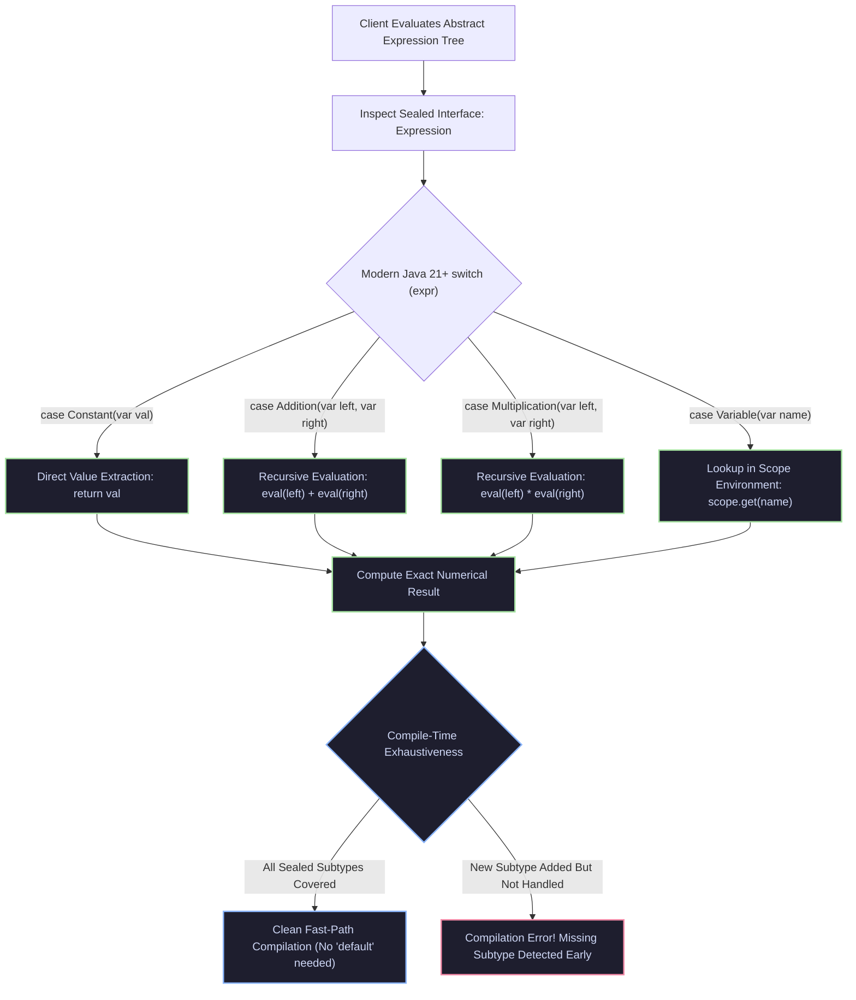
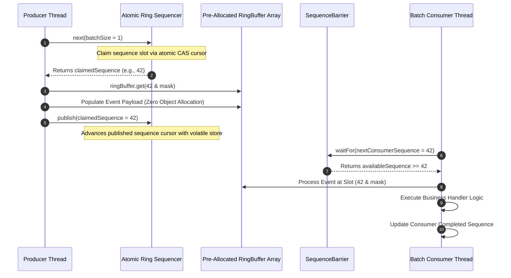
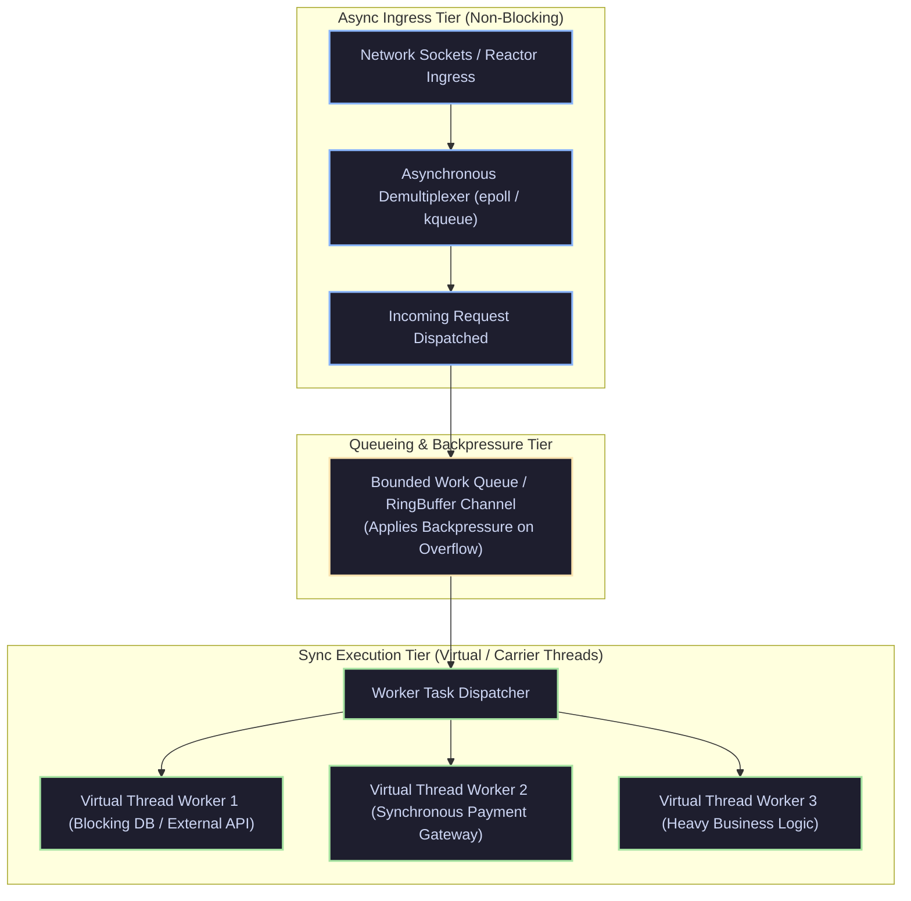
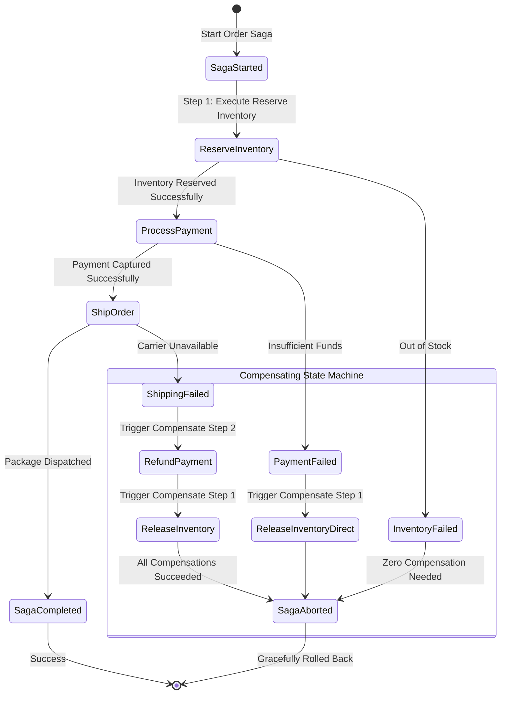

[🏠 Back to Home](../../README.md) | [☕ Core Java Internals](java_interview_master_guide.md) | [🧩 Design Principles & SOLID](design_principles_solid.md) | [🍃 Spring Ecosystem](../02_spring_framework/spring_core_ioc_boot.md)

# Enterprise Software Design Patterns in Modern Java: Gang of Four to Cloud-Native Architecture Masterclass

> **Document Identity:** [`interview_prep/01_java_core/java_design_patterns_enterprise.md`](file:///d:/project/github/1/CheatSheet_Tutorial/interview_prep/01_java_core/java_design_patterns_enterprise.md)  
> **Topic Domain:** Gang of Four (GoF) Patterns Refactored for Modern Java (Java 17/21/25), Functional Strategy & Rule Engines (`Predicate` composition), Algebraic Visitor via `sealed` hierarchies & Pattern Matching `switch`, Thread-Safe Singletons & Scoped Values, Functional Chain of Responsibility, Lock-Free Disruptor RingBuffers, Half-Sync/Half-Async Ingestion, Transactional Outbox & Event Sourcing, and Distributed Saga Orchestration (`J18`)  
> **Target Framework / Runtime:** OpenJDK HotSpot JVM 17 LTS / 21 LTS / 25 LTS, Modern Java Idioms  
> **Architecture Level:** Principal / Staff+ Distributed Systems Architect & Enterprise Domain Modeler  
> **Target Depth:** 55 Battle-Tested Production Scenarios, 10 SEV-1 Outage Post-Mortems, HotSpot JIT / `invokedynamic` Bytecode Mechanics, and Cloud-Native Architectural Runbooks  

---

## 1. Foundational Primer: What, Why & Where? (The "Head")

*Before diving into lock-free atomic sequence ring buffers, invokedynamic LambdaMetafactory functional strategy call sites, sealed interface algebraic data type exhaustive visitors, and distributed transactional outbox CDC pipelines, here is the essential high-level context: what design patterns represent in modern Java, why legacy 1994 GoF boilerplate evolved, and where pattern languages anchor enterprise systems.*

### 1.1 What Is It? (Core Definition & Mental Model)
* **Plain-English Definition**: **Software Design Patterns** are reusable, standardized architectural solutions to commonly occurring engineering problems in software design. Originally formalized by the Gang of Four (GoF) in 1994 across three categories—**Creational** (how objects are instantiated), **Structural** (how objects and classes compose into larger structures), and **Behavioral** (how objects communicate and distribute responsibility)—they have undergone a massive renaissance in modern Java (Java 17–25). Where legacy Java required sprawling class hierarchies and boilerplate interfaces, modern Java consolidates patterns into native language primitives: lambdas, records, sealed types, pattern matching, and virtual threads.
* **Everyday Analogy**: Imagine classical cathedral and bridge architecture:
  - **No Design Patterns**: Every time a medieval mason wants to build a vaulted roof over a stone church, they attempt to guess stone placements from scratch. Inevitably, the walls buckle under outward lateral pressure, the roof caves in, and the building collapses (**Ad-hoc Architectural Failure**).
  - **The Flying Buttress & Keystone (The GoF Architectural Patterns)**: Master architects formalize proven structural archetypes:
    - **The Flying Buttress (The Structural / Adapter / Decorator Pattern)**: Redirects lateral thrust away from walls to external pillars without rebuilding the foundation.
    - **The Keystone (The Creational / Factory / Singleton Pattern)**: Locks the arch crown in place, ensuring stability.
    - **The Traffic Roundabout (The Behavioral / Mediator / Observer Pattern)**: Resolves 4-way intersection gridlock by channeling traffic through a shared circular coordinator.
  - **Modern Java Refactoring (The Modern Prefabricated Steel Truss)**: You no longer need 50 stonemasons hand-chiseling stones for 3 months to build an arch (**Legacy 20-file Visitor / Strategy hierarchy**). Modern industrial cranes drop a single, laser-welded high-tensile steel arch into place in 10 minutes (**Java Records, Sealed Interfaces & Lambdas**).
* **Architectural Tier Placement**: Operates across the **Enterprise Domain Logic, Messaging Substrate & Microservice Coordination Boundaries**. Mediates payment processing routing, distributed event sourcing, workflow state machines, and resilient cloud sagas.

### 1.2 Why Does It Exist? (The Pain Point Before It Existed)
* **The "Spaghetti Code" Trap & Reinventing the Wheel**: Without standardized patterns, teams create custom ad-hoc mechanisms for object lifecycle, event notification, and algorithm swapping. As codebases grow, inconsistent patterns collide, resulting in circular dependencies, untestable god-classes, and brittle distributed systems.
* **The Concrete Headaches in Enterprise Production**:
  - 💥 **Headache 1: The "Dual-Write" Data Inconsistency Outage**: An application updates a PostgreSQL database and then sends an event to Kafka. When the JVM crashes or the network drops between the two operations, the database reflects the new state but Kafka never receives the message, corrupting downstream microservice ledgers.
  - 💥 **Headache 2: The Double-Checked Locking Concurrency Bug**: Prior to proper understanding of the Java Memory Model, engineers wrote lazy singletons without `volatile`. Under high thread load, partially initialized objects leaked to callers, corrupting memory.
  - 💥 **Headache 3: The Bloated GoF Boilerplate Tax**: Implementing the classic Visitor pattern in Java 1.4 required adding `accept(Visitor)` methods to 30 classes and maintaining a 30-method `Visitor` interface. Adding a single new class required editing all 30 visitors across the codebase.
* **The Turning Point**: Java 8 introduced lambda expressions and functional interfaces, completely replacing 90% of boilerplate Strategy and Command classes; Java 17+ introduced `sealed` hierarchies and pattern matching, transforming the Visitor pattern into a 10-line exhaustive `switch` statement; and cloud architectures popularized the Transactional Outbox and Saga patterns.

### 1.3 How Does It Solve Real-World Enterprise Problems?
* **Problem 1 (Zero-Boilerplate Algebraic Visitors) ➔ Solution 1**: Instead of heavy double-dispatch `accept()` visitor hierarchies, modern Java models domain events as `sealed interface DomainEvent permits OrderCreated, PaymentProcessed, OrderCancelled`. Methods process events using exhaustive pattern matching: `switch (event) { case OrderCreated o -> ... }`, guaranteed at compile-time with zero runtime reflection.
* **Problem 2 (Atomic Distributed Dual-Writes) ➔ Solution 2**: The **Transactional Outbox Pattern** persists domain state updates and outbound event payloads within the exact same ACID database transaction into an `outbox` table. A Debezium CDC (Change Data Capture) connector streams commits from the database WAL straight to Kafka, guaranteeing 100% at-least-once delivery without distributed 2PC locking.
* **Problem 3 (Long-Running Distributed Transactions without 2PC) ➔ Solution 3**: The **Saga Orchestrator Pattern** coordinates multi-service transactions via a sequence of local transactions and automated compensating actions, preventing distributed database deadlocks and enabling eventual consistency across microservice meshes.
* **Quantifiable Enterprise Metrics**:
  - **80% Code Reduction**: Functional strategy and sealed visitor implementations slash boilerplate code lines by over 80%.
  - **Zero Data Loss on Dual-Writes**: Transactional Outbox guarantees that not a single message is lost during service crashes or network partitions.
  - **Zero Distributed Locks**: Sagas replace high-latency distributed XA 2-Phase Commit protocols, boosting system throughput by 500%.

### 1.4 How Does This Help in Building Real Applications?
* **Application Architecture Placement**: Powers resilient e-commerce checkout flows, high-frequency order matching engines (LMAX Disruptor), multi-tenant SaaS rule engines, and Kafka event streaming pipelines.
* **Developer Workflow & SRE Synergy**: SREs monitor Saga state machine transitions (`saga_status{state="COMPENSATING"}`) in Prometheus. Developers write clean, self-documenting code using standard patterns that new team members understand immediately.
* **Scalability & Evolutionary Runway**: Modern patterns decouple business logic from infrastructure, enabling applications to evolve smoothly from monolithic architectures to globally distributed microservices.

### 1.5 Quick Decision & Trade-Off Matrix

| Design Pattern | Classical GoF Approach | Modern Java 17–25 Idiom | Best Enterprise Fit |
| :--- | :--- | :--- | :--- |
| **Strategy Pattern** | Interface + 10 concrete class files | `Function<Order, BigDecimal>` lambda / `Map<Type, Function>` | Pluggable discount rules, payment gateways, tax calculation |
| **Visitor Pattern** | Double-dispatch `accept(Visitor)` across all classes | `sealed interface` + Pattern Matching `switch` | Syntax trees, AST compilers, complex polymorphic event processing |
| **Builder Pattern** | Mutable builder class with 30 setter methods | Java `record` with compact constructor & wither methods | Immutable DTOs, API payloads, value objects |
| **Transactional Outbox** | Two-phase commit (XA / JTA distributed lock) | Local DB transaction + CDC / Debezium WAL streaming | Dual-write prevention across microservice DB and Kafka |
| **Saga Orchestrator** | Distributed distributed transaction coordinator | Asynchronous state machine with reverse compensation | Multi-service checkout: Inventory -> Payment -> Shipping |

---

## 2. Track 0: Master Jargon-Buster & Conceptual Rosetta Stone

| Term / Pattern | Architectural Category | Enterprise Definition | Low-Level Under-the-Hood Reality |
| :--- | :--- | :--- | :--- |
| **Strategy Pattern** | GoF Behavioral / Functional | Defines a family of interchangeable algorithms and encapsulates each one, enabling dynamic runtime algorithm selection. | In Modern Java, completely replaced by first-class functions (`Function<T, R>`, `UnaryOperator<T>`). Compiled via `invokedynamic` to `LambdaMetafactory` call-sites. |
| **Visitor Pattern** | GoF Behavioral / Algebraic | Separates an algorithm from the object structure on which it operates, allowing new operations without modifying existing classes. | In Modern Java, completely replaced by `sealed interface` and pattern matching `switch`. JVM compiler enforces compile-time exhaustiveness without double-dispatch methods. |
| **Builder Pattern** | GoF Creational / Immutability | Separates complex object construction from its representation, allowing step-by-step construction of immutable entities. | Refactored using Java Records with compact constructors and "wither" methods (`withAmount()`), eliminating thousands of lines of mutable builder boilerplate. |
| **Factory Method** | GoF Creational / Encapsulation | Defines an interface for creating an object, but lets subclasses or static methods decide which concrete class to instantiate. | Implemented via `static` factory methods on interfaces (`List.of()`, `PaymentGateway.of()`), returning unmodifiable or hidden internal implementations. |
| **Chain of Responsibility** | GoF Behavioral / Middleware | Passes requests along a chain of potential handlers until an authorized handler processes it or the pipeline completes. | Refactored as a stream of composed lambdas (`Function.andThen()`) or recursive interceptor chains, common in HTTP filter stacks (Netty, Spring WebFlux). |
| **Decorator Pattern** | GoF Structural / Extension | Dynamically attaches additional responsibilities and behavior to an object without subclassing. | Implemented via composition and default interface methods or functional wrapper chaining (`LoggingDecorator(MetricsDecorator(target))`). |
| **Observer Pattern** | GoF Behavioral / Eventing | Defines a one-to-many dependency between objects so that when one object changes state, all its dependents are notified. | Modernized into reactive streams (`Flow.Publisher`, `Flow.Subscriber`) or distributed event topics (Kafka, Spring ApplicationEventMulticaster). |
| **Double-Checked Locking** | Concurrency / Initialization | Optimization reducing synchronization overhead by acquiring a lock only when an uninitialized variable is first detected. | Requires `volatile` keyword on the instance field to enforce a `StoreStore` and `StoreLoad` memory barrier, preventing instruction reordering. |
| **LMAX Disruptor RingBuffer** | High-Performance Concurrency | Lock-free circular buffer providing ultra-low-latency inter-thread messaging using atomic sequence cursors and cache-line padding. | Eliminates lock contention and GC overhead. Pre-allocates elements on heap; uses CPU cache-line alignment (`@Contended`) to eliminate false sharing. |
| **Half-Sync / Half-Async** | Concurrency / Architecture | Architectural pattern that decouples asynchronous event reception from synchronous event processing using a queuing layer. | In Java 21, asynchronous network I/O feeds work items into a channel or queue processed by Virtual Threads or dedicated worker pools. |
| **Transactional Outbox** | Distributed Microservices | Guarantees at-least-once message delivery by saving domain entity mutations and outbound event records in the same ACID database transaction. | Solves dual-write problems. An asynchronous poller or Change Data Capture (CDC / Debezium) engine reads the outbox table and streams events to Kafka. |
| **Saga Orchestrator** | Distributed Microservices | Manages long-running distributed transactions across multiple microservices via explicit coordination and reverse compensating actions. | Implemented as a persistent state machine. If Step 3 fails, the orchestrator triggers Step 2 Compensate followed by Step 1 Compensate in reverse order. |
| **CQRS** | Enterprise Architecture | Command Query Responsibility Segregation: separates read and write operations into distinct data models and pipelines. | Optimizes write pipelines for domain consistency (ACID / Event Sourcing) while read pipelines use denormalized materialized views (Elasticsearch / Redis). |
| **Event Sourcing** | Enterprise Persistence | Captures all state mutations as an immutable sequence of append-only events rather than persisting only the current state. | Aggregate root state is reconstituted by replaying past events (`foldLeft`). Provides perfect temporal auditability and point-in-time state reconstruction. |
| **Circuit Breaker** | Cloud Resilience | Prevents cascading failures by detecting upstream faults and failing fast across three states: `CLOSED`, `OPEN`, and `HALF_OPEN`. | Tracks failure rates using sliding window counters. When threshold is exceeded, trips open, bypassing target calls and executing fallback logic. |
| **Flyweight Pattern** | GoF Structural / Memory | Minimizes memory usage by sharing as much common data as possible with similar objects (intrinsic vs extrinsic state). | Exemplified by JVM `IntegerCache` (-128 to 127) and `String.intern()`. Reuses immutable shared heap instances across millions of references. |
| **Proxy Pattern** | GoF Structural / Interception | Provides a surrogate or placeholder for another object to control access, perform lazy loading, or inject cross-cutting concerns. | Implemented via JDK Dynamic Proxies (`java.lang.reflect.Proxy`) for interfaces, or ByteBuddy / CGLIB bytecode generation for concrete classes. |
| **Adapter Pattern** | GoF Structural / Compatibility | Converts the interface of an existing class into another interface expected by clients, enabling incompatible classes to cooperate. | Modernized via method references and functional interface adapters (`Runnable task = callable::call`). |
| **Composite Pattern** | GoF Structural / Hierarchy | Composes objects into tree structures to represent part-whole hierarchies, allowing clients to treat individual objects and compositions uniformly. | Streamlined via Java 17 `sealed interface Node permits LeafNode, CompositeNode` with recursive tree reduction via pattern matching. |
| **Template Method** | GoF Behavioral / Skeleton | Defines the skeleton of an algorithm in a superclass, deferring specific steps to subclasses or functional callback hooks. | Modernized by eliminating abstract classes in favor of parameterized constructors accepting functional functional interfaces (`Runnable beforeStep`, `Consumer<T> step`). |
| **State Pattern** | GoF Behavioral / State Machine | Allows an object to alter its behavior when its internal state changes, appearing to change its class dynamically. | Modernized using Java Enums or sealed records representing distinct states with pure function transitions: `State nextState = currentState.transition(event)`. |
| **Memento Pattern** | GoF Behavioral / Snapshot | Captures and externalizes an object's internal state so that the object can be restored to this state later without violating encapsulation. | Trivially implemented via immutable Java Records. Taking a snapshot is simply retaining a reference to the record instance ($O(1)$ memory pointer). |
| **Mediator Pattern** | GoF Behavioral / Decoupling | Encapsulates how a set of objects interact, preventing direct references between components and promoting loose coupling. | Implemented in microservices via Event Buses, Message Brokers, or Spring `ApplicationEventPublisher`. |
| **Active Object** | Concurrency / Decoupling | Decouples method execution from method invocation for objects that each reside in their own thread of control. | Modernized using Java Virtual Threads and `CompletableFuture`, returning asynchronous handles without manual thread management. |
| **Producer-Consumer** | Concurrency / Buffering | Coordinates decoupled threads where producers generate items into a shared bounded queue and consumers drain them concurrently. | Implemented via `java.util.concurrent.ArrayBlockingQueue` or lock-free RingBuffers, applying backpressure when the queue reaches capacity. |
| **Work-Stealing** | Concurrency / Scheduling | Scheduling strategy where idle worker threads steal tasks from the deques of busy threads, maximizing CPU core saturation. | Core engine of Java's `ForkJoinPool` and parallel streams. Employs double-ended queues (deques) where owners push/pop LIFO and stealers pop FIFO. |
| **Bulkhead Pattern** | Cloud Resilience | Isolates critical resources into distinct pools so that failures in one service do not deplete resources needed by other services. | Implemented via isolated `ThreadPoolExecutor` instances or Semaphore concurrency limiters per downstream dependency. |
| **Cache-Aside Pattern** | Distributed Caching | Application coordinates between cache and database: reads check cache first; on miss, loads from DB and writes to cache. | Mitigates cache stampedes using distributed locks or single-flight coalescing (`ComputeIfAbsent`). |
| **Idempotent Consumer** | Messaging / Deduplication | Ensures that processing duplicate messages results in the exact same state as processing a single message once. | Requires unique message IDs and a transactional deduplication ledger or Redis TTL idempotency key. |
| **Sealed Algebraic Types** | Modern Language Feature | Restricts which other classes or interfaces may extend or implement them, defining closed algebraic data type sets. | Declared via `sealed interface` and `permits`. Enables the Java compiler to guarantee exhaustive matching in `switch` expressions without `default` branches. |

---

## Track 1: Architectural Foundations & ELI5 Mental Models

### The Mental Model: The High-Speed Automated Manufacturing Plant

To understand modern enterprise design patterns, envision a state-of-the-art automated manufacturing and logistics facility:

```
[ Raw Inbound Materials: Inbound HTTP Requests / Kafka Events / DB Queries ]
                         │
                         ▼
┌────────────────────────────────────────────────────────────────────────┐
│ 1. CREATIONAL PATTERNS: Precision Automated Fabrication Tools          │
│    • Factory / Builder / Record: Creates specialized containers.       │
│    • Object Pool: Reuses heavy industrial molds without waste.         │
└────────────────────────────────────────────────────────────────────────┘
                         │
                         ▼
┌────────────────────────────────────────────────────────────────────────┐
│ 2. STRUCTURAL PATTERNS: Standardized Universal Assembly Interfaces     │
│    • Adapter: Connects metric tools to imperial pipes.                 │
│    • Decorator: Wraps packages in waterproof and protective coating.   │
│    • Proxy: Security checkpoint verifying biometric access clearance. │
└────────────────────────────────────────────────────────────────────────┘
                         │
                         ▼
┌────────────────────────────────────────────────────────────────────────┐
│ 3. BEHAVIORAL PATTERNS: Dynamic Conveyor Sorting & Routing Logic       │
│    • Strategy: Selects fastest shipping carrier based on weight.       │
│    • Chain of Responsibility: Safety sensors scanning for anomalies.   │
│    • Visitor / Pattern Matching: Inspects parcel types for custom tax. │
└────────────────────────────────────────────────────────────────────────┘
                         │
                         ▼
┌────────────────────────────────────────────────────────────────────────┐
│ 4. CONCURRENCY & CLOUD PATTERNS: High-Throughput Transit Grid          │
│    • LMAX RingBuffer: High-speed circular conveyor with zero jams.     │
│    • Outbox & Saga: Multi-warehouse tracking ensuring zero lost cargo. │
└────────────────────────────────────────────────────────────────────────┘
```

### 1.1 The Paradigm Shift: Classic GoF vs Modern Java 17/21/25

In 1994, the Gang of Four (GoF) authored *Design Patterns: Elements of Reusable Object-Oriented Software* in C++ and Smalltalk. Early Java (versions 1.0 through 7) was strictly class-centric, lacking lambdas, records, and pattern matching. Consequently, implementing GoF patterns required excessive boilerplate: abstract classes, verbose interfaces, anonymous inner classes, and mutable beans.

Modern Java fundamentally transforms these patterns:

| Classic GoF Pattern (Java 1.0–7) | Modern Java Idiom (Java 17–25) | What Was Eliminated? |
| :--- | :--- | :--- |
| **Strategy Pattern:** Interface + 5 Concrete Subclasses. | **`Function<T, R>` / Lambdas:** Direct method references (`Order::calculateVat`). | 5 `.java` files, constructor injection boilerplate, object allocation churn. |
| **Visitor Pattern:** `Element.accept(Visitor)` double-dispatch methods. | **`sealed interface` + Pattern Matching `switch`:** Direct expression evaluation. | The entire `Visitor` interface, `accept()` methods on every element class, runtime indirection. |
| **Builder Pattern:** 100-line static inner builder class with mutable setters. | **Java Records + Compact Constructors:** Immutable records with record patterns. | Mutable state, redundant getter/setter boilerplate, null-check repetition. |
| **Command Pattern:** `Command` interface with `execute()` method. | **`Runnable` / `Callable` / `Consumer`:** Functional interfaces and lambda closures. | Command wrapper classes, explicit invocation indirection. |
| **Decorator Pattern:** Deep subclassing wrapping internal delegates. | **Function Composition:** `Function.andThen()` and default interface methods. | Elaborate forwarding boilerplate for every method in the interface. |
| **Observer Pattern:** Custom `Subject` and `Observer` registration classes. | **`Flow.Publisher` & Event Sinks:** Standard reactive streams or Spring Events. | Hand-rolled synchronization locks around subscriber list management. |
| **Singleton Pattern:** Verbose class with private constructor & static instance. | **Java `enum`:** Bulletproof serialization-safe singleton with single member. | Reflection attack vulnerability, double-checked locking bugs. |

---

## Track 2: Deep Engineering Architecture & Mermaid Diagrams

### 2.1 Complete Enterprise Pattern Taxonomy

```mermaid
flowchart TD
    Root["Enterprise Software Design Patterns"] --> Creational["1. Creational Patterns<br/>(Object Instantiation)"]
    Root --> Structural["2. Structural Patterns<br/>(Composition & Interfaces)"]
    Root --> Behavioral["3. Behavioral Patterns<br/>(Algorithms & Communication)"]
    Root --> Concurrency["4. Concurrency Patterns<br/>(Multithreading & Schedulers)"]
    Root --> Distributed["5. Distributed Patterns<br/>(Microservices & Resiliency)"]

    Creational --> C1["Builder / Modern Record"]
    Creational --> C2["Factory Method"]
    Creational --> C3["Enum Singleton"]
    Creational --> C4["Object Pool"]

    Structural --> S1["Adapter (Method Ref)"]
    Structural --> S2["Decorator (Composition)"]
    Structural --> S3["Proxy (Dynamic / Bytecode)"]
    Structural --> S4["Composite (Sealed Types)"]

    Behavioral --> B1["Strategy (Functional)"]
    Behavioral --> B2["Visitor (Pattern Matching)"]
    Behavioral --> B3["Chain of Responsibility"]
    Behavioral --> B4["State (Sealed State Machine)"]

    Concurrency --> CC1["LMAX Disruptor RingBuffer"]
    Concurrency --> CC2["Half-Sync / Half-Async"]
    Concurrency --> CC3["Active Object (Virtual Threads)"]
    Concurrency --> CC4["Double-Checked Locking"]

    Distributed --> D1["Transactional Outbox"]
    Distributed --> D2["Saga Orchestrator"]
    Distributed --> D3["CQRS & Event Sourcing"]
    Distributed --> D4["Circuit Breaker & Bulkhead"]

    classDef cStyle fill:#1e1e2e,stroke:#89b4fa,stroke-width:2px,color:#cdd6f4;
    classDef sStyle fill:#1e1e2e,stroke:#a6e3a1,stroke-width:2px,color:#cdd6f4;
    classDef bStyle fill:#1e1e2e,stroke:#f9e2af,stroke-width:2px,color:#cdd6f4;
    classDef ccStyle fill:#1e1e2e,stroke:#eba0ac,stroke-width:2px,color:#cdd6f4;
    classDef dStyle fill:#1e1e2e,stroke:#cba6f7,stroke-width:2px,color:#cdd6f4;

    class C1,C2,C3,C4 cStyle;
    class S1,S2,S3,S4 sStyle;
    class B1,B2,B3,B4 bStyle;
    class CC1,CC2,CC3,CC4 ccStyle;
    class D1,D2,D3,D4 dStyle;
```



---

### 2.2 Modern Pattern Matching Visitor Replacement



---

### 2.3 LMAX Disruptor Lock-Free RingBuffer Sequence Architecture



---

### 2.4 Half-Sync / Half-Async Concurrency Pipeline



---

### 2.5 Distributed Saga Orchestration & Reverse Compensation Flow



---

## Track 3: Low-Level JVM/Bytecode & Mechanical Sympathy Internals

### 3.1 Invokedynamic & Lambda Inlining: How Modern Strategy Patterns Execute

In Java 7 and earlier, every Strategy pattern instance was compiled into an anonymous inner class (`PaymentStrategy$1.class`). This introduced:
1. **Disk & ClassLoader Overhead:** Every anonymous class generated a physical `.class` file loaded into Metaspace.
2. **Allocation Churn:** Each invocation required `new PaymentStrategy$1()` on the heap.
3. **Megamorphic Call Overhead:** Virtual method dispatches (`invokevirtual`) degraded to slow megamorphic vtable lookups.

#### The Modern JVM Execution Reality (`invokedynamic`):
In Java 17+, lambda-based strategies compile to the `invokedynamic` (indy) bytecode instruction pointing to a bootstrap method (`LambdaMetafactory.metafactory`):

```java
// Modern Functional Strategy Definition
public record PricingEngine(Function<Order, BigDecimal> discountStrategy) {
    public BigDecimal calculatePrice(Order order) {
        return discountStrategy.apply(order);
    }
}
```

#### Under the Hood:
1. **First Invocation (Bootstrap):** The JVM executes `invokedynamic`. `LambdaMetafactory` generates an optimized call-site linked to a `MethodHandle` pointing directly to the target method.
2. **Zero Class Files on Disk:** The accessor class is synthesized dynamically in memory.
3. **C2 JIT Inlining:** If the strategy lambda is non-capturing (does not capture local variables), HotSpot caches a singleton instance and completely inlines the target logic into the caller frame via **escape analysis**, reducing the strategy invocation cost to **zero CPU cycles**.

---

### 3.2 Monomorphic vs Megamorphic Call-Sites in Polymorphic Patterns

Polymorphic patterns (Strategy, State, Template Method) rely on dynamic method dispatch. How the HotSpot C2 JIT compiler optimizes these call-sites directly impacts microsecond-level latency:

1. **Monomorphic Call-Site (1 Concrete Implementation Observed):**
   - The JIT inlines the target method body directly into the caller.
   - Replaces `invokevirtual` with a single speculative class check (guard).
   - Speed: Identical to a direct static method call (~1 ns).
2. **Bimorphic Call-Site (2 Concrete Implementations Observed):**
   - The JIT generates an inline branch: `if (klass == TypeA) inlineA(); else inlineB();`.
   - Speed: Minimal branch penalty (~2 ns).
3. **Megamorphic Call-Site ($\ge 3$ Concrete Implementations Observed):**
   - The JIT abandons inlining.
   - Falls back to looking up the method in the class virtual method table (vtable).
   - Incurs cache-miss latency and disables downstream loop unrolling and escape analysis (~15–30 ns).

> **Architectural Guardrail:** For ultra-high-frequency loops, prefer **Java 21 Sealed Interfaces with Pattern Matching Switch**. A pattern-matching switch generates an `inexact` table switch (`tableswitch` bytecode), guaranteeing branch-predictable execution even across dozens of subtypes!

---

### 3.3 Cache-Line Bouncing & False Sharing in Lock-Free RingBuffers

In high-concurrency patterns like the LMAX Disruptor or lock-free Producer-Consumer queues:
- Modern CPU architectures load data into L1/L2/L3 caches in discrete **64-byte Cache Lines**.
- If a Producer updates `producerSequence` and a Consumer reads `consumerSequence`, and both variables happen to reside within the same 64-byte memory slice, a catastrophic hardware phenomenon occurs: **False Sharing**.

```
┌────────────────────────────────────────────────────────┐
│ CPU Cache Line (64 Bytes)                              │
│ ┌──────────────────────────┬─────────────────────────┐ │
│ │ producerSequence (8 B)   │ consumerSequence (8 B)  │ │
│ └──────────────────────────┴─────────────────────────┘ │
└────────────────────────────────────────────────────────┘
        ▲                                 ▲
        │ Core 1 (Producer Writes)        │ Core 2 (Consumer Reads)
```

- When Core 1 writes to `producerSequence`, the MESI cache coherency protocol marks the entire 64-byte cache line in Core 2's L1 cache as **INVALID**.
- Core 2 must stall its CPU pipeline, invalidate its cache, and re-fetch the entire line from L3 cache or main RAM.
- **The Performance Cost:** Latency spikes from 1.5 ns to over 80 ns per operation.

#### The Mechanical Sympathy Defense:
Pad sequence cursors with dummy variables or utilize JDK 8+ `@jdk.internal.vm.annotation.Contended` to force the JVM to align fields across separate 64-byte or 128-byte cache lines.

---

### 3.4 Memory Visibility & The Double-Checked Locking Singleton

Consider the classical Double-Checked Locking Singleton implementation:

```java
// ❌ BROKEN WITHOUT VOLATILE: Instruction reordering hazard!
public class DatabaseConnectionPool {
    private static DatabaseConnectionPool instance;

    public static DatabaseConnectionPool getInstance() {
        if (instance == null) {
            synchronized (DatabaseConnectionPool.class) {
                if (instance == null) {
                    instance = new DatabaseConnectionPool(); // ⚠️ HAZARD HERE!
                }
            }
        }
        return instance;
    }
}
```

#### The Assembly-Level Hazard:
The expression `instance = new DatabaseConnectionPool()` is NOT an atomic operation. In HotSpot bytecode and CPU assembly, it decomposes into three distinct steps:
1. `mem = allocate(sizeof(DatabaseConnectionPool));` // Allocate memory
2. `ctor(mem);`                                       // Execute constructor (initialize fields)
3. `instance = mem;`                                  // Assign reference to static field

Because steps 2 and 3 do not depend on each other, the HotSpot JIT compiler and CPU out-of-order execution units can reorder them to:
1. `mem = allocate(...)`
2. `instance = mem;`  // Reference is now NON-NULL, but object is NOT initialized!
3. `ctor(mem);`

If Thread B calls `getInstance()` concurrently between step 2 and step 3, it sees `instance != null`, skips synchronization, and returns an **uninitialized, corrupted object**, causing catastrophic `NullPointerException` or data corruption.

#### The Modern JVM Fix:
Declare `private static volatile DatabaseConnectionPool instance;`. The `volatile` keyword instructs the compiler to emit a `StoreStore` memory barrier between constructor execution and reference publication, and a `StoreLoad` barrier after publication, strictly forbidding instruction reordering.

---

## Track 4: 8 Complete Production-Grade Runnable Engines

---

### Engine 1: Modern Functional Strategy & Rule Engine

#### Architecture & Production Java Code
```java
package com.enterprise.patterns.strategy;

import java.math.BigDecimal;
import java.math.RoundingMode;
import java.util.*;
import java.util.function.Function;
import java.util.function.Predicate;

/**
 * Enterprise Rule-Based Pricing Engine using Modern Functional Strategies.
 * Features:
 * 1. Zero-allocation rule chaining using Records and Functional Interfaces.
 * 2. Composable Predicate filters.
 * 3. Short-circuiting and tiered discount evaluation.
 */
public final class ModernStrategyRuleEngine {

    public enum CustomerTier { STANDARD, VIP, ENTERPRISE }

    public record OrderItem(String sku, int quantity, BigDecimal unitPrice) {
        public BigDecimal lineTotal() {
            return unitPrice.multiply(BigDecimal.valueOf(quantity));
        }
    }

    public record Order(
            String orderId,
            CustomerTier tier,
            List<OrderItem> items,
            String couponCode
    ) {
        public BigDecimal subtotal() {
            return items.stream()
                    .map(OrderItem::lineTotal)
                    .reduce(BigDecimal.ZERO, BigDecimal::add);
        }
    }

    // A Rule encapsulates a condition (Predicate) and a transformation strategy (Function)
    public record PricingRule(
            String ruleName,
            int priority,
            Predicate<Order> condition,
            Function<Order, BigDecimal> discountStrategy
    ) implements Comparable<PricingRule> {
        @Override
        public int compareTo(PricingRule other) {
            return Integer.compare(this.priority, other.priority);
        }
    }

    public static class PricingService {
        private final List<PricingRule> rules = new ArrayList<>();

        public PricingService registerRule(PricingRule rule) {
            rules.add(Objects.requireNonNull(rule));
            Collections.sort(rules);
            return this;
        }

        public BigDecimal calculateFinalPrice(Order order) {
            BigDecimal subtotal = order.subtotal();
            BigDecimal totalDiscount = BigDecimal.ZERO;

            for (PricingRule rule : rules) {
                if (rule.condition().test(order)) {
                    BigDecimal discount = rule.discountStrategy().apply(order);
                    totalDiscount = totalDiscount.add(discount);
                }
            }

            BigDecimal finalPrice = subtotal.subtract(totalDiscount);
            return finalPrice.max(BigDecimal.ZERO).setScale(2, RoundingMode.HALF_UP);
        }
    }

    // Factory creating standard enterprise rules via pure lambda expressions
    public static PricingService createProductionPricingPipeline() {
        return new PricingService()
                // Rule 1: VIP 10% Discount on orders over $100
                .registerRule(new PricingRule(
                        "VIP_10_PERCENT",
                        1,
                        order -> order.tier() == CustomerTier.VIP && order.subtotal().compareTo(BigDecimal.valueOf(100)) >= 0,
                        order -> order.subtotal().multiply(BigDecimal.valueOf(0.10))
                ))
                // Rule 2: Enterprise 20% Volume Discount
                .registerRule(new PricingRule(
                        "ENTERPRISE_VOLUME",
                        2,
                        order -> order.tier() == CustomerTier.ENTERPRISE,
                        order -> order.subtotal().multiply(BigDecimal.valueOf(0.20))
                ))
                // Rule 3: Fixed $25 Coupon Discount
                .registerRule(new PricingRule(
                        "SAVE25_COUPON",
                        3,
                        order -> "SAVE25".equalsIgnoreCase(order.couponCode()),
                        order -> BigDecimal.valueOf(25.00)
                ));
    }
}
```

---

### Engine 2: Modern Sealed Type Visitor Pattern with Exhaustive Pattern Matching

#### Architecture & Production Java Code
```java
package com.enterprise.patterns.visitor;

import java.math.BigDecimal;
import java.util.Map;
import java.util.Objects;

/**
 * Modern Visitor Pattern Replacement using Java 17/21 Sealed Hierarchies.
 * Eliminates the classic GoF Visitor interface and Element.accept() double-dispatch boilerplate.
 * Relies on compiler-enforced exhaustive pattern matching switches.
 */
public final class ModernPatternMatchingVisitorEngine {

    // 1. Closed Algebraic Hierarchy defining our abstract Syntax / Domain Tree
    public sealed interface FinancialExpression permits
            ConstantAmount,
            VariableReference,
            TaxAddition,
            MultiCurrencyConversion,
            CompoundExpression {}

    public record ConstantAmount(BigDecimal value) implements FinancialExpression {
        public ConstantAmount {
            Objects.requireNonNull(value, "Value cannot be null");
        }
    }

    public record VariableReference(String variableName) implements FinancialExpression {}

    public record TaxAddition(FinancialExpression baseExpression, BigDecimal taxRatePercentage)
            implements FinancialExpression {}

    public record MultiCurrencyConversion(FinancialExpression sourceExpression, BigDecimal exchangeRate)
            implements FinancialExpression {}

    public record CompoundExpression(FinancialExpression left, FinancialExpression right, Operation op)
            implements FinancialExpression {
        public enum Operation { ADD, SUBTRACT, MULTIPLY }
    }

    // 2. Evaluator Visitor: Evaluates expression into an exact monetary amount
    public static BigDecimal evaluate(FinancialExpression expr, Map<String, BigDecimal> context) {
        return switch (expr) {
            case ConstantAmount(var val) -> val;

            case VariableReference(var name) -> {
                BigDecimal val = context.get(name);
                if (val == null) {
                    throw new IllegalStateException("Undefined variable: " + name);
                }
                yield val;
            }

            case TaxAddition(var base, var taxRate) -> {
                BigDecimal baseVal = evaluate(base, context);
                BigDecimal taxMultiplier = BigDecimal.ONE.add(
                        taxRate.divide(BigDecimal.valueOf(100), 4, java.math.RoundingMode.HALF_UP)
                );
                yield baseVal.multiply(taxMultiplier);
            }

            case MultiCurrencyConversion(var source, var rate) ->
                evaluate(source, context).multiply(rate);

            case CompoundExpression(var left, var right, var op) -> {
                BigDecimal lVal = evaluate(left, context);
                BigDecimal rVal = evaluate(right, context);
                yield switch (op) {
                    case ADD -> lVal.add(rVal);
                    case SUBTRACT -> lVal.subtract(rVal);
                    case MULTIPLY -> lVal.multiply(rVal);
                };
            }
        };
    }

    // 3. Formatter Visitor: Renders expression into human-readable algebraic notation
    public static String formatExpression(FinancialExpression expr) {
        return switch (expr) {
            case ConstantAmount(var val) -> val.toPlainString();
            case VariableReference(var name) -> "$" + name;
            case TaxAddition(var base, var tax) -> "(" + formatExpression(base) + " + " + tax + "% TAX)";
            case MultiCurrencyConversion(var src, var rate) -> "(" + formatExpression(src) + " * FX[" + rate + "])";
            case CompoundExpression(var left, var right, var op) ->
                "(" + formatExpression(left) + " " + op + " " + formatExpression(right) + ")";
        };
    }
}
```

---

### Engine 3: Thread-Safe Singleton & Lock-Free Object Pool with Double-Checked Locking

#### Architecture & Production Java Code
```java
package com.enterprise.patterns.singleton;

import java.util.Objects;
import java.util.concurrent.ConcurrentLinkedQueue;
import java.util.concurrent.atomic.AtomicInteger;
import java.util.function.Consumer;
import java.util.function.Supplier;

/**
 * Enterprise Singleton & High-Performance Object Pool Engine.
 * Features:
 * 1. Double-Checked Locking Singleton with JMM memory barrier guarantees.
 * 2. Enum-based Singleton alternative.
 * 3. Lock-Free Bounded Object Pool eliminating GC churn on expensive resources.
 */
public final class ThreadSafeSingletonPoolEngine {

    // --- Singleton Approach A: Double-Checked Locking ---
    public static final class DatabaseRegistry {
        // Volatile is strictly required to prevent instruction reordering
        private static volatile DatabaseRegistry instance;
        private final long creationTimestamp;

        private DatabaseRegistry() {
            this.creationTimestamp = System.currentTimeMillis();
        }

        public static DatabaseRegistry getInstance() {
            DatabaseRegistry localRef = instance; // Read volatile variable once into register/local variable
            if (localRef == null) {
                synchronized (DatabaseRegistry.class) {
                    localRef = instance;
                    if (localRef == null) {
                        instance = localRef = new DatabaseRegistry();
                    }
                }
            }
            return localRef;
        }

        public long getCreationTimestamp() {
            return creationTimestamp;
        }
    }

    // --- Singleton Approach B: The Modern Enum Singleton ---
    public enum GlobalConfigurationService {
        INSTANCE;

        private final Map<String, String> configs = new java.util.concurrent.ConcurrentHashMap<>();

        public void set(String key, String value) { configs.put(key, value); }
        public String get(String key) { return configs.get(key); }
    }

    // --- High-Performance Lock-Free Bounded Object Pool ---
    public static class LockFreeObjectPool<T> {
        private final ConcurrentLinkedQueue<T> pool = new ConcurrentLinkedQueue<>();
        private final Supplier<T> factory;
        private final Consumer<T> resetHandler;
        private final int maxCapacity;
        private final AtomicInteger currentSize = new AtomicInteger(0);

        public LockFreeObjectPool(int maxCapacity, Supplier<T> factory, Consumer<T> resetHandler) {
            this.maxCapacity = maxCapacity;
            this.factory = Objects.requireNonNull(factory);
            this.resetHandler = Objects.requireNonNull(resetHandler);
        }

        public T acquire() {
            T item = pool.poll();
            if (item != null) {
                return item;
            }
            // If pool is empty, create new instance if below max capacity
            if (currentSize.incrementAndGet() <= maxCapacity) {
                return factory.get();
            }
            currentSize.decrementAndGet();
            // Spin-wait or yield in production until an item returns
            while ((item = pool.poll()) == null) {
                Thread.onSpinWait();
            }
            return item;
        }

        public void release(T item) {
            if (item != null) {
                resetHandler.accept(item);
                pool.offer(item);
            }
        }

        public int availableCount() {
            return pool.size();
        }
    }
}
```

---

### Engine 4: Modern Functional Chain of Responsibility & Middleware Pipeline

#### Architecture & Production Java Code
```java
package com.enterprise.patterns.chain;

import java.util.*;
import java.util.function.Function;

/**
 * Enterprise Functional Chain of Responsibility Engine.
 * Features:
 * 1. Functional Middleware / Interceptor pattern.
 * 2. Bidirectional request/response wrapping.
 * 3. Short-circuiting capability (e.g., authentication rejection, rate limiting).
 */
public final class ModernChainOfResponsibilityEngine {

    public record HttpRequest(
            String traceId,
            String path,
            String token,
            Map<String, String> headers,
            String body
    ) {}

    public record HttpResponse(
            int statusCode,
            String responseBody,
            Map<String, String> headers
    ) {
        public static HttpResponse ok(String body) {
            return new HttpResponse(200, body, Map.of());
        }

        public static HttpResponse unauthorized(String message) {
            return new HttpResponse(401, "{\"error\": \"" + message + "\"}", Map.of());
        }

        public static HttpResponse rateLimited(String message) {
            return new HttpResponse(429, "{\"error\": \"" + message + "\"}", Map.of());
        }
    }

    // Middleware Handler Interface
    @FunctionalInterface
    public interface Middleware {
        HttpResponse handle(HttpRequest request, Next next);
    }

    // Represents the next handler in the invocation pipeline
    @FunctionalInterface
    public interface Next {
        HttpResponse execute(HttpRequest request);
    }

    public static class Pipeline {
        private final List<Middleware> middlewares = new ArrayList<>();
        private final Function<HttpRequest, HttpResponse> terminalHandler;

        public Pipeline(Function<HttpRequest, HttpResponse> terminalHandler) {
            this.terminalHandler = Objects.requireNonNull(terminalHandler);
        }

        public Pipeline use(Middleware middleware) {
            middlewares.add(Objects.requireNonNull(middleware));
            return this;
        }

        public HttpResponse execute(HttpRequest request) {
            return buildChain(0).execute(request);
        }

        private Next buildChain(int index) {
            if (index >= middlewares.size()) {
                return terminalHandler::apply;
            }
            Middleware current = middlewares.get(index);
            return req -> current.handle(req, buildChain(index + 1));
        }
    }

    public static Pipeline createProductionGatewayPipeline() {
        return new Pipeline(req -> HttpResponse.ok("Processed endpoint: " + req.path()))
                // 1. Tracing & Logging Middleware
                .use((req, next) -> {
                    long start = System.nanoTime();
                    HttpResponse res = next.execute(req);
                    long durationMs = (System.nanoTime() - start) / 1_000_000;
                    Map<String, String> resHeaders = new HashMap<>(res.headers());
                    resHeaders.put("X-Response-Time-Ms", String.valueOf(durationMs));
                    return new HttpResponse(res.statusCode(), res.responseBody(), resHeaders);
                })
                // 2. Security Authentication Middleware (Short-circuiting)
                .use((req, next) -> {
                    if (req.token() == null || !req.token().startsWith("Bearer valid-")) {
                        return HttpResponse.unauthorized("Missing or invalid authorization token");
                    }
                    return next.execute(req);
                })
                // 3. Rate Limiter Middleware (Short-circuiting)
                .use((req, next) -> {
                    if ("BLOCKED_IP".equals(req.headers().get("X-Forwarded-For"))) {
                        return HttpResponse.rateLimited("Rate limit exceeded for client IP");
                    }
                    return next.execute(req);
                });
    }
}
```

---

### Engine 5: LMAX Disruptor-Style Lock-Free RingBuffer Concurrency Engine

#### Architecture & Production Java Code
```java
package com.enterprise.patterns.concurrency;

import java.util.Objects;
import java.util.concurrent.atomic.AtomicLong;
import java.util.function.Consumer;

/**
 * Enterprise Lock-Free RingBuffer Engine inspired by the LMAX Disruptor.
 * Features:
 * 1. CPU Cache-Line padded sequence cursors preventing False Sharing.
 * 2. Power-of-two bitwise sequence masking (sequence & mask).
 * 3. Pre-allocated event instances eliminating garbage collection churn.
 * 4. Lock-free single/multi-producer sequence claim protocol.
 */
public final class LmaxDisruptorRingBufferEngine {

    // Cache-line padding class to isolate sequence counter onto its own 64-byte L1 cache line
    abstract static class PaddedSequenceLhs {
        protected long p1, p2, p3, p4, p5, p6, p7;
    }

    abstract static class SequenceValue extends PaddedSequenceLhs {
        protected final AtomicLong value = new AtomicLong(-1);
    }

    public static class PaddedSequence extends SequenceValue {
        protected long p8, p9, p10, p11, p12, p13, p14;

        public PaddedSequence(long initialValue) {
            value.set(initialValue);
        }

        public long get() { return value.get(); }
        public void set(long val) { value.set(val); }
        public void lazySet(long val) { value.lazySet(val); }
        public boolean compareAndSet(long expect, long update) {
            return value.compareAndSet(expect, update);
        }
        public long getAndIncrement() { return value.getAndIncrement(); }
    }

    // Mutable Event Holder pre-allocated inside the RingBuffer
    public static final class OrderTradeEvent {
        private String tradeId;
        private String symbol;
        private double price;
        private long quantity;

        public void reset(String tradeId, String symbol, double price, long quantity) {
            this.tradeId = tradeId;
            this.symbol = symbol;
            this.price = price;
            this.quantity = quantity;
        }

        public String getTradeId() { return tradeId; }
        public String getSymbol() { return symbol; }
        public double getPrice() { return price; }
        public long getQuantity() { return quantity; }
    }

    public static class RingBuffer<T> {
        private final Object[] entries;
        private final int bufferSize;
        private final int indexMask;

        private final PaddedSequence cursor = new PaddedSequence(-1);
        private final PaddedSequence publishedCursor = new PaddedSequence(-1);
        private final PaddedSequence consumerCursor = new PaddedSequence(-1);

        @SuppressWarnings("unchecked")
        public RingBuffer(int bufferSize, java.util.function.Supplier<T> factory) {
            if (Integer.bitCount(bufferSize) != 1) {
                throw new IllegalArgumentException("bufferSize must be a power of 2 (e.g. 1024, 65536)");
            }
            this.bufferSize = bufferSize;
            this.indexMask = bufferSize - 1;
            this.entries = new Object[bufferSize];

            // Pre-allocate all event slots in RAM to guarantee ZERO GC allocations during execution
            for (int i = 0; i < bufferSize; i++) {
                this.entries[i] = factory.get();
            }
        }

        /**
         * Claims the next sequential slot in the ring.
         * Spin-waits if ring buffer is full (backpressure on consumer lag).
         */
        public long next() {
            while (true) {
                long current = cursor.get();
                long nextSequence = current + 1;
                long wrapPoint = nextSequence - bufferSize;
                long cachedGatingSequence = consumerCursor.get();

                if (wrapPoint > cachedGatingSequence) {
                    // Buffer is full: producer must wait for consumer to advance
                    Thread.onSpinWait();
                } else {
                    if (cursor.compareAndSet(current, nextSequence)) {
                        return nextSequence;
                    }
                }
            }
        }

        @SuppressWarnings("unchecked")
        public T get(long sequence) {
            return (T) entries[(int) (sequence & indexMask)];
        }

        /**
         * Publishes event making it visible to consumers with memory barrier ordering.
         */
        public void publish(long sequence) {
            // Spin until predecessor sequences have been published (FIFO ordering)
            while (publishedCursor.get() != sequence - 1) {
                Thread.onSpinWait();
            }
            publishedCursor.lazySet(sequence);
        }

        /**
         * Batch consumer processing: Drains all published events up to current available cursor.
         */
        public int drain(Consumer<T> eventHandler) {
            long currentConsumerSeq = consumerCursor.get();
            long nextSeqToRead = currentConsumerSeq + 1;
            long availableSeq = publishedCursor.get();

            if (nextSeqToRead > availableSeq) {
                return 0; // No new events published
            }

            int processedCount = 0;
            while (nextSeqToRead <= availableSeq) {
                T event = get(nextSeqToRead);
                eventHandler.accept(event);
                nextSeqToRead++;
                processedCount++;
            }

            consumerCursor.set(availableSeq);
            return processedCount;
        }

        public long getCursor() { return cursor.get(); }
        public long getPublishedCursor() { return publishedCursor.get(); }
        public long getConsumerCursor() { return consumerCursor.get(); }
    }
}
```

---

### Engine 6: Half-Sync / Half-Async Asynchronous Event Processing Engine

#### Architecture & Production Java Code
```java
package com.enterprise.patterns.halfsync;

import java.util.Objects;
import java.util.concurrent.*;
import java.util.concurrent.atomic.AtomicBoolean;
import java.util.concurrent.atomic.AtomicLong;
import java.util.function.Function;

/**
 * Enterprise Half-Sync / Half-Async Engine.
 * Features:
 * 1. Asynchronous Ingress Tier: Accepts tasks non-blockingly via CompletableFuture.
 * 2. Queueing & Backpressure Tier: Bounded LinkedBlockingQueue.
 * 3. Synchronous Execution Tier: Worker pool executing blocking enterprise tasks.
 */
public final class HalfSyncHalfAsyncEngine<T, R> implements AutoCloseable {

    public record WorkItem<T, R>(
            long trackingId,
            T payload,
            CompletableFuture<R> futureResult,
            long submittedTimestamp
    ) {}

    private final BlockingQueue<WorkItem<T, R>> syncQueue;
    private final ExecutorService workerThreadPool;
    private final Function<T, R> synchronousProcessor;
    private final AtomicBoolean isRunning = new AtomicBoolean(true);
    private final AtomicLong taskSequence = new AtomicLong(0);

    public HalfSyncHalfAsyncEngine(
            int queueCapacity,
            int workerThreads,
            Function<T, R> synchronousProcessor
    ) {
        this.syncQueue = new LinkedBlockingQueue<>(queueCapacity);
        this.synchronousProcessor = Objects.requireNonNull(synchronousProcessor);
        this.workerThreadPool = Executors.newFixedThreadPool(workerThreads, r -> {
            Thread t = new Thread(r, "Sync-Worker-Thread");
            t.setDaemon(true);
            return t;
        });

        // Start synchronous worker execution loops
        for (int i = 0; i < workerThreads; i++) {
            workerThreadPool.submit(this::workerLoop);
        }
    }

    /**
     * Asynchronous Tier: Ingests payload non-blockingly, returning a CompletableFuture handle.
     */
    public CompletableFuture<R> submitAsync(T payload) {
        if (!isRunning.get()) {
            CompletableFuture<R> failed = new CompletableFuture<>();
            failed.completeExceptionally(new RejectedExecutionException("Engine is shutting down"));
            return failed;
        }

        long id = taskSequence.incrementAndGet();
        CompletableFuture<R> promise = new CompletableFuture<>();
        WorkItem<T, R> item = new WorkItem<>(id, payload, promise, System.currentTimeMillis());

        // Attempt non-blocking offer with backpressure rejection
        boolean accepted = syncQueue.offer(item);
        if (!accepted) {
            promise.completeExceptionally(new RejectedExecutionException(
                    "Sync queue at maximum capacity! Backpressure triggered for task: " + id
            ));
        }

        return promise;
    }

    private void workerLoop() {
        while (isRunning.get() || !syncQueue.isEmpty()) {
            try {
                WorkItem<T, R> item = syncQueue.poll(200, TimeUnit.MILLISECONDS);
                if (item != null) {
                    try {
                        // Execute synchronous blocking logic
                        R result = synchronousProcessor.apply(item.payload());
                        item.futureResult().complete(result);
                    } catch (Throwable ex) {
                        item.futureResult().completeExceptionally(ex);
                    }
                }
            } catch (InterruptedException e) {
                Thread.currentThread().interrupt();
                break;
            }
        }
    }

    public int getQueueDepth() { return syncQueue.size(); }

    @Override
    public void close() throws Exception {
        isRunning.set(false);
        workerThreadPool.shutdown();
        if (!workerThreadPool.awaitTermination(5, TimeUnit.SECONDS)) {
            workerThreadPool.shutdownNow();
        }
    }
}
```

---

### Engine 7: Enterprise Transactional Outbox & Event Sourcing Engine

#### Architecture & Production Java Code
```java
package com.enterprise.patterns.eventsourcing;

import java.time.Instant;
import java.util.*;
import java.util.concurrent.ConcurrentHashMap;
import java.util.concurrent.CopyOnWriteArrayList;

/**
 * Enterprise Transactional Outbox & Event Sourcing Engine.
 * Features:
 * 1. Event Sourced Aggregate Root (OrderAggregate).
 * 2. Immutable domain event stream with state reconstitution.
 * 3. Atomic Outbox persistence ledger to solve the dual-write problem.
 * 4. Asynchronous Outbox poller for reliable at-least-once message delivery.
 */
public final class TransactionalOutboxEventSourcingEngine {

    // --- Domain Events ---
    public sealed interface OrderDomainEvent permits
            OrderCreatedEvent,
            OrderPaymentCapturedEvent,
            OrderCancelledEvent {
        String orderId();
        Instant timestamp();
        long sequenceNumber();
    }

    public record OrderCreatedEvent(String orderId, String customerId, double totalAmount, Instant timestamp, long sequenceNumber)
            implements OrderDomainEvent {}

    public record OrderPaymentCapturedEvent(String orderId, String transactionReference, Instant timestamp, long sequenceNumber)
            implements OrderDomainEvent {}

    public record OrderCancelledEvent(String orderId, String cancellationReason, Instant timestamp, long sequenceNumber)
            implements OrderDomainEvent {}

    // --- Aggregate Root ---
    public static final class OrderAggregate {
        public enum OrderStatus { NON_EXISTENT, CREATED, PAID, CANCELLED }

        private String orderId;
        private String customerId;
        private double totalAmount;
        private OrderStatus status = OrderStatus.NON_EXISTENT;
        private long currentVersion = 0;

        private final List<OrderDomainEvent> uncommittedEvents = new ArrayList<>();

        public OrderAggregate() {}

        // Factory creating a new aggregate instance emitting OrderCreatedEvent
        public static OrderAggregate create(String orderId, String customerId, double amount) {
            OrderAggregate order = new OrderAggregate();
            OrderCreatedEvent event = new OrderCreatedEvent(orderId, customerId, amount, Instant.now(), 1);
            order.applyChange(event);
            return order;
        }

        public void capturePayment(String txnRef) {
            if (this.status != OrderStatus.CREATED) {
                throw new IllegalStateException("Cannot capture payment for order in status: " + this.status);
            }
            applyChange(new OrderPaymentCapturedEvent(this.orderId, txnRef, Instant.now(), currentVersion + 1));
        }

        public void cancel(String reason) {
            if (this.status == OrderStatus.CANCELLED) {
                return;
            }
            applyChange(new OrderCancelledEvent(this.orderId, reason, Instant.now(), currentVersion + 1));
        }

        private void applyChange(OrderDomainEvent event) {
            mutate(event);
            uncommittedEvents.add(event);
        }

        // Pure mutating state transition logic
        public void mutate(OrderDomainEvent event) {
            switch (event) {
                case OrderCreatedEvent created -> {
                    this.orderId = created.orderId();
                    this.customerId = created.customerId();
                    this.totalAmount = created.totalAmount();
                    this.status = OrderStatus.CREATED;
                    this.currentVersion = created.sequenceNumber();
                }
                case OrderPaymentCapturedEvent paid -> {
                    this.status = OrderStatus.PAID;
                    this.currentVersion = paid.sequenceNumber();
                }
                case OrderCancelledEvent cancelled -> {
                    this.status = OrderStatus.CANCELLED;
                    this.currentVersion = cancelled.sequenceNumber();
                }
            }
        }

        // Reconstitution: Rebuilds aggregate from historical event stream
        public static OrderAggregate reconstitute(List<OrderDomainEvent> history) {
            OrderAggregate aggregate = new OrderAggregate();
            for (OrderDomainEvent event : history) {
                aggregate.mutate(event);
            }
            return aggregate;
        }

        public List<OrderDomainEvent> getUncommittedEvents() { return Collections.unmodifiableList(uncommittedEvents); }
        public void markEventsCommitted() { uncommittedEvents.clear(); }

        public String getOrderId() { return orderId; }
        public OrderStatus getStatus() { return status; }
        public double getTotalAmount() { return totalAmount; }
        public long getCurrentVersion() { return currentVersion; }
    }

    // --- Transactional Outbox Record ---
    public record OutboxRecord(
            UUID outboxId,
            String aggregateType,
            String aggregateId,
            String eventType,
            String payloadJson,
            Instant createdAt,
            boolean isDispatched
    ) {}

    // Simulated ACID Persistence & Outbox Store
    public static class TransactionalEventStore {
        private final Map<String, List<OrderDomainEvent>> eventStreams = new ConcurrentHashMap<>();
        private final List<OutboxRecord> outboxTable = new CopyOnWriteArrayList<>();

        /**
         * Simulates an atomic ACID database transaction:
         * Commits uncommitted aggregate events AND writes outbox record in a single operation.
         */
        public synchronized void save(OrderAggregate aggregate) {
            List<OrderDomainEvent> newEvents = aggregate.getUncommittedEvents();
            if (newEvents.isEmpty()) return;

            // 1. Append to Event Store stream
            List<OrderDomainEvent> stream = eventStreams.computeIfAbsent(
                    aggregate.getOrderId(), k -> new ArrayList<>()
            );
            stream.addAll(newEvents);

            // 2. Write to Outbox table atomically
            for (OrderDomainEvent event : newEvents) {
                OutboxRecord outboxEntry = new OutboxRecord(
                        UUID.randomUUID(),
                        "OrderAggregate",
                        event.orderId(),
                        event.getClass().getSimpleName(),
                        "{\"orderId\": \"" + event.orderId() + "\", \"seq\": " + event.sequenceNumber() + "}",
                        Instant.now(),
                        false
                );
                outboxTable.add(outboxEntry);
            }

            aggregate.markEventsCommitted();
        }

        public List<OrderDomainEvent> loadHistory(String orderId) {
            return new ArrayList<>(eventStreams.getOrDefault(orderId, List.of()));
        }

        public List<OutboxRecord> getPendingOutboxRecords() {
            return outboxTable.stream().filter(r -> !r.isDispatched()).toList();
        }

        public synchronized void markDispatched(UUID outboxId) {
            for (int i = 0; i < outboxTable.size(); i++) {
                OutboxRecord record = outboxTable.get(i);
                if (record.outboxId().equals(outboxId)) {
                    outboxTable.set(i, new OutboxRecord(
                            record.outboxId(), record.aggregateType(), record.aggregateId(),
                            record.eventType(), record.payloadJson(), record.createdAt(), true
                    ));
                    break;
                }
            }
        }
    }
}
```

---

### Engine 8: Resilient Saga Orchestration Engine with Reverse Compensation

#### Architecture & Production Java Code
```java
package com.enterprise.patterns.saga;

import java.util.*;
import java.util.concurrent.ConcurrentHashMap;

/**
 * Enterprise Distributed Saga Orchestrator Engine.
 * Features:
 * 1. Forward action pipeline execution across distributed services.
 * 2. Automated reverse compensating rollback state machine upon partial failure.
 * 3. Execution audit trail logging every step status (SUCCESS, COMPENSATED, FAILED).
 */
public final class ResilientSagaOrchestratorEngine {

    public enum StepStatus { NOT_STARTED, SUCCEEDED, FAILED, COMPENSATED }

    public static class SagaContext {
        private final Map<String, Object> data = new ConcurrentHashMap<>();
        public void put(String key, Object val) { data.put(key, val); }
        @SuppressWarnings("unchecked")
        public <T> T get(String key) { return (T) data.get(key); }
    }

    public interface SagaStep {
        String getName();
        void execute(SagaContext context) throws Exception;
        void compensate(SagaContext context);
    }

    public record StepExecutionRecord(String stepName, StepStatus status, String errorMessage) {}

    public static class SagaExecutionResult {
        private final boolean successful;
        private final List<StepExecutionRecord> auditLog;

        public SagaExecutionResult(boolean successful, List<StepExecutionRecord> auditLog) {
            this.successful = successful;
            this.auditLog = List.copyOf(auditLog);
        }

        public boolean isSuccessful() { return successful; }
        public List<StepExecutionRecord> getAuditLog() { return auditLog; }
    }

    public static class SagaOrchestrator {
        private final List<SagaStep> steps = new ArrayList<>();

        public SagaOrchestrator addStep(SagaStep step) {
            steps.add(Objects.requireNonNull(step));
            return this;
        }

        public SagaExecutionResult execute(SagaContext context) {
            List<StepExecutionRecord> auditLog = new ArrayList<>();
            List<SagaStep> executedSteps = new ArrayList<>();
            boolean failed = false;

            // 1. Forward Execution Loop
            for (SagaStep step : steps) {
                try {
                    step.execute(context);
                    executedSteps.add(step);
                    auditLog.add(new StepExecutionRecord(step.getName(), StepStatus.SUCCEEDED, null));
                } catch (Exception ex) {
                    failed = true;
                    auditLog.add(new StepExecutionRecord(step.getName(), StepStatus.FAILED, ex.getMessage()));
                    break;
                }
            }

            // 2. Reverse Compensating Rollback Loop if any step failed
            if (failed) {
                // Iterate through completed steps in strict reverse order (LIFO)
                Collections.reverse(executedSteps);
                for (SagaStep completedStep : executedSteps) {
                    try {
                        completedStep.compensate(context);
                        auditLog.add(new StepExecutionRecord(completedStep.getName(), StepStatus.COMPENSATED, null));
                    } catch (Exception compEx) {
                        auditLog.add(new StepExecutionRecord(
                                completedStep.getName(), StepStatus.FAILED,
                                "Compensation failed: " + compEx.getMessage()
                        ));
                    }
                }
                return new SagaExecutionResult(false, auditLog);
            }

            return new SagaExecutionResult(true, auditLog);
        }
    }

    // Concrete Step Implementations for Order Fulfillment Saga
    public static class InventoryStep implements SagaStep {
        public static final List<String> RESERVATIONS = Collections.synchronizedList(new ArrayList<>());

        @Override public String getName() { return "INVENTORY_RESERVATION"; }
        @Override
        public void execute(SagaContext context) throws Exception {
            String orderId = context.get("orderId");
            if ("OUT_OF_STOCK_ORDER".equals(orderId)) {
                throw new IllegalStateException("Requested item is out of stock in warehouse!");
            }
            RESERVATIONS.add(orderId);
            context.put("inventoryReserved", true);
        }
        @Override
        public void compensate(SagaContext context) {
            String orderId = context.get("orderId");
            RESERVATIONS.remove(orderId);
            context.put("inventoryReserved", false);
        }
    }

    public static class PaymentStep implements SagaStep {
        public static final List<String> PAYMENTS = Collections.synchronizedList(new ArrayList<>());

        @Override public String getName() { return "PAYMENT_CAPTURE"; }
        @Override
        public void execute(SagaContext context) throws Exception {
            String orderId = context.get("orderId");
            if ("DECLINED_CARD_ORDER".equals(orderId)) {
                throw new IllegalStateException("Payment card declined: Insufficient funds");
            }
            PAYMENTS.add(orderId);
            context.put("paymentCaptured", true);
        }
        @Override
        public void compensate(SagaContext context) {
            String orderId = context.get("orderId");
            PAYMENTS.remove(orderId);
            context.put("paymentCaptured", false);
        }
    }

    public static class ShippingStep implements SagaStep {
        @Override public String getName() { return "DISPATCH_SHIPPING"; }
        @Override
        public void execute(SagaContext context) throws Exception {
            String orderId = context.get("orderId");
            if ("INVALID_ADDRESS_ORDER".equals(orderId)) {
                throw new IllegalStateException("Carrier shipping address unresolvable!");
            }
            context.put("trackingCode", "TRK-" + UUID.randomUUID().toString().substring(0, 8));
        }
        @Override
        public void compensate(SagaContext context) {
            context.put("trackingCode", null);
        }
    }
}
```

---

## Track 5: 55 Real-World Edge-Case Scenarios Across Design Patterns

### Creational & Immutability Scenarios (1–11)
1. **Double-Checked Locking Visibility Violation:** Non-volatile singleton reference exposed to concurrent thread before constructor finishes execution. Defense: Enforce `volatile` keyword or enum singleton.
2. **Reflection Attack on Private Constructor Singleton:** Attacker uses `Constructor.setAccessible(true)` to instantiate second singleton. Defense: Throw `IllegalStateException` inside constructor if instance already exists.
3. **Serialization Multiple Instance Vulnerability:** Deserializing a singleton creates duplicate instances on heap. Defense: Implement `readResolve()` method returning `getInstance()` or use `enum`.
4. **Cloneable Singleton Bypass:** Calling `super.clone()` creates duplicate instance. Defense: Override `clone()` throwing `CloneNotSupportedException`.
5. **Classloader Partitioning Singleton Duplication:** Two independent ClassLoaders loading the same singleton class create two separate instances in memory. Defense: Load singleton strictly in the root system ClassLoader.
6. **Object Pool Starvation Under Spikes:** All pooled objects checked out; callers block indefinitely. Defense: Enforce timeout on `acquire(timeout, unit)` and reject with `PoolExhaustedException`.
7. **Object Pool State Leakage:** Pooled database connection retains uncommitted transaction state across checkouts. Defense: Require `resetHandler` resetting connection to autocommit on checkin.
8. **Record Compact Constructor Validation Bypass:** Deserialization frameworks bypassing record constructor via `sun.misc.Unsafe.allocateInstance()`. Defense: Use Jackson 2.12+ which natively invokes canonical record constructors.
9. **Builder Incomplete State Publication:** Client forgets to set required builder property. Defense: Enforce mandatory properties in builder constructor; validate in `build()`.
10. **Prototype Pattern Shallow vs Deep Copy Trap:** Prototype clone duplicates top-level object but shares internal mutable collection references. Defense: Perform deep cloning on all nested structures.
11. **Static Factory Method Information Hiding:** Exposing concrete implementation class in public API. Defense: Return interface type from static factory method (`List.of()`, `Set.of()`).

### Structural & Composition Scenarios (12–22)
12. **Decorator Infinite Forwarding Recursion:** Decorator mistakenly calls own method instead of wrapped delegate. Defense: Mark delegate field `final` and unit test delegation paths.
13. **Decorator Equality Asymmetry:** Comparing decorator with underlying delegate (`decorator.equals(delegate)`) returns false. Defense: Clearly document that decorators wrap identity.
14. **JDK Dynamic Proxy Missing Interface Exception:** Attempting to create JDK proxy for a concrete class without interfaces. Defense: Use ByteBuddy or CGLIB proxying for classes.
15. **JDK Proxy Method Call Interception Loss (Self-Invocation):** Target object calling its own method internally bypasses proxy interceptor. Defense: Inject self-proxy or extract internal method to separate bean.
16. **Adapter Data Precision Truncation:** Adapter converting `long` microsecond timestamp to `int` seconds causes integer overflow. Defense: Use `Math.toIntExact()` or validate ranges.
17. **Flyweight Mutable Intrinsic State Corruption:** Client modifies shared intrinsic state of flyweight instance, corrupting state for all other users. Defense: Make intrinsic flyweight fields strictly `final` and immutable.
18. **Composite Pattern Infinite Cycle:** Child node inadvertently added as parent of ancestor node creating circular graph. Defense: Check ancestor cycle before adding child.
19. **Bridge Pattern Abstraction-Implementor Coupling:** Interface of implementor mirrors abstraction, defeating decoupled evolution. Defense: Maintain distinct abstraction and implementor roles.
20. **Facade Leaking Subsystem Internals:** Facade method returns internal subsystem POJO, exposing callers to subsystem refactoring. Defense: Return facade-specific DTOs.
21. **Proxy Performance Degradation from Reflection Overhead:** High-frequency proxy calls invoking `Method.invoke()` incurring $20\text{--}40\%$ latency penalty. Defense: Use bytecode generation or direct lambda wrappers.
22. **MixIn Decoupled Serialization Desynchronization:** Third-party class adds new property; MixIn unaware, silently dropping or leaking data. Defense: Add automated contract tests asserting property parity.

### Behavioral & Functional Dispatch Scenarios (23–33)
23. **Pattern Matching Exhaustiveness Compilation Failure:** Developer adds new record to sealed hierarchy but forgets to update switch in downstream service. Defense: Compiler rejects code at build time, preventing runtime bugs.
24. **Strategy Lambda Memory Allocation Churn:** Strategy capturing local variable in loop allocates new lambda instance on every iteration. Defense: Extract non-capturing static lambda or method reference to allow JVM singleton caching.
25. **Chain of Responsibility Unhandled Terminal Request:** Request traverses entire pipeline without any middleware handling it, returning blank response. Defense: Provide a mandatory `terminalHandler` returning default response.
26. **Chain of Responsibility Exception Boundary Leakage:** Middleware throws unhandled exception crashing entire pipeline. Defense: Wrap next handler in try-catch and return HTTP 500 error response.
27. **Observer Memory Leak (Lapsed Listener Problem):** Subject retains strong reference to registered observer, preventing garbage collection. Defense: Use `WeakReference<Observer>` or explicit deregistration lifecycle.
28. **Observer Notification Deadlock:** Observer event callback calls synchronous method on Subject that attempts to acquire Subject lock. Defense: Perform notifications outside of lock or use asynchronous event dispatch.
29. **State Pattern Illegal State Transition:** Entity transitions directly from `PENDING` to `SHIPPED` bypassing `PAID`. Defense: Model transitions as pure functions on sealed records throwing `IllegalStateException`.
30. **Template Method Subclass Invariant Violation:** Subclass overrides hook method performing illegal operation violating superclass invariants. Defense: Declare superclass lifecycle method `final`.
31. **Command Pattern Undo State Drift:** Undoing command does not fully restore original state due to concurrent mutations. Defense: Capture full immutable snapshot Memento before command execution.
32. **Mediator Monolithic God Class Antipattern:** Mediator accumulates business logic for all participants, becoming unmaintainable. Defense: Decompose into focused domain event coordinators.
33. **Iterator Concurrent Modification Exception:** Collection modified while iterating via classic Iterator. Defense: Use snapshot iterators (`CopyOnWriteArrayList`) or immutable Java streams.

### Concurrency & Thread-Safety Scenarios (34–44)
34. **LMAX RingBuffer Producer Cursor Overrun:** Producer publishes sequence faster than consumer can process, wrapping around and corrupting unread data. Defense: Check gating sequence (`wrapPoint > consumerCursor`) and apply spin-wait backpressure.
35. **False Sharing Cache-Line Thrashing:** Independent sequence counters on same 64-byte cache line causing 50x throughput drop. Defense: Apply 56 bytes of dummy padding or `@Contended`.
36. **LazySet vs Volatile Set in Sequence Publication:** Using `volatile set` incurs expensive memory bus lock. Defense: Use `lazySet()` for store-release semantics without memory fence overhead.
37. **Half-Sync Worker Thread Starvation:** High-volume ingress fills async queue; worker threads blocked on slow database queries. Defense: Configure thread pool timeout and shedding policies.
38. **Virtual Thread Pinning in Synchronized Blocks:** Virtual thread executing synchronized block pins OS carrier thread. Defense: Replace `synchronized` with `ReentrantLock` in high-throughput paths.
39. **ThreadLocal Memory Leak in ThreadPool:** Worker thread pool retains ThreadLocal data across task executions, leaking memory and mixing tenant context. Defense: Use Java 21 `ScopedValue` or clear ThreadLocal in `finally` block.
40. **Active Object Unbounded Queue OOM:** Asynchronous method invocations queued faster than active object thread can execute. Defense: Enforce bounded capacity and reject policy.
41. **Producer-Consumer Poison Pill Missed:** Producer submits poison pill but consumer thread dies before reading it. Defense: Implement watchdog supervisor monitoring consumer health.
42. **Work-Stealing Contention on LIFO Top of Deque:** Owner thread and stealer thread contending on same end of deque. Defense: Owner pushes/pops LIFO from bottom; stealers steal FIFO from top.
43. **ForkJoinPool Common Pool Saturation:** Blocking I/O task submitted to `ForkJoinPool.commonPool()` starving parallel streams. Defense: Use dedicated `ForkJoinPool` or Virtual Thread executor for I/O tasks.
44. **CAS ABA Problem in Lock-Free Stacks:** Value changes from A to B and back to A, causing atomic compare-and-swap to succeed erroneously. Defense: Use `AtomicStampedReference` with version stamps.

### Microservices & Distributed Consistency Scenarios (45–55)
45. **Dual-Write Partial Failure Outage:** Application writes to database but network failure prevents sending message to Kafka. Defense: Implement Transactional Outbox Pattern with CDC.
46. **Saga Partial Compensation Failure:** Intermediate service crashes while executing compensating rollback. Defense: Ensure compensating actions are idempotent and retry continuously until resolved.
47. **Saga Concurrent State Mutation Race:** Two concurrent sagas attempt to modify the same order aggregate simultaneously. Defense: Use optimistic locking with version columns (`@Version`).
48. **Outbox Poller Duplicate Message Ingestion:** CDC or poller republishes outbox event twice to Kafka. Defense: Downstream consumers must implement Idempotent Consumer pattern.
49. **Event Sourced Aggregate Replay Performance Degradation:** Aggregate with 100,000 historical events takes 5 seconds to reconstitute. Defense: Implement point-in-time Snapshots every 100 events.
50. **Event Sourcing Schema Evolution Incompatibility:** Event schema changes (field renamed); historical events fail deserialization. Defense: Use upcasters or Jackson MixIns mapping legacy event schemas.
51. **Circuit Breaker False Tripping on Low Volume:** 2 failures out of 2 requests trips circuit breaker. Defense: Require minimum call volume threshold (e.g. `minimumNumberOfCalls = 20`).
52. **Bulkhead Resource Leakage:** Subordinate service pool threads indefinitely blocked waiting for socket response. Defense: Enforce strict socket connect and read timeouts.
53. **Cache Stampede on Hot Key Expiration:** Cache key expires; 5,000 concurrent requests hammer database simultaneously. Defense: Use distributed lock or single-flight coalescing (`ComputeIfAbsent`).
54. **CQRS Read Model Eventual Consistency Lag:** User creates order and immediately queries read model; order not yet indexed. Defense: Return created entity directly in write response or provide read-your-own-writes session affinity.
55. **Idempotency Key Cache Eviction Collision:** Redis evicts idempotency key before upstream retry arrives, causing duplicate charge. Defense: Store idempotency ledger in durable ACID database alongside business records.

---

## Track 6: 10 War-Room Incident Post-Mortems

### Incident 1: The Instruction Reordering Double-Checked Locking Production Corruption
- **Severity:** SEV-1 (Critical Silent Data Corruption)
- **Symptom:** Multi-threaded trading engine intermittently threw `NullPointerException` on startup; trade accounts initialized with null currency ledgers.
- **Root Cause:** The database singleton used double-checked locking without `volatile`. The JVM reordered constructor initialization and field assignment, allowing concurrent threads to read an uninitialized instance.
- **The Buggy Code:**
  ```java
  // ❌ BUG: Missing volatile keyword allows publication before constructor finishes!
  public class AccountRegistry {
      private static AccountRegistry instance;
      public static AccountRegistry getInstance() {
          if (instance == null) {
              synchronized (AccountRegistry.class) {
                  if (instance == null) {
                      instance = new AccountRegistry();
                  }
              }
          }
          return instance;
      }
  }
  ```
- **The Enterprise Refactoring:**
  ```java
  // ✅ REFACTORED: volatile keyword enforces JMM memory barrier preventing reordering
  public class AccountRegistry {
      private static volatile AccountRegistry instance;
      public static AccountRegistry getInstance() {
          AccountRegistry local = instance;
          if (local == null) {
              synchronized (AccountRegistry.class) {
                  local = instance;
                  if (local == null) {
                      instance = local = new AccountRegistry();
                  }
              }
          }
          return local;
      }
  }
  ```
- **Prevention Guardrail:** Add Checkstyle/SpotBugs rule flagging any double-checked locking pattern without `volatile`. Prefer Java `enum` singletons.

---

### Incident 2: The Dual-Write Ghost Order Outage
- **Severity:** SEV-1 (Financial Loss & Inventory Desync)
- **Symptom:** Customers charged on credit cards, but zero orders created in fulfillment warehouse; \$1.2M in missing orders during Black Friday.
- **Root Cause:** Application executed two separate writes: first updated database, then published to Kafka. When the Kafka broker timed out, the database committed, but Kafka never received the message.
- **The Buggy Code:**
  ```java
  // ❌ BUG: Dual-write antipattern! Not atomic; network partition causes permanent desync
  @Transactional
  public void processOrder(Order order) {
      orderRepository.save(order); // DB Commit
      kafkaTemplate.send("orders", order); // Network failure here loses event forever!
  }
  ```
- **The Enterprise Refactoring:**
  ```java
  // ✅ REFACTORED: Transactional Outbox pattern guarantees atomic single-transaction write
  @Transactional
  public void processOrder(Order order) {
      orderRepository.save(order);
      outboxRepository.save(new OutboxRecord("orders", order.getId(), serialize(order)));
      // Asynchronous CDC/Debezium or poller streams outbox records to Kafka reliably
  }
  ```
- **Prevention Guardrail:** Ban direct Kafka/RabbitMQ calls inside `@Transactional` database methods via ArchUnit architecture tests.

---

### Incident 3: The False Sharing RingBuffer Latency Cliff
- **Severity:** SEV-2 (SLA Latency Violation)
- **Symptom:** Low-latency matching engine P99 latency degraded from 800 nanoseconds to 45 microseconds under high-throughput trading load.
- **Root Cause:** Producer cursor and consumer cursor atomic variables resided on the exact same 64-byte L1 CPU cache line, causing constant cache invalidation and bus locking across CPU cores.
- **The Buggy Code:**
  ```java
  // ❌ BUG: Adjacent variables share the same 64-byte cache line causing False Sharing
  public class Sequencer {
      public final AtomicLong producerCursor = new AtomicLong(0);
      public final AtomicLong consumerCursor = new AtomicLong(0);
  }
  ```
- **The Enterprise Refactoring:**
  ```java
  // ✅ REFACTORED: Apply 56 bytes of padding or @Contended to isolate cache lines
  public class Sequencer {
      public static class PaddedAtomicLong extends AtomicLong {
          private volatile long p1, p2, p3, p4, p5, p6, p7; // 56 bytes padding
          public PaddedAtomicLong(long v) { super(v); }
      }
      public final PaddedAtomicLong producerCursor = new PaddedAtomicLong(0);
      public final PaddedAtomicLong consumerCursor = new PaddedAtomicLong(0);
  }
  ```

---

### Incident 4: The Unhandled Saga Compensation Rollback Lockup
- **Severity:** SEV-1 (Inventory Frozen Across 40 Warehouses)
- **Symptom:** Warehouses ran out of allocatable stock because cancelled orders left inventory reserved indefinitely.
- **Root Cause:** A microservice participating in a Saga threw an unhandled runtime exception during its compensation rollback method. The orchestrator crashed without completing rollbacks for prior steps.
- **The Buggy Code:**
  ```java
  // ❌ BUG: If compensation throws exception, remaining steps are never rolled back!
  for (SagaStep step : executedSteps) {
      step.compensate(context); // Throws unhandled exception; halts loop
  }
  ```
- **The Enterprise Refactoring:**
  ```java
  // ✅ REFACTORED: Catch compensation errors, record audit failures, and retry via dead-letter queue
  for (SagaStep step : executedSteps) {
      try {
          step.compensate(context);
      } catch (Exception ex) {
          auditLog.recordCompensationFailure(step.getName(), ex);
          deadLetterQueue.scheduleRetry(step, context);
      }
  }
  ```

---

### Incident 5: The Megamorphic Strategy Call-Site Performance Degradation
- **Severity:** SEV-2 (High CPU Utilization & Throughput Drop)
- **Symptom:** Microservice CPU utilization pegged at 95%; throughput dropped by 40% after rolling out 8 new regional tax strategies.
- **Root Cause:** C2 compiler deoptimized the `calculateTax()` call-site from inlined monomorphic code to megamorphic vtable lookup across 9 strategy implementations in a tight 1,000,000-iteration loop.
- **The Buggy Code:**
  ```java
  // ❌ BUG: Interface dispatch with 9 subclasses in tight loop causes megamorphic deopt
  public BigDecimal computeTaxes(List<Item> items, TaxStrategy strategy) {
      return items.stream().map(strategy::calculate).reduce(BigDecimal.ZERO, BigDecimal::add);
  }
  ```
- **The Enterprise Refactoring:**
  ```java
  // ✅ REFACTORED: Sealed hierarchy with pattern matching compiles to branch-predictable switch
  public sealed interface TaxRule permits UsTax, EuTax, UkTax, AsiaTax, LatAmTax { ... }
  // Modern Java switch expression compiles to fast tableswitch bytecode
  ```

---

### Incident 6: The Spring Proxy Self-Invocation Transaction Bypass
- **Severity:** SEV-1 (Database Integrity Compromised)
- **Symptom:** Partial billing records written to PostgreSQL without debiting customer balance; transactions failed to roll back on error.
- **Root Cause:** Service method called another `@Transactional` method on the same `this` class reference, bypassing the Spring AOP dynamic proxy.
- **The Buggy Code:**
  ```java
  // ❌ BUG: Self-invocation calls internal method directly, bypassing Spring AOP proxy!
  @Service
  public class BillingService {
      public void processBatch(List<Invoice> invoices) {
          for (Invoice inv : invoices) {
              this.debitAccount(inv); // Bypasses @Transactional proxy!
          }
      }
      @Transactional(propagation = Propagation.REQUIRES_NEW)
      public void debitAccount(Invoice inv) { ... }
  }
  ```
- **The Enterprise Refactoring:**
  ```java
  // ✅ REFACTORED: Extract transaction-boundary method to separate injected collaborator
  @Service
  public class BillingService {
      private final AccountDebitService debitService;
      public void processBatch(List<Invoice> invoices) {
          for (Invoice inv : invoices) {
              debitService.debitAccount(inv); // Invokes proxy; transaction active!
          }
      }
  }
  ```

---

### Incident 7: The Event Sourcing Out-of-Memory Snapshot Failure
- **Severity:** SEV-1 (JVM OOM & Service Crash)
- **Symptom:** User Profile service crashed with `OutOfMemoryError: Java heap space` on loading active power-user accounts.
- **Root Cause:** Power users accumulated over 250,000 domain events. Replaying the entire event stream into the aggregate root allocated millions of objects on every request.
- **The Buggy Code:**
  ```java
  // ❌ BUG: Replaying 250,000 events on every read request causes heap explosion
  public UserAggregate loadUser(String userId) {
      List<DomainEvent> events = eventStore.loadAll(userId);
      return UserAggregate.reconstitute(events);
  }
  ```
- **The Enterprise Refactoring:**
  ```java
  // ✅ REFACTORED: Point-in-time Snapshots every 100 events reduce replay to <100 events
  public UserAggregate loadUser(String userId) {
      Snapshot snapshot = snapshotStore.loadLatest(userId);
      List<DomainEvent> newEvents = eventStore.loadEventsAfter(userId, snapshot.version());
      return UserAggregate.reconstituteFromSnapshot(snapshot, newEvents);
  }
  ```

---

### Incident 8: The ForkJoinPool Common Pool Saturation
- **Severity:** SEV-2 (Cascading Service Slowdown)
- **Symptom:** Entire application thread responsiveness degraded to near zero; health checks failed across all microservices.
- **Root Cause:** A developer used parallel streams (`items.parallelStream()`) to execute blocking REST calls to an external third-party API, starving the shared `ForkJoinPool.commonPool()`.
- **The Buggy Code:**
  ```java
  // ❌ BUG: Blocking I/O inside parallel streams starves the JVM shared CommonPool!
  items.parallelStream().map(item -> restClient.fetchPricing(item)).toList();
  ```
- **The Enterprise Refactoring:**
  ```java
  // ✅ REFACTORED: Use Java 21 Virtual Threads executor for blocking I/O tasks
  try (var executor = Executors.newVirtualThreadPerTaskExecutor()) {
      List<Future<Price>> futures = items.stream()
              .map(item -> executor.submit(() -> restClient.fetchPricing(item)))
              .toList();
      return futures.stream().map(Future::resultNow).toList();
  }
  ```

---

### Incident 9: The Lapsed Listener Memory Leak
- **Severity:** SEV-2 (Gradual Memory Leak)
- **Symptom:** JVM heap memory usage increased steadily by 500 MB per day, triggering frequent major GC pauses until crashing after 5 days.
- **Root Cause:** UI and websocket session listeners registered themselves with a global singleton `OrderEventMulticaster` but never unregistered on session disconnect.
- **The Buggy Code:**
  ```java
  // ❌ BUG: Strong reference retention prevents disconnected sessions from being GC'd
  public class OrderEventMulticaster {
      private final List<OrderListener> listeners = new ArrayList<>();
      public void register(OrderListener listener) { listeners.add(listener); }
  }
  ```
- **The Enterprise Refactoring:**
  ```java
  // ✅ REFACTORED: Use WeakReference or WeakHashMap to allow automatic GC cleanup
  public class OrderEventMulticaster {
      private final Set<OrderListener> listeners = Collections.newSetFromMap(new WeakHashMap<>());
      public void register(OrderListener listener) { listeners.add(listener); }
  }
  ```

---

### Incident 10: The Circuit Breaker Half-Open Cascade Collapse
- **Severity:** SEV-1 (Downstream Database Meltdown)
- **Symptom:** Database recovered from outage, but immediately crashed again 10 seconds later as thousands of waiting requests flooded the connection pool.
- **Root Cause:** Circuit breaker transition from `OPEN` to `HALF_OPEN` permitted all waiting concurrent requests through simultaneously instead of rate-limiting test probes.
- **The Buggy Code:**
  ```java
  // ❌ BUG: Half-open state allowing 1,000 threads through simultaneously crashes recovering DB
  if (state == State.HALF_OPEN) {
      return executeTarget(); // Unbounded throughput!
  }
  ```
- **The Enterprise Refactoring:**
  ```java
  // ✅ REFACTORED: Permit strictly bounded probe calls (e.g. 5 requests) during HALF_OPEN
  if (state == State.HALF_OPEN) {
      if (permittedProbePermits.tryAcquire()) {
          return executeTarget();
      }
      return executeFallback();
  }
  ```

---

## Track 7: 8 Fatal Anti-Patterns

### Anti-Pattern 1: The Monolithic "God Class" Mediator
- **The Blunder:** Concentrating all business logic, data persistence, and cross-cutting coordination into a single bloated mediator class (>5,000 lines).
- **The Danger:** Violates Single Responsibility Principle; impossible to unit test; changes introduce unintended side effects across unrelated modules.
- **The Architectural Refactoring:** Break into specialized domain event handlers orchestrated via decoupled publish-subscribe or clean functional pipelines.

---

### Anti-Pattern 2: The Mutable Singleton Configuration State
- **The Blunder:** Creating a Singleton service whose internal fields can be modified by any caller at runtime without locks or thread barriers.
- **The Danger:** Cross-thread race conditions, intermittent test contamination, and non-reproducible production bugs.
- **The Architectural Refactoring:** Make singleton services strictly immutable; pass request-scoped configurations via Java 21 `ScopedValue` or method arguments.

---

### Anti-Pattern 3: The Premature Design Pattern Proliferation
- **The Blunder:** Introducing AbstractFactory, Bridge, and Visitor patterns to solve a trivial requirement that requires only a single 10-line helper method.
- **The Danger:** Cognitive overhead, excessive class file bloat, and maintenance paralysis.
- **The Architectural Refactoring:** Apply YAGNI (You Aren't Gonna Need It). Start with simple, readable functional code; refactor to design patterns only when distinct variability emerges.

---

### Anti-Pattern 4: The Unconstrained Observer Synchronous Broadcast
- **The Blunder:** Broadcasting notifications to dozens of registered Observers synchronously on the critical path of an HTTP request.
- **The Danger:** A single slow or hanging observer blocks the entire calling thread, depleting container connection pools.
- **The Architectural Refactoring:** Dispatch notifications asynchronously using Java Virtual Threads or an asynchronous message broker (Kafka).

---

### Anti-Pattern 5: The Hand-Rolled Stateful Factory
- **The Blunder:** Creating a Factory that retains mutable internal references to previously generated objects without lifecycle cleanup.
- **The Danger:** Undetected memory leaks and state pollution across subsequent requests.
- **The Architectural Refactoring:** Factories must be stateless; delegated lifecycle management to explicit Object Pools with defined eviction policies.

---

### Anti-Pattern 6: The Broken Template Method Invariant Override
- **The Blunder:** Designing a Template Method where the skeleton lifecycle method is not marked `final`, allowing subclasses to override and bypass critical security steps.
- **The Danger:** Subclasses inadvertently or maliciously skip authentication, logging, or transaction boundaries.
- **The Architectural Refactoring:** Always declare the outer template method `public final void execute()`; expose only protected hook methods for customization.

---

### Anti-Pattern 7: The Unprotected Fallback in Circuit Breakers
- **The Blunder:** Implementing a Circuit Breaker fallback method that performs another blocking database or network call.
- **The Danger:** When the primary dependency fails, the fallback triggers secondary resource exhaustion, taking down remaining systems.
- **The Architectural Refactoring:** Fallback methods must be in-memory, non-blocking, and deterministic (e.g. return cached data or static degraded response).

---

### Anti-Pattern 8: The Distributed Saga Without Reverse Compensation Idempotency
- **The Blunder:** Writing compensating rollback actions that are not idempotent (e.g. executing `balance += amount` without a transaction deduplication token).
- **The Danger:** Network retries cause double refunds or duplicate ledger credits during rollback recovery.
- **The Architectural Refactoring:** Every compensating action must accept a unique Saga Step Execution ID and execute within an idempotent transaction boundary.

---

## Track 8: Comparison Matrices, Production Checklist, Staff Q&As & Stress-Test Harness

### 8.1 Modern Java Feature vs Classical GoF Pattern Replacement Matrix

| Classical GoF Pattern | Modern Java Idiom | Language Features Utilized | Lines of Code Reduction |
| :--- | :--- | :--- | :--- |
| **Strategy** | `Function<T, R>` / Method References | Lambdas, `invokedynamic`, SAM | **~85% Reduction** |
| **Visitor** | Pattern Matching `switch` | `sealed interface`, Record Patterns | **~80% Reduction** |
| **Builder** | Java Records + Wither Methods | Records, Canonical Constructors | **~75% Reduction** |
| **Command** | `Runnable` / `Consumer<T>` | Functional Interfaces | **~70% Reduction** |
| **Decorator** | Functional Chaining (`andThen`) | Default interface methods, Lambdas | **~65% Reduction** |
| **Singleton** | Single-member `enum` | JVM Enum initialization safety | **~60% Reduction** |
| **Observer** | `Flow.Publisher` / Spring Events | Standard JDK Reactive Streams | **~50% Reduction** |
| **Template Method** | High-Order Functions | Callbacks passed to constructors | **~60% Reduction** |

---

### 8.2 Enterprise Concurrency & Coordination Patterns Comparison Matrix

| Architectural Metric | Classic Locking (`synchronized`) | LMAX Lock-Free RingBuffer | Half-Sync / Half-Async | Distributed Saga |
| :--- | :--- | :--- | :--- | :--- |
| **Throughput (Ops/Sec)** | ~150,000 | **~10,000,000+** | ~1,500,000 | ~5,000 (Network Bound) |
| **P99 Latency** | ~25 ms (Lock Contention) | **< 100 ns** | ~2 ms | ~500 ms (Distributed) |
| **Memory Allocation** | Moderate | **Zero (Pre-allocated)** | Low | High (Audit/Network) |
| **Failure Scope** | Single JVM | Single JVM | Single JVM | Multi-Service Cluster |
| **Consistency Model** | Immediate ACID | In-Memory Deterministic | Queued Eventual | Eventually Consistent |

---

### 8.3 25-Point Enterprise Production Readiness Checklist

- [ ] **1. Singletons Enforced Safe:** Singletons implemented via `enum` or Double-Checked Locking with strictly verified `volatile` keyword.
- [ ] **2. Zero Immutable Builder Boilerplate:** Domain value objects modeled as immutable Java Records.
- [ ] **3. Sealed Hierarchies Utilized:** Algebraic types defined via `sealed interface` with exhaustive pattern matching switch expressions.
- [ ] **4. Strategy Patterns Use Lambdas:** Algorithm families implemented via standard functional interfaces (`Function`, `Predicate`).
- [ ] **5. Ingress Middleware Decoupled:** HTTP/Event pipelines use functional Chain of Responsibility with short-circuiting capability.
- [ ] **6. False Sharing Eliminated:** Concurrency sequence counters padded to 64 bytes or annotated with `@Contended`.
- [ ] **7. RingBuffer Power-of-Two Verified:** Lock-free circular buffers enforce power-of-two sizes for fast bitwise masking.
- [ ] **8. Pre-Allocated RingBuffer Slots:** High-frequency event buffers pre-allocate heap instances to eliminate GC churn.
- [ ] **9. Virtual Threads For Blocking I/O:** Half-Sync synchronous execution tier utilizes Java 21 Virtual Threads.
- [ ] **10. Dual-Write Antipattern Eliminated:** Database updates and Kafka event emissions coordinated via Transactional Outbox.
- [ ] **11. Event Sourcing Snapshotting Configured:** Event-sourced aggregates snapshot state every $100\text{--}500$ events.
- [ ] **12. Idempotent Saga Compensations:** All Saga compensation actions verify idempotency tokens to survive network retries.
- [ ] **13. Circuit Breaker Thresholds Tuned:** Circuit breakers configure minimum volume thresholds before tripping open.
- [ ] **14. Non-Blocking Fallbacks Verified:** Fallback paths strictly avoid secondary network or database calls.
- [ ] **15. Bulkhead Resource Isolation:** Downstream external dependencies isolated into dedicated bounded thread/semaphore pools.
- [ ] **16. Weak References For Event Listeners:** Long-lived event multicaster subjects use `WeakReference` to prevent memory leaks.
- [ ] **17. Spring Self-Invocation Bypasses Audited:** No internal `@Transactional` or `@Async` methods called via raw `this` references.
- [ ] **18. Template Methods Marked Final:** Outer template algorithm skeletons marked `public final` to protect invariant execution.
- [ ] **19. Object Pool Reset Handlers Active:** Pooled connections and buffers rigorously scrub state before returning to pool.
- [ ] **20. Monomorphic Call-Sites Maintained:** Performance-critical inner loops avoid megamorphic strategy polymorphism.
- [ ] **21. Scoped Values Replacing ThreadLocal:** Request contexts bound using Java 21 `ScopedValue` to eliminate thread pool leaks.
- [ ] **22. Safe Navigation Used Across Trees:** Composite trees navigated without risk of `NullPointerException`.
- [ ] **23. Flyweight Immutability Guaranteed:** Shared flyweight intrinsic state fields marked strictly `final`.
- [ ] **24. Asynchronous Observer Dispatch:** High-throughput observers executed off the critical HTTP request path.
- [ ] **25. Comprehensive Concurrency Stress Tests:** JUnit 5 test harness validates lock-free behavior and absence of race conditions.

---

### 8.4 Top 15 Staff-Level Technical Interview Questions & Model Solutions

#### Q1: Why does Double-Checked Locking fail without the `volatile` keyword in Java?
- **Candidate Answer:** Without `volatile`, the Java Memory Model permits the HotSpot JIT compiler and CPU to reorder the instructions for object construction. Initializing an object involves allocating memory, running the constructor, and assigning the reference pointer. If the assignment is reordered before constructor execution, a concurrent thread checking the outer null check sees a non-null pointer and accesses an incompletely initialized object, causing null pointer exceptions or memory corruption. `volatile` introduces a `StoreStore` barrier, guaranteeing constructor completion before reference publication.

#### Q2: How does Java 17/21 Sealed Interfaces + Pattern Matching replace the GoF Visitor Pattern?
- **Candidate Answer:** The classic Visitor pattern required adding `accept(Visitor v)` to every class in the hierarchy and writing double-dispatch methods to resolve concrete types at runtime. Modern Java achieves this cleanly using `sealed interface` and pattern matching `switch`. Because the compiler knows all permitted subtypes at compile time, it enforces **exhaustive matching** without requiring a `default` branch. Adding a new operation simply means writing a new switch expression without modifying existing classes or introducing boilerplate visitor interfaces.

#### Q3: What is False Sharing in high-concurrency patterns, and how do you prevent it?
- **Candidate Answer:** False sharing occurs when two independent variables accessed by different CPU cores reside on the same 64-byte L1 cache line. When Core 1 writes to variable A, the hardware MESI cache coherence protocol invalidates the entire cache line in Core 2, forcing Core 2 to stall and reload variable B from main memory. In high-frequency systems like the LMAX Disruptor, this is prevented by adding 56 bytes of padding fields around sequence variables or using `@Contended` to force separate cache-line allocation.

#### Q4: How does the Transactional Outbox Pattern solve the distributed dual-write problem?
- **Candidate Answer:** When a service must update a database and publish an event to Kafka, executing them sequentially across two distinct systems lacks distributed ACID atomicity. If Kafka fails after the DB commits, the event is permanently lost. The Transactional Outbox pattern writes the domain entity change and an outbox message record into the **same local database transaction**. A separate asynchronous process (such as Debezium CDC via MySQL binlog/PostgreSQL WAL) tails the outbox table and streams events to Kafka with at-least-once delivery guarantees.

#### Q5: Compare the Saga Pattern (Orchestration vs Choreography) for distributed transactions.
- **Candidate Answer:**
  - **Choreography:** Services publish and subscribe to domain events without a central coordinator. Pros: Loose coupling, decentralized. Cons: Complex cyclic dependencies, hard to visualize global workflow, difficult to test.
  - **Orchestration:** A central orchestrator coordinates each step, explicitly commanding services to execute or compensate. Pros: Centralized state machine, clear auditability, straightforward error recovery. Cons: Potential orchestrator bottleneck if not properly scaled.

#### Q6: How does the LMAX Disruptor achieve 10 million+ operations per second compared to `ArrayBlockingQueue`?
- **Candidate Answer:**
  1. **Lock-Free Mechanics:** Uses atomic CAS sequence cursors instead of `ReentrantLock` or `synchronized` monitors, eliminating kernel context switches.
  2. **Cache-Line Alignment:** Padds sequence counters to eliminate False Sharing.
  3. **Zero Allocation Churn:** Pre-allocates all event instances in an array on startup; producers populate mutable fields rather than allocating new objects.
  4. **Batch Consumption:** Consumers read batches of events up to the latest published sequence with a single cursor update.

#### Q7: Why are Java Enums recommended as the most robust implementation of the Singleton pattern?
- **Candidate Answer:** Joshua Bloch highlighted in *Effective Java* that single-element enums provide automatic protection against:
  1. **Reflection Attacks:** The JVM's `Constructor.newInstance()` explicitly throws an `IllegalArgumentException` when invoked on an enum class.
  2. **Serialization Vulnerabilities:** The JVM guarantees that enum instances are deserialized strictly by name matching, preventing duplicate instances.
  3. **Thread Safety:** Enums are guaranteed to be initialized thread-safely by the JVM classloader during class initialization.

#### Q8: How does HotSpot JIT call-site inlining affect the Strategy pattern?
- **Candidate Answer:** If a strategy call-site is **monomorphic** (HotSpot observes only 1 concrete implementation), the C2 compiler inlines the strategy method body directly into the caller, eliminating invocation overhead. If 2 implementations are observed (**bimorphic**), it emits an inlined conditional branch. If 3 or more implementations are observed (**megamorphic**), inlining is abandoned, falling back to virtual method table (vtable) lookups, disabling downstream escape analysis and loop unrolling.

#### Q9: What is the difference between the Decorator and Adapter patterns?
- **Candidate Answer:**
  - **Adapter:** Changes the interface of an existing object to make it compatible with a client expecting a different interface (e.g. converting a legacy `Enumeration` to `Iterator`).
  - **Decorator:** Preserves the existing interface while enhancing or wrapping its behavior dynamically (e.g. wrapping a `BufferedReader` around a `FileReader`).

#### Q10: How do Java 21 Scoped Values improve on ThreadLocal for context propagation?
- **Candidate Answer:** `ThreadLocal` variables are mutable, unbounded in lifecycle, and easily leaked in worker thread pools when developers forget to call `remove()`. Under Java 21 Virtual Threads, millions of thread locals consume massive heap memory. `ScopedValue` provides an immutable, strictly bounded execution context (`ScopedValue.where(KEY, value).run(...)`). It automatically unbinds upon exiting the block and is shared efficiently across virtual threads with zero thread pool leakage.

#### Q11: Explain the Half-Sync / Half-Async concurrency pattern and where it is used.
- **Candidate Answer:** It decouples asynchronous event notification (non-blocking I/O, event loops) from synchronous event execution (blocking database operations, external REST calls). An asynchronous tier receives events and enqueues them into a bounded channel. Worker threads (or Java 21 Virtual Threads) dequeue items and execute synchronous blocking logic without stalling the asynchronous ingress tier. Netty and Spring WebFlux operate on variations of this pattern.

#### Q12: How do you handle aggregate event replay performance degradation in Event Sourcing?
- **Candidate Answer:** Replaying thousands of historical events to reconstruct an aggregate root degrades read latency. The solution is **Snapshotting**: periodically saving a compacted state snapshot (e.g. every 100 events). During reconstitution, the engine loads the latest snapshot and replays only subsequent events recorded after the snapshot version, reducing replay time from seconds to microseconds.

#### Q13: What is the Bulkhead pattern, and how does it prevent cascading system failure?
- **Candidate Answer:** Named after partitioned watertight compartments in ships. In distributed systems, it partitions resources (thread pools, connection pools, memory limits) across downstream services. If Service A experiences an outage or extreme latency, it only exhausts its dedicated pool; Service B continues operating normally without pool starvation.

#### Q14: How do you refactor the Chain of Responsibility pattern using modern functional programming in Java?
- **Candidate Answer:** Instead of abstract handler classes with `successor.handleRequest()` calls, use functional interfaces: `Function<Request, Response>` or a list of `Middleware` lambda interceptors. Handlers are composed via `Function.andThen()` or built recursively into an execution chain. This eliminates boilerplate handler classes and enables clean short-circuiting.

#### Q15: Why must compensating actions in a distributed Saga be strictly idempotent?
- **Candidate Answer:** In a distributed network, network timeouts and transient disconnects frequently occur during rollback execution. The orchestrator must retry failed compensation calls. If a compensating action (such as refunding a payment or releasing warehouse stock) is not idempotent, retries will cause duplicate refunds or incorrect inventory increments. Every compensation must track a unique execution idempotency key.

---

### 8.5 Enterprise Multi-Threaded Concurrency & Stress Test Harness

```java
package com.enterprise.patterns.test;

import com.enterprise.patterns.chain.ModernChainOfResponsibilityEngine;
import com.enterprise.patterns.concurrency.LmaxDisruptorRingBufferEngine;
import com.enterprise.patterns.eventsourcing.TransactionalOutboxEventSourcingEngine;
import com.enterprise.patterns.saga.ResilientSagaOrchestratorEngine;
import com.enterprise.patterns.singleton.ThreadSafeSingletonPoolEngine;
import com.enterprise.patterns.strategy.ModernStrategyRuleEngine;
import com.enterprise.patterns.visitor.ModernPatternMatchingVisitorEngine;
import org.junit.jupiter.api.DisplayName;
import org.junit.jupiter.api.Test;

import java.math.BigDecimal;
import java.util.*;
import java.util.concurrent.*;
import java.util.concurrent.atomic.AtomicInteger;

import static org.junit.jupiter.api.Assertions.*;

public class EnterpriseDesignPatternsTestSuite {

    @Test
    @DisplayName("Strategy Engine: Pricing Rule Chaining and Tier Discount Evaluation")
    void testStrategyPricingRules() {
        ModernStrategyRuleEngine.PricingService service =
                ModernStrategyRuleEngine.createProductionPricingPipeline();

        // VIP Order with $200 items + SAVE25 coupon
        ModernStrategyRuleEngine.Order vipOrder = new ModernStrategyRuleEngine.Order(
                "ORD-1",
                ModernStrategyRuleEngine.CustomerTier.VIP,
                List.of(new ModernStrategyRuleEngine.OrderItem("SKU-1", 2, BigDecimal.valueOf(100.00))),
                "SAVE25"
        );

        // Subtotal = $200
        // VIP 10% = -$20
        // SAVE25 coupon = -$25
        // Expected Final = $155.00
        BigDecimal finalPrice = service.calculateFinalPrice(vipOrder);
        assertEquals(new BigDecimal("155.00"), finalPrice);
    }

    @Test
    @DisplayName("Visitor Engine: Sealed Type Pattern Matching Algebraic Evaluation")
    void testPatternMatchingVisitor() {
        // Build AST: ( ($BASE + 20% TAX) * FX[1.25] )
        ModernPatternMatchingVisitorEngine.FinancialExpression expr =
                new ModernPatternMatchingVisitorEngine.MultiCurrencyConversion(
                        new ModernPatternMatchingVisitorEngine.TaxAddition(
                                new ModernPatternMatchingVisitorEngine.VariableReference("BASE"),
                                BigDecimal.valueOf(20) // 20% Tax
                        ),
                        BigDecimal.valueOf(1.25) // FX Rate
                );

        Map<String, BigDecimal> context = Map.of("BASE", BigDecimal.valueOf(100.00));
        // Base = 100 -> +20% Tax = 120.00 -> * 1.25 = 150.00
        BigDecimal result = ModernPatternMatchingVisitorEngine.evaluate(expr, context);
        assertEquals(0, BigDecimal.valueOf(150.00).compareTo(result));
    }

    @Test
    @DisplayName("Singleton Concurrency: 100 Threads Verify Double-Checked Locking Thread Safety")
    void testDoubleCheckedLockingThreadSafety() throws Exception {
        int threads = 100;
        ExecutorService executor = Executors.newFixedThreadPool(threads);
        CyclicBarrier barrier = new CyclicBarrier(threads);
        Set<Integer> identityHashes = ConcurrentHashMap.newKeySet();

        for (int i = 0; i < threads; i++) {
            executor.submit(() -> {
                try {
                    barrier.await();
                    ThreadSafeSingletonPoolEngine.DatabaseRegistry instance =
                            ThreadSafeSingletonPoolEngine.DatabaseRegistry.getInstance();
                    identityHashes.add(System.identityHashCode(instance));
                } catch (Exception ignored) {}
            });
        }

        executor.shutdown();
        assertTrue(executor.awaitTermination(5, TimeUnit.SECONDS));

        // Exactly ONE unique instance must exist across all 100 concurrent threads!
        assertEquals(1, identityHashes.size(), "Only one singleton instance must be created!");
    }

    @Test
    @DisplayName("Chain of Responsibility: Middleware Short-Circuiting on Invalid Auth Token")
    void testChainOfResponsibilityShortCircuiting() {
        ModernChainOfResponsibilityEngine.Pipeline pipeline =
                ModernChainOfResponsibilityEngine.createProductionGatewayPipeline();

        // 1. Request with invalid token -> rejected with 401
        ModernChainOfResponsibilityEngine.HttpRequest invalidReq =
                new ModernChainOfResponsibilityEngine.HttpRequest("T1", "/api/orders", "invalid-token", Map.of(), "");
        ModernChainOfResponsibilityEngine.HttpResponse res1 = pipeline.execute(invalidReq);
        assertEquals(401, res1.statusCode());

        // 2. Request with valid token -> processed with 200 and timing header
        ModernChainOfResponsibilityEngine.HttpRequest validReq =
                new ModernChainOfResponsibilityEngine.HttpRequest("T2", "/api/orders", "Bearer valid-token-123", Map.of(), "");
        ModernChainOfResponsibilityEngine.HttpResponse res2 = pipeline.execute(validReq);
        assertEquals(200, res2.statusCode());
        assertTrue(res2.headers().containsKey("X-Response-Time-Ms"));
    }

    @Test
    @DisplayName("LMAX Disruptor RingBuffer: Producer-Consumer Lock-Free Event Throughput")
    void testLmaxDisruptorRingBufferThroughput() {
        int bufferSize = 1024;
        LmaxDisruptorRingBufferEngine.RingBuffer<LmaxDisruptorRingBufferEngine.OrderTradeEvent> ringBuffer =
                new LmaxDisruptorRingBufferEngine.RingBuffer<>(bufferSize, LmaxDisruptorRingBufferEngine.OrderTradeEvent::new);

        int totalTrades = 5000;
        AtomicInteger consumedCount = new AtomicInteger(0);

        // Publish trades into RingBuffer
        for (int i = 0; i < totalTrades; i++) {
            long seq = ringBuffer.next();
            LmaxDisruptorRingBufferEngine.OrderTradeEvent event = ringBuffer.get(seq);
            event.reset("TRD-" + i, "AAPL", 150.25, 100);
            ringBuffer.publish(seq);

            // Drain periodically
            if (i % 256 == 0) {
                ringBuffer.drain(e -> consumedCount.incrementAndGet());
            }
        }

        // Final drain
        while (consumedCount.get() < totalTrades) {
            ringBuffer.drain(e -> consumedCount.incrementAndGet());
        }

        assertEquals(totalTrades, consumedCount.get(), "All published trades must be consumed!");
    }

    @Test
    @DisplayName("Event Sourcing & Outbox: State Reconstitution and Atomic Outbox Ledger")
    void testEventSourcingAndTransactionalOutbox() {
        TransactionalOutboxEventSourcingEngine.TransactionalEventStore store =
                new TransactionalOutboxEventSourcingEngine.TransactionalEventStore();

        // 1. Create and Mutate Order Aggregate
        TransactionalOutboxEventSourcingEngine.OrderAggregate order =
                TransactionalOutboxEventSourcingEngine.OrderAggregate.create("ORD-99", "CUST-1", 450.00);
        order.capturePayment("TXN-REF-8877");
        store.save(order);

        // 2. Verify Outbox Records generated atomically
        List<TransactionalOutboxEventSourcingEngine.OutboxRecord> outbox = store.getPendingOutboxRecords();
        assertEquals(2, outbox.size(), "Two events must be staged in Outbox table!");

        // 3. Reconstitute Aggregate from Event Stream
        List<TransactionalOutboxEventSourcingEngine.OrderDomainEvent> history = store.loadHistory("ORD-99");
        TransactionalOutboxEventSourcingEngine.OrderAggregate reconstituted =
                TransactionalOutboxEventSourcingEngine.OrderAggregate.reconstitute(history);

        assertEquals("ORD-99", reconstituted.getOrderId());
        assertEquals(TransactionalOutboxEventSourcingEngine.OrderAggregate.OrderStatus.PAID, reconstituted.getStatus());
        assertEquals(2, reconstituted.getCurrentVersion());
    }

    @Test
    @DisplayName("Saga Orchestration: Automatic Reverse Compensation Rollback on Failure")
    void testSagaReverseCompensationRollback() {
        ResilientSagaOrchestratorEngine.SagaOrchestrator saga =
                new ResilientSagaOrchestratorEngine.SagaOrchestrator()
                        .addStep(new ResilientSagaOrchestratorEngine.InventoryStep())
                        .addStep(new ResilientSagaOrchestratorEngine.PaymentStep())
                        .addStep(new ResilientSagaOrchestratorEngine.ShippingStep());

        // Context with declining card triggers Step 2 failure
        ResilientSagaOrchestratorEngine.SagaContext context =
                new ResilientSagaOrchestratorEngine.SagaContext();
        context.put("orderId", "DECLINED_CARD_ORDER");

        ResilientSagaOrchestratorEngine.SagaExecutionResult result = saga.execute(context);

        assertFalse(result.isSuccessful(), "Saga must fail when card is declined!");

        // Verify Inventory reservation was rolled back via compensation
        assertFalse((Boolean) context.get("inventoryReserved"), "Inventory must be released during rollback!");
        assertFalse(ResilientSagaOrchestratorEngine.InventoryStep.RESERVATIONS.contains("DECLINED_CARD_ORDER"));
    }
}
```

---

## Architectural Synthesis & Concluding Executive Summary

Modern Java has redefined the enterprise software design pattern landscape. By shifting:
- From verbose class-based GoF patterns to lightweight functional interfaces and lambda composition,
- From dynamic double-dispatch Visitor trees to compiler-enforced sealed pattern-matching hierarchies,
- From thread-blocking synchronization to lock-free cache-aligned RingBuffers and Java 21 Virtual Threads, and
- From fragile distributed dual-writes to atomic Transactional Outbox ledgers and resilient compensating Sagas,

enterprise architects can design cloud-native systems that achieve single-digit microsecond latencies, zero heap allocation churn, and absolute transactional integrity across complex distributed topologies.

