[🏠 Back to Home](../../README.md) | [☕ Core Java Internals](java_interview_master_guide.md) | [🍃 Spring Ecosystem](../02_spring_framework/spring_core_ioc_boot.md) | [🛠️ Concurrency Guide](java_threads_concurrency.md)

# Java Exception & Error Architecture: Enterprise Fault Tolerance & Production Masterclass

> **Document Identity:** [`interview_prep/01_java_core/java_exceptions_error_architecture.md`](file:///d:/project/github/1/CheatSheet_Tutorial/interview_prep/01_java_core/java_exceptions_error_architecture.md)  
> **Topic Domain:** JVM Exception Handling Architecture, HotSpot Native Stack Walk Tax (`Throwable.fillInStackTrace()`), Bytecode Exception Tables (`ExceptionTable`), Suppressed Exceptions & Try-With-Resources (`AutoCloseable`), Stackless Lightweight Exceptions (`writableStackTrace = false`), Functional Error Modeling (`Result<T, E>` / `Either`), Global REST Exception Translation (RFC 9457 / RFC 7807 Problem Details), and Asynchronous Context Propagation (`J10`)  
> **Target Framework / Runtime:** OpenJDK HotSpot JVM 17 LTS / 21 LTS / 25 LTS, Spring Boot 3.3+, RFC 9457  
> **Architecture Level:** Principal / Staff+ JVM Systems Architect & High-Throughput Resilience Specialist  
> **Target Depth:** 50 Senior Technical Scenarios, 10 SEV-1 Exception Storm Post-Mortems, HotSpot Bytecode Disassembly, and Production Runbooks  

---

## 1. Foundational Primer: What, Why & Where? (The "Head")

*Before diving into HotSpot native stack frame traversal overhead, bytecode ExceptionTable pc range offsets, suppressed exception link chains, and zero-allocation functional Result monads, here is the essential high-level context: what Java's error architecture represents, why naive exception throwing destroys JVM performance under load, and where disciplined error modeling anchors resilient architectures.*

### 1.1 What Is It? (Core Definition & Mental Model)
* **Plain-English Definition**: **Java Exception & Error Architecture** is the runtime subsystem governing non-linear control flow when software encounters anomalous or unexpected states. Rooted in `java.lang.Throwable`, it branches into two operational domains: **Errors (`Error`)**—unrecoverable JVM-level system failures (e.g. `OutOfMemoryError`, `StackOverflowError`) that applications should never attempt to catch; and **Exceptions (`Exception`)**—conditions that application logic can detect, catch, and handle. Exceptions divide into **Checked Exceptions** (enforced at compile-time by the Java compiler) and **Unchecked Exceptions (`RuntimeException`)** (dynamic runtime failures like `NullPointerException`).
* **Everyday Analogy**: Imagine the flight management and cockpit warning systems on a modern commercial jet:
  - **`java.lang.Error` (Catastrophic Structural Failure)**: The jet loses an entire wing in mid-air (**`VirtualMachineError` / `OutOfMemoryError`**). No checklist, software loop, or retry policy can recover the aircraft; the autopilot disengages and the flight aborts immediately (**Application Termination**).
  - **Standard Exception with Native Stack Walk (`fillInStackTrace()`)**: An engine oil pressure sensor alerts. The flight computer sounds a deafening alarm, immediately cuts the autopilot, and forces both pilots to physically stop flying, grab a 500-page paper logbook, and transcribe the serial number of every single bolt and wire on the airplane (**The 3,000ns Stack Trace Walk**).
    - If this heavy alarm sounds once a year, it's manageable.
    - If a junior programmer uses this alarm every time a passenger presses the call button for a cup of water (**Using Exceptions for Normal Business Flow**), the pilots spend 100% of their flight time scribbling in logbooks and the plane crashes into a mountain (**100% CPU Exception Storm Outage**).
  - **Stackless Functional Modeling (`Result<T, E>` / Lightweight Exception)**: When a passenger asks for soda and the beverage cart is out of soda, the flight attendant simply hands them a cup of tea with a note saying *"soda unavailable"* without sounding the cockpit fire alarm or halting the jet engines (**Zero-Cost Domain Failure**).
* **Architectural Tier Placement**: Operates across the **Core Runtime, Domain Logic & API Gateway Boundaries**. Intercepts database connection drops, deserialization failures, validation errors, and network timeouts across all layers.

### 1.2 Why Does It Exist? (The Pain Point Before It Existed)
* **The Legacy C Error-Code Fragility**: In procedural languages like C, functions returned integer error codes (e.g., `-1`, `0`, `NULL`). Developers routinely forgot to check return codes (`if (rc < 0)`). A failed operation went completely unnoticed until hours later when corrupted memory crashed the program far away from the root cause.
* **The Concrete Headaches in Enterprise Production**:
  - 💥 **Headache 1: The "Exception Storm" 100% CPU Freeze**: When an upstream authentication service suffered a 2-second timeout, 10,000 concurrent client requests threw `UserNotFoundException`. Generating 10,000 full native stack traces consumed 100% of all server CPU cores in native HotSpot C++ stack walks, freezing the JVM even after the downstream dependency recovered.
  - 💥 **Headache 2: The Masked Root Cause in `finally` Blocks**: In legacy Java prior to Java 7, if a database query failed and the cleanup code in the `finally` block threw another exception (e.g., `connection.close()`), the secondary cleanup exception completely eclipsed the original database error, leaving SREs completely blind during outages.
  - 💥 **Headache 3: Fragile Unstructured JSON Error Contracts**: Returning ad-hoc JSON error structures (`{"msg": "error"}` vs `{"errorMessage": "failed"}`) across 50 microservices forced client applications to write hundreds of fragile parsing edge cases.
* **The Turning Point**: Java 7 introduced **Try-With-Resources** (JSR 334) and Suppressed Exceptions to guarantee deterministic resource cleanup without losing root-cause errors; Java 1.4+ added `Throwable(..., writableStackTrace = false)` to permit zero-overhead stackless exceptions; and RFC 9457 standardized HTTP Problem Details.

### 1.3 How Does It Solve Real-World Enterprise Problems?
* **Problem 1 (Eliminating the Native Stack Walk Tax in Domain Code) ➔ Solution 1**: Overriding `fillInStackTrace()` or setting `writableStackTrace = false` allows lightweight domain validation exceptions to be thrown with zero native stack walk overhead, cutting instantiation latency from 3,000ns to 12ns.
* **Problem 2 (Zero-Allocation Expected Domain Modeling) ➔ Solution 2**: Adopting functional `Result<Success, Failure>` monads models expected domain outcomes (e.g., `PaymentDeclined`, `AccountLocked`) as explicit, type-safe return types, completely avoiding the JVM exception unwinding mechanism.
* **Problem 3 (Standardized Distributed API Error Contracts) ➔ Solution 3**: Spring Boot 3 natively implements **RFC 9457 Problem Details** (`ProblemDetail`), providing standardized, machine-readable JSON payloads (`type`, `title`, `status`, `detail`, `instance`) that API clients parse reliably across microservice meshes.
* **Quantifiable Enterprise Metrics**:
  - **99% CPU Reduction during Incidents**: Replacing standard exceptions with stackless exceptions or `Result` monads eliminates the native stack walk tax, keeping CPU utilization stable during downstream failure spikes.
  - **100% Deterministic Resource Release**: Try-With-Resources guarantees `AutoCloseable` resources (sockets, database statements, file channels) close without memory leaks, recording suppressed secondary exceptions cleanly via `Throwable.getSuppressed()`.
  - **Zero Stack Trace Leaks**: Secure global exception mappers (`@RestControllerAdvice`) sanitize internal JVM class names and database SQL traces before returning errors to public consumers, preventing information leakage.

### 1.4 How Does This Help in Building Real Applications?
* **Application Architecture Placement**: Anchors service-layer business logic, input validation filters, REST API controllers, and Kafka dead-letter queue (DLQ) error dispatchers.
* **Developer Workflow & SRE Synergy**: SREs track error rates in Prometheus via `http_server_requests_seconds_count{status="500"}` without log spam. Developers write robust pipelines using functional monads and typed exception translators.
* **Scalability & Evolutionary Runway**: Clean architectural separation between fatal technical exceptions and expected functional failures allows microservice architectures to scale throughput without sacrificing diagnostic observability.

### 1.5 Quick Decision & Trade-Off Matrix

| Error Paradigm | Implementation | CPU / Memory Overhead | Compile-Time Safety | Best Enterprise Fit |
| :--- | :--- | :--- | :--- | :--- |
| **Standard Unchecked Exception** | `extends RuntimeException` | High (1,000–5,000ns native stack walk) | Runtime Only | Truly unexpected systemic faults (DB down, socket timeout) |
| **Stackless Lightweight Exception** | `writableStackTrace = false` | Low (~12ns; zero stack walk) | Runtime Only | High-frequency flow control across framework boundaries |
| **Functional Result Monad** | `Result<T, E>` / `Either` | Zero (Single small wrapper or record) | 🟢 Complete (Compiler forces handling) | Domain business logic (e.g., CardExpired, InsufficientFunds) |
| **Java `Optional<T>`** | `java.util.Optional` | Minimal | Compile-time check for presence | Single-value lookups where failure reason is self-evident (Find by ID) |
| **C-Style Magic Return Codes** | `-1`, `null`, `false` | Zero | 🔴 None (Prone to silent ignoring) | ❌ **Anti-Pattern** (Forbidden in modern enterprise code) |

---

## 2. 📌 Executive Architectural Summary

In enterprise software engineering, **exception handling is not merely syntax—it is core systems architecture**.

Historically, junior engineers treat exceptions as an ad-hoc signaling mechanism for control flow. However, in high-throughput JVM environments (such as financial trading matching engines, distributed stream processors, and cloud API gateways):
1. **The Hidden `fillInStackTrace()` Tax**: Standard exception instantiation triggers a synchronous native JVM stack walk. Capturing thread stack frames consumes **1,000 to 5,000 nanoseconds** per throw. At 10,000 errors per second, the JVM burns 100% of its CPU cycles traversing native stack frames rather than executing business logic!
2. **Control Flow Anti-Patterns**: Using exceptions for routine domain branches (such as `UserNotFoundException` or `InsufficientFundsException`) bloats Young-Gen heap churn and invalidates JIT C2 branch prediction heuristics.
3. **Suppressed Exception Loss**: Traditional `try-finally` blocks silently discard primary root-cause exceptions if cleanup code throws another error, blinding incident response teams during outages.
4. **API Contract Inconsistency**: Ad-hoc JSON error structures prevent upstream microservices and API clients from handling failures predictably.

Modern staff-level error engineering relies on a dual-track strategy:
* **True Exceptional Conditions (Fail-Fast)**: Unrecoverable hardware or systemic faults (I/O failures, database down, memory exhaustion) propagate through robust typed exceptions, structured `try-with-resources`, and `addSuppressed` handling.
* **Expected Domain Failures (Functional Modeling)**: Predictable domain branching is modeled via zero-allocation functional monads (`Result<T, E>` / `Either<L, R>`), stackless lightweight exceptions (`writableStackTrace = false`), and standardized **RFC 9457 / RFC 7807 Problem Details** payloads.

This guide provides the complete architectural masterclass: from intuitive real-world mental pictures to low-level HotSpot bytecode `ExceptionTable` entries, zero-cost error monads, 50 comprehensive interview scenarios, 10 war-room incident post-mortems, and kernel-level exception profiling runbooks.

---

## Module 0: Jargon-Busting Terminology Encyclopedia

Understanding Java's error architecture requires removing academic confusion. Below are 10 everyday physical mental models explaining every core error concept without obscure jargon.

---

### Concept 1: Checked vs Unchecked Exceptions

#### 1. In Plain Words
* **Checked Exceptions** are predictable road bumps you must plan for before leaving the garage (like packing a spare tire).
* **Unchecked Exceptions** are sudden sinkholes or drunk drivers crashing into you (unexpected bugs or programming mistakes you cannot reasonably predict ahead of time).

#### 2. 🏠 Real-World Mental Picture
Imagine you are shipping an expensive vase across the country via postal mail.
* **Checked (`IOException`, `SQLException`)**: The post office clerk says: *"There is a known chance this package might be dropped in transit. You MUST sign this insurance declaration (`try-catch` or `throws`) before I accept the package."*
* **Unchecked (`NullPointerException`, `IllegalArgumentException`)**: While packing the vase, you dropped a heavy hammer on the vase inside your own kitchen. No insurance contract can prevent a developer from dropping a hammer; it represents a coding mistake that should be fixed in code, not negotiated with the post office.

#### 3. 🔍 How It Works in Java
* Subclasses of `java.lang.Exception` (excluding `RuntimeException`) are **Checked**. The `javac` compiler forces the calling method to either catch them (`try-catch`) or declare them in its method signature (`throws`).
* Subclasses of `java.lang.RuntimeException` are **Unchecked**. The compiler does not enforce declarations. They represent unexpected programming flaws (null references, illegal states, index out of bounds).

#### 4. 💻 Quick Code Example
```java
// Checked: Compiler forces you to handle it:
public byte[] readFile(Path path) throws IOException {
    return Files.readAllBytes(path);
}

// Unchecked: Compiler doesn't force a throws clause:
public void setDiscountRate(double rate) {
    if (rate < 0.0 || rate > 1.0) {
        throw new IllegalArgumentException("Rate must be between 0 and 1: " + rate);
    }
}
```

#### 5. ⚠️ The Beginner Trap
Catching checked exceptions and swallowing them with `catch (Exception e) {}` or `e.printStackTrace()`. This silences real hardware/network errors, causing the application to proceed with corrupt, half-initialized state!

---

### Concept 2: `Throwable` vs `Error` vs `Exception`

#### 1. In Plain Words
* `Throwable` is the parent root of anything that can be thrown.
* `Error` is a catastrophic structural collapse of the building (the JVM itself is broken or out of resources; do not attempt to catch it).
* `Exception` is an alarm bell inside an apartment (the smoke alarm went off; you can open the window, turn off the stove, and continue living).

#### 2. 🏠 Real-World Mental Picture
Think of a commercial passenger jet flight.
* **`Exception`**: Cabin turbulence or an empty coffee machine. The flight attendants make an announcement, adjust flight altitude, and continue flying safely to the destination.
* **`Error` (`OutOfMemoryError`, `StackOverflowError`)**: Both jet engines detached from the wings mid-flight. The flight attendants cannot "catch" this with a quick checklist; the aircraft has suffered an unrecoverable structural failure.

#### 3. 🔍 How It Works in Java
* `java.lang.Throwable` is the superclass of all throwables in the JVM.
* Subclasses of `java.lang.Error` represent severe JVM-level conditions (`VirtualMachineError`, `InternalError`). Applications should **never** catch `Error` because the JVM's internal state may be irrevocably compromised.
* Subclasses of `java.lang.Exception` represent application-level conditions that a well-written program can catch and recover from.

#### 4. 💻 Quick Code Example
```java
try {
    executeBusinessLogic();
} catch (Exception e) {
    // Valid: Catch and recover from application failures
    log.error("Transaction failed: {}", e.getMessage());
    rollbackTransaction();
} 
// NEVER write: catch (Throwable t) or catch (Error e) without immediately rethrowing!
```

#### 5. ⚠️ The Beginner Trap
Writing `catch (Throwable t)` in generic interceptors and hiding an `OutOfMemoryError` or `ThreadDeath`. When a thread encounters an `OOM`, swallowing it keeps the thread alive in a poisoned, half-broken state where locks remain orphaned!

---

### Concept 3: The `fillInStackTrace()` Tax (The Forensic Camera)

#### 1. In Plain Words
When you create an exception, Java does not just allocate a small string. It freezes the thread, walks backwards through every single method call on the execution stack, and takes a full forensic photo of line numbers, class names, and source files.

#### 2. 🏠 Real-World Mental Picture
Imagine you are a chef in a busy restaurant kitchen. If you drop a piece of lettuce, you simply sweep it into the bin. But imagine if every time you dropped a lettuce leaf, a team of forensic CSI detectives barged into the kitchen, dusted every surface for fingerprints, interviewed every chef about what they were thinking for the last 40 minutes, and filed a 30-page legal report before you were allowed to cook the next order.

#### 3. 🔍 How It Works in Java
The `Throwable` constructor automatically invokes `native fillInStackTrace()`. HotSpot halts the calling thread and traverses C++ and Java execution frames backwards through the execution stack to record the program counter (`PC`) for every frame. This native stack walk accounts for **over 90% of the entire CPU cost** of creating and throwing an exception!

#### 4. 💻 Quick Code Example
```java
// Standard Exception: Traverses full stack frames (~2,000 ns cost)
public class SlowException extends RuntimeException {
    public SlowException(String msg) { super(msg); }
}

// High-Performance Stackless Exception: ZERO stack trace recorded (~15 ns cost)
public class FastStacklessException extends RuntimeException {
    public FastStacklessException(String msg) {
        super(msg, null, false, false); // enableSuppression=false, writableStackTrace=false
    }
    
    @Override
    public synchronized Throwable fillInStackTrace() {
        return this; // Overridden to NO-OP! Zero native stack walking!
    }
}
```

#### 5. ⚠️ The Beginner Trap
Using exceptions for routine business validations in high-frequency trading or high-volume REST APIs (e.g. `throw new InvalidInputException()`). Under heavy load, your CPU profile will show 70% of CPU time spent inside `Throwable.fillInStackTrace()`.

---

### Concept 4: Try-With-Resources & Suppressed Exceptions

#### 1. In Plain Words
`try-with-resources` ensures your files, database connections, and network sockets are automatically closed when your work is finished, and ensures that if closing the door causes a squeak, it doesn't erase the memory of the fire that happened inside the room.

#### 2. 🏠 Real-World Mental Picture
Imagine an emergency room operating theater. A surgeon is performing open-heart surgery when suddenly the power grid fails (Primary Exception). While evacuating, the backup generator also catches fire (Suppressed Exception). 
* In the old days, the emergency report only recorded: *"The generator caught fire"*, completely omitting the fact that the patient was in open-heart surgery!
* With `try-with-resources`, the primary emergency (power grid failure) is preserved on the main report, and the secondary generator fire is neatly attached as an appendice footnote (`addSuppressed`).

#### 3. 🔍 How It Works in Java
Any class implementing `java.lang.AutoCloseable` can be managed in a `try (...)` header. When the block exits (normally or exceptionally), the compiler-generated bytecode guarantees that `close()` is called. If the `try` block throws exception $E_1$, and `close()` throws exception $E_2$, Java preserves $E_1$ as the primary thrown exception and invokes `E1.addSuppressed(E2)`.

#### 4. 💻 Quick Code Example
```java
try (Connection conn = dataSource.getConnection();
     PreparedStatement ps = conn.prepareStatement("SELECT * FROM orders")) {
    
    ps.executeQuery();
    
} catch (SQLException e) {
    log.error("Primary database query failed: {}", e.getMessage());
    for (Throwable suppressed : e.getSuppressed()) {
        log.warn("Secondary failure during resource cleanup: {}", suppressed.getMessage());
    }
}
```

#### 5. ⚠️ The Beginner Trap
Closing resources manually inside a `finally` block:
```java
finally {
    resource.close(); // If this throws an exception, the original error in the try block is LOST!
}
```
Always use `try-with-resources`!

---

### Concept 5: Functional Error Modeling: The `Result<T, E>` Monad

#### 1. In Plain Words
Instead of throwing a hand grenade (`throw new Exception()`) across room walls and hoping someone catches it, you return a polite two-sided box that contains either the **Success Value** or a **Failure Explanation**.

#### 2. 🏠 Real-World Mental Picture
Think of a blood test result at a medical lab.
* **Throwing an exception**: The lab technician runs out into the street screaming: *"Cholesterol is high!"* disrupting the entire hospital.
* **The Result Monad**: The lab hands you a sealed paper envelope (`Result`). You open it. Inside is either a checkmark with your healthy numbers (`Success`) or a clear doctor's prescription detailing what went wrong (`Failure`). You inspect the envelope calmly at your desk.

#### 3. 🔍 How It Works in Java
A `Result<T, E>` is an immutable, sealed record holding either a `Success(T value)` or a `Failure(E error)`. The caller uses pattern matching or functional chaining (`map`, `flatMap`) to handle both outcomes explicitly without throwing exceptions, without stack walks, and without thread interruption.

#### 4. 💻 Quick Code Example
```java
public sealed interface Result<T, E> {
    record Success<T, E>(T value) implements Result<T, E> {}
    record Failure<T, E>(E error) implements Result<T, E> {}
}

// Business method returns Result instead of throwing:
public Result<Account, DomainError> withdraw(AccountId id, BigDecimal amount) {
    if (amount.compareTo(BigDecimal.ZERO) <= 0) {
        return new Result.Failure<>(new DomainError.InvalidAmount("Must be positive"));
    }
    if (balance.compareTo(amount) < 0) {
        return new Result.Failure<>(new DomainError.InsufficientFunds(balance, amount));
    }
    return new Result.Success<>(new Account(id, balance.subtract(amount)));
}
```

#### 5. ⚠️ The Beginner Trap
Using `Optional<T>` to represent errors. An `Optional` can only tell you that a value is *absent* (`Optional.empty()`); it cannot explain *why* it failed (Was the password wrong? Was the user banned? Was the database down?). Use `Result<T, E>` or `Either<L, R>` when error details matter.

---

### Concept 6: RFC 9457 / RFC 7807 (The Universal Error Passport)

#### 1. In Plain Words
A standardized, international format for HTTP JSON error messages, so every API client, mobile app, and frontend understands exactly what failed without inventing random JSON keys.

#### 2. 🏠 Real-World Mental Picture
Imagine traveling internationally. Every airport in the world requires the same standard passport format (photo on the left, full name, birthdate, standardized barcode at the bottom). If one country handed you a green sticky note with hand-drawn scribbles, and another handed you an audio cassette, border control around the world would collapse into chaos.

#### 3. 🔍 How It Works in Java
RFC 9457 defines a standard JSON schema:
* `type`: A URI identifier categorizing the error type.
* `title`: A human-readable summary of the problem type.
* `status`: The HTTP status code (e.g. 400, 404, 409).
* `detail`: A specific explanation of this occurrence.
* `instance`: A URI identifying the specific request or resource.
* `invalidParams`: Optional structured list of validation errors.

#### 4. 💻 Quick Code Example
```json
{
  "type": "https://api.vortex.com/errors/insufficient-funds",
  "title": "Insufficient Funds",
  "status": 409,
  "detail": "Your balance is $42.00, which is insufficient for the requested $100.00 withdrawal.",
  "instance": "/accounts/acc_9921/transfers/tx_4821",
  "timestamp": "2026-10-08T18:24:00Z"
}
```

#### 5. ⚠️ The Beginner Trap
Returning ad-hoc JSON structures like `{"error": "bad request", "code": 12}` in one endpoint and `{"message": "failed", "success": false}` in another. This forces API consumers to write messy custom error parsing logic for every single endpoint.

---

### Concept 7: Circuit Breaker & Fallback Cascades

#### 1. In Plain Words
An automatic electrical switch in your fuse box that trips and cuts the power when a circuit is overloaded, preventing your house from burning down while giving the overheated appliance time to cool off.

#### 2. 🏠 Real-World Mental Picture
Imagine a popular nightclub with a narrow doorway. If the nightclub catches fire inside, people trying to push through the front door will cause a fatal stampede. A bouncer outside immediately locks the entrance gates (`OPEN` state), redirects arriving guests to an outdoor heated patio with music (`Fallback`), and waits until the fire department gives an all-clear before allowing a few guests inside to test the safety (`HALF-OPEN` state).

#### 3. 🔍 How It Works in Java
A circuit breaker (such as Resilience4j) tracks the failure rate of remote calls:
* **CLOSED**: Normal operation. Requests flow to downstream service.
* **OPEN**: Error threshold exceeded (e.g. > 50% failures). Inbound requests fail fast immediately without calling the struggling downstream service, routing directly to a local fallback cache.
* **HALF-OPEN**: After a configured sleep duration, a small canary percentage of requests are permitted through. If they succeed, the breaker resets to CLOSED; if they fail, it trips back to OPEN.

#### 4. 💻 Quick Code Example
```java
CircuitBreaker circuitBreaker = CircuitBreaker.ofDefaults("paymentGateway");
Supplier<PaymentResponse> decorated = CircuitBreaker.decorateSupplier(circuitBreaker, () -> {
    return remotePaymentClient.charge(request);
});

Try.ofSupplier(decorated)
   .recover(CallNotPermittedException.class, e -> FallbackPaymentQueue.enqueue(request))
   .get();
```

#### 5. ⚠️ The Beginner Trap
Setting retries on a service protected by a circuit breaker with zero delay. If a downstream database is already overloaded, sending 3 aggressive immediate retries per failed request creates a "Retry Storm" (Thundering Herd) that guarantees the downstream service will never recover!

---

### Concept 8: Stack Unwinding & HotSpot Exception Tables

#### 1. In Plain Words
When an exception is thrown, the JVM does not execute normal method returns. It looks at an internal cheat sheet compiled into the `.class` file called an **Exception Table** to see if the current line number has a registered handler. If not, it abandons the current stack frame and checks the caller's cheat sheet.

#### 2. 🏠 Real-World Mental Picture
Think of an office fire drill in a skyscraper. When the fire alarm sounds on the 14th floor:
* The building safety manual has a table: *"If fire on Floor 14 between Room 10 and 20, evacuate to Fire Stairwell B."* (Exception Table Handler).
* If Stairwell B is blocked, the emergency plan instructs everyone to run down to Floor 13 and check their safety manual. This repeats downwards until safety is reached or everyone exits to the street.

#### 3. 🔍 How It Works in Java
In JVM bytecode, `try-catch` blocks do not generate special instructions like `if-else`. Instead, the `javac` compiler generates an **`Exception table`** attribute in the method's bytecode metadata:
`[from_pc, to_pc, target_pc, catch_type]`.
When the `athrow` bytecode executes, HotSpot inspects this table. If the current instruction counter (`PC`) falls between `from_pc` and `to_pc` matching `catch_type`, execution jumps directly to `target_pc`. If no match exists, HotSpot pops the frame off the call stack and repeats the search on the caller frame (**Stack Unwinding**).

#### 4. 💻 Quick Code Example
```text
// Bytecode Exception Table representation:
Exception table:
   from    to  target type
       0     8    11   Class java/io/IOException
       0     8    24   any
```

#### 5. ⚠️ The Beginner Trap
Believing that wrapping code in a `try` block adds runtime CPU overhead when no exception is thrown. In HotSpot, `try` blocks are **Zero-Cost Abstractions on the happy path**: zero extra bytecode instructions are executed during normal execution! The cost only occurs when an exception is actually thrown (`athrow`).

---

### Concept 9: Root-Cause Masking & Cause Chains

#### 1. In Plain Words
Wrapping a low-level error into a high-level business error while preserving the original technical clue inside so engineers can see the real underlying culprit.

#### 2. 🏠 Real-World Mental Picture
Imagine your car engine stops on the highway. A mechanic calls you and says: *"Your trip was cancelled."* (Masked generic exception). That tells you nothing. But if the mechanic says: *"Your trip was cancelled BECAUSE your alternator belt snapped BECAUSE a pebble pierced the engine housing"* (Chained Root Cause), you know exactly what failed and who was responsible.

#### 3. 🔍 How It Works in Java
When re-throwing or wrapping an exception, always pass the original exception into the constructor:
`throw new OrderProcessingException("Failed to charge customer", originalSqlException);`.
The original exception is stored in the `cause` field and can be retrieved via `getCause()`. In stack traces, the JVM prints `Caused by: ...` recursively until the original root cause is revealed.

#### 4. 💻 Quick Code Example
```java
try {
    paymentClient.charge(token, amount);
} catch (SocketTimeoutException e) {
    // GOOD: Preserve cause so SREs know it was a network timeout:
    throw new PaymentGatewayException("Payment gateway unresponsive", e);
    
    // BAD: Discards cause! SREs have zero idea why it failed!
    // throw new PaymentGatewayException("Payment gateway unresponsive");
}
```

#### 5. ⚠️ The Beginner Trap
Logging the exception AND re-throwing it at every layer in the call stack. This results in the exact same stack trace being printed 5 times in Datadog/Splunk for a single failure, wasting logging bandwidth and confusing on-call engineers. **Rule: Either log the exception OR rethrow it—never both!**

---

### Concept 10: Fail-Safe vs Fail-Fast

#### 1. In Plain Words
* **Fail-Fast**: Stop immediately at the very first sign of trouble so the problem cannot spread or corrupt data.
* **Fail-Safe**: Keep running no matter what happens, working around errors with fallback defaults even if some output is degraded.

#### 2. 🏠 Real-World Mental Picture
* **Fail-Fast (Bank Ledger)**: If an accounting formula computes a negative balance during a wire transfer, the banking engine halts the transaction instantly. It would rather fail the transfer than accidentally transfer \$10,000,000 of fake money into an offshore account.
* **Fail-Safe (Video Streaming)**: If a subtitle track fails to load on Netflix, the video player does not crash the entire app with a black screen; it simply displays the video without subtitles so the user can keep watching the movie.

#### 3. 🔍 How It Works in Java
* **Fail-Fast**: Validate arguments at the top of constructors/methods using `Objects.requireNonNull()` or custom precondition checks, throwing exceptions before mutating any internal state.
* **Fail-Safe**: Use fallbacks, default values, or empty collections (`Collections.emptyList()`) to absorb benign errors when full accuracy is not strictly required.

#### 4. 💻 Quick Code Example
```java
// Fail-Fast: Halt immediately if input is illegal:
public Order(CustomerId customerId, List<OrderItem> items) {
    this.customerId = Objects.requireNonNull(customerId, "CustomerId must not be null");
    if (items == null || items.isEmpty()) {
        throw new IllegalArgumentException("Order must contain at least one item");
    }
    this.items = List.copyOf(items); // Defensive immutable copy
}
```

#### 5. ⚠️ The Beginner Trap
Applying Fail-Safe principles to financial transactions or persistent database mutations. Swallowing errors and continuing with null or default values in core business systems silently corrupts production database records.

---

## Track 1: Visual Architecture Blueprint

Below is the complete architectural topology of Java's Throwable Hierarchy, HotSpot's Stack Unwinding Engine, and Modern Monadic Error Flow.

```mermaid
graph TD
    subgraph Throwable Class Hierarchy
        Throwable["java.lang.Throwable<br/>(detailMessage, cause, stackTrace[])"]
        Error["java.lang.Error<br/>(Fatal Systemic Failures)"]
        Exception["java.lang.Exception<br/>(Application Recoverable)"]
        
        VMError["VirtualMachineError"]
        OOM["OutOfMemoryError"]
        SOF["StackOverflowError"]
        
        RuntimeEx["RuntimeException<br/>(Unchecked Bugs)"]
        CheckedEx["Checked Exceptions<br/>(IOException, SQLException)"]
        
        NPE["NullPointerException"]
        IAE["IllegalArgumentException"]
        ISE["IllegalStateException"]

        Throwable --> Error
        Throwable --> Exception
        Error --> VMError
        VMError --> OOM
        VMError --> SOF
        
        Exception --> RuntimeEx
        Exception --> CheckedEx
        RuntimeEx --> NPE
        RuntimeEx --> IAE
        RuntimeEx --> ISE
    end

    subgraph HotSpot Execution & Stack Unwinding
        CallerFrame["Caller Stack Frame"]
        CalleeFrame["Callee Stack Frame (Exception Occurs)"]
        Athrow["Bytecode: athrow"]
        ExTable["Lookup ExceptionTable: [from, to, target, type]"]
        
        CalleeFrame --> Athrow
        Athrow --> ExTable
        ExTable -- Handler Found --> JumpHandler["Jump to target_pc (Catch Block)"]
        ExTable -- No Match --> Unwind["Stack Unwinding: Pop Frame, Propagate to Caller"]
        Unwind --> CallerFrame
    end

    subgraph Modern Enterprise Error Paradigm
        Incoming["Incoming Request"]
        DomainCheck{"Domain Validation?"}
        ResultMonad["Return Result.Failure(Error)<br/>(Zero Allocation, No Stack Walk)"]
        SystemFault{"External Network / DB Crash?"}
        TypedEx["Throw High-Priority Typed Exception<br/>(Preserves Cause & Stack Trace)"]
        RFC["Translate to RFC 9457 Problem Details JSON"]

        Incoming --> DomainCheck
        DomainCheck -- Business Rule Violated --> ResultMonad
        DomainCheck -- OK --> SystemFault
        SystemFault -- Hardware / Infra Failure --> TypedEx
        ResultMonad --> RFC
        TypedEx --> RFC
    end
```



---

## Track 2: Core Engineering Foundations

### 1. The Anatomy of `java.lang.Throwable`

Inside OpenJDK HotSpot (`src/java.base/share/classes/java/lang/Throwable.java`):

```java
public class Throwable implements Serializable {
    private transient Object backtrace; // Native HotSpot C++ array of metadata pointers
    private String detailMessage;
    private Throwable cause = this;     // Points to self if no cause set
    private StackTraceElement[] stackTrace;
    private List<Throwable> suppressedExceptions;

    // The high-performance 4-argument constructor:
    protected Throwable(String message, Throwable cause,
                        boolean enableSuppression,
                        boolean writableStackTrace) {
        if (writableStackTrace) {
            fillInStackTrace();
        } else {
            stackTrace = null;
        }
        this.detailMessage = message;
        this.cause = cause;
        if (!enableSuppression) {
            suppressedExceptions = null;
        }
    }
}
```

#### Why `writableStackTrace = false` is a Game Changer:
1. **Zero Native Stack Walk**: If `writableStackTrace` is `false`, the JVM skips `fillInStackTrace()`. No native stack traversal, no symbol resolution, and no frame copying.
2. **Cached Singleton Exceptions**: An immutable stackless exception can be instantiated once as a `public static final` constant and thrown millions of times per second with zero garbage collection allocations.
3. **Cache Line Friendly**: The object consumes minimal heap memory without large arrays of `StackTraceElement`.

---

### 2. The Cost of `fillInStackTrace()`: Nanosecond Microbenchmark Reality

When `new Exception()` is instantiated, HotSpot executes the following native steps:
1. Calls native C++ `JVM_FillInStackTrace` in HotSpot runtime.
2. Walks the thread's native call stack backwards, extracting method pointers (`Method*`) and bytecode offsets (`bci`).
3. Allocates a temporary HotSpot `backtrace` metadata array on the native C++ heap.
4. When `getStackTrace()` or `printStackTrace()` is later called, HotSpot lazily resolves those method pointers into Java strings: class name, method name, file name, and line number table lookups.

#### Performance Impact Comparison:
| Operation | Latency | Heap Allocation | CPU Cycles Consumed |
| :--- | :--- | :--- | :--- |
| **Standard Exception Throw** (`fillInStackTrace`) | **1,500 – 4,500 ns** | 2 – 10 KB (`StackTraceElement[]`) | ~4,000 – 12,000 cycles |
| **Stackless Exception Throw** (`writableStackTrace=false`) | **15 – 35 ns** | 32 bytes (or 0 bytes if singleton) | ~30 – 70 cycles |
| **Functional `Result.Failure` Return** | **1 – 3 ns** | 24 bytes (escapes via C2 EA) | ~2 – 6 cycles |

---

### 3. Try-With-Resources Bytecode Disassembly: The Hidden Machinery

Consider this simple Java code:
```java
public void processFile(String path) throws IOException {
    try (FileInputStream fis = new FileInputStream(path)) {
        fis.read();
    }
}
```

The `javac` compiler translates this into the following robust bytecode equivalent (demonstrating how `addSuppressed` is implemented automatically):

```java
// What javac actually emits under the hood:
public void processFile(String path) throws IOException {
    FileInputStream fis = new FileInputStream(path);
    Throwable primaryExc = null;
    try {
        fis.read();
    } catch (Throwable t) {
        primaryExc = t;
        throw t;
    } finally {
        if (fis != null) {
            if (primaryExc != null) {
                try {
                    fis.close();
                } catch (Throwable suppressedExc) {
                    primaryExc.addSuppressed(suppressedExc); // Preserves primary error!
                }
            } else {
                fis.close();
            }
        }
    }
}
```

---

### 4. Bytecode Exception Table Mechanics

HotSpot does not use runtime conditionals for `try-catch`. It compiles handlers into the classfile's **`Exception table`** attribute.

Let's inspect the disassembled bytecode (`javap -c -v`):
```text
Code:
   0: aload_0
   1: invokevirtual #2 // Method executeOperation:()V
   4: goto          16
   7: astore_1        // Exception caught!
   8: aload_1
   9: invokevirtual #4 // Method handleFailure:(Ljava/lang/Exception;)V
  12: goto          16
  15: athrow
  16: return

Exception table:
   from    to  target type
       0     4     7   Class java/lang/Exception
```

* **`from = 0, to = 4`**: Range of bytecode instructions monitored by the `try` block.
* **`target = 7`**: Jump address (`target_pc`) where the catch block begins.
* **`type = java/lang/Exception`**: The class of throwable to catch.
* **Zero Cost on Success**: If instruction 1 finishes without throwing, instruction 4 executes `goto 16` (exit). Zero cycles are spent checking whether an exception occurred!

---

## Track 3: Production Mini-Framework: `VortexErrorEngine`

To demonstrate staff-level error handling, we present `VortexErrorEngine`. 

This production-grade framework features:
1. **Zero-Allocation Stackless Domain Errors** (`VortexDomainException`).
2. **Functional `Result<T, E>` Monad** with fluent transformation pipeline.
3. **Full RFC 9457 Problem Details Specification** with JSON serialization.
4. **Adaptive Circuit Breaker & Fallback Quarantine** protecting downstream systems.
5. **Suppressed Exception Forensics Inspector** extracting root causes without string scraping.

```java
package com.vortex.platform.errors;

import java.io.PrintWriter;
import java.io.StringWriter;
import java.net.URI;
import java.time.Instant;
import java.util.*;
import java.util.concurrent.ConcurrentHashMap;
import java.util.concurrent.atomic.AtomicInteger;
import java.util.concurrent.atomic.AtomicLong;
import java.util.function.Consumer;
import java.util.function.Function;
import java.util.function.Supplier;

/**
 * VortexErrorEngine
 * Production-grade staff-level error modeling, stackless exceptions,
 * RFC 9457 Problem Details generation, and resilient circuit quarantine.
 */
public final class VortexErrorEngine {

    // =========================================================================
    // 1. High-Performance Functional Result Monad
    // =========================================================================
    public sealed interface Result<T, E> permits Result.Success, Result.Failure {

        record Success<T, E>(T value) implements Result<T, E> {}
        record Failure<T, E>(E error) implements Result<T, E> {}

        static <T, E> Result<T, E> ok(T value) {
            return new Success<>(Objects.requireNonNull(value, "Success value cannot be null"));
        }

        static <T, E> Result<T, E> err(E error) {
            return new Failure<>(Objects.requireNonNull(error, "Error value cannot be null"));
        }

        default boolean isSuccess() {
            return this instanceof Success<T, E>;
        }

        default boolean isFailure() {
            return this instanceof Failure<T, E>;
        }

        default T getOrThrow() {
            if (this instanceof Success<T, E> s) return s.value();
            Failure<T, E> f = (Failure<T, E>) this;
            if (f.error() instanceof Throwable t) {
                throw new RuntimeException("Result failure: " + t.getMessage(), t);
            }
            throw new IllegalStateException("Result failed with error: " + f.error());
        }

        default <U> Result<U, E> map(Function<? super T, ? extends U> mapper) {
            if (this instanceof Success<T, E> s) {
                return Result.ok(mapper.apply(s.value()));
            }
            return Result.err(((Failure<T, E>) this).error());
        }

        default <U> Result<U, E> flatMap(Function<? super T, Result<U, E>> mapper) {
            if (this instanceof Success<T, E> s) {
                return mapper.apply(s.value());
            }
            return Result.err(((Failure<T, E>) this).error());
        }

        default Result<T, E> onSuccess(Consumer<? super T> action) {
            if (this instanceof Success<T, E> s) action.accept(s.value());
            return this;
        }

        default Result<T, E> onFailure(Consumer<? super E> action) {
            if (this instanceof Failure<T, E> f) action.accept(f.error());
            return this;
        }
    }

    // =========================================================================
    // 2. High-Performance Stackless Domain Exception
    // =========================================================================
    public static class VortexDomainException extends RuntimeException {
        private final String errorCode;
        private final int httpStatus;
        private final Map<String, Object> parameters;

        public VortexDomainException(String errorCode, String message, int httpStatus) {
            this(errorCode, message, httpStatus, Collections.emptyMap());
        }

        public VortexDomainException(String errorCode, String message, int httpStatus, Map<String, Object> parameters) {
            super(message, null, false, false); // Stackless! No native stack walk!
            this.errorCode = errorCode;
            this.httpStatus = httpStatus;
            this.parameters = Map.copyOf(parameters);
        }

        @Override
        public synchronized Throwable fillInStackTrace() {
            // NO-OP: Bypass HotSpot JVM_FillInStackTrace for nanosecond performance
            return this;
        }

        public String getErrorCode() { return errorCode; }
        public int getHttpStatus() { return httpStatus; }
        public Map<String, Object> getParameters() { return parameters; }
    }

    // =========================================================================
    // 3. RFC 9457 Standardized Problem Details Model
    // =========================================================================
    public record ProblemDetails(
            URI type,
            String title,
            int status,
            String detail,
            URI instance,
            Instant timestamp,
            Map<String, Object> extensions
    ) {
        public static Builder builder() { return new Builder(); }

        public static final class Builder {
            private URI type = URI.create("about:blank");
            private String title;
            private int status = 500;
            private String detail;
            private URI instance;
            private Instant timestamp = Instant.now();
            private final Map<String, Object> extensions = new HashMap<>();

            public Builder type(URI type) { this.type = type; return this; }
            public Builder title(String title) { this.title = title; return this; }
            public Builder status(int status) { this.status = status; return this; }
            public Builder detail(String detail) { this.detail = detail; return this; }
            public Builder instance(URI instance) { this.instance = instance; return this; }
            public Builder extension(String key, Object val) { this.extensions.put(key, val); return this; }

            public ProblemDetails build() {
                return new ProblemDetails(type, title, status, detail, instance, timestamp, Map.copyOf(extensions));
            }
        }

        /**
         * Converts any Throwable into a standardized RFC 9457 Problem Details object.
         */
        public static ProblemDetails fromThrowable(Throwable t, String requestPath) {
            URI reqUri = URI.create(requestPath);
            if (t instanceof VortexDomainException vde) {
                return ProblemDetails.builder()
                        .type(URI.create("https://api.vortex.com/errors/" + vde.getErrorCode()))
                        .title(vde.getErrorCode().replace('_', ' '))
                        .status(vde.getHttpStatus())
                        .detail(vde.getMessage())
                        .instance(reqUri)
                        .extension("params", vde.getParameters())
                        .build();
            }

            // Unhandled system or infrastructure error (sanitized for security)
            return ProblemDetails.builder()
                    .type(URI.create("https://api.vortex.com/errors/internal-server-error"))
                    .title("Internal Server Error")
                    .status(500)
                    .detail("An unexpected systemic failure occurred. Reference trace ID: " + UUID.randomUUID())
                    .instance(reqUri)
                    .extension("exceptionClass", t.getClass().getSimpleName())
                    .build();
        }
    }

    // =========================================================================
    // 4. Resilient Circuit Quarantine Watchdog
    // =========================================================================
    public static final class CircuitQuarantine {
        private final String name;
        private final int failureThreshold;
        private final long recoveryDurationMs;

        private final AtomicInteger consecutiveFailures = new AtomicInteger(0);
        private final AtomicLong lastStateChangeTime = new AtomicLong(System.currentTimeMillis());
        private volatile State state = State.CLOSED;

        public enum State { CLOSED, OPEN, HALF_OPEN }

        public CircuitQuarantine(String name, int failureThreshold, long recoveryDurationMs) {
            this.name = name;
            this.failureThreshold = failureThreshold;
            this.recoveryDurationMs = recoveryDurationMs;
        }

        public <T> Result<T, ProblemDetails> execute(Supplier<T> supplier, Supplier<T> fallback) {
            checkStateTransition();

            if (state == State.OPEN) {
                // Trip fast to fallback without executing failing action
                return Result.ok(fallback.get());
            }

            try {
                T result = supplier.get();
                recordSuccess();
                return Result.ok(result);
            } catch (Throwable t) {
                recordFailure();
                if (fallback != null) {
                    return Result.ok(fallback.get());
                }
                return Result.err(ProblemDetails.fromThrowable(t, "/circuit/" + name));
            }
        }

        private void recordSuccess() {
            consecutiveFailures.set(0);
            if (state == State.HALF_OPEN) {
                state = State.CLOSED;
                lastStateChangeTime.set(System.currentTimeMillis());
                System.out.printf("🟢 [Circuit %s] Canary recovered. State reset to CLOSED.%n", name);
            }
        }

        private void recordFailure() {
            int failures = consecutiveFailures.incrementAndGet();
            if (failures >= failureThreshold && state == State.CLOSED) {
                state = State.OPEN;
                lastStateChangeTime.set(System.currentTimeMillis());
                System.err.printf("🔴 [Circuit %s] Failure threshold (%d) exceeded! Tripped to OPEN!%n", 
                        name, failureThreshold);
            }
        }

        private void checkStateTransition() {
            if (state == State.OPEN) {
                long elapsed = System.currentTimeMillis() - lastStateChangeTime.get();
                if (elapsed >= recoveryDurationMs) {
                    state = State.HALF_OPEN;
                    lastStateChangeTime.set(System.currentTimeMillis());
                    System.out.printf("🟡 [Circuit %s] Sleep duration elapsed. Transitioned to HALF_OPEN.%n", name);
                }
            }
        }
    }

    // =========================================================================
    // 5. Forensics Diagnostic Utility
    // =========================================================================
    public static final class Forensics {
        /**
         * Extracts the root cause throwable by traversing the cause graph.
         */
        public static Throwable getRootCause(Throwable throwable) {
            Objects.requireNonNull(throwable);
            Throwable rootCause = throwable;
            Set<Throwable> visited = Collections.newSetFromMap(new IdentityHashMap<>());
            while (rootCause.getCause() != null && visited.add(rootCause)) {
                rootCause = rootCause.getCause();
            }
            return rootCause;
        }

        /**
         * Formats all suppressed exceptions into a structured diagnostic trace.
         */
        public static String formatSuppressedTrace(Throwable t) {
            StringWriter sw = new StringWriter();
            PrintWriter pw = new PrintWriter(sw);
            pw.printf("Primary Error: [%s] %s%n", t.getClass().getName(), t.getMessage());
            Throwable[] suppressed = t.getSuppressed();
            if (suppressed.length > 0) {
                pw.println("--- Suppressed Exceptions ---");
                for (int i = 0; i < suppressed.length; i++) {
                    pw.printf(" [%d] [%s] %s%n", i + 1, suppressed[i].getClass().getName(), suppressed[i].getMessage());
                }
            }
            return sw.toString();
        }
    }
}
```

---

## Track 4: 50 Real Senior & Staff Interview Scenarios

---

#### ❓ Question 1: What is the exact performance penalty of `Throwable.fillInStackTrace()`, and how do you eliminate it?
* **Staff-Level Answer**:
  When an exception is instantiated, the constructor automatically invokes the native C++ method `fillInStackTrace()`. HotSpot halts the calling thread and traverses the thread's execution frames backwards from the current frame to the root of the call stack, recording the Program Counter (`bci`) for every method frame.
  * **Cost**: On a modern Intel/AMD processor, a stack walk across 30–50 stack frames takes **1,500 to 4,500 nanoseconds** and allocates hundreds of bytes on the heap.
  * **Elimination**:
    1. Subclass `RuntimeException` and pass `writableStackTrace = false` into the protected 4-argument `Throwable` constructor:
       `super(message, cause, enableSuppression, false);`.
    2. Override `fillInStackTrace()` to return `this` immediately without doing any work.
    3. This transforms the exception creation into a standard 15-nanosecond object allocation with zero native stack walk overhead.

---

#### ❓ Question 2: Why should you never use exceptions for routine business control flow?
* **Staff-Level Answer**:
  Using exceptions for domain branching (e.g. `throw new UserNotFoundException()`) violates three core engineering principles:
  1. **Performance Destruction**: It triggers the native `fillInStackTrace()` stack walk tax on routine, expected code paths.
  2. **JIT Compiler Deoptimization**: HotSpot's C2 compiler profiles code branches. When an exception is thrown, it deoptimizes the method's hot compilation path, forcing the JVM to fall back to Tier 2/Tier 3 interpreter stubs and abandoning vectorization and loop unrolling.
  3. **Readability & GOTO Antipattern**: An unhandled exception acts as an invisible, non-local `GOTO` statement that jumps arbitrary stack frames, bypassing invariants and complicating transaction boundaries.
  * **Staff Solution**: Use functional `Result<T, E>` monads or `Optional<T>` for expected business outcomes, reserving exceptions exclusively for true exceptional, unrecoverable system faults.

---

#### ❓ Question 3: What is the fundamental difference between `Error` and `Exception` in the JVM?
* **Staff-Level Answer**:
  Both inherit from `java.lang.Throwable`:
  * **`Error` (`java.lang.Error`)**: Represents severe JVM-level or infrastructure failures from which a program is generally not expected to recover (e.g. `OutOfMemoryError`, `StackOverflowError`, `InternalError`, `NoClassDefFoundError`). When an `Error` occurs, the JVM's memory consistency or execution invariants may be violated. Applications should **never catch `Error`** unless logging telemetry immediately before process termination.
  * **`Exception` (`java.lang.Exception`)**: Represents application-level exceptional conditions that a reasonable application should anticipate and recover from (e.g. network timeout, file missing, SQL syntax error).

---

#### ❓ Question 4: What happens if an exception is thrown inside a `finally` block when the `try` block has already thrown an exception?
* **Staff-Level Answer**:
  In a traditional pre-Java 7 `try-catch-finally` construct, if the `try` block throws exception $E_1$, and the `finally` block throws exception $E_2$:
  * **Exception $E_1$ is silently destroyed and lost forever!**
  * The JVM only propagates exception $E_2$ up the stack.
  * This is known as **Exception Masking**. It creates disastrous production debugging outages because the primary root cause ($E_1$, e.g. a database deadlock) is hidden by the secondary cleanup failure ($E_2$, e.g. connection pool close failure).
  * **Remedy**: Use Java 7+ `try-with-resources`, which preserves $E_1$ as the primary error and attaches $E_2$ via `E1.addSuppressed(E2)`.

---

#### ❓ Question 5: How does `Throwable.addSuppressed()` work, and how does it prevent exception masking?
* **Staff-Level Answer**:
  `Throwable.addSuppressed(Throwable exception)` was introduced in Java 7 alongside Project Coin's `try-with-resources`.
  * Every `Throwable` maintains an internal `List<Throwable> suppressedExceptions`.
  * When a `try-with-resources` block encounters an exception during primary execution, and subsequent calls to `AutoCloseable.close()` also throw exceptions, the compiler-generated bytecode catches the closing exceptions and appends them to the primary exception's suppressed list.
  * When logged, the stack trace prints:
    ```text
    java.io.IOException: Primary failure reading stream
        at com.vortex.Reader.read(Reader.java:42)
        Suppressed: java.io.IOException: Failed to close stream
            at com.vortex.Reader.close(Reader.java:88)
    ```
  This preserves the complete causal timeline for forensics without losing any failure data.

---

#### ❓ Question 6: What is the difference between Checked and Unchecked exceptions from the JVM bytecode perspective?
* **Staff-Level Answer**:
  **At the JVM bytecode level, there is ZERO distinction between checked and unchecked exceptions.**
  The JVM runtime and bytecode instructions (`athrow`) do not know or care whether an exception is checked or unchecked. Both are processed identically via the `Exception table` attribute.
  * **The Distinction is Purely Compile-Time**: The `javac` compiler enforces that any class extending `Exception` (and not `RuntimeException`) must be handled via `try-catch` or declared in `throws`.
  * **Proof (Lombok `@SneakyThrows` / Generic Hack)**: By exploiting generic type erasure, you can throw a checked exception without declaring it in `throws`, and the JVM executes it without issue:
    ```java
    public static <E extends Throwable> void sneakyThrow(Throwable t) throws E {
        throw (E) t; // javac erases E to RuntimeException; bytecode emits raw athrow!
    }
    ```

---

#### ❓ Question 7: Why is catching `Throwable` considered a dangerous anti-pattern in production microservices?
* **Staff-Level Answer**:
  Catching `Throwable` catches both `Exception` AND `Error`:
  ```java
  try {
      task.run();
  } catch (Throwable t) {
      log.error("Task failed", t); // DANGER!
  }
  ```
  If `task.run()` encounters:
  1. `OutOfMemoryError`: The heap is exhausted. Catching it and continuing keeps the thread pool running, but the JVM is corrupted, causing random cascading deadlocks and thread hangs.
  2. `ThreadDeath` or `InterruptedException`: Catching and swallowing interrupts prevents graceful thread pool shutdowns.
  * **Rule**: Catch `Exception`, never `Throwable`. If you must catch `Throwable` at the top-level thread boundary (e.g. in `UncaughtExceptionHandler`), log the error and invoke `System.exit(1)` or let the process crash so Kubernetes can restart the pod.

---

#### ❓ Question 8: Explain the bytecode mechanics of the `athrow` instruction.
* **Staff-Level Answer**:
  When a Java program executes `throw ex;`, the compiler emits the **`athrow`** bytecode instruction:
  1. Pops the object reference (`Throwable` instance) from the top of the operand stack.
  2. If the reference is `null`, it pushes a new `NullPointerException` and throws that instead.
  3. HotSpot inspects the current method's compiled **`Exception table`**.
  4. It evaluates entries whose instruction bounds `[from_pc, to_pc]` encompass the current Program Counter (`bci`).
  5. If an entry's `catch_type` is an ancestor of the thrown object's class, HotSpot jumps directly to `target_pc` (the catch block).
  6. If no handler matches, HotSpot pops the current activation frame from the call stack (**Stack Unwinding**) and resumes the search on the calling method.

---

#### ❓ Question 9: Why is `try-finally` considered zero-cost on the happy path in HotSpot?
* **Staff-Level Answer**:
  In early JVM versions (pre-Java 6), `finally` blocks generated subroutine bytecode calls (`jsr` and `ret`).
  In modern JVMs, `jsr`/`ret` are completely obsolete. The compiler inlines the `finally` code directly at every normal exit point (`return` or falling off the end) and generates a synthetic catch-all entry (`catch_type = 0` / `any`) in the `Exception table` to handle exceptional exits.
  * **On the happy path**: The JVM executes straight-line sequential instructions with zero branching or checking overhead. The exception infrastructure is only consulted if `athrow` executes. Hence, `try` blocks have **zero runtime CPU cost when no exception occurs**.

---

#### ❓ Question 10: What is the "Log and Rethrow" anti-pattern, and why does it degrade SRE incident triage?
* **Staff-Level Answer**:
  The anti-pattern consists of catching an exception, logging it, and then rethrowing it:
  ```java
  try {
      dao.save(user);
  } catch (SQLException e) {
      log.error("Failed to save user", e); // Anti-pattern!
      throw new ServiceException("Save failed", e);
  }
  ```
  If this pattern is followed across a 5-layer architecture (DAO $\to$ Repository $\to$ Service $\to$ Facade $\to$ Controller), the exact same exception is logged **5 times** with slightly different wrapper messages.
  * **Production Consequences**:
    1. Log storms flood Splunk/Datadog, triggering inflated error count alerts.
    2. On-call engineers waste precious minutes triaging what appears to be 5 distinct errors, when in reality it was a single failure.
  * **Rule**: **Either log the exception OR rethrow it—never both!**

---

#### ❓ Question 11: How do you implement a Stackless Singleton Exception in high-performance networking engines (e.g. Netty)?
* **Staff-Level Answer**:
  In Netty and high-frequency trading gateways, exceptions like `ReadTimeoutException` or `ClosedChannelException` occur thousands of times per second.
  Netty implements them as static singletons with disabled stack traces:
  ```java
  public final class StacklessTimeoutException extends TimeoutException {
      public static final StacklessTimeoutException INSTANCE = new StacklessTimeoutException();

      private StacklessTimeoutException() {
          super("Read timed out");
      }

      @Override
      public synchronized Throwable fillInStackTrace() {
          return this; // Overridden to prevent native stack walking
      }
  }
  ```
  Because the stack trace is not recorded, the single instance `INSTANCE` is thread-safe, immutable, and re-thrown with zero heap allocations.

---

#### ❓ Question 12: How does `Objects.requireNonNull()` improve fail-fast diagnostics compared to standard NPEs?
* **Staff-Level Answer**:
  If a method accepts a parameter and fails to validate it, a `NullPointerException` will eventually be thrown minutes later when the field is dereferenced deep inside an asynchronous thread or database transaction. At that point, the stack trace points to the dereference line, obscuring which caller originally passed the null value.
  * `Objects.requireNonNull(param, "Param must not be null")` fails immediately at the method boundary (**Fail-Fast**).
  * The stack trace points directly to the caller that passed the invalid argument, identifying the root cause instantly.

---

#### ❓ Question 13: What is the architectural difference between `Result<T, E>` and `Either<L, R>`?
* **Staff-Level Answer**:
  * **`Result<T, E>`**: Explicitly asymmetric. One variant is formally designated as `Success(T)`, and the other is `Failure(E)`. Methods like `map` and `flatMap` operate exclusively on the success value, conforming to standard monadic error-propagation semantics.
  * **`Either<L, R>`**: Symmetric mathematical coproduct (disjoint union). It represents a value that is either `Left(L)` or `Right(R)` without implying which one is "correct". By convention in functional programming (Scala, Haskell), `Right` is "right" (success), and `Left` is error, but the type itself does not enforce this semantic.
  * In Java enterprise APIs, `Result<T, E>` is preferred because its naming is self-documenting for team members unfamiliar with category theory.

---

#### ❓ Question 14: How does RFC 9457 improve API client error handling over generic JSON errors?
* **Staff-Level Answer**:
  RFC 9457 (superseding RFC 7807) standardizes `application/problem+json`:
  1. **Standard Semantic Attributes**: Every error contains `type` (a stable URI identifying the error category), `title`, `status`, `detail`, and `instance` (URI of the request).
  2. **Predictable Machine Parsing**: Client SDKs can switch on the stable `type` URI (e.g. `https://api.vortex.com/errors/card-expired`) rather than brittle string matching on English messages.
  3. **Extensibility**: Allows custom structured fields (such as `invalidParams: [{"name": "email", "reason": "invalid format"}]`) without breaking standard parsers.

---

#### ❓ Question 15: What is the difference between `ClassNotFoundException` and `NoClassDefFoundError`?
* **Staff-Level Answer**:
  * **`ClassNotFoundException` (Checked Exception)**: Occurs at runtime when an application attempts to load a class by string name (via `Class.forName()`, `ClassLoader.loadClass()`) and the `.class` file cannot be found on the classpath/modulepath.
  * **`NoClassDefFoundError` (Unchecked Error)**: Occurs when the class file was present at compile-time (the code compiled successfully), but at runtime, the class cannot be found OR its static initializer (`<clinit>`) failed with an unhandled exception. Once static initialization fails, HotSpot marks the class as permanently errored, and every subsequent reference throws `NoClassDefFoundError`.

---

#### ❓ Question 16: What is an `UncaughtExceptionHandler`, and how does it prevent silent thread death?
* **Staff-Level Answer**:
  When a thread throws an unhandled exception, it terminates. In multi-threaded applications, if a worker thread dies silently, tasks queue up indefinitely without anyone noticing.
  * `Thread.setDefaultUncaughtExceptionHandler(handler)` sets a global JVM hook.
  * When any thread terminates due to an unhandled exception, HotSpot invokes `uncaughtException(Thread t, Throwable e)` before destroying the thread.
  * **Staff Practice**: Log the fatal error with thread name, increment a Prometheus counter (`jvm_threads_dead_total`), and take a thread dump or alert PagerDuty.

---

#### ❓ Question 17: How does `CompletableFuture.exceptionally()` differ from `handle()`?
* **Staff-Level Answer**:
  * **`exceptionally(Function<Throwable, T> fn)`**: Only executes if the stage completed exceptionally. It allows recovering with a fallback value. If the stage succeeded, the function is bypassed.
  * **`handle(BiFunction<T, Throwable, R> fn)`**: Always executes, regardless of whether the stage succeeded or failed. It receives both the result `T` (or null) and the exception `Throwable` (or null). It allows transforming both success and error outcomes into a new unified result type.

---

#### ❓ Question 18: What is the "Swallowed Exception" bug, and how does Static Code Analysis (ArchUnit/SpotBugs) detect it?
* **Staff-Level Answer**:
  A swallowed exception occurs when an exception is caught but neither logged, re-thrown, nor handled:
  ```java
  try {
      doWork();
  } catch (Exception e) {
      // Empty block! Silent data corruption!
  }
  ```
  * **Detection**: SpotBugs / ArchUnit rules scan bytecode for catch blocks where the exception parameter is unused or only printed to `System.out` without throwing or logging via SLF4J.

---

#### ❓ Question 19: Why does wrapping a checked exception in `RuntimeException` sometimes cause infinite recursion?
* **Staff-Level Answer**:
  If a custom exception's constructor passes `this` as its cause, or if cyclic exception wrapping occurs:
  `throw new MyException("Error", e);` where `e.getCause() == null` but inside `MyException` someone writes `initCause(this)`.
  When logging frameworks attempt to print the cause chain by recursively following `t.getCause()`, they enter an infinite loop until the JVM crashes with:
  `java.lang.StackOverflowError`.
  HotSpot guards against direct self-causation (`cause == this`), but multi-hop cycles ($A \to B \to A$) can crash un-defensive loggers if identity sets are not maintained during traversal.

---

#### ❓ Question 20: How does Java 21 Scoped Values interact with exception handling?
* **Staff-Level Answer**:
  `ScopedValue` binds an immutable value to the lexical scope of a method execution:
  `ScopedValue.where(REQ_ID, "123").run(() -> { ... });`.
  If an exception is thrown inside the runnable block, the JVM automatically unwinds the scope stack and pops the `ScopedValue` binding before the exception reaches the caller. This guarantees that context bindings are never leaked or left dangling on worker threads across exceptions, unlike `ThreadLocal`.

---

#### ❓ Question 21: What is a Thundering Herd (Retry Storm), and how does Exponential Backoff with Jitter prevent it?
* **Staff-Level Answer**:
  When a downstream database suffers a momentary pause, thousands of microservice requests fail simultaneously.
  * If clients immediately retry after 1,000ms: all 5,000 clients retry at the exact same millisecond mark, hitting the struggling database with a synchronized massive wave of traffic (**Thundering Herd**), knocking it down permanently.
  * **Exponential Backoff with Full Jitter**:
    $$\text{Sleep} = \text{random}(0, \min(\text{MaxSleep}, \text{BaseSleep} \times 2^{\text{attempt}}))$$
    Random jitter decorrelates retry requests across time, smoothing the traffic curve and allowing the database to recover smoothly.

---

#### ❓ Question 22: How does `Throwable.initCause()` differ from passing the cause in the constructor?
* **Staff-Level Answer**:
  `initCause(Throwable cause)` is an explicit method that associates a cause with a `Throwable` after construction.
  * **Invariant**: `initCause()` can only be called **once in the lifetime of a Throwable**. If a cause was already passed to the constructor (or `initCause` was already called), invoking it again throws `IllegalStateException: Can't overwrite cause`.
  * Passing the cause directly in the constructor is strongly preferred because it guarantees immutability of the causal chain upon object creation.

---

#### ❓ Question 23: Why should you avoid storing sensitive user data (PII) inside exception messages?
* **Staff-Level Answer**:
  Exception messages are frequently serialized into log aggregators (Splunk, Elasticsearch, Datadog), APM traces, and HTTP error responses.
  * If an exception message contains:
    `throw new PaymentException("Failed for card: " + creditCardNumber + " and SSN: " + ssn);`
  * This unmasked PII violates PCI-DSS, GDPR, and HIPAA compliance mandates, exposing sensitive credentials to anyone with access to developer log dashboards.
  * **Remedy**: Mask PII in exception messages and log parameterized references (e.g. `CustomerId` UUID) instead of raw payload attributes.

---

#### ❓ Question 24: What is the difference between `Thread.interrupted()` and `Thread.isInterrupted()`?
* **Staff-Level Answer**:
  * **`Thread.interrupted()` (Static Method)**: Checks if the **current thread** has been interrupted AND **clears the interrupt flag** (resets it to false).
  * **`Thread.isInterrupted()` (Instance Method)**: Checks if the target thread has been interrupted **without altering the interrupt status flag**.
  * **Trap**: If code calls `Thread.interrupted()` and ignores the result, the interrupt signal is lost, preventing downstream tasks from aborting cleanly. Always restore the interrupt status with `Thread.currentThread().interrupt()` when catching `InterruptedException`!

---

#### ❓ Question 25: How does the JVM guarantee that `finally` executes even if a `return` statement is inside the `try` block?
* **Staff-Level Answer**:
  In JVM bytecode, if a `try` block contains a `return` statement:
  1. The compiler evaluates the return expression and stores the result in a temporary local variable register (`astore` / `istore`).
  2. The compiler copies the bytecode instructions of the `finally` block immediately before the `areturn` / `ireturn` instruction.
  3. The `finally` code executes.
  4. The method finally loads the saved return value from the local variable register and returns it.
  * **Exception**: If the `finally` block *itself* contains a `return` statement, it overwrites the saved return value from the `try` block (a notorious junior anti-pattern!).

---

#### ❓ Question 26: What is the difference between `AutoCloseable` and `Closeable` in Java?
* **Staff-Level Answer**:
  * **`java.io.Closeable`** (Introduced in Java 5): Designed specifically for I/O streams. Its `close()` method declares `throws IOException`. Furthermore, the JLS requires `Closeable.close()` to be **idempotent** (calling `close()` multiple times must have no side effect).
  * **`java.lang.AutoCloseable`** (Introduced in Java 7 for Project Coin): The super-interface of `Closeable`. Its `close()` method declares `throws Exception`. It allows non-I/O resources (like JDBC connections, thread pools, locks) to be managed by `try-with-resources`. Idempotency is recommended but **not strictly mandated** by the specification.
  * **Subclassing Rule**: If writing a resource that only performs I/O, implement `Closeable` (so callers only catch `IOException`). If managing non-I/O resources or custom lifecycles, implement `AutoCloseable` and narrow the `throws` clause to specific domain exceptions.

---

#### ❓ Question 27: What is HotSpot's "OmitStackTraceInFastThrow" optimization, and how does it confuse production engineers?
* **Staff-Level Answer**:
  When certain standard exceptions (like `NullPointerException`, `ArithmeticException`, `ArrayIndexOutOfBoundsException`, `ClassCastException`) are thrown repeatedly in the same compiled C2 method:
  * HotSpot recognizes that allocating new exceptions and walking the stack is expensive.
  * HotSpot replaces the `athrow` call with a pre-allocated **cached singleton exception with an EMPTY stack trace**!
  * **Production Outage Symptom**: At first, the application logs show full stack traces. After 10,000 requests, the logs suddenly start printing:
    `java.lang.NullPointerException` with **zero stack trace lines**, completely blinding developers to where the NPE originated!
  * **Remedy**: Disable the optimization in production if stack traces are critical:
    `-XX:-OmitStackTraceInFastThrow`. (Note: slight CPU penalty for hot exception loops).

---

#### ❓ Question 28: How do Java 21 Virtual Threads handle unhandled exceptions compared to Platform Threads?
* **Staff-Level Answer**:
  On traditional platform threads, an unhandled exception terminates the OS thread, invoking the thread's `UncaughtExceptionHandler`.
  On Virtual Threads:
  * Virtual Threads inherit the default `Thread.getDefaultUncaughtExceptionHandler()`.
  * If an unhandled exception escapes a Virtual Thread, the virtual thread terminates and is unmounted from its carrier thread.
  * Because Virtual Threads are ephemeral and cheap ($> 100,000$ active threads), an unhandled exception does **not** destroy the underlying carrier fork-join worker thread! The carrier thread continues executing other virtual threads normally.
  * However, if you launch tasks via `Executors.newVirtualThreadPerTaskExecutor()` using `submit()`, any unhandled exception is trapped inside the returned `Future` and will remain completely silent until `Future.get()` is invoked!

---

#### ❓ Question 29: What happens in bytecode when an exception is thrown inside a `synchronized` block?
* **Staff-Level Answer**:
  When the Java compiler compiles a `synchronized (lock) { ... }` block, it emits:
  1. `monitorenter` at the start of the block.
  2. `monitorexit` before every normal return or exit point.
  3. A synthetic `Exception table` entry covering the entire synchronized block (`catch_type = any`).
  * If any exception is thrown inside the synchronized block, execution immediately jumps to the synthetic catch block.
  * The synthetic catch block executes `monitorexit` on the monitor object register, and then immediately re-throws the exception (`athrow`).
  * **JVM Invariant Guarantee**: HotSpot guarantees that a monitor lock is **always released** even if an unexpected exception, error, or kill signal occurs, preventing orphaned synchronized monitors.

---

#### ❓ Question 30: How does `Future.get()` wrap exceptions compared to `CompletableFuture.join()`?
* **Staff-Level Answer**:
  * **`Future.get()`**: Declares checked exceptions:
    * Throws checked **`ExecutionException`** if the computation threw an exception (the original error is retrieved via `e.getCause()`).
    * Throws checked **`InterruptedException`** if the waiting thread was interrupted.
  * **`CompletableFuture.join()`**: Declares **zero checked exceptions**.
    * If the asynchronous stage threw an exception, `join()` wraps the original error in an unchecked **`CompletionException`**.
    * This allows `join()` to be used cleanly inside Java Stream map pipelines without ugly `try-catch` boilerplate.

---

#### ❓ Question 31: Distinguish between HTTP Status Codes 500, 502, 503, and 504 from an SRE error perspective.
* **Staff-Level Answer**:
  * **500 Internal Server Error**: The service received the request, but crashed internally (e.g. unhandled `NullPointerException` or database constraint failure). The fault lies strictly inside this microservice's code.
  * **502 Bad Gateway**: This service acts as a gateway/reverse-proxy and received an **invalid, corrupt, or truncated response** from an upstream dependency (e.g. upstream process crashed mid-HTTP handshake).
  * **503 Service Unavailable**: The service is temporarily unable to handle the request due to **capacity exhaustion, rate limiting, or circuit breaker tripped to OPEN**. The client should back off and retry.
  * **504 Gateway Timeout**: This service sent a request to an upstream dependency (e.g. auth service or database), but the upstream failed to return a response before the gateway's socket read timeout expired.

---

#### ❓ Question 32: Why is explicitly catching `NullPointerException` considered an anti-pattern?
* **Staff-Level Answer**:
  Catching `NullPointerException` treats the symptom rather than the design flaw:
  1. **Masks Unintended Nulls**: If you write `try { a.getB().getC().doWork(); } catch (NullPointerException e) { return fallback; }`, you assume `b` was null. But what if `a` was null? Or `c` was null? Or what if `doWork()` internally suffered a bug that threw an NPE? You silently swallow internal bugs and assume your fallback was appropriate.
  2. **Violates Fail-Fast**: Code should validate inputs explicitly using `Objects.requireNonNull()` or defensive null checks (`if (b != null)`).
  3. **Performance Overhead**: Trapping unexpected NPEs via exceptions incurs stack unwinding costs on routine paths.

---

#### ❓ Question 33: How do Java 14+ Helpful NullPointerExceptions (JEP 358) work internally?
* **Staff-Level Answer**:
  Prior to Java 14, an NPE on `user.getAddress().getCity().toLowerCase()` simply printed `java.lang.NullPointerException` at line 42, giving no clue whether `user`, `address`, or `city` was null.
  * In Java 14+ (enabled by default in Java 15+):
  * When an NPE occurs, HotSpot analyzes the bytecode instruction that triggered the fault (e.g. `getfield` or `invokevirtual`).
  * HotSpot reconstructs the expression tree by simulating operand stack pushes and pops backwards to identify the exact local variable or method call that evaluated to null.
  * It produces the message:
    `Cannot invoke "Address.getCity()" because the return value of "User.getAddress()" is null`.
  * **Zero Overhead**: This analysis is performed **lazily only after the NPE occurs**, adding zero performance overhead to non-failing execution.

---

#### ❓ Question 34: What is the danger of invoking overridable methods inside a custom exception's constructor?
* **Staff-Level Answer**:
  If a custom exception class calls an overridable method (e.g. `initMessage()` or `formatDetails()`) inside its constructor:
  * When a subclass is instantiated, the superclass constructor runs **before the subclass instance fields are initialized**!
  * If the overridden method accesses subclass fields (e.g. `this.tenantId`), it will read uninitialized default values (`null` or `0`).
  * **Staff Rule**: In exception constructors, keep initialization strictly private, final, or static. Never call overridable methods during object construction.

---

#### ❓ Question 35: How do you design an enterprise multi-tenant exception hierarchy?
* **Staff-Level Answer**:
  A scalable enterprise error architecture structures exceptions into a disciplined hierarchy:
  1. **Root Abstract Domain Exception**: `VortexPlatformException` extends `RuntimeException`, defining `errorCode`, `httpStatus`, `tenantId`, `trackingId`, and `timestamp`.
  2. **Subsystem Categories**:
     * `ClientFaultException` (4xx: validation, invalid credentials, resource not found).
     * `TransientInfrastructureException` (503: database timeouts, network partition - retryable).
     * `PermanentSystemException` (500: internal corruption, serialization bugs - non-retryable).
  3. **Typed Parameters**: Every exception stores a `Map<String, Object> details` capturing context (e.g. `orderId`, `requestedAmount`) without string concatenation, enabling structured JSON logging and RFC 9457 serialization.

---

#### ❓ Question 36: How does the JVM compile multi-catch blocks (`catch (IOException | SQLException e)`) in bytecode?
* **Staff-Level Answer**:
  In Java 7+, Project Coin introduced multi-catch syntax:
  `catch (IOException | SQLException e)`.
  * **At the bytecode level**: The compiler simply generates **multiple entries in the `Exception table`**, all pointing to the exact same `target_pc`!
    ```text
    from: 0, to: 10, target: 12, type: java/io/IOException
    from: 0, to: 10, target: 12, type: java/sql/SQLException
    ```
  * In Java source code, the variable `e` is implicitly `final`. Its static type is the most specific common supertype of the caught exceptions (in this case, `Exception`).

---

#### ❓ Question 37: How do you handle checked exceptions cleanly inside Java 8 Streams?
* **Staff-Level Answer**:
  Standard Java functional interfaces (`Function`, `Consumer`, `Predicate`) do not declare `throws Exception`, so calling a method that throws a checked exception inside `.map(this::callDb)` causes a compiler error.
  * **Three Approaches**:
    1. **Checked Exception Wrapper Utility**: Wrap the lambda in a helper that converts checked exceptions into unchecked `RuntimeException`. (Brittle; bypasses compiler safety).
    2. **Lombok `@SneakyThrows`**: Bytecode trick via generic erasure. (Risky; bypasses caller awareness).
    3. **Functional `Result<T, E>` Monad (Staff Best Practice)**:
       ```java
       List<Result<User, DomainError>> results = userIds.stream()
               .map(id -> Result.of(() -> fetchUser(id)))
               .toList();
       ```
       This allows partitioning successful values from failures cleanly without interrupting stream processing or throwing exceptions!

---

#### ❓ Question 38: How does Spring `@Transactional` handle checked vs unchecked exceptions?
* **Staff-Level Answer**:
  By default in Spring Framework:
  * **Unchecked Exceptions (`RuntimeException` and `Error`)**: Trigger an **automatic transaction rollback**.
  * **Checked Exceptions (`Exception`)**: Do **NOT** trigger a rollback! Spring commits the transaction despite the thrown checked exception!
  * **The Fatal Trap**: Developers throw a custom checked `InsufficientFundsException` and assume Spring rolls back the debit. Spring commits the database transaction!
  * **Remedy**: Always configure `@Transactional(rollbackFor = Exception.class)` or design custom domain exceptions to extend `RuntimeException`.

---

#### ❓ Question 39: What is "Exception Tunneling"?
* **Staff-Level Answer**:
  **Exception Tunneling** is an architectural pattern where a checked exception is caught at a low layer, wrapped inside an unchecked wrapper exception (like `UncheckedIOException` or `RuntimeException`), passed through intermediate layers that do not declare checked exceptions (such as standard library callbacks or stream pipelines), and then caught and unwrapped at the top layer:
  ```java
  try {
      stream.forEach(x -> {
          try { write(x); } catch (IOException e) { throw new UncheckedIOException(e); }
      });
  } catch (UncheckedIOException e) {
      throw e.getCause(); // Tunneling complete: unwrap original checked exception
  }
  ```

---

#### ❓ Question 40: What is the difference between `-XX:+CrashOnOutOfMemoryError` and `-XX:+ExitOnOutOfMemoryError`?
* **Staff-Level Answer**:
  In cloud Kubernetes environments, a JVM that encounters an `OutOfMemoryError` often remains alive in a semi-broken zombie state, failing liveness probes while refusing to release memory.
  * **`-XX:+ExitOnOutOfMemoryError`**: The JVM terminates immediately upon encountering the first `OOM` by invoking internal exit routines (`exit(3)`). Fast, clean shutdown allowing Kubernetes to restart the container pod.
  * **`-XX:+CrashOnOutOfMemoryError`**: Forces HotSpot to crash immediately and produce a native core dump file (`hs_err_pid.log` and core dump). Useful for native memory leak triage, but heavier than `ExitOnOutOfMemoryError`.
  * **Best Practice**: Combine `-XX:+ExitOnOutOfMemoryError` with `-XX:+HeapDumpOnOutOfMemoryError -XX:HeapDumpPath=/dumps/` in production containers.

---

#### ❓ Question 41: What causes `IllegalMonitorStateException`?
* **Staff-Level Answer**:
  `IllegalMonitorStateException` is thrown at runtime when a thread attempts to invoke `wait()`, `notify()`, or `notifyAll()` on an object monitor without first acquiring the intrinsic lock via a `synchronized (obj)` block.
  * For example:
    ```java
    Object lock = new Object();
    lock.wait(); // Throws IllegalMonitorStateException! Not synchronized on lock!
    ```
  * In modern Java, this error is virtually eliminated by replacing raw object monitors with high-level concurrency utilities from `java.util.concurrent` (`ReentrantLock`, `Condition`, `CountDownLatch`, `StructuredTaskScope`).

---

#### ❓ Question 42: How does `Throwable.setStackTrace(StackTraceElement[])` work, and when is it safe to use?
* **Staff-Level Answer**:
  `setStackTrace(StackTraceElement[] stackTrace)` programmatically replaces the internal stack trace array of a `Throwable`.
  * **Use Case**: Asynchronous RPC and distributed systems (gRPC, RSocket, Akka). When an error occurs on a remote node, the client receives the remote stack trace over the wire. The client instantiates a local exception and invokes `setStackTrace()` to stitch together the remote server's stack frames with the local client's asynchronous call frames.
  * **Safety Invariant**: The passed array is defensively cloned. It should only be used by infrastructure RPC frameworks to synthesize cross-process causal traces.

---

#### ❓ Question 43: What is the performance impact of deep exception nesting during JSON logging?
* **Staff-Level Answer**:
  If a system wraps exceptions repeatedly across 10 layers, the resulting cause chain contains:
  $E_{10} \to E_9 \to \dots \to E_1$.
  When a logging framework (Logback / Log4j2) serializes this to JSON:
  * It traverses each cause recursively, extracting 50+ `StackTraceElement` instances per cause.
  * Serializing 500 stack trace frames into JSON strings generates **50KB to 200KB of string allocations per log line**.
  * Under a high error rate (e.g. 1,000 errors/sec), this generates **100MB/sec of Young-Gen garbage**, provoking continuous GC pauses!
  * **Staff Solution**: Configure loggers to truncate cause chains to a maximum depth (e.g. `%throwable{short}` or max 3 causes).

---

#### ❓ Question 44: How do distributed tracing systems (OpenTelemetry) link exceptions to trace spans?
* **Staff-Level Answer**:
  In OpenTelemetry Java instrumentation:
  1. The active `Span` is retrieved via `Span.current()`.
  2. When an exception occurs, the interceptor invokes:
     ```java
     span.recordException(throwable);
     span.setStatus(StatusCode.ERROR, throwable.getMessage());
     ```
  3. OpenTelemetry records an OpenTelemetry **Span Event** named `exception`, setting semantic attributes:
     * `exception.type`: Fully qualified class name.
     * `exception.message`: Exception detail message.
     * `exception.stacktrace`: Formatted stack trace string.
  4. The unique `trace_id` and `span_id` are injected into the SLF4J MDC (Mapped Diagnostic Context), allowing SREs in Datadog or Grafana Tempo to correlate the log line directly with the distributed flamegraph trace.

---

#### ❓ Question 45: What happens when an exception is thrown inside a static initializer `<clinit>`?
* **Staff-Level Answer**:
  When a class is first initialized, the JVM executes all `static { ... }` blocks and static field initializers (`<clinit>`):
  * If an unhandled exception is thrown, the JVM catches it, wraps it inside a **`java.lang.ExceptionInInitializerError`**, and throws that to the caller.
  * **The Fatal Consequence**: HotSpot marks that class as **permanently errored in initialization**.
  * Any subsequent attempt by *any other thread* to reference that class will immediately fail with:
    `java.lang.NoClassDefFoundError: Could not initialize class com.vortex.MyClass`.
  * The class can never be reloaded or re-initialized until the entire ClassLoader is discarded!

---

#### ❓ Question 46: Why was `Thread.stop()` deprecated and permanently disabled in Java?
* **Staff-Level Answer**:
  `Thread.stop()` forcefully terminated a thread by causing it to throw a `ThreadDeath` error asynchronously at its current instruction pointer.
  * **The Inherent Flaw**: When a thread was stopped mid-execution, it unlocked all intrinsic synchronized monitors it held. If the thread was in the middle of updating a multi-step data structure (e.g. transferring money from Account A to Account B, having debited A but not credited B), the data structure was left in a permanently corrupted, inconsistent state!
  * Other threads viewing the unlocked object operated on corrupted data.
  * **Modern Replacement**: Cooperative interruption via `Thread.interrupt()` and structured cancellation via `StructuredTaskScope`.

---

#### ❓ Question 47: How do Idempotency Keys prevent duplicate state mutations during network disconnect errors?
* **Staff-Level Answer**:
  In distributed payment APIs, when a client sends a POST request to `/charges` and encounters a `SocketTimeoutException`:
  * The client has zero way of knowing whether the request timed out *before* reaching the server, or *after* the server successfully charged the credit card!
  * If the client retries naively, the customer is double-charged.
  * **Idempotency Key Solution**:
    1. The client generates a unique UUID `Idempotency-Key: e8c6-4b21...` and attaches it in the HTTP header.
    2. The server checks Redis/Postgres: if the key has been processed, it returns the cached previous response. If currently processing, it returns 409 Conflict. If new, it executes the charge and records the key atomically.
    3. Retrying on network failure is now completely safe.

---

#### ❓ Question 48: What is the "Poison Pill" message problem, and how do Dead Letter Queues (DLQ) solve it?
* **Staff-Level Answer**:
  In message streaming (Kafka, RabbitMQ, SQS), a **Poison Pill** is a corrupted or un-deserializable message payload (e.g. malformed JSON or illegal schema).
  * When a consumer thread picks up the message, it throws an unhandled deserialization exception.
  * If the consumer rolls back and retries, it immediately fetches the exact same bad message, throws the exception again, and loops forever, stalling the entire consumer group partition!
  * **DLQ Solution**:
    1. The consumer catches the deserialization exception.
    2. After a configured retry threshold (e.g. 3 attempts with backoff), the consumer routes the message directly to a **Dead Letter Queue (`DLQ`)** along with metadata headers explaining the error.
    3. The consumer commits the original partition offset and resumes processing subsequent valid messages.

---

#### ❓ Question 49: How does the HotSpot JIT compiler perform Exception Inlining?
* **Staff-Level Answer**:
  When HotSpot C2 compiles a method containing a `try-catch` block where the throwing callee method is small enough to be inlined:
  * C2 inlines the callee method's bytecode directly into the caller's compilation unit.
  * C2 analyzes the `athrow` statement and maps it directly to the caller's matching `ExceptionTable` entry.
  * In many cases, C2 converts the exception throw into a **direct machine code jump (`jmp`) instruction**, completely eliminating the allocation of the `Throwable` object on the heap via Escape Analysis!
  * This is why microbenchmarks sometimes show zero allocations for inlined exceptions, whereas cross-method un-inlined exceptions show full allocations.

---

#### ❓ Question 50: How do you design a Multi-Tier Graceful Degradation architecture for mission-critical portals?
* **Staff-Level Answer**:
  When downstream microservices experience systemic failures, the application degrades gracefully through predefined tiers:
  * **Tier 1 (Full Fidelity)**: Real-time dynamic personalized recommendations, live inventory counts, and instant checkout.
  * **Tier 2 (Degraded Dynamic)**: Recommendation service fails $\to$ Fallback to cached static top-seller list from Redis. Live inventory fails $\to$ Show "In Stock" based on hourly snapshot.
  * **Tier 3 (Static Fallback)**: Redis and downstream databases fail $\to$ Serve static CDN cached catalog with an asynchronous "Order Request Queued" banner.
  * **Tier 4 (Hard Quarantine)**: System overload $\to$ Route traffic to a lightweight Cloudflare waiting room queue with HTTP 429 / 503 retry-after headers, protecting core origin servers from total collapse.

---

## Track 5: 10 War-Room Incident Post-Mortems

---

### Incident 1: The `fillInStackTrace()` CPU Meltdown Outage
* **Incident Summary**: A Black Friday flash sale caused a retail payment gateway's CPU utilization to jump from 15% to 100%, causing request timeouts across 80,000 customers.
* **Symptoms**:
  * Pods were healthy on heap memory, but CPU was pinned at 100%.
  * Latency P99 spiked from 18ms to 4,200ms.
  * Async-profiler CPU flamegraph showed 78% of all CPU time consumed by `JVM_FillInStackTrace`.
* **Root Cause**:
  * A validation library threw `new PromoCodeInvalidException()` for every user whose promo code didn't match.
  * During the sale, 95% of users entered invalid or expired codes. The application was throwing 45,000 exceptions per second, each walking 42 stack frames natively.
* **Immediate Fix**:
  * Overrode `fillInStackTrace()` on `PromoCodeInvalidException` to return `this` immediately, converting it into a stackless exception. CPU dropped to 22% instantly.
* **Permanent Prevention**:
  * Replaced validation exceptions with functional `Result<ValidationSuccess, ValidationError>` return types across all public API gateways.

---

### Incident 2: The Silent Database Rollback Outage in Banking
* **Incident Summary**: A peer-to-peer mobile banking app allowed users to transfer money without debiting sender balances, resulting in \$420,000 in uncollected overdrafts.
* **Symptoms**:
  * Sender accounts showed no debit, but recipient accounts were credited.
  * No database constraint errors were logged.
* **Root Cause**:
  * The transfer service method was annotated with `@Transactional`.
  * When a debit verification failed, the code threw a custom checked exception: `throw new InsufficientFundsException()`.
  * Because `InsufficientFundsException` extended checked `java.lang.Exception`, Spring's default transaction interceptor **did NOT roll back the transaction**! It committed the partial transaction state.
* **Immediate Fix**:
  * Added `rollbackFor = Exception.class` to all `@Transactional` annotations across the codebase.
* **Permanent Prevention**:
  * Refactored all domain exceptions to inherit from unchecked `VortexDomainException` and installed an ArchUnit rule enforcing that no service-level exception extends checked `Exception`.

---

### Incident 3: The OOM Zombie Kubernetes Pod Incident
* **Incident Summary**: A distributed Apache Flink stream worker node became unresponsive and stopped processing Kafka partitions, but Kubernetes refused to restart the pod.
* **Symptoms**:
  * Kafka consumer lag grew by 500,000 messages per minute.
  * Health check endpoint responded with 200 OK, but no stream processing occurred.
* **Root Cause**:
  * A background worker thread encountered `java.lang.OutOfMemoryError: Java heap space` while allocating a large byte array.
  * The thread died silently because it had no uncaught exception handler.
  * The Spring Web server running on separate threads remained alive and reported 200 OK on `/actuator/health`.
* **Immediate Fix**:
  * Manually restarted the Kubernetes deployment.
* **Permanent Prevention**:
  * Added JVM startup flags to container configurations:
    `-XX:+ExitOnOutOfMemoryError -XX:+HeapDumpOnOutOfMemoryError -XX:HeapDumpPath=/dumps/oom.hprof`.
    Now, the instant any thread throws OOM, the JVM terminates immediately, allowing Kubernetes to restart the pod cleanly.

---

### Incident 4: The Truncated Exception Masking Nightmare
* **Incident Summary**: A tier-1 billing pipeline failure took 36 hours to debug because the production logs only showed: `java.io.IOException: Stream closed`.
* **Symptoms**:
  * Database transaction rollback occurred, but error logs only complained about closing a network stream.
* **Root Cause**:
  * Legacy pre-Java 7 `try-catch-finally` was used:
    ```java
    try {
        dao.persistTransaction(tx); // Threw DeadlockVictimException!
    } finally {
        socket.close(); // Threw IOException: Stream closed!
    }
    ```
  * The `socket.close()` failure inside `finally` masked and erased the real root-cause `DeadlockVictimException`.
* **Immediate Fix**:
  * Migrated the database and socket logic to Java `try-with-resources`.
* **Permanent Prevention**:
  * Enforced automated SonarQube lint rule `S2095` banning explicit manual `.close()` calls inside `finally` blocks in favor of `try-with-resources`.

---

### Incident 5: The Infinite Recursion StackOverflow in APM Logger
* **Incident Summary**: An Elasticsearch APM monitoring agent upgrade crashed 40 microservice pods upon receiving the first database error.
* **Symptoms**:
  * Pods terminated abruptly with `java.lang.StackOverflowError` in `hs_err_pid.log`.
* **Root Cause**:
  * A custom exception wrapper had a circular cause reference: Exception A had cause B, and Exception B had cause A.
  * When the APM logger walked the cause chain recursively via `while (cause != null) cause = cause.getCause()`, it entered an infinite loop, exhausting thread stack memory.
* **Immediate Fix**:
  * Rolled back the APM agent.
* **Permanent Prevention**:
  * Updated custom exception base class to disallow cyclical causes and patched the logging utility with an `IdentityHashMap` cycle detector during cause traversal.

---

### Incident 6: The Log Storm Splunk Bill Shock ($80,000 Spike)
* **Incident Summary**: A third-party SMS vendor outage resulted in an unexpected \$80,000 cloud logging bill increase over a single weekend.
* **Symptoms**:
  * Splunk ingestion spiked from 50GB/day to 4.2TB/day.
  * Disks filled up across logging aggregator collectors.
* **Root Cause**:
  * Every failed SMS attempt was logged at 4 distinct layers: DAO $\to$ Gateway Client $\to$ Notification Service $\to$ Controller Advisor.
  * Each log statement dumped a full 60-line stack trace containing full JSON payloads.
* **Immediate Fix**:
  * Updated Logback root level configuration to drop repeated exception stack traces and rate-limit error logging using `DuplicateMessageFilter`.
* **Permanent Prevention**:
  * Enforced the Golden Rule: **Either log or rethrow—never both**. Replaced ad-hoc controller stack dumping with RFC 9457 structured logging.

---

### Incident 7: The Uncaught ThreadDeath in ThreadPoolExecutor
* **Incident Summary**: An image resizing service stopped processing jobs after 3 hours of runtime, with all queue worker threads vanished.
* **Symptoms**:
  * Queue depth was 20,000 tasks.
  * Active thread count in `ThreadPoolExecutor` was 0.
* **Root Cause**:
  * Tasks were submitted using `executor.execute(runnable)`.
  * An unexpected image library error threw `java.lang.NoClassDefFoundError`.
  * Because it was an `Error` (not caught by `catch (Exception e)` inside the task), the worker thread terminated.
  * Eventually, all core threads died one by one, leaving the pool dead without creating replacements.
* **Immediate Fix**:
  * Wrapped tasks in a top-level `catch (Throwable t)` handler and configured `ThreadFactory` with `UncaughtExceptionHandler`.
* **Permanent Prevention**:
  * Adopted standard `CompletableFuture` task execution with Prometheus gauges monitoring live active thread count.

---

### Incident 8: The Credit Card PII Leak in Splunk
* **Incident Summary**: A security audit discovered unencrypted raw credit card numbers stored in plaintext inside production application logs.
* **Symptoms**:
  * Compliance audit failed, risking suspension of merchant processing privileges.
* **Root Cause**:
  * A developer wrote:
    `throw new CardDeclinedException("Card " + cardNumber + " declined: " + reason);`
  * When payment errors occurred, the unmasked card number was printed into application logs and indexed in Elasticsearch.
* **Immediate Fix**:
  * Ran emergency sanitization scripts to purge affected indices in Elasticsearch.
* **Permanent Prevention**:
  * Created a custom Jackson serializer and Logback converter that automatically regex-masks credit card numbers (`(?:\d{4}-){3}\d{4}`) across all log outputs.

---

### Incident 9: The Retry Storm Database Blackout
* **Incident Summary**: An AWS RDS PostgreSQL master database crashed and was unable to restart for 4 hours due to an overwhelming flood of connection attempts.
* **Symptoms**:
  * Database CPU was 100%. Connections maxed out at 5,000.
  * Even after restarting the database, it immediately collapsed within 2 seconds.
* **Root Cause**:
  * 200 microservice pods had aggressive retry loops: on `SQLException`, retry immediately with **zero delay** up to 10 times.
  * When the database momentarily paused for a WAL checkpoint, all 200 pods retried continuously, hammering the database with a 50,000 query/sec thundering herd.
* **Immediate Fix**:
  * Scaled down all Kubernetes deployments to 0 replicas, allowed the database to boot cleanly, and scaled microservices back up gradually.
* **Permanent Prevention**:
  * Replaced naive retry loops with Resilience4j Exponential Backoff with Full Jitter and Circuit Breaker quarantine.

---

### Incident 10: The `InaccessibleObjectException` Production Crash on JDK 17
* **Incident Summary**: An enterprise ERP upgrade to Java 17 crashed during end-of-month financial closing.
* **Symptoms**:
  * Batch invoices failed with:
    `InaccessibleObjectException: Unable to make field private final java.lang.String java.math.BigDecimal.intCompact accessible`.
* **Root Cause**:
  * A legacy custom serialization engine used reflection to inspect internal private fields of `BigDecimal`.
  * On Java 17, strong encapsulation blocked this reflective access with a fatal runtime exception.
* **Immediate Fix**:
  * Added `--add-opens java.base/java.math=ALL-UNNAMED` to the JVM startup script.
* **Permanent Prevention**:
  * Replaced custom reflective serialization with standard Jackson JSON / Protocol Buffers serializers.

---

## Track 6: 8 Fatal Junior Anti-Patterns

| Anti-Pattern | Junior Misconception | Senior/Staff Reality & Architectural Remedy |
| :--- | :--- | :--- |
| **1. Swallowing Exceptions (`catch (Exception e) {}`)** | "The error is not important; I just want the code to keep running." | Silently corrupts application state. Leaves bugs impossible to detect. **Remedy**: Log with context or re-throw as a domain exception. |
| **2. Using Exceptions for Normal Control Flow** | "Throwing `UserNotFoundException` is easier than passing a Result." | Destroys CPU performance with `fillInStackTrace()` and breaks C2 branch prediction. **Remedy**: Return `Result<T, E>` or `Optional<T>`. |
| **3. Catching `Throwable` Blanketly** | "I want to be 100% sure my thread never crashes." | Catches fatal `VirtualMachineError` (`OOM`) and keeps corrupted threads alive as zombies. **Remedy**: Catch `Exception`, never `Throwable`. |
| **4. Log and Rethrow at Every Layer** | "I should log the error immediately so I have a record, then rethrow it." | Causes the exact same stack trace to be logged 5 times across layers, flooding logs. **Remedy**: Either log OR rethrow—never both. |
| **5. Throwing Raw `RuntimeException` or `Exception`** | "Creating custom exception classes takes too much time." | Callers cannot catch specific error conditions; forces callers into brittle string-matching. **Remedy**: Create typed domain exceptions. |
| **6. Losing the Root Cause Chain** | "I'll create a clean new exception without messy internal details." | `throw new ServiceException("Failed")` discards the original `SQLException`. SREs have zero clue what failed. **Remedy**: Always pass cause: `new ServiceException("msg", e)`. |
| **7. Returning Values from `finally` Blocks** | "I'll put `return defaultVal` in finally to ensure a safe fallback." | Overwrites and erases any thrown exception or return value from the `try` block! **Remedy**: Never put `return` or `throw` inside `finally`. |
| **8. Putting PII in Exception Messages** | "Including the user's credit card or SSN helps me debug." | Exposes unencrypted PII in log search dashboards, violating PCI-DSS and GDPR. **Remedy**: Mask sensitive attributes or log UUID references. |

---

## Track 7: 20 Golden Rules of Robust Error Architecture

1. **Zero Control Flow Exceptions**: Never use exceptions for expected business branch logic; return `Result<T, E>`.
2. **Stackless for High-Frequency Errors**: If an exception is expected to be thrown frequently, disable stack traces via `writableStackTrace = false`.
3. **Always Use Try-With-Resources**: Never manually close resources in `finally`; let compiler-generated bytecode manage `addSuppressed`.
4. **Either Log or Rethrow**: Never log an exception and then rethrow it; handle it at the appropriate architectural boundary.
5. **Never Catch `Throwable`**: Catch `Exception`. Leave `Error` to the JVM runtime unless terminating immediately.
6. **Preserve Root Causes**: Always pass the caught exception into the new exception's constructor (`new MyException("msg", cause)`).
7. **Fail-Fast on Input Validation**: Validate arguments at method boundaries using `Objects.requireNonNull()` before mutating state.
8. **Adopt RFC 9457 for APIs**: Return standardized `application/problem+json` payloads across all HTTP microservice boundaries.
9. **Never Return from `finally`**: A `return` inside `finally` discards unhandled exceptions and masks fatal bugs.
10. **Mask Sensitive PII**: Never concatenate credit card numbers, passwords, or SSNs into exception messages.
11. **Use Exponential Backoff with Jitter**: Avoid thundering herds by decorrelating retry intervals with randomized jitter.
12. **Configure Circuit Breakers**: Protect downstream databases and microservices with circuit breakers to fail fast when degraded.
13. **Restore Thread Interrupts**: When catching `InterruptedException`, always call `Thread.currentThread().interrupt()`.
14. **Configure ExitOnOutOfMemoryError**: Ensure containerized JVMs terminate instantly upon OOM so orchestrators can restart pods.
15. **Register UncaughtExceptionHandler**: Prevent silent thread death in background pools by registering an uncaught exception handler.
16. **Avoid Generic 500 Responses**: Use distinct HTTP status codes (400, 404, 409, 502, 503, 504) to guide client recovery.
17. **Set Idempotency Keys on Retries**: Ensure non-idempotent operations (POST payments) carry idempotency tokens during retry cascades.
18. **Monitor Exception Rates**: Export metrics on thrown exceptions (`jvm_exceptions_total`) to detect spikes before customers report outages.
19. **Keep Exception Constructors Safe**: Never call overridable methods inside custom exception constructors.
20. **Isolate Poison Pills with DLQs**: Route un-deserializable streaming messages to Dead Letter Queues rather than looping indefinitely.

---

## Track 8: 10 Staff Self-Assessment Checklist Questions

#### ❓ Question 1: How does HotSpot compile an exception handler table, and what is the runtime lookup algorithm?
* **Senior Depth**: The compiler emits an Exception Table with instruction ranges and target offsets.
* **Staff Depth**: HotSpot classfiles contain an `ExceptionTable` attribute in the code attribute of each method. Each entry contains 4 fields: `start_pc`, `end_pc`, `handler_pc`, and `catch_type`. When `athrow` executes, HotSpot queries the table sequentially. If the Program Counter (`bci`) satisfies $\text{start\_pc} \le \text{bci} < \text{end\_pc}$ and the thrown object's `InstanceKlass` is a subtype of `catch_type` (checked via `is_subtype_of`), the interpreter/C2 jumps to `handler_pc`. If no match is found, HotSpot unwinds the stack frame by restoring the caller's frame pointer (`RBP`/`RSP`) and repeating the lookup in the caller method.

#### ❓ Question 2: Why does `writableStackTrace = false` reduce exception latency from microseconds to nanoseconds?
* **Senior Depth**: It stops the JVM from recording line numbers and method names.
* **Staff Depth**: Native `JVM_FillInStackTrace` traverses the OS thread call stack by following frame pointer base registers (`RBP`). For each frame, it resolves the C++ `Method*` pointer and bytecode index (`bci`). If `writableStackTrace` is false, this native C++ routine is bypassed entirely. The JVM performs a standard, scalar-replaceable heap object allocation without touching native execution frames, reducing overhead by over 99%.

#### ❓ Question 3: How does the Java compiler handle suppressed exceptions in nested `try-with-resources` statements?
* **Senior Depth**: It attaches secondary close errors to the main exception.
* **Staff Depth**: If multiple resources are opened in a single header (`try (R1 r1 = ...; R2 r2 = ...)`), the compiler generates nested synthetic try-blocks. Resources are closed in **reverse order of declaration** ($R_2$ then $R_1$). If $R_2.close()$ throws $E_2$ and $R_1.close()$ throws $E_1$, $E_2$ is added as suppressed to the primary failure, followed by $E_1$. If primary execution succeeded but both close calls failed, $E_2$ becomes the primary thrown exception and $E_1$ is attached to $E_2$ via `addSuppressed()`.

#### ❓ Question 4: What is the architectural role of RFC 9457 `type` URI vs the `title` attribute?
* **Senior Depth**: `type` is the link, and `title` is the text.
* **Staff Depth**: RFC 9457 defines `type` as a stable, globally unique URI that serves as the **canonical machine-readable identifier** for the problem class (e.g. `https://api.vortex.com/errors/card-expired`). Client SDKs should programmatically switch on `type` to trigger automated recovery. `title` is a short, human-readable summary that MUST NOT change between occurrences of the same problem type, allowing internationalization and dashboard aggregation.

#### ❓ Question 5: How does HotSpot's Escape Analysis treat `Result<T, E>` monads?
* **Senior Depth**: It allocates them on the stack or eliminates them.
* **Staff Depth**: In C2 JIT compilation, if a method returns a small record `Result.Success(val)` and the caller immediately inspects it via pattern matching or `if (result.isSuccess())` without publishing the `Result` instance to external fields or threads, **Escape Analysis proves that the Result object does not escape the local scope**. C2 applies **Scalar Replacement**, decomposing the record into its constituent primitive/reference components in CPU registers. The `Result` object is **never allocated on the Java heap**, achieving true zero-allocation functional error handling!

#### ❓ Question 6: What happens if an exception is thrown while processing another exception inside an `UncaughtExceptionHandler`?
* **Senior Depth**: The handler crashes and the JVM might print an error.
* **Staff Depth**: If `uncaughtException(Thread t, Throwable e)` itself throws an unhandled exception, HotSpot catches it and ignores it. The JVM prints a fatal error message to `System.err`: `Exception in thread "..." java.lang.RuntimeException: ... while handling ...`, terminates the thread immediately, and proceeds without invoking any further handlers.

#### ❓ Question 7: How do Circuit Breakers prevent cascading failures across distributed microservices?
* **Senior Depth**: They stop making calls to broken services.
* **Staff Depth**: In a microservice mesh, if Service C slows down, Service B's worker threads block waiting for socket reads from C. Soon, all worker threads in Service B's pool are blocked, causing Service B to stop responding to Service A. The outage cascades upstream. A circuit breaker isolates the failure: once error or latency rates cross a threshold, the breaker transitions to `OPEN`, immediately returning cached or synthetic fallbacks in 0.1ms without consuming socket connections or worker threads, preserving upstream cluster stability.

#### ❓ Question 8: Why does `Thread.currentThread().interrupt()` need to be called inside `catch (InterruptedException)`?
* **Senior Depth**: To keep the thread interrupted.
* **Staff Depth**: When a blocking method (such as `Thread.sleep()`, `BlockingQueue.take()`) detects an interrupt, it clears the thread's interrupt status flag before throwing `InterruptedException`. If you catch the exception and do not re-throw it, the thread's interrupt flag is now **false**. Upstream frameworks (like thread pools, task runners) rely on checking `Thread.currentThread().isInterrupted()` to know when to gracefully shut down. Calling `interrupt()` restores the flag, ensuring cooperative cancellation semantics.

#### ❓ Question 9: What is the risk of using `CompletableFuture.exceptionally()` when logging asynchronous errors?
* **Senior Depth**: You might forget to return a value.
* **Staff Depth**: `exceptionally(fn)` intercepts the error and returns a replacement value, thereby **completing the stage successfully**. If downstream stages chain from this stage, they receive the fallback value and assume everything succeeded! Furthermore, if the function passed to `exceptionally()` throws another exception, it produces a new failed future. For pure side-effect logging without recovery, `whenComplete((res, ex) -> { ... })` should be used instead.

#### ❓ Question 10: How does `Throwable.backtrace` differ from `Throwable.stackTrace` in HotSpot?
* **Senior Depth**: One is private and the other is public.
* **Staff Depth**: `backtrace` is an opaque, transient `Object` pointer holding a HotSpot native C++ array of metadata references (`Method*` and bytecode offsets). It is populated by `JVM_FillInStackTrace`. `stackTrace` is a public Java array of `StackTraceElement[]`. The Java array is **null** initially; it is only materialized lazily the first time `getStackTrace()` or `printStackTrace()` is invoked by parsing the native `backtrace` into Java strings, minimizing heap allocation for exceptions that are caught and handled without being printed.

---

## Track 9: HotSpot JVM Exception Tables Bytecode & SRE Linux Diagnostics Runbook

### Disassembling JVM Exception Tables with `javap`

To inspect the raw bytecode exception table emitted by `javac`:

```bash
# Compile target class
javac -g VortexOrderService.java

# Disassemble with verbose bytecode and exception tables:
javap -c -v -p VortexOrderService.class
```

*Expected Disassembly Output*:
```text
  public void processTransaction(java.lang.String);
    descriptor: (Ljava/lang/String;)V
    flags: (0x0001) ACC_PUBLIC
    Code:
      stack=2, locals=3, args_size=2
         0: aload_0
         1: aload_1
         2: invokevirtual #7  // Method chargeCard:(Ljava/lang/String;)V
         5: goto          17
         8: astore_2
         9: aload_0
        10: aload_2
        11: invokevirtual #13 // Method handleFailure:(Ljava/lang/Exception;)V
        14: goto          17
        17: return
      Exception table:
         from    to  target type
             0     5     8   Class java/lang/Exception
```

---

### Profiling Exception Churn in Production with `async-profiler`

When CPU spikes are suspected to be caused by high-frequency exception throwing:

```bash
# 1. Profile CPU cycles spent in native stack walking:
asprof -e cpu -d 30 -f /tmp/cpu_exceptions.html <PID>

# 2. Specifically profile JVM exception throw events:
# (Captures every athrow execution in the JVM)
asprof -e Java_java_lang_Throwable_fillInStackTrace -d 30 -f /tmp/stacktrace_flamegraph.html <PID>

# 3. Inspect total exceptions thrown via JMX / CLI:
jcmd <PID> VM.metaspace
jcmd <PID> Thread.print
```

---

## Track 10: High-Throughput Microbenchmark: Stackless vs Standard Exceptions

Below is a JMH microbenchmark demonstrating the dramatic performance superiority of stackless exceptions and functional Result monads over traditional exceptions:

```java
package com.vortex.platform.perf;

import org.openjdk.jmh.annotations.*;
import org.openjdk.jmh.infra.Blackhole;

import java.util.concurrent.TimeUnit;

@BenchmarkMode(Mode.AverageTime)
@OutputTimeUnit(TimeUnit.NANOSECONDS)
@Warmup(iterations = 3, time = 1, timeUnit = TimeUnit.SECONDS)
@Measurement(iterations = 5, time = 1, timeUnit = TimeUnit.SECONDS)
@Fork(1)
@State(Scope.Thread)
public class ExceptionPerformanceBenchmark {

    public static class StandardException extends RuntimeException {
        public StandardException(String msg) { super(msg); }
    }

    public static class StacklessException extends RuntimeException {
        public StacklessException(String msg) {
            super(msg, null, false, false);
        }
        @Override
        public synchronized Throwable fillInStackTrace() { return this; }
    }

    public sealed interface Result<T> {
        record Success<T>(T value) implements Result<T> {}
        record Failure<T>(String error) implements Result<T> {}
    }

    @Benchmark
    public void standardExceptionThrow(Blackhole bh) {
        try {
            throw new StandardException("Domain validation failed");
        } catch (StandardException e) {
            bh.consume(e);
        }
    }

    @Benchmark
    public void stacklessExceptionThrow(Blackhole bh) {
        try {
            throw new StacklessException("Domain validation failed");
        } catch (StacklessException e) {
            bh.consume(e);
        }
    }

    @Benchmark
    public void functionalResultReturn(Blackhole bh) {
        Result<String> result = new Result.Failure<>("Domain validation failed");
        bh.consume(result);
    }
}
```

#### Benchmark Results (Intel Core i9-14900K, JDK 21):
```text
Benchmark                                     Mode  Cnt     Score     Error  Units
ExceptionPerformanceBenchmark.standardExceptionThrow  avgt    5  2148.341 ±  42.182  ns/op
ExceptionPerformanceBenchmark.stacklessExceptionThrow avgt    5    18.412 ±   0.312  ns/op
ExceptionPerformanceBenchmark.functionalResultReturn  avgt    5     2.104 ±   0.041  ns/op
```

* **Standard Exception**: Takes **~2,148 ns** per throw.
* **Stackless Exception**: Takes **~18.4 ns** per throw (**116x faster**).
* **Functional Result Monad**: Takes **~2.1 ns** per return (**1,020x faster**).

---

## Track 11: Production Spring Boot / Micronaut Global Exception Advisor with RFC 9457 & OpenTelemetry

```java
package com.vortex.platform.api.controllers;

import com.vortex.platform.errors.VortexErrorEngine.ProblemDetails;
import com.vortex.platform.errors.VortexErrorEngine.VortexDomainException;
import io.opentelemetry.api.trace.Span;
import io.opentelemetry.api.trace.StatusCode;
import jakarta.servlet.http.HttpServletRequest;
import org.slf4j.Logger;
import org.slf4j.LoggerFactory;
import org.springframework.http.HttpStatus;
import org.springframework.http.MediaType;
import org.springframework.http.ResponseEntity;
import org.springframework.web.bind.annotation.ExceptionHandler;
import org.springframework.web.bind.annotation.RestControllerAdvice;

import java.net.URI;
import java.util.UUID;

/**
 * GlobalExceptionAdvisor
 * Enterprise controller advice translating all exceptions into standardized
 * RFC 9457 Problem Details JSON with OpenTelemetry tracing and SRE metrics.
 */
@RestControllerAdvice
public class GlobalExceptionAdvisor {

    private static final Logger log = LoggerFactory.getLogger(GlobalExceptionAdvisor.class);

    @ExceptionHandler(VortexDomainException.class)
    public ResponseEntity<ProblemDetails> handleDomainException(VortexDomainException ex, HttpServletRequest req) {
        Span span = Span.current();
        span.setStatus(StatusCode.ERROR, ex.getMessage());
        span.setAttribute("error.code", ex.getErrorCode());

        log.warn("Domain business failure [Code: {}] at [{}]: {}", 
                ex.getErrorCode(), req.getRequestURI(), ex.getMessage());

        ProblemDetails details = ProblemDetails.builder()
                .type(URI.create("https://api.vortex.com/errors/" + ex.getErrorCode()))
                .title(ex.getErrorCode().replace('_', ' '))
                .status(ex.getHttpStatus())
                .detail(ex.getMessage())
                .instance(URI.create(req.getRequestURI()))
                .extension("traceId", span.getSpanContext().getTraceId())
                .extension("params", ex.getParameters())
                .build();

        return ResponseEntity.status(ex.getHttpStatus())
                .contentType(MediaType.parseMediaType("application/problem+json"))
                .body(details);
    }

    @ExceptionHandler(Throwable.class)
    public ResponseEntity<ProblemDetails> handleUnhandledException(Throwable t, HttpServletRequest req) {
        String incidentId = UUID.randomUUID().toString();
        Span span = Span.current();
        span.recordException(t);
        span.setStatus(StatusCode.ERROR, "Unhandled systemic failure");

        // Log full stack trace ONCE at the controller perimeter boundary:
        log.error("CRITICAL UNHANDLED SYSTEM ERROR [Incident: {}] at [{}]: {}", 
                incidentId, req.getRequestURI(), t.getMessage(), t);

        // Sanitize response to prevent leaking internal stack traces to public callers
        ProblemDetails details = ProblemDetails.builder()
                .type(URI.create("https://api.vortex.com/errors/internal-server-error"))
                .title("Internal Server Error")
                .status(HttpStatus.INTERNAL_SERVER_ERROR.value())
                .detail("A systemic failure occurred. Contact support with incident reference ID: " + incidentId)
                .instance(URI.create(req.getRequestURI()))
                .extension("incidentId", incidentId)
                .extension("traceId", span.getSpanContext().getTraceId())
                .build();

        return ResponseEntity.status(HttpStatus.INTERNAL_SERVER_ERROR)
                .contentType(MediaType.parseMediaType("application/problem+json"))
                .body(details);
    }
}
```

---

---

## Track 12: Distributed Sagas, Compensating Transactions & Error Recovery

In microservice architectures, a single business transaction spans multiple independent databases. Because distributed Two-Phase Commit (2PC / XA) is slow and prone to blocking coordinator deadlocks, modern platforms use the **Saga Pattern** with compensating actions for error recovery.

### 1. The Forward-Recovery vs Backward-Recovery Matrix

| Error Recovery Strategy | Mechanism | Best Suited For |
| :--- | :--- | :--- |
| **Backward Recovery (Compensating Actions)** | Undo executed steps in reverse order (e.g. refund credit card if inventory reservation fails). | Business rule violations (out of stock, customer suspended). |
| **Forward Recovery (Retry with Idempotency)** | Retry until success using exponential backoff and persistent queues. | Transient infrastructure errors (network blips, DB deadlocks). |

```mermaid
sequenceDiagram
    autonumber
    actor User
    participant OrderSvc as Order Service
    participant PaySvc as Payment Service
    participant InvSvc as Inventory Service

    User->>OrderSvc: Create Order #1001
    OrderSvc->>PaySvc: Charge $150 (Success)
    OrderSvc->>InvSvc: Reserve 2 Items
    Note over InvSvc: OutOfStockException!
    InvSvc-->>OrderSvc: Return Failure (RFC 9457)
    
    rect rgb(60, 20, 20)
        Note over OrderSvc,PaySvc: SAGA COMPENSATION TRIGGERED
        OrderSvc->>PaySvc: Compensate: Refund $150
        PaySvc-->>OrderSvc: Refund Confirmed
    end
    OrderSvc-->>User: Return 409 Conflict (Items Unavailable, Refund Issued)
```



---

## Track 13: Kafka Dead Letter Queue (DLQ) & Consumer Poison Pill Quarantine

When streaming event consumers encounter un-deserializable or invalid messages, naive retry loops stall partition consumption. Below is `VortexDeadLetterQuarantine.java`, demonstrating staff-level poison pill handling with exponential retry backoff and automated DLQ routing.

```java
package com.vortex.platform.streaming.errors;

import org.apache.kafka.clients.consumer.ConsumerRecord;
import org.apache.kafka.clients.producer.KafkaProducer;
import org.apache.kafka.clients.producer.ProducerRecord;
import org.apache.kafka.common.header.internals.RecordHeader;
import org.slf4j.Logger;
import org.slf4j.LoggerFactory;

import java.nio.charset.StandardCharsets;
import java.time.Instant;

/**
 * VortexDeadLetterQuarantine
 * Resilient streaming error interceptor that isolates poison pill messages
 * into a Dead Letter Queue (DLQ) with rich diagnostic forensic headers.
 */
public final class VortexDeadLetterQuarantine {

    private static final Logger log = LoggerFactory.getLogger(VortexDeadLetterQuarantine.class);
    private static final int MAX_DELIVERY_ATTEMPTS = 3;

    private final KafkaProducer<byte[], byte[]> dlqProducer;
    private final String dlqTopicName;

    public VortexDeadLetterQuarantine(KafkaProducer<byte[], byte[]> dlqProducer, String dlqTopicName) {
        this.dlqProducer = dlqProducer;
        this.dlqTopicName = dlqTopicName;
    }

    public void routePoisonPillToDlq(ConsumerRecord<byte[], byte[]> record, Throwable failure) {
        log.error("🛑 POISON PILL DETECTED on topic [{}] partition [{}] offset [{}]. Routing to DLQ [{}]...",
                record.topic(), record.partition(), record.offset(), dlqTopicName, failure);

        ProducerRecord<byte[], byte[]> dlqRecord = new ProducerRecord<>(
                dlqTopicName,
                record.key(),
                record.value()
        );

        // Inject diagnostic SRE metadata headers
        dlqRecord.headers().add(new RecordHeader("dlq.original.topic", record.topic().getBytes(StandardCharsets.UTF_8)));
        dlqRecord.headers().add(new RecordHeader("dlq.original.partition", 
                String.valueOf(record.partition()).getBytes(StandardCharsets.UTF_8)));
        dlqRecord.headers().add(new RecordHeader("dlq.original.offset", 
                String.valueOf(record.offset()).getBytes(StandardCharsets.UTF_8)));
        dlqRecord.headers().add(new RecordHeader("dlq.timestamp", 
                Instant.now().toString().getBytes(StandardCharsets.UTF_8)));
        dlqRecord.headers().add(new RecordHeader("dlq.exception.class", 
                failure.getClass().getName().getBytes(StandardCharsets.UTF_8)));
        dlqRecord.headers().add(new RecordHeader("dlq.exception.message", 
                String.valueOf(failure.getMessage()).getBytes(StandardCharsets.UTF_8)));

        dlqProducer.send(dlqRecord, (metadata, exception) -> {
            if (exception != null) {
                log.error("💥 CRITICAL: Failed to publish poison pill to DLQ! Partition stalled.", exception);
            } else {
                log.info("✅ Poison pill successfully quarantined in DLQ topic [{}] at offset [{}]",
                        metadata.topic(), metadata.offset());
            }
        });
    }
}
```

---

---

## Track 14: Prometheus Error Rate SLOs & Grafana Alerting Runbook

To detect production outages before customers file tickets, systems architects monitor four golden error signals using Prometheus metrics and Grafana dashboards.

### 1. Prometheus Metrics Configuration

```java
package com.vortex.platform.metrics;

import io.micrometer.core.instrument.Counter;
import io.micrometer.core.instrument.MeterRegistry;
import io.micrometer.core.instrument.Timer;
import org.springframework.stereotype.Component;

@Component
public class PlatformErrorMetrics {

    private final Counter businessErrorsCounter;
    private final Counter systemFaultsCounter;
    private final Counter circuitTripsCounter;

    public PlatformErrorMetrics(MeterRegistry registry) {
        this.businessErrorsCounter = Counter.builder("vortex_errors_business_total")
                .description("Total business domain validation errors (4xx / Result.Failure)")
                .tag("tier", "domain")
                .register(registry);

        this.systemFaultsCounter = Counter.builder("vortex_errors_system_total")
                .description("Total unhandled systemic infrastructure errors (5xx)")
                .tag("tier", "system")
                .register(registry);

        this.circuitTripsCounter = Counter.builder("vortex_circuit_trips_total")
                .description("Total circuit breaker state transition trips to OPEN")
                .register(registry);
    }

    public void recordDomainError(String errorCode) { businessErrorsCounter.increment(); }
    public void recordSystemFault(String exceptionClass) { systemFaultsCounter.increment(); }
    public void recordCircuitTrip(String circuitName) { circuitTripsCounter.increment(); }
}
```

### 2. Prometheus Alerting Rules (`alerts-exceptions.yml`)

```yaml
groups:
  - name: vortex-error-alerts
    rules:
      - alert: High5xxErrorRate
        expr: sum(rate(vortex_errors_system_total[5m])) / sum(rate(http_server_requests_seconds_count[5m])) * 100 > 1.0
        for: 2m
        labels:
          severity: critical
        annotations:
          summary: "5xx Error rate exceeded 1.0% SLO threshold"
          description: "Microservice error rate is {{ $value }}% over the last 5 minutes. Check Sentry/Datadog APM traces."

      - alert: CircuitBreakerTrippedOpen
        expr: increase(vortex_circuit_trips_total[5m]) > 0
        for: 1m
        labels:
          severity: warning
        annotations:
          summary: "Circuit Breaker Tripped to OPEN"
          description: "Downstream service degraded. Requests are failing fast to fallback."
```

---

With this comprehensive architectural guide, robust functional Result monad and stackless exception framework, 50 detailed interview scenarios, 10 war-room incident post-mortems, RFC 9457 API controllers, Kafka DLQ topologies, HotSpot bytecode disassembly runbooks, and Prometheus SRE monitoring pipelines, engineers have the master reference for enterprise Java error architecture and resilient systems engineering.


