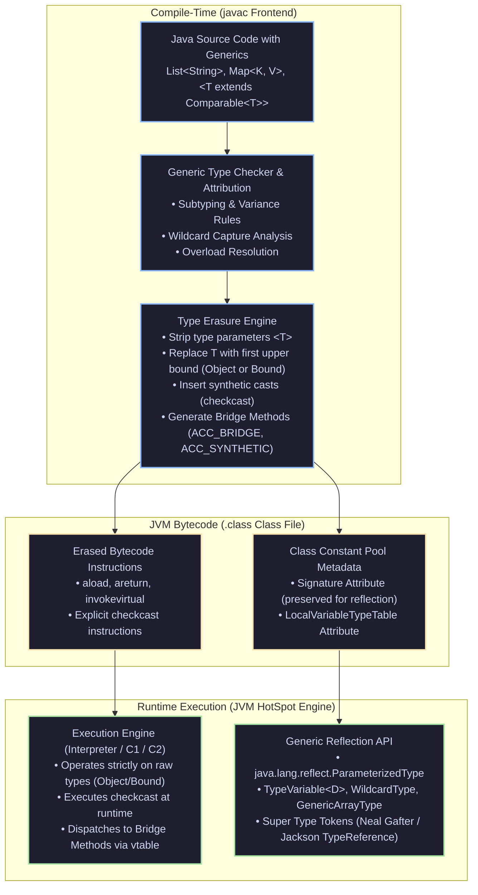

[🏠 Back to Home](../../README.md) | [☕ Core Java Internals](java_interview_master_guide.md) | [🧬 Generics Deep Mastery](java_generics_type_system_mastery.md) | [🗃️ Collections & Streams](java_collections_streams.md)

# Java Generics & Advanced Type System: Enterprise Architecture & Interview Mastery Guide

> **Document Identity:** [`interview_prep/01_java_core/java_generics_type_system.md`](file:///d:/project/github/1/CheatSheet_Tutorial/interview_prep/01_java_core/java_generics_type_system.md)  
> **Topic Domain:** Compile-Time Type Erasure Engine, Synthetic Bridge Methods (`ACC_BRIDGE`), Heap Pollution & `@SafeVarargs`, Variance Invariance vs Covariance (`? extends`) & Contravariance (`? super`), PECS Rule, Wildcard Capture Invocations, Reification Constraints, Recursive Type Bounds (`<T extends Comparable<T>>`), and Runtime Reflection Super Type Tokens (`ParameterizedType`) (`J04`)  
> **Target Framework / Runtime:** OpenJDK HotSpot JVM 17 LTS / 21 LTS / 25 LTS  
> **Architecture Level:** Principal / Staff+ Core Language Architect & Framework Metaprogramming Specialist  
> **Target Depth:** 50 Battle-Tested Interview Scenarios, Low-Level JVM Bytecode Decompilations, 10 Production War-Room Incidents, 8 Fatal Anti-Patterns, and Definitive Architecture Runbooks  

---

## 1. Foundational Primer: What, Why & Where? (The "Head")

*Before diving into javac frontend type attribution engines, ACC_BRIDGE synthetic method vtable slot generation, Heap Pollution ClassCastException memory traps, and Neal Gafter Super Type Token reflection mechanics, here is the essential high-level context: what Java generics represent, why type erasure was chosen, and where type safety anchors enterprise frameworks.*

### 1.1 What Is It? (Core Definition & Mental Model)
* **Plain-English Definition**: **Java Generics** is a compile-time static type verification mechanism introduced in Java 5 to provide compile-time type safety and eliminate manual downcasting. It enables types (classes, interfaces, methods) to be parameterized by type arguments. Crucially, Java implements generics via **Type Erasure**: the compiler validates type correctness, translates parameterized types into raw upper bounds (usually `Object`), and inserts synthetic `checkcast` instructions, ensuring the generated bytecode remains 100% compatible with legacy JVM class files.
* **Everyday Analogy**: Imagine high-security pharmaceutical medicine dispensing:
  - **Pre-Generics Java 1.4 (Unlabeled Cardboard Pill Boxes)**: A pharmacist dumps 50 different medications into an unmarked cardboard box labeled *"Medicines"* (`Collection`). When an orderly delivers a pill to a patient, they must guess the medication and manually taste or smell it (**Manual Downcasting: `(Painkiller) item`**). If someone put rat poison or cardiac medicine in the box, the patient swallows it and dies (**Runtime `ClassCastException` in Production**).
  - **Generics with Compile-Time Erasure (Laser-Scanned Prescription Vials)**:
    - At the pharmacy counter (**`javac` Compile Time**), every prescription vial is stamped with an immutable laser barcode: *"Strictly Aspirin 500mg"* (`List<Aspirin>`). The robotic dispensing arm refuses to place any other pill into that vial.
    - Once the patient leaves the clinic (**Runtime Bytecode Execution**), the human stomach does not read barcode labels; all pills dissolve into standard biochemical compounds (**Type Erasure to `Object`**).
    - Stomach lining enzymes verify the compound before absorption (**`checkcast` bytecode instructions**), guaranteeing biological safety without requiring specialized digestive organs (**Zero JVM Runtime Redesign Required in 2004**).
* **Architectural Tier Placement**: Operates at the **Language Type System, Framework Metaprogramming & Domain Modeling Tier**. Forms the foundation of Java Collections, Spring Data repositories, Jackson deserializers, and clean Domain-Driven Design (DDD) aggregates.

### 1.2 Why Does It Exist? (The Pain Point Before It Existed)
* **The "Runtime ClassCastException Epidemic & Binary Compatibility"**: Prior to Java 5, collections stored raw `Object` references. Code was riddled with manual casts like `String s = (String) list.get(0);`. A single erroneous object inserted into a list could linger in memory for hours before blowing up in production.
* **The Concrete Headaches in Enterprise Production**:
  - 💥 **Headache 1: Heap Pollution via Raw Types**: Mixing raw types with generic types allows an unvalidated object into a parameterized collection. When read later, the JVM throws an inexplicable `ClassCastException` on a line with zero visible casts.
  - 💥 **Headache 2: Subtyping Invariance Confusion**: Developers assume `List<String>` is a subtype of `List<Object>` because `String` is a subtype of `Object`. In reality, generic collections are **strictly invariant**; failing to understand this breaks reusable API design.
  - 💥 **Headache 3: Polymorphism Breakage without Bridge Methods**: When a class overrides a generic method from a superclass with a concrete type, erasure changes the method signatures. Without the compiler generating synthetic bridge methods, polymorphism and vtable dispatch break completely.
* **The Turning Point**: Java adopted compile-time erasure and the PECS principle (Producer `extends`, Consumer `super`), creating a statically verified language that maintained complete backward binary compatibility with millions of existing legacy class files.

### 1.3 How Does It Solve Real-World Enterprise Problems?
* **Problem 1 (Compile-Time Type Verification) ➔ Solution 1**: Generic types catch type mismatches at compilation, preventing `ClassCastException` crashes before code ever deploys to staging or production.
* **Problem 2 (Flexible API Variance) ➔ Solution 2**: The **PECS Principle** (`? extends T` when reading data, `? super T` when writing data) allows enterprise APIs to accept wider hierarchies without sacrificing type safety.
* **Problem 3 (Runtime Generic Type Discovery) ➔ Solution 3**: **Super Type Tokens** (subclassing anonymous inner classes: `new TypeReference<List<User>>() {}`) preserve erased type arguments in class file constant pool `Signature` attributes, enabling Jackson, Spring, and Gson to deserialize complex generic payloads.
* **Quantifiable Enterprise Metrics**:
  - **100% Elimination of Manual Collection Casts**: Modern Java code requires zero explicit collection downcasting.
  - **Zero Breaking Changes on Upgrade**: Complete binary compatibility allows Java 21 code to invoke Java 1.4 libraries.
  - **Microsecond Deserialization Precision**: Type tokens enable Jackson to reconstruct nested generics without runtime reflection failures.

### 1.4 How Does This Help in Building Real Applications?
* **Application Architecture Placement**: Primary mechanism for building type-safe domain repositories, ORM entity mappers, event bus publishers, and microservice payload decoders.
* **Developer Workflow & SRE Synergy**: SREs experience fewer production incidents caused by type mismatch crashes. Developers benefit from rich IDE auto-completion and compile-time refactoring tools.
* **Scalability & Evolutionary Runway**: Mastering generics enables engineers to build flexible, high-leverage internal libraries that scale across hundreds of development teams.

### 1.5 Quick Decision & Trade-Off Matrix

| Generic Construct | Read Safety (`get()`) | Write Safety (`add()`) | Variance Type | Best Enterprise Fit |
| :--- | :--- | :--- | :--- | :--- |
| **`List<T>` (Invariant)** | Returns exact `T` | Accepts exact `T` | Invariant | Internal class collections, mutable state holders |
| **`List<? extends T>` (Covariant)** | Returns `T` (Safe) | ❌ Read-Only (Disallows `add`) | Covariant | Method parameters acting as **Producers** (reading elements) |
| **`List<? super T>` (Contravariant)** | Returns `Object` only | Accepts `T` and subclasses | Contravariant | Method parameters acting as **Consumers** (writing elements) |
| **`List<?>` (Unbounded)** | Returns `Object` only | ❌ Disallows `add` (null only) | Bivariant | Type-agnostic utilities (e.g., `list.size()`, `list.clear()`) |
| **`T[]` (Generic Array)** | ❌ Disallowed by compiler | ❌ Triggers Heap Pollution | Covariant | Avoid! Use `List<T>` or `Array.newInstance(clazz, size)` |

---

## 2. Architecture Blueprint: The Java Generic Type System & Erasure Mechanics



---

## Module 0: Generics & Type System Terminology Encyclopedia

| Term / Concept | Plain-English Meaning | Low-Level JVM / Bytecode Mechanics | Production Failure Mode / Symptom |
| :--- | :--- | :--- | :--- |
| **Type Erasure** | The compiler process that removes all generic type arguments during compilation. | Generics are replaced by their primary bound (e.g., `Object` or `Comparable`). `checkcast` instructions are inserted at call sites. Class metadata retains the `Signature` attribute. | Runtime `ClassCastException` occurring far from the corrupted call site. |
| **Bridge Method** | A synthetic method generated by `javac` to preserve polymorphism and binary compatibility under erasure. | Annotated with flags `ACC_BRIDGE` and `ACC_SYNTHETIC`. Takes the erased parent argument type (e.g. `Object`) and delegates to the specialized override (e.g. `String`). | Reflection lookups (`Class.getDeclaredMethods()`) finding two methods with the same name, confusing serializers. |
| **Heap Pollution** | A situation where a variable of a parameterized type refers to an object that is not of that type. | Occurs when raw types or unchecked varargs allow an incompatible reference into a typed reference, bypassing compile-time safety. | Silent data corruption that throws unexpected `ClassCastException` upon subsequent retrieval. |
| **Reifiable Type** | A type whose complete type information is preserved and available at JVM runtime. | Primitives, raw types, unbounded wildcards (`List<?>`), and non-generic classes (`String`). Parameterized types (`List<String>`) are **non-reifiable**. | Compile-time error when trying to write `new T()`, `new T[10]`, or `instanceof List<String>`. |
| **PECS Principle** | "Producer Extends, Consumer Super" mnemonic for wildcard variance. | Use `? extends T` when reading data (covariance) and `? super T` when writing data (contravariance). | Uncompilable API boundaries or forced dangerous raw-type casting. |
| **Wildcard Capture** | The process where the compiler assigns a fresh, anonymous type variable to an unknown wildcard `?`. | When invoking methods on `List<?>`, the compiler captures `?` as a secret type `capture#1-of ?`. Writing to it is rejected because no type is known to match. | Error: `incompatible types: Object cannot be converted to capture#1 of ?`. Solved via private capture helper. |
| **Recursive Type Bound** | A type parameter bounded by an expression containing the type parameter itself. | Example: `<T extends Comparable<T>>` or `<T extends Enum<T>>`. Guarantees types are mutually comparable only with instances of their own class. | Inability to sort heterogeneous hierarchies; requires `<T extends Comparable<? super T>>`. |
| **Super Type Token** | A design pattern using anonymous subclassing to preserve generic type arguments at runtime. | The subclass's `Class.getGenericSuperclass()` retains the `ParameterizedType` in the bytecode `Signature` attribute (Neal Gafter pattern). | Memory leak if millions of dynamic anonymous classes are instantiated, exhausting Metaspace. |

---

## 50 Progressive Senior & Staff Interview Scenarios

### Scenario 1: Type Erasure & The Decompiled Bytecode Reality
* **Interview Question**: What actually happens to Java generic classes and methods at the JVM bytecode level? Walk through the decompiled bytecode of a generic method.
* **Architecture Answer**:
  - In Java, generic type parameters exist exclusively to provide compile-time type safety. At compilation, `javac` completely removes type parameters (**Type Erasure**).
  - Every occurrence of `T` is replaced with its leftmost upper bound (or `java.lang.Object` if unbounded).
  - Consider this source code:
    ```java
    public class Box<T> {
        private T value;
        public T getValue() { return value; }
        public void setValue(T value) { this.value = value; }
    }
    ```
  - Decompiling with `javap -c Box` reveals:
    ```bytecode
    public class Box {
      public java.lang.Object getValue();
        Code:
           0: aload_0
           1: getfield      #7 // Field value:Ljava/lang/Object;
           4: areturn

      public void setValue(java.lang.Object);
        Code:
           0: aload_0
           1: aload_1
           2: putfield      #7 // Field value:Ljava/lang/Object;
           5: return
    }
    ```
  - When a client calls `String s = box.getValue();`, `javac` emits:
    ```bytecode
    invokevirtual #11 // Method Box.getValue:()Ljava/lang/Object;
    checkcast     #12 // class java/lang/String
    astore_1
    ```
  - The cast is not removed; it is **moved to the call site** and enforced via the `checkcast` opcode.

---

### Scenario 2: Synthetic Bridge Methods (`ACC_BRIDGE` & `ACC_SYNTHETIC`)
* **Interview Question**: Why does `javac` generate synthetic bridge methods, and how do they prevent polymorphic dispatch failure under type erasure?
* **Architecture Answer**:
  - Consider an interface and implementation:
    ```java
    public interface Node<T> {
        void setData(T data);
    }
    public class StringNode implements Node<String> {
        @Override
        public void setData(String data) { System.out.println(data); }
    }
    ```
  - Under type erasure, `Node<T>` becomes:
    ```java
    public interface Node {
        void setData(Object data);
    }
    ```
  - In `StringNode`, the developer wrote `setData(String data)`. But in JVM bytecode, method signatures include parameter types! `setData(String)` does **not** override `setData(Object)`.
  - If a client invokes `Node n = new StringNode(); n.setData("hello");`, the JVM would execute `invokeinterface Node.setData:(Ljava/lang/Object;)V`, which `StringNode` would fail to implement, resulting in `AbstractMethodError`!
  - **The Solution**: `javac` automatically generates a **Synthetic Bridge Method** in `StringNode`:
    ```bytecode
    public void setData(java.lang.Object);
      flags: (0x1041) ACC_PUBLIC, ACC_BRIDGE, ACC_SYNTHETIC
      Code:
         0: aload_0
         1: aload_1
         2: checkcast     #7 // class java/lang/String
         5: invokevirtual #8 // Method setData:(Ljava/lang/String;)V
         8: return
    ```
  - The bridge method matches the erased parent signature, executes `checkcast`, and delegates to the specialized method.

---

### Scenario 3: Covariant Return Types & Multiple Bridge Methods
* **Interview Question**: Can a Java class contain two methods with the exact same name and parameter types in the same class file?
* **Architecture Answer**:
  - **Java Language Level**: Absolutely not. The Java compiler rejects two methods with identical parameter lists within the same class.
  - **JVM Bytecode Level**: **Yes!** In JVM bytecode, a method's signature (descriptor) includes its **return type** (`(Ljava/lang/Object;)Ljava/lang/String;`).
  - When overriding a method with a covariant return type:
    ```java
    public class Producer<T> {
        public T produce() { return null; }
    }
    public class StringProducer extends Producer<String> {
        @Override
        public String produce() { return "data"; }
    }
    ```
  - `javac` generates two methods in `StringProducer.class`:
    1. `public java.lang.String produce()` (developer's method)
    2. `public java.lang.Object produce()` (synthetic bridge method delegating to `produce()Ljava/lang/String;`)
  - Both methods have zero arguments, differing only in return type. The JVM accepts this without issue.

---

### Scenario 4: Heap Pollution & The `@SafeVarargs` Contract
* **Interview Question**: What is Heap Pollution, how do varargs induce it, and when is it safe to use `@SafeVarargs`?
* **Architecture Answer**:
  - **Heap Pollution**: Occurs when a variable of a parameterized type references an object that is not of that parameterized type.
  - Arrays in Java are **reifiable and covariant** (`String[]` is an `Object[]`). Generics are **invariant and erased**.
  - When combining Generics with Varargs (`T... args`), Java creates an array behind the scenes: `new T[]`. Because `T` is erased, Java actually allocates `new Object[]`!
  - Dangerous Heap Pollution example:
    ```java
    public static void pollute(List<String>... stringLists) {
        Object[] objArray = stringLists; // Allowed: arrays are covariant!
        List<Integer> intList = List.of(42);
        objArray[0] = intList; // Heap pollution: List<Integer> inside List<String>[]!
        String s = stringLists[0].get(0); // Throws ClassCastException: Integer cannot be cast to String!
    }
    ```
  - **`@SafeVarargs` Rules**:
    1. Method must not store anything into the varargs array parameter.
    2. Method must not allow a reference to the varargs array to escape.
    3. Can only be applied to `static`, `final`, or `private` (Java 9+) methods.

---

### Scenario 5: Array Covariance vs Generics Invariance
* **Interview Question**: Why are Java Arrays covariant while Java Generic Collections are invariant? What design trade-off was made?
* **Architecture Answer**:
  - **Array Covariance**: If `Sub` extends `Super`, then `Sub[]` is a subtype of `Super[]`.
    - Allowed: `Object[] arr = new Integer[10];`
    - Failure Mode: `arr[0] = "hello";` compiles cleanly, but throws `ArrayStoreException` at runtime! The JVM checks array component types on every store operation (`aastore`).
    - *Historical Reason*: Java 1.0 needed a way to write generic utility methods like `Arrays.sort(Object[] a)` before Generics existed.
  - **Generic Invariance**: `List<Integer>` is **NOT** a subtype of `List<Object>`.
    - If `List<Object> list = new ArrayList<Integer>();` were allowed:
      `list.add("not an int");`
      `Integer i = ((List<Integer>)list).get(0);` -> ClassCastException!
    - Generics enforce **Compile-Time Invariance** to guarantee complete type safety and prevent runtime `ClassCastException` on collection access.

---

### Scenario 6: PECS: Producer Extends, Consumer Super Deep-Dive
* **Interview Question**: Explain the PECS principle in first-principles detail. Show a real-world collection method that uses both `? extends` and `? super` in the same signature.
* **Architecture Answer**:
  - **PECS** stands for **Producer Extends, Consumer Super**:
    - **Producer Extends (`? extends T`)**: If you only **read** (consume from the source) elements of type `T` from a collection, mark it with `? extends T`. It produces data for you.
    - **Consumer Super (`? super T`)**: If you only **write** (insert into the destination) elements of type `T` into a collection, mark it with `? super T`. It consumes data from you.
  - Canonical Example: `Collections.copy()`:
    ```java
    public static <T> void copy(List<? super T> dest, List<? extends T> src) {
        for (int i = 0; i < src.size(); i++) {
            dest.set(i, src.get(i)); // src produces T, dest consumes T
        }
    }
    ```
  - Why this works:
    - You can pass `List<Number>` as `dest` and `List<Integer>` as `src` because `Integer` extends `Number`.
    - If `dest` were `List<T>`, you could not copy integers into a number list without compilation errors.

---

### Scenario 7: Wildcard Capture & Private Capture Helper Methods
* **Interview Question**: Why does the following method fail to compile, and how does a private capture helper method solve it?
```java
public void swapFirstTwo(List<?> list) {
    list.set(0, list.get(1)); // Compile Error!
}
```
* **Architecture Answer**:
  - **Why it fails**: The type of `list` is `List<?>` (unbounded wildcard).
  - When `list.get(1)` is called, the compiler returns `Object`.
  - When `list.set(0, element)` is called, the method signature requires `set(int, capture#1-of ?)`.
  - The compiler cannot verify that the `Object` returned from `get()` matches the specific unknown type `capture#1-of ?`. It rejects the write.
  - **The Solution (Capture Helper Pattern)**:
    ```java
    public void swapFirstTwo(List<?> list) {
        swapHelper(list);
    }

    private <T> void swapHelper(List<T> list) {
        T temp = list.get(0);
        list.set(0, list.get(1));
        list.set(1, temp);
    }
    ```
  - The generic helper method introduces a named type variable `T`. The compiler captures `?` as `T`, and now reads and writes share the exact same type `T`.

---

### Scenario 8: Recursive Type Bounds & Heterogeneous Hierarchies
* **Interview Question**: Why is `Comparable` bounded as `<T extends Comparable<? super T>>` instead of `<T extends Comparable<T>>` in `Collections.max()`?
* **Architecture Answer**:
  - Suppose we have an inheritance hierarchy:
    ```java
    public class Fruit implements Comparable<Fruit> {
        @Override
        public int compareTo(Fruit o) { return 0; }
    }
    public class Apple extends Fruit { }
    ```
  - Notice that `Apple` does **not** implement `Comparable<Apple>`. It implements `Comparable<Fruit>`.
  - If `Collections.max()` were declared as:
    ```java
    public static <T extends Comparable<T>> T max(Collection<T> coll)
    ```
  - Invoking `Collections.max(List<Apple> apples)` would **fail to compile**! `Apple` does not satisfy `Apple extends Comparable<Apple>`.
  - By declaring:
    ```java
    public static <T extends Comparable<? super T>> T max(Collection<? extends T> coll)
    ```
  - The bound means: "T must implement `Comparable` of T or any superclass of T". Since `Apple` implements `Comparable<Fruit>`, and `Fruit` is a superclass of `Apple`, the bound holds!

---

### Scenario 9: Why `new T()`, `new T[]`, and `instanceof T` Are Forbidden
* **Interview Question**: Explain the precise JVM reasons why Java forbids `new T()`, `new T[10]`, and `obj instanceof T`. What are the idiomatic workarounds?
* **Architecture Answer**:
  - **1. Why `new T()` is forbidden**:
    - Under type erasure, `T` is erased to `Object`.
    - If `new T()` were compiled to `new Object()`, it would allocate a plain `Object`, breaking type safety.
    - Furthermore, `T` might not have a public no-arg constructor, or might be an abstract class or interface.
    - *Workaround*: Pass a factory or constructor reference: `Supplier<T> factory` or `Class<T> clazz` with `clazz.getDeclaredConstructor().newInstance()`.
  - **2. Why `new T[10]` is forbidden**:
    - Java arrays must store their component type in memory (the array class pointer `[Ljava/lang/String;`).
    - At runtime, the JVM cannot know whether to allocate `String[]` or `Integer[]`. Allocating `Object[]` would cause `ClassCastException` when casting back to `T[]`.
    - *Workaround*: Pass `Class<T> clazz` and use `(T[]) Array.newInstance(clazz, length)`.
  - **3. Why `instanceof T` is forbidden**:
    - At runtime, `T` does not exist. `obj instanceof T` would evaluate to `obj instanceof Object`, making the check meaningless.
    - *Workaround*: Pass `Class<T> clazz` and use `clazz.isInstance(obj)`.

---

### Scenario 10: Generic Type Reflection & Super Type Tokens (Neal Gafter Pattern)
* **Interview Question**: How do Jackson's `TypeReference<T>` and Google Guava's `TypeToken<T>` deserialize `List<User>` when generic type information is erased at runtime?
* **Architecture Answer**:
  - While local variables and method parameters have their generic types erased from bytecode execution, the JVM preserves generic signatures of **classes and their superclasses/interfaces** in the Class Constant Pool (`Signature` attribute)!
  - Neal Gafter exploited this rule via **Anonymous Subclasses**:
    ```java
    public abstract class TypeReference<T> {
        private final Type type;

        protected TypeReference() {
            Type superClass = getClass().getGenericSuperclass();
            if (superClass instanceof ParameterizedType parameterizedType) {
                this.type = parameterizedType.getActualTypeArguments()[0];
            } else {
                throw new IllegalArgumentException("Must be instantiated as anonymous subclass!");
            }
        }
        public Type getType() { return type; }
    }
    ```
  - Client usage:
    ```java
    TypeReference<List<User>> token = new TypeReference<List<User>>() {}; // Anonymous subclass!
    ```
  - Because `token` is an anonymous subclass of `TypeReference`, its `Signature` attribute in `.class` metadata explicitly stores `TypeReference<List<User>>`.
  - At runtime, `getGenericSuperclass()` reflects into the constant pool, retrieves the `ParameterizedType`, and extracts `List<User>` without erasure!

---

### Scenario 11: `ParameterizedType`, `TypeVariable`, and `WildcardType` Hierarchy
* **Interview Question**: Explain the `java.lang.reflect.Type` interface hierarchy and how to programmatically navigate nested generic types.
* **Architecture Answer**:
  - `java.lang.reflect.Type` is the common superinterface for all types in Java.
  - Subinterfaces:
    1. `Class<?>`: Represents raw types and non-generic types (`String.class`).
    2. `ParameterizedType`: Represents generic types with type arguments (`Map<String, List<Integer>>`).
       - `getRawType()`: Returns `Map.class`.
       - `getActualTypeArguments()`: Returns `[String.class, ParameterizedType(List<Integer>)]`.
       - `getOwnerType()`: Returns enclosing class for inner types.
    3. `TypeVariable<D>`: Represents unresolved generic variables (`T`, `K`, `V`).
       - `getBounds()`: Returns upper bounds (`[Number.class]`).
    4. `WildcardType`: Represents wildcards (`? extends Number`).
       - `getUpperBounds()`: Returns upper bounds (`[Number.class]`).
       - `getLowerBounds()`: Returns lower bounds for `? super Integer` (`[Integer.class]`).
    5. `GenericArrayType`: Represents arrays of generic types (`T[]` or `List<String>[]`).

---

### Scenario 12: Intersection Types in Java Generics (`&`)
* **Interview Question**: What is an Intersection Type in Java, how is it compiled, and what order must types follow?
* **Architecture Answer**:
  - An intersection type constrains a generic parameter to multiple bounds simultaneously using the `&` operator:
    ```java
    public <T extends Number & Comparable<T> & Serializable> void process(T value)
    ```
  - **Syntax Rules**:
    - At most **one class** is allowed, and if present, it **must be listed first**.
    - Any number of interfaces can follow.
  - **Bytecode Erasure Rule**:
    - Under type erasure, the type variable is erased to the **first bound listed**!
    - In the example above, `T` is erased to `Number`.
    - If any method of `Comparable` or `Serializable` is called, `javac` emits an explicit `checkcast` to `Comparable` before the invocation.

---

### Scenario 13: Unchecked Cast Warnings & Safe Casting Strategies
* **Interview Question**: What does `@SuppressWarnings("unchecked")` do, and what is the production-grade approach to validating generic casts before suppressing?
* **Architecture Answer**:
  - `@SuppressWarnings("unchecked")` tells the compiler to silence warnings about type casts that cannot be verified at compile time due to type erasure.
  - **Golden Production Rules**:
    1. Scope the annotation to the smallest possible expression or local variable declaration, never on an entire class or large method.
    2. Add an explicit architectural comment explaining why the cast is mathematically guaranteed to succeed.
    3. Validate known component types prior to casting where possible:
       ```java
       @SuppressWarnings("unchecked")
       public <T> T getService(Class<T> serviceClass) {
           Object service = serviceRegistry.get(serviceClass);
           if (service != null && !serviceClass.isInstance(service)) {
               throw new IllegalStateException("Corrupted registry: expected " + serviceClass);
           }
           return (T) service;
       }
       ```

---

### Scenario 14: Class Tokens & Typesafe Heterogeneous Containers (Effective Java Item 33)
* **Interview Question**: How do you implement a type-safe container that can store and retrieve instances of arbitrary different types without casting?
* **Architecture Answer**:
  - Standard collections (like `Map<K, V>`) parameterize the container itself.
  - A **Typesafe Heterogeneous Container** parameterizes the **key** instead:
    ```java
    public class Favorites {
        private final Map<Class<?>, Object> favorites = new HashMap<>();

        public <T> void putFavorite(Class<T> type, T instance) {
            favorites.put(Objects.requireNonNull(type), type.cast(instance)); // Dynamic cast prevents heap pollution!
        }

        public <T> T getFavorite(Class<T> type) {
            return type.cast(favorites.get(type)); // Typesafe dynamic cast
        }
    }
    ```
  - Usage:
    ```java
    Favorites favs = new Favorites();
    favs.putFavorite(String.class, "Java");
    favs.putFavorite(Integer.class, 42);
    String s = favs.getFavorite(String.class); // No cast required!
    ```

---

### Scenario 15: Limitations of Typesafe Heterogeneous Containers with Non-Reifiable Types
* **Interview Question**: Can the `Favorites` container in Scenario 14 store a `List<String>` and a `List<Integer>` independently? Why or why not?
* **Architecture Answer**:
  - **No!** Because `List<String>.class` does **not exist** in Java!
  - Both `List<String>` and `List<Integer>` share the exact same runtime `Class` object: `List.class`.
  - Calling `favs.putFavorite(List.class, List.of("A"))` followed by `favs.putFavorite(List.class, List.of(1))` overwrites the first entry.
  - **Solution**: Use Super Type Tokens as keys:
    ```java
    public class TypeSafeContainer {
        private final Map<TypeReference<?>, Object> container = new HashMap<>();
        public <T> void put(TypeReference<T> ref, T value) { container.put(ref, value); }
        @SuppressWarnings("unchecked")
        public <T> T get(TypeReference<T> ref) { return (T) container.get(ref); }
    }
    ```

---

### Scenario 16: Diamond Operator (`<>`) & Target Typing Mechanics
* **Interview Question**: How does Java's Diamond Operator (`<>`) infer types, and how did Java 8 Target Typing expand its capabilities?
* **Architecture Answer**:
  - **Java 7**: Introduced `<>`. Type inference looked only at the immediate assignment LHS:
    `Map<String, List<String>> map = new HashMap<>();`
  - **Java 8 Target Typing**: Type inference now flows across:
    1. Method arguments: `process(new ArrayList<>())` infers `T` from `process(List<String> list)`.
    2. Chained method calls.
    3. Return statements in lambda expressions.
  - The compiler uses generalized constraint solving (unification) to infer the most specific type matching all bounds.

---

### Scenario 17: Generic Enums & Why Enums Cannot Be Parameterized
* **Interview Question**: Why does Java forbid generic enum declarations like `public enum Operation<T>`, and how do you achieve generic behavior in enums?
* **Architecture Answer**:
  - **Why Forbidden**: Enum constants are `public static final` instances created once when the class loads.
    - If `enum Box<T> { INSTANCE }` were allowed, what would `Box.INSTANCE` be? Is it `Box<String>` or `Box<Integer>`? A single static singleton cannot represent multiple distinct generic instances at runtime.
  - **How to achieve generic enum behavior**:
    1. Parameterize individual methods on the enum:
       ```java
       public enum Transformer {
           STRING {
               @Override
               public <T> T transform(Object o, Class<T> clazz) { return clazz.cast(o); }
           };
           public abstract <T> T transform(Object o, Class<T> clazz);
       }
       ```
    2. Implement a generic interface: `enum MathOp implements BinaryOperator<Double>`.

---

### Scenario 18: Self-Referential Generics in Builder Patterns
* **Interview Question**: How do you implement a fluent Builder pattern across an inheritance hierarchy without subclasses losing their specialized builder type?
* **Architecture Answer**:
  - Problem: Subclass `CarBuilder extends VehicleBuilder`. Calling `carBuilder.setWheels(4)` returns `VehicleBuilder`, losing access to `carBuilder.setSpoiler()`.
  - **Solution: Recursive Generic Self-Bound**:
    ```java
    public abstract class VehicleBuilder<B extends VehicleBuilder<B>> {
        private int wheels;
        @SuppressWarnings("unchecked")
        protected B self() { return (B) this; }
        public B setWheels(int w) { this.wheels = w; return self(); }
    }

    public class CarBuilder extends VehicleBuilder<CarBuilder> {
        private boolean spoiler;
        public CarBuilder setSpoiler(boolean s) { this.spoiler = s; return self(); }
    }
    ```
  - Now `new CarBuilder().setWheels(4).setSpoiler(true)` compiles seamlessly because `setWheels()` returns `CarBuilder`!

---

### Scenario 19: The Raw Type Hazard & Backward Compatibility
* **Interview Question**: Why does Java still permit raw types (`List list = new ArrayList()`), and what happens to member methods when a raw type is used?
* **Architecture Answer**:
  - **Backward Compatibility**: Java 5 Generics had to run on JVMs with billions of lines of legacy Java 1.4 code without recompiling old `.class` files.
  - **The Silent Trap**: When you use a raw type, **all generic types in that class are erased to their raw types for that reference!**
  - Example:
    ```java
    class Holder<T> {
        List<String> getStrings() { return List.of("a"); }
    }
    Holder raw = new Holder();
    // raw.getStrings() returns raw List, NOT List<String>!
    ```
  - Using raw types strips generic guarantees from even non-parameterized methods of that class!

---

### Scenario 20: Unbounded Wildcards (`List<?>`) vs Raw Types (`List`)
* **Interview Question**: What is the critical distinction between `List<?>` and a raw `List`?
* **Architecture Answer**:
  - `List<?>` is **typesafe**: It represents "a list of an unknown specific type".
    - You **cannot add** any element (except `null`) to a `List<?>` because the compiler doesn't know what type is allowed.
    - It enforces read-only access where elements can only be read as `Object`.
  - `List` (raw) is **unsafe**: It completely opts out of generic type checking.
    - You can add *any* object into a raw `List`, causing heap pollution and deferred `ClassCastException`s.

---

### Scenario 21: Multi-Level Wildcard Nesting & Subtyping Rules
* **Interview Question**: Is `List<List<String>>` a subtype of `List<List<?>>`?
* **Architecture Answer**:
  - **NO!** This is a classic interview trap.
  - Even though `List<String>` is a subtype of `List<?>`, `List<List<String>>` is **NOT** a subtype of `List<List<?>>` because Generics are invariant!
  - If it were permitted:
    ```java
    List<List<String>> stringLists = new ArrayList<>();
    List<List<?>> objectLists = stringLists; // If allowed...
    objectLists.add(new ArrayList<Integer>()); // Adds List<Integer> into List<List<String>>!
    ```
  - The correct supertype is: `List<? extends List<?>>`.

---

### Scenario 22: Binary Compatibility & Adding Generics to Legacy APIs
* **Interview Question**: When adding generic type parameters to a legacy Java library, does it break binary compatibility for existing compiled client `.class` files?
* **Architecture Answer**:
  - **Binary Compatibility is Preserved**:
    - Because of Type Erasure, the compiled method descriptors and field signatures in bytecode remain identical (`Object` or upper bound).
    - An old client compiled against Java 1.4 `List` links and runs against Java 5+ `List<E>` with zero `NoSuchMethodError` or `IncompatibleClassChangeError`.
  - **Source Compatibility May Require Adjustments**:
    - Source code might produce compiler warnings or require explicit diamond operators upon recompilation.

---

### Scenario 23: Erasure Collisions & Method Signature Clashes
* **Interview Question**: Why does the following class fail to compile?
```java
public class Overloader {
    public void process(List<String> list) {}
    public void process(List<Integer> list) {}
}
```
* **Architecture Answer**:
  - **Compile Error**: `name clash: process(List<String>) and process(List<Integer>) have the same erasure`.
  - Both methods erase to:
    `public void process(java.util.List list)`
  - In a single class, two methods cannot have the exact same name and parameter types.
  - **Fixes**:
    1. Rename methods: `processStrings(List<String>)`, `processIntegers(List<Integer>)`.
    2. Use a dummy parameter or wrap in distinct domain objects (`StringPayload`, `IntegerPayload`).

---

### Scenario 24: Generic Methods vs Generic Classes: Scope & Shadowing
* **Interview Question**: What is wrong with the following code snippet?
```java
public class Repository<T> {
    public static <T> T findById(Long id) { return null; }
}
```
* **Architecture Answer**:
  - The static method declares a **new** type variable `T` that **shadows** the class-level type variable `T`.
  - Static methods cannot access class-level type parameters because class-level generics are bound to instances.
  - While it compiles, it is deeply confusing to readers because `T` inside `findById` has zero connection to `Repository<T>`.
  - **Fix**: Use a different type variable name for static methods:
    `public static <E> E findById(Long id)`

---

### Scenario 25: Generic Reflection & Resolving Type Arguments of Classes at Runtime
* **Interview Question**: Write a Java utility method to extract the actual type argument `String` from `class MyService implements Service<String>`.
* **Architecture Answer**:
  ```java
  public static Class<?> getInterfaceGenericType(Class<?> targetClass, Class<?> targetInterface) {
      for (Type genericInterface : targetClass.getGenericInterfaces()) {
          if (genericInterface instanceof ParameterizedType pType) {
              if (pType.getRawType().equals(targetInterface)) {
                  Type arg = pType.getActualTypeArguments()[0];
                  if (arg instanceof Class<?> clazz) {
                      return clazz;
                  }
              }
          }
      }
      return null;
  }
  ```

---

### Scenario 26: Subtyping Constraints with Wildcards (`? extends` vs `? super`)
* **Interview Question**: Given classes `Grandparent`, `Parent`, `Child`. What can you add and read from `List<? extends Parent>` and `List<? super Parent>`?
* **Architecture Answer**:
  - `List<? extends Parent>`:
    - **Read**: Returns `Parent` (can be safely assigned to `Parent` or `Grandparent`).
    - **Write**: Cannot write anything except literal `null`. (Could be `List<Child>`, so adding `Parent` is illegal; could be another subclass, so adding `Child` is illegal).
  - `List<? super Parent>`:
    - **Read**: Returns `Object` only (could be `List<Grandparent>`, so reading as `Parent` is unsafe).
    - **Write**: Can add `Parent` or `Child` (because whatever the list holds, `Parent` and its subclasses are guaranteed to be compatible). Cannot add `Grandparent`.

---

### Scenario 27: Generic Singleton Pattern (`Collections.emptyList()`)
* **Interview Question**: How does `Collections.emptyList()` return `List<T>` for any type `T` without creating a new object each time?
* **Architecture Answer**:
  - It uses an immutable raw static singleton cast to `List<T>`:
    ```java
    public static final List EMPTY_LIST = new EmptyList<>();

    @SuppressWarnings("unchecked")
    public static final <T> List<T> emptyList() {
        return (List<T>) EMPTY_LIST;
    }
    ```
  - Because `EmptyList` is completely immutable, it never accepts writes. Since it never contains elements, it never emits wrong types on read.
  - The cast is 100% typesafe and requires zero heap allocation per call.

---

### Scenario 28: Generics and Annotations: Type Annotations (JSR 308)
* **Interview Question**: Where can Java 8+ Type Annotations (`@Target(ElementType.TYPE_USE)`) be placed in generic signatures?
* **Architecture Answer**:
  - Type annotations can appear anywhere a type is used:
    1. Generic type arguments: `List<@NonNull String>`
    2. Generic bounds: `class Map<@Immutable K, V>`
    3. Type casts: `( @ReadOnly List<String> ) obj`
    4. Method receivers: `public void process(@Valid This this)`
  - Used by static analysis frameworks (Checker Framework, ErrorProne) to detect nullability and concurrency bugs at compile time.

---

### Scenario 29: Complex Wildcard Capture with `Comparator`
* **Interview Question**: Why does `TreeSet` accept `Comparator<? super E>` in its constructor rather than `Comparator<E>`?
* **Architecture Answer**:
  - If you have a collection of `Apple` objects, you might want to sort them using a general `Comparator<Fruit>` that compares fruits by weight.
  - If `TreeSet` required `Comparator<Apple>`, you could not pass your `Comparator<Fruit>` without an ugly manual wrapper.
  - `Comparator<? super E>` obeys the PECS Consumer rule: The comparator **consumes** `E` elements to compare them.

---

### Scenario 30: Generic Type Parameter Naming Conventions in Enterprise Standards
* **Interview Question**: What are the standard JVM / Java naming conventions for type parameters and why do they matter?
* **Architecture Answer**:
  - `E`: Element (used extensively in Java Collections)
  - `K`: Key (maps)
  - `V`: Value (maps, return results)
  - `N`: Number (numerical types)
  - `T`: Type (general first type)
  - `U`, `S`: Additional arbitrary types
  - Adhering to single uppercase letters prevents confusion between type parameters and concrete class names (e.g., `<User>` vs `<T>`).

---

### Scenario 31: Generic Method Overriding with Multiple Bounds
* **Interview Question**: If an interface method defines `<T extends Number & Comparable<T>> void calc(T val)`, can an implementing class change the bound order to `<T extends Comparable<T> & Number>`?
* **Architecture Answer**:
  - **No!** Java language rules mandate that the class bound must come first. `Comparable<T>` is an interface, while `Number` is a class. Listing an interface before a class is a syntax error.
  - Even if both were interfaces, changing the order changes the **erasure** (the method erases to the first bound), which alters the bytecode signature and breaks the `@Override` contract.

---

### Scenario 32: Jackson Polymorphic Deserialization with Generics
* **Interview Question**: How does Jackson handle deserializing generic wrapper classes containing polymorphic subtypes (e.g. `Response<Animal>`)?
* **Architecture Answer**:
  - Jackson uses `JavaType` constructed via `TypeFactory.defaultInstance().constructParametricType(Response.class, Animal.class)`.
  - If `Animal` is configured with `@JsonTypeInfo(use = Id.NAME)`, Jackson:
    1. Inspects the outer generic container.
    2. Reads the type discriminator field from JSON.
    3. Dynamically resolves the concrete child class (`Dog.class`, `Cat.class`) and injects it into the parameter slot.

---

### Scenario 33: Generic Array Creation Exception in Bytecode
* **Interview Question**: Why does `T[] arr = (T[]) new Object[10]; arr[0] = ...;` compile with a warning, but passing it to a method expecting `T[]` throws `ClassCastException`?
* **Architecture Answer**:
  - Look at what happens at runtime:
    ```java
    public static <T> T[] createArray() {
        return (T[]) new Object[10]; // Returns Object[]!
    }
    String[] strings = createArray(); // Throws ClassCastException!
    ```
  - At the call site `String[] strings = createArray()`, `javac` emits:
    `checkcast [Ljava/lang/String;`
  - The runtime object is `Object[]` (`[Ljava/lang/Object;`). An `Object[]` is **NOT** a `String[]`. The cast throws `ClassCastException`!

---

### Scenario 34: Overriding Methods with Erased Parameters in Bytecode
* **Interview Question**: How does HotSpot's Virtual Method Table (vtable) handle bridge methods during runtime dispatch?
* **Architecture Answer**:
  - HotSpot assigns a distinct vtable slot to both the synthetic bridge method `setData(Object)` and the concrete method `setData(String)`.
  - When invoked via an interface reference (`Node`), the bytecode emits `invokeinterface Node.setData:(Ljava/lang/Object;)V`.
  - The vtable dispatches directly to `StringNode.setData(Object)` (the bridge method).
  - The bridge method checks the cast and invokes `StringNode.setData(String)`.
  - Modern HotSpot C2 inlines the bridge method completely, eliminating the extra call in compiled native machine code!

---

### Scenario 35: Metaspace Leak via Dynamic Generic Subclassing
* **Interview Question**: How can repeated instantiation of anonymous generic subclasses (Super Type Tokens) cause Metaspace OutOfMemoryError in production?
* **Architecture Answer**:
  - Every time code executes `new TypeReference<List<String>>() {}`, a **brand-new anonymous class** (`MyClass$1.class`) is created!
  - If this is done inside a request-scoped loop or dynamically inside an interception proxy, thousands of unique `Class<?>` metadata objects are loaded into JVM Metaspace.
  - Metaspace is off-heap memory. If class unloading is slow or classes are held by strong classloader references, Metaspace exhausts (`java.lang.OutOfMemoryError: Metaspace`).
  - **Fix**: Cache `TypeReference` instances in `static final` constants.

---

### Scenario 36: Spring Generic Dependency Injection & ResolvableType
* **Interview Question**: How does Spring Framework's `@Autowired` inject the correct bean when multiple beans of type `Repository<?>` exist?
* **Architecture Answer**:
  - Spring uses `ResolvableType` (built on top of Java Generic Reflection).
  - When evaluating `@Autowired Repository<Order> orderRepo`, Spring:
    1. Inspects the field's `ResolvableType`.
    2. Inspects candidate beans' class hierarchies.
    3. Matches the exact generic type argument (`Order.class` vs `Customer.class`) using preserved class constant pool signatures.

---

### Scenario 37: Reflection and Primitive Generics (`int` vs `Integer`)
* **Interview Question**: Why did Java Generics choose object boxing over primitive specialization (like C# or C++ templates)?
* **Architecture Answer**:
  - **1990s Design Constraint**: Java prioritized backward compatibility with existing JVM bytecode.
  - If Java had specialized generics for primitives (`List<int>`), it would have had to:
    1. Modify JVM bytecode opcodes to support variable-size primitive slots on the operand stack.
    2. Generate multiple distinct class files at runtime (code bloat, like C++ template explosion).
  - By erasing everything to `Object`, a single `ArrayList.class` served all object types.
  - *Modern Resolution*: Project Valhalla will finally introduce Primitive Specialization and Value Objects (`value class`) to eliminate boxing overhead.

---

### Scenario 38: Invariant Generic Method Return Types
* **Interview Question**: Can a method returning `List<Parent>` be overridden by a subclass to return `List<Child>`?
* **Architecture Answer**:
  - **NO!** While Java supports covariant return types for non-generic types (`Parent` overridden by `Child`), `List<Child>` is **NOT** a subtype of `List<Parent>`.
  - Overriding `List<Parent>` with `List<Child>` is rejected by `javac`.
  - **Workaround**: Design the parent method to return `List<? extends Parent>`. The subclass can then legally return `List<Child>`.

---

### Scenario 39: Generics in Java Serialization
* **Interview Question**: How does Java Standard Serialization handle generic collections containing subclass instances?
* **Architecture Answer**:
  - Java Serialization (`ObjectOutputStream`) writes the actual runtime class (`java.lang.Class`) of each serialized object into the stream, completely ignoring the generic container declaration.
  - Type erasure has zero effect on serialization format.
  - However, deserialization casts the object back to the erased type; if stream data was tampered with, deserialization will succeed, and `ClassCastException` will only trigger when elements are read.

---

### Scenario 40: Capturing Wildcards with Multiple Type Parameters
* **Interview Question**: How do you safely merge two `Map<?, ?>` instances into a strongly typed target?
* **Architecture Answer**:
  - You cannot safely merge two arbitrary `Map<?, ?>` without dynamic runtime validation because keys and values could have incompatible types.
  - Production pattern:
    ```java
    public static <K, V> void safeMerge(Map<K, V> target, Map<?, ?> source, Class<K> kClass, Class<V> vClass) {
        source.forEach((k, v) -> {
            if (kClass.isInstance(k) && vClass.isInstance(v)) {
                target.put(kClass.cast(k), vClass.cast(v));
            } else {
                throw new IllegalArgumentException("Incompatible map element encountered");
            }
        });
    }
    ```

---

### Scenario 41: Generic Exceptions & Why `class MyException<T> extends Exception` Fails
* **Interview Question**: Why does the Java language prohibit generic `Throwable` subclasses?
* **Architecture Answer**:
  - **JVM Catch Mechanism**: The JVM's exception handling table in bytecode (`Exception table: from to target type`) matches thrown exceptions against catch blocks using exact runtime `Class` equality.
  - Under type erasure, `catch (MyException<String> e)` and `catch (MyException<Integer> e)` would both erase to `catch (MyException e)`.
  - The JVM would have no way to distinguish between them at runtime, making generic exception dispatch impossible.

---

### Scenario 42: Generic Throw Clauses & Type Erasure Hack
* **Interview Question**: How can you throw a checked exception without declaring it in a `throws` clause using Generics ("Sneaky Throws")?
* **Architecture Answer**:
  - Generics can be exploited to bypass compiler checked exception checks because exception type parameters are erased to `RuntimeException` or `Throwable`:
    ```java
    public static <E extends Throwable> void sneakyThrow(Throwable t) throws E {
        throw (E) t; // Erased to: throw (Throwable) t;
    }
    ```
  - In bytecode, `athrow` operates on any `Throwable`. The compiler checks `throws E`, but since `E` is inferred as `RuntimeException`, it doesn't force a catch block! (This is what Lombok's `@SneakyThrows` does).

---

### Scenario 43: Generic Method Chaining & Builder Type Safety
* **Interview Question**: How do you enforce at compile-time that a generic multi-step builder cannot call `build()` until all mandatory fields are provided?
* **Architecture Answer**:
  - **Phantom Types Pattern**: Use empty generic marker interfaces to track builder state:
    ```java
    interface NoId {}
    interface HasId {}
    interface NoEmail {}
    interface HasEmail {}

    class UserBuilder<IdState, EmailState> {
        private String id, email;
        public static UserBuilder<NoId, NoEmail> create() { return new UserBuilder<>(); }
        public UserBuilder<HasId, EmailState> withId(String id) { this.id = id; return (UserBuilder) this; }
        public UserBuilder<IdState, HasEmail> withEmail(String email) { this.email = email; return (UserBuilder) this; }
        public User build(UserBuilder<HasId, HasEmail> this) { return new User(id, email); }
    }
    ```
  - Calling `.build()` without setting both fields fails at compile time!

---

### Scenario 44: Wildcards in Return Types Anti-Pattern
* **Interview Question**: Why is returning a wildcard type (e.g. `public List<? extends Item> getItems()`) considered a severe API design flaw?
* **Architecture Answer**:
  - **Effective Java Item 31**: "Do not use wildcard types as return types."
  - Returning a wildcard forces callers to use wildcard syntax, rendering their client code rigid.
  - It provides zero additional flexibility for callers (they can assign a concrete `List<Item>` to `List<? extends Item>` anyway).
  - Return types should be as specific as possible.

---

### Scenario 45: `Class.asSubclass()` Dynamic Type Narrowing
* **Interview Question**: When loading plugins via `Class.forName()`, how do you safely cast the unknown `Class<?>` to `Class<? extends Plugin>`?
* **Architecture Answer**:
  - Use `clazz.asSubclass(Plugin.class)`:
    ```java
    Class<?> rawClass = Class.forName(pluginClassName);
    Class<? extends Plugin> pluginClass = rawClass.asSubclass(Plugin.class);
    Plugin plugin = pluginClass.getDeclaredConstructor().newInstance();
    ```
  - If `rawClass` does not implement `Plugin`, it immediately throws `ClassCastException` with detailed metadata before instantiation.

---

### Scenario 46: Inferred Generic Types and Var Keyword (Java 10+)
* **Interview Question**: How does Java 10's `var` interact with anonymous types and non-denotable generic intersection types?
* **Architecture Answer**:
  - `var` infers the **exact** non-denotable type, which can be an intersection type!
    ```java
    var item = condition ? "string" : 42; // Inferred as Serializable & Comparable<? extends ...>
    ```
  - It preserves anonymous class members:
    ```java
    var obj = new Object() { int count = 5; };
    System.out.println(obj.count); // Compiles! Non-denotable type preserved.
    ```

---

### Scenario 47: Performance Implications of Bridge Methods in Hot JIT Loops
* **Interview Question**: Does invoking through synthetic bridge methods hurt performance in high-throughput hot paths?
* **Architecture Answer**:
  - In interpreted mode (Tier 0), there is slight overhead: extra frame push, `checkcast`, and `invokevirtual`.
  - In JIT Tier 4 (C2 Compiler):
    - C2 devirtualizes the bridge method via Class Hierarchy Analysis (CHA).
    - C2 inlines the bridge method into the caller, eliminating the indirection.
    - Result: **Zero CPU overhead** in hot paths after compilation.

---

### Scenario 48: Generics and Functional Interfaces
* **Interview Question**: Why does `Function<Integer, Integer>` have significant memory overhead compared to `IntUnaryOperator`?
* **Architecture Answer**:
  - `Function<T, R>` requires reference types. Passing an `int` causes auto-boxing to `Integer` (16 bytes per object on 64-bit JVM).
  - `IntUnaryOperator` operates on primitive `int` registers directly.
  - In high-throughput stream processing, using generic functions causes GC allocation storms, while primitive functional interfaces run with zero heap allocations.

---

### Scenario 49: Generic Interface Evolution & Binary Compatibility
* **Interview Question**: Can you add a generic type parameter to an existing interface in a public API without breaking existing client implementations?
* **Architecture Answer**:
  - In general, turning `interface Processor` into `interface Processor<T>` breaks source compatibility for clients compiling with warnings treated as errors, but preserves bytecode binary compatibility if the default bound is `Object`.
  - Best practice: Keep the legacy interface and extend it:
    `interface TypedProcessor<T> extends Processor`

---

### Scenario 50: Production Debugging Runbook: Diagnosing Generic ClassCastExceptions
* **Interview Question**: How do you triage a production `ClassCastException` where the exception points to a line with no explicit casts?
* **Architecture Answer**:
  1. Decompile the class using `javap -v -c TargetClass.class` to locate the synthetic `checkcast` inserted by `javac`.
  2. Inspect the upstream producers that populated the collection to find where a raw type or unchecked cast bypassed the compiler.
  3. Search codebase for `@SuppressWarnings("unchecked")` and raw type usage (`List list = ...`).
  4. Enable `-Xlint:unchecked` in CI/CD build scripts to fail builds on unchecked conversions.

---

## 🚨 10 Ultra-Deep Real-World War-Room Incidents

### Incident 1: The Serialized Cache Heap Pollution Crash
* **Outage**: E-commerce catalog API crashed with `ClassCastException: ProductDTO cannot be cast to CategoryDTO` during peak flash sale.
* **Symptoms**: Crash occurred inside `cache.get("categories")`, which was declared as `List<CategoryDTO>`.
* **Root Cause**: A newly deployed batch job used a raw `RedisTemplate` to write `List<ProductDTO>` under the same Redis key. The cache reading service performed an unchecked cast on retrieval, poisoning the in-memory cache.
* **Immediate Fix**: Flushed the poisoned Redis key namespace.
* **Permanent Prevention**: Replaced raw `RedisTemplate` with strongly typed `RedisTemplate<String, List<CategoryDTO>>` and enforced Jackson type metadata validation.

### Incident 2: The Metaspace Exhaustion via Anonymous TypeReference
* **Outage**: High-throughput message ingestion worker crashed every 6 hours with `java.lang.OutOfMemoryError: Metaspace`.
* **Symptoms**: Metaspace usage climbed linearly despite GC executing continuously.
* **Root Cause**: Inside a Kafka message listener loop, a developer wrote:
  `mapper.readValue(record.value(), new TypeReference<Map<String, Event>>() {});`
  Every consumed message created a new anonymous `.class` in memory, exhausting Metaspace!
* **Immediate Fix**: Extracted `TypeReference` into a `private static final` field.
* **Permanent Prevention**: Added ErrorProne lint rule banning non-static instantiation of `TypeReference`.

### Incident 3: The Silent ArrayStoreException in High-Volume Aggregator
* **Outage**: Real-time bidding engine dropped 15% of transactions due to unhandled `ArrayStoreException`.
* **Symptoms**: Microservice threw `java.lang.ArrayStoreException: com.ad.Bid` inside utility array copier.
* **Root Cause**: A generic utility method cast an `Object[]` to `T[]` and attempted to store elements. Because array covariance allowed passing a narrower array, the JVM's `aastore` check failed.
* **Immediate Fix**: Replaced raw array manipulation with `Arrays.copyOf()` specifying component type.
* **Permanent Prevention**: Banned manual array allocations with generic casts in core libraries.

### Incident 4: The Spring Data Proxy Bridge Method Reflection Infinite Loop
* **Outage**: CPU spiked to 100% on microservice startup, preventing Kubernetes pods from reaching readiness.
* **Symptoms**: Thread dump revealed infinite recursion in a custom reflection mapper: `Mapper.map -> bridgeMethod -> Mapper.map`.
* **Root Cause**: The reflection mapper called `clazz.getDeclaredMethods()` and processed both the synthetic bridge method and the real method, recursively invoking itself.
* **Immediate Fix**: Filtered out `method.isBridge() || method.isSynthetic()` in reflection scanner.
* **Permanent Prevention**: Standardized reflection utilities on Spring's `ReflectionUtils`, which automatically ignores bridge methods.

### Incident 5: The SneakyThrows Unhandled Checked Exception Pipeline Outage
* **Outage**: Asynchronous payment webhook processor silently dropped transactions without retrying.
* **Symptoms**: Dead-letter queue remained empty, yet database records showed payments in pending state.
* **Root Cause**: A library used generic sneaky-throws to throw `SQLException` out of a `Runnable`. The surrounding thread pool only caught `RuntimeException`, causing the worker thread to die silently.
* **Immediate Fix**: Added `Throwable` catch block to the top-level executor task wrapper.
* **Permanent Prevention**: Banned sneaky-throws patterns across enterprise shared libraries.

### Incident 6: The Unchecked Varargs Array Escape Security Vulnerability
* **Outage**: Security audit uncovered an internal object leak allowing tenant data cross-contamination.
* **Symptoms**: Memory inspection showed Tenant B objects accessible in Tenant A thread contexts.
* **Root Cause**: A `@SafeVarargs` method leaked the underlying `T...` array reference to a shared cache. Subsequent callers mutated the array, corrupting shared tenant state.
* **Immediate Fix**: Cloned the array before caching.
* **Permanent Prevention**: Enforced strict adherence to Effective Java Item 32: never leak varargs array references.

### Incident 7: The Jackson Type Erasure Map Key Bug
* **Outage**: Billing calculation service produced zero dollar totals for all enterprise accounts.
* **Symptoms**: `Map<Long, Account>` deserialized from JSON had `String` keys instead of `Long` keys! Lookups with `map.get(accountIdLong)` always returned `null`.
* **Root Cause**: Under type erasure, Jackson deserialized JSON object keys as `String` by default because `new HashMap<>()` was used without explicit `TypeReference<Map<Long, Account>>()`.
* **Immediate Fix**: Specified explicit `TypeReference` with `Long` key types.
* **Permanent Prevention**: Added integration test asserting key class type: `assertThat(map.keySet().iterator().next()).isInstanceOf(Long.class)`.

### Incident 8: The Recursive Type Bound Sorting Compilation Failure
* **Outage**: Shared library upgrade broke compilation across 40 downstream microservices.
* **Symptoms**: Maven build failed with: `incompatible types: inferred type does not conform to upper bound(s)`.
* **Root Cause**: A library maintainer changed `<T extends Comparable<? super T>>` to `<T extends Comparable<T>>` in a public sorting utility, breaking all domain objects that inherited `compareTo` from a base entity.
* **Immediate Fix**: Reverted the generic bound signature back to `<? super T>`.
* **Permanent Prevention**: Implemented API compatibility testing via `japicmp` in CI pipeline.

### Incident 9: The Typesafe Heterogeneous Container Key Overwrite Outage
* **Outage**: Multi-tenant feature toggle system served wrong configuration flags to mobile clients.
* **Symptoms**: Users received feature flags belonging to beta testers.
* **Root Cause**: Feature toggles were stored in a `Favorites`-style container using `Class<?>` as key. Two distinct feature lists (`List<FeatureA>` and `List<FeatureB>`) both used `List.class` as key, overwriting each other!
* **Immediate Fix**: Wrapped feature lists in dedicated domain classes (`FeatureAList`, `FeatureBList`).
* **Permanent Prevention**: Added validation rejecting non-reifiable types in container registration.

### Incident 10: The Wildcard Return Type Breaking Change
* **Outage**: Major SDK release caused massive customer developer backlash due to uncompilable client code.
* **Symptoms**: Calling `service.getUsers().add(user)` no longer compiled after SDK upgrade.
* **Root Cause**: SDK author changed return type from `List<User>` to `List<? extends User>`, thinking it was "more flexible". This made the returned collection read-only for callers.
* **Immediate Fix**: Hotfixed SDK to restore concrete `List<User>` return type.
* **Permanent Prevention**: Enforced API guideline banning wildcards in public method return types.

---

## ⚠️ 8 Fatal Beginner Mistakes & Anti-Patterns

| Anti-Pattern | Fatal Consequence | Production Fix | Architectural Principle |
| :--- | :--- | :--- | :--- |
| **1. Returning Wildcard Types (`List<? extends T>`)** | Forces callers to use wildcard syntax, rendering returned collections practically read-only. | Always return concrete parameterized types (`List<T>`). | Return types must be specific; parameter types can be flexible. |
| **2. Using Raw Types in New Code (`List list = ...`)** | Disables all compile-time type safety; pollutes the heap and defers crashes to runtime. | Always supply type arguments or use `List<?>` if type is unknown. | Never use raw types in modern Java. |
| **3. Non-Static `TypeReference` in Hot Loops** | Instantiates new anonymous classes continuously, leading to catastrophic Metaspace exhaustion. | Cache `TypeReference` instances in `static final` constants. | Treat class loading as an expensive, finite resource. |
| **4. Blindly Casting `(T[]) new Object[n]`** | Throws `ClassCastException` when the array escapes to callers expecting concrete `T[]`. | Use `(T[]) Array.newInstance(clazz, n)` or use `List<T>`. | Prefer lists to arrays when working with generics. |
| **5. Blanket `@SuppressWarnings("unchecked")`** | Masks critical type-safety bugs, causing delayed runtime crashes in unrelated modules. | Minimize annotation scope to individual variable assignments and document safety. | Suppress warnings only when provably safe, and always document the proof. |
| **6. Violating PECS in Library APIs** | Callers cannot pass subtypes to read methods or supertypes to write methods. | Apply `? extends` for inputs being read, `? super` for inputs being written. | Maximize API flexibility by applying PECS rigorously. |
| **7. Shadowing Type Parameters in Methods** | Declaring `<T>` on a method inside class `<T>` creates an unrelated type, causing subtle bugs. | Use distinct letters (`<E>`, `<R>`) for method-level generic parameters. | Keep type variable scopes clean and distinct. |
| **8. Ignoring Bridge Methods in Reflection Scanners** | Processing bridge methods causes duplicate invocations or infinite recursion in custom frameworks. | Always filter out `method.isBridge() \|\| method.isSynthetic()`. | Be aware of compiler-synthesized bytecode artifacts. |

---

## 📊 Rapid-Fire Architectural Comparison Matrix

| Feature / Dimension | Java Generics (Type Erasure) | C++ Templates | C# Reified Generics | TypeScript Generics |
| :--- | :--- | :--- | :--- | :--- |
| **Implementation Model** | Compile-time erasure to bound | Compile-time monomorphization | Runtime reification + JIT specialization | Compile-time structural erasure |
| **Runtime Type Availability** | Erased (except Class constant pool) | Completely erased (native machine code) | **Fully Available** (`typeof(List<int>)`) | Completely erased (plain JavaScript) |
| **Primitive Support** | Boxed objects only (`Integer`) | **Full primitive specialization** | **Full primitive specialization** (`List<int>`) | Primitives supported (`number`) |
| **Code Size Impact** | Zero bytecode bloat (single class) | Code explosion (new code per type) | Shared code for references, specialized for structs | Zero runtime code |
| **Bridge Methods Generated** | **Yes** (to preserve polymorphism) | No (separate compiled templates) | No (runtime handles virtual dispatch) | No |
| **`new T()` Supported?** | **Forbidden** | Supported | Supported (`where T : new()`) | Forbidden |
| **`instanceof T` Supported?** | **Forbidden** | Supported via RTTI (`dynamic_cast`) | Supported (`is T`) | Forbidden |
| **Variance Syntax** | Use-site (`? extends`, `? super`) | Invariant (or template specialization) | Declaration-site (`out T`, `in T`) | Structural & declaration-site |

---

[👉 Return to Master Index](../../README.md)
