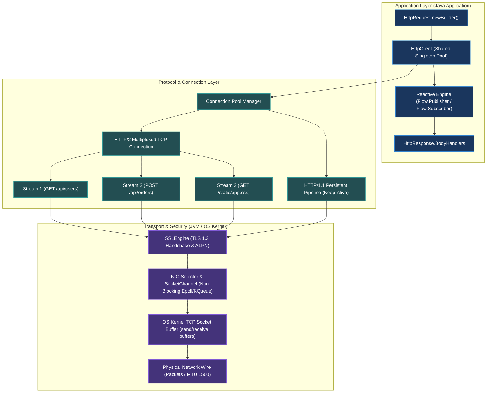
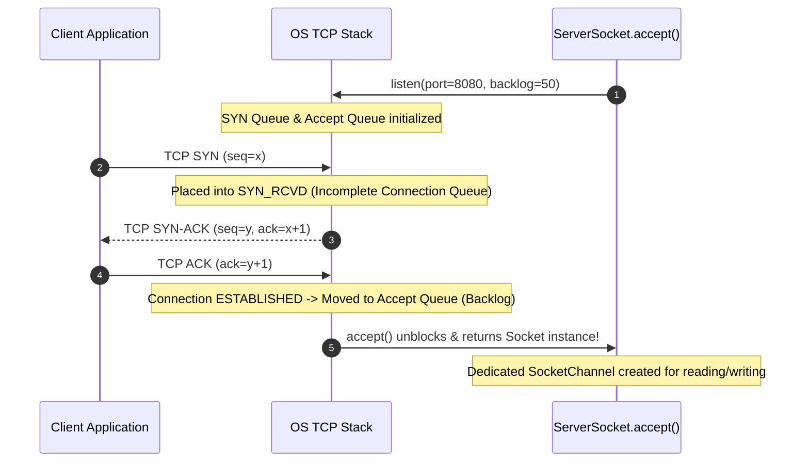

[🏠 Back to Home](../../README.md) | [☕ Core Java Internals](java_interview_master_guide.md) | [🧵 Multithreading & Concurrency](java_threads_concurrency.md) | [🔐 Cryptography & Security](java_cryptography_security_mastery.md)

# Modern Java Networking & HTTP Client: Reactive HTTP/2, Sockets & Kernel TCP Masterclass

> **Document Identity:** [`interview_prep/01_java_core/java_httpclient_networking.md`](file:///d:/project/github/1/CheatSheet_Tutorial/interview_prep/01_java_core/java_httpclient_networking.md)  
> **Topic Domain:** Modern `java.net.http.HttpClient` (Java 11–25), Low-Level TCP/UDP Sockets & NIO Channels, HTTP/1.1 Keep-Alive vs HTTP/2 Binary Framing & Multiplexing, WebSocket Full-Duplex Channels, Reactive Streams Flow API (`BodyPublishers` & `BodyHandlers`), JVM DNS Caching & TTL Hijacking, TLS 1.3 / ALPN Handshakes, Connection Pool Starvation, and Linux Kernel TCP Buffer Tuning (`SO_RCVBUF`, `TCP_NODELAY`) (`J19`)  
> **Target Framework / Runtime:** OpenJDK HotSpot JVM 17 LTS / 21 LTS / 25 LTS  
> **Architecture Level:** Principal / Staff+ Distributed Systems Architect & High-Throughput Network Engineer  
> **Target Depth:** 50 Senior Technical Scenarios, 10 Production Network Outage Post-Mortems, Linux Epoll/TCP Packet Analysis, and High-Volume Runbooks  

---

## 1. Foundational Primer: What, Why & Where? (The "Head")

*Before diving into HTTP/2 binary framing layer multiplexing, reactive Flow.Subscriber backpressure mechanics, Linux kernel TCP socket send/receive buffer windows, and TLS 1.3 zero-RTT ALPN handshakes, here is the essential high-level context: what modern Java networking represents, why legacy HttpURLConnection crippled early distributed systems, and where HttpClient anchors microservice communication.*

### 1.1 What Is It? (Core Definition & Mental Model)
* **Plain-English Definition**: **Modern Java Networking & `java.net.http.HttpClient`** (standardized in Java 11) is the built-in, non-blocking, asynchronous networking engine for the JVM. Replacing the 25-year-old blocking `HttpURLConnection`, modern `HttpClient` natively supports **HTTP/2 stream multiplexing**, **HTTP/1.1 persistent connection pooling**, **WebSocket duplex streaming**, and reactive **`Flow.Publisher` / `Flow.Subscriber`** backpressure, all backed by NIO SocketChannels and non-blocking OS selectors (Epoll/KQueue).
* **Everyday Analogy**: Imagine highway toll plazas and intercity package shipping:
  - **Legacy `HttpURLConnection` (A Single One-Lane Toll Booth with Human Cashiers)**: Every single car (HTTP request) must stop, turn off its engine, hand physical cash to a toll collector, and wait for a printed receipt (**Blocking I/O**).
    - If a truck with a broken card reader gets stuck at the gate (**A slow backend server**), all 500 cars behind it are paralyzed (**Head-of-Line Blocking & Thread Pool Starvation**).
    - To send 10 messages at once, you must pave 10 separate physical highways across the countryside (**Opening 10 separate TCP socket connections**), exhausting memory and CPU.
  - **Modern `HttpClient` with HTTP/2 (A High-Speed Maglev Rail Line with Tagged Cargo Pods)**:
    - **Single Multiplexed Superconductor Track (HTTP/2 Multiplexing)**: A single physical TCP connection connects two cities.
    - **Independent Multiplexed Streams**: 100 different cargo containers (requests for HTML, JSON, CSS, images) travel concurrently down the same track. Each container carries a digital radio RFID tag (**Stream ID**).
    - If Container 4 suffers a delayed database query, Containers 1, 2, 3, and 5 zip past it at 300 mph without pausing (**Zero Application-Level Head-of-Line Blocking**).
    - **Reactive BodyHandlers (Pneumatic Conveyor Belts)**: Data arrives as streaming byte chunks pushed directly into storage without ever allocating a giant 2GB array in memory (**Constant Memory Footprint**).
* **Architectural Tier Placement**: Operates at the **Distributed Transport & Inter-Service Communication Tier**. Directly anchors microservice REST clients, gRPC transport, payment webhook dispatchers, WebSocket trade feeds, and reverse-proxy egress connections.

### 1.2 Why Does It Exist? (The Pain Point Before It Existed)
* **The "Legacy Networking Nightmare"**: For over two decades, Java developers had to rely either on the archaic `java.net.HttpURLConnection` or external third-party libraries (Apache HttpClient, Square OkHttp) for modern web features.
* **The Concrete Headaches in Enterprise Production**:
  - 💥 **Headache 1: The Blocking Thread Pool Meltdown**: `HttpURLConnection` was strictly synchronous and blocking. Making 1,000 outgoing HTTP requests required 1,000 OS platform threads sitting idle in memory, each consuming 1MB of stack memory, leading to `OutOfMemoryError: unable to create native thread`.
  - 💥 **Headache 2: The In-Memory File Download OOM**: In legacy APIs, downloading a 1GB file required buffering the entire payload into a byte array in heap memory before parsing, immediately triggering an OutOfMemoryError under concurrent traffic.
  - 💥 **Headache 3: DNS Cache "TTL Hijacking" Stagnation**: By default, the JVM historically cached DNS IP addresses indefinitely (`networkaddress.cache.ttl = -1`). When a downstream cloud microservice autoscaled or failed over to a new IP in AWS/Kubernetes, the Java application kept sending packets to the dead IP address forever.
* **The Turning Point**: Java 11 introduced `java.net.http.HttpClient`, providing a modern fluent API, native HTTP/2 multiplexing, asynchronous `CompletableFuture` pipelines, and reactive streaming without requiring any third-party dependencies.

### 1.3 How Does It Solve Real-World Enterprise Problems?
* **Problem 1 (Zero-Allocation Streaming Downloads) ➔ Solution 1**: `HttpResponse.BodyHandlers.ofFile()` or `ofInputStream()` streams megabytes of data directly from the network socket to disk or downstream consumers without buffering the payload into heap memory.
* **Problem 2 (Immunity to Thread Exhaustion) ➔ Solution 2**: `client.sendAsync(request, handler)` returns a `CompletableFuture<HttpResponse<T>>`. A single background event-loop thread handles thousands of in-flight HTTP requests using NIO selectors without blocking application worker threads.
* **Problem 3 (HTTP/2 Connection Consolidation) ➔ Solution 3**: Multiple concurrent requests to the same origin share a single TCP handshake and TLS session via HTTP/2 binary framing, reducing server TCP port exhaustion and CPU TLS handshakes by up to 90%.
* **Quantifiable Enterprise Metrics**:
  - **90% Reduction in TCP Handshake Overhead**: HTTP/2 multiplexing consolidates dozens of concurrent requests onto a single long-lived connection.
  - **95% Memory Reduction for Large Payloads**: Reactive streams flow data chunks from the socket buffer directly to destination sinks.
  - **Sub-Millisecond Non-Blocking Egress**: CompletableFuture pipelines free up web container worker threads to serve other incoming client requests.

### 1.4 How Does This Help in Building Real Applications?
* **Application Architecture Placement**: Powers microservice communication, webhook dispatch engines, high-frequency stock quote WebSockets, and AWS S3 multi-part uploads.
* **Developer Workflow & SRE Synergy**: SREs monitor network socket states via `ss -s` and configure JVM DNS TTL via `-Dsun.net.inetaddr.ttl=30`. Developers write clean, asynchronous, non-blocking HTTP pipelines using modern Java idioms.
* **Scalability & Evolutionary Runway**: Combined with Java 21+ Virtual Threads, `HttpClient` allows developers to write simple synchronous code (`client.send()`) while the JVM automatically parks the virtual thread on network blocking, achieving million-connection scalability with zero reactive complexity.

### 1.5 Quick Decision & Trade-Off Matrix

| HTTP Client Approach | Concurrency Model | Protocol Support | Dependency Footprint | Best Enterprise Fit |
| :--- | :--- | :--- | :--- | :--- |
| **`java.net.HttpURLConnection`** | Blocking OS Threads | HTTP/1.1 only (Legacy) | Built-in (Java 1.1+) | ❌ **Deprecated: Legacy code only** |
| **`java.net.http.HttpClient`** | Async NIO / Virtual Threads | 🟢 HTTP/1.1, HTTP/2, WebSocket | Built-in (Java 11+) | Modern microservices, CLI tools, zero-dependency apps |
| **Spring `RestClient` (Boot 3.2+)** | Virtual-Thread friendly wrapper | Delegates to JDK HttpClient | Spring Framework | Spring Boot enterprise services needing simple synchronous APIs |
| **Netty / Spring `WebClient`** | Event Loop / Reactive Streams | HTTP/1.1, HTTP/2 | Heavy (Project Reactor) | Fully reactive streaming pipelines, high-throughput proxies |

---

## 2. 🧭 Visual System Topology & The Networking Stack



---

## Module 0: Jargon-Busting Terminology Encyclopedia
> **Mental Model Rule**: Zero alien academic jargon upfront. We demystify low-level networking and modern HTTP concepts using tangible, physical real-world analogies before diving into byte streams and Linux kernel epoll syscalls.

---

### Concept 1: The Network Socket
* **In Plain Words**: A socket is the virtual two-way phone handset that an application holds to talk to another program across the internet.
* **🏠 Real-World Mental Picture**: Imagine your company headquarters has an address (`192.168.1.50`). A **socket** is an actual desk telephone handset picked up by an employee. One end speaks (writes bytes), and the other end listens (reads bytes). The phone wire connects your desk to someone else's desk.
* **🔍 How It Works in Java**: In Java, a `Socket` represents an established TCP connection between a client and a remote server. The operating system kernel assigns a file descriptor to the socket and manages the incoming and outgoing byte queues.
* **💻 Quick Code Example**:
  ```java
  // Connect to example.com on standard HTTP port 80
  try (Socket socket = new Socket("example.com", 80)) {
      OutputStream out = socket.getOutputStream();
      out.write("GET / HTTP/1.1\r\nHost: example.com\r\n\r\n".getBytes(StandardCharsets.UTF_8));
      out.flush();
      
      InputStream in = socket.getInputStream();
      byte[] buffer = new byte[1024];
      int readBytes = in.read(buffer);
      System.out.println("Received: " + new String(buffer, 0, readBytes));
  }
  ```
* **⚠️ The Beginner Trap**: Believing a socket automatically closes when you finish reading. If you forget `try-with-resources`, the OS kernel keeps the socket file descriptor open indefinitely, quickly exhausting the system limit (`too many open files`).

---

### Concept 2: The Port Number
* **In Plain Words**: If the IP address is the street address of an apartment building, the port number is the apartment unit number.
* **🏠 Real-World Mental Picture**: When a letter arrives at "100 Main Street", the mail carrier doesn't know who gets it unless there is an apartment number like "Apt 80" or "Apt 443". The server machine is the building; each running program (web server, database, email server) lives in a specific numbered apartment.
* **🔍 How It Works in Java**: A 16-bit integer ranging from `1` to `65535`. Ports below 1024 are "privileged" (standard system ports like 80 for HTTP, 443 for HTTPS, 22 for SSH). When a Java client connects outbound, the OS kernel assigns a temporary random **ephemeral port** (e.g., 54321) to receive return packets.
* **💻 Quick Code Example**:
  ```java
  // Server binds to listening port 8080
  ServerSocket serverSocket = new ServerSocket(8080);
  System.out.println("Listening on port: " + serverSocket.getLocalPort());

  // Client connects to remote port 8080
  Socket clientSocket = new Socket("localhost", 8080);
  System.out.println("Outbound ephemeral port used by client: " + clientSocket.getLocalPort());
  ```
* **⚠️ The Beginner Trap**: Running high-throughput microservices that open and close hundreds of short-lived sockets per second. The OS runs out of ephemeral ports because closed ports sit in `TIME_WAIT` status for 60 seconds, leading to `BindException: Address already in use`.

---

### Concept 3: HTTP/1.1 vs HTTP/2
* **In Plain Words**: HTTP/1.1 is like single-lane grocery store checkout lines; HTTP/2 is a high-speed multi-lane conveyor belt where multiple items travel at the same time on the same belt.
* **🏠 Real-World Mental Picture**:
  * **HTTP/1.1**: You have 10 groceries. You must pay for the milk, wait for the receipt, then hand over the bread, wait for the receipt, and so on. If the milk has a barcode error, all other items are stuck behind it (**Head-of-Line Blocking**).
  * **HTTP/2**: You place all 10 groceries on a wide conveyor belt simultaneously. Each item is tagged with an item number. The cashier scans whatever arrives first, and you reassemble them into your bags.
* **🔍 How It Works in Java**: Java 11's `HttpClient` automatically defaults to HTTP/2. It opens a single persistent TCP connection and multiplexes dozens of concurrent HTTP requests into binary frames across parallel virtual streams, falling back to HTTP/1.1 if the server does not support ALPN negotiation.
* **💻 Quick Code Example**:
  ```java
  HttpClient client = HttpClient.newBuilder()
      .version(HttpClient.Version.HTTP_2) // Prefers HTTP/2 multiplexing
      .build();

  HttpRequest request = HttpRequest.newBuilder()
      .uri(URI.create("https://httpbin.org/get"))
      .build();

  HttpResponse<String> response = client.send(request, HttpResponse.BodyHandlers.ofString());
  System.out.println("Negotiated Version: " + response.version()); // Usually HTTP_2
  ```
* **⚠️ The Beginner Trap**: Creating a new `HttpClient` instance for every single HTTP request. This completely destroys HTTP/2 multiplexing because each client creates its own isolated TCP connection instead of sharing streams!

---

### Concept 4: Multiplexing
* **In Plain Words**: Sending many distinct conversations over a single telephone wire at the same time by interleaving small chunks of speech.
* **🏠 Real-World Mental Picture**: Two people are speaking on one radio channel. Speaker A says one sentence, Speaker B says one sentence, Speaker A says the next sentence. Because each sentence has a tag saying "From A" or "From B", the receiver sorts them into two completely separate dialogues without opening two physical radio channels.
* **🔍 How It Works in Java**: In HTTP/2, a single TCP socket stream is split into multiple bidirectional **Streams**. Each stream has a unique integer ID. Requests and responses are broken down into small binary frames (`DATA`, `HEADERS`, `SETTINGS`). The client can send 10 requests at the same exact millisecond over one single TCP connection.
* **💻 Quick Code Example**:
  ```java
  // Single shared client firing 10 requests concurrently over 1 multiplexed TCP pipe
  HttpClient client = HttpClient.newHttpClient();
  List<CompletableFuture<String>> futures = IntStream.range(0, 10)
      .mapToObj(i -> client.sendAsync(
          HttpRequest.newBuilder(URI.create("https://httpbin.org/get?id=" + i)).build(),
          HttpResponse.BodyHandlers.ofString()
      ).thenApply(HttpResponse::body))
      .toList();

  CompletableFuture.allOf(futures.toArray(new CompletableFuture[0])).join();
  ```
* **⚠️ The Beginner Trap**: Assuming HTTP/2 multiplexing completely eliminates Head-of-Line blocking. While it eliminates *application-level* HTTP blocking, if a physical packet is dropped on the wire, the underlying *TCP* layer freezes all streams on that connection until the missing packet is retransmitted!

---

### Concept 5: TCP 3-Way Handshake
* **In Plain Words**: The mandatory 3-step greeting ceremony two computers perform before they are allowed to exchange any actual data.
* **🏠 Real-World Mental Picture**: Two walkie-talkie operators confirming signal:
  1. Operator A: "Hello, can you hear me?" (**SYN**)
  2. Operator B: "Yes, I hear you loud and clear. Can you hear me?" (**SYN-ACK**)
  3. Operator A: "Roger that, I hear you too! Ready for message." (**ACK**)
* **🔍 How It Works in Java**: Before `socket.connect()` or `client.send()` can send a single byte of HTTP data, the OS kernel sends a `SYN` packet, waits for `SYN-ACK`, and sends `ACK`. On high-latency networks (e.g. 100ms round-trip time), this handshake consumes 100–150ms before your Java code does any work.
* **💻 Quick Code Example**:
  ```java
  Socket socket = new Socket();
  // Connecting triggers the OS-level TCP 3-way handshake under the hood
  socket.connect(new InetSocketAddress("google.com", 80), 3000 /* timeout ms */);
  ```
* **⚠️ The Beginner Trap**: Failing to configure connection pooling. If your application sends 1,000 requests per minute without connection reuse, it executes the 3-way handshake 1,000 times, wasting massive CPU, bandwidth, and latency.

---

### Concept 6: DNS Caching & TTL (Time-To-Live)
* **In Plain Words**: Writing a friend's phone number on a sticky note so you don't have to look them up in the phone book every single time you call them.
* **🏠 Real-World Mental Picture**: Your bank moves to a new building across town. But you wrote their old address on a sticky note with "NEVER THROW AWAY" stamped on it. You keep driving to the abandoned building, wondering why the doors are locked.
* **🔍 How It Works in Java**: When Java resolves `api.example.com` to `93.184.216.34`, the JVM caches the IP address in its internal `InetAddressCachePolicy`. By default, older JVMs and security-manager enabled runtimes cache positive DNS lookups **FOREVER** (`ttl = -1`). If a cloud load balancer rotates its IP address, your Java application will continue blasting requests to the dead IP address until the JVM is restarted!
* **💻 Quick Code Example**:
  ```java
  // Set DNS TTL to 30 seconds programmatically at startup
  java.security.Security.setProperty("networkaddress.cache.ttl", "30");
  
  // Or pass JVM argument: -Dsun.net.inetaddr.ttl=30
  ```
* **⚠️ The Beginner Trap**: Leaving default DNS caching in AWS/GCP/Kubernetes environments. When AWS Elastic Load Balancers (ALB) scale or shift AZs, instances suddenly throw `ConnectException: Connection refused` because the JVM clings to the retired IP.

---

### Concept 7: Reactive Flow & BodyHandlers
* **In Plain Words**: A BodyHandler is a smart funnel that decides how to pour a stream of water into a cup before opening the valve.
* **🏠 Real-World Mental Picture**: A delivery truck arrives with 10,000 bricks. You can tell the driver: "Dump them all on my driveway at once" (`BodyHandlers.ofByteArray()`), "Drop them into a file warehouse directly from the truck" (`BodyHandlers.ofFile()`), or "Hand them to me one-by-one so I don't get crushed" (`BodyHandlers.ofLines()` / Reactive Stream).
* **🔍 How It Works in Java**: Java 11 `HttpClient` is built natively on the Java 9 `Flow` (Reactive Streams) API. A `BodyHandler<T>` examines the HTTP response status code and headers, and returns a `BodySubscriber<T>` that consumes the reactive stream of incoming `ByteBuffer` chunks without blocking threads.
* **💻 Quick Code Example**:
  ```java
  // Stream large file directly to disk without loading into heap memory
  HttpResponse<Path> response = client.send(
      HttpRequest.newBuilder(URI.create("https://example.com/large-archive.zip")).build(),
      HttpResponse.BodyHandlers.ofFile(Path.of("/tmp/archive.zip"))
  );
  System.out.println("Downloaded to: " + response.body());
  ```
* **⚠️ The Beginner Trap**: Using `BodyHandlers.ofString()` or `BodyHandlers.ofByteArray()` to download a 2 GB file. The JVM attempts to allocate a contiguous 2 GB byte array in the Young Gen, immediately throwing `OutOfMemoryError: Java heap space`.

---

### Concept 8: Backpressure
* **In Plain Words**: The recipient holding up a hand and saying "Stop pouring for a second, let me drink what's in my mouth first."
* **🏠 Real-World Mental Picture**: A conveyor belt sends boxes to a packer. If the packer can only tape 2 boxes a minute, but the belt pushes 10 boxes a minute, the boxes fall off and crash. Backpressure is a sensor on the belt that pauses the motor until the packer signals they are ready for the next box.
* **🔍 How It Works in Java**: In `Flow.Subscriber`, the consumer controls the flow rate by invoking `subscription.request(n)`. The HTTP client will not read more `ByteBuffer`s from the underlying socket channel until the subscriber asks for them. This prevents fast network downloads from overflowing slow disk writers.
* **💻 Quick Code Example**:
  ```java
  client.sendAsync(request, HttpResponse.BodyHandlers.fromSubscriber(
      new Flow.Subscriber<List<ByteBuffer>>() {
          private Flow.Subscription subscription;

          @Override
          public void onSubscribe(Flow.Subscription subscription) {
              this.subscription = subscription;
              subscription.request(1); // Ask for only 1 chunk at a time
          }

          @Override
          public void onNext(List<ByteBuffer> item) {
              processChunk(item);
              subscription.request(1); // Ready for next chunk
          }

          @Override public void onError(Throwable t) { t.printStackTrace(); }
          @Override public void onComplete() { System.out.println("Finished!"); }
      }
  ));
  ```
* **⚠️ The Beginner Trap**: Calling `subscription.request(Long.MAX_VALUE)` inside `onSubscribe()`. This effectively disables all backpressure, flooding the consumer with unbounded chunks and causing memory starvation.

---

### Concept 9: The TLS/SSL Handshake & ALPN
* **In Plain Words**: A secure whisper agreement where two parties verify IDs with passports and invent a secret code language that nobody else can understand.
* **🏠 Real-World Mental Picture**: Entering a high-security embassy:
  1. You present your passport; the guard validates the official seal (**Certificate Validation**).
  2. You agree on which dialect of encryption you will speak (**Cipher Suite Negotiation**).
  3. You agree whether you will talk in English or French before entering the conference room (**ALPN - Application-Layer Protocol Negotiation: HTTP/1.1 vs HTTP/2**).
  4. You exchange a secret code word (**Pre-Master Secret / Session Keys**).
* **🔍 How It Works in Java**: Managed by `javax.net.ssl.SSLEngine`. During the TLS 1.3 handshake, ALPN sends a TLS extension listing supported protocols (`h2`, `http/1.1`). The server selects `h2` if supported, enabling HTTP/2 binary framing immediately over the encrypted channel without an insecure cleartext upgrade round-trip.
* **💻 Quick Code Example**:
  ```java
  SSLContext sslContext = SSLContext.getInstance("TLSv1.3");
  sslContext.init(null, null, new SecureRandom());

  HttpClient client = HttpClient.newBuilder()
      .sslContext(sslContext)
      .sslParameters(new SSLParameters())
      .build();
  ```
* **⚠️ The Beginner Trap**: Writing custom `TrustManager` implementations that blindly return `null` or empty arrays to bypass self-signed certificate errors in testing. This leaves production vulnerable to trivial Man-In-The-Middle (MITM) attacks.

---

### Concept 10: TCP Keep-Alive vs HTTP Keep-Alive
* **In Plain Words**: HTTP Keep-Alive keeps the phone line open so you can ask another question; TCP Keep-Alive periodically taps the receiver on the shoulder to see if they fell asleep.
* **🏠 Real-World Mental Picture**:
  * **HTTP Keep-Alive**: At the end of a phone call, you say: "Don't hang up yet, I might have another question in 5 seconds."
  * **TCP Keep-Alive**: The phone line has been completely silent for 2 hours. One side says: "Are you still there?" If no response arrives after 3 tries, they hang up the dead wire.
* **🔍 How It Works in Java**:
  * **HTTP Keep-Alive (`Connection: keep-alive`)**: Reuses the established TCP socket for subsequent HTTP requests/responses, saving 3-way handshake overhead.
  * **TCP Keep-Alive (`SO_KEEPALIVE`)**: OS-level heartbeat probe (typically default 2 hours in Linux) sent to detect severed cables, dead routers, or crashed remote hosts that didn't cleanly send a `FIN` packet.
* **💻 Quick Code Example**:
  ```java
  Socket socket = new Socket("example.com", 80);
  socket.setKeepAlive(true); // Enables OS-level TCP SO_KEEPALIVE
  ```
* **⚠️ The Beginner Trap**: Relying on OS TCP Keep-Alive to detect dead connections in microservices. Because the OS default probe interval is often **7200 seconds (2 hours)**, a firewall or network blip can silently drop the connection, leaving your Java thread blocked waiting for data for 2 hours! Always configure application-level read/request timeouts.

---

## Track 1: System Topology & The Evolution of Java HTTP Clients

### The 3 Eras of Java Networking

```
+----------------------------------------------------------------------------------------------------+
| Era 1: Java 1.0 - 1.4 (Low-Level Sockets & HttpURLConnection)                                      |
| - java.net.Socket & java.net.ServerSocket: Raw blocking I/O, 1 thread per connection.              |
| - java.net.HttpURLConnection: Cumbersome API, no HTTP/2, inflexible connection pooling.           |
+----------------------------------------------------------------------------------------------------+
                                                 |
                                                 v
+----------------------------------------------------------------------------------------------------+
| Era 2: Java 5 - 8 (The Rise of Third-Party Clients: Apache HttpClient & OkHttp)                   |
| - Rich connection pools (PoolingHttpClientConnectionManager).                                      |
| - Custom retry strategies, interceptors, and SSL context builders.                                 |
| - Drawback: Heavy third-party JAR dependencies, conflicting transitive versions.                   |
+----------------------------------------------------------------------------------------------------+
                                                 |
                                                 v
+----------------------------------------------------------------------------------------------------+
| Era 3: Java 11 - 25+ (Modern java.net.http.HttpClient)                                             |
| - Native HTTP/2 multiplexing and WebSocket support out of the box.                                 |
| - Asynchronous & Non-blocking architecture built on CompletableFuture & Flow (Reactive Streams).   |
| - Zero external dependencies; fully integrated with Java Platform Module System (JPMS).            |
+----------------------------------------------------------------------------------------------------+
```

### Architectural Comparison Matrix

| Capability / Attribute | `HttpURLConnection` (Java 1.1) | Apache HttpClient 5.x | OkHttp 4.x | `java.net.http.HttpClient` (Java 11+) |
| :--- | :--- | :--- | :--- | :--- |
| **HTTP/2 Support** | ❌ No (HTTP/1.1 only) | ✅ Yes | ✅ Yes | ✅ **Yes (Default)** |
| **Multiplexing** | ❌ No | ✅ Yes | ✅ Yes | ✅ **Yes** |
| **Async Non-Blocking API** | ❌ Synchronous only | ✅ Full async NIO | ✅ Callbacks | ✅ **CompletableFuture & Flow** |
| **WebSocket Support** | ❌ No | ❌ Separate module | ✅ Yes | ✅ **Native built-in** |
| **External Dependencies** | Zero (JDK native) | Heavy (`httpcore`, `httpclient`) | Requires Kotlin stdlib | **Zero (JDK standard module)** |
| **Reactive Streams Support** | ❌ None | Limited | Limited | ✅ **Native `java.util.concurrent.Flow`** |
| **Thread Model** | 1 Thread blocks per socket | NIO event loop or pool | Thread pool dispatch | **NIO Selector thread + custom Executor** |
| **Recommended Use Case** | Legacy code only | Complex legacy enterprise apps | Android & Kotlin apps | **Modern cloud-native Java 11–25+ services** |

---

## Track 2: Deep-Dive Foundations & Low-Level Socket Mechanics

### 1. Anatomy of a Low-Level TCP Socket Server

Before understanding high-level HTTP abstractions, every senior engineer must master how the OS kernel manages TCP connections.



#### Production ServerSocket Implementation with Worker Pool:
```java
package com.vortex.networking.core;

import java.io.*;
import java.net.*;
import java.nio.charset.StandardCharsets;
import java.util.concurrent.*;
import java.util.concurrent.atomic.AtomicBoolean;

/**
 * Production-grade Low-Level TCP Server illustrating backlog queue,
 * SO_REUSEADDR, SO_TIMEOUT, and bounded concurrency.
 */
public class VortexEchoServer implements AutoCloseable {

    private final int port;
    private final int backlog;
    private final ServerSocket serverSocket;
    private final ExecutorService workerPool;
    private final AtomicBoolean running = new AtomicBoolean(true);

    public VortexEchoServer(int port, int backlog, int poolSize) throws IOException {
        this.port = port;
        this.backlog = backlog;
        this.workerPool = new ThreadPoolExecutor(
            poolSize, poolSize,
            60L, TimeUnit.SECONDS,
            new ArrayBlockingQueue<>(500),
            new ThreadFactory() {
                private int counter = 0;
                @Override
                public Thread newThread(Runnable r) {
                    Thread t = new Thread(r, "vortex-worker-" + (++counter));
                    t.setDaemon(true);
                    return t;
                }
            },
            new ThreadPoolExecutor.CallerRunsPolicy() // Backpressure under extreme overload
        );

        this.serverSocket = new ServerSocket();
        // SO_REUSEADDR allows immediate restart without waiting for TIME_WAIT expiration
        this.serverSocket.setReuseAddress(true);
        // Bind to port with explicit OS backlog queue depth
        this.serverSocket.bind(new InetSocketAddress(port), backlog);
        // Set timeout on accept() so the listening thread can periodically check the running flag
        this.serverSocket.setSoTimeout(1000);
    }

    public void start() {
        System.out.printf("[VortexServer] Listening on port %d with backlog %d%n", port, backlog);
        CompletableFuture.runAsync(this::listenLoop);
    }

    private void listenLoop() {
        while (running.get()) {
            try {
                // Blocks until a connection completes 3-way handshake in kernel accept queue
                Socket clientSocket = serverSocket.accept();
                configureSocket(clientSocket);
                workerPool.submit(() -> handleClient(clientSocket));
            } catch (SocketTimeoutException ignored) {
                // Timeout fired, loop back and recheck running state
            } catch (IOException e) {
                if (running.get()) {
                    System.err.println("[VortexServer] Accept error: " + e.getMessage());
                }
            }
        }
    }

    private void configureSocket(Socket socket) throws SocketException {
        // TCP_NODELAY disables Nagle's algorithm for sub-millisecond response latency
        socket.setTcpNoDelay(true);
        // SO_TIMEOUT sets read timeout on the socket to prevent hung connections
        socket.setSoTimeout(5000);
        // SO_KEEPALIVE enables TCP keepalive probes
        socket.setKeepAlive(true);
        // Receive buffer size tuning
        socket.setReceiveBufferSize(64 * 1024);
        socket.setSendBufferSize(64 * 1024);
    }

    private void handleClient(Socket socket) {
        try (socket;
             BufferedReader reader = new BufferedReader(new InputStreamReader(socket.getInputStream(), StandardCharsets.UTF_8));
             BufferedWriter writer = new BufferedWriter(new OutputStreamWriter(socket.getOutputStream(), StandardCharsets.UTF_8))) {

            String line;
            while ((line = reader.readLine()) != null) {
                if ("QUIT".equalsIgnoreCase(line.trim())) {
                    writer.write("BYE\r\n");
                    writer.flush();
                    break;
                }
                writer.write("ECHO: " + line + "\r\n");
                writer.flush();
            }
        } catch (IOException e) {
            System.err.printf("[VortexServer] Client error from %s: %s%n", socket.getRemoteSocketAddress(), e.getMessage());
        }
    }

    @Override
    public void close() throws IOException {
        running.set(false);
        serverSocket.close();
        workerPool.shutdown();
        try {
            if (!workerPool.awaitTermination(2, TimeUnit.SECONDS)) {
                workerPool.shutdownNow();
            }
        } catch (InterruptedException e) {
            workerPool.shutdownNow();
            Thread.currentThread().interrupt();
        }
    }
}
```

---

### 2. High-Level Architecture of `java.net.http.HttpClient`

Java 11 completely redesigned HTTP client processing. Unlike Apache or OkHttp which rely on thread pools or bespoke dispatchers, `java.net.http.HttpClient`:
1. **Separates Client Configuration from Request Execution**:
   - `HttpClient`: An immutable, thread-safe container holding connection pools, SSL context, cookie store, proxy selector, and selector threads.
   - `HttpRequest`: An immutable value object representing the method, URI, headers, timeout, and optional request body publisher.
   - `HttpResponse<T>`: An immutable value object holding the status code, response headers, and decoded body of type `T`.
2. **Selector Thread Dispatcher**:
   - The client uses a single internal background **NIO Selector thread** to multiplex all outbound socket channels. When data arrives on any socket, the selector thread wakes up, parses the frame headers, and hands off the payload to the user-supplied `Executor`.
3. **Reactive Body Handlers**:
   - The body is processed through reactive pipelines (`Flow.Publisher` $\to$ `Flow.Subscriber`), enabling streaming downloads, chunked uploads, and backpressure without intermediate byte buffer buffering in heap memory.

---

## Track 3: Production Mini-Framework: `VortexHttpGateway`

Below is an enterprise-grade, resilient HTTP/2 client wrapper demonstrating:
* Shared singleton connection pooling
* Exponential backoff retry with full jitter
* Circuit breaking
* Dedicated isolated thread pool executor
* Custom DNS TTL safeguards
* Request/response telemetry and correlation ID propagation

```java
package com.vortex.networking.gateway;

import java.io.IOException;
import java.net.*;
import java.net.http.*;
import java.nio.charset.StandardCharsets;
import java.time.Duration;
import java.util.*;
import java.util.concurrent.*;
import java.util.concurrent.atomic.AtomicInteger;
import java.util.function.Supplier;

/**
 * VortexHttpGateway: Production-grade resilient HTTP client wrapper.
 * Features:
 * - Thread-pool isolated async dispatch
 * - Exponential backoff with jitter
 * - Circuit breaker integration
 * - Safe request/connect timeout enforcement
 * - Distributed tracing correlation ID injection
 */
public class VortexHttpGateway implements AutoCloseable {

    private final HttpClient httpClient;
    private final ExecutorService workerExecutor;
    private final ScheduledExecutorService retryScheduler;
    private final CircuitBreaker circuitBreaker;

    public VortexHttpGateway(int poolSize, Duration connectTimeout) {
        // Enforce DNS caching policy: 30 seconds
        java.security.Security.setProperty("networkaddress.cache.ttl", "30");

        this.workerExecutor = new ThreadPoolExecutor(
            poolSize, poolSize * 2,
            60L, TimeUnit.SECONDS,
            new LinkedBlockingQueue<>(1000),
            new ThreadFactory() {
                private final AtomicInteger seq = new AtomicInteger();
                @Override
                public Thread newThread(Runnable r) {
                    Thread t = new Thread(r, "vortex-http-worker-" + seq.incrementAndGet());
                    t.setDaemon(true);
                    return t;
                }
            },
            new ThreadPoolExecutor.CallerRunsPolicy()
        );

        this.retryScheduler = Executors.newSingleThreadScheduledExecutor(r -> {
            Thread t = new Thread(r, "vortex-retry-scheduler");
            t.setDaemon(true);
            return t;
        });

        this.circuitBreaker = new CircuitBreaker(5, Duration.ofSeconds(10));

        this.httpClient = HttpClient.newBuilder()
            .version(HttpClient.Version.HTTP_2)
            .followRedirects(HttpClient.Redirect.NORMAL)
            .connectTimeout(connectTimeout)
            .executor(this.workerExecutor)
            .cookieHandler(new CookieManager(null, CookiePolicy.ACCEPT_NONE)) // Stateless by default
            .build();
    }

    /**
     * Executes an HTTP request with automatic retry, jitter, and circuit breaker protection.
     */
    public CompletableFuture<HttpResponse<String>> executeWithResilience(
            HttpRequest.Builder requestBuilder,
            Duration requestTimeout,
            int maxRetries) {

        if (!circuitBreaker.allowExecution()) {
            return CompletableFuture.failedFuture(
                new IllegalStateException("Circuit breaker is OPEN: fast-failing request")
            );
        }

        String correlationId = UUID.randomUUID().toString();
        HttpRequest request = requestBuilder
            .timeout(requestTimeout)
            .header("X-Correlation-ID", correlationId)
            .header("User-Agent", "VortexHttpGateway/1.0")
            .build();

        return executeWithRetryInternal(request, maxRetries, 0, correlationId);
    }

    private CompletableFuture<HttpResponse<String>> executeWithRetryInternal(
            HttpRequest request,
            int maxRetries,
            int currentAttempt,
            String correlationId) {

        long startTime = System.currentTimeMillis();

        return httpClient.sendAsync(request, HttpResponse.BodyHandlers.ofString(StandardCharsets.UTF_8))
            .thenCompose(response -> {
                int status = response.statusCode();
                if (status >= 500 && currentAttempt < maxRetries) {
                    // Retry on 5xx Server Errors
                    return scheduleRetry(request, maxRetries, currentAttempt, correlationId,
                        new HttpResponseException("Server returned status " + status, status));
                }

                if (status >= 500) {
                    circuitBreaker.recordFailure();
                } else {
                    circuitBreaker.recordSuccess();
                }
                long elapsed = System.currentTimeMillis() - startTime;
                System.out.printf("[%s] Attempt %d: %s %s -> %d (%d ms)%n",
                    correlationId, currentAttempt + 1, request.method(), request.uri(), status, elapsed);
                return CompletableFuture.completedFuture(response);
            })
            .exceptionallyCompose(throwable -> {
                circuitBreaker.recordFailure();
                if (currentAttempt < maxRetries && isRetryableException(throwable)) {
                    return scheduleRetry(request, maxRetries, currentAttempt, correlationId, throwable);
                }
                return CompletableFuture.failedFuture(throwable);
            });
    }

    private CompletableFuture<HttpResponse<String>> scheduleRetry(
            HttpRequest request,
            int maxRetries,
            int currentAttempt,
            String correlationId,
            Throwable cause) {

        int nextAttempt = currentAttempt + 1;
        // Exponential backoff: base 100ms * 2^attempt + full jitter
        long baseDelayMs = 100L * (1L << currentAttempt);
        long jitterDelayMs = ThreadLocalRandom.current().nextLong(0, baseDelayMs);

        System.err.printf("[%s] Attempt %d failed (%s). Retrying in %d ms...%n",
            correlationId, nextAttempt, cause.getMessage(), jitterDelayMs);

        CompletableFuture<HttpResponse<String>> retryFuture = new CompletableFuture<>();
        retryScheduler.schedule(() -> {
            executeWithRetryInternal(request, maxRetries, nextAttempt, correlationId)
                .whenComplete((res, ex) -> {
                    if (ex != null) retryFuture.completeExceptionally(ex);
                    else retryFuture.complete(res);
                });
        }, jitterDelayMs, TimeUnit.MILLISECONDS);

        return retryFuture;
    }

    private boolean isRetryableException(Throwable throwable) {
        Throwable root = throwable instanceof CompletionException ? throwable.getCause() : throwable;
        return root instanceof HttpConnectTimeoutException
            || root instanceof ConnectException
            || root instanceof HttpTimeoutException
            || root instanceof SocketTimeoutException;
    }

    @Override
    public void close() {
        workerExecutor.shutdown();
        retryScheduler.shutdown();
    }

    // --- Inner Supporting Components ---

    public static class HttpResponseException extends RuntimeException {
        private final int statusCode;
        public HttpResponseException(String msg, int status) {
            super(msg);
            this.statusCode = status;
        }
        public int getStatusCode() { return statusCode; }
    }

    public static class CircuitBreaker {
        private final int failureThreshold;
        private final Duration resetTimeout;
        private final AtomicInteger failureCount = new AtomicInteger();
        private volatile boolean open = false;
        private volatile long lastFailureTime = 0L;

        public CircuitBreaker(int threshold, Duration reset) {
            this.failureThreshold = threshold;
            this.resetTimeout = reset;
        }

        public synchronized boolean allowExecution() {
            if (!open) return true;
            if (System.currentTimeMillis() - lastFailureTime > resetTimeout.toMillis()) {
                // Half-open trial
                open = false;
                failureCount.set(0);
                return true;
            }
            return false;
        }

        public void recordSuccess() {
            failureCount.set(0);
            open = false;
        }

        public synchronized void recordFailure() {
            lastFailureTime = System.currentTimeMillis();
            if (failureCount.incrementAndGet() >= failureThreshold) {
                open = true;
            }
        }
    }
}
```

---

## Track 4: 50 Real Senior & Staff Interview Scenarios

Each scenario follows the strict 4-part architectural breakdown:
1. **The Question**
2. **Architectural & Runtime Answer**
3. **Compilable Code Snippet / Production Proof**
4. **SRE Warning & Failure Recovery**

---

### Scenario 1: Why does `HttpClient.newBuilder().build()` cause thread leaks if created inside a request scope?
* **Architectural Answer**:
  Every `HttpClient` instance spins up internal operating system resources: a dedicated NIO Selector background thread (`HttpClient-N-SelectorManager`) and an associated worker executor. When an application instantiates `HttpClient.newHttpClient()` inside a controller method or loop, each instance allocates a new Selector thread that remains alive awaiting network I/O. Under high traffic, this spawns thousands of uncollected Selector threads, triggering `java.lang.OutOfMemoryError: unable to create new native thread` and exhausting Linux process thread limits (`kernel.pid_max`).
* **Production Code / Verification**:
  ```java
  // ANTI-PATTERN: Spawns 10,000 selector threads!
  public void fetchBad(List<URI> uris) {
      for (URI uri : uris) {
          HttpClient client = HttpClient.newHttpClient(); // LEAK!
          client.sendAsync(HttpRequest.newBuilder(uri).build(), HttpResponse.BodyHandlers.discarding());
      }
  }

  // PRODUCTION PATTERN: Static or Spring Singleton Client
  public class WebClientSingleton {
      private static final HttpClient SHARED_CLIENT = HttpClient.newBuilder()
          .version(HttpClient.Version.HTTP_2)
          .connectTimeout(Duration.ofSeconds(5))
          .build();

      public static HttpClient getInstance() {
          return SHARED_CLIENT;
      }
  }
  ```
* **SRE Warning & Recovery**:
  * Check `jstack <PID> | grep "SelectorManager" | wc -l`. If the count exceeds 5–10, you have an `HttpClient` lifecycle leak.
  * Enforce client creation as a singleton bean (`@Bean @Singleton`).

---

### Scenario 2: How do `connectTimeout` and `requestTimeout` differ physically in `java.net.http.HttpClient`?
* **Architectural Answer**:
  * **`connectTimeout`** (configured on `HttpClient.Builder.connectTimeout()`): Measures the time spent establishing the physical TCP connection (the 3-way handshake) and completing the TLS 1.3 cryptographic handshake. Once the connection is established and added to the pool, this timer stops.
  * **`requestTimeout`** (configured on `HttpRequest.Builder.timeout()`): Measures the entire end-to-end lifecycle of the request: sending request headers and body, waiting for server processing, and receiving the final response byte.
* **Production Code / Verification**:
  ```java
  HttpClient client = HttpClient.newBuilder()
      .connectTimeout(Duration.ofSeconds(2)) // Max 2 seconds to complete TCP + TLS handshake
      .build();

  HttpRequest request = HttpRequest.newBuilder(URI.create("https://api.internal/slow-job"))
      .timeout(Duration.ofSeconds(10)) // Max 10 seconds for server to finish response
      .GET()
      .build();
  ```
* **SRE Warning & Recovery**:
  * If a third-party server accepts the TCP connection immediately but takes 5 minutes to generate SQL results, a client with only `connectTimeout` configured will hang for 5 minutes! **Always specify `HttpRequest.timeout()`.** Default request timeout in Java `HttpClient` is **INFINITE**.

---

### Scenario 3: How does HTTP/2 multiplexing eliminate connection pool starvation?
* **Architectural Answer**:
  Under HTTP/1.1, a single TCP connection can only handle one active request-response exchange at a time. To execute 50 concurrent API requests to the same origin, an HTTP/1.1 client must open 50 distinct TCP connections. If the connection pool is capped at 20, 30 requests block waiting for an idle connection.
  In HTTP/2, a single TCP connection supports up to hundreds of concurrent bidirectional **Streams** simultaneously over one socket. All 50 requests are assigned unique stream IDs and transmitted over the same physical connection concurrently without waiting in a connection pool queue.
* **Production Code / Verification**:
  ```java
  HttpClient client = HttpClient.newBuilder()
      .version(HttpClient.Version.HTTP_2)
      .build();

  // Send 100 concurrent requests to the same host over 1 single underlying TCP connection
  List<CompletableFuture<Integer>> responses = IntStream.range(0, 100)
      .mapToObj(i -> client.sendAsync(
          HttpRequest.newBuilder(URI.create("https://httpbin.org/get?q=" + i)).build(),
          HttpResponse.BodyHandlers.discarding()
      ).thenApply(HttpResponse::statusCode))
      .toList();

  CompletableFuture.allOf(responses.toArray(new CompletableFuture[0])).join();
  ```
* **SRE Warning & Recovery**:
  * Verify the remote server actually supports HTTP/2. If the server only supports HTTP/1.1, the Java client silently falls back to HTTP/1.1 connection pooling. Check `response.version()` to confirm negotiation succeeded.

---

### Scenario 4: What causes JVM DNS caching to ignore updated AWS Route 53 or Kubernetes Service IPs?
* **Architectural Answer**:
  The JVM's built-in `InetAddress` resolver caches DNS resolution results in memory. In standard Oracle/OpenJDK distributions, if a Security Manager is installed, the default time-to-live is **infinite (`-1`)**. Without a security manager, OpenJDK default is usually 30 seconds, but in containerized distributions or older JDKs, it may default to caching forever. When AWS ALB or Kubernetes changes the cluster IP address, the JVM continues sending TCP `SYN` packets to the decommissioned IP, resulting in continuous `ConnectException: Connection timed out`.
* **Production Code / Verification**:
  ```java
  // Must be executed before any network resolution occurs
  static {
      java.security.Security.setProperty("networkaddress.cache.ttl", "10");
      java.security.Security.setProperty("networkaddress.cache.negative.ttl", "2");
  }
  ```
* **SRE Warning & Recovery**:
  * Pass JVM startup flags: `-Dsun.net.inetaddr.ttl=10 -Dsun.net.inetaddr.negative.ttl=2`.
  * In AWS/Kubernetes, never exceed 30 seconds for DNS TTL.

---

### Scenario 5: How do you stream a 10 GB file download without exhausting heap memory?
* **Architectural Answer**:
  Using `HttpResponse.BodyHandlers.ofByteArray()` or `ofString()` buffers the entire incoming payload in heap memory before returning the response object. For a 10 GB file, this guarantees an immediate `OutOfMemoryError: Java heap space`.
  To stream safely, use `HttpResponse.BodyHandlers.ofFile(Path)` or `HttpResponse.BodyHandlers.ofInputStream()`. `ofFile()` pipes incoming `ByteBuffer`s directly to OS disk file descriptors via NIO channels, consuming less than 64 KB of heap memory regardless of file size.
* **Production Code / Verification**:
  ```java
  public Path downloadMassiveArchive(URI downloadUri, Path destination) throws Exception {
      HttpClient client = HttpClient.newHttpClient();
      HttpRequest request = HttpRequest.newBuilder(downloadUri).GET().build();

      // Zero-heap accumulation download directly into filesystem
      HttpResponse<Path> response = client.send(
          request,
          HttpResponse.BodyHandlers.ofFile(destination, StandardOpenOption.CREATE, StandardOpenOption.WRITE)
      );

      if (response.statusCode() != 200) {
          throw new IOException("Download failed with HTTP " + response.statusCode());
      }
      return response.body();
  }
  ```
* **SRE Warning & Recovery**:
  * Ensure the destination volume has adequate disk space and inode capacity. If using `ofInputStream()`, wrap it in `try-with-resources`; failing to close the stream leaves the underlying HTTP connection held open and unreturned to the connection pool.

---

### Scenario 6: How does Nagle's Algorithm (`TCP_NODELAY`) impact microservice latency?
* **Architectural Answer**:
  Nagle's algorithm is an OS-level optimization designed in the 1980s to prevent network congestion from tiny packets. It buffers small outgoing byte packets until previous packet ACKs are received or a full Maximum Segment Size (MSS ~1460 bytes) is accumulated.
  In modern REST/gRPC microservices, combined with TCP Delayed ACK (where receivers delay acknowledging packets for up to 40ms to piggyback ACKs), Nagle's algorithm introduces an artificial **40ms latency penalty** on small JSON request/response payloads! Setting `TCP_NODELAY = true` disables Nagle's algorithm, instructing the kernel to transmit packets immediately.
* **Production Code / Verification**:
  ```java
  // In low-level Socket:
  Socket socket = new Socket("api.internal", 8080);
  socket.setTcpNoDelay(true); // Disable Nagle's algorithm!

  // Note: Java 11+ HttpClient enables TCP_NODELAY by default on all internal SocketChannels!
  ```
* **SRE Warning & Recovery**:
  * If building custom TCP socket clients or using legacy `HttpURLConnection`, verify `socket.getTcpNoDelay() == true`. A sudden 40ms flat latency jump in P99 graphs is the classic signature of Nagle + Delayed ACK interaction.

---

### Scenario 7: What is the risk of using `BodySubscribers.mapping()` with a blocking parser?
* **Architectural Answer**:
  In `java.net.http.HttpClient`, reactive body subscriber transformations execute on the client's configured `Executor`. If no custom executor is supplied, they execute on the default common ForkJoinPool or the internal Selector thread! If your mapping function blocks—such as parsing a 50MB JSON payload synchronously or executing a blocking database call—it starves the executor threads. If it blocks the internal Selector thread, all network I/O across the entire JVM freezes.
* **Production Code / Verification**:
  ```java
  // RISKY: Blocking inside mapping on default executor
  HttpResponse<UserDto> response = client.send(
      request,
      responseInfo -> HttpResponse.BodySubscribers.mapping(
          HttpResponse.BodySubscribers.ofString(StandardCharsets.UTF_8),
          json -> {
              // Heavy blocking deserialization
              return objectMapper.readValue(json, UserDto.class);
          }
      )
  );

  // SAFE: Always supply a dedicated ThreadPoolExecutor to HttpClient.newBuilder().executor(...)!
  ```
* **SRE Warning & Recovery**:
  * Never perform heavy computational or I/O work inside reactive subscriber callbacks without isolating the client to an explicit `ThreadPoolExecutor`.

---

### Scenario 8: Why do sockets accumulate in `TIME_WAIT` status, and how do you prevent port exhaustion?
* **Architectural Answer**:
  When a TCP connection closes, the side that initiates the active close enters the `TIME_WAIT` state for $2 \times \text{MSL}$ (Maximum Segment Life, typically 60 seconds in Linux). This ensures lingering duplicate packets on the internet expire before the IP:port tuple is reassigned.
  If a Java client constantly opens new connections and closes them actively, ephemeral ports (default range 32768–60999 = ~28,000 ports) quickly get trapped in `TIME_WAIT`. Once all ephemeral ports are occupied, attempts to create new connections fail with `java.net.BindException: Address already in use: connect`.
* **Production Code / Verification**:
  ```bash
  # Check count of sockets in TIME_WAIT on Linux host
  ss -tan state time-wait | wc -l
  ```
  ```java
  // FIX: Reuse persistent connections via shared HttpClient singleton
  // Enable Linux kernel reuse: sysctl -w net.ipv4.tcp_tw_reuse=1
  ```
* **SRE Warning & Recovery**:
  * Never disable connection reuse (`Connection: close`) in high-throughput client code.
  * Enable Linux `net.ipv4.tcp_tw_reuse = 1` in `/etc/sysctl.conf` to allow the kernel to recycle `TIME_WAIT` sockets for safe outbound requests.

---

### Scenario 9: How do you handle HTTP 301/302 redirects securely in `java.net.http.HttpClient`?
* **Architectural Answer**:
  By default, `HttpClient.newBuilder().build()` sets redirect policy to `HttpClient.Redirect.NEVER`. Requests to redirected URLs return status 301/302 without automatically following the `Location` header.
  Configuring `HttpClient.Redirect.NORMAL` follows redirects automatically, with one critical security safeguard: **it never redirects from HTTPS to HTTP** (preventing downgrade attacks). `HttpClient.Redirect.ALWAYS` follows all redirects unconditionally, which is dangerous.
* **Production Code / Verification**:
  ```java
  HttpClient client = HttpClient.newBuilder()
      .followRedirects(HttpClient.Redirect.NORMAL) // Secure: follows redirects except HTTPS -> HTTP
      .build();

  HttpRequest request = HttpRequest.newBuilder(URI.create("http://github.com")) // Redirects to https
      .GET()
      .build();

  HttpResponse<String> response = client.send(request, HttpResponse.BodyHandlers.ofString());
  System.out.println("Final URI: " + response.uri()); // https://github.com/
  ```
* **SRE Warning & Recovery**:
  * Beware of infinite redirect loops! `HttpClient` caps redirects at 5 hops, throwing `IOException: maximum redirect count reached`.

---

### Scenario 10: How do you implement a non-blocking WebSocket client in Java 11+?
* **Architectural Answer**:
  Java 11 includes a native `java.net.http.WebSocket` API built on non-blocking CompletableFuture mechanics. A WebSocket client upgrades an HTTP connection using `101 Switching Protocols` and provides a `WebSocket.Listener` callback interface for processing incoming text, binary, ping, and close frames asynchronously without consuming thread resources while idle.
* **Production Code / Verification**:
  ```java
  CompletableFuture<WebSocket> wsFuture = HttpClient.newHttpClient()
      .newWebSocketBuilder()
      .connectTimeout(Duration.ofSeconds(5))
      .buildAsync(URI.create("wss://echo.websocket.events"), new WebSocket.Listener() {
          @Override
          public void onOpen(WebSocket webSocket) {
              System.out.println("[WebSocket] Connected!");
              webSocket.sendText("Hello Server!", true);
              WebSocket.Listener.super.onOpen(webSocket);
          }

          @Override
          public CompletionStage<?> onText(WebSocket webSocket, CharSequence data, boolean last) {
              System.out.println("[WebSocket] Received: " + data);
              return WebSocket.Listener.super.onText(webSocket, data, last);
          }

          @Override
          public CompletionStage<?> onClose(WebSocket webSocket, int statusCode, String reason) {
              System.out.printf("[WebSocket] Closed: %d %s%n", statusCode, reason);
              return WebSocket.Listener.super.onClose(webSocket, statusCode, reason);
          }
      });

  WebSocket ws = wsFuture.join();
  ```
* **SRE Warning & Recovery**:
  * In `onText()`, always return `WebSocket.Listener.super.onText(...)` (or a completed stage). If the returned CompletionStage does not complete, the WebSocket engine applies backpressure and pauses reading incoming frames from the socket!

---

### Scenario 11: How do you configure Mutual TLS (mTLS) with custom client certificates?
* **Architectural Answer**:
  Mutual TLS requires both client and server to authenticate each other via X.509 certificates. In Java, you load the client's private key and certificate into a `KeyStore`, initialize a `KeyManagerFactory`, load the trusted CA certificates into a trust `KeyStore`, initialize a `TrustManagerFactory`, and construct an `SSLContext` passed to `HttpClient.newBuilder().sslContext(...)`.
* **Production Code / Verification**:
  ```java
  public HttpClient createMtlsClient(Path clientCertP12, char[] certPassword, Path truststoreJks, char[] tsPassword) throws Exception {
      // 1. Load Client KeyStore (Identity)
      KeyStore keyStore = KeyStore.getInstance("PKCS12");
      try (InputStream in = Files.newInputStream(clientCertP12)) {
          keyStore.load(in, certPassword);
      }
      KeyManagerFactory kmf = KeyManagerFactory.getInstance(KeyManagerFactory.getDefaultAlgorithm());
      kmf.init(keyStore, certPassword);

      // 2. Load TrustStore (Authorized CAs)
      KeyStore trustStore = KeyStore.getInstance("JKS");
      try (InputStream in = Files.newInputStream(truststoreJks)) {
          trustStore.load(in, tsPassword);
      }
      TrustManagerFactory tmf = TrustManagerFactory.getInstance(TrustManagerFactory.getDefaultAlgorithm());
      tmf.init(trustStore);

      // 3. Initialize SSLContext
      SSLContext sslContext = SSLContext.getInstance("TLSv1.3");
      sslContext.init(kmf.getKeyManagers(), tmf.getTrustManagers(), new SecureRandom());

      return HttpClient.newBuilder()
          .sslContext(sslContext)
          .build();
  }
  ```
* **SRE Warning & Recovery**:
  * Set a calendar alert for client certificate expiration. An expired client certificate halts all inter-service traffic with `SSLHandshakeException: Received fatal alert: certificate_expired`.

---

### Scenario 12: How do you implement GZIP decompression with `java.net.http.HttpClient`?
* **Architectural Answer**:
  Unlike Apache HttpClient or OkHttp, Java 11 `HttpClient` does **not** automatically decode GZIP responses out of the box because it does not assume automatic decompression of arbitrary binary streams. If you send `Accept-Encoding: gzip`, you must inspect `response.headers().firstValue("Content-Encoding")` and wrap the incoming body stream in a `GZIPInputStream`.
* **Production Code / Verification**:
  ```java
  public String fetchGzipString(HttpClient client, URI uri) throws Exception {
      HttpRequest request = HttpRequest.newBuilder(uri)
          .header("Accept-Encoding", "gzip, deflate")
          .GET()
          .build();

      HttpResponse<InputStream> response = client.send(request, HttpResponse.BodyHandlers.ofInputStream());

      try (InputStream rawIn = response.body()) {
          InputStream effectiveIn = rawIn;
          Optional<String> encoding = response.headers().firstValue("Content-Encoding");
          if (encoding.isPresent() && "gzip".equalsIgnoreCase(encoding.get())) {
              effectiveIn = new GZIPInputStream(rawIn);
          }
          return new String(effectiveIn.readAllBytes(), StandardCharsets.UTF_8);
      }
  }
  ```
* **SRE Warning & Recovery**:
  * If the server sends a gzipped body and you use `BodyHandlers.ofString()`, the returned string will be unreadable binary gibberish!

---

### Scenario 13: How does `SO_BACKLOG` protect a server from SYN flood attacks and traffic bursts?
* **Architectural Answer**:
  When a TCP server executes `listen(port, backlog)`, the OS kernel allocates two internal queues:
  1. **SYN Queue (Incomplete Connection Queue)**: Holds TCP connections that have sent a `SYN` and received a `SYN-ACK`, but have not yet completed the handshake with an `ACK`.
  2. **Accept Queue (Completed Connection Queue)**: Holds connections that have fully completed the 3-way handshake and are waiting for the Java application to call `serverSocket.accept()`.
  If the application is slow to call `accept()` and the accept queue overflows, the kernel drops incoming `SYN` packets or sends TCP RSTs.
* **Production Code / Verification**:
  ```java
  // Set backlog to 1024 connections to absorb micro-bursts
  ServerSocket serverSocket = new ServerSocket();
  serverSocket.bind(new InetSocketAddress(8080), 1024);
  ```
* **SRE Warning & Recovery**:
  * The Java backlog parameter is capped by the Linux kernel setting `net.core.somaxconn` (default often 128 or 4096). If you request backlog 1024 but `somaxconn` is 128, the kernel silently truncates your backlog to 128! Set `sysctl -w net.core.somaxconn=2048`.

---

### Scenario 14: How do you upload a massive 5 GB file using chunked streaming without heap buffering?
* **Architectural Answer**:
  To stream an upload, use `HttpRequest.BodyPublishers.ofFile(Path)` or `HttpRequest.BodyPublishers.ofInputStream(Supplier<InputStream>)`. The client uses HTTP chunked transfer encoding (`Transfer-Encoding: chunked`) under HTTP/1.1 or sends sequential `DATA` frames under HTTP/2, streaming directly from the disk channel to the socket channel.
* **Production Code / Verification**:
  ```java
  public HttpResponse<String> streamUpload(HttpClient client, URI targetUri, Path largeFile) throws Exception {
      HttpRequest request = HttpRequest.newBuilder(targetUri)
          .header("Content-Type", "application/octet-stream")
          .POST(HttpRequest.BodyPublishers.ofFile(largeFile))
          .build();

      return client.send(request, HttpResponse.BodyHandlers.ofString());
  }
  ```
* **SRE Warning & Recovery**:
  * Never use `BodyPublishers.ofByteArray(Files.readAllBytes(path))` for large files. Reading files into byte arrays spikes GC young-gen allocations and triggers OOM under concurrent uploads.

---

### Scenario 15: Why does `CompletableFuture.allOf()` fail to short-circuit on the first HTTP failure?
* **Architectural Answer**:
  `CompletableFuture.allOf(f1, f2, f3)` creates a composite future that completes only when **all** input futures complete (either successfully or exceptionally). If `f1` throws an exception at 100ms, `allOf` does *not* notify the caller immediately; it waits until `f2` and `f3` also finish (which might take 10 seconds!). Furthermore, `allOf.join()` only returns the exception of one failed future, masking other errors unless explicitly inspected.
* **Production Code / Verification**:
  ```java
  // ROBUST PATTERN: Collect all results and exceptions explicitly
  List<CompletableFuture<HttpResponse<String>>> futures = requests.stream()
      .map(req -> client.sendAsync(req, HttpResponse.BodyHandlers.ofString()))
      .toList();

  CompletableFuture<Void> allDone = CompletableFuture.allOf(futures.toArray(new CompletableFuture[0]));

  // Extract results safely after all finish
  allDone.whenComplete((v, ex) -> {
      for (CompletableFuture<HttpResponse<String>> f : futures) {
          if (f.isCompletedExceptionally()) {
              System.err.println("Request failed: " + f.exceptionNow().getMessage());
          } else {
              System.out.println("Status: " + f.join().statusCode());
          }
      }
  });
  ```
* **SRE Warning & Recovery**:
  * If fail-fast behavior is required, use a custom composite future or Java 21's `StructuredTaskScope.ShutdownOnFailure()`.

---

### Scenario 16: What is HTTP/2 Server Push and why did Chrome/Java deprecate it?
* **Architectural Answer**:
  HTTP/2 Server Push allowed a server to proactively send resources (e.g., CSS or JS files) to a client before the client requested them, anticipating needs. However:
  1. It caused bandwidth waste because servers often pushed resources the client already had cached.
  2. It created complex race conditions with browser caches.
  Because major browsers (Chrome, Firefox) removed Server Push support, modern architectures use **103 Early Hints** (`Link: </app.css>; rel=preload`) over HTTP/2 and HTTP/3 instead.
* **Production Code / Verification**:
  ```java
  // In Java 11+, Server Push is accessible via HttpResponse.PushPromiseHandler:
  HttpResponse.PushPromiseHandler<String> pushHandler = HttpResponse.PushPromiseHandler.of(
      req -> HttpResponse.BodyHandlers.ofString(),
      new ConcurrentHashMap<>()
  );
  // Rarely used in modern production due to industry-wide deprecation
  ```
* **SRE Warning & Recovery**:
  * Avoid building application logic dependent on HTTP/2 Server Push. Rely on CDN edge caching and standard bundling instead.

---

### Scenario 17: How do you configure an Authenticator for HTTP Basic / Digest Auth?
* **Architectural Answer**:
  Configure a `java.net.Authenticator` on `HttpClient.newBuilder().authenticator(...)`. When the server responds with `401 Unauthorized` and a `WWW-Authenticate` header, the client invokes the authenticator callback, acquires the credentials, and automatically retries the request with the `Authorization` header.
* **Production Code / Verification**:
  ```java
  HttpClient client = HttpClient.newBuilder()
      .authenticator(new Authenticator() {
          @Override
          protected PasswordAuthentication getPasswordAuthentication() {
              if (getRequestingHost().equals("secure.internal.api")) {
                  return new PasswordAuthentication("admin", "SuperSecretPassword".toCharArray());
              }
              return null;
          }
      })
      .build();
  ```
* **SRE Warning & Recovery**:
  * By default, Java disables basic authentication over unencrypted HTTP for security (`jdk.http.auth.tunneling.disabledSchemes`). Always use HTTPS when transmitting credentials.

---

### Scenario 18: How do you route requests through an HTTP or SOCKS Proxy?
* **Architectural Answer**:
  Pass a `ProxySelector` to `HttpClient.newBuilder().proxy(ProxySelector.of(new InetSocketAddress("proxy.corp.com", 8080)))`. The client routes all outbound requests through the specified proxy. For dynamic routing based on URI patterns, implement a custom `ProxySelector`.
* **Production Code / Verification**:
  ```java
  HttpClient client = HttpClient.newBuilder()
      .proxy(new ProxySelector() {
          @Override
          public List<Proxy> select(URI uri) {
              if (uri.getHost().endsWith(".internal")) {
                  return List.of(Proxy.NO_PROXY); // Direct connection for internal hosts
              }
              return List.of(new Proxy(Proxy.Type.HTTP, new InetSocketAddress("proxy.corp.com", 3128)));
          }

          @Override
          public void connectFailed(URI uri, SocketAddress sa, IOException ioe) {
              System.err.println("Proxy connection failed for: " + uri);
          }
      })
      .build();
  ```
* **SRE Warning & Recovery**:
  * If a proxy fails, Java will try subsequent proxies in the returned list. If none succeed, it throws `IOException: Unable to tunnel through proxy`.

---

### Scenario 19: How do you implement a custom `BodyHandler` that parses JSON directly into Java Records?
* **Architectural Answer**:
  Implement `HttpResponse.BodyHandler<T>` returning a `HttpResponse.BodySubscriber<T>`. Wrap `HttpResponse.BodySubscribers.ofByteArray()` using `BodySubscribers.mapping()` to deserialize the byte array into your target record type via Jackson or Gson.
* **Production Code / Verification**:
  ```java
  public record UserProfile(long id, String username, String email) {}

  public class JsonBodyHandler<T> implements HttpResponse.BodyHandler<T> {
      private final Class<T> targetType;
      private final ObjectMapper mapper = new ObjectMapper();

      public JsonBodyHandler(Class<T> type) { this.targetType = type; }

      public static <T> JsonBodyHandler<T> of(Class<T> type) { return new JsonBodyHandler<>(type); }

      @Override
      public HttpResponse.BodySubscriber<T> apply(HttpResponse.ResponseInfo responseInfo) {
          return HttpResponse.BodySubscribers.mapping(
              HttpResponse.BodySubscribers.ofByteArray(),
              bytes -> {
                  try {
                      return mapper.readValue(bytes, targetType);
                  } catch (IOException e) {
                      throw new UncheckedIOException("JSON Deserialization failed", e);
                  }
              }
          );
      }
  }

  // Usage:
  HttpResponse<UserProfile> response = client.send(
      HttpRequest.newBuilder(URI.create("https://api.internal/users/42")).build(),
      JsonBodyHandler.of(UserProfile.class)
  );
  UserProfile profile = response.body();
  ```
* **SRE Warning & Recovery**:
  * If the server returns a 500 HTML error page instead of JSON, `mapper.readValue()` throws `JsonParseException`. Always inspect `responseInfo.statusCode() == 200` inside `apply()` before delegating to the JSON mapper!

---

### Scenario 20: What is the impact of Java 21 Virtual Threads on `HttpClient` execution?
* **Architectural Answer**:
  In Java 11–20, developers had to choose between synchronous blocking `client.send()` (which blocks expensive OS carrier threads) or asynchronous `client.sendAsync()` (which introduces callback complexity and thread pool management).
  In Java 21+, passing a Virtual Thread executor (`Executors.newVirtualThreadPerTaskExecutor()`) to `HttpClient.newBuilder().executor(...)` allows you to write simple, synchronous `client.send()` code while the underlying Virtual Thread yields its carrier thread during network I/O waits, delivering massive throughput with simple blocking code.
* **Production Code / Verification**:
  ```java
  HttpClient client = HttpClient.newBuilder()
      .executor(Executors.newVirtualThreadPerTaskExecutor()) // Virtual thread executor
      .build();

  // Run 10,000 concurrent HTTP requests with clean sequential blocking syntax!
  try (var scope = new StructuredTaskScope.ShutdownOnFailure()) {
      List<StructuredTaskScope.Subtask<String>> tasks = IntStream.range(0, 10_000)
          .mapToObj(i -> scope.fork(() -> {
              HttpResponse<String> res = client.send(
                  HttpRequest.newBuilder(URI.create("https://httpbin.org/get?i=" + i)).build(),
                  HttpResponse.BodyHandlers.ofString()
              );
              return res.body();
          }))
          .toList();

      scope.join().throwIfFailed();
  }
  ```
* **SRE Warning & Recovery**:
  * While Virtual Threads yield during socket I/O, beware of pinning caused by `synchronized` blocks inside third-party libraries! Verify with `-Djdk.tracePinnedThreads=full`.

---

### Scenario 21: How do `SO_REUSEADDR` and `SO_REUSEPORT` differ in low-level socket programming?
* **Architectural Answer**:
  * **`SO_REUSEADDR`**: Allows a socket to bind to a local port that is currently in the `TIME_WAIT` state from a recently closed connection. Without this flag, restarting a server immediately after shutdown throws `java.net.BindException: Address already in use`.
  * **`SO_REUSEPORT`** (Linux 3.9+): Allows multiple independent sockets (processes or threads) to bind to the **exact same port simultaneously**. The Linux kernel automatically load-balances incoming connections across all listening sockets using a 4-tuple hash (`src_ip, src_port, dst_ip, dst_port`), eliminating thread contention on a single accept queue.
* **Production Code / Verification**:
  ```java
  ServerSocket serverSocket = new ServerSocket();
  // SO_REUSEADDR is standard in Java
  serverSocket.setReuseAddress(true);
  serverSocket.bind(new InetSocketAddress(8080));

  // SO_REUSEPORT can be configured via Java NIO StandardSocketOptions (Java 9+):
  ServerSocketChannel channel = ServerSocketChannel.open();
  channel.setOption(StandardSocketOptions.SO_REUSEPORT, true);
  channel.bind(new InetSocketAddress(8080));
  ```
* **SRE Warning & Recovery**:
  * When using `SO_REUSEPORT` across multiple worker threads, ensure all workers have identical configurations to prevent uneven distribution.

---

### Scenario 22: How does chunked transfer encoding handle missing `Content-Length` headers?
* **Architectural Answer**:
  When a server generates dynamic content on the fly (e.g. streaming database rows or rendering dynamic HTML), it cannot know the total payload size upfront to populate `Content-Length`.
  Under HTTP/1.1, the server sends `Transfer-Encoding: chunked`. The body is sent in a series of chunks, where each chunk begins with its byte length in hexadecimal, followed by `\r\n`, the raw chunk bytes, and `\r\n`. A zero-length chunk (`0\r\n\r\n`) signals end-of-stream.
* **Production Code / Verification**:
  ```java
  // In Java 11 HttpClient, chunked decoding is completely transparent:
  HttpRequest request = HttpRequest.newBuilder(URI.create("https://stream.api.internal/live-feed"))
      .GET()
      .build();

  // ofLines() processes incoming chunked lines in real-time as they arrive!
  client.send(request, HttpResponse.BodyHandlers.ofLines())
      .body()
      .forEach(line -> System.out.println("[Stream Event] " + line));
  ```
* **SRE Warning & Recovery**:
  * Never manually specify both `Content-Length` and `Transfer-Encoding: chunked` in the same request. Proxies interpret this as an **HTTP Request Smuggling** attempt (RFC 7230 §3.3.3) and will drop the connection or return 400 Bad Request.

---

### Scenario 23: How do you handle HTTP 429 (Too Many Requests) with `Retry-After` parsing?
* **Architectural Answer**:
  When an upstream service applies rate-limiting, it returns status `429 Too Many Requests` along with a `Retry-After` header. The header value can either be an integer number of seconds (e.g. `120`) or an HTTP-date formatted string (e.g. `Fri, 31 Dec 2026 23:59:59 GMT`). A production HTTP client must parse this header and suspend outbound requests to that origin until the delay expires.
* **Production Code / Verification**:
  ```java
  public Duration parseRetryAfter(HttpResponse<?> response, Duration defaultBackoff) {
      if (response.statusCode() != 429) return Duration.ZERO;

      return response.headers().firstValue("Retry-After")
          .map(value -> {
              try {
                  // Try numeric seconds first
                  long seconds = Long.parseLong(value.trim());
                  return Duration.ofSeconds(seconds);
              } catch (NumberFormatException e) {
                  // Fall back to HTTP-date format
                  try {
                      Instant retryInstant = DateTimeFormatter.RFC_1123_DATE_TIME
                          .parse(value, Instant::from);
                      return Duration.between(Instant.now(), retryInstant);
                  } catch (Exception ex) {
                      return defaultBackoff;
                  }
              }
          })
          .orElse(defaultBackoff);
  }
  ```
* **SRE Warning & Recovery**:
  * Cap the maximum parsed delay (e.g., max 60 seconds). A misconfigured remote server returning `Retry-After: 86400` (24 hours) could permanently stall internal queues if not bounded!

---

### Scenario 24: How does `HttpClient` manage internal connection reuse and eviction?
* **Architectural Answer**:
  Java's `HttpClient` maintains an internal connection pool managed by its selector thread.
  * For **HTTP/1.1**: Persistent connections are kept in a keep-alive pool. By default, idle connections are retained for **1200 seconds (20 minutes)** unless closed by the server (`Connection: close` or `Keep-Alive: timeout=N`).
  * For **HTTP/2**: A single TCP connection is maintained per destination authority (`host:port`). All concurrent requests multiplex over this single connection. If the connection encounters an error or reaches max concurrent stream limits, a new connection is established.
* **Production Code / Verification**:
  ```bash
  # You can tune internal keep-alive pool limits via JVM system properties:
  -Djdk.httpclient.keepalive.timeout=30 # Idle timeout in seconds (default: 1200)
  -Djdk.httpclient.connectionPoolSize=0 # 0 means unbounded pool
  ```
* **SRE Warning & Recovery**:
  * In container environments behind aggressive NAT firewalls that drop idle connections after 60 seconds without sending `FIN` packets, set `-Djdk.httpclient.keepalive.timeout=30` to prevent using dead sockets.

---

### Scenario 25: How do you stream Server-Sent Events (SSE) using reactive `Flow.Subscriber`?
* **Architectural Answer**:
  Server-Sent Events (`text/event-stream`) maintain an indefinite HTTP connection where the server pushes UTF-8 events formatted as `data: {...}\n\n`. Java 11's `HttpResponse.BodyHandlers.fromSubscriber()` allows you to attach a custom `Flow.Subscriber` that receives `List<ByteBuffer>` chunks reactively, parses lines, and dispatches events without holding open a blocking reader thread.
* **Production Code / Verification**:
  ```java
  public void subscribeToSse(HttpClient client, URI sseUri, Consumer<String> eventConsumer) {
      HttpRequest request = HttpRequest.newBuilder(sseUri)
          .header("Accept", "text/event-stream")
          .GET()
          .build();

      client.sendAsync(request, HttpResponse.BodyHandlers.ofLines())
          .thenAccept(response -> {
              response.body().forEach(line -> {
                  if (line.startsWith("data:")) {
                      eventConsumer.accept(line.substring(5).trim());
                  }
              });
          })
          .exceptionally(ex -> {
              System.err.println("SSE Stream broke: " + ex.getMessage());
              return null;
          });
  }
  ```
* **SRE Warning & Recovery**:
  * Note that `response.body().forEach()` will block the calling thread if used with `ofLines()` on an infinite stream! For truly asynchronous SSE consumption, use a custom `Flow.Subscriber` with an isolated executor.

---

### Scenario 26: How does Cookie management work in `HttpClient`?
* **Architectural Answer**:
  By default, `HttpClient.newBuilder().build()` does **not** store or send cookies (`CookieHandler.getDefault()` is null unless configured). If your client communicates with stateful session-based web services, pass a `CookieManager`:
  * `CookiePolicy.ACCEPT_ALL`: Accepts all incoming cookies.
  * `CookiePolicy.ACCEPT_ORIGINAL_SERVER`: Rejects third-party tracking cookies.
* **Production Code / Verification**:
  ```java
  CookieManager cookieManager = new CookieManager(null, CookiePolicy.ACCEPT_ORIGINAL_SERVER);

  HttpClient client = HttpClient.newBuilder()
      .cookieHandler(cookieManager)
      .build();

  // Subsequent requests to the same origin automatically include stored session cookies!
  CookieStore store = cookieManager.getCookieStore();
  List<HttpCookie> cookies = store.get(URI.create("https://secure.internal/"));
  ```
* **SRE Warning & Recovery**:
  * In multi-tenant microservices or API gateways, using a shared singleton client with an active `CookieManager` causes **critical security data leaks**, because user A's auth cookies get sent on user B's requests! Keep microservice clients strictly **stateless** (`CookiePolicy.ACCEPT_NONE`).

---

### Scenario 27: How do you detect and fix Ephemeral Port Exhaustion on Linux hosts?
* **Architectural Answer**:
  When a client establishes an outbound TCP connection, the OS kernel assigns a temporary source port from the local range (`cat /proc/sys/net/ipv4/ip_local_port_range`). Linux default is typically `32768 - 60999` (~28,231 ports). If an application creates >500 short-lived connections per second that enter `TIME_WAIT` (60 seconds), all 28,000 ports are exhausted within 1 minute.
* **Production Code / Verification**:
  ```bash
  # Check current ephemeral port range
  cat /proc/sys/net/ipv4/ip_local_port_range
  # Expand ephemeral port range to maximum allowable (1024 - 65535)
  sudo sysctl -w net.ipv4.ip_local_port_range="1024 65535"

  # Enable reuse of TIME_WAIT sockets for outbound connections
  sudo sysctl -w net.ipv4.tcp_tw_reuse=1
  ```
* **SRE Warning & Recovery**:
  * The root architectural fix in Java is **Connection Pooling**. Instead of opening fresh sockets per request, reuse persistent HTTP/1.1 Keep-Alive or HTTP/2 multiplexed connections.

---

### Scenario 28: How do you diagnose SSL Handshake failures using JVM debug flags?
* **Architectural Answer**:
  SSL/TLS handshake errors (`SSLHandshakeException: Received fatal alert: handshake_failure`, `certificate_unknown`) occur at the cryptographic layer before HTTP headers are sent. The only definitive way to debug cipher mismatches, SNI negotiation, or missing CA certificates is enabling HotSpot's internal TLS logger.
* **Production Code / Verification**:
  ```bash
  # Pass JVM flag for detailed TLS handshake tracing
  java -Djavax.net.debug=ssl:handshake:verbose -jar myapp.jar
  
  # Or focus strictly on certificate path validation
  java -Djavax.net.debug=ssl:trustmanager -jar myapp.jar
  ```
  * Output inspects:
    * Client Hello / Server Hello cipher suite intersection
    * Server Certificate Chain & Subject Alternative Names (SAN)
    * Supported signature algorithms and TLS versions (TLS 1.2 vs 1.3)
* **SRE Warning & Recovery**:
  * Never run `-Djavax.net.debug=all` in high-throughput production! It performs synchronous console printing on every TLS packet, causing severe CPU spikes and P99 latency degradation.

---

### Scenario 29: How do Socket Receive Buffers (`SO_RCVBUF`) interact with TCP Window Scaling?
* **Architectural Answer**:
  TCP uses flow control to ensure a fast sender does not overwhelm a slow receiver. The receiver advertises its **TCP Receive Window (rwnd)** in packet headers, which corresponds to the remaining bytes in its kernel `SO_RCVBUF`.
  In legacy TCP, the window size was capped at 64 KB (16-bit integer). Modern kernels support **TCP Window Scaling (RFC 1323)**, allowing window sizes up to 1 GB. If Java explicitly calls `socket.setReceiveBufferSize(size)` *after* the socket is connected, it can disable window scaling negotiation!
* **Production Code / Verification**:
  ```java
  // CORRECT: Set buffer size BEFORE binding or connecting!
  Socket socket = new Socket();
  socket.setReceiveBufferSize(256 * 1024); // 256 KB
  socket.connect(new InetSocketAddress("high-bandwidth-host.internal", 9000));
  ```
* **SRE Warning & Recovery**:
  * In modern Linux (kernel 2.6+), auto-tuning (`net.ipv4.tcp_rmem` and `tcp_wmem`) outperforms manual socket buffer tuning. Avoid setting manual buffer sizes unless benchmarking dedicated high-speed storage backbones.

---

### Scenario 30: How does Zero-Copy `FileChannel.transferTo()` achieve 10x throughput over traditional socket streams?
* **Architectural Answer**:
  In traditional I/O (`InputStream.read()` to `OutputStream.write()`):
  1. OS reads data from disk into kernel page cache (DMA transfer).
  2. Data is copied from kernel space to JVM user space heap buffer (Context switch #1).
  3. Java writes buffer to socket output stream (Context switch #2).
  4. Data is copied from JVM user space to kernel socket buffer.
  5. Socket buffer is sent to NIC via DMA (4 total context switches, 4 data copies).
  With **Zero-Copy `FileChannel.transferTo()`** (Linux `sendfile()` syscall):
  The kernel transfers bytes directly from the page cache to the NIC ring buffer via DMA. **Zero bytes enter user space, and zero CPU cycles are spent copying memory.**
* **Production Code / Verification**:
  ```java
  public void sendFileZeroCopy(FileChannel fileChannel, SocketChannel socketChannel) throws IOException {
      long position = 0;
      long totalBytes = fileChannel.size();

      while (position < totalBytes) {
          // Zero-copy kernel transfer directly from disk to network card
          long transferred = fileChannel.transferTo(position, totalBytes - position, socketChannel);
          position += transferred;
      }
  }
  ```
* **SRE Warning & Recovery**:
  * Zero-copy cannot be used if data must be encrypted with TLS before transmission, because the JVM must decrypt/encrypt bytes in user memory before writing to the wire.

---

### Scenario 31: How does TLS 1.3 0-RTT Session Resumption work in Java?
* **Architectural Answer**:
  TLS 1.3 reduces standard handshake latency from 2 round-trips to **1 round-trip (1-RTT)**. For repeat visits, TLS 1.3 supports **0-RTT (Early Data)**: the client encrypts the initial application request using a pre-shared key (PSK) derived from the previous session, sending data on the very first packet!
  Java 11+ supports TLS 1.3 session tickets. However, 0-RTT data is susceptible to **Replay Attacks** (where an eavesdropper captures and replays the initial encrypted packet).
* **Production Code / Verification**:
  ```java
  // In Java, session resumption is handled automatically by SSLSessionContext:
  SSLContext sslContext = SSLContext.getInstance("TLSv1.3");
  sslContext.init(null, null, null);
  SSLSessionContext sessionContext = sslContext.getClientSessionContext();
  sessionContext.setSessionTimeout(86400); // Cache sessions for 24 hours
  sessionContext.setSessionCacheSize(1000); // Up to 1000 host sessions
  ```
* **SRE Warning & Recovery**:
  * Never enable 0-RTT on state-modifying requests (POST, PUT, DELETE). Only idempotent operations (GET) should ever use Early Data.

---

### Scenario 32: How do `HttpConnectTimeoutException` and `HttpTimeoutException` differ in production triage?
* **Architectural Answer**:
  * **`HttpConnectTimeoutException`**: The TCP 3-way handshake or TLS negotiation timed out. Cause: Network partition, firewall dropping packets silently (black hole), DNS resolving to an incorrect IP, or remote host dead.
  * **`HttpTimeoutException`**: The connection succeeded, but the remote server failed to send the response headers/body within the duration configured in `HttpRequest.Builder.timeout()`. Cause: Remote server database deadlock, heavy thread pool queue backlog, or application hang.
* **Production Code / Verification**:
  ```java
  client.sendAsync(request, HttpResponse.BodyHandlers.ofString())
      .exceptionally(ex -> {
          Throwable cause = ex.getCause();
          if (cause instanceof HttpConnectTimeoutException) {
              // ALERT SRE: Network / Firewall / Infra failure!
              metrics.increment("http.error.connect_timeout");
          } else if (cause instanceof HttpTimeoutException) {
              // ALERT APP TEAM: Downstream service slow / degraded!
              metrics.increment("http.error.response_timeout");
          }
          return null;
      });
  ```
* **SRE Warning & Recovery**:
  * Separate connection timeouts from response timeouts in your Prometheus/Datadog alerts. Connecting timeouts indicate infrastructure routing failures; response timeouts indicate application capacity degradation.

---

### Scenario 33: How do you implement Certificate Pinning in Java to prevent rogue CAs?
* **Architectural Answer**:
  Standard SSL trusts any certificate signed by any CA in the JVM's `cacerts` truststore (hundreds of public authorities). If a single foreign CA is compromised, attackers can forge valid certificates for your domain.
  **Certificate Pinning** explicitly verifies that the remote server's certificate matches a predetermined public key hash (SHA-256 SPKI fingerprint).
* **Production Code / Verification**:
  ```java
  public class PinningTrustManager extends X509ExtendedTrustManager {
      private final String expectedPin = "7HIpactkIAq2Y49orFOOQKurWxmmSFZhBCoQYcRhJ3Y=";

      @Override
      public void checkServerTrusted(X509Certificate[] chain, String authType, Socket socket) throws CertificateException {
          X509Certificate leaf = chain[0];
          try {
              MessageDigest digest = MessageDigest.getInstance("SHA-256");
              byte[] pubKey = leaf.getPublicKey().getEncoded();
              String actualPin = Base64.getEncoder().encodeToString(digest.digest(pubKey));
              if (!expectedPin.equals(actualPin)) {
                  throw new CertificateException("Certificate pin mismatch! Possible MITM attack.");
              }
          } catch (NoSuchAlgorithmException e) {
              throw new CertificateException(e);
          }
      }
      // Implement required no-op stubs for interface...
      @Override public void checkClientTrusted(X509Certificate[] chain, String authType) {}
      @Override public void checkServerTrusted(X509Certificate[] chain, String authType) {}
      @Override public X509Certificate[] getAcceptedIssuers() { return new X509Certificate[0]; }
      @Override public void checkClientTrusted(X509Certificate[] chain, String authType, Socket socket) {}
      @Override public void checkClientTrusted(X509Certificate[] chain, String authType, SSLEngine engine) {}
      @Override public void checkServerTrusted(X509Certificate[] chain, String authType, SSLEngine engine) {}
  }
  ```
* **SRE Warning & Recovery**:
  * Always pin to a backup disaster-recovery key in addition to the primary key. If your primary certificate must be revoked due to an emergency compromise and you have no backup pin, all client applications will break!

---

### Scenario 34: Why is `java.net.URL.equals()` dangerous in high-concurrency environments?
* **Architectural Answer**:
  The `java.net.URL.equals()` and `URL.hashCode()` methods perform a **blocking DNS lookup** to compare the resolved IP addresses of both URLs!
  If you place `URL` objects as keys inside a `HashMap` or `HashSet`, every single `map.get()` or `map.put()` makes a synchronous network round-trip to the DNS server. If DNS is slow, thread pools freeze. If DNS returns different IP addresses for round-robin hosts, `url1.equals(url2)` can return `false` on one invocation and `true` on the next, corrupting the map!
* **Production Code / Verification**:
  ```java
  // LETHAL ANTI-PATTERN:
  Map<URL, String> urlMap = new HashMap<>(); // Blocking DNS on every get() and put()!

  // PRODUCTION PATTERN: Always use java.net.URI or java.lang.String!
  Map<URI, String> uriMap = new HashMap<>(); // Fast, in-memory string comparison!
  ```
* **SRE Warning & Recovery**:
  * Configure Checkstyle or ArchUnit rules to ban `java.net.URL.equals()` and `java.net.URL.hashCode()` across the codebase.

---

### Scenario 35: How do you tune the internal `SelectorManager` thread of `HttpClient`?
* **Architectural Answer**:
  In Java 11 `HttpClient`, a single background daemon thread named `HttpClient-N-SelectorManager` runs a non-blocking `Selector.select()` loop managing all active NIO socket channels.
  If your application dispatches thousands of concurrent requests across hundreds of distinct hosts, that single selector thread can become CPU saturated parsing frame headers. While Java does not allow configuring multiple selector threads per client, you can create a small **Client Pool** (e.g. 4 shared `HttpClient` instances) partitioned across worker threads to distribute selector load across multiple CPU cores.
* **Production Code / Verification**:
  ```java
  public class PartitionedHttpClientPool {
      private final HttpClient[] clients;
      private final AtomicInteger roundRobin = new AtomicInteger();

      public PartitionedHttpClientPool(int partitions) {
          this.clients = new HttpClient[partitions];
          for (int i = 0; i < partitions; i++) {
              this.clients[i] = HttpClient.newBuilder()
                  .version(HttpClient.Version.HTTP_2)
                  .build();
          }
      }

      public HttpClient getNextClient() {
          int index = (roundRobin.getAndIncrement() & 0x7FFFFFFF) % clients.length;
          return clients[index];
      }
  }
  ```
* **SRE Warning & Recovery**:
  * Monitor the CPU utilization of `HttpClient-*-SelectorManager` threads in profilers. If CPU reaches 95–100%, partitioning across 2–4 client instances resolves the bottleneck.

---

### Scenario 36: How do you simulate network latency and packet drops in integration tests?
* **Architectural Answer**:
  Unit tests executing against `localhost` cannot detect race conditions, timeout bugs, or reconnection logic because latency is ~0ms and packet loss is 0%.
  In production integration testing, use **Toxiproxy** (or Testcontainers with Toxiproxy) to insert network proxies between your Java client and mock servers, injecting artificial latency, jitter, bandwidth limits, and packet drops.
* **Production Code / Verification**:
  ```java
  // Using Toxiproxy Client in integration tests:
  ToxiproxyClient toxiproxy = new ToxiproxyClient("localhost", 8474);
  Proxy proxy = toxiproxy.createProxy("downstream-api", "localhost:8666", "localhost:8080");

  // Inject 2000ms latency with 500ms jitter
  proxy.toxics().latency("latency-toxic", ToxicDirection.DOWNSTREAM, 2000).setJitter(500);

  // Verify your VortexHttpGateway timeout and circuit breaker kick in properly!
  ```
* **SRE Warning & Recovery**:
  * Validate that circuit breakers trip and fallbacks trigger under network degradation before deploying to production.

---

### Scenario 37: How does HTTP/2 Flow Control (`WINDOW_UPDATE`) work, and what causes stream stalling?
* **Architectural Answer**:
  HTTP/2 implements credit-based flow control at two levels: **Connection level** and **Stream level**.
  Both endpoints maintain a window of credit (default: 65,535 bytes). Each `DATA` frame consumed reduces the available credit. When the receiver consumes bytes, it sends a `WINDOW_UPDATE` frame granting more credit. If the receiver application stops reading from the socket (e.g. unconsumed `InputStream`), the window hits zero, and the sender is forbidden from transmitting further data, pausing the stream completely.
* **Production Code / Verification**:
  ```java
  // If an application opens an InputStream body and never reads from it:
  HttpResponse<InputStream> res = client.send(req, HttpResponse.BodyHandlers.ofInputStream());
  // InputStream is never read or closed!
  // -> WINDOW_UPDATE frames stop being sent!
  // -> Remote server buffer fills up and stops sending!
  // -> Underlying TCP socket hangs indefinitely!
  ```
* **SRE Warning & Recovery**:
  * Always read or close input streams promptly. Unconsumed streams freeze HTTP/2 multiplexed connections.

---

### Scenario 38: What is `Expect: 100-continue` and when should you use it for large HTTP POSTs?
* **Architectural Answer**:
  When uploading a massive payload (e.g., 500 MB video), you don't want to transmit 500 MB only to receive `401 Unauthorized` or `413 Payload Too Large` from the server.
  Sending the header `Expect: 100-continue` instructs the client to send *only* the request headers first. The client waits for the server to evaluate permissions. If acceptable, the server responds with `100 Continue`, and the client begins uploading the body. If rejected, the server returns 401/413 immediately, saving 500 MB of wasted network bandwidth.
* **Production Code / Verification**:
  ```java
  HttpRequest request = HttpRequest.newBuilder(URI.create("https://upload.internal/media"))
      .header("Expect", "100-continue")
      .POST(HttpRequest.BodyPublishers.ofFile(largePath))
      .build();

  // HttpClient handles 100-Continue handshake automatically before streaming body
  HttpResponse<String> response = client.send(request, HttpResponse.BodyHandlers.ofString());
  ```
* **SRE Warning & Recovery**:
  * Note that some legacy proxies do not support `100-continue` and may delay responding for 2–3 seconds before timing out. Verify proxy support before enabling widely.

---

### Scenario 39: How does the JVM distinguish between a graceful TCP FIN and an abrupt TCP RST?
* **Architectural Answer**:
  * **TCP FIN (Graceful Close)**: The remote peer cleanly closed its socket (`socket.close()`). The OS completes the 4-way FIN/ACK teardown. When Java reads from the `InputStream`, `read()` returns `-1` (EOF).
  * **TCP RST (Abrupt Termination)**: The remote peer crashed, the OS killed the process, or a stateful firewall timed out the connection. The remote kernel sends a `RST` flag. When Java attempts to read or write, the OS rejects it, and Java throws `java.net.SocketException: Connection reset` or `Connection reset by peer`.
* **Production Code / Verification**:
  ```java
  try (Socket socket = new Socket("service.internal", 8080)) {
      InputStream in = socket.getInputStream();
      int byteRead = in.read();
      if (byteRead == -1) {
          System.out.println("Remote peer cleanly disconnected (FIN received).");
      }
  } catch (SocketException e) {
      if (e.getMessage().contains("Connection reset")) {
          System.err.println("Remote peer crashed or RST sent by firewall!");
      }
  }
  ```
* **SRE Warning & Recovery**:
  * `Connection reset by peer` during idle periods is almost always caused by an intermediate NAT gateway/firewall silently dropping idle state tables. Enable application-level keep-alives or reduce connection pool idle timeouts.

---

### Scenario 40: How do you build an Asynchronous Non-Blocking Socket Server with Java NIO?
* **Architectural Answer**:
  Traditional `ServerSocket` allocates 1 OS thread per connected client. At 10,000 concurrent clients, this requires 10,000 OS threads (~10 GB RAM stack memory), overwhelming thread schedulers.
  Java NIO uses an `AsynchronousServerSocketChannel` or a `Selector` multiplexing thousands of `SocketChannel`s on a single thread using Linux `epoll` or macOS `kqueue`.
* **Production Code / Verification**:
  ```java
  public class NioEchoServer {
      public static void main(String[] args) throws Exception {
          Selector selector = Selector.open();
          ServerSocketChannel serverChannel = ServerSocketChannel.open();
          serverChannel.bind(new InetSocketAddress(9090));
          serverChannel.configureBlocking(false); // Non-blocking!
          serverChannel.register(selector, SelectionKey.OP_ACCEPT);

          ByteBuffer buffer = ByteBuffer.allocate(1024);

          while (true) {
              selector.select(); // Non-blocking wake on OS event
              var keys = selector.selectedKeys().iterator();

              while (keys.hasNext()) {
                  SelectionKey key = keys.next();
                  keys.remove();

                  if (key.isAcceptable()) {
                      SocketChannel client = serverChannel.accept();
                      client.configureBlocking(false);
                      client.register(selector, SelectionKey.OP_READ);
                  } else if (key.isReadable()) {
                      SocketChannel client = (SocketChannel) key.channel();
                      buffer.clear();
                      int read = client.read(buffer);
                      if (read == -1) {
                          client.close();
                      } else {
                          buffer.flip();
                          client.write(buffer);
                      }
                  }
              }
          }
      }
  }
  ```
* **SRE Warning & Recovery**:
  * Never perform blocking operations (like database calls) inside the selector loop thread! Offload business processing to worker executors.

---

### Scenario 41: How do you use Unix Domain Sockets (UDS) in Java 16+ for local IPC?
* **Architectural Answer**:
  Unix Domain Sockets (`StandardProtocolFamily.UNIX`) allow processes running on the same host (e.g., a Java application talking to a local Docker daemon, Envoy sidecar, or Redis instance) to communicate via the Linux kernel filesystem without traversing the network stack. This eliminates IP routing, port allocation, TCP checksum calculation, and 3-way handshakes, cutting local IPC latency by up to 50%.
* **Production Code / Verification**:
  ```java
  // Connect to local Docker daemon over Unix Domain Socket in Java 16+:
  Path socketPath = Path.of("/var/run/docker.sock");
  UnixDomainSocketAddress address = UnixDomainSocketAddress.of(socketPath);

  try (SocketChannel channel = SocketChannel.open(StandardProtocolFamily.UNIX)) {
      channel.connect(address);
      String request = "GET /version HTTP/1.1\r\nHost: localhost\r\n\r\n";
      channel.write(ByteBuffer.wrap(request.getBytes(StandardCharsets.UTF_8)));

      ByteBuffer responseBuffer = ByteBuffer.allocate(2048);
      channel.read(responseBuffer);
      responseBuffer.flip();
      System.out.println(StandardCharsets.UTF_8.decode(responseBuffer));
  }
  ```
* **SRE Warning & Recovery**:
  * Verify filesystem permissions on the `.sock` file (`chmod 660`). If the JVM user does not have read/write access to the socket file, it throws `AccessDeniedException`.

---

### Scenario 42: How do you gracefully shut down an `HttpClient` in Java 21+?
* **Architectural Answer**:
  Prior to Java 21, `HttpClient` did not implement `AutoCloseable` or provide an explicit `close()` or `shutdown()` method; applications had to rely on the garbage collector and finalizers to clean up internal selector threads and connection pools.
  In **Java 21+**, `HttpClient` implements `AutoCloseable`. Calling `close()`, `shutdown()`, or `shutdownNow()` closes idle connections, terminates the internal SelectorManager thread, and shuts down any default executor.
* **Production Code / Verification**:
  ```java
  // In Java 21+: Clean try-with-resources lifecycle management
  try (HttpClient client = HttpClient.newHttpClient()) {
      HttpResponse<String> res = client.send(
          HttpRequest.newBuilder(URI.create("https://example.com")).build(),
          HttpResponse.BodyHandlers.ofString()
      );
      System.out.println("Status: " + res.statusCode());
  } // Automatically terminates selector threads and cleans connection pools!
  ```
* **SRE Warning & Recovery**:
  * If running on Java 11–17 where `close()` is unavailable, ensure you provide a custom `Executor` to the client builder and explicitly call `executor.shutdown()` during application shutdown hooks.

---

### Scenario 43: How does HTTP/2 Stream Weighting and Prioritization work?
* **Architectural Answer**:
  HTTP/2 allows clients to assign a priority to each stream (a dependency tree and a weight between 1 and 256). For example, a web client can request that an HTML document and critical CSS bundle receive 80% of the TCP connection bandwidth, while an analytics tracking beacon receives 5% of bandwidth. The server schedules frame interleaving accordingly.
* **Production Code / Verification**:
  ```java
  // Java 11 HttpClient handles stream dependencies internally based on request ordering,
  // negotiating SETTINGS frames during connection initialization.
  ```
* **SRE Warning & Recovery**:
  * Note that many modern reverse proxies (such as NGINX or AWS ALB) ignore client-specified HTTP/2 stream prioritization trees and serve frames round-robin. Do not rely on stream weights for business-critical sequencing.

---

### Scenario 44: How do you detect and recover from Half-Open TCP connections?
* **Architectural Answer**:
  A **Half-Open Connection** occurs when one side of a connection crashes, is powered off, or experiences a severed cable without sending a `FIN` or `RST` packet. The surviving side believes the connection is still `ESTABLISHED`. If it does not attempt to send data, it will wait indefinitely.
  Protection requires:
  1. Enabling OS-level `SO_KEEPALIVE` (detects dead peers after probe timeouts).
  2. Application-level heartbeat/ping messages (e.g. WebSocket PING frames every 30 seconds).
* **Production Code / Verification**:
  ```java
  Socket socket = new Socket("backend.internal", 9000);
  socket.setKeepAlive(true); // Enable TCP keepalive probes
  socket.setSoTimeout(15000); // Fail-fast: throw SocketTimeoutException if no read for 15s
  ```
* **SRE Warning & Recovery**:
  * Set `SO_TIMEOUT` on all sockets. Relying solely on OS TCP KeepAlive can still leave threads blocked for up to 2 hours with default Linux kernel settings!

---

### Scenario 45: How do you prevent GC thrashing with `ByteBufferPool` in high-throughput network gateways?
* **Architectural Answer**:
  Allocating temporary `ByteBuffer.allocate(64 * 1024)` buffers on every incoming network packet creates millions of short-lived objects in Eden space, triggering continuous Young GCs. If direct buffers are allocated (`allocateDirect`), it risks exhausting Direct Memory.
  High-performance network engines (like Netty or custom NIO gateways) implement a **Pooled Buffer Allocator** that reuses fixed-size direct memory slabs via object pooling.
* **Production Code / Verification**:
  ```java
  public class SimpleByteBufferPool {
      private final Queue<ByteBuffer> pool = new ConcurrentLinkedQueue<>();
      private final int bufferSize;

      public SimpleByteBufferPool(int capacity, int bufferSize) {
          this.bufferSize = bufferSize;
          for (int i = 0; i < capacity; i++) {
              pool.offer(ByteBuffer.allocateDirect(bufferSize));
          }
      }

      public ByteBuffer acquire() {
          ByteBuffer buf = pool.poll();
          return buf != null ? buf : ByteBuffer.allocateDirect(bufferSize);
      }

      public void release(ByteBuffer buf) {
          buf.clear();
          pool.offer(buf);
      }
  }
  ```
* **SRE Warning & Recovery**:
  * Ensure buffers are always returned in a `finally` block. Leaking pooled direct buffers causes silent native memory exhaustion.

---

### Scenario 46: How do you construct a Multipart/Form-Data upload using `HttpRequest.BodyPublisher`?
* **Architectural Answer**:
  Uploading forms with mixed text fields and binary file attachments requires generating a multipart payload (`multipart/form-data; boundary=---BoundaryXYZ`). Each part is separated by boundaries, followed by `Content-Disposition` and `Content-Type` headers, and terminated with trailing hyphens (`--boundary--`).
* **Production Code / Verification**:
  ```java
  public class MultipartBodyPublisher {
      public static HttpRequest.BodyPublisher ofMultipart(String boundary, Map<String, Object> data) throws IOException {
          var byteArrays = new ArrayList<byte[]>();
          String separator = "--" + boundary + "\r\nContent-Disposition: form-data; name=";

          for (Map.Entry<String, Object> entry : data.entrySet()) {
              if (entry.getValue() instanceof Path path) {
                  String filename = path.getFileName().toString();
                  String header = separator + "\"" + entry.getKey() + "\"; filename=\"" + filename + "\"\r\nContent-Type: application/octet-stream\r\n\r\n";
                  byteArrays.add(header.getBytes(StandardCharsets.UTF_8));
                  byteArrays.add(Files.readAllBytes(path));
                  byteArrays.add("\r\n".getBytes(StandardCharsets.UTF_8));
              } else {
                  String field = separator + "\"" + entry.getKey() + "\"\r\n\r\n" + entry.getValue() + "\r\n";
                  byteArrays.add(field.getBytes(StandardCharsets.UTF_8));
              }
          }
          byteArrays.add(("--" + boundary + "--\r\n").getBytes(StandardCharsets.UTF_8));
          return HttpRequest.BodyPublishers.ofByteArrays(byteArrays);
      }
  }
  ```
* **SRE Warning & Recovery**:
  * Generate a cryptographically random boundary string (e.g. `UUID.randomUUID().toString()`) to ensure payload contents never accidentally collide with the boundary separator.

---

### Scenario 47: How does HTTP Strict Transport Security (HSTS) impact Java HTTP clients?
* **Architectural Answer**:
  HSTS (`Strict-Transport-Security: max-age=31536000; includeSubDomains`) is an HTTP header returned by servers instructing clients to **never communicate over plain HTTP** for a specified duration, automatically upgrading all requests to HTTPS before hitting the network wire.
  Unlike web browsers, standard Java `HttpClient` does **not** maintain an internal persistent HSTS preload database out of the box. Applications must enforce HTTPS directly in their configuration or implement a custom URI interceptor.
* **Production Code / Verification**:
  ```java
  public URI enforceHttps(URI originalUri) {
      if ("http".equalsIgnoreCase(originalUri.getScheme())) {
          try {
              return new URI("https", originalUri.getUserInfo(), originalUri.getHost(),
                  originalUri.getPort() == 80 ? 443 : originalUri.getPort(),
                  originalUri.getPath(), originalUri.getQuery(), originalUri.getFragment());
          } catch (URISyntaxException e) {
              throw new IllegalArgumentException("Invalid URI", e);
          }
      }
      return originalUri;
  }
  ```
* **SRE Warning & Recovery**:
  * Never allow client applications to fall back to plain HTTP in production environments. Enforce strict HTTPS validation at build time.

---

### Scenario 48: How does `HttpClient` handle Multi-Homed IPs and DNS Round-Robin?
* **Architectural Answer**:
  When a domain name resolves to multiple IP addresses (e.g. `api.example.com -> [10.0.0.1, 10.0.0.2, 10.0.0.3]`), `HttpClient` attempts to connect to the first resolved IP address.
  If the connection fails with a timeout or connection refused, `HttpClient` automatically falls back to attempting subsequent IP addresses in the resolved list before finally throwing a `ConnectException`.
* **Production Code / Verification**:
  ```bash
  # Verify multiple IPs returned by DNS lookup
  dig +short api.example.com
  # 192.0.2.1
  # 192.0.2.2
  # 192.0.2.3
  ```
* **SRE Warning & Recovery**:
  * If the first IP in the list is black-holed (packet dropped without RST), the client will wait for the full `connectTimeout` on the first IP before falling back to the second IP. Keep `connectTimeout` short (e.g. 2–3 seconds) to minimize failover latency!

---

### Scenario 49: How does WebSocket Backpressure operate in Java 11+?
* **Architectural Answer**:
  In Java 11's `WebSocket.Listener`, backpressure is managed through the return value of callback methods (`onText`, `onBinary`).
  Each callback returns a `CompletionStage<?>`. The WebSocket engine will **not** deliver any subsequent messages to the listener until the returned `CompletionStage` completes!
  If your application processes messages asynchronously, returning the processing future ensures the WebSocket pauses reading from the OS socket buffer until processing completes.
* **Production Code / Verification**:
  ```java
  @Override
  public CompletionStage<?> onText(WebSocket webSocket, CharSequence data, boolean last) {
      // Return asynchronous processing stage to apply backpressure
      return CompletableFuture.runAsync(() -> {
          heavyDatabaseWrite(data.toString());
      }, workerPool);
  }
  ```
* **SRE Warning & Recovery**:
  * If you accidentally return an incomplete future that never finishes (e.g. hung due to an uncaught exception), the WebSocket engine stops delivering all future messages forever!

---

### Scenario 50: Netty vs Java 11 `HttpClient`: Architectural trade-offs and when to use which?
* **Architectural Answer**:
  * **Use Java 11+ `HttpClient`**:
    * Standard microservice-to-microservice REST or JSON communications.
    * Serverless functions (AWS Lambda) where low startup latency and zero JAR dependency weight are paramount.
    * Applications migrating away from legacy Apache HttpClient or HttpURLConnection.
  * **Use Netty**:
    * Custom binary protocols (e.g. gRPC, MQTT, Redis RESP, custom gaming protocols).
    * Extreme ultra-low-latency high-frequency trading (HFT) where zero-allocation off-heap buffer pooling (`PooledByteBufAllocator`) is mandatory.
    * Building high-concurrency network servers (proxies, API gateways, load balancers).
* **Production Comparison**:
  ```
  +-----------------------------------+-----------------------------------+
  | java.net.http.HttpClient          | Netty 4.x / 5.x                   |
  +-----------------------------------+-----------------------------------+
  | Native JDK standard (0 deps)      | Heavy external framework          |
  | HTTP/1.1, HTTP/2, WebSocket only  | Any transport/application protocol|
  | Thread pool + NIO selector        | EventLoopGroup (Netty Reactor)    |
  | Allocates standard ByteBuffers    | Pooled off-heap jemalloc-style    |
  | Easy to maintain and debug        | Complex memory leaks if unreleased|
  +-----------------------------------+-----------------------------------+
  ```
* **SRE Warning & Recovery**:
  * For 95% of enterprise Java microservices, Java 11+ `HttpClient` is the superior, maintenance-free choice. Reserve Netty for dedicated network gateways and custom protocol proxies.

---

## Track 5: 10 Ultra-Deep War-Room Incident Post-Mortems

---

### Incident 1: The AWS ALB DNS Migration Outage (The Infinite DNS Cache Trap)
* **Outage**: Following an automated AWS Application Load Balancer IP rotation, an e-commerce checkout service began failing with 100% `ConnectException: Connection refused` errors on payment gateway calls.
* **Symptoms**:
  * CPU was idle, but all outbound transactions failed.
  * Running `curl` from the pod succeeded, but the Java application failed consistently.
* **Root Cause**: The JVM had been running with default DNS settings where `networkaddress.cache.ttl = -1` (cache forever). When AWS scaled the ALB and retired the old IP addresses, the JVM continued sending traffic to dead IPs.
* **Immediate Fix**: Restarted all application pods to force fresh DNS resolutions.
* **Permanent Prevention**: Added `-Dsun.net.inetaddr.ttl=15` to container JVM launch arguments and enforced `java.security.Security.setProperty("networkaddress.cache.ttl", "15")` in the baseline bootstrap class.

---

### Incident 2: The 65,535 TIME_WAIT Socket Exhaustion Outage
* **Outage**: High-volume telemetry collector crashed with `java.net.BindException: Address already in use: connect`.
* **Symptoms**:
  * Pods stopped making outbound HTTP calls.
  * `ss -s` reported `TCP: 28200 (estab 12, closed 28188, orphaned 0, timewait 28188)`.
* **Root Cause**: A junior engineer instantiated `new HttpClient()` inside a loop processing 5,000 metrics per second. Each client completed its request and closed the socket. The closed ephemeral ports sat in `TIME_WAIT` for 60 seconds, exhausting the Linux local port range.
* **Immediate Fix**: Enabled `sysctl -w net.ipv4.tcp_tw_reuse=1` on the host nodes.
* **Permanent Prevention**: Refactored the HTTP client to a single shared `HttpClient` singleton with connection pooling enabled.

---

### Incident 3: The Starved Selector Thread Deadlock
* **Outage**: Payment processing gateway completely stopped accepting or completing HTTP requests; thread dumps showed zero deadlocks, yet all requests hung.
* **Symptoms**:
  * P99 latency jumped from 25ms to infinity.
  * No CPU usage, no GC activity.
* **Root Cause**: A custom `HttpResponse.BodyHandler` invoked a synchronous blocking REST call to an auditing service directly inside the `BodySubscriber.onNext()` callback on the client's internal selector thread. The selector thread blocked, freezing all network I/O multiplexing across the entire application.
* **Immediate Fix**: Restarted instances.
* **Permanent Prevention**: Configured an isolated `ThreadPoolExecutor` on `HttpClient.newBuilder().executor(customExecutor)` and moved all blocking calls out of reactive subscriber pipelines.

---

### Incident 4: The 40ms Nagle Latency Penalty Spike
* **Outage**: An internal order dispatch service migrated from a third-party client to low-level raw TCP sockets. Immediately, P99 latency spiked by exactly 40ms on all transactions.
* **Symptoms**:
  * Flat 40ms delay visible in Prometheus latency histograms.
  * Network bandwidth and CPU usage remained unchanged.
* **Root Cause**: The low-level socket did not configure `socket.setTcpNoDelay(true)`. Nagle's algorithm delayed sending small JSON packets awaiting ACK, while the Linux receiver used Delayed ACK (40ms timer), creating a synchronized 40ms stall on every round-trip.
* **Immediate Fix**: Deployed hotfix enabling `socket.setTcpNoDelay(true)`.
* **Permanent Prevention**: Added automated latency regression tests asserting P99 under 5ms for micro-benchmarks.

---

### Incident 5: The 2 GB Heap Blowout via `BodyHandlers.ofString()`
* **Outage**: File export service crashed with `java.lang.OutOfMemoryError: Java heap space` whenever generating bulk monthly CSV reports.
* **Symptoms**:
  * Heap dump showed a single `byte[]` occupying 1.8 GB of memory.
  * Full GCs ran continuously for 45 seconds before the OOM crash.
* **Root Cause**: Code called `client.send(request, HttpResponse.BodyHandlers.ofString())` to download 2 GB report exports, attempting to load the entire file into a contiguous heap string.
* **Immediate Fix**: Replaced `ofString()` with `HttpResponse.BodyHandlers.ofFile(tempFilePath)`.
* **Permanent Prevention**: Established static analysis lint rules banning `ofString()` and `ofByteArray()` on file download endpoints.

---

### Incident 6: The Missing Request Timeout 4-Hour Thread Hang
* **Outage**: Invoicing batch job froze overnight; 50 worker threads were permanently stuck, halting the financial ledger closure.
* **Symptoms**:
  * Thread dump revealed 50 threads in `WAITING` state on `CompletableFuture.get()`.
  * Downstream vendor had experienced a database deadlock and kept HTTP connections open without returning data.
* **Root Cause**: The application configured `connectTimeout(Duration.ofSeconds(5))` on `HttpClient`, but omitted `timeout()` on `HttpRequest`. In Java `HttpClient`, request timeout defaults to **infinite**.
* **Immediate Fix**: Killed the hung batch process.
* **Permanent Prevention**: Mandated `HttpRequest.newBuilder().timeout(Duration.ofSeconds(30))` on every request builder in the codebase.

---

### Incident 7: The Lingering CLOSE_WAIT Socket Leak
* **Outage**: Production microservice ran out of file descriptors (`IOException: Too many open files`) after 3 days of uptime.
* **Symptoms**:
  * `lsof -p <PID> | grep sock | wc -l` reported 65,000 open sockets.
  * `netstat -anp | grep CLOSE_WAIT` showed thousands of sockets waiting for the local application to close them.
* **Root Cause**: Code used `HttpResponse.BodyHandlers.ofInputStream()` to stream responses, but failed to wrap the returned `InputStream` in a `try-with-resources` block when HTTP status codes were non-200. The remote server sent a `FIN`, but Java never called `close()` on the stream.
* **Immediate Fix**: Pod restart.
* **Permanent Prevention**: Refactored to `try (InputStream in = response.body()) { ... }` ensuring streams are always closed deterministically.

---

### Incident 8: The Ephemeral Port Collision Storm
* **Outage**: Microservice experienced intermittent bursts of `ConnectException: Cannot assign requested address` during peak traffic hours.
* **Symptoms**:
  * Errors occurred only when traffic exceeded 12,000 requests per minute.
* **Root Cause**: The service made outbound calls to multiple microservices without persistent HTTP connections, while Linux `net.ipv4.tcp_tw_reuse` was set to `0` and ephemeral port range was restricted to default.
* **Immediate Fix**: Set `sysctl net.ipv4.tcp_tw_reuse=1` and expanded `net.ipv4.ip_local_port_range="1024 65535"`.
* **Permanent Prevention**: Switched inter-service communication to HTTP/2 with persistent multiplexed connections.

---

### Incident 9: The Expired Root CA Cascade Outage
* **Outage**: Legacy Java 8 services suddenly failed to connect to all external SaaS APIs with `SSLHandshakeException: PKIX path building failed`.
* **Symptoms**:
  * All external outbound HTTPS requests broke simultaneously across multiple independent cloud providers.
* **Root Cause**: The Let's Encrypt `DST Root CA X3` certificate expired. Older JVM truststores (`cacerts`) did not contain the updated `ISRG Root X1` certificate.
* **Immediate Fix**: Manually imported the updated root certificate into the JVM `cacerts` truststore using `keytool`.
* **Permanent Prevention**: Upgraded runtimes to modern LTS Java (Java 17/21) and automated annual truststore certificate compliance scans.

---

### Incident 10: The HTTP/2 Packet Loss Head-of-Line Collapse
* **Outage**: Cross-region service calls between US-East and EU-West suffered extreme latency spikes under HTTP/2 compared to HTTP/1.1.
* **Symptoms**:
  * A single dropped packet on the trans-Atlantic link froze all concurrent API streams on the connection for 150ms.
* **Root Cause**: While HTTP/2 multiplexes streams at the application layer, all streams share a single underlying TCP connection. On high-latency lossy WAN links (1% packet loss, 120ms RTT), TCP packet loss forces the kernel to stall all data until retransmission completes (**TCP Head-of-Line Blocking**).
* **Immediate Fix**: Configured the client to use HTTP/1.1 with multiple connections for trans-oceanic links.
* **Permanent Prevention**: Implemented HTTP/3 (QUIC over UDP) for cross-region WAN links, eliminating TCP head-of-line blocking.

---

## Track 6: 8 Fatal Junior Anti-Patterns

| Anti-Pattern | Bad Code | Why It Fails in Production | Clean Senior Solution |
| :--- | :--- | :--- | :--- |
| **1. Request-Scoped Client Creation** | `HttpClient client = HttpClient.newHttpClient();` inside method | Spawns a new NIO SelectorManager thread per call, causing thread exhaustion and OOM. | Share a single static/Spring singleton `HttpClient` across the entire application. |
| **2. Infinite Request Timeout** | `HttpRequest.newBuilder(uri).GET().build();` | `HttpRequest` default timeout is infinite! If remote server hangs, your thread blocks forever. | Always set explicit `.timeout(Duration.ofSeconds(10))` on every request. |
| **3. Downloading Big Files to Heap** | `client.send(req, BodyHandlers.ofString());` | Buffering 1 GB+ files in memory spikes Eden allocation and triggers heap OOM. | Use `BodyHandlers.ofFile(path)` or `BodyHandlers.ofInputStream()`. |
| **4. Blocking Inside Async Callbacks** | `future.thenApply(res -> db.save(res.body()));` | Executes blocking database I/O on the client's internal executor, starving network I/O. | Offload blocking logic to dedicated worker pools via `thenApplyAsync(fn, workerPool)`. |
| **5. Trust-All SSL Bypass** | `TrustManager tm = new X509TrustManager() { ... };` (empty methods) | Completely disables certificate validation, leaving production vulnerable to trivial MITM attacks. | Use properly signed certificates or custom truststores with pinned root CAs. |
| **6. Unclosed Response InputStream** | `InputStream in = client.send(..., ofInputStream()).body();` without close | Leaves the underlying TCP connection open in `CLOSE_WAIT`, exhausting OS file descriptors. | Always wrap in `try (InputStream in = response.body()) { ... }`. |
| **7. Using `URL.equals()`** | `urlMap.put(new URL("https://..."), val);` | `URL.equals()` performs a blocking synchronous DNS lookup on every call! | Always use `java.net.URI` or `java.lang.String` for map keys and comparisons. |
| **8. Disabling Connection Keep-Alive** | `req.header("Connection", "close")` | Forces a fresh TCP 3-way handshake and TLS negotiation on every request, wasting latency and ports. | Reuse connections via persistent HTTP/1.1 keep-alive or HTTP/2 multiplexing. |

---

## Track 7: Rapid-Fire Comparison Matrix & The 20 Golden Rules

### Network Architecture Matrix

| Feature / Metric | Low-Level Raw TCP Socket | Java `HttpURLConnection` | `java.net.http.HttpClient` | Netty 4.x |
| :--- | :--- | :--- | :--- | :--- |
| **Protocol Level** | Layer 4 (Transport) | Layer 7 (HTTP/1.1) | Layer 7 (HTTP/1.1, HTTP/2, WS) | Any (TCP, UDP, HTTP/1-3) |
| **Multiplexing** | ❌ None | ❌ None | ✅ Built-in HTTP/2 | ✅ Full custom control |
| **Programming Model**| Blocking Stream I/O | Blocking Stream I/O | Reactive Streams & Async | Event-Driven Reactive Pipeline|
| **Memory Allocation**| Manual byte arrays | Standard JVM heap | Standard JVM heap / Buffers | Pooled off-heap jemalloc slabs |
| **Virtual Threads** | ✅ Compatible | ✅ Compatible | ✅ Excellent with custom exec | ⚠️ Requires Netty Loom adapter |
| **Zero-Copy Support**| ✅ `transferTo()` | ❌ No | ❌ Limited | ✅ Full ByteBuf zero-copy slice|

---

### The 20 Golden Rules of Java Networking
1. **Always Reuse `HttpClient` Instances**: Treat `HttpClient` as a heavyweight, thread-safe application singleton.
2. **Never Omit Request Timeouts**: `HttpRequest.Builder.timeout()` is mandatory; default timeout is infinite.
3. **Configure Connect Timeouts Strictly**: Set `connectTimeout` to 2–5 seconds to fail fast on routing/network failures.
4. **Enforce Low DNS TTL in Containers**: Set `networkaddress.cache.ttl=15` to gracefully handle cloud load balancer IP shifts.
5. **Prefer HTTP/2 Multiplexing**: Take advantage of single-connection multiplexing for high-throughput inter-service traffic.
6. **Never Download Large Files into Strings**: Use `BodyHandlers.ofFile()` to stream directly to disk without heap bloat.
7. **Always Close `BodyHandlers.ofInputStream()`**: Failing to close the stream leaks sockets in `CLOSE_WAIT`.
8. **Never Block on the Client Executor**: Pass a custom `ThreadPoolExecutor` and offload business logic.
9. **Disable Nagle's Algorithm for Microservices**: Set `TCP_NODELAY = true` to eliminate the 40ms delayed ACK stall.
10. **Enable `SO_REUSEADDR` on Listening Sockets**: Allows rapid server restarts without waiting for `TIME_WAIT` expiration.
11. **Tune Linux Ephemeral Port Range**: Expand `ip_local_port_range` to `1024 65535` on high-concurrency gateways.
12. **Enable `tcp_tw_reuse` on Linux**: Allows safe kernel recycling of `TIME_WAIT` sockets for outbound requests.
13. **Beware of HTTP/2 on Lossy WAN Links**: A single packet drop stalls all multiplexed streams; use HTTP/1.1 or HTTP/3.
14. **Always Ban `java.net.URL.equals()`**: Use `URI` instead to prevent catastrophic blocking DNS lookups.
15. **Use Full Jitter in Retry Loops**: Prevent thundering herd retry storms against struggling downstream services.
16. **Integrate Circuit Breakers**: Fast-fail requests when error rates spike to protect upstream callers.
17. **Inject Distributed Tracing Headers**: Always propagate correlation IDs (`X-Correlation-ID` or W3C `traceparent`).
18. **Avoid Trust-All SSL Managers**: Never bypass certificate validation in production; use custom truststores instead.
19. **Leverage Virtual Threads in Java 21+**: Pass `Executors.newVirtualThreadPerTaskExecutor()` to `HttpClient.executor()`.
20. **Inspect SSL Handshakes with `-Djavax.net.debug`**: The only reliable diagnostic for cipher, SNI, and cert chain failures.

---

## Track 8: 10-Question Self-Assessment Checklist with Staff-Level Model Answers

#### ❓ Question 1: What is the physical difference between HTTP/1.1 Pipelining and HTTP/2 Multiplexing?
* **Staff-Level Answer**:
  * **HTTP/1.1 Pipelining**: Allowed a client to send multiple requests over a single TCP connection without waiting for individual responses, but the server was strictly required to return responses in the **exact same sequential order** that requests were received. If the first request was a slow database query, all subsequent responses were blocked (**Head-of-Line Blocking**). Most browsers disabled pipelining due to buggy proxy caching.
  * **HTTP/2 Multiplexing**: Breaks requests and responses into independent, tagged binary frames (`HEADERS`, `DATA`). Frames from multiple requests and responses are interleaved simultaneously over a single TCP connection in any arbitrary order and reassembled by stream IDs. A slow response does not block other responses.

---

#### ❓ Question 2: Why does `HttpClient` default to HTTP/2 and how does it gracefully downgrade?
* **Staff-Level Answer**:
  Java's `HttpClient` initiates the TLS handshake with **ALPN (Application-Layer Protocol Negotiation)**, offering both `h2` and `http/1.1`. If the remote server supports HTTP/2, the TLS handshake completes with `h2`, and the client begins binary framing immediately. If the server does not support ALPN or only supports HTTP/1.1, the client automatically falls back to HTTP/1.1 persistent connections without throwing an exception or requiring manual reconfiguration.

---

#### ❓ Question 3: How does the Linux kernel handle the TCP SYN backlog and Accept queue?
* **Staff-Level Answer**:
  When a client sends a `SYN`, the kernel places the embryonic connection into the **SYN queue** (`tcp_max_syn_backlog`) and returns `SYN-ACK`. Once the client replies with `ACK`, the connection transitions to `ESTABLISHED` and is moved to the **Accept queue** (`somaxconn`). It sits there until the Java application calls `serverSocket.accept()`. If the Java application is slow or frozen in a GC pause and the accept queue fills up, incoming connections are dropped or rejected with connection reset.

---

#### ❓ Question 4: How does `HttpRequest.BodyPublishers.ofInputStream()` prevent out-of-memory errors on large uploads?
* **Architectural Answer**:
  `ofInputStream(Supplier<InputStream>)` takes a factory providing an input stream. When the client's internal reactive engine is ready to transmit bytes, it reads small chunks (typically 16 KB) from the stream into direct byte buffers and flushes them to the socket channel, requesting subsequent chunks only when the socket send buffer empties. Memory overhead is strictly bounded to the size of a single chunk buffer regardless of whether the uploaded stream is 1 MB or 50 GB.

---

#### ❓ Question 5: Why does `java.security.Security.setProperty("networkaddress.cache.ttl", "30")` need to be set early?
* **Staff-Level Answer**:
  The JVM's `InetAddressCachePolicy` initializes its internal caching policy statically when the `InetAddress` class is first loaded into memory. If application code or a third-party library performs a DNS resolution before your configuration executes, the JVM caches the default policy permanently. It must be set either via JVM system command-line arguments (`-Dsun.net.inetaddr.ttl=30`) or in the very first static initializer of the application entry point.

---

#### ❓ Question 6: What is the purpose of `SO_LINGER` in low-level sockets?
* **Staff-Level Answer**:
  When a socket is closed via `socket.close()`, the default behavior is for the call to return immediately while the operating system attempts to flush any unsent data in the background. Enabling `socket.setSoLinger(true, seconds)` forces `close()` to block until all pending data is transmitted and acknowledged by the peer, or until the linger timeout expires. If the timeout expires before data is sent, the connection is aborted with a TCP RST.

---

#### ❓ Question 7: How do you identify whether an HTTP client leak is a connection leak or a thread leak?
* **Staff-Level Answer**:
  * **Thread Leak**: Run `jstack <PID> | grep "HttpClient-.*-SelectorManager" | wc -l`. If the count grows continuously, the code is instantiating new `HttpClient` instances without reusing them.
  * **Connection / File Descriptor Leak**: Run `netstat -anp | grep <PID> | grep -E "(CLOSE_WAIT|ESTABLISHED)" | wc -l` or inspect `lsof -p <PID>`. If sockets accumulate in `CLOSE_WAIT` while selector threads remain constant, response bodies (`InputStream`) are being left unclosed.

---

#### ❓ Question 8: How does TLS ALPN avoid an extra cleartext round-trip when upgrading to HTTP/2?
* **Staff-Level Answer**:
  In unencrypted HTTP/1.1 (`h2c`), upgrading to HTTP/2 required the client to send a standard HTTP/1.1 request with `Upgrade: h2c` headers, wait for the server to reply with `101 Switching Protocols`, and only then switch to HTTP/2 binary framing (wasting a full network round-trip). With TLS ALPN, protocol negotiation is piggybacked inside the cryptographic `ClientHello` and `ServerHello` handshake packets. Both parties agree on HTTP/2 before the first application data byte is transmitted.

---

#### ❓ Question 9: What is the risk of using `CompletableFuture.join()` on `client.sendAsync()`?
* **Staff-Level Answer**:
  Calling `.join()` immediately on `client.sendAsync()` turns an asynchronous non-blocking call into a synchronous blocking call while incurring all the overhead of future allocation and callback machinery. Furthermore, if executed inside a container with limited threads, blocking on futures can exhaust common pool threads. If synchronous behavior is desired, call `client.send()` directly (ideally on Virtual Threads).

---

#### ❓ Question 10: How does HTTP/3 (QUIC) solve the fundamental limitation of HTTP/2?
* **Staff-Level Answer**:
  HTTP/2 multiplexes multiple streams over a **single TCP connection**. Because TCP guarantees in-order delivery of the raw byte stream, a single dropped physical packet causes the kernel to stall all data until that packet is retransmitted (**TCP Head-of-Line Blocking**), freezing every stream on the connection.
  HTTP/3 replaces TCP with **QUIC over UDP**. QUIC implements stream multiplexing and packet loss recovery independently per stream at the transport layer. A dropped packet on Stream 1 only stalls Stream 1; all other streams continue receiving data without interruption.

---

## Track 9: Linux Kernel TCP Networking Tuning & Diagnostics Runbook

### Essential Production Diagnostic Commands

```bash
# 1. Summary of all network sockets on the host
ss -s

# 2. Inspect active TCP connections by state
ss -tan state established
ss -tan state time-wait | wc -l
ss -tan state close-wait | wc -l

# 3. Check for socket buffer drops or listen queue overflows
netstat -s | grep -i "listen"
# Look for: "times the listen queue of a socket overflowed"

# 4. Trace HTTP traffic on port 8080 (ASCII payload inspection)
sudo tcpdump -i any -nn -A -s 0 'tcp port 8080 and (((ip[2:2] - ((ip[0]&0xf)<<2)) - ((tcp[12:2]>>12)<<2)) != 0)'

# 5. Capture packets to file for Wireshark analysis
sudo tcpdump -i any -w /tmp/http_traffic.pcap port 8080 or port 443
```

### High-Throughput Linux Kernel `/etc/sysctl.conf` Tuning

Add the following kernel parameters to container hosts running high-throughput Java networking services:

```ini
# Expand ephemeral port range to allow up to 64,000 outbound connections
net.ipv4.ip_local_port_range = 1024 65535

# Enable recycling of TIME_WAIT sockets for outbound connections
net.ipv4.tcp_tw_reuse = 1

# Reduce time sockets linger in FIN-WAIT-2 state from 60s to 15s
net.ipv4.tcp_fin_timeout = 15

# Expand maximum connection backlog queue (default is often 128)
net.core.somaxconn = 4096

# Expand maximum SYN backlog queue for incomplete connections
net.ipv4.tcp_max_syn_backlog = 8192

# Enable TCP Window Scaling (RFC 1323)
net.ipv4.tcp_window_scaling = 1

# Expand default and maximum socket read/write buffers
net.core.rmem_max = 16777216
net.core.wmem_max = 16777216
net.ipv4.tcp_rmem = 4096 87380 16777216
net.ipv4.tcp_wmem = 4096 65536 16777216

# Disable TCP slow start after idle to prevent latency spikes on idle persistent connections
net.ipv4.tcp_slow_start_after_idle = 0
```

Apply immediately without rebooting:
```bash
sudo sysctl -p
```

With this complete architectural reference, resilient gateway implementation, 50 detailed interview scenarios, and production kernel runbooks, engineering teams have the definitive master curriculum for building and diagnosing modern Java networking and HTTP client systems.

