[🏠 Back to Home](../../README.md) | [📚 All Modules](../README.md) | [🍃 Spring Ecosystem](../02_spring_framework/spring_core_ioc_boot.md) | [☁️ Cloud & Distributed](../03_distributed_systems/distributed_consensus_raft_paxos.md)

# Module 01: Core Java & JVM Architecture Master Engineering Directory & Learning Tracks

> **Document Identity:** [`interview_prep/01_java_core/java_interview_master_guide.md`](file:///d:/project/github/1/CheatSheet_Tutorial/interview_prep/01_java_core/java_interview_master_guide.md)  
> **Topic Domain:** Complete Core Java Engineering, Low-Level JVM Internals (HotSpot, JIT, GC, Safepoints), Concurrency & Project Loom, Memory Model & Hardware Coherence, Collections & Functional Pipelines, Type Systems & Bytecode Engineering, Build Automation & CI/CD Toolchains, and Distributed Low-Level/High-Level Systems Design (`M01-MASTER`)  
> **Target Framework / Runtime:** OpenJDK HotSpot JVM 8, 11, 17, 21, 25 LTS  
> **Architecture Level:** Principal / Staff+ Enterprise Architect, Systems Infrastructure Lead & JVM Runtime Specialist  
> **Target Depth:** Complete 43-Guide Topical Index, Progressive Learning Tracks (L1 to L8), Architectural Decision Matrices, and Interview Readiness Checklists  

---

## 1. Foundational Primer: What, Why & Where? (The "Head")

*Before navigating the 43 individual deep-dive guides covering JMM cache coherence, HotSpot C2 Sea-of-Nodes JIT graphs, Generational ZGC colored pointers, Project Loom user-mode continuations, and distributed Little's Law scale math, here is the essential high-level context: what Module 01 represents, why mechanical sympathy separates senior engineers from architects, and how to navigate this knowledge base.*

### 1.1 What Is It? (Core Definition & Mental Model)
* **Plain-English Definition**: **Module 01: Core Java & JVM Architecture** is the comprehensive engineering encyclopedia covering the complete runtime substrate, language semantics, memory model, concurrency engines, compilation pipeline, and architectural design principles of the Java platform. It bridges high-level clean code abstractions (SOLID, Gang of Four patterns) down through the OpenJDK HotSpot runtime to the bare-metal CPU hardware and Linux kernel boundary.
* **Everyday Analogy**: Imagine an aerospace engineering campus:
  - **The Aerodynamics & Cockpit Controls (Language & Patterns)**: OOP fundamentals, Generics, Lambdas, Streams, and SOLID principles—the ergonomic controls pilots use to steer the aircraft safely.
  - **The Jet Turbine Engine (HotSpot JVM & Execution Substrate)**: JIT compilation (C1/C2), Code Cache, and Template Interpreter—converting fuel (bytecode) into raw kinetic thrust (native CPU instructions).
  - **The Hydraulic & Fuel Lines (Memory & Hardware Coherence)**: Java Memory Model (JMM), MESI cache coherence, TLABs, and Generational GC—maintaining continuous pressure and recycling waste heat without stalling the aircraft.
  - **The Flight Deck Navigation Radar (Systems Design & Toolchains)**: LLD, HLD, Maven, and Gradle—orchestrating entire fleets across transcontinental flight corridors.
* **Architectural Tier Placement**: Operates across the **Bare-Metal Hardware, Operating System Kernel, JVM Virtualization, Language Runtime & Architectural Domain Design Tiers**. Anchors every upstream framework (Spring Boot, Quarkus, Micronaut) and distributed streaming platform (Kafka, Flink, Spark).

### 1.2 Why Does It Exist? (The Pain Point Before It Existed)
* **The "Black-Box" Engineering Illusion**: Many Java developers treat the JVM as a black box: they write high-level code assuming the garbage collector and JIT compiler will magically resolve all inefficiencies.
* **The Concrete Headaches in Enterprise Production**:
  - 💥 **Production Latency Spikes**: Misconfigured GC algorithms causing 15-second Stop-The-World pauses during market open in high-frequency trading platforms.
  - 💥 **Invisible Concurrency Bugs**: Memory visibility and reordering bugs causing data corruption because developers omitted `volatile` or misused double-checked locking.
  - 💥 **Memory Exhaustion Outages**: ThreadLocal leaks in pooled web containers and off-heap DirectByteBuffer exhaustion triggering Linux cgroup OOMKilled (Exit Code 137).
  - 💥 **Architecture Rot**: Big Ball of Mud codebases where classes violate SRP, DIP, and modularity, paralyzing delivery velocity.
* **The Turning Point**: This master curriculum instills **Mechanical Sympathy**—understanding how software interacts with the underlying virtual machine, operating system kernel, and multi-core CPU architecture.

### 1.3 How Does It Solve Real-World Enterprise Problems?
* **Problem 1 (Sub-Millisecond P99 Latency) ➔ Solution 1**: Leveraging Generational ZGC, TLAB allocation, and JIT scalar replacement keeps objects off the heap and pause times below 1 millisecond.
* **Problem 2 (Million-Scale Concurrency) ➔ Solution 2**: Project Loom Virtual Threads multiplex millions of user-mode tasks over small pools of OS carrier threads, eliminating reactive complexity.
* **Problem 3 (Zero-Vulnerability Software Supply Chains) ➔ Solution 3**: Mastering Maven/Gradle dependency mediation, BOMs, and shading prevents transitive CVE poisoning and JAR hell.

### 1.4 How to Navigate This Knowledge Base
* **Level 1 (Core Foundations)**: Master language semantics, OOP contracts, and memory topologies.
* **Level 2 (Concurrency & Runtimes)**: Master the JMM, locks, virtual threads, and async pipelines.
* **Level 3 (Virtual Machine Internals)**: Master HotSpot, JIT compilation, GC algorithms, and memory diagnostics.
* **Level 4 (Systems Architecture & Scale)**: Master LLD engines, HLD math, and build automation.

---

## 2. Guide Architecture Overview & Domain Taxonomy

```mermaid
flowchart TB
    subgraph D1 ["Domain 1: Core Language, OOP & Foundations"]
        direction LR
        J01["java_oop_core_fundamentals.md"]
        J02["design_principles_solid.md"]
        J03["enterprise_java_terms.md"]
        J04["java_utility_classes_master_guide.md"]
    end

    subgraph D2 ["Domain 2: Concurrency, Multithreading & Loom"]
        direction LR
        C1["java_threads_concurrency.md"]
        C2["java_multithreading_concurrency_mastery.md"]
        C3["java_memory_model_jmm_hardware.md"]
        C4["java_modern_features_loom_concurrency.md"]
        C5["completable_future_async.md"]
    end

    subgraph D3 ["Domain 3: JVM Internals, JIT & Memory Management"]
        direction LR
        M1["java_internals_deep_dive.md"]
        M2["jvm_gc_profiling.md"]
        M3["jvm_jit_compiler.md"]
        M4["jvm_jit_compiler_deep_dive.md"]
        M5["java_memory_leaks_oom_diagnostics.md"]
        M6["java_jmh_performance_engineering.md"]
    end

    subgraph D4 ["Domain 4: Collections, Generics & Functional Streams"]
        direction LR
        S1["java_collections_streams.md"]
        S2["java_collections_internals_mastery.md"]
        S3["java_functional_interfaces_lambdas_streams.md"]
        S4["java_generics_type_system.md"]
        S5["java_generics_type_system_mastery.md"]
    end

    subgraph D5 ["Domain 5: I/O, Networking, Security & Database Protocols"]
        direction LR
        N1["java_io_nio_channels.md"]
        N2["java_io_nio_zero_copy_mastery.md"]
        N3["java_httpclient_networking.md"]
        N4["java_spring_cryptography.md"]
        N5["java_cryptography_security_mastery.md"]
        N6["java_jdbc_hikaricp_mastery.md"]
        N7["java_jdbc_stored_procedures_callable_statements.md"]
    end

    subgraph D6 ["Domain 6: Bytecode, Metaprogramming, QA & Build Systems"]
        direction LR
        B1["java_reflection_proxies_bytebuddy.md"]
        B2["jpms_modules_classloaders.md"]
        B3["java_testing_junit5_mockito_archunit.md"]
        B4["jackson_json.md"]
        B5["jackson_json_mastery.md"]
        B6["maven_build_automation.md"]
        B7["maven_build_automation_mastery.md"]
        B8["gradle_build_automation.md"]
        B9["gradle_build_automation_mastery.md"]
        B10["maven_gradle_build.md"]
    end

    subgraph D7 ["Domain 7: Systems Design & Modern Language Evolution"]
        direction LR
        E1["java_system_design_lld.md"]
        E2["java_system_design_hld.md"]
        E3["java_design_patterns_enterprise.md"]
        E4["java_version_evolution_8_to_25.md"]
        E5["kotlin_for_java_architects.md"]
        E6["java_exceptions_error_architecture.md"]
    end

    D1 --> D2 --> D3 --> D4 --> D5 --> D6 --> D7
```



---

## 3. Complete Catalog of 43 Core Java Master Guides

### 3.1 Domain 1: Core Language, OOP & Foundations
* [`java_oop_core_fundamentals.md`](file:///d:/project/github/1/CheatSheet_Tutorial/interview_prep/01_java_core/java_oop_core_fundamentals.md): Primitive vs reference memory topologies, strict pass-by-value proof, String Constant Pool, `Object` contract laws, HotSpot `vtable`/`itable` dispatch, and deep immutability.
* [`design_principles_solid.md`](file:///d:/project/github/1/CheatSheet_Tutorial/interview_prep/01_java_core/design_principles_solid.md): Single Responsibility, Open/Closed, Liskov Substitution, Interface Segregation, Dependency Inversion, DRY/KISS/YAGNI/AHA, and Hexagonal Clean Architecture.
* [`enterprise_java_terms.md`](file:///d:/project/github/1/CheatSheet_Tutorial/interview_prep/01_java_core/enterprise_java_terms.md): Definitive encyclopedia of 50 enterprise engineering concepts: dynamic proxies, 3-level singleton cache, dirty checking snapshots, and HikariCP pool math.
* [`java_utility_classes_master_guide.md`](file:///d:/project/github/1/CheatSheet_Tutorial/interview_prep/01_java_core/java_utility_classes_master_guide.md): `Collections`, `Arrays` (Dual-Pivot Quicksort / TimSort), `Objects` intrinsics, `Math.exact` overflow protection, and `System.arraycopy` AVX-512 SIMD.

### 3.2 Domain 2: Concurrency, Multithreading & Loom
* [`java_threads_concurrency.md`](file:///d:/project/github/1/CheatSheet_Tutorial/interview_prep/01_java_core/java_threads_concurrency.md): Thread lifecycles, synchronization primitives, AQS architecture, thread pool dimensioning, and concurrency diagnostics.
* [`java_multithreading_concurrency_mastery.md`](file:///d:/project/github/1/CheatSheet_Tutorial/interview_prep/01_java_core/java_multithreading_concurrency_mastery.md): Monitor lock inflation (biased $\to$ thin $\to$ fat), AQS wait queues, ReentrantLock vs StampedLock, and lock-free atomic CAS algorithms.
* [`java_memory_model_jmm_hardware.md`](file:///d:/project/github/1/CheatSheet_Tutorial/interview_prep/01_java_core/java_memory_model_jmm_hardware.md): CPU L1-L3 cache hierarchy, MESI bus protocol, JSR-133 Happens-Before formal rules, VarHandle memory ordering, and `@Contended` false sharing padding.
* [`java_modern_features_loom_concurrency.md`](file:///d:/project/github/1/CheatSheet_Tutorial/interview_prep/01_java_core/java_modern_features_loom_concurrency.md): Project Loom Virtual Threads, user-mode continuation scheduler, carrier thread pinning mitigation, and structured concurrency.
* [`completable_future_async.md`](file:///d:/project/github/1/CheatSheet_Tutorial/interview_prep/01_java_core/completable_future_async.md): Non-blocking asynchronous programming, thread pool sizing, DAG task composition, timeout recovery, and reactive bridges.

### 3.3 Domain 3: JVM Internals, JIT & Memory Management
* [`java_internals_deep_dive.md`](file:///d:/project/github/1/CheatSheet_Tutorial/interview_prep/01_java_core/java_internals_deep_dive.md): HotSpot JVM architecture, runtime data areas, ClassLoader delegation, Java Object Layout (JOL), Compressed OOPs 32GB limit, and Panama FFM.
* [`jvm_gc_profiling.md`](file:///d:/project/github/1/CheatSheet_Tutorial/interview_prep/01_java_core/jvm_gc_profiling.md): Generational hypothesis, safepoints, Parallel, G1GC, ZGC, Generational ZGC, load barriers, and async-profiler flame graphs.
* [`jvm_jit_compiler.md`](file:///d:/project/github/1/CheatSheet_Tutorial/interview_prep/01_java_core/jvm_jit_compiler.md): Template Interpreter, Tiered Compilation (Levels 0–4: C1/C2), method inlining, escape analysis, and segmented Code Cache.
* [`jvm_jit_compiler_deep_dive.md`](file:///d:/project/github/1/CheatSheet_Tutorial/interview_prep/01_java_core/jvm_jit_compiler_deep_dive.md): C2 Sea-of-Nodes compiler graph, loop unrolling, SIMD vectorization, OSR deoptimization traps, and `hsdis` native machine disassembly.
* [`java_memory_leaks_oom_diagnostics.md`](file:///d:/project/github/1/CheatSheet_Tutorial/interview_prep/01_java_core/java_memory_leaks_oom_diagnostics.md): The 7 distinct OOM types, Eclipse MAT Dominator Tree triage, GC roots analysis, and Linux cgroup OOMKiller diagnostics (Exit Code 137).
* [`java_jmh_performance_engineering.md`](file:///d:/project/github/1/CheatSheet_Tutorial/interview_prep/01_java_core/java_jmh_performance_engineering.md): JMH benchmark modes, dead-code elimination traps, constant folding, `Blackhole.consume()`, and `-prof perfasm` hardware counters.

### 3.4 Domain 4: Collections, Generics & Functional Streams
* [`java_collections_streams.md`](file:///d:/project/github/1/CheatSheet_Tutorial/interview_prep/01_java_core/java_collections_streams.md): Collections framework architecture, `HashMap` treeification (O(log n)), `ConcurrentHashMap` bin locks, Stream push/pull pipelines, and Spliterators.
* [`java_collections_internals_mastery.md`](file:///d:/project/github/1/CheatSheet_Tutorial/interview_prep/01_java_core/java_collections_internals_mastery.md): Deep bitwise hashing `(h ^ (h >>> 16))`, `LongAdder` cell striping, CopyOnWrite invariants, and Sequenced Collections (Java 21).
* [`java_functional_interfaces_lambdas_streams.md`](file:///d:/project/github/1/CheatSheet_Tutorial/interview_prep/01_java_core/java_functional_interfaces_lambdas_streams.md): The 43 standard functional interfaces, SAM contracts, `invokedynamic` & `LambdaMetafactory`, and custom parallel spliterators.
* [`java_generics_type_system.md`](file:///d:/project/github/1/CheatSheet_Tutorial/interview_prep/01_java_core/java_generics_type_system.md): Type erasure mechanics, bridge method synthesis, PECS variance, unbounded wildcards, and type inference.
* [`java_generics_type_system_mastery.md`](file:///d:/project/github/1/CheatSheet_Tutorial/interview_prep/01_java_core/java_generics_type_system_mastery.md): Super Type Tokens (`TypeReference`), recursive type bounds, reifiable vs non-reifiable types, and heap pollution mitigation.

### 3.5 Domain 5: I/O, Networking, Security & Database Protocols
* [`java_io_nio_channels.md`](file:///d:/project/github/1/CheatSheet_Tutorial/interview_prep/01_java_core/java_io_nio_channels.md): BIO vs NIO vs NIO.2, ByteBuffer pointer mechanics (`pos`, `lim`, `cap`), OS multiplexing (`epoll`), and Netty reactor loops.
* [`java_io_nio_zero_copy_mastery.md`](file:///d:/project/github/1/CheatSheet_Tutorial/interview_prep/01_java_core/java_io_nio_zero_copy_mastery.md): DirectByteBuffer off-heap allocations, Linux DMA zero-copy `transferTo` (`sendfile`), and Project Panama off-heap memory arenas.
* [`java_httpclient_networking.md`](file:///d:/project/github/1/CheatSheet_Tutorial/interview_prep/01_java_core/java_httpclient_networking.md): Modern `java.net.http.HttpClient`, HTTP/2 binary framing multiplexing, reactive Flow body handlers, and Linux TCP socket tuning.
* [`java_spring_cryptography.md`](file:///d:/project/github/1/CheatSheet_Tutorial/interview_prep/01_java_core/java_spring_cryptography.md): JCA/JCE providers, AES-256-GCM AEAD, Nonce reuse GHASH attacks, TLS 1.3 1-RTT, mTLS Zero-Trust, and AWS KMS envelope encryption.
* [`java_cryptography_security_mastery.md`](file:///d:/project/github/1/CheatSheet_Tutorial/interview_prep/01_java_core/java_cryptography_security_mastery.md): Ed25519 signatures, X25519 key exchange, Argon2id password hashing, PKCS12 / PKCS11 HSMs, and constant-time timing attack mitigations.
* [`java_jdbc_hikaricp_mastery.md`](file:///d:/project/github/1/CheatSheet_Tutorial/interview_prep/01_java_core/java_jdbc_hikaricp_mastery.md): JDBC 4.3 specification, driver connection handshakes, PreparedStatement server-side caching, and HikariCP `ConcurrentBag` FastPath.
* [`java_jdbc_stored_procedures_callable_statements.md`](file:///d:/project/github/1/CheatSheet_Tutorial/interview_prep/01_java_core/java_jdbc_stored_procedures_callable_statements.md): `CallableStatement`, OUT parameter registration, Oracle `SYS_REFCURSOR`, PostgreSQL named portals, and cursor leak ORA-01000 prevention.

### 3.6 Domain 6: Bytecode, Metaprogramming, QA & Build Systems
* [`java_reflection_proxies_bytebuddy.md`](file:///d:/project/github/1/CheatSheet_Tutorial/interview_prep/01_java_core/java_reflection_proxies_bytebuddy.md): Reflection inflation threshold, JDK dynamic proxies, ByteBuddy subclass weaving, MethodHandles, and JPMS `--add-opens`.
* [`jpms_modules_classloaders.md`](file:///d:/project/github/1/CheatSheet_Tutorial/interview_prep/01_java_core/jpms_modules_classloaders.md): Module declarations (`module-info.java`), strong encapsulation, ClassLoader delegation, plugin isolation, and `jlink` minimal runtimes.
* [`java_testing_junit5_mockito_archunit.md`](file:///d:/project/github/1/CheatSheet_Tutorial/interview_prep/01_java_core/java_testing_junit5_mockito_archunit.md): JUnit 5 Jupiter architecture, Mockito ByteBuddy inline mock maker, ArchUnit architectural rules, and Testcontainers Docker integration.
* [`jackson_json.md`](file:///d:/project/github/1/CheatSheet_Tutorial/interview_prep/01_java_core/jackson_json.md): Jackson 3-Tier processing API, data binding, Polymorphic Type Handling CVE defenses, Java Record serialization, and custom modules.
* [`jackson_json_mastery.md`](file:///d:/project/github/1/CheatSheet_Tutorial/interview_prep/01_java_core/jackson_json_mastery.md): Streaming `JsonParser`/`JsonGenerator`, zero-allocation JSON parsing, Mix-in annotations, and high-throughput serialization tuning.
* [`maven_build_automation.md`](file:///d:/project/github/1/CheatSheet_Tutorial/interview_prep/01_java_core/maven_build_automation.md): Maven 3/4 lifecycles, 23 phase sequencing, Super POM, Aether "Nearest Definition Wins" mediation, and Reactor multi-module builds.
* [`maven_build_automation_mastery.md`](file:///d:/project/github/1/CheatSheet_Tutorial/interview_prep/01_java_core/maven_build_automation_mastery.md): Bill of Materials (BOM), Maven Shade package relocation, Surefire vs Failsafe, and production CI/CD build hardening.
* [`gradle_build_automation.md`](file:///d:/project/github/1/CheatSheet_Tutorial/interview_prep/01_java_core/gradle_build_automation.md): Gradle Kotlin DSL, Task DAG, Incremental compilation (`UP-TO-DATE`), Configuration Cache, and Version Catalogs.
* [`gradle_build_automation_mastery.md`](file:///d:/project/github/1/CheatSheet_Tutorial/interview_prep/01_java_core/gradle_build_automation_mastery.md): Remote build cache SHA-256 fingerprinting, Worker API multi-threaded builds, composite builds (`includeBuild`), and custom plugins.
* [`maven_gradle_build.md`](file:///d:/project/github/1/CheatSheet_Tutorial/interview_prep/01_java_core/maven_gradle_build.md): Side-by-side comparative architecture: Maven rigid lifecycles vs Gradle task DAG, conflict algorithms, Google Jib, and Layered JARs.

### 3.7 Domain 7: Systems Design & Modern Language Evolution
* [`java_system_design_lld.md`](file:///d:/project/github/1/CheatSheet_Tutorial/interview_prep/01_java_core/java_system_design_lld.md): Production LLD runnable engines: Concurrent Parking Lot, Token Bucket Rate Limiter, Splitwise Min-Cash-Flow, Elevator LOOK/SCAN, and Snowflake ID Generator.
* [`java_system_design_hld.md`](file:///d:/project/github/1/CheatSheet_Tutorial/interview_prep/01_java_core/java_system_design_hld.md): Enterprise HLD scale math: Little's Law, Consistent Hashing (200 VNodes), Multi-Tier L1/L2 Cache Coalescing, and Transactional Outbox CDC.
* [`java_design_patterns_enterprise.md`](file:///d:/project/github/1/CheatSheet_Tutorial/interview_prep/01_java_core/java_design_patterns_enterprise.md): GoF 23 patterns refactored with modern Java (Records, Sealed Types, Pattern Matching), LMAX Disruptor RingBuffer, and Distributed Sagas.
* [`java_version_evolution_8_to_25.md`](file:///d:/project/github/1/CheatSheet_Tutorial/interview_prep/01_java_core/java_version_evolution_8_to_25.md): Comprehensive roadmap (Java 8 $\to$ 11 $\to$ 17 $\to$ 21 $\to$ 25 LTS): Records, Pattern Matching, Loom, Panama FFM, Generational ZGC, and Compact Headers.
* [`kotlin_for_java_architects.md`](file:///d:/project/github/1/CheatSheet_Tutorial/interview_prep/01_java_core/kotlin_for_java_architects.md): Bidirectional Java-Kotlin interoperability, bytecode desugaring (`@JvmStatic`, `@JvmField`), Coroutines CPS vs Loom, and Spring Boot 3 Kotlin.
* [`java_exceptions_error_architecture.md`](file:///d:/project/github/1/CheatSheet_Tutorial/interview_prep/01_java_core/java_exceptions_error_architecture.md): HotSpot native stack walk costs, stackless exceptions (`writableStackTrace = false`), try-with-resources bytecode, and RFC 9457 Problem Details.

---

## 4. Progressive 8-Layer Architectural Learning Paths

```
┌──────────────────────────────────────────────────────────────────────────────────┐
│                             ARCHITECT LEARNING PATHS                             │
├──────────────────────────────────────────────────────────────────────────────────┤
│ Track 1: Low-Latency Systems Architect                                           │
│   JMM Hardware ➔ Threads & Concurrency ➔ JIT Compiler ➔ GC Profiling ➔ NIO DMA   │
├──────────────────────────────────────────────────────────────────────────────────┤
│ Track 2: Enterprise Cloud & Microservices Lead                                   │
│   OOP Fundamentals ➔ SOLID ➔ Loom Virtual Threads ➔ Cryptography ➔ HLD / LLD     │
├──────────────────────────────────────────────────────────────────────────────────┤
│ Track 3: Core Platform, Build & DevOps Engineer                                  │
│   JPMS Modules ➔ ClassLoaders ➔ Maven & Gradle Mastery ➔ Testing QA ➔ Version 8-25│
└──────────────────────────────────────────────────────────────────────────────────┘
```

1. **Foundations Track**: Start with [`java_oop_core_fundamentals.md`](file:///d:/project/github/1/CheatSheet_Tutorial/interview_prep/01_java_core/java_oop_core_fundamentals.md) and [`design_principles_solid.md`](file:///d:/project/github/1/CheatSheet_Tutorial/interview_prep/01_java_core/design_principles_solid.md) to solidify object contracts and clean architecture.
2. **Concurrency & Hardware Track**: Progress through [`java_memory_model_jmm_hardware.md`](file:///d:/project/github/1/CheatSheet_Tutorial/interview_prep/01_java_core/java_memory_model_jmm_hardware.md), [`java_multithreading_concurrency_mastery.md`](file:///d:/project/github/1/CheatSheet_Tutorial/interview_prep/01_java_core/java_multithreading_concurrency_mastery.md), and [`java_modern_features_loom_concurrency.md`](file:///d:/project/github/1/CheatSheet_Tutorial/interview_prep/01_java_core/java_modern_features_loom_concurrency.md).
3. **Runtime & Performance Track**: Deep dive into [`java_internals_deep_dive.md`](file:///d:/project/github/1/CheatSheet_Tutorial/interview_prep/01_java_core/java_internals_deep_dive.md), [`jvm_jit_compiler_deep_dive.md`](file:///d:/project/github/1/CheatSheet_Tutorial/interview_prep/01_java_core/jvm_jit_compiler_deep_dive.md), and [`jvm_gc_profiling.md`](file:///d:/project/github/1/CheatSheet_Tutorial/interview_prep/01_java_core/jvm_gc_profiling.md).
4. **Data Infrastructure & Design Track**: Conclude with [`java_jdbc_hikaricp_mastery.md`](file:///d:/project/github/1/CheatSheet_Tutorial/interview_prep/01_java_core/java_jdbc_hikaricp_mastery.md), [`java_system_design_lld.md`](file:///d:/project/github/1/CheatSheet_Tutorial/interview_prep/01_java_core/java_system_design_lld.md), and [`java_system_design_hld.md`](file:///d:/project/github/1/CheatSheet_Tutorial/interview_prep/01_java_core/java_system_design_hld.md).

---

## 5. Cross-Module Enterprise Integration Matrix

| Core Java Capability | Enterprise Framework Integration | Cloud / Distributed Substrate | Companion Module |
| :--- | :--- | :--- | :--- |
| **Virtual Threads (Loom)** | Spring Boot 3.2+ Embedded Tomcat | AWS ECS / Kubernetes Pods | [🍃 Module 02: Spring Framework](../02_spring_framework/spring_core_ioc_boot.md) |
| **HikariCP FastPath** | Spring Data JPA / Hibernate 6 | PostgreSQL / Aurora RDS | [🗄️ Module 05: Databases](../05_databases_persistence/postgresql_internals_sharding.md) |
| **NIO Channels & Zero-Copy** | Netty / Spring WebFlux | Apache Kafka Event Brokers | [📬 Module 06: Messaging](../06_messaging_distributed/kafka_internals_distributed.md) |
| **AES-256-GCM / TLS 1.3** | Spring Security OAuth2 / OIDC | Istio Service Mesh mTLS | [🔒 Module 07: Security](../07_security_identity/oauth2_oidc_zero_trust.md) |
| **Async-Profiler / JFR** | Micrometer / Spring Actuator | Prometheus, Grafana & OpenTelemetry | [📊 Module 08: Observability](../08_observability_sre/opentelemetry_distributed_tracing.md) |
