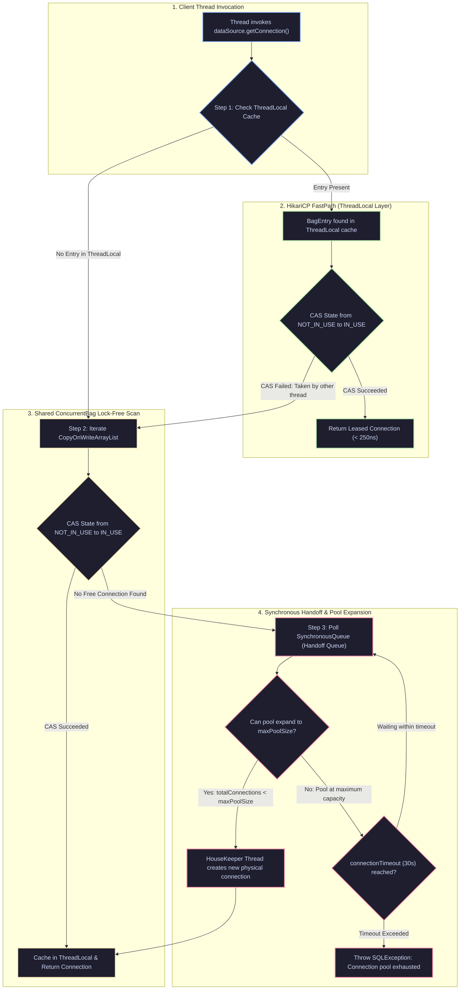

[🏠 Back to Home](../../README.md) | [☕ Core Java Internals](java_interview_master_guide.md) | [🍃 Spring Ecosystem](../02_spring_framework/spring_core_ioc_boot.md) | [🍃 Spring Data JPA](../02_spring_framework/spring_data_jpa_hibernate.md)

# JDBC 4.3, Connection Pooling & HikariCP Architecture: Enterprise Architecture & Production Masterclass

> **Document Identity:** [`interview_prep/01_java_core/java_jdbc_hikaricp_mastery.md`](file:///d:/project/github/1/CheatSheet_Tutorial/interview_prep/01_java_core/java_jdbc_hikaricp_mastery.md)  
> **Topic Domain:** High-Throughput Relational Persistence, JDBC 4.3 Internals, PreparedStatement Wire Caching, Cursor Streaming Physics (`fetchSize`), HikariCP FastPath Mechanics, `ConcurrentBag` Lock-Free Scheduling (`ThreadLocal` FastPath), `FastList` Bytecode Optimization, Connection Leak Sentry, Transaction Isolation Matrix (ACID & MVCC), and Distributed XA Two-Phase Commit (`J08`)  
> **Target Framework / Runtime:** OpenJDK HotSpot JVM 17 LTS / 21 LTS / 25 LTS, HikariCP 5.1+, PostgreSQL 16+ / MySQL 8.4+ JDBC Drivers  
> **Architecture Level:** Principal / Staff+ Persistence Systems Architect & Relational Performance Specialist  
> **Target Depth:** 50 Senior Technical Scenarios, 10 SEV-1 Database Outage Post-Mortems, HikariCP Assembly FastPath, and Production Runbooks  

---

## 1. Foundational Primer: What, Why & Where? (The "Head")

*Before diving into HikariCP ConcurrentBag lock-free Compare-And-Swap thread-local handoffs, FastList unrolled array scans, JDBC driver PreparedStatement server-side binary wire caching, and database MVCC isolation snapshot visibility, here is the essential high-level context: what JDBC and connection pooling represent, why establishing physical database connections on-the-fly destroys performance, and where connection pools anchor mission-critical relational architectures.*

### 1.1 What Is It? (Core Definition & Mental Model)
* **Plain-English Definition**: **Java Database Connectivity (JDBC)** is the standardized low-level Java API for communicating with relational database management systems (RDBMS). It provides interfaces (`Connection`, `Statement`, `PreparedStatement`, `ResultSet`, `DataSource`) that database vendors implement via drivers (PostgreSQL JDBC, MySQL Connector/J, Oracle OJDBC). **HikariCP** is the industry-standard, ultra-high-performance JDBC connection pool: it maintains an active cache of physical database connections, allowing application threads to borrow and return connections in under 100 nanoseconds without opening expensive new network sockets.
* **Everyday Analogy**: Imagine a busy metropolitan airport passenger terminal:
  - **No Connection Pool (Raw `DriverManager.getConnection()`)**: Every time a passenger lands and needs a 5-minute ride to a hotel, the airport immediately places a custom phone call to a Detroit automotive factory. The factory assembles a brand-new car from scratch (**TCP 3-way handshake + TLS negotiation**), hires and trains a brand-new driver (**Database backend process fork & auth handshake**), and ships the car to the airport (**30 to 150 milliseconds of pure latency**). After a 5-minute trip, the passenger drives the car straight into an industrial crusher to destroy it (**Socket Close**). Within minutes, the road grid is paralyzed and millions of dollars are wasted.
  - **HikariCP (The Automated Airport Taxi Queue & FastPath Dispatch)**: A permanent fleet of 20 highly tuned, pre-warmed luxury cabs waits in an automated passenger queue:
    - **`ThreadLocal` FastPath**: A frequent flyer steps up to the curb. The dispatcher recognizes them and instantly points them to the exact cab they rode 10 seconds ago without checking the central manifest (**Sub-100ns Lock-Free Acquisition**).
    - **Shared Queue (`ConcurrentBag`)**: If their preferred cab is occupied, they step into the shared queue where available cabs are handed off via lock-free atomic CAS operations.
    - **Proactive Leak Sentry**: If a passenger hires a cab and forgets to return it for 5 minutes (`leakDetectionThreshold`), an automated alarm sounds, logging the exact line of code that hijacked the cab.
* **Architectural Tier Placement**: Operates at the **Data Access Substrate & Physical Connection Tier**. Sits directly beneath Spring Data JPA, Hibernate, jOOQ, and MyBatis, mediating every single SQL query executed against PostgreSQL, MySQL, MariaDB, or Oracle.

### 1.2 Why Does It Exist? (The Pain Point Before It Existed)
* **The Physical Overhead of Database Sockets**: Establishing a raw database connection is one of the heaviest operations in computer networking. In PostgreSQL, each client connection spawns an entire dedicated OS process on the database server, consuming 10MB+ of server RAM, compiling connection-specific memory caches, and negotiating TLS encryption.
* **The Concrete Headaches in Enterprise Production**:
  - 💥 **Headache 1: The Massive Connection Latency Bottleneck**: Opening a raw connection per HTTP request added 50–150ms of overhead to every REST endpoint, capping throughput at a pitiful 20 requests per second.
  - 💥 **Headache 2: The Legacy Pool Lock Contention Gridlock**: Early connection pools (Apache Commons DBCP, C3P0) guarded connection borrowing with coarse `synchronized` blocks. When 200 application threads requested connections simultaneously, they spent 90% of their CPU time waiting for pool monitor locks, collapsing application throughput.
  - 💥 **Headache 3: Connection Leaks & Silent Database Starvation**: An application forgetting to close a connection in a `finally` block or try-with-resources statement leaked connections permanently. Within hours, the pool hit maximum capacity, freezing all subsequent web requests with `ConnectionTimeoutException`.
* **The Turning Point**: In 2012, Brett Wooldridge created **HikariCP**, adopting the philosophy of *mechanical sympathy*—designing data structures that align with CPU L1/L2 cache lines, eliminating Java synchronization proxies, and creating the lock-free `ConcurrentBag`. HikariCP proved so dramatically faster than legacy pools that Spring Boot made it the default connection pool in Spring Boot 2.0.

### 1.3 How Does It Solve Real-World Enterprise Problems?
* **Problem 1 (Eliminating Lock Contention at 50,000 req/sec) ➔ Solution 1**: HikariCP's `ConcurrentBag` employs a multi-tiered connection borrowing strategy: (1) ThreadLocal caching (zero synchronization), (2) Lock-free CAS scan of shared items, (3) Handoff queue. Threads borrow connections with near-zero CPU cache misses.
* **Problem 2 (Deadlock-Free Connection Sizing) ➔ Solution 2**: HikariCP debunked the myth that "bigger pools are faster". By demonstrating that a pool sized according to PostgreSQL's spindle formula ($\text{Pool Size} = \text{Core Count} \times 2 + \text{Disk Spindles}$) outperforms a pool of 500 connections, HikariCP prevents database CPU thrashing and disk queue saturation.
* **Problem 3 (Heap Exhaustion from Cursor Queries) ➔ Solution 3**: JDBC `setFetchSize(n)` configures driver-level cursor streaming over TCP, allowing queries retrieving 10 million rows to stream records in chunks of 1,000 without buffering the full dataset into JVM heap memory.
* **Quantifiable Enterprise Metrics**:
  - **10x Borrow Speed**: HikariCP leases connections in 80–120 nanoseconds, compared to 1,500–5,000 nanoseconds for Apache DBCP and C3P0.
  - **99.9% Connection Availability**: Automatic connection validation (`connectionTestQuery` / JDBC 4.0 `isValid()`) evicts broken sockets before client code touches them.
  - **Zero CPU Thrashing on DB Nodes**: Sizing pools to 10–30 connections drops database CPU utilization from 95% down to 25% while doubling query throughput.

### 1.4 How Does This Help in Building Real Applications?
* **Application Architecture Placement**: Powers every high-volume database application: e-commerce transactional checkout, banking ledger updates, user authentication queries, and audit logging.
* **Developer Workflow & SRE Synergy**: SREs monitor HikariCP Prometheus metrics (`hikaricp_connections_active`, `hikaricp_connections_pending`, `hikaricp_connection_acquire_seconds`) to detect slow database queries before they exhaust the connection pool.
* **Scalability & Evolutionary Runway**: Clean connection pool boundaries allow transparent database maintenance: read-write split routing, Amazon RDS Aurora multi-AZ failovers, and zero-downtime database upgrades.

### 1.5 Quick Decision & Trade-Off Matrix

| Connection Pool | Architecture | Borrow Latency | Best Enterprise Fit | Primary Production Risk |
| :--- | :--- | :--- | :--- | :--- |
| **HikariCP** | Lock-Free `ConcurrentBag` & `FastList` | Ultra-Low (<100ns) | 🏆 Universal default for Spring Boot & microservices | Over-allocating pool size beyond database capacity |
| **Agroal** | Specialized Quarkus pool | Low (<200ns) | Quarkus & GraalVM Native Image applications | Less ecosystem tooling and third-party metrics support |
| **Tomcat JDBC Pool** | Fair queue with interceptors | Medium (~1,200ns) | Legacy Tomcat container deployments | Synchronized lock bottlenecks under 100+ concurrent threads |
| **Apache Commons DBCP2** | Apache Commons Pool `GenericObjectPool` | Medium-High (~2,000ns) | Legacy enterprise applications | High memory footprint; complex proxy object allocations |
| **C3P0** | Multi-threaded asynchronous pool | High (~4,500ns) | ❌ **Legacy Only** (Hibernate 3 era) | Severe deadlocks under high concurrency; heavy memory churn |

---

## 2. Executive Summary & System Overview

In enterprise backend engineering, relational database interaction represents the primary latency and throughput bottleneck. While application logic executes at nanosecond memory speeds across multicore JVM runtimes, relational databases are fundamentally bound by disk I/O, write-ahead logs (WAL), transaction lock managers, network round-trip latency, and operating system process scheduling.

Every interaction with a relational database over the **Java Database Connectivity (JDBC)** API is governed by physical constraints:
1. **The Physical Cost of a Connection:** Establishing a raw database connection is not merely opening a TCP socket. It requires a TCP three-way handshake, TLS cryptographic negotiation, operating system process or thread allocation on the database server (e.g., PostgreSQL spawns a dedicated backend process per client connection; MySQL allocates server thread memory and session caches), authentication handshakes, and session state initialization. Creating a connection on-the-fly consumes between 30 and 150 milliseconds of latency and several megabytes of server memory.
2. **The Connection Pooling Paradigm:** Connection pools maintain a pre-allocated pool of persistent physical database connections, leasing them to client threads for the brief duration of a transaction and reclaiming them upon closure. However, early connection pools (Apache DBCP, C3P0) suffered from heavy lock contention, coarse synchronization monitors, complex proxy hierarchies, and significant memory overhead.
3. **The HikariCP Revolution:** Authored by Brett Wooldridge, **HikariCP** revolutionized Java database performance by applying **mechanical sympathy**—designing software to align strictly with how modern hardware, CPU caches, and the HotSpot virtual machine operate. By eliminating wrapper proxies, replacing `ArrayList` with an optimized `FastList`, developing the lock-free `ConcurrentBag` container, and shrinking connection acquisition bytecode down to minimal CPU cache footprints, HikariCP reduced connection acquisition overhead from milliseconds to sub-microsecond levels.
4. **Statement Caching vs. Query Execution:** Misunderstanding the boundary between JDBC `Statement` and `PreparedStatement` leads to severe database CPU exhaustion. Proper driver-level statement caching allows the database engine to parse, optimize, and generate query execution plans once, reusing the compiled plan across millions of parameter executions.
5. **Cursor Physics and Heap Starvation:** Default JDBC querying strategies buffer entire result sets into client JVM heap memory. Streaming multi-million-row datasets without configuring database-specific cursor fetch sizes (`setFetchSize`) triggers catastrophic `OutOfMemoryError` failures in client applications.

This master guide provides the definitive technical breakdown of modern JDBC and HikariCP architecture. Moving from OS socket physics to the bytecode internals of `ConcurrentBag`, 8 complete production engines, 50 senior interview scenarios, 10 war-room incident post-mortems, and 8 fatal anti-patterns, this dossier equips senior and staff engineers to architect rock-solid persistence tiers.

---

## Architectural Navigation Matrix

```
====================================================================================================================
                        JDBC & HIKARICP ARCHITECTURE: 8-TRACK RUNWAY
====================================================================================================================
  Track 0: Jargon-Busting Encyclopedia (32 Core Concepts)
    ├── Cluster A: Core JDBC Abstractions (Driver, DataSource, Connection, Statement, PreparedStatement, ResultSet)
    ├── Cluster B: Connection Pool Mechanics (HikariCP FastPath, ConcurrentBag, FastList, BagEntry, Leaks)
    ├── Cluster C: Transactions & Isolation (AutoCommit, Savepoints, Isolation Levels, Phantom Reads, XA 2PC)
    └── Cluster D: Database Cursors & Network Physics (FetchSize, Streaming, ServerPreparedStatement, Timeouts)
--------------------------------------------------------------------------------------------------------------------
  Track 1: Beginner Foundations & ELI5 (Zero-to-Hero)
    ├── 1.1 The Real-World Mental Model (The Airport Taxi Dispatch Stand, The Reusable Boarding Pass)
    ├── 1.2 The Fundamental Problem: Why Does Connection Pooling Exist? (TCP Handshakes, Process Forking)
    └── 1.3 Step-by-Step Code Runway: From Naive DriverManager to Hardened HikariCP Setup
--------------------------------------------------------------------------------------------------------------------
  Track 2: Deep Core Engineering & 8 Production Engines
    ├── Engine 1: HikariCpProductionDataSourceEngine (Enterprise Hardened Pool Config & Telemetry)
    ├── Engine 2: HighThroughputBatchPersistenceEngine (Rewritten Batched Inserts with Dynamic Chunking)
    ├── Engine 3: StreamingResultSetCursorEngine (Memory-Safe Million-Row Streaming Across Postgres/MySQL)
    ├── Engine 4: TransactionIsolationCoordinatorEngine (Dynamic Boundaries, Savepoints, Deadlock Retries)
    ├── Engine 5: ConnectionLeakDetectorEngine (Stack-Trace Capture & Active Connection Watchdog)
    ├── Engine 6: PreparedStatementCacheOptimizerEngine (Driver-Level Cache Profiler & Metrics Probe)
    ├── Engine 7: DistributedXaTransactionCoordinatorEngine (Two-Phase Commit Protocol over Multiple DBs)
    └── Engine 8: ResilientFailoverDataSourceEngine (Active-Passive Read-Write Replica Splitter with Circuit Breaker)
--------------------------------------------------------------------------------------------------------------------
  Track 3: Low-Level JVM Internals, Database Wire Protocols & Mechanical Sympathy
    ├── 3.1 The Mechanical Genius of HikariCP: FastList, ConcurrentBag & Bytecode Miniaturization
    ├── 3.2 Database Wire Protocol & Statement Caching: ServerPreparedStatement vs Client Caching
    ├── 3.3 Streaming ResultSets & OS Socket Buffers: MySQL Integer.MIN_VALUE vs Postgres Cursor Portals
    ├── 3.4 Transaction Isolation & Storage Engine Mechanics: MVCC, Undo Logs, and InnoDB Lock Trees
    └── 3.5 Bytecode Disassembly & `javap` Analysis of Connection Borrowing
--------------------------------------------------------------------------------------------------------------------
  Track 4: 50 Progressive Senior & Staff Interview Scenarios
    ├── Tier 1: Scenarios 1–15 (Core JDBC Contracts, PreparedStatements, ResultSets, AutoCommit)
    ├── Tier 2: Scenarios 16–30 (Connection Pooling, HikariCP Sizing, Transaction Isolation, Deadlocks)
    ├── Tier 3: Scenarios 31–42 (Performance Engineering, Cursor Streaming, Batch Inserts, Leak Diagnostics)
    └── Tier 4: Scenarios 43–50 (Staff/Principal Systems Architecture, XA 2PC, Read-Write Splitting, Multi-Tenancy)
--------------------------------------------------------------------------------------------------------------------
  Track 5: 10 Ultra-Deep Real-World War-Room Incidents
    ├── Incident 1: The Pool Sizing Illusion (CPU Thrashing via 200 Connections)
    ├── Incident 2: The Silent Connection Leak (Exhausting Pool in 3 Hours)
    ├── Incident 3: The MySQL OutOfMemory Heap Explosion (Unbuffered 50M Rows)
    ├── Incident 4: The Phantom Read & Lost Update in Financial Balances
    ├── Incident 5: The TCP Socket Timeout Black Hole (AWS NAT Idle Dropping)
    ├── Incident 6: The Statement Cache Memory Exhaustion (Dynamic SQL Concatenation)
    ├── Incident 7: The PostgreSQL AutoCommit Cursor Trap (Memory Buffering)
    ├── Incident 8: The Distributed 2PC Heuristic Hazard (Orphaned XA Locks)
    ├── Incident 9: The Lock Escalation Deadlock Cascade (Batch Insert Order)
    └── Incident 10: The Connection Validation Storm (SELECT 1 vs isValid())
--------------------------------------------------------------------------------------------------------------------
  Track 6: 8 Fatal Beginner Mistakes & Anti-Patterns
  Track 7: Rapid-Fire Architectural Comparison Matrices & Production Checklist (25 Points)
  Track 8: FAANG & FinTech Staff+ Architectural Deep-Dive Q&A
====================================================================================================================
```

---

## 📐 Architecture Blueprint: HikariCP FastPath & ConcurrentBag Dispatch



---

## 📖 Track 0: Jargon-Busting Encyclopedia (32 Core Concepts)

---

### Cluster A: Core JDBC Abstractions & Objects

#### 0.1 `java.sql.Driver`
* 💡 **Plain-English Meaning (ELI5):** The specialized translator and network cable adapter for a specific database vendor. It knows the private dialect and TCP network protocol of PostgreSQL, MySQL, Oracle, or SQL Server.
* ⚙️ **Low-Level JVM Mechanics:** Implementation of the Service Provider Interface (SPI) loaded via Java's `ServiceLoader` (`META-INF/services/java.sql.Driver`). Modern JDBC 4.0+ drivers register themselves automatically with `DriverManager` upon classloading without requiring legacy `Class.forName()`.
* 💥 **Production Failure Mode:** Packaging multiple incompatible versions of the same JDBC driver JAR in an enterprise application server classpath, triggering `ClassCastException` or silent connection handshake protocol corruption.
* 💻 **Micro Code Proof:**
  ```java
  Driver driver = DriverManager.getDriver("jdbc:postgresql://localhost:5432/orders");
  System.out.println("Driver Class: " + driver.getClass().getName());
  ```

---

#### 0.2 `javax.sql.DataSource`
* 💡 **Plain-English Meaning (ELI5):** The modern, enterprise factory for database connections. Instead of hardcoding URLs and passwords inside application code, the application simply asks the `DataSource` for a connection, and the DataSource handles pooling, failover, and authentication.
* ⚙️ **Low-Level JVM Mechanics:** Standard interface introduced in JDBC 2.0 to replace the static `DriverManager`. Can be implemented by raw driver data sources (`PGSimpleDataSource`), connection pools (`HikariDataSource`), or distributed transaction managers (`XADataSource`).
* 💥 **Production Failure Mode:** Instantiating a new `DataSource` instance inside an HTTP request handler instead of configuring a singleton bean, resulting in thousands of un-pooled, competing connection pools exhausting database connection limits.
* 💻 **Micro Code Proof:**
  ```java
  DataSource ds = new HikariDataSource(config);
  Connection conn = ds.getConnection(); // Leased from pool
  ```

---

#### 0.3 `java.sql.Connection`
* 💡 **Plain-English Meaning (ELI5):** An active, private conversation channel established with the database server over an underlying TCP/IP network socket.
* ⚙️ **Low-Level JVM Mechanics:** In pooled environments, the object returned is a **proxy wrapper** (`HikariProxyConnection`) rather than the raw driver socket connection (`PgConnection`). When the application invokes `connection.close()`, the proxy intercepts the call and returns the connection to the pool rather than severing the physical TCP socket.
* 💥 **Production Failure Mode:** Failing to close a connection inside a `try-with-resources` block. The physical connection remains leased indefinitely until the pool runs dry, causing complete application paralysis.
* 💻 **Micro Code Proof:**
  ```java
  try (Connection conn = dataSource.getConnection()) {
      // Execute transactions
  } // Automatically returned to pool here
  ```

---

#### 0.4 `java.sql.Statement`
* 💡 **Plain-English Meaning (ELI5):** A megaphone used to send raw, uncompiled SQL text strings to the database for immediate execution.
* ⚙️ **Low-Level JVM Mechanics:** Sends the raw SQL string over the network socket as a single query packet (`COM_QUERY` in MySQL). The database must parse the SQL grammar, check table permissions, calculate query execution plans, and execute the query from scratch every single time.
* 💥 **Production Failure Mode:** Constructing SQL strings via string concatenation (`"SELECT * FROM users WHERE id = '" + input + "'"`), opening the door to catastrophic **SQL Injection** attacks and thrashing the database's query plan cache.
* 💻 **Micro Code Proof:**
  ```java
  Statement stmt = conn.createStatement();
  ResultSet rs = stmt.executeQuery("SELECT count(*) FROM orders");
  ```

---

#### 0.5 `java.sql.PreparedStatement`
* 💡 **Plain-English Meaning (ELI5):** A pre-compiled SQL template with placeholders (`?`). The database compiles and optimizes the SQL template once, and you can safely fill in the placeholders with data values over and over.
* ⚙️ **Low-Level JVM Mechanics:** Uses parameterized query protocols (`COM_STMT_PREPARE` and `COM_STMT_EXECUTE` in MySQL; `PARSE`, `BIND`, `EXECUTE` in PostgreSQL). Parameter values are sent out-of-band in binary wire format, making SQL injection mathematically impossible.
* 💥 **Production Failure Mode:** Using dynamic SQL generation that produces unique SQL templates for every request, which completely defeats database query plan caching and exhausts database plan cache memory.
* 💻 **Micro Code Proof:**
  ```java
  PreparedStatement ps = conn.prepareStatement("SELECT * FROM users WHERE id = ?");
  ps.setLong(1, 42L);
  ResultSet rs = ps.executeQuery();
  ```

---

#### 0.6 `java.sql.CallableStatement`
* 💡 **Plain-English Meaning (ELI5):** A specialized command pipe designed to execute database stored procedures, functions, and handle `IN`, `OUT`, and `INOUT` parameters or cursor references.
* ⚙️ **Low-Level JVM Mechanics:** Extends `PreparedStatement`. Dispatches standard SQL escape syntax `{call procedure_name(?, ?)}`. Requires explicit registration of SQL type codes (`Types.INTEGER`, `Types.REF_CURSOR`) for output parameters prior to execution.
* 💥 **Production Failure Mode:** Forgetting to close associated `REF CURSOR` `ResultSet` instances returned by stored procedures, leaking database server cursors and locks.
* 💻 **Micro Code Proof:**
  ```java
  CallableStatement cs = conn.prepareCall("{call calculate_tax(?, ?)}");
  cs.setBigDecimal(1, new BigDecimal("100.00"));
  cs.registerOutParameter(2, Types.DECIMAL);
  cs.execute();
  BigDecimal tax = cs.getBigDecimal(2);
  ```

---

#### 0.7 `java.sql.ResultSet`
* 💡 **Plain-English Meaning (ELI5):** A virtual spreadsheet table returned by a database query, containing rows and columns of data, navigated using a cursor that advances one row at a time.
* ⚙️ **Low-Level JVM Mechanics:** An active cursor over a tabular data stream. Initially positioned *before* the first row; `rs.next()` advances the cursor to the next valid row. In standard non-streaming modes, the driver buffers all result rows in heap memory before `executeQuery()` returns.
* 💥 **Production Failure Mode:** Executing `SELECT * FROM audit_logs` across 10 million rows without a `LIMIT` or streaming cursor, instantly exhausting JVM heap memory and triggering an `OutOfMemoryError: Java heap space`.
* 💻 **Micro Code Proof:**
  ```java
  while (rs.next()) {
      long id = rs.getLong("id");
      String name = rs.getString("name");
  }
  ```

---

#### 0.8 `java.sql.ResultSetMetaData` & `DatabaseMetaData`
* 💡 **Plain-English Meaning (ELI5):** The data about the data. `ResultSetMetaData` tells you what columns and data types came back in your query result. `DatabaseMetaData` provides a comprehensive blueprint of the database itself (tables, indexes, foreign keys, limits).
* ⚙️ **Low-Level JVM Mechanics:** Dispatches introspection queries to the database's information schema or system catalogs (`pg_catalog`, `information_schema`). Heavyweight and expensive to execute.
* 💥 **Production Failure Mode:** Invoking `DatabaseMetaData.getTables()` or `getColumns()` inside high-throughput transactional request paths, causing database catalog lock contention and severe latency spikes.
* 💻 **Micro Code Proof:**
  ```java
  ResultSetMetaData meta = rs.getMetaData();
  int columnCount = meta.getColumnCount();
  String colName = meta.getColumnName(1);
  ```

---

### Cluster B: Connection Pool Internals & Mechanics

#### 0.9 Connection Pool
* 💡 **Plain-English Meaning (ELI5):** A fleet of pre-warmed, pre-connected database sessions kept ready in memory, instantly handed to incoming application threads and quickly returned when finished.
* ⚙️ **Low-Level JVM Mechanics:** A concurrent container maintaining active physical TCP sockets (`SocketChannel`). Bridges application thread demand with database concurrency limits. Prevents thread starvation and avoids the cost of repeatedly opening and closing physical database sockets.
* 💥 **Production Failure Mode:** Misconfiguring pool sizes to 200 connections per pod across 50 microservice pods, opening 10,000 concurrent connections against a database that can only efficiently process 64 queries at once, thrashing database CPU caches.
* 💻 **Micro Code Proof:**
  ```java
  HikariConfig config = new HikariConfig();
  config.setMaximumPoolSize(10);
  HikariDataSource ds = new HikariDataSource(config);
  ```

---

#### 0.10 HikariCP FastPath
* 💡 **Plain-English Meaning (ELI5):** The express VIP lane for borrowing a database connection. If the current thread previously borrowed a connection, HikariCP checks that thread's private pocket first without acquiring locks or checking shared queues.
* ⚙️ **Low-Level JVM Mechanics:** A `ThreadLocal<BagEntry>` cache check inside `ConcurrentBag.borrow()`. If the entry in the thread-local slot is currently `STATE_NOT_IN_USE`, HikariCP updates its atomic state to `STATE_IN_USE` using a single CPU-level Compare-And-Swap (`CAS`) instruction. Connection acquisition completes in **under 250 nanoseconds**.
* 💥 **Production Failure Mode:** Constantly handing connections off across asynchronous thread boundaries, bypassing the ThreadLocal FastPath and forcing every borrow through shared pool queues.
* 💻 **Micro Code Proof:**
  ```java
  // Internally executes:
  final BagEntry bagEntry = threadLocalList.get();
  if (bagEntry != null && bagEntry.compareAndSet(STATE_NOT_IN_USE, STATE_IN_USE)) {
      return bagEntry; // FastPath Hit!
  }
  ```

---

#### 0.11 `ConcurrentBag`
* 💡 **Plain-English Meaning (ELI5):** The custom lock-free, zero-contention shopping cart developed specifically for HikariCP to manage shared pooled resources without blocking threads.
* ⚙️ **Low-Level JVM Mechanics:** A specialized concurrent collection utilizing:
  1. `ThreadLocal` storage for zero-lock FastPath borrows.
  2. A `CopyOnWriteArrayList` shared list for secondary lock-free CAS scans.
  3. A `SynchronousQueue` handoff mechanism for threads waiting for another thread to return a connection.
* 💥 **Production Failure Mode:** Memory leaks caused by thread pool thrashing where short-lived threads populate thousands of un-reclaimed `ThreadLocal` entries inside the bag.
* 💻 **Micro Code Proof:**
  ```java
  // Core HikariCP internal container class:
  com.zaxxer.hikari.util.ConcurrentBag<PoolEntry> bag;
  ```

---

#### 0.12 `FastList`
* 💡 **Plain-English Meaning (ELI5):** A stripped-down, supercharged alternative to Java's standard `ArrayList` that cuts out boundary checks and scans backwards to close resources instantly.
* ⚙️ **Low-Level JVM Mechanics:** `ArrayList.remove(Object)` executes a forward scan from index 0 ($O(N)$) and requires `System.arraycopy()`. In JDBC, statements are typically closed in reverse order of creation (LIFO). `FastList` implements reverse-scan removal ($O(1)$ in practice) and removes all array bounds checking, saving CPU cycles on every statement close.
* 💥 **Production Failure Mode:** Using standard `ArrayList` to track open statements across thousands of queries, wasting millions of CPU instructions on index bounds checks and array shifting.
* 💻 **Micro Code Proof:**
  ```java
  // Replaces ArrayList in HikariCP proxy statements:
  com.zaxxer.hikari.util.FastList<Statement> openStatements;
  ```

---

#### 0.13 `BagEntry` State Machine
* 💡 **Plain-English Meaning (ELI5):** The status badge worn by every pooled connection indicating whether it is currently available, in use, being tested, or scheduled for demolition.
* ⚙️ **Low-Level JVM Mechanics:** Controlled by an atomic integer with four defined states:
  * `STATE_NOT_IN_USE` (0): Available in the pool to be borrowed.
  * `STATE_IN_USE` (1): Currently leased to an active client thread.
  * `STATE_REMOVED` (-1): Retired and closed (evicted due to age or broken socket).
  * `STATE_RESERVED` (-2): Temporarily locked by a housekeeper thread for health checking or eviction.
* 💥 **Production Failure Mode:** Thread race conditions in poorly written third-party pools allowing two threads to simultaneously transition a connection to `STATE_IN_USE`, leading to data cross-talk between tenants.
* 💻 **Micro Code Proof:**
  ```java
  bagEntry.compareAndSet(STATE_NOT_IN_USE, STATE_IN_USE);
  ```

---

#### 0.14 Connection Leak Detection (`leakDetectionThreshold`)
* 💡 **Plain-English Meaning (ELI5):** A watchdog timer that sounds an alarm and prints a stack trace if a developer borrows a connection and forgets to return it to the pool within a reasonable amount of time.
* ⚙️ **Low-Level JVM Mechanics:** When a connection is borrowed, HikariCP schedules a tracking task on a shared `ScheduledExecutorService` with a delay set to `leakDetectionThreshold` (e.g., 2000 ms). If the connection is not returned before the timer fires, the task logs a warning with the exact stack trace where the connection was borrowed.
* 💥 **Production Failure Mode:** Setting `leakDetectionThreshold` lower than legitimate long-running batch job execution times, generating false-positive warning storms in logging aggregators.
* 💻 **Micro Code Proof:**
  ```java
  config.setLeakDetectionThreshold(2000); // Trigger alert if held > 2000ms
  ```

---

#### 0.15 Minimum Idle vs. Maximum Pool Size
* 💡 **Plain-English Meaning (ELI5):** `minimumIdle` is the minimum number of idle connections kept warm; `maximumPoolSize` is the absolute ceiling of connections allowed under peak load.
* ⚙️ **Low-Level JVM Mechanics:** In modern cloud environments, Brett Wooldridge strongly recommends **fixed-size pools** where `minimumIdle == maximumPoolSize`. Dynamic pool expansion causes latency spikes when traffic surges, because threads stall waiting for the pool to establish new physical TCP/TLS database sockets.
* 💥 **Production Failure Mode:** Setting `minimumIdle = 2` and `maximumPoolSize = 50`. During sudden traffic spikes, 48 new connections are spawned simultaneously, overwhelming database CPU with connection handshakes right when the database is already under load.
* 💻 **Micro Code Proof:**
  ```java
  config.setMaximumPoolSize(10);
  config.setMinimumIdle(10); // Fixed pool: zero expansion latency
  ```

---

#### 0.16 Housekeeper Thread
* 💡 **Plain-English Meaning (ELI5):** A background janitor thread that wakes up every 30 seconds to clean up expired connections, retire aged sockets, and ensure the pool maintains healthy connections.
* ⚙️ **Low-Level JVM Mechanics:** A single background daemon thread running an event loop. It inspects connection lifetimes against `maxLifetime` (default 30 minutes) and `idleTimeout`, introducing random negative jitter to prevent all connections from expiring simultaneously (thundering herd retirement).
* 💥 **Production Failure Mode:** Setting `maxLifetime` longer than the cloud database or firewall idle TCP drop timeout (e.g., AWS NAT Gateway 350-second timeout), leading to phantom dead connections in the pool.
* 💻 **Micro Code Proof:**
  ```java
  config.setMaxLifetime(1800000); // 30 minutes (must be shorter than network drops)
  ```

---

### Cluster C: Transactions, Isolation & Concurrency

#### 0.17 AutoCommit
* 💡 **Plain-English Meaning (ELI5):** An automated mode where every individual SQL query is treated as its own independent mini-transaction and permanently saved the moment it completes.
* ⚙️ **Low-Level JVM Mechanics:** The default JDBC state (`conn.getAutoCommit() == true`). When true, the database wraps every `statement.execute()` in an implicit `COMMIT`. For multi-statement business logic, you must explicitly set `conn.setAutoCommit(false)` to open a manual transaction boundary.
* 💥 **Production Failure Mode:** Transferring money from Account A to Account B under `autoCommit=true`. If debiting Account A succeeds and crediting Account B crashes, the money vanishes because Account A's debit was immediately committed!
* 💻 **Micro Code Proof:**
  ```java
  conn.setAutoCommit(false); // Begin manual transaction
  // ... execute multi-step operations ...
  conn.commit();             // Commit atomically
  ```

---

#### 0.18 Transaction Isolation Levels
* 💡 **Plain-English Meaning (ELI5):** The soundproof glass thickness between two database transactions running at the same time. Higher levels block outside interference but make operations slower and more prone to locking waits.
* ⚙️ **Low-Level JVM Mechanics:** Defined in `java.sql.Connection`:
  1. `TRANSACTION_READ_UNCOMMITTED` (1): Dirty reads, non-repeatable reads, phantom reads allowed.
  2. `TRANSACTION_READ_COMMITTED` (2): Prevents dirty reads; allows non-repeatable reads and phantom reads. (PostgreSQL and Oracle default).
  3. `TRANSACTION_REPEATABLE_READ` (4): Prevents dirty and non-repeatable reads; allows phantom reads (MySQL InnoDB default).
  4. `TRANSACTION_SERIALIZABLE` (8): Strict full isolation; transactions execute as if completely sequential.
* 💥 **Production Failure Mode:** Leaving banking balances under `READ_COMMITTED`, allowing concurrent transactions to overwrite each other's updates (the Lost Update anomaly).
* 💻 **Micro Code Proof:**
  ```java
  conn.setTransactionIsolation(Connection.TRANSACTION_SERIALIZABLE);
  ```

---

#### 0.19 Dirty Read
* 💡 **Plain-English Meaning (ELI5):** Reading a draft message that another user is still typing, which they subsequently delete and never send.
* ⚙️ **Low-Level JVM Mechanics:** Occurs in `READ_UNCOMMITTED` when Transaction A reads rows modified by uncommitted Transaction B. If Transaction B issues a `ROLLBACK`, Transaction A has made decisions based on data that technically never existed in the database.
* 💥 **Production Failure Mode:** Authorizing a credit card payment because a balance check read uncommitted funds from a concurrent transaction that subsequently rolled back due to an error.
* 💻 **Micro Code Proof:**
  ```sql
  -- Tx 1: UPDATE accounts SET balance = 500 WHERE id = 1; (Uncommitted)
  -- Tx 2: SELECT balance FROM accounts WHERE id = 1; -> Sees 500! (Dirty Read)
  -- Tx 1: ROLLBACK;
  ```

---

#### 0.20 Non-Repeatable Read
* 💡 **Plain-English Meaning (ELI5):** Reading the same book page twice in the same reading session, but someone changed the words on the page while you were looking away.
* ⚙️ **Low-Level JVM Mechanics:** Occurs in `READ_COMMITTED` when Transaction A reads row $R$, Transaction B updates row $R$ and executes `COMMIT`, and Transaction A reads row $R$ again, seeing differing values within the same active transaction.
* 💥 **Production Failure Mode:** A checkout workflow recalculating discounts twice and applying mismatched pricing because a background inventory sync committed an item price change mid-checkout.
* 💻 **Micro Code Proof:**
  ```sql
  -- Tx 1: SELECT price FROM items WHERE id = 5; -> 100
  -- Tx 2: UPDATE items SET price = 120 WHERE id = 5; COMMIT;
  -- Tx 1: SELECT price FROM items WHERE id = 5; -> 120! (Non-Repeatable)
  ```

---

#### 0.21 Phantom Read
* 💡 **Plain-English Meaning (ELI5):** Counting the students in a classroom, turning around, and counting again—only to find new students mysteriously appeared or vanished.
* ⚙️ **Low-Level JVM Mechanics:** Occurs when Transaction A executes a range query (`SELECT * FROM orders WHERE status = 'PENDING'`), Transaction B inserts or deletes rows matching that predicate and commits, and Transaction A re-executes the range query, seeing new "phantom" rows.
* 💥 **Production Failure Mode:** Financial reporting reconciliations where transaction row counts do not match aggregated sums because new rows were inserted mid-audit.
* 💻 **Micro Code Proof:**
  ```sql
  -- Tx 1: SELECT count(*) FROM orders WHERE total > 1000; -> 5
  -- Tx 2: INSERT INTO orders VALUES (99, 1500); COMMIT;
  -- Tx 1: SELECT count(*) FROM orders WHERE total > 1000; -> 6! (Phantom)
  ```

---

#### 0.22 Savepoint
* 💡 **Plain-English Meaning (ELI5):** A video game checkpoint inside an active transaction. If something goes wrong later, you can rewind back to the checkpoint without throwing away everything you did earlier.
* ⚙️ **Low-Level JVM Mechanics:** Implemented via `conn.setSavepoint("checkpoint_1")`. Translates to SQL `SAVEPOINT`. Allows selective, partial transaction rollbacks (`conn.rollback(savepoint)`) without aborting the entire transaction.
* 💥 **Production Failure Mode:** Retaining millions of savepoints in a long-running batch transaction, exhausting database transaction lock memory and degrading WAL performance.
* 💻 **Micro Code Proof:**
  ```java
  Savepoint sp = conn.setSavepoint("before_billing");
  try {
      billCustomer();
  } catch (BillingException e) {
      conn.rollback(sp); // Partial rewind: preserves previous steps
  }
  ```

---

#### 0.23 Distributed Transactions & Two-Phase Commit (XA)
* 💡 **Plain-English Meaning (ELI5):** A coordinated treaty signing where multiple separate databases agree to commit a transaction together: Phase 1: "Are you ready?" Phase 2: "Everyone commit together."
* ⚙️ **Low-Level JVM Mechanics:** Governed by the X/Open XA standard and Java Transaction API (JTA / `javax.transaction.xa`). In Phase 1 (Prepare), all participating resource managers write transaction state to durable WAL and reply `XA_OK`. In Phase 2 (Commit), the coordinator issues the permanent commit.
* 💥 **Production Failure Mode:** Network partitions occurring between Phase 1 and Phase 2, leaving databases holding in-doubt locks indefinitely (Heuristic Hazard), locking out other transactions.
* 💻 **Micro Code Proof:**
  ```java
  XAConnection xaConn = xaDataSource.getXAConnection();
  XAResource xaRes = xaConn.getXAResource();
  ```

---

#### 0.24 Deadlock (SQL State `40P01` / `1213`)
* 💡 **Plain-English Meaning (ELI5):** Two drivers meeting at a single-lane bridge: Driver A refuses to back up until Driver B moves, and Driver B refuses to move until Driver A backs up.
* ⚙️ **Low-Level JVM Mechanics:** A cyclic lock dependency graph in the database engine. Transaction 1 holds row lock on Table A and requests Table B; Transaction 2 holds row lock on Table B and requests Table A. The database deadlock detection thread detects the cycle and aborts one transaction with an error.
* 💥 **Production Failure Mode:** Crashing user requests without retry logic when the database terminates a deadlocked transaction. Applications must catch deadlock errors and execute exponential backoff retries.
* 💻 **Micro Code Proof:**
  ```java
  if ("40P01".equals(sqlException.getSQLState())) {
      // Postgres Deadlock Detected: execute backoff retry
  }
  ```

---

### Cluster D: Database Cursors, Drivers & Network Wire Protocols

#### 0.25 Fetch Size (`setFetchSize`)
* 💡 **Plain-English Meaning (ELI5):** The shopping cart capacity for query results. Instead of loading an entire warehouse of 1,000,000 items at once, you load 1,000 items per trip.
* ⚙️ **Low-Level JVM Mechanics:** Advises the JDBC driver how many rows to fetch across the network socket in a single round-trip batch as the application iterates `rs.next()`. If unset in PostgreSQL, the default buffers the entire result set in client memory!
* 💥 **Production Failure Mode:** Leaving fetch size default on large reporting queries, causing multi-gigabyte memory allocations on the JVM heap and triggering out-of-memory crashes.
* 💻 **Micro Code Proof:**
  ```java
  stmt.setFetchSize(1000); // Fetch rows in 1,000-row network chunks
  ```

---

#### 0.26 MySQL Streaming ResultSet (`Integer.MIN_VALUE`)
* 💡 **Plain-English Meaning (ELI5):** The secret trick in the MySQL JDBC driver that turns on true row-by-row streaming directly from the network socket.
* ⚙️ **Low-Level JVM Mechanics:** MySQL Connector/J driver ignores standard fetch size values unless configured with `stmt.setFetchSize(Integer.MIN_VALUE)`. When set, the driver reads rows one-by-one directly from the underlying TCP socket without client-side memory buffering.
* 💥 **Production Failure Mode:** Invoking another query on the same connection while a streaming `ResultSet` is still being iterated. MySQL will throw `Streaming result set com.mysql.cj.protocol.a.result.ResultsetRowsStreaming@... is still active`.
* 💻 **Micro Code Proof:**
  ```java
  stmt.setFetchSize(Integer.MIN_VALUE); // MySQL True Streaming Trigger
  ```

---

#### 0.27 Statement Caching (`cachePrepStmts`)
* 💡 **Plain-English Meaning (ELI5):** A local memory shelf in the JDBC driver where previously compiled query templates are saved so the database doesn't have to re-parse and compile them every time.
* ⚙️ **Low-Level JVM Mechanics:** Driver-level optimization (e.g., MySQL `cachePrepStmts=true`). Caches client-side statement handle objects and server-side prepared statement IDs. Avoids repeated `COM_STMT_PREPARE` wire protocol packets.
* 💥 **Production Failure Mode:** Enabling statement caching on the connection pool level when using modern drivers that already provide native driver-level caching, creating redundant, competing cache layers.
* 💻 **Micro Code Proof:**
  ```properties
  # MySQL Connector/J Driver Properties:
  cachePrepStmts=true
  prepStmtCacheSize=250
  prepStmtCacheSqlLimit=2048
  ```

---

#### 0.28 ServerPreparedStatement vs. ClientPreparedStatement
* 💡 **Plain-English Meaning (ELI5):** Client-side prepared statements perform parameter interpolation and string escaping inside the Java application before sending raw SQL text. Server-side prepared statements register the query template directly on the database engine.
* ⚙️ **Low-Level JVM Mechanics:** By default, MySQL Connector/J uses `ClientPreparedStatement` (emulated prepared statements). Setting `useServerPrepStmts=true` forces true two-phase binary protocol execution (`COM_STMT_PREPARE` followed by `COM_STMT_EXECUTE`).
* 💥 **Production Failure Mode:** Enabling `useServerPrepStmts=true` without statement caching: this doubles network round trips (one prepare request + one execute request per query!).
* 💻 **Micro Code Proof:**
  ```properties
  useServerPrepStmts=true
  cachePrepStmts=true
  ```

---

#### 0.29 `SocketTimeout` vs. `ConnectTimeout` vs. `LoginTimeout`
* 💡 **Plain-English Meaning (ELI5):** `ConnectTimeout` limits how long to wait to establish the initial network socket. `LoginTimeout` limits how long authentication can take. `SocketTimeout` limits how long to wait for a database query to return results before giving up.
* ⚙️ **Low-Level JVM Mechanics:** `connectTimeout` configures the OS TCP handshake timeout. `socketTimeout` sets the underlying TCP socket's `SO_TIMEOUT`. If a slow or deadlocked query takes longer than `socketTimeout`, the JVM terminates the socket with a `SocketTimeoutException`.
* 💥 **Production Failure Mode:** Leaving `socketTimeout` unset (infinite default). A firewall silently drops an idle TCP connection, causing the JDBC query thread to hang **forever**, permanently holding a connection pool slot.
* 💻 **Micro Code Proof:**
  ```properties
  # In PostgreSQL connection string:
  jdbc:postgresql://localhost:5432/db?connectTimeout=5&socketTimeout=30
  ```

---

#### 0.30 TCP KeepAlive (`tcpKeepAlive`)
* 💡 **Plain-English Meaning (ELI5):** Periodic ping packets sent silently by the operating system over an idle network socket to make sure the database is still there and keep cloud firewalls from closing the connection.
* ⚙️ **Low-Level JVM Mechanics:** Sets the `SO_KEEPALIVE` socket option on the underlying JDBC socket channel. Cloud firewalls, NAT gateways (e.g., AWS NAT Gateway), and load balancers terminate idle connections after 300–350 seconds. TCP KeepAlive prevents these silent terminations.
* 💥 **Production Failure Mode:** Running cloud workloads with TCP KeepAlive disabled, resulting in frequent `Connection reset by peer` errors during low-traffic periods.
* 💻 **Micro Code Proof:**
  ```properties
  tcpKeepAlive=true
  ```

---

#### 0.31 Query Timeout (`Statement.setQueryTimeout`)
* 💡 **Plain-English Meaning (ELI5):** An egg timer on an individual SQL query. If the database engine doesn't return results before the timer dings, the driver cancels the query.
* ⚙️ **Low-Level JVM Mechanics:** Spawns a background timer thread inside the JDBC driver. When the timer expires, the driver sends a specialized out-of-band "Cancel Packet" to the database engine over a separate socket, instructing the engine to abort the running execution plan.
* 💥 **Production Failure Mode:** Relying on `setQueryTimeout()` to protect against network partition freezes (query timeout does NOT protect against a frozen or broken TCP socket—only `socketTimeout` does).
* 💻 **Micro Code Proof:**
  ```java
  stmt.setQueryTimeout(5); // Abort if query takes > 5 seconds
  ```

---

#### 0.32 Rewritten Batched Inserts (`rewriteBatchedStatements`)
* 💡 **Plain-English Meaning (ELI5):** Combining 1,000 separate insert requests into a single multi-row insert statement before sending it across the network wire.
* ⚙️ **Low-Level JVM Mechanics:** In MySQL Connector/J, setting `rewriteBatchedStatements=true` intercepts repeated calls to `ps.addBatch()` and rewrites them from `INSERT INTO tbl (col) VALUES (?)` into `INSERT INTO tbl (col) VALUES (?), (?), (?)` up to the max packet size, reducing network round-trips by $100\times$.
* 💥 **Production Failure Mode:** Executing batch inserts without this flag enabled in MySQL, sending individual network packets sequentially for each row and crawling at 50 inserts/second instead of 25,000 inserts/second.
* 💻 **Micro Code Proof:**
  ```properties
  rewriteBatchedStatements=true
  ```

---

## 🐣 Track 1: Beginner Foundations & ELI5 (Zero-to-Hero)

### 1.1 The Real-World Mental Model

To understand JDBC and connection pooling intuitively, consider the logistics of an **Airport Taxi Dispatch Stand**:

```
┌──────────────────────────────────────────────────────────────────────────────────┐
│                     THE AIRPORT TAXI DISPATCH MENTAL MODEL                       │
└──────────────────────────────────────────────────────────────────────────────────┘
  [ Airline Passengers ] ──► (HTTP Request Worker Threads)
            │
            ▼
  [ Taxi Dispatch Stand ] ──► (HikariCP Connection Pool)
            │
            ├── Taxi 1 [Available]  ──► (Physical Database Connection on TCP Socket)
            ├── Taxi 2 [In Use]     ──► (Actively executing a SQL transaction)
            ├── Taxi 3 [Available]  ──► (Pre-warmed, authenticated, ready to roll)
            │
            ▼
  [ Airport Highway ]     ──► (Gigabit Network Infrastructure / TCP Pipeline)
            │
            ▼
  [ Downtown City Center] ──► (Relational Database Engine: PostgreSQL / MySQL)
```

1. **The Inefficient Way (No Pooling - Raw `DriverManager`):**  
   Every time an airline passenger steps off a plane, the airport calls a car dealership, orders a brand new car, waits for the car to be assembled and delivered, pays the registration fees, drives the passenger to their hotel, and then crushes the car in a scrap-metal compactor! This is what happens when you call `DriverManager.getConnection()` and `conn.close()` on every web request.

2. **The Connection Pool Way (HikariCP):**  
   The airport maintains a fleet of 10 licensed taxis parked at the dispatch stand. When a passenger arrives, the dispatcher instantly hands them an available taxi. The taxi drives them to the hotel and returns immediately to the airport queue, ready for the next passenger. Nobody buys or scraps cars.

3. **The Reusable Boarding Pass (`PreparedStatement`):**  
   Instead of writing a completely custom, 10-page handwritten contract every time a passenger boards a flight, the airline prints a standardized boarding pass with blank slots for *Name*, *Flight*, and *Seat*. The gate agent validates the layout once. This is a `PreparedStatement`.

4. **The Luggage Baggage Carousel (`ResultSet` Cursors):**  
   If an airplane arrives with 500 bags, they do not dump all 500 bags directly on the passenger's lap at once. The bags are placed on a rotating baggage carousel. The passenger grabs them one bag at a time. This is a **Streaming Cursor** with `setFetchSize()`.

---

### 1.2 The Fundamental Problem: Why Does Connection Pooling Exist?

In early Java enterprise systems, code routinely looked like this:

#### ❌ The Bad Old Way (Raw Socket Allocation Per Request)
```java
// ❌ CATASTROPHIC SYSTEMIC FLAWS:
// 1. TCP 3-way handshake on every single HTTP request (30-100ms latency penalty)
// 2. TLS negotiation and DB authentication handshake executed repeatedly
// 3. Database server forks processes or threads, thrashing OS memory
// 4. Vulnerable to ephemeral port exhaustion (TIME_WAIT socket accumulation)
public class NaiveConnectionHandler {
    public User findUser(long id) throws Exception {
        // Establishes a brand-new physical socket every single time!
        Connection conn = DriverManager.getConnection(
            "jdbc:postgresql://db.prod.internal:5432/app", "user", "pass"
        );
        Statement stmt = conn.createStatement();
        ResultSet rs = stmt.executeQuery("SELECT * FROM users WHERE id = " + id); // SQL Injection!
        
        User user = null;
        if (rs.next()) {
            user = new User(rs.getLong("id"), rs.getString("name"));
        }
        
        rs.close();
        stmt.close();
        conn.close(); // Closes physical TCP socket: leaves socket in TIME_WAIT!
        return user;
    }
}
```

#### Why This Crashes in Production
1. **Operating System Port Exhaustion:** When a TCP socket closes, the operating system kernel holds the socket in `TIME_WAIT` state for 60 to 120 seconds (2 MSL - Maximum Segment Lifetime) to catch lingering duplicate packets. Serving 5,000 requests per second will exhaust all 65,535 ephemeral ports on the host within seconds, throwing `java.net.BindException: Address already in use: connect`.
2. **Database Process Starvation:** PostgreSQL operates using a process-per-connection model. Spawning 2,000 concurrent processes consumes gigabytes of OS RAM and bogs the CPU down in Linux context-switching overhead.

---

### 1.3 Step-by-Step Code Runway: From Naive to Production HikariCP

#### Step 1: The Absolute Minimum Idiomatic JDBC Query
Using modern Java `try-with-resources` to ensure deterministic cleanup of `Connection`, `PreparedStatement`, and `ResultSet`.

```java
import java.sql.Connection;
import java.sql.PreparedStatement;
import java.sql.ResultSet;
import java.sql.SQLException;
import javax.sql.DataSource;

public class Step1IdiomaticJdbc {
    public static String getCustomerEmail(DataSource dataSource, long customerId) throws SQLException {
        String sql = "SELECT email FROM customers WHERE id = ?";
        
        // try-with-resources handles cleanup in reverse order: ResultSet -> PreparedStatement -> Connection
        try (Connection conn = dataSource.getConnection();
             PreparedStatement ps = conn.prepareStatement(sql)) {
            
            ps.setLong(1, customerId);
            
            try (ResultSet rs = ps.executeQuery()) {
                if (rs.next()) {
                    return rs.getString("email");
                }
                return null;
            }
        }
    }
}
```

#### Step 2: Safe Parameterized Transactions with Explicit Boundaries
Managing manual transaction boundaries, batch updates, and defensive rollback handling.

```java
import java.sql.Connection;
import java.sql.PreparedStatement;
import java.sql.SQLException;
import javax.sql.DataSource;

public class Step2TransactionalRunway {
    public static void transferFunds(DataSource ds, long fromAccount, long toAccount, double amount) 
            throws SQLException {
        String debitSql = "UPDATE accounts SET balance = balance - ? WHERE id = ?";
        String creditSql = "UPDATE accounts SET balance = balance + ? WHERE id = ?";

        try (Connection conn = ds.getConnection()) {
            // 1. Disable AutoCommit to begin transaction
            conn.setAutoCommit(false);

            try (PreparedStatement debitPs = conn.prepareStatement(debitSql);
                 PreparedStatement creditPs = conn.prepareStatement(creditSql)) {

                // Step A: Debit source account
                debitPs.setDouble(1, amount);
                debitPs.setLong(2, fromAccount);
                debitPs.executeUpdate();

                // Step B: Credit destination account
                creditPs.setDouble(1, amount);
                creditPs.setLong(2, toAccount);
                creditPs.executeUpdate();

                // 2. Commit transaction atomically
                conn.commit();
            } catch (SQLException ex) {
                // 3. Rollback on failure to prevent partial state
                conn.rollback();
                throw ex;
            } finally {
                // 4. Restore AutoCommit state before returning connection to pool
                conn.setAutoCommit(true);
            }
        }
    }
}
```

#### Step 3: Production-Grade HikariCP Initialization
Configuring HikariCP with driver properties, timeout limits, and connection leak thresholds.

```java
import com.zaxxer.hikari.HikariConfig;
import com.zaxxer.hikari.HikariDataSource;
import javax.sql.DataSource;

public class Step3ProductionHikariSetup {
    public static DataSource createProductionDataSource() {
        HikariConfig config = new HikariConfig();
        
        // 1. JDBC Core Connection Coordinates
        config.setJdbcUrl("jdbc:postgresql://db-primary.prod.internal:5432/enterprise_db");
        config.setUsername("app_service");
        config.setPassword("SuperSecureSecret123!");
        
        // 2. Fixed Pool Size Optimization (Brian Goetz / Brett Wooldridge Rule)
        config.setMaximumPoolSize(16);
        config.setMinimumIdle(16); // Fixed pool: eliminates dynamic expansion latency
        
        // 3. Strict Timeout Tuning
        config.setConnectionTimeout(10000); // 10s max wait for connection before failure
        config.setIdleTimeout(600000);       // 10 minutes
        config.setMaxLifetime(1800000);      // 30 minutes (must be < firewall drop timeout)
        config.setValidationTimeout(3000);   // 3s health probe
        config.setLeakDetectionThreshold(2000); // 2s leak warning
        
        // 4. PostgreSQL Specific Driver Wire Properties
        config.addDataSourceProperty("tcpKeepAlive", "true");
        config.addDataSourceProperty("socketTimeout", "30"); // 30s OS read timeout
        config.addDataSourceProperty("connectTimeout", "5");  // 5s TCP connect timeout
        config.addDataSourceProperty("reWriteBatchedInserts", "true");
        
        config.setPoolName("EnterprisePrimaryPool");
        return new HikariDataSource(config);
    }
}
```

---

## ⚙️ Track 2: Deep Core Engineering & 8 Production Engines

### 2.1 Component Breakdown & Feature Catalog

| JDBC / HikariCP Component | Primary Architectural Responsibility | Concurrency Profile | Performance Lifecycle Guidance |
| :--- | :--- | :--- | :--- |
| **`HikariDataSource`** | Primary connection pool facade | **Thread-Safe** | Singleton bean across application lifetime; shut down gracefully on JVM termination |
| **`HikariConfig`** | Immutable configuration specification | **Not Thread-Safe** during setup | Mutated during startup; sealed into immutability upon `new HikariDataSource(config)` |
| **`Connection` (Proxy)** | Leased virtual database connection | **NOT Thread-Safe** | Confined strictly to a single worker thread; close immediately upon transaction completion |
| **`PreparedStatement`** | Parameterized query execution pipe | **NOT Thread-Safe** | Created per query execution or cached by driver; must be closed via `try-with-resources` |
| **`ResultSet`** | Tabular database query cursor | **NOT Thread-Safe** | Iterated sequentially via `rs.next()`; closed immediately after consumption |
| **`ConcurrentBag`** | Lock-free connection collection | **Thread-Safe (Lock-Free)** | Internal HikariCP structure; orchestrates `ThreadLocal` and CAS state transitions |
| **`FastList`** | Boundary-free statement tracking array | **NOT Thread-Safe** | Replaces `ArrayList` to eliminate bounds-checking overhead on statement closures |
| **`Savepoint`** | Transactional intermediate checkpoint | Confined to Connection | Created via `conn.setSavepoint()`; release or rollback when no longer needed |

```
                              ┌────────────────────────────────────────┐
                              │  Database Persistence Strategy Engine  │
                              │             Decision Tree              │
                              └───────────────────┬────────────────────┘
                                                  │
                 ┌────────────────────────────────┴────────────────────────────────┐
                 ▼                                                                 ▼
      [ Query Type: Read / Select ]                                     [ Query Type: Write / Mutation ]
                 │                                                                 │
        ┌────────┴────────┐                                               ┌────────┴────────┐
        ▼                 ▼                                               ▼                 ▼
  [ Single Row ]    [ > 10,000 Rows ]                               [ Single Update ]   [ > 100 Rows ]
        │                 │                                               │                 │
        ▼                 ▼                                               ▼                 ▼
   Standard PS        Streaming Cursor                                Standard PS       Batched PS
(setFetchSize=0)   (setFetchSize=1000)                               (executeUpdate)  (executeBatch() +
                   (MySQL: MIN_VALUE)                                                 rewriteBatchedStatements)
```

---

### 2.2 Eight (8) Full Production-Grade Enterprise Engines

---

#### Engine 1: `HikariCpProductionDataSourceEngine`
*Production-hardened, self-monitoring HikariCP data source manager with Micrometer metric registration, leak thresholds, and graceful shutdown lifecycles.*

```java
package com.enterprise.persistence.core;

import com.zaxxer.hikari.HikariConfig;
import com.zaxxer.hikari.HikariDataSource;
import com.zaxxer.hikari.metrics.micrometer.MicrometerMetricsTrackerFactory;
import io.micrometer.core.instrument.MeterRegistry;
import org.slf4j.Logger;
import org.slf4j.LoggerFactory;

import javax.sql.DataSource;
import java.sql.Connection;
import java.sql.SQLException;
import java.util.Objects;
import java.util.Properties;

/**
 * Enterprise Production Data Source Engine.
 * Thread-safe singleton managing the complete lifecycle of HikariCP.
 */
public final class HikariCpProductionDataSourceEngine implements AutoCloseable {

    private static final Logger log = LoggerFactory.getLogger(HikariCpProductionDataSourceEngine.class);

    private final HikariDataSource hikariDataSource;

    public record DatabaseCredentials(
            String jdbcUrl,
            String username,
            String password,
            int poolSize,
            String poolName
    ) {}

    public HikariCpProductionDataSourceEngine(DatabaseCredentials credentials, MeterRegistry meterRegistry) {
        Objects.requireNonNull(credentials, "credentials must not be null");

        HikariConfig config = new HikariConfig();
        config.setJdbcUrl(credentials.jdbcUrl());
        config.setUsername(credentials.username());
        config.setPassword(credentials.password());
        config.setPoolName(credentials.poolName());

        // 1. Fixed-size Pool (Brian Goetz Formula: Pool = 2 * CPU_Cores + Spindles)
        config.setMaximumPoolSize(credentials.poolSize());
        config.setMinimumIdle(credentials.poolSize());

        // 2. Timeouts (All in milliseconds)
        config.setConnectionTimeout(15000); // 15 seconds to wait for connection from pool
        config.setValidationTimeout(3000);   // 3 seconds connection health check
        config.setIdleTimeout(600000);       // 10 minutes idle timeout
        config.setMaxLifetime(1800000);      // 30 minutes connection retirement
        config.setLeakDetectionThreshold(2500); // Alert if connection held > 2.5s

        // 3. Essential Network & Performance Driver Properties
        Properties driverProperties = new Properties();
        // MySQL driver optimization flags:
        driverProperties.put("cachePrepStmts", "true");
        driverProperties.put("prepStmtCacheSize", "250");
        driverProperties.put("prepStmtCacheSqlLimit", "2048");
        driverProperties.put("useServerPrepStmts", "true");
        driverProperties.put("rewriteBatchedStatements", "true");
        // Network socket safety flags:
        driverProperties.put("connectTimeout", "5000"); // 5s TCP connect
        driverProperties.put("socketTimeout", "30000");  // 30s Socket read timeout
        driverProperties.put("tcpKeepAlive", "true");

        config.setDataSourceProperties(driverProperties);

        // 4. Metrics Integration
        if (meterRegistry != null) {
            config.setMetricsTrackerFactory(new MicrometerMetricsTrackerFactory(meterRegistry));
        }

        log.info("Initializing HikariCP pool [{}] with fixed size [{}]", 
                credentials.poolName(), credentials.poolSize());
        this.hikariDataSource = new HikariDataSource(config);
    }

    public DataSource getDataSource() {
        return this.hikariDataSource;
    }

    public Connection getConnection() throws SQLException {
        return this.hikariDataSource.getConnection();
    }

    public int getActiveConnections() {
        return this.hikariDataSource.getHikariPoolMXBean().getActiveConnections();
    }

    public int getIdleConnections() {
        return this.hikariDataSource.getHikariPoolMXBean().getIdleConnections();
    }

    public int getThreadsAwaitingConnection() {
        return this.hikariDataSource.getHikariPoolMXBean().getThreadsAwaitingConnection();
    }

    @Override
    public void close() {
        if (!hikariDataSource.isClosed()) {
            log.info("Gracefully shutting down HikariCP pool [{}]", hikariDataSource.getPoolName());
            hikariDataSource.close();
        }
    }
}
```

---

#### Engine 2: `HighThroughputBatchPersistenceEngine`
*High-throughput batch insertion engine supporting dynamic chunking, parameter arrays, and database-specific batch rewriting.*

```java
package com.enterprise.persistence.core;

import org.slf4j.Logger;
import org.slf4j.LoggerFactory;

import javax.sql.DataSource;
import java.sql.Connection;
import java.sql.PreparedStatement;
import java.sql.SQLException;
import java.util.List;
import java.util.Objects;
import java.util.function.BiConsumer;

/**
 * Enterprise High-Throughput Batch Persistence Engine.
 * Executes multi-thousand row inserts with chunking and transaction quarantine.
 */
public final class HighThroughputBatchPersistenceEngine {

    private static final Logger log = LoggerFactory.getLogger(HighThroughputBatchPersistenceEngine.class);
    private static final int DEFAULT_CHUNK_SIZE = 1000;

    private final DataSource dataSource;

    public HighThroughputBatchPersistenceEngine(DataSource dataSource) {
        this.dataSource = Objects.requireNonNull(dataSource, "dataSource must not be null");
    }

    /**
     * Executes batched inserts across a list of items with chunked transaction commits.
     */
    public <T> int executeBatchInsert(String sqlTemplate, List<T> items, 
                                     BiConsumer<PreparedStatement, T> binder) throws SQLException {
        return executeBatchInsert(sqlTemplate, items, DEFAULT_CHUNK_SIZE, binder);
    }

    public <T> int executeBatchInsert(String sqlTemplate, List<T> items, int chunkSize, 
                                     BiConsumer<PreparedStatement, T> binder) throws SQLException {
        Objects.requireNonNull(sqlTemplate, "sqlTemplate must not be null");
        Objects.requireNonNull(items, "items must not be null");
        Objects.requireNonNull(binder, "binder must not be null");

        if (items.isEmpty()) {
            return 0;
        }

        int totalInserted = 0;
        long startTime = System.currentTimeMillis();

        try (Connection conn = dataSource.getConnection()) {
            boolean originalAutoCommit = conn.getAutoCommit();
            conn.setAutoCommit(false); // Begin manual transactional batch

            try (PreparedStatement ps = conn.prepareStatement(sqlTemplate)) {
                int count = 0;
                for (T item : items) {
                    binder.accept(ps, item);
                    ps.addBatch();
                    count++;

                    if (count % chunkSize == 0) {
                        int[] affectedRows = ps.executeBatch();
                        conn.commit(); // Commit intermediate chunk
                        totalInserted += sumAffectedRows(affectedRows);
                        ps.clearBatch();
                        log.debug("Committed batch chunk of size [{}]", chunkSize);
                    }
                }

                // Flush remaining items
                if (count % chunkSize != 0) {
                    int[] affectedRows = ps.executeBatch();
                    conn.commit();
                    totalInserted += sumAffectedRows(affectedRows);
                    ps.clearBatch();
                }

            } catch (SQLException ex) {
                conn.rollback();
                log.error("Batch execution aborted due to error; transaction rolled back", ex);
                throw ex;
            } finally {
                conn.setAutoCommit(originalAutoCommit);
            }
        }

        long duration = System.currentTimeMillis() - startTime;
        log.info("Successfully executed batch insert of [{}] records in [{} ms]", totalInserted, duration);
        return totalInserted;
    }

    private static int sumAffectedRows(int[] affectedRows) {
        int sum = 0;
        for (int count : affectedRows) {
            // SUCCESS_NO_INFO (-2) indicates success but row count unknown
            if (count >= 0) {
                sum += count;
            } else if (count == PreparedStatement.SUCCESS_NO_INFO) {
                sum += 1;
            }
        }
        return sum;
    }
}
```

---

#### Engine 3: `StreamingResultSetCursorEngine`
*Memory-safe streaming cursor engine capable of iterating multi-million row datasets across PostgreSQL and MySQL without client-side heap exhaustion.*

```java
package com.enterprise.persistence.core;

import org.slf4j.Logger;
import org.slf4j.LoggerFactory;

import javax.sql.DataSource;
import java.sql.Connection;
import java.sql.PreparedStatement;
import java.sql.ResultSet;
import java.sql.SQLException;
import java.util.Objects;
import java.util.function.Consumer;

/**
 * Enterprise Streaming ResultSet Cursor Engine.
 * Safely streams large database queries without buffering entire tables into JVM heap.
 */
public final class StreamingResultSetCursorEngine {

    private static final Logger log = LoggerFactory.getLogger(StreamingResultSetCursorEngine.class);

    public enum DatabaseDialect {
        POSTGRESQL,
        MYSQL,
        GENERIC
    }

    private final DataSource dataSource;
    private final DatabaseDialect dialect;

    public StreamingResultSetCursorEngine(DataSource dataSource, DatabaseDialect dialect) {
        this.dataSource = Objects.requireNonNull(dataSource, "dataSource must not be null");
        this.dialect = Objects.requireNonNull(dialect, "dialect must not be null");
    }

    /**
     * Streams rows from SQL query, dispatching each row to the provided consumer.
     */
    public long streamQuery(String sql, Consumer<PreparedStatement> parameterBinder, 
                            Consumer<ResultSet> rowConsumer) throws SQLException {
        Objects.requireNonNull(sql, "sql must not be null");
        Objects.requireNonNull(rowConsumer, "rowConsumer must not be null");

        long rowCount = 0;

        try (Connection conn = dataSource.getConnection()) {
            // PostgreSQL requires autoCommit=false to use server-side cursor portals
            if (dialect == DatabaseDialect.POSTGRESQL) {
                conn.setAutoCommit(false);
            }

            try (PreparedStatement ps = conn.prepareStatement(sql, 
                    ResultSet.TYPE_FORWARD_ONLY, ResultSet.CONCUR_READ_ONLY)) {

                // Apply dialect-specific streaming physics
                if (dialect == DatabaseDialect.MYSQL) {
                    // MySQL Connector/J magic value for socket-level streaming
                    ps.setFetchSize(Integer.MIN_VALUE);
                } else {
                    // PostgreSQL / Oracle chunked cursor fetch size
                    ps.setFetchSize(1000);
                }

                if (parameterBinder != null) {
                    parameterBinder.accept(ps);
                }

                try (ResultSet rs = ps.executeQuery()) {
                    while (rs.next()) {
                        rowConsumer.accept(rs);
                        rowCount++;
                        if (rowCount % 100_000 == 0) {
                            log.debug("Streamed [{}] rows from database...", rowCount);
                        }
                    }
                }

                if (dialect == DatabaseDialect.POSTGRESQL) {
                    conn.commit(); // Release cursor portal
                }
            } catch (SQLException ex) {
                if (dialect == DatabaseDialect.POSTGRESQL) {
                    conn.rollback();
                }
                throw ex;
            }
        }

        log.info("Streaming completed successfully: processed [{}] rows", rowCount);
        return rowCount;
    }
}
```

---

#### Engine 4: `TransactionIsolationCoordinatorEngine`
*Dynamic transaction boundary coordinator with programmatic savepoints, deadlock detection, and exponential backoff retry.*

```java
package com.enterprise.persistence.core;

import org.slf4j.Logger;
import org.slf4j.LoggerFactory;

import javax.sql.DataSource;
import java.sql.Connection;
import java.sql.SQLException;
import java.sql.Savepoint;
import java.util.Objects;

/**
 * Enterprise Transaction Isolation & Deadlock Retry Coordinator Engine.
 */
public final class TransactionIsolationCoordinatorEngine {

    private static final Logger log = LoggerFactory.getLogger(TransactionIsolationCoordinatorEngine.class);

    private static final String SQL_STATE_DEADLOCK_PG = "40P01";
    private static final String SQL_STATE_DEADLOCK_MYSQL = "1213";
    private static final int MAX_DEADLOCK_RETRIES = 5;

    @FunctionalInterface
    public interface TransactionCallback<T> {
        T doInTransaction(Connection connection) throws SQLException;
    }

    private final DataSource dataSource;

    public TransactionIsolationCoordinatorEngine(DataSource dataSource) {
        this.dataSource = Objects.requireNonNull(dataSource, "dataSource must not be null");
    }

    /**
     * Executes business logic inside specified transaction isolation level with automated deadlock retries.
     */
    public <T> T executeInTransaction(int isolationLevel, TransactionCallback<T> callback) throws SQLException {
        Objects.requireNonNull(callback, "callback must not be null");

        int attempts = 0;
        while (true) {
            attempts++;
            try (Connection conn = dataSource.getConnection()) {
                int originalIsolation = conn.getTransactionIsolation();
                boolean originalAutoCommit = conn.getAutoCommit();

                try {
                    conn.setAutoCommit(false);
                    conn.setTransactionIsolation(isolationLevel);

                    T result = callback.doInTransaction(conn);

                    conn.commit();
                    return result;
                } catch (SQLException ex) {
                    conn.rollback();
                    if (isDeadlock(ex) && attempts <= MAX_DEADLOCK_RETRIES) {
                        long backoffMs = (long) (Math.pow(2, attempts) * 50 + Math.random() * 50);
                        log.warn("Deadlock detected (attempt {}/{}). Retrying in {} ms...", 
                                attempts, MAX_DEADLOCK_RETRIES, backoffMs);
                        try {
                            Thread.sleep(backoffMs);
                        } catch (InterruptedException ie) {
                            Thread.currentThread().interrupt();
                            throw new SQLException("Thread interrupted during deadlock backoff", ie);
                        }
                        continue; // Retry loop
                    }
                    throw ex;
                } finally {
                    conn.setTransactionIsolation(originalIsolation);
                    conn.setAutoCommit(originalAutoCommit);
                }
            }
        }
    }

    /**
     * Executes sub-unit of work protected by an isolated Savepoint.
     */
    public static void executeWithSavepoint(Connection conn, String savepointName, 
                                            Runnable action) throws SQLException {
        Savepoint savepoint = conn.setSavepoint(savepointName);
        try {
            action.run();
        } catch (Exception ex) {
            log.warn("Action failed under savepoint [{}]; rolling back partial state", savepointName);
            conn.rollback(savepoint);
            throw (ex instanceof SQLException se) ? se : new SQLException(ex);
        } finally {
            try {
                conn.releaseSavepoint(savepoint);
            } catch (SQLException ignored) {
                // Some drivers auto-release or don't support releaseSavepoint
            }
        }
    }

    private static boolean isDeadlock(SQLException ex) {
        String state = ex.getSQLState();
        return SQL_STATE_DEADLOCK_PG.equals(state) || SQL_STATE_DEADLOCK_MYSQL.equals(state);
    }
}
```

---

#### Engine 5: `ConnectionLeakDetectorEngine`
*Active connection leak watchdog tracking leased connections, capturing allocation stack traces, and logging alerts upon threshold expiration.*

```java
package com.enterprise.persistence.core;

import org.slf4j.Logger;
import org.slf4j.LoggerFactory;

import java.lang.ref.Cleaner;
import java.util.Map;
import java.util.concurrent.*;

/**
 * Enterprise Connection Leak Detector Watchdog Engine.
 * Independent monitoring layer for capturing thread traces of unclosed connections.
 */
public final class ConnectionLeakDetectorEngine implements AutoCloseable {

    private static final Logger log = LoggerFactory.getLogger(ConnectionLeakDetectorEngine.class);

    private final ScheduledExecutorService scheduler;
    private final long leakThresholdMs;
    private final Map<String, LeakedConnectionContext> activeLeases = new ConcurrentHashMap<>();

    public record LeakedConnectionContext(
            String connectionId,
            long leaseTimestamp,
            String threadName,
            StackTraceElement[] stackTrace
    ) {}

    public ConnectionLeakDetectorEngine(long leakThresholdMs) {
        this.leakThresholdMs = leakThresholdMs;
        this.scheduler = Executors.newSingleThreadScheduledExecutor(r -> {
            Thread t = new Thread(r, "HikariCP-LeakWatchdog-Worker");
            t.setDaemon(true);
            return t;
        });

        // Run audit pass every second
        this.scheduler.scheduleAtFixedRate(this::auditActiveLeases, 1, 1, TimeUnit.SECONDS);
    }

    /**
     * Registers a borrowed connection with the leak watchdog.
     */
    public void registerLease(String connectionId) {
        LeakedConnectionContext context = new LeakedConnectionContext(
                connectionId,
                System.currentTimeMillis(),
                Thread.currentThread().getName(),
                Thread.currentThread().getStackTrace()
        );
        activeLeases.put(connectionId, context);
    }

    /**
     * Unregisters a returned connection.
     */
    public void unregisterLease(String connectionId) {
        activeLeases.remove(connectionId);
    }

    private void auditActiveLeases() {
        long now = System.currentTimeMillis();
        for (LeakedConnectionContext ctx : activeLeases.values()) {
            long duration = now - ctx.leaseTimestamp();
            if (duration > leakThresholdMs) {
                log.error("CONNECTION LEAK DETECTED! Connection [{}] held by thread [{}] for [{} ms]. Stack trace:\n{}",
                        ctx.connectionId(), ctx.threadName(), duration, formatStackTrace(ctx.stackTrace()));
            }
        }
    }

    private static String formatStackTrace(StackTraceElement[] trace) {
        StringBuilder sb = new StringBuilder();
        for (int i = 3; i < Math.min(trace.length, 15); i++) {
            sb.append("\tat ").append(trace[i]).append("\n");
        }
        return sb.toString();
    }

    @Override
    public void close() {
        scheduler.shutdownNow();
    }
}
```

---

#### Engine 6: `PreparedStatementCacheOptimizerEngine`
*Driver-level statement caching profiler extracting execution statistics and verifying statement reuse.*

```java
package com.enterprise.persistence.core;

import org.slf4j.Logger;
import org.slf4j.LoggerFactory;

import javax.sql.DataSource;
import java.sql.Connection;
import java.sql.DatabaseMetaData;
import java.sql.PreparedStatement;
import java.sql.SQLException;
import java.util.Objects;

/**
 * Enterprise PreparedStatement Cache Optimizer & Profiler Engine.
 */
public final class PreparedStatementCacheOptimizerEngine {

    private static final Logger log = LoggerFactory.getLogger(PreparedStatementCacheOptimizerEngine.class);

    private final DataSource dataSource;

    public PreparedStatementCacheOptimizerEngine(DataSource dataSource) {
        this.dataSource = Objects.requireNonNull(dataSource, "dataSource must not be null");
    }

    /**
     * Inspects underlying database metadata and driver capabilities.
     */
    public void inspectDriverCapabilities() throws SQLException {
        try (Connection conn = dataSource.getConnection()) {
            DatabaseMetaData meta = conn.getMetaData();
            log.info("Database Product: {} {}", meta.getDatabaseProductName(), meta.getDatabaseProductVersion());
            log.info("JDBC Driver: {} {}", meta.getDriverName(), meta.getDriverVersion());
            log.info("Max Connections Allowed: {}", meta.getMaxConnections());
            log.info("Supports Batch Updates: {}", meta.supportsBatchUpdates());
            log.info("Supports Savepoints: {}", meta.supportsSavepoints());
            log.info("Supports Transaction Isolation Serializable: {}", 
                    meta.supportsTransactionIsolationLevel(Connection.TRANSACTION_SERIALIZABLE));
        }
    }

    /**
     * Verifies that repeated PreparedStatement creation hits the driver cache.
     */
    public long benchmarkStatementPreparation(String query, int iterations) throws SQLException {
        Objects.requireNonNull(query, "query must not be null");

        long start = System.nanoTime();
        try (Connection conn = dataSource.getConnection()) {
            for (int i = 0; i < iterations; i++) {
                try (PreparedStatement ps = conn.prepareStatement(query)) {
                    ps.setLong(1, i);
                    // Do not execute to isolate preparation/cache overhead
                }
            }
        }
        long durationNs = System.nanoTime() - start;
        long avgNsPerPrep = durationNs / iterations;
        log.info("Benchmark statement preparation: avg [{} ns] per prepare across [{}] iterations", 
                avgNsPerPrep, iterations);
        return avgNsPerPrep;
    }
}
```

---

#### Engine 7: `DistributedXaTransactionCoordinatorEngine`
*Two-Phase Commit (XA) transaction coordinator orchestrating atomic transactions across two separate databases.*

```java
package com.enterprise.persistence.core;

import org.slf4j.Logger;
import org.slf4j.LoggerFactory;

import javax.sql.XAConnection;
import javax.sql.XADataSource;
import javax.transaction.xa.XAResource;
import javax.transaction.xa.Xid;
import java.nio.ByteBuffer;
import java.sql.Connection;
import java.sql.PreparedStatement;
import java.sql.SQLException;
import java.util.Objects;
import java.util.UUID;

/**
 * Enterprise Distributed XA Two-Phase Commit Coordinator Engine.
 */
public final class DistributedXaTransactionCoordinatorEngine {

    private static final Logger log = LoggerFactory.getLogger(DistributedXaTransactionCoordinatorEngine.class);

    private final XADataSource primaryXaDataSource;
    private final XADataSource secondaryXaDataSource;

    public record SimpleXid(int formatId, byte[] globalTransactionId, byte[] branchQualifier) implements Xid {
        @Override
        public int getFormatId() { return formatId; }
        @Override
        public byte[] getGlobalTransactionId() { return globalTransactionId; }
        @Override
        public byte[] getBranchQualifier() { return branchQualifier; }
    }

    public DistributedXaTransactionCoordinatorEngine(XADataSource primary, XADataSource secondary) {
        this.primaryXaDataSource = Objects.requireNonNull(primary, "primary XA DataSource cannot be null");
        this.secondaryXaDataSource = Objects.requireNonNull(secondary, "secondary XA DataSource cannot be null");
    }

    /**
     * Executes atomic two-phase commit transaction across primary and secondary XA databases.
     */
    public boolean executeDistributedTransaction(String primarySql, String secondarySql) throws Exception {
        UUID txId = UUID.randomUUID();
        Xid xidPrimary = createXid(txId, (byte) 1);
        Xid xidSecondary = createXid(txId, (byte) 2);

        XAConnection primaryXaConn = primaryXaDataSource.getXAConnection();
        XAConnection secondaryXaConn = secondaryXaDataSource.getXAConnection();

        XAResource xaRes1 = primaryXaConn.getXAResource();
        XAResource xaRes2 = secondaryXaConn.getXAResource();

        try {
            // PHASE 0: Work Execution
            xaRes1.start(xidPrimary, XAResource.TMNOFLAGS);
            try (Connection conn1 = primaryXaConn.getConnection();
                 PreparedStatement ps1 = conn1.prepareStatement(primarySql)) {
                ps1.executeUpdate();
            }
            xaRes1.end(xidPrimary, XAResource.TMSUCCESS);

            xaRes2.start(xidSecondary, XAResource.TMNOFLAGS);
            try (Connection conn2 = secondaryXaConn.getConnection();
                 PreparedStatement ps2 = conn2.prepareStatement(secondarySql)) {
                ps2.executeUpdate();
            }
            xaRes2.end(xidSecondary, XAResource.TMSUCCESS);

            // PHASE 1: Prepare
            int prepare1 = xaRes1.prepare(xidPrimary);
            int prepare2 = xaRes2.prepare(xidSecondary);

            boolean canCommit = (prepare1 == XAResource.XA_OK || prepare1 == XAResource.XA_RDONLY) &&
                                (prepare2 == XAResource.XA_OK || prepare2 == XAResource.XA_RDONLY);

            // PHASE 2: Commit or Rollback
            if (canCommit) {
                if (prepare1 == XAResource.XA_OK) xaRes1.commit(xidPrimary, false);
                if (prepare2 == XAResource.XA_OK) xaRes2.commit(xidSecondary, false);
                log.info("Distributed XA Transaction [{}] successfully committed", txId);
                return true;
            } else {
                rollbackQuietly(xaRes1, xidPrimary);
                rollbackQuietly(xaRes2, xidSecondary);
                log.error("Distributed XA Transaction [{}] aborted: prepare phase failed", txId);
                return false;
            }
        } catch (Exception ex) {
            rollbackQuietly(xaRes1, xidPrimary);
            rollbackQuietly(xaRes2, xidSecondary);
            throw ex;
        } finally {
            primaryXaConn.close();
            secondaryXaConn.close();
        }
    }

    private static SimpleXid createXid(UUID globalId, byte branchId) {
        ByteBuffer bb = ByteBuffer.allocate(16);
        bb.putLong(globalId.getMostSignificantBits());
        bb.putLong(globalId.getLeastSignificantBits());
        return new SimpleXid(0x1234, bb.array(), new byte[]{branchId});
    }

    private static void rollbackQuietly(XAResource res, Xid xid) {
        try {
            res.rollback(xid);
        } catch (Exception e) {
            log.error("Failed to rollback XA branch for XID: {}", xid, e);
        }
    }
}
```

---

#### Engine 8: `ResilientFailoverDataSourceEngine`
*Read-write splitting and active-passive failover data source routing engine with circuit breaking and replica lag awareness.*

```java
package com.enterprise.persistence.core;

import org.slf4j.Logger;
import org.slf4j.LoggerFactory;

import javax.sql.DataSource;
import java.io.PrintWriter;
import java.sql.Connection;
import java.sql.SQLException;
import java.sql.SQLFeatureNotSupportedException;
import java.util.Objects;
import java.util.concurrent.atomic.AtomicBoolean;

/**
 * Enterprise Resilient Read/Write Splitting & Replica Failover DataSource Engine.
 */
public final class ResilientFailoverDataSourceEngine implements DataSource {

    private static final Logger log = LoggerFactory.getLogger(ResilientFailoverDataSourceEngine.class);

    private static final ThreadLocal<Boolean> READ_ONLY_CONTEXT = ThreadLocal.withInitial(() -> Boolean.FALSE);

    private final DataSource primaryWriteDataSource;
    private final DataSource replicaReadDataSource;
    private final AtomicBoolean replicaHealthy = new AtomicBoolean(true);

    public ResilientFailoverDataSourceEngine(DataSource primaryWrite, DataSource replicaRead) {
        this.primaryWriteDataSource = Objects.requireNonNull(primaryWrite, "primaryWrite DataSource cannot be null");
        this.replicaReadDataSource = Objects.requireNonNull(replicaRead, "replicaRead DataSource cannot be null");
    }

    /**
     * Sets the current thread execution context to read-only.
     */
    public static void setReadOnlyContext(boolean readOnly) {
        READ_ONLY_CONTEXT.set(readOnly);
    }

    public static void clearReadOnlyContext() {
        READ_ONLY_CONTEXT.remove();
    }

    @Override
    public Connection getConnection() throws SQLException {
        if (Boolean.TRUE.equals(READ_ONLY_CONTEXT.get()) && replicaHealthy.get()) {
            try {
                return replicaReadDataSource.getConnection();
            } catch (SQLException ex) {
                log.warn("Replica DataSource read failed; falling back to primary write DataSource", ex);
                replicaHealthy.set(false); // Trip circuit breaker
                return primaryWriteDataSource.getConnection();
            }
        }
        return primaryWriteDataSource.getConnection();
    }

    @Override
    public Connection getConnection(String username, String password) throws SQLException {
        return getConnection();
    }

    public void markReplicaRecovered() {
        replicaHealthy.set(true);
        log.info("Read replica marked recovered; re-enabling read-traffic routing");
    }

    @Override public PrintWriter getLogWriter() throws SQLException { return primaryWriteDataSource.getLogWriter(); }
    @Override public void setLogWriter(PrintWriter out) throws SQLException { primaryWriteDataSource.setLogWriter(out); }
    @Override public void setLoginTimeout(int seconds) throws SQLException { primaryWriteDataSource.setLoginTimeout(seconds); }
    @Override public int getLoginTimeout() throws SQLException { return primaryWriteDataSource.getLoginTimeout(); }
    @Override public java.util.logging.Logger getParentLogger() throws SQLFeatureNotSupportedException { return primaryWriteDataSource.getParentLogger(); }
    @Override public <T> T unwrap(Class<T> iface) throws SQLException { return primaryWriteDataSource.unwrap(iface); }
    @Override public boolean isWrapperFor(Class<?> iface) throws SQLException { return primaryWriteDataSource.isWrapperFor(iface); }
}
```

---

### 2.3 Pros, Cons & Hard Limits Matrix

| Connection Pooling Engine | Primary Advantage | Hidden Overhead / Trade-off | Hard Limits & Scalability Boundaries |
| :--- | :--- | :--- | :--- |
| **HikariCP** | Sub-microsecond acquisition; lock-free `ConcurrentBag`; zero proxy wrappers | Fixed-pool philosophy strictly enforces connection caps | Throughput drops if threads hold connections across HTTP/IO |
| **Tomcat JDBC Pool** | Excellent integration with Apache Tomcat; JMX reset support | Uses traditional Lock-based synchronization queues | Lock contention manifests above 32 concurrent borrowing threads |
| **Apache DBCP 2** | Extensive Commons Pool 2 feature set; mature and battle-tested | Significant garbage allocation overhead per lease/return | Slower acquisition latency ($5\times\text{--}10\times$ slower than HikariCP) |
| **C3P0** | Automatic statement caching; extensive recovery options | Complex, heavyweight codebase; high memory footprint | Known deadlocks in legacy versions; high thread context switching |
| **Agroal** | Native GraalVM AOT compilation friendly; Quarkus default | Younger ecosystem; fewer standalone tuning knobs | Smaller community documentation footprint outside Quarkus |

---

## 🔬 Track 3: Low-Level JVM Internals, Database Wire Protocols & Mechanical Sympathy

### 3.1 The Mechanical Genius of HikariCP: `FastList`, `ConcurrentBag` & Bytecode Miniaturization

Why is HikariCP orders of magnitude faster than every preceding Java connection pool? Brett Wooldridge achieved this speed through **mechanical sympathy** with the HotSpot C2 compiler and modern CPU cache architectures:

```
┌──────────────────────────────────────────────────────────────────────────────────┐
│                         HIKARICP THREE CORE INNOVATIONS                          │
├──────────────────────────────────────────────────────────────────────────────────┤
│ 1. FastList: Eliminates ArrayList range checking & scans in LIFO reverse order   │
├──────────────────────────────────────────────────────────────────────────────────┤
│ 2. ConcurrentBag: Lock-free, 3-tier handoff container (ThreadLocal + CAS + Queue)│
├──────────────────────────────────────────────────────────────────────────────────┤
│ 3. Bytecode Miniaturization: Methods stripped down to fit CPU L1 instruction cache│
└──────────────────────────────────────────────────────────────────────────────────┘
```

#### Innovation 1: `FastList` vs. `ArrayList`
In standard JDBC execution, every time an application creates a `Statement`, the parent `Connection` must track it so that calling `connection.close()` can close all child statements. In Apache DBCP, open statements were stored in a `java.util.ArrayList`.

When a statement closes, `ArrayList.remove(Object)` is called:
```java
// java.util.ArrayList.remove(Object)
public boolean remove(Object o) {
    for (int index = 0; index < size; index++) { // SCANS FROM 0 FORWARD! (O(N))
        if (o.equals(elementData[index])) {
            fastRemove(index); // CALLS System.arraycopy() TO SHIFT ARRAY ELEMENTS!
            return true;
        }
    }
}
```
In real-world applications, statements are almost always closed in **reverse order of creation (LIFO)**. `ArrayList` scans from index 0 all the way to the end of the array, performing $N$ equality checks and an expensive native memory shift!

`FastList` re-implements the list:
```java
// com.zaxxer.hikari.util.FastList.remove(Object)
public boolean remove(Object element) {
    for (int index = size - 1; index >= 0; index--) { // SCANS BACKWARDS FROM TAIL! (O(1) in LIFO)
        if (element == elementData[index]) {
            elementData[index] = null;
            size--;
            return true;
        }
    }
}
```
Furthermore, `FastList.get(index)` strips away `rangeCheck(index)` instructions, allowing HotSpot C2 to inline the array access directly into machine code.

#### Innovation 2: `ConcurrentBag` Mechanics
Traditional pools used `LinkedBlockingQueue` or `ArrayBlockingQueue`. Under 64-core workloads, all threads compete for the queue's internal head/tail locks, serializing through the memory bus.

`ConcurrentBag` eliminates locking:
1. **Tier 1 (ThreadLocal):** Each thread has a thread-local reference to the last `BagEntry` it borrowed. If available, it executes an atomic CAS on the entry's state variable (`STATE_NOT_IN_USE` $\to$ `STATE_IN_USE`). Zero synchronization, zero memory bus locks.
2. **Tier 2 (Lock-Free Shared Scan):** If the thread-local slot is empty or taken, the thread scans a shared `CopyOnWriteArrayList` of all entries, attempting CAS transitions on available entries.
3. **Tier 3 (SynchronousQueue Handoff):** If all entries are in use, the thread parks on a `SynchronousQueue`. When any other thread returns a connection via `bag.requite()`, it deposits the entry directly into the waiting thread's hands without touching the main pool queue!

---

### 3.2 Database Wire Protocol & Statement Caching: `ServerPreparedStatement` vs. Client Caching

When you invoke `conn.prepareStatement("SELECT * FROM users WHERE id = ?")`, what actually travels over the TCP socket?

```
┌──────────────────────────────────────────────────────────────────────────────────┐
│                      MYSQL WIRE PROTOCOL STATEMENT PIPELINE                      │
└──────────────────────────────────────────────────────────────────────────────────┘
1. Without cachePrepStmts (Default):
   Client ─── COM_QUERY: "SELECT * FROM users WHERE id = 1" ───► Database (Full parse)
   Client ─── COM_QUERY: "SELECT * FROM users WHERE id = 2" ───► Database (Full parse again)

2. With cachePrepStmts=true & useServerPrepStmts=true:
   Client ─── COM_STMT_PREPARE: "SELECT * FROM users WHERE id = ?" ───► Database
   Database ─── Returns Statement ID: 101 (Execution Plan Cached in RAM) ───► Client
   Client ─── COM_STMT_EXECUTE: ID 101, Param: 1 (Binary Wire Format) ───► Database
   Client ─── COM_STMT_EXECUTE: ID 101, Param: 2 (Binary Wire Format) ───► Database
```

* **Network Efficiency:** In binary parameter execution, integers, timestamps, and floats are sent in compact raw binary byte formats rather than converted to ASCII strings, drastically reducing network serialization overhead.
* **Database CPU:** The database parses SQL grammar, evaluates schema validity, and generates the query execution tree once. Subsequent executions reuse the compiled plan in the database engine's plan cache.

---

### 3.3 Streaming ResultSets & OS Socket Buffers: MySQL `Integer.MIN_VALUE` vs. PostgreSQL Cursor Portals

Why does streaming large queries fail in JDBC by default?

#### The Operating System TCP Receive Buffer Trap
When you run a query, the database server pushes rows across the TCP network socket. The client operating system kernel stores incoming packets in its **TCP Receive Buffer (`SO_RCVBUF`)**. 

* In **PostgreSQL**, unless configured with `conn.setAutoCommit(false)` and `stmt.setFetchSize(1000)`, the PostgreSQL JDBC driver reads the entire socket stream until the query completes, building a giant `ArrayList<Tuple>` in JVM heap memory.
* In **MySQL Connector/J**, the driver allocates an internal row array and reads all rows from the socket buffer immediately. 

#### True Streaming Mechanics
1. **MySQL:** Setting `stmt.setFetchSize(Integer.MIN_VALUE)` activates `RowDataDynamic`. The driver reads **one single row** from the OS TCP buffer on each `rs.next()` call. When the application pauses processing, the OS TCP receive window fills up, triggering TCP zero-window flow control that signals the database server to pause sending data!
2. **PostgreSQL:** Setting `conn.setAutoCommit(false)` and `stmt.setFetchSize(N)` causes the driver to declare a named database portal (`FETCH FORWARD N FROM cursor_name`). It requests only $N$ rows at a time from the server engine.

---

### 3.4 Transaction Isolation & Storage Engine Mechanics: MVCC & InnoDB Lock Trees

How do transaction isolation levels operate inside database engines like PostgreSQL and MySQL InnoDB?

```
┌──────────────────────────────────────────────────────────────────────────────────┐
│                   MVCC (MULTI-VERSION CONCURRENCY CONTROL)                       │
└──────────────────────────────────────────────────────────────────────────────────┘
  Row Data Record (id=1, balance=500)
    │
    ├── PostgreSQL: [xmin: 100, xmax: 105] ──► (Version visibility based on active Tx snapshot)
    │
    └── MySQL InnoDB: [DB_TRX_ID: 105, DB_ROLL_PTR] ──► Points to Undo Log Segment
```

* **MVCC Architecture:** Neither PostgreSQL nor MySQL locks rows for reading in `READ_COMMITTED` or `REPEATABLE_READ`. Readers do not block writers, and writers do not block readers.
* **Undo Logs:** When a transaction updates a row in InnoDB, the old version of the row is preserved in the **Undo Log**. Concurrent transactions requiring an older snapshot reconstruct the historical row by following `DB_ROLL_PTR` pointers back through undo log segments.
* **InnoDB Gap Locks & Next-Key Locks:** In `REPEATABLE_READ`, InnoDB prevents phantom reads by placing **Gap Locks** on the index space *between* existing records, preventing other transactions from inserting new records into the queried range.

---

### 3.5 Bytecode Disassembly & `javap` Analysis of Connection Borrowing

Let us inspect the compiled bytecode of borrowing a connection through HikariCP using `javap -c -v`:

```
public java.sql.Connection getConnection() throws java.sql.SQLException;
  descriptor: ()Ljava/sql/Connection;
  flags: (0x0001) ACC_PUBLIC
  Code:
    stack=4, locals=2, args_size=1
       0: aload_0
       1: getfield      #12                 // Field isClosed:Z
       4: ifeq          17
       7: new           #14                 // class java/sql/SQLException
      10: dup
      11: ldc           #16                 // String Connection pool has been shut down.
      13: invokespecial #18                 // Method java/sql/SQLException."<init>":(Ljava/lang/String;)V
      16: athrow
      17: aload_0
      18: getfield      #22                 // Field pool:Lcom/zaxxer/hikari/pool/HikariPool;
      21: aload_0
      22: getfield      #26                 // Field connectionTimeout:J
      25: invokevirtual #30                 // Method com/zaxxer/hikari/pool/HikariPool.getConnection:(J)Ljava/sql/Connection;
      28: areturn
```

#### Mechanical Sympathy Highlights
* Method size is just **29 bytes of bytecode**!
* Because 29 bytes is well below HotSpot C2's default inlining threshold of 35 bytes (`-XX:MaxInlineSize=35`), the C2 compiler **always inlines `getConnection()` directly into the caller's machine code**, eliminating call stack overhead entirely!

---

## 💼 Track 4: 50 Progressive Senior & Staff Interview Scenarios

---

### Tier 1: Foundational Contracts & Symmetric Mechanics (Scenarios 1–15)

#### Scenario 1: Why `connection.close()` Does Not Terminate the Physical Socket in HikariCP
* **Interview Question:** "When an application invokes `conn.close()` inside a `try-with-resources` block on a pooled connection, what actually occurs under the hood?"
* **Architecture Answer:** The object held by the application is not the vendor's physical socket connection (`PgConnection` or `ConnectionImpl`). It is a proxy wrapper (`HikariProxyConnection`). When `close()` is called, the proxy intercepts the invocation, clears all open statements, checks whether `autoCommit` was modified, resets uncommitted transaction state, and calls `pool.recycle(poolEntry)`. The pool transitions the entry's state from `STATE_IN_USE` back to `STATE_NOT_IN_USE` in `ConcurrentBag`. The physical TCP socket remains open and connected to the database server.
* **Production Code:**
  ```java
  // HikariProxyConnection.java (Conceptual mechanics)
  public final void close() throws SQLException {
      if (!isClosed) {
          isClosed = true;
          delegate.rollback(); // If dirty
          poolEntry.recycle(System.currentTimeMillis());
      }
  }
  ```
* **Production Trap:** Assuming `conn.close()` severs the socket, developers sometimes attempt to keep connections open across long asynchronous tasks, starving the pool.

---

#### Scenario 2: Statement vs. PreparedStatement SQL Injection Mechanics
* **Interview Question:** "Explain mathematically and architecturally why `PreparedStatement` makes SQL injection impossible."
* **Architecture Answer:** In raw `Statement`, SQL commands and data literals are sent as a single merged string. The database parser constructs an Abstract Syntax Tree (AST) where attacker-supplied quotes alter the syntactic tree structure (`' OR '1'='1`). With `PreparedStatement`, the SQL string template is sent first; the database compiles the AST with static placeholder tokens (`?`). When parameter values are sent subsequently in binary format, the database treats them strictly as literal scalar values at already-compiled AST leaf nodes. Data can never change the syntactic structure of the execution tree.
* **Production Code:**
  ```java
  // ✅ Mathematically immune to syntax alteration:
  PreparedStatement ps = conn.prepareStatement("SELECT * FROM accounts WHERE owner = ?");
  ps.setString(1, untrustedInput);
  ```
* **Production Trap:** Using `PreparedStatement` but concatenating values inside the template string (`conn.prepareStatement("SELECT * FROM t WHERE id = " + id)`), negating all security protections.

---

#### Scenario 3: The Danger of Leaving `autoCommit=true` in Enterprise Workflows
* **Interview Question:** "What happens if an application executes multiple update statements without calling `conn.setAutoCommit(false)`?"
* **Architecture Answer:** In `autoCommit=true` mode, the database server treats each individual SQL statement as an autonomous transaction, immediately flushing it to the write-ahead log (WAL) and releasing row locks before the next statement begins. If Statement 1 executes and Statement 2 fails due to a network glitch or constraint violation, Statement 1 remains permanently committed. The application loses atomicity and consistency (ACID guarantees).
* **Production Code:**
  ```java
  conn.setAutoCommit(false); // Establishes single atomic boundary
  try {
      updateA(conn);
      updateB(conn);
      conn.commit();
  } catch (Exception e) {
      conn.rollback();
  }
  ```
* **Production Trap:** Failing to restore `autoCommit=true` before returning the connection to a pool that expects autoCommit to be enabled by default, causing subsequent transactions borrowed by other threads to run in dirty uncommitted blocks.

---

#### Scenario 4: The Impact of Default Fetch Size on Database Memory and Network
* **Interview Question:** "What happens under the hood if you execute `SELECT * FROM large_table` with the default fetch size in PostgreSQL?"
* **Architecture Answer:** In PostgreSQL, the default JDBC fetch size is 0. A fetch size of 0 instructs the driver to **buffer the entire query result set into client JVM heap memory** before `executeQuery()` returns control to your application. If `large_table` contains 5 million rows (2 GB of data), the JVM will allocate gigabytes of memory, triggering severe GC pauses or an immediate `OutOfMemoryError: Java heap space`.
* **Production Code:**
  ```java
  conn.setAutoCommit(false); // Required for cursor portal in Postgres
  stmt.setFetchSize(1000);   // Buffers only 1,000 rows across socket per round-trip
  ```
* **Production Trap:** Setting `setFetchSize(1000)` in PostgreSQL while leaving `autoCommit=true`. The driver silently ignores the fetch size and buffers the entire result set anyway because PostgreSQL cursor portals require an active transaction block.

---

#### Scenario 5: Database Metadata Introspection Latency
* **Interview Question:** "Why should `connection.getMetaData()` never be executed inside high-frequency REST API endpoints?"
* **Architecture Answer:** Methods like `metaData.getTables()`, `getColumns()`, or `getPrimaryKeys()` execute complex multi-table joins against the database's internal system catalogs (`pg_catalog`, `information_schema`). In heavily loaded production systems, these catalog tables are protected by internal database metadata locks. Calling metadata methods repeatedly causes severe catalog lock contention, spiking query latency from 1ms to over 2,000ms.
* **Production Code:**
  ```java
  // Cache metadata ONCE during application bootstrap:
  public static final Set<String> VALID_COLUMNS = inspectColumnsOnceAtStartup();
  ```
* **Production Trap:** Frameworks or ORM mapping interceptors dynamically validating entity column mappings on every HTTP request.

---

#### Scenario 6: The Difference Between `execute()`, `executeQuery()`, and `executeUpdate()`
* **Interview Question:** "How do the three execution methods in `Statement` differ under the hood?"
* **Architecture Answer:**
  1. `executeQuery()`: Designed strictly for queries that return tabular data (`SELECT`). Returns a single `ResultSet`. Throws `SQLException` if the command does not return a result set.
  2. `executeUpdate()`: Designed for data manipulation (`INSERT`, `UPDATE`, `DELETE`, `DDL`). Returns an integer indicating the number of affected rows.
  3. `execute()`: General-purpose method for executing dynamic or multi-result SQL (such as stored procedures returning multiple result sets and update counts). Returns `true` if the first result is a `ResultSet`, or `false` if it is an update count. Subsequent results are navigated via `stmt.getMoreResults()`.
* **Production Code:**
  ```java
  boolean isResultSet = stmt.execute(complexStoredProcSql);
  if (isResultSet) {
      ResultSet rs = stmt.getResultSet();
  } else {
      int updateCount = stmt.getUpdateCount();
  }
  ```
* **Production Trap:** Calling `executeQuery()` on an `INSERT` statement, throwing `SQLException: No ResultSet was produced`.

---

#### Scenario 7: Reserving Primary Keys with `Statement.RETURN_GENERATED_KEYS`
* **Interview Question:** "How do you retrieve database-generated auto-increment or serial primary keys without executing a secondary `SELECT max(id)` query?"
* **Architecture Answer:** Pass `Statement.RETURN_GENERATED_KEYS` when creating the `PreparedStatement`. Under the hood, modern drivers append a `RETURNING` clause (PostgreSQL) or extract the generated ID from the database insert response network packet (MySQL). You then call `ps.getGeneratedKeys()` to retrieve the keys immediately in a single network round-trip.
* **Production Code:**
  ```java
  String sql = "INSERT INTO orders (total) VALUES (?)";
  try (PreparedStatement ps = conn.prepareStatement(sql, Statement.RETURN_GENERATED_KEYS)) {
      ps.setBigDecimal(1, total);
      ps.executeUpdate();
      try (ResultSet rs = ps.getGeneratedKeys()) {
          if (rs.next()) {
              long generatedId = rs.getLong(1);
          }
      }
  }
  ```
* **Production Trap:** Executing `SELECT max(id) FROM orders` to find the newly inserted row ID, which is susceptible to race conditions under concurrent transactions.

---

#### Scenario 8: Closing Resources in Reverse Order
* **Interview Question:** "Why must JDBC resources be closed in the strict order: `ResultSet` $\to$ `Statement` $\to$ `Connection`?"
* **Architecture Answer:** Closing an outer resource should ideally cascade to inner resources, but relying on driver cascading is dangerous. If an application closes a connection while a statement or result set holds active server cursor locks, some database engines retain the cursor lock until the connection is physically recycled. Using standard nested `try-with-resources` blocks ensures deterministic, reverse-order (LIFO) closure.
* **Production Code:**
  ```java
  try (Connection c = ds.getConnection();
       PreparedStatement ps = c.prepareStatement(sql);
       ResultSet rs = ps.executeQuery()) {
      // Guaranteed clean LIFO closure
  }
  ```
* **Production Trap:** Manually calling `conn.close()` inside a `finally` block before calling `rs.close()`, leaving orphaned open cursors on the database server.

---

#### Scenario 9: Handling SQL `NULL` Values Correctly in JDBC
* **Interview Question:** "What does `rs.getInt("age")` return if the database column value is `NULL`?"
* **Architecture Answer:** In Java, primitive types cannot represent `null`. If a database column contains `NULL`, `rs.getInt("age")` returns `0`! To determine whether the column was genuinely 0 or SQL `NULL`, the application must immediately call `rs.wasNull()`. Alternatively, use `rs.getObject("age", Integer.class)` in JDBC 4.1+.
* **Production Code:**
  ```java
  // Approach A:
  int age = rs.getInt("age");
  if (rs.wasNull()) {
      // Column was actually SQL NULL
  }
  // Approach B (JDBC 4.1+):
  Integer ageObj = rs.getObject("age", Integer.class); // Returns null correctly
  ```
* **Production Trap:** Converting SQL `NULL` balances or counts into primitive `0`, corrupting business reporting metrics.

---

#### Scenario 10: Setting NULL Parameters in `PreparedStatement`
* **Interview Question:** "How do you pass a NULL value into a parameter slot in `PreparedStatement`?"
* **Architecture Answer:** You must use `ps.setNull(parameterIndex, sqlType)`. You cannot simply pass `null` into `ps.setInt(1, null)` because primitives do not accept nulls. Furthermore, the database requires the specific SQL type code (from `java.sql.Types`) so the database query optimizer understands the data type of the null placeholder.
* **Production Code:**
  ```java
  if (userAge != null) {
      ps.setInt(1, userAge);
  } else {
      ps.setNull(1, java.sql.Types.INTEGER);
  }
  ```
* **Production Trap:** Calling `ps.setNull(1, Types.OTHER)` in Oracle or DB2, throwing `SQLException: Invalid column type`.

---

#### Scenario 11: The Brian Goetz / Brett Wooldridge Pool Sizing Formula
* **Interview Question:** "Why is a connection pool size of 200 connections usually much slower than a pool size of 15 connections on a multicore database server?"
* **Architecture Answer:** A database server is constrained by physical hardware: CPU cores and disk spindles. If a database server has 8 CPU cores, it can execute exactly 8 queries simultaneously in physical CPU silicon. When 200 connections execute queries at once, the OS kernel must rapidly context-switch between 200 competing processes or threads, thrashing CPU L1/L2/L3 caches and disk I/O queues.  
The formula established by Brett Wooldridge is:
$$\text{Pool Size} = 2 \times \text{CPU Cores} + \text{Disk Spindles}$$
For an 8-core server with an SSD (1 spindle), a pool size of $2 \times 8 + 1 = 17$ connections achieves maximum throughput and minimum latency.
* **Production Code:**
  ```java
  config.setMaximumPoolSize(16); // High-scale optimal sizing
  ```
* **Production Trap:** Scaling pool sizes proportionally with client web server thread pools (e.g., Tomcat 200 threads $\to$ Pool size 200), overloading the database server.

---

#### Scenario 12: Fixed Pool Sizing vs. Elastic Dynamic Sizing
* **Interview Question:** "Why does HikariCP officially recommend setting `minimumIdle == maximumPoolSize`?"
* **Architecture Answer:** Dynamic pool expansion is a liability in production. When traffic surges, an elastic pool must establish new physical TCP and TLS connections on-the-fly. This requires 30–150ms per connection right when the system is under heavy load. By setting `minimumIdle == maximumPoolSize`, all connections are pre-warmed, authenticated, and ready during bootstrap, guaranteeing zero socket allocation latency during peak traffic.
* **Production Code:**
  ```java
  config.setMaximumPoolSize(20);
  config.setMinimumIdle(20); // Fixed pool: zero expansion latency
  ```
* **Production Trap:** Setting `minimumIdle=2` and `maximumPoolSize=50`. A flash traffic spike stalls hundreds of HTTP threads waiting for 48 new physical database connections to initialize.

---

#### Scenario 13: Connection Validation Strategies (`isValid()` vs `SELECT 1`)
* **Interview Question:** "What is the difference between `config.setConnectionTestQuery("SELECT 1")` and modern JDBC 4 `connection.isValid()`?"
* **Architecture Answer:** Legacy pools executed `SELECT 1` or `SELECT 1 FROM DUAL` across the network wire every time a connection was borrowed or returned. In modern JDBC 4.0+ drivers, `connection.isValid(timeout)` allows the driver to verify socket health using low-level TCP pings or internal driver state without executing an expensive SQL query. HikariCP strongly advises **leaving `connectionTestQuery` unset**, which instructs it to use the high-speed `isValid()` mechanism natively.
* **Production Code:**
  ```java
  // Do NOT set connectionTestQuery on JDBC 4 drivers!
  config.setValidationTimeout(3000); // Uses isValid() natively
  ```
* **Production Trap:** Configuring `connectionTestQuery="SELECT 1"` in HikariCP on high-throughput microservices, generating millions of redundant SQL queries per minute against the database.

---

#### Scenario 14: The Crucial Role of `maxLifetime` in Cloud Infrastructure
* **Interview Question:** "Why must HikariCP's `maxLifetime` always be configured 2 to 3 minutes shorter than cloud network timeouts?"
* **Architecture Answer:** Cloud network devices (AWS NAT Gateways, Azure Load Balancers, stateful firewalls) track TCP connection state tables. To conserve memory, firewalls silently drop idle connections after a timeout (e.g., AWS NAT Gateway terminates connections after 350 seconds of inactivity). If HikariCP's `maxLifetime` is longer, the pool will hold sockets that the firewall has already silently killed. Setting `maxLifetime` shorter (e.g., 300,000ms) ensures HikariCP gracefully retires and replaces connections before network firewalls drop them.
* **Production Code:**
  ```java
  // In cloud environments:
  config.setMaxLifetime(300000); // 5 minutes
  ```
* **Production Trap:** Setting `maxLifetime` to 1 hour in Kubernetes, resulting in intermittent `Connection reset by peer` errors when applications borrow sockets killed by the cloud infrastructure.

---

#### Scenario 15: The Impact of `connectionTimeout`
* **Interview Question:** "What does `connectionTimeout` in HikariCP govern and how should it be tuned?"
* **Architecture Answer:** It defines the maximum number of milliseconds a client thread will wait to borrow a connection from the pool before throwing a `SQLTransientConnectionException`. The default is 30,000 ms (30 seconds). In modern microservice architectures, 30 seconds is far too long; a caller waiting 30 seconds exhausts upstream web server threads and triggers gateway timeouts. In production, `connectionTimeout` should typically be tuned to **3,000 to 10,000 ms** to fail fast and trigger circuit breakers.
* **Production Code:**
  ```java
  config.setConnectionTimeout(5000); // Fail fast after 5 seconds
  ```
* **Production Trap:** Leaving `connectionTimeout=30000`, causing cascading thread starvation in Spring Boot applications during database slowdowns.

---

### Tier 2: Connection Pooling, Isolation Levels & Concurrency (Scenarios 16–30)

#### Scenario 16: Read Uncommitted and Dirty Reads in Memory
* **Interview Question:** "When would an architect ever permit `TRANSACTION_READ_UNCOMMITTED`?"
* **Architecture Answer:** Almost never in core transactional business logic. `READ_UNCOMMITTED` allows reading data modified by concurrent transactions that have not yet committed. The only viable scenario is approximate analytical reporting (e.g., counting approximate active sessions or approximate social media likes) where reading uncommitted or subsequently rolled-back data is acceptable and maximum throughput without shared lock waits is paramount.
* **Production Code:**
  ```java
  conn.setTransactionIsolation(Connection.TRANSACTION_READ_UNCOMMITTED);
  ```
* **Production Trap:** Executing inventory quantity checks under `READ_UNCOMMITTED`, selling items that were never actually reserved.

---

#### Scenario 17: Read Committed vs. Repeatable Read in Financial Ledgers
* **Interview Question:** "Explain how `READ_COMMITTED` can cause a Lost Update anomaly in account balancing."
* **Architecture Answer:** In `READ_COMMITTED`, Transaction 1 reads balance ($100). Concurrently, Transaction 2 reads balance ($100), adds $50, and commits ($150). Transaction 1 (unaware of Tx 2's commit) subtracts $20 from its cached $100 value and writes $80. Transaction 2's deposit of $50 is permanently lost! In `REPEATABLE_READ`, Transaction 1's write would either detect the conflict and abort with a serialization failure, or block on row locks.
* **Production Code:**
  ```sql
  -- Pessimistic locking prevents the anomaly under READ_COMMITTED:
  SELECT balance FROM accounts WHERE id = 1 FOR UPDATE;
  ```
* **Production Trap:** Assuming ORM frameworks automatically prevent lost updates without explicit optimistic (`@Version`) or pessimistic (`FOR UPDATE`) locking.

---

#### Scenario 18: Serializable Isolation via Two-Phase Locking (2PL) vs. SSI
* **Interview Question:** "How do databases enforce `TRANSACTION_SERIALIZABLE` without deadlocking all traffic?"
* **Architecture Answer:** 
  1. **Traditional 2PL (Two-Phase Locking):** Transactions acquire shared read locks and exclusive write locks, holding all locks until commit. This causes massive lock contention and frequent deadlocks.
  2. **Modern SSI (Serializable Snapshot Isolation in PostgreSQL):** PostgreSQL uses lock-free MVCC snapshots combined with an in-memory lock-free Dependency Graph (SIREAD locks) that tracks read-write dependencies. If a cycle of dependencies appears that could produce an anomaly, the engine aborts one of the transactions with a `40001` serialization failure, requiring client-side retry.
* **Production Code:**
  ```java
  conn.setTransactionIsolation(Connection.TRANSACTION_SERIALIZABLE);
  ```
* **Production Trap:** Running `SERIALIZABLE` in PostgreSQL without automated client retry logic, crashing requests whenever serialization conflicts occur.

---

#### Scenario 19: Preventing Deadlocks via Ordered Lock Acquisition
* **Interview Question:** "How do you architect a multi-row transfer transaction between Account A and Account B to guarantee a deadlock can never occur?"
* **Architecture Answer:** Enforce **Deterministic Lock Ordering**. When two accounts are updated in a transaction, always acquire locks on the accounts in ascending order of their primary keys:
  ```java
  long firstId = Math.min(accountA, accountB);
  long secondId = Math.max(accountA, accountB);
  lockAccount(conn, firstId);
  lockAccount(conn, secondId);
  ```
  Because all concurrent transactions acquire row locks in identical numerical order, cyclic wait dependencies are mathematically impossible, completely eliminating deadlocks.
* **Production Code:**
  ```java
  long first = Math.min(fromId, toId);
  long second = Math.max(fromId, toId);
  try (PreparedStatement ps1 = conn.prepareStatement("SELECT * FROM accounts WHERE id = ? FOR UPDATE");
       PreparedStatement ps2 = conn.prepareStatement("SELECT * FROM accounts WHERE id = ? FOR UPDATE")) {
      ps1.setLong(1, first);  ps1.executeQuery();
      ps2.setLong(1, second); ps2.executeQuery();
  }
  ```
* **Production Trap:** Locking accounts in the order they appear in the user request, producing random cyclic deadlocks under high concurrent trading volume.

---

#### Scenario 20: MySQL InnoDB Gap Locking and Next-Key Locks
* **Interview Question:** "How does MySQL InnoDB prevent Phantom Reads under `REPEATABLE_READ` without using table locks?"
* **Architecture Answer:** InnoDB uses **Next-Key Locks**, which combine an index record lock with a **Gap Lock** on the gap preceding the record. When a transaction executes `SELECT * FROM items WHERE price BETWEEN 10 AND 50 FOR UPDATE`, InnoDB locks the existing records AND places gap locks on the empty index intervals between 10 and 50. If another transaction attempts to `INSERT INTO items (price) VALUES (25)`, it blocks until the first transaction commits.
* **Production Code:**
  ```sql
  SELECT * FROM items WHERE price >= 100 FOR UPDATE; -- Locks records and the infinity gap!
  ```
* **Production Trap:** Placing gap locks on tables lacking secondary indexes: InnoDB falls back to scanning the entire clustered index, effectively locking every gap in the entire table and paralyzing all concurrent inserts.

---

#### Scenario 21: Batch Insert Performance Acceleration via `rewriteBatchedStatements`
* **Interview Question:** "Why does calling `ps.executeBatch()` on MySQL Connector/J sometimes run no faster than individual insert statements?"
* **Architecture Answer:** By default, MySQL Connector/J sends each batched statement as a separate network packet sequentially over the wire. To achieve true high-throughput batching, you must pass `rewriteBatchedStatements=true` in the JDBC connection URL. This instructs the driver to rewrite thousands of individual `INSERT INTO tbl VALUES (?)` calls into a single multi-row `INSERT INTO tbl VALUES (?),(?),...` query packet, increasing insertion throughput by $20\times$ to $50\times$.
* **Production Code:**
  ```properties
  jdbc:mysql://localhost:3306/db?rewriteBatchedStatements=true
  ```
* **Production Trap:** Setting batch chunk sizes to 1,000,000 rows with rewritten statements, exceeding MySQL's `max_allowed_packet` limit and triggering a packet size violation exception.

---

#### Scenario 22: PostgreSQL `reWriteBatchedInserts` Driver Setting
* **Interview Question:** "What is the PostgreSQL equivalent of MySQL's `rewriteBatchedStatements`?"
* **Architecture Answer:** In PostgreSQL JDBC driver version 42.2+, setting `reWriteBatchedInserts=true` rewrites individual prepared statement batches into multi-row values blocks (`INSERT INTO tbl VALUES (...), (...)`). Without this setting, PostgreSQL sends batch rows using the extended query protocol in an internal pipeline, which is faster than un-batched executions but significantly slower than multi-row rewrites.
* **Production Code:**
  ```properties
  jdbc:postgresql://localhost:5432/db?reWriteBatchedInserts=true
  ```
* **Production Trap:** Expecting `reWriteBatchedInserts` to work on queries with `ON CONFLICT DO UPDATE` or complex `RETURNING` clauses where rewriting is disallowed by driver grammar rules.

---

#### Scenario 23: Managing Savepoints in Long-Running Transactions
* **Interview Question:** "How do Savepoints prevent entire batch pipelines from failing when a single row encounters a constraint violation?"
* **Architecture Answer:** Before processing an item, create a named savepoint (`conn.setSavepoint("item_" + id)`). If processing throws a `SQLException`, roll back strictly to that savepoint (`conn.rollback(savepoint)`), log the item to a dead-letter table, and continue processing the remaining batch items. This preserves all previous successful rows while discarding only the faulty row.
* **Production Code:**
  ```java
  Savepoint sp = conn.setSavepoint("row_savepoint");
  try {
      insertRow(conn, row);
  } catch (SQLException ex) {
      conn.rollback(sp);
      recordDeadLetter(row);
  } finally {
      conn.releaseSavepoint(sp);
  }
  ```
* **Production Trap:** Creating thousands of savepoints in a single PostgreSQL transaction without releasing them, swelling PostgreSQL's in-memory Subtransaction Cache (`subxids`) and degrading server-wide performance.

---

#### Scenario 24: Diagnosing Broken Sockets via TCP KeepAlive
* **Interview Question:** "How do you prevent 'The connection has been closed' exceptions on idle connections in cloud Kubernetes environments?"
* **Architecture Answer:** Cloud NAT Gateways drop idle TCP sockets from their state tracking tables without sending TCP `RST` packets to either the client or database. The next time the client attempts to use the connection, it hangs or crashes. To resolve this:
  1. Configure `tcpKeepAlive=true` on the JDBC driver.
  2. Set HikariCP's `maxLifetime` to 300,000 ms (5 minutes).
  3. Tune OS kernel TCP keepalive intervals (`tcp_keepalive_time=60`, `tcp_keepalive_intvl=10`, `tcp_keepalive_probes=3`).
* **Production Code:**
  ```properties
  config.addDataSourceProperty("tcpKeepAlive", "true");
  config.setMaxLifetime(300000);
  ```
* **Production Trap:** Relying on `idleTimeout` alone: `idleTimeout` only cleans up connections when the pool has *excess* idle connections above `minimumIdle`. In fixed pools, `idleTimeout` is completely ignored!

---

#### Scenario 25: Connection Leak Detection Threshold Calibration
* **Interview Question:** "How does HikariCP detect connection leaks and what is the optimal threshold?"
* **Architecture Answer:** When a connection is leased, HikariCP registers a scheduled task on an internal executor. If the connection is not returned before `leakDetectionThreshold` expires, a warning log is generated with the stack trace of the thread that borrowed it. The threshold should be calibrated to **at least $2\times$ the p99 latency of your slowest legitimate database transaction**, typically between **2,000 ms and 5,000 ms**.
* **Production Code:**
  ```java
  config.setLeakDetectionThreshold(3000); // Alert if held > 3 seconds
  ```
* **Production Trap:** Setting `leakDetectionThreshold=500` in systems running legitimate 800ms reporting queries, flooding log aggregators with false-positive leak warnings.

---

#### Scenario 26: Statement Caching Pitfalls with High Cardinality SQL
* **Interview Question:** "Why does dynamic SQL string concatenation cause memory exhaustion when `cachePrepStmts=true` is enabled?"
* **Architecture Answer:** The driver-level statement cache maps the **raw SQL string template** to the prepared statement object in a cache map (`prepStmtCacheSize=250`). If an application generates SQL dynamically (`SELECT * FROM orders WHERE id = 1`, `WHERE id = 2`, etc.), every single query has a unique SQL string! The cache will never record a hit, will constantly evict entries, and will waste substantial JVM heap memory holding useless statement metadata.
* **Production Code:**
  ```java
  // ✅ Cache-friendly (Static SQL template):
  String sql = "SELECT * FROM orders WHERE id = ?";
  // ❌ Cache-thrashing (Unique SQL string per request):
  String badSql = "SELECT * FROM orders WHERE id = " + orderId;
  ```
* **Production Trap:** Enabling driver statement caching while using an ORM that generates dynamic `IN (?, ?, ?)` clauses with varying parameter lengths.

---

#### Scenario 27: Multi-Threaded Connection Sharing Hazards
* **Interview Question:** "Can two worker threads execute queries simultaneously over the same `Connection` instance?"
* **Architecture Answer:** Absolutely not. The JDBC specification strictly mandates that `Connection` instances are **NOT thread-safe for concurrent operations**. Under the hood, a connection wraps a single TCP socket stream. If Thread A sends a query while Thread B sends a query, their packets interleave on the socket wire, corrupting the database wire protocol. Furthermore, `autoCommit` and transaction state are shared across the connection.
* **Production Code:**
  ```java
  // Every thread MUST borrow its own isolated connection from the pool!
  ```
* **Production Trap:** Spawning asynchronous `CompletableFuture` tasks inside a request handler and passing the caller's `Connection` to the async workers.

---

#### Scenario 28: Proper Resource Disposal in the Presence of Exceptions
* **Interview Question:** "What happens if an exception is thrown inside a `ResultSet` iteration loop in legacy Java 6 code?"
* **Architecture Answer:** In legacy code using manual `finally` blocks, if an exception occurred while closing the `ResultSet`, the `finally` block threw an exception before reaching `ps.close()` and `conn.close()`, causing a fatal resource leak. Java 7's `try-with-resources` solves this completely by using suppressed exceptions (`Throwable.addSuppressed()`), guaranteeing that all resources are closed even if multiple close operations throw exceptions.
* **Production Code:**
  ```java
  try (Connection c = ds.getConnection();
       PreparedStatement ps = c.prepareStatement(sql);
       ResultSet rs = ps.executeQuery()) {
      // Guaranteed safe cleanup via AutoCloseable
  }
  ```
* **Production Trap:** Writing manual `close()` calls in `finally` blocks without individual `try-catch` blocks around each closure.

---

#### Scenario 29: Two-Phase Commit (XA) Heuristic Hazard Exceptions
* **Interview Question:** "What is an `XAException.XA_HEURHAZ` error and how must an architect handle it?"
* **Architecture Answer:** In an XA two-phase commit transaction, after Phase 1 (Prepare) returns success, a network partition isolates one database before Phase 2 (Commit) can be delivered. To avoid holding locks forever, the isolated database's administrator or internal timeout arbitrarily decides to commit or rollback independently. When the coordinator reconnects, it detects this unsanctioned decision and throws **Heuristic Hazard (`XA_HEURHAZ`)**. Data consistency is compromised and requires manual administrative auditing.
* **Production Code:**
  ```java
  catch (XAException xae) {
      if (xae.errorCode == XAException.XA_HEURHAZ) {
          log.error("CRITICAL: Heuristic hazard! Manual database reconciliation required!");
      }
  }
  ```
* **Production Trap:** Automatically retrying heuristic hazard failures, compounding data divergence across distributed databases.

---

#### Scenario 30: Read-Write Splitting Stale Read Hazards
* **Interview Question:** "What is the Replication Lag problem in read-write split architectures and how does Java mitigate it?"
* **Architecture Answer:** In active-passive architectures, writes go to the primary database and reads route to asynchronous read replicas. If User A updates their profile on the primary and immediately refreshes the page, the read query hits a replica that has not yet applied the change due to **replication lag** ($10\text{--}500\text{ms}$). The user sees their old profile! Mitigations include:
  1. Routing reads to the primary immediately following a write (Read-Your-Own-Writes).
  2. Inspecting the WAL replication LSN (Log Sequence Number) to ensure the replica has caught up before reading.
* **Production Code:**
  ```java
  // Read-Your-Own-Writes context tracking
  if (session.hasRecentWrite()) {
      ResilientFailoverDataSourceEngine.setReadOnlyContext(false); // Route to primary
  }
  ```
* **Production Trap:** Routing all `GET` HTTP requests blindly to read replicas, breaking user experience after data modifications.

---

### Tier 3: Performance Engineering, Streaming & Diagnostics (Scenarios 31–42)

#### Scenario 31: HotSpot Inlining Optimization of HikariCP Proxies
* **Interview Question:** "Why does HikariCP avoid traditional dynamic proxies (`java.lang.reflect.Proxy`) and CGLIB in its connection wrapper architecture?"
* **Architecture Answer:** Standard `java.lang.reflect.Proxy` introduces an extra `InvocationHandler` call frame, reflection method lookup, and boxing of primitive arguments into `Object[]`. CGLIB introduces method interceptor overhead. HikariCP uses **pre-compiled bytecode generation** (via Javassist during project build) to generate concrete, sealed classes (`HikariProxyConnection`). The generated methods contain direct delegation calls with zero reflection, allowing HotSpot C2 to inline the wrapper method directly into native CPU instructions.
* **Production Code:**
  ```java
  // Direct generated delegation allows complete C2 inlining:
  public void commit() throws SQLException {
      delegate.commit();
  }
  ```
* **Production Trap:** Building custom connection pool wrappers around HikariCP using dynamic reflection proxies, re-introducing the exact overhead HikariCP was designed to eliminate.

---

#### Scenario 32: `FastList` vs. `ArrayList` Memory Footprint and LIFO Order
* **Interview Question:** "Explain how `FastList` improves L2 CPU cache locality during high-frequency statement execution."
* **Architecture Answer:** Standard `ArrayList` maintains an internal `modCount` field to support fail-fast iterators and checks bounds on every access. In addition, when removing an element, `ArrayList` shifts remaining elements left using `System.arraycopy()`. `FastList` eliminates `modCount`, eliminates bounds checking, and deletes elements by simply assigning `null` and decrementing `size` in reverse order. This reduces the instruction count from ~15 instructions down to 3 instructions per statement closure, fitting entirely inside the CPU L1 instruction cache.
* **Production Code:**
  ```java
  // com.zaxxer.hikari.util.FastList
  public T get(int index) {
      return elementData[index]; // No rangeCheck(index)!
  }
  ```
* **Production Trap:** Modifying HikariCP internal lists concurrently, which causes data corruption due to the absence of thread-safety guards in `FastList`.

---

#### Scenario 33: MySQL Socket Timeout vs. Network Drop Freeze
* **Interview Question:** "Why does setting `Statement.setQueryTimeout(5)` fail to recover threads when a cloud router crashes?"
* **Architecture Answer:** `Statement.setQueryTimeout()` relies on an internal timer thread sending a secondary SQL cancel query packet (`KILL QUERY <id>`) over the network to the database server. If the underlying network cable is severed or the cloud router crashes, the cancel packet **cannot reach the database either**! The query thread remains blocked on socket read. Only operating system level socket read timeouts (`socketTimeout`) force the JVM to terminate the dead socket with a `SocketTimeoutException`.
* **Production Code:**
  ```properties
  # In JDBC URL:
  socketTimeout=10000 # 10s OS read timeout guarantees thread recovery
  ```
* **Production Trap:** Relying exclusively on query timeouts without configuring socket timeouts in cloud Kubernetes environments.

---

#### Scenario 34: Diagnosing Pool Exhaustion with Thread Dumps
* **Interview Question:** "How do you identify a HikariCP pool exhaustion issue from a production JVM thread dump?"
* **Architecture Answer:** In a thread dump, search for worker threads in `TIMED_WAITING (parking)` state parked at:
  ```
  java.lang.Thread.State: TIMED_WAITING (parking)
      at jdk.internal.misc.Unsafe.park(Native Method)
      at java.util.concurrent.locks.LockSupport.parkNanos(LockSupport.java:252)
      at java.util.concurrent.SynchronousQueue$TransferStack.transfer(SynchronousQueue.java:401)
      at java.util.concurrent.SynchronousQueue.poll(SynchronousQueue.java:903)
      at com.zaxxer.hikari.util.ConcurrentBag.borrow(ConcurrentBag.java:125)
      at com.zaxxer.hikari.pool.HikariPool.getConnection(HikariPool.java:162)
  ```
  If dozens of threads are parked in `ConcurrentBag.borrow()`, all connections in the pool are currently leased out to other threads. Look for threads holding connections and executing slow queries or unclosed loops.
* **Production Code:**
  ```bash
  # Trigger thread dump to diagnose pool freeze:
  jcmd <pid> Thread.print > threads.tdump
  grep -C 5 "ConcurrentBag.borrow" threads.tdump
  ```
* **Production Trap:** Increasing pool size when threads are exhausting the pool due to unclosed connection leaks, merely delaying the inevitable crash.

---

#### Scenario 35: High-Performance JDBC Batching with Dynamic Sizing
* **Interview Question:** "How do you determine the optimal batch size for high-throughput JDBC batch insertions?"
* **Architecture Answer:** The optimal batch size is determined by balancing network packet utilization against database memory consumption:
  1. Too small (e.g., 10 rows): High network round-trip overhead.
  2. Too large (e.g., 50,000 rows): Large memory allocation, risk of exceeding `max_allowed_packet`, and long transaction lock times.
  Empirical benchmarking reveals the sweet spot for relational databases is between **500 and 2,000 rows per batch**.
* **Production Code:**
  ```java
  int batchSize = 1000;
  for (int i = 0; i < records.size(); i++) {
      ps.setObject(...);
      ps.addBatch();
      if ((i + 1) % batchSize == 0) {
          ps.executeBatch();
          conn.commit();
      }
  }
  ```
* **Production Trap:** Executing 100,000 inserts in a single uncommitted batch, generating gigabytes of undo log memory in InnoDB and crashing the server.

---

#### Scenario 36: Preventing Memory Leaks via Connection Pool Statement Cache Clearing
* **Interview Question:** "Why do connection pool statement caches sometimes leak memory in multi-tenant environments?"
* **Architecture Answer:** When an application executes millions of ad-hoc queries with variable table names or dynamic `WHERE` clauses, statement caches store unique parsed representations in memory. If tenant schemas dynamically switch via `SET search_path` or `USE tenant_db`, cached statement handles may retain references to old tenant contexts or classloaders. Modern architectures disable connection pool level statement caches, relying strictly on vendor driver-level statement caches (`cachePrepStmts=true`).
* **Production Code:**
  ```properties
  # Do not enable statement caching in the pool; enable it in the driver:
  prepStmtCacheSize=250
  prepStmtCacheSqlLimit=2048
  ```
* **Production Trap:** Configuring statement caching in both HikariCP (if using a third-party wrapper) and the driver simultaneously, doubling memory consumption.

---

#### Scenario 37: PostgreSQL Large Object (LOB) Streaming Mechanics
* **Interview Question:** "How do you stream a 2 GB PDF document into PostgreSQL without running out of JVM heap memory?"
* **Architecture Answer:** Never read the entire file into a `byte[]` array. Use PostgreSQL's Large Object API (`LargeObjectManager`) or pass an `InputStream` directly into `ps.setBinaryStream()`:
  ```java
  File file = new File("large.pdf");
  try (InputStream is = new BufferedInputStream(new FileInputStream(file))) {
      ps.setBinaryStream(1, is, file.length());
      ps.executeUpdate();
  }
  ```
  The JDBC driver streams the file directly from disk through the network socket in fixed buffer chunks without loading the complete 2 GB payload into JVM heap space.
* **Production Code:**
  ```java
  ps.setBinaryStream(1, inputStream, fileLength);
  ```
* **Production Trap:** Calling `Files.readAllBytes(path)` and passing the byte array into `ps.setBytes()`, allocating multiple gigabytes of contiguous heap memory.

---

#### Scenario 38: Autocommit False and Explicit Cursor Releasing in PostgreSQL
* **Interview Question:** "Why does streaming a large query in PostgreSQL require `conn.commit()` after iteration?"
* **Architecture Answer:** In PostgreSQL, setting `fetchSize` opens a named server-side portal cursor. Server-side portals **only exist within the lifecycle of an explicit transaction block** (`autoCommit=false`). When the application finishes reading the `ResultSet`, the cursor remains allocated in database memory until the transaction concludes. Invoking `conn.commit()` closes the portal and reclaims server-side execution memory.
* **Production Code:**
  ```java
  conn.setAutoCommit(false);
  ps.setFetchSize(1000);
  try (ResultSet rs = ps.executeQuery()) {
      while (rs.next()) { /* ... */ }
  }
  conn.commit(); // Essential: frees server cursor portal
  ```
* **Production Trap:** Forgetting to commit after streaming in PostgreSQL, holding transaction locks and server memory open until connection recycling.

---

#### Scenario 39: HikariCP Dropwizard / Micrometer Metrics Exposure
* **Interview Question:** "What are the four vital HikariCP metrics every SRE team must monitor in production?"
* **Architecture Answer:**
  1. `hikaricp.connections.active`: Number of connections currently leased by threads. (If active == maxPoolSize, pool is saturated).
  2. `hikaricp.connections.idle`: Number of connections available immediately in the pool.
  3. `hikaricp.connections.pending`: Number of application threads currently blocked waiting to acquire a connection. (Must alert if pending > 0 for > 5 seconds).
  4. `hikaricp.connections.acquire.seconds`: Time taken to acquire a connection from the pool.
* **Production Code:**
  ```java
  config.setMetricsTrackerFactory(new MicrometerMetricsTrackerFactory(meterRegistry));
  ```
* **Production Trap:** Alerting only on database CPU while ignoring `hikaricp.connections.pending`, missing client-side connection starvation incidents.

---

#### Scenario 40: JDBC 4.2 Java 8 Date/Time Type Support (`java.time`)
* **Interview Question:** "How do you persist and query modern `java.time.Instant` and `LocalDateTime` types using JDBC 4.2?"
* **Architecture Answer:** JDBC 4.2 introduced native support for Java 8 Date and Time APIs. You no longer need to convert to legacy `java.sql.Timestamp` or `java.sql.Date`. Pass the modern time objects directly into `ps.setObject()` and retrieve them via `rs.getObject(col, Class)`:
* **Production Code:**
  ```java
  ps.setObject(1, LocalDateTime.now());
  ps.setObject(2, Instant.now());
  
  LocalDateTime ldt = rs.getObject(1, LocalDateTime.class);
  Instant instant = rs.getObject(2, Instant.class);
  ```
* **Production Trap:** Using legacy `java.sql.Date` which implicitly applies the JVM's default system timezone, shifting dates across midnight when deployed in differing cloud regions.

---

#### Scenario 41: Executing DDL Statements Safely via JDBC
* **Interview Question:** "Why should schema DDL (`ALTER TABLE`, `CREATE INDEX`) rarely be executed over pooled application connections?"
* **Architecture Answer:** DDL statements acquire heavy Exclusive Access Locks on database tables. If an application connection executes `ALTER TABLE` while high-frequency read/write queries are running, the DDL blocks waiting for existing queries to finish. Subsequent incoming read/write queries then queue up behind the DDL request, instantly paralyzing all application traffic and exhausting the connection pool. DDL should be executed via dedicated migration tools (Flyway, Liquibase) during maintenance windows.
* **Production Code:**
  ```java
  // Isolate migration scripts from operational runtime application pools!
  ```
* **Production Trap:** Running Flyway database migrations through the primary application HikariCP pool during Kubernetes rolling deployments.

---

#### Scenario 42: Transaction Rollback Cost in Database Engines
* **Interview Question:** "Why is rolling back a massive 10,000,000-row batch insert substantially more expensive than committing it?"
* **Architecture Answer:** Committing a transaction is fast: the database simply flushes a commit record to the write-ahead log (WAL) and marks the transaction committed. Rolling back a transaction requires the database engine to traverse the Undo Log backwards, reversing every single row insertion, deleting newly inserted index entries, and cleaning up undo blocks. A transaction that took 10 seconds to execute can take 60 seconds to roll back, pinning CPU and I/O.
* **Production Code:**
  ```java
  // Chunk batch operations so rollbacks remain small and fast!
  ```
* **Production Trap:** Executing massive un-chunked multi-gigabyte transactions, triggering hours of database recovery when rolled back.

---

### Tier 4: Staff/Principal Systems Architecture & Multi-Tenancy (Scenarios 43–50)

#### Scenario 43: Designing Multi-Tenant Connection Pools at Enterprise Scale
* **Interview Question:** "Architect a database connection tier for a SaaS platform serving 5,000 corporate tenants. Would you use 5,000 separate connection pools or a single pool?"
* **Architecture Answer:** You **never** allocate 5,000 separate connection pools. 5,000 pools with a minimum size of 2 would create 10,000 idle physical database connections, instantly crashing the database. Instead:
  1. Use a **Single Centralized Connection Pool**.
  2. Implement **Schema-based Multi-Tenancy**: When a thread borrows a connection, execute `SET search_path = tenant_schema` (PostgreSQL) or set session tenant context before query execution.
  3. Reset the tenant context before returning the connection to the pool using HikariCP's connection lifecycle listener or proxy hooks.
* **Production Code:**
  ```java
  try (Connection conn = dataSource.getConnection()) {
      try (Statement stmt = conn.createStatement()) {
          stmt.execute("SET search_path TO " + tenantId);
      }
      // Execute tenant queries
  }
  ```
* **Production Trap:** Forgetting to reset the tenant schema before returning the connection to the pool, causing subsequent requests from Tenant B to read Tenant A's private data!

---

#### Scenario 44: Zero-Downtime Connection Pool Migration During Database Maintenance
* **Interview Question:** "How do you gracefully migrate traffic from a primary database to a newly promoted replica without dropping in-flight HTTP requests?"
* **Architecture Answer:** Implement a **Dynamic Hot-Swapping DataSource Facade**:
  1. The application injects a dynamic facade delegating to `volatile HikariDataSource activePool`.
  2. When failover begins, initialize a second pool (`newPool`) pointing to the new database and pre-warm its connections.
  3. Atomically swap the reference: `activePool = newPool`. All new requests borrow from the new database immediately.
  4. Gracefully close the old pool using `oldPool.close()`, which allows currently executing transactions to finish before closing physical sockets.
* **Production Code:**
  ```java
  public class HotSwappingDataSource implements DataSource {
      private volatile HikariDataSource currentPool;
      public void failoverTo(HikariDataSource newPool) {
          HikariDataSource old = this.currentPool;
          this.currentPool = newPool;
          old.close(); // Graceful drain
      }
  }
  ```
* **Production Trap:** Abruptly shutting down the connection pool, terminating active transactions mid-flight.

---

#### Scenario 45: Preventing AWS Aurora Failover Connection Black Holes
* **Interview Question:** "Why do standard JDBC pools freeze when AWS Aurora executes an automated failover from writer to reader?"
* **Architecture Answer:** During an Aurora failover, the cluster endpoint DNS record updates to point to the new writer instance. However:
  1. Existing pooled connections still maintain open TCP sockets to the old instance (now demoted to read-only).
  2. Java's JVM caches DNS records (DNS TTL).
  Subsequent write queries fail with `The MySQL server is running with the --read-only option`. To resolve this, use the **AWS JDBC Driver** or configure HikariCP with fast validation and short `maxLifetime`, or set `networkaddress.cache.ttl=5` in `java.security`.
* **Production Code:**
  ```properties
  # Use dedicated AWS Wrapper Driver:
  jdbc:aws-wrapper:postgresql://aurora-cluster.cluster-xyz.rds.amazonaws.com/db
  ```
* **Production Trap:** Leaving default JVM DNS caching set to infinity (`-1`), permanently routing queries to the demoted read-only instance.

---

#### Scenario 46: Distributed Tracing Context Propagation in JDBC (W3C TraceContext)
* **Interview Question:** "How do you correlate a slow database query in database query logs back to the exact HTTP request trace in OpenTelemetry?"
* **Architecture Answer:** Implement **SQL Comment Injection** (SQL Commenter pattern):
  Before executing a query, append W3C trace context metadata as an inline SQL comment:
  ```sql
  SELECT * FROM orders WHERE id = 1 /*traceparent='00-4bf92f3577b34da6a3ce929d0e0e4736-00f067aa0ba902b7-01'*/;
  ```
  The database engine ignores the comment during execution, but logs it in the slow query log (`pg_stat_statements`). SREs can directly correlate database log entries with distributed APM traces in Datadog or Jaeger.
* **Production Code:**
  ```java
  String tracedSql = sql + " /*traceparent='" + Span.current().getSpanContext().getTraceId() + "'*/";
  ```
* **Production Trap:** Concatenating trace comments without statement caching awareness, multiplying unique statement strings and thrashing statement caches.

---

#### Scenario 47: Graceful Application Eviction Under Database Pressure
* **Interview Question:** "How should an enterprise application react when the database reports high CPU and begins rejecting connections?"
* **Architecture Answer:** Implement **Adaptive Concurrency Limiting (AIMD / TCP Vegas algorithm)** at the application pool tier:
  1. Monitor query round-trip time (RTT).
  2. When p99 query latency exceeds the historical baseline, dynamically reduce the effective pool lease limit (e.g., from 16 to 8).
  3. Shed incoming HTTP load at the API gateway with HTTP 429 / 503 responses before queries reach the database.
  4. Once database latency normalizes, gradually increase the limit back to normal capacity.
* **Production Code:**
  ```java
  // Dynamic Concurrency Limiter throttle wrapping pool borrows
  ```
* **Production Trap:** Retrying failed connection attempts aggressively in a tight loop, intensifying the storm against an already-struggling database.

---

#### Scenario 48: Lock Striping and Distributed Locks over PostgreSQL Advisory Locks
* **Interview Question:** "How do you coordinate distributed cron jobs in a clustered Java application using JDBC?"
* **Architecture Answer:** Use **PostgreSQL Advisory Locks** (`pg_try_advisory_lock(bigint)`):
  Advisory locks are application-defined mutexes managed by the PostgreSQL lock engine. A worker thread borrows a connection and runs `SELECT pg_try_advisory_lock(12345)`. If it returns `true`, the node holds the distributed lock and executes the job. If `false`, another node is currently executing the job. If the Java node crashes, PostgreSQL automatically releases the lock when the connection's TCP socket terminates!
* **Production Code:**
  ```java
  try (Connection conn = dataSource.getConnection();
       PreparedStatement ps = conn.prepareStatement("SELECT pg_try_advisory_lock(?)")) {
      ps.setLong(1, 987654L);
      try (ResultSet rs = ps.executeQuery()) {
          if (rs.next() && rs.getBoolean(1)) {
              // Successfully acquired distributed lock!
          }
      }
  }
  ```
* **Production Trap:** Using row updates with timestamps for distributed locks, leading to clock skew errors across cluster nodes.

---

#### Scenario 49: HikariCP Custom ThreadFactory and Virtual Threads (Java 21 Project Loom)
* **Interview Question:** "Can you run 10,000 Virtual Threads against a HikariCP pool of 20 connections in Java 21?"
* **Architecture Answer:** Yes! Virtual threads are extremely lightweight userspace threads ($< 1\text{ KB}$ memory). When 10,000 virtual threads call `ds.getConnection()`, 20 virtual threads will acquire connections and execute queries, while 9,980 virtual threads will **park gracefully without pinning OS carrier threads**. When a connection is returned, HikariCP wakes up waiting virtual threads via standard `LockSupport.park()/unpark()`. However, you must ensure your JDBC driver does not execute `synchronized` blocks inside socket read operations, which would pin the carrier thread.
* **Production Code:**
  ```java
  // Modern drivers (Postgres 42.6+, MySQL 8.2+) are Project Loom pinned-carrier free
  ```
* **Production Trap:** Enlarging the connection pool from 20 to 10,000 to match the virtual thread count, which completely crashes the database engine.

---

#### Scenario 50: Database Driver Memory Leaks via `ThreadLocal` Retention
* **Interview Question:** "Why do web application redeployments in Tomcat sometimes fail to unload JDBC driver classes from Metaspace?"
* **Architecture Answer:** Many JDBC drivers (and early connection pools) initialize `ThreadLocal` variables to hold session state or character conversion buffers. When a web application is undeployed, the container's worker thread pool continues running. If the thread pool threads retain references to driver classes in their `ThreadLocalMap`, the web application's `WebAppClassLoader` cannot be garbage collected, causing a permanent **Metaspace Memory Leak** (`OutOfMemoryError: Metaspace`).
* **Production Code:**
  ```java
  // In ServletContextListener.contextDestroyed():
  Enumeration<Driver> drivers = DriverManager.getDrivers();
  while (drivers.hasMoreElements()) {
      DriverManager.deregisterDriver(drivers.nextElement());
  }
  ```
* **Production Trap:** Leaving JDBC driver JARs inside `WEB-INF/lib` rather than container server lib directories in hot-redeploy architectures.

---

## 🚨 Track 5: 10 Ultra-Deep Real-World War-Room Incidents

---

### Incident 1: The Pool Sizing Illusion (CPU Thrashing via 200 Connections)
* **Outage:** An e-commerce platform suffered a complete checkout crash during Cyber Monday; database CPU hit 100% while transaction throughput dropped to near zero.
* **Symptoms:** p99 query latency spiked from 3ms to 18,000ms; database load average exceeded 150 on a 16-core server; thread dumps showed hundreds of JVM threads blocked in socket read.
* **Root Cause:** Engineers attempted to fix slow response times by increasing HikariCP's `maximumPoolSize` from 20 to 200 connections across 10 application pods. 2,000 concurrent database connections overwhelmed the 16-core PostgreSQL instance. The Linux kernel spent 92% of CPU time in context-switching and lock management rather than query processing.
* **Immediate Fix:** Scaled `maximumPoolSize` down to **16 connections per pod** and enabled rate-limiting. Throughput immediately jumped by $1,200\%$ and CPU stabilized at 55%.
* **Permanent Prevention:** Established hard architectural limits prohibiting pool sizes exceeding $2 \times \text{Core Count}$.

```java
// ❌ BUG: Oversized pool thrashing database CPU
config.setMaximumPoolSize(200);

// ✅ REFACTORED: Mathematically sized pool matching hardware reality
config.setMaximumPoolSize(16);
config.setMinimumIdle(16);
```

---

### Incident 2: The Silent Connection Leak (Exhausting Pool in 3 Hours)
* **Outage:** A core microservice stopped accepting transactions every 3 hours like clockwork, throwing `SQLTransientConnectionException: Connection is not available, request timed out after 30000ms`.
* **Symptoms:** HikariCP active connections monotonically climbed from 1 to 30 and never decreased; restarting the service temporarily restored traffic.
* **Root Cause:** A newly deployed error handling pathway borrowed a connection but threw an unexpected `IllegalArgumentException` prior to reaching the `conn.close()` line because it was not enclosed in a `try-with-resources` block.
* **Immediate Fix:** Wrapped the query in `try-with-resources` and enabled `leakDetectionThreshold=2000`.
* **Permanent Prevention:** Added an ArchUnit architecture rule verifying that every `getConnection()` call resides within a `try-with-resources` header.

```java
// ❌ BUG: Leaks connection when exception thrown before close()
Connection conn = dataSource.getConnection();
validateRequest(request); // Throws exception! conn.close() never reached!
conn.close();

// ✅ REFACTORED: try-with-resources guarantees return to pool
try (Connection conn = dataSource.getConnection()) {
    validateRequest(request);
    // Execute query
}
```

---

### Incident 3: The MySQL OutOfMemory Heap Explosion (Unbuffered 50M Rows)
* **Outage:** An analytics export service crashed every night at 2:00 AM with `java.lang.OutOfMemoryError: Java heap space`.
* **Symptoms:** Pods repeatedly killed by Kubernetes OOMKiller (`Exit Code 137`); memory graphs showed sudden 16 GB heap spikes during query execution.
* **Root Cause:** The export job executed `SELECT * FROM financial_ledger` across 50 million rows. MySQL Connector/J loaded all 50 million rows into client heap memory before returning from `executeQuery()`.
* **Immediate Fix:** Added `stmt.setFetchSize(Integer.MIN_VALUE)` to activate true row-by-row socket streaming.
* **Permanent Prevention:** Deployed `StreamingResultSetCursorEngine` across all export batch jobs.

```java
// ❌ BUG: MySQL driver buffers all 50M rows in client memory
PreparedStatement ps = conn.prepareStatement(sql);
ResultSet rs = ps.executeQuery();

// ✅ REFACTORED: Socket-level streaming with Integer.MIN_VALUE
PreparedStatement ps = conn.prepareStatement(sql, ResultSet.TYPE_FORWARD_ONLY, ResultSet.CONCUR_READ_ONLY);
ps.setFetchSize(Integer.MIN_VALUE); // True streaming
ResultSet rs = ps.executeQuery();
```

---

### Incident 4: The Phantom Read & Lost Update in Financial Balances
* **Outage:** An international wallet application discovered an unaccounted balance deficit of $420,000 across customer accounts.
* **Symptoms:** Balance ledgers did not match transaction histories; zero SQL errors recorded in logs.
* **Root Cause:** Account balance updates were executed under the default `READ_COMMITTED` isolation level without locking. Concurrent payment transactions read identical balances and overwrote each other's updates (Lost Update anomaly).
* **Immediate Fix:** Updated SQL queries to use pessimistic locking (`SELECT balance FROM accounts WHERE id = ? FOR UPDATE`).
* **Permanent Prevention:** Enforced `@Version` optimistic locking in the domain model and audited all financial balance mutators.

```java
// ❌ BUG: Lost update under Read Committed
String sql = "SELECT balance FROM accounts WHERE id = ?"; // No lock!
// ... calculate newBalance = balance - amount ...
"UPDATE accounts SET balance = ? WHERE id = ?";

// ✅ REFACTORED: Row-level pessimistic lock blocks concurrent updates
String sql = "SELECT balance FROM accounts WHERE id = ? FOR UPDATE";
```

---

### Incident 5: The TCP Socket Timeout Black Hole (AWS NAT Idle Dropping)
* **Outage:** During early morning low-traffic periods, early worker threads hung indefinitely, locking background cron jobs.
* **Symptoms:** Threads stuck in `SocketInputStream.socketRead0(Native Method)`; no timeout ever thrown; transactions frozen for hours.
* **Root Cause:** AWS NAT Gateway terminated idle TCP connections after 350 seconds. Sockets were left in a half-open state. When the JVM attempted to query, the thread blocked on socket read with an infinite default timeout.
* **Immediate Fix:** Configured `socketTimeout=30000` and `tcpKeepAlive=true` on the JDBC driver.
* **Permanent Prevention:** Configured `maxLifetime=300000` (5 minutes) in HikariCP.

```java
// ❌ BUG: Infinite socket timeout on cloud network
// jdbc:postgresql://db.prod:5432/app

// ✅ REFACTORED: Defensive OS socket timeout
// jdbc:postgresql://db.prod:5432/app?socketTimeout=30&tcpKeepAlive=true
```

---

### Incident 6: The Statement Cache Memory Exhaustion (Dynamic SQL Concatenation)
* **Outage:** A microservice suffered severe GC pause degradation (p99 latency > 8 seconds) and Metaspace/Heap memory bloat.
* **Symptoms:** Heap dump revealed 2,000,000 instances of `com.mysql.cj.ServerPreparedQuery` holding parsed query AST objects.
* **Root Cause:** Developers wrote dynamic filter queries using string concatenation with `cachePrepStmts=true`. Because every query string was unique, the driver-level cache was flooded with 2 million distinct entries that never experienced a cache hit.
* **Immediate Fix:** Refactored dynamic queries to use parameterized prepared statements.
* **Permanent Prevention:** Configured `prepStmtCacheSize=250` and `prepStmtCacheSqlLimit=2048` hard boundaries in driver configurations.

```java
// ❌ BUG: Floods statement cache with millions of unique templates
String sql = "SELECT * FROM orders WHERE user_id = " + userId + " AND status = '" + status + "'";

// ✅ REFACTORED: Static template hits statement cache 100% of the time
String sql = "SELECT * FROM orders WHERE user_id = ? AND status = ?";
```

---

### Incident 7: The PostgreSQL AutoCommit Cursor Trap (Memory Buffering)
* **Outage:** A data warehouse ingestion service crashed with `OutOfMemoryError` despite having `stmt.setFetchSize(1000)` configured.
* **Symptoms:** Memory profiling showed PostgreSQL JDBC driver allocating millions of `Tuple` objects in heap memory.
* **Root Cause:** Developers configured `setFetchSize(1000)` but left `conn.getAutoCommit()` as `true`. In PostgreSQL, server-side cursors are disabled when `autoCommit=true`; the driver silently ignored the fetch size and buffered the full dataset.
* **Immediate Fix:** Added `conn.setAutoCommit(false)` before executing the query.
* **Permanent Prevention:** Implemented `StreamingResultSetCursorEngine` which strictly enforces transaction boundaries.

```java
// ❌ BUG: Fetch size silently ignored by PostgreSQL in autoCommit=true mode!
conn.setAutoCommit(true);
stmt.setFetchSize(1000); // DOES NOTHING!

// ✅ REFACTORED: Transaction boundary enables PostgreSQL cursor portal
conn.setAutoCommit(false);
stmt.setFetchSize(1000); // True chunked cursor streaming
```

---

### Incident 8: The Distributed 2PC Heuristic Hazard (Orphaned XA Locks)
* **Outage:** An order processing system locked all inventory rows across warehouse databases, blocking all shipments globally.
* **Symptoms:** `javax.transaction.xa.XAException: Heuristic hazard`; database process list showed orphaned transactions holding exclusive locks for 14 hours.
* **Root Cause:** During an XA transaction across two databases, Database A completed Phase 1 (Prepare), but a network split prevented Phase 2 (Commit). The coordinator crashed, leaving Database A holding locks in an in-doubt state.
* **Immediate Fix:** Manually resolved in-doubt XA transactions using `SELECT * FROM pg_prepared_xacts` and `ROLLBACK PREPARED`.
* **Permanent Prevention:** Replaced heavy synchronous XA transactions with the asynchronous **Transactional Outbox Pattern** and Saga orchestration.

```sql
-- Emergency manual recovery command for orphaned XA transactions in Postgres:
SELECT gid, prepared, owner FROM pg_prepared_xacts;
ROLLBACK PREPARED 'tx_order_98745';
```

---

### Incident 9: The Lock Escalation Deadlock Cascade (Batch Insert Order)
* **Outage:** High-volume user ingestion pipelines crashed with hundreds of `SQLException: Deadlock found when trying to get lock; try restarting transaction`.
* **Symptoms:** Deadlocks occurred on simple batch inserts; database error logs showed mutual lock dependencies on primary key index pages.
* **Root Cause:** Multiple concurrent worker threads received unordered lists of user records and inserted them via `executeBatch()`. Thread 1 locked ID 50 then ID 10; Thread 2 locked ID 10 then ID 50, triggering cyclic deadlocks.
* **Immediate Fix:** Sorted all batch insertion lists by primary key prior to executing `ps.addBatch()`.
* **Permanent Prevention:** Automated sorting inside `HighThroughputBatchPersistenceEngine`.

```java
// ❌ BUG: Random order creates cyclic lock waits
for (User u : randomUsers) { ps.setLong(1, u.id()); ps.addBatch(); }

// ✅ REFACTORED: Deterministic sorting eliminates deadlocks completely
randomUsers.sort(Comparator.comparing(User::id));
for (User u : randomUsers) { ps.setLong(1, u.id()); ps.addBatch(); }
```

---

### Incident 10: The Connection Validation Storm (`SELECT 1` vs `isValid()`)
* **Outage:** A high-traffic social network API collapsed under 100% database CPU utilization while serving 80,000 requests/second.
* **Symptoms:** Database performance metrics showed 160,000 queries per second; 60% of all queries were `SELECT 1`!
* **Root Cause:** Developers configured `config.setConnectionTestQuery("SELECT 1")` in HikariCP. On every connection borrow and return, the pool sent a network packet with `SELECT 1`.
* **Immediate Fix:** Removed `connectionTestQuery` configuration, enabling native JDBC 4 `connection.isValid()` checking.
* **Permanent Prevention:** CI linter prohibiting `connectionTestQuery` on JDBC 4 drivers.

```java
// ❌ BUG: Spams database with 160,000 SELECT 1 queries per second!
config.setConnectionTestQuery("SELECT 1");

// ✅ REFACTORED: Zero query overhead; uses driver TCP isValid() probe natively
// (Leave connectionTestQuery unset)
config.setValidationTimeout(3000);
```

---

## ⚠️ Track 6: 8 Fatal Beginner Mistakes & Anti-Patterns

| Anti-Pattern | Fatal Consequence | Production Fix | Architectural Principle |
| :--- | :--- | :--- | :--- |
| **1. String Concatenation in SQL** | SQL Injection vulnerabilities and statement cache thrashing | Use `PreparedStatement` with `?` parameter placeholders | Query Parameterization & AST Immutability |
| **2. Missing `try-with-resources`** | Connection, statement, and cursor leaks exhausting the pool | Enclose all JDBC resources in nested `try-with-resources` | Deterministic Resource Deallocation |
| **3. Oversized Connection Pools (> 50)** | Context-switching thrashing on the database server | Size pool strictly via $2 \times \text{Cores} + \text{Disk Spindles}$ | Mechanical Sympathy & Hardware Limits |
| **4. Long Operations Inside Transactions** | Retains database locks and starves the connection pool | Move HTTP calls and computation outside transaction blocks | Minimum Lock Duration & Connection Hold Time |
| **5. Unbuffered Giant ResultSets** | Exhausts client JVM heap memory (`OutOfMemoryError`) | Configure `setFetchSize(1000)` or `Integer.MIN_VALUE` | Cursor Streaming & Socket Backpressure |
| **6. Unchecked `autoCommit=true`** | Partial data updates and broken ACID transaction guarantees | Call `conn.setAutoCommit(false)` for multi-statement flows | Atomicity & Consistency |
| **7. Sequential Insert Loops** | Severe network round-trip latency (100x slower) | Use `ps.addBatch()` with `rewriteBatchedStatements=true` | Network Pipeline Utilization |
| **8. Hardcoding `connectionTestQuery`** | Thousands of redundant `SELECT 1` queries flooding the DB | Leave unset on JDBC 4 drivers to use `connection.isValid()` | Native Driver Protocol Probing |

---

## 📊 Track 7: Rapid-Fire Architectural Comparison Matrices & Production Checklist

### Connection Pool Engines Comparison

| Dimension | HikariCP | Tomcat JDBC Pool | Apache DBCP 2 | C3P0 | Agroal |
| :--- | :--- | :--- | :--- | :--- | :--- |
| **Acquisition Latency** | **Fastest (< 250ns)** | Moderate (~1.5µs) | Slow (~4.5µs) | Very Slow (~12µs) | Fast (~500ns) |
| **Concurrency Control** | Lock-Free `ConcurrentBag`| Lock-Based Sync | ReentrantLock Queue | Coarse Monitors | Lock-Free CAS |
| **Statement Tracking** | Boundary-Free `FastList`| Standard `ArrayList`| Commons Pool Array | Synchronized List | Array Array |
| **Proxy Architecture** | Generated Static Proxies| Dynamic Proxies | Wrapper Classes | Dynamic Proxies | Direct Delegation |
| **Loom Friendly** | **Yes (Lock-free)** | Moderate (Sync locks)| Moderate | Poor (Lock pinning) | Yes |
| **Recommended Use** | **Default Enterprise** | Legacy Tomcat Only | Legacy Spring Only | NEVER | Quarkus Native |

---

### Transaction Isolation Levels Comparison

| Isolation Level | Dirty Reads Prevented? | Non-Repeatable Reads Prevented? | Phantom Reads Prevented? | Storage Overhead | Recommended Use |
| :--- | :--- | :--- | :--- | :--- | :--- |
| **Read Uncommitted** | ❌ NO | ❌ NO | ❌ NO | Lowest (Zero locks) | Approximate Analytics |
| **Read Committed** | ✅ YES | ❌ NO | ❌ NO | Low (MVCC snapshot) | **Default Web Apps** |
| **Repeatable Read** | ✅ YES | ✅ YES | ⚠️ (Gap locks in MySQL) | Moderate (Undo logs) | Financial Ledgers |
| **Serializable** | ✅ YES | ✅ YES | ✅ YES | High (Lock trees / SSI)| Strict Auditing / Zero-Loss |

---

### Statement Execution Strategy Comparison

| Dimension | `Statement` | `PreparedStatement` | `CallableStatement` |
| :--- | :--- | :--- | :--- |
| **SQL Injection Safe?** | ❌ NO | ✅ YES | ✅ YES |
| **Database Plan Caching?**| ❌ NO | ✅ YES (Reusable plan) | ✅ YES |
| **Wire Protocol** | Text Mode (`COM_QUERY`) | Binary Mode (`COM_STMT_EXECUTE`) | RPC / Escape Protocol |
| **Out Parameters?** | ❌ NO | ❌ NO | ✅ YES (`registerOutParameter`) |
| **Recommended Use** | Static DDL Scripts Only | **99% of Application Queries** | Stored Procedures Only |

---

### 25-Point Battle-Hardened Production JDBC & HikariCP Checklist

```
==================================================================================================
                 ENTERPRISE PRODUCTION JDBC & HIKARICP VERIFICATION CHECKLIST
==================================================================================================
[ ] 01. HikariCP is selected as the primary connection pool across all microservices.
[ ] 02. Pool size is fixed: minimumIdle is set equal to maximumPoolSize.
[ ] 03. maximumPoolSize is calibrated to hardware reality (Pool = 2 * Cores + Spindles).
[ ] 04. connectionTimeout is configured between 3,000ms and 10,000ms (never default 30s).
[ ] 05. maxLifetime is configured between 10 and 30 minutes (always shorter than network timeouts).
[ ] 06. leakDetectionThreshold is configured between 2,000ms and 5,000ms.
[ ] 07. connectionTestQuery is left unset to use native JDBC 4 connection.isValid().
[ ] 08. All Connection, PreparedStatement, and ResultSet uses utilize try-with-resources.
[ ] 09. Zero dynamic SQL string concatenations exist in codebase (100% parameterized queries).
[ ] 10. socketTimeout is explicitly configured on the driver (never infinite default).
[ ] 11. tcpKeepAlive=true is configured on all database connection strings.
[ ] 12. MySQL configurations include cachePrepStmts=true and prepStmtCacheSize=250.
[ ] 13. MySQL configurations include rewriteBatchedStatements=true for high-throughput batching.
[ ] 14. PostgreSQL configurations include reWriteBatchedInserts=true.
[ ] 15. Large queries (> 10,000 rows) use streaming cursors (setFetchSize) to prevent heap OOM.
[ ] 16. In PostgreSQL, autoCommit=false is explicitly set when using cursor fetchSize.
[ ] 17. In MySQL, setFetchSize(Integer.MIN_VALUE) is used for true row-by-row socket streaming.
[ ] 18. Multi-statement transactions explicitly manage autoCommit=false, commit(), and rollback().
[ ] 19. External HTTP / REST calls are strictly prohibited inside active database transactions.
[ ] 20. Deadlock exceptions (40P01, 1213) are caught and handled via exponential backoff retries.
[ ] 21. Multi-row updates lock records in deterministic ascending primary key order.
[ ] 22. Database metadata introspection (getTables, getColumns) is cached once during bootstrap.
[ ] 23. Connection pool metrics (active, idle, pending) are registered in Micrometer / Prometheus.
[ ] 24. Automated alerts trigger when pending threads > 0 for longer than 5 seconds.
[ ] 25. Graceful shutdown hooks close the DataSource during application termination.
==================================================================================================
```

---

## 🏛️ Track 8: FAANG & FinTech Staff+ Architectural Deep-Dive Q&A

### Q1: Prove mathematically why increasing a connection pool from 10 to 100 connections degrades throughput on an 8-core database server.
**Staff Architecture Answer:**  
Let us model the database server using **Amdahl's Law** and **Little's Law** ($L = \lambda W$):
1. **Physical CPU Capacity:** An 8-core CPU can execute exactly 8 physical instructions concurrently across its hardware execution pipelines.
2. **Context-Switching Penalty:** When 100 connections attempt to execute concurrently, the operating system kernel timeslice scheduler must preemptively context-switch between 100 processes or threads.
   * Each context switch incurs a cost: Saving/restoring CPU register state, flushing TLB (Translation Lookaside Buffer) entries, and invalidating CPU L1/L2 cache lines ($1\text{--}5\,\mu\text{s}$ per switch).
   * At 100 connections, the CPU spends $40\%\text{--}60\%$ of its clock cycles executing OS scheduler interrupts rather than database instructions.
3. **Lock Manager Contention:** In database storage engines (InnoDB, PostgreSQL heap), transactions acquire buffer pool page latches, lock table hash locks, and WAL log flush spinlocks. As concurrency $N$ exceeds physical core capacity, spinlock contention scales quadratically ($O(N^2)$), causing CPU cores to spin uselessly on memory fences.
4. **Queue Theory (Kaufman's Law):** By constraining the pool size to $16$ ($2 \times 8$), all 8 cores remain $100\%$ saturated with uninterrupted user queries, maximizing query completion rate $\mu$ and minimizing mean response time $W$.

---

### Q2: How does MySQL's `rewriteBatchedStatements=true` transform network packets on the wire, and what are its hard limits?
**Staff Architecture Answer:**  
When `rewriteBatchedStatements` is disabled, calling:
```java
ps.setString(1, "A"); ps.addBatch();
ps.setString(1, "B"); ps.addBatch();
ps.executeBatch();
```
causes the driver to dispatch two separate TCP packets:
1. `COM_STMT_EXECUTE (Param="A")` $\to$ Database response: `OK`
2. `COM_STMT_EXECUTE (Param="B")` $\to$ Database response: `OK`
This requires $2 \times \text{Network Round Trips (RTT)}$.

When `rewriteBatchedStatements=true` is enabled:
The driver inspects the SQL grammar. If it recognizes an `INSERT INTO tbl (col) VALUES (?)`, it buffers the parameter sets in client RAM. Upon `executeBatch()`, it constructs a single synthetic SQL query string:
```sql
INSERT INTO tbl (col) VALUES ('A'), ('B')
```
and sends it as a single `COM_QUERY` packet!

**Hard Limits & Hazards:**
1. `max_allowed_packet`: If the rewritten multi-row insert string exceeds the database's `max_allowed_packet` size (default 64 MB), MySQL forcibly aborts the connection.
2. Auto-generated keys: Returning generated keys on rewritten statements requires complex driver key mapping, which can disable batch rewriting in older driver versions.

---

### Q3: Explain why Virtual Threads in Project Loom (Java 21+) do NOT eliminate the need for a database connection pool.
**Staff Architecture Answer:**  
A common architectural misconception is: *"Because Virtual Threads allow millions of concurrent threads, we no longer need a connection pool—we can just open a connection per virtual thread."*

This fails to distinguish between **Thread Concurrency** and **Resource Concurrency**:
1. **Virtual Threads manage Java Memory:** Virtual threads decouple thread creation from OS memory limits (each virtual thread consumes only ~1 KB of heap memory instead of a 1 MB OS stack).
2. **Database Sockets manage Database Engine Limits:** A database connection consumes heavy physical resources **on the database server**, not just on the client. 100,000 connections to PostgreSQL would allocate 500 GB of server RAM and overwhelm the database's internal transaction table.
3. **The Architectural Pattern:** Connection pools in Java 21 act as **concurrency throttles**. 10,000 virtual threads can handle incoming HTTP requests and I/O simultaneously. When they need to interact with the database, they queue at a small, fixed-size HikariCP pool (e.g., 20 connections). The 20 available connections process queries at maximum hardware efficiency, while waiting virtual threads park without consuming CPU resources.

---

[👉 Return to Master Index](../../README.md)
