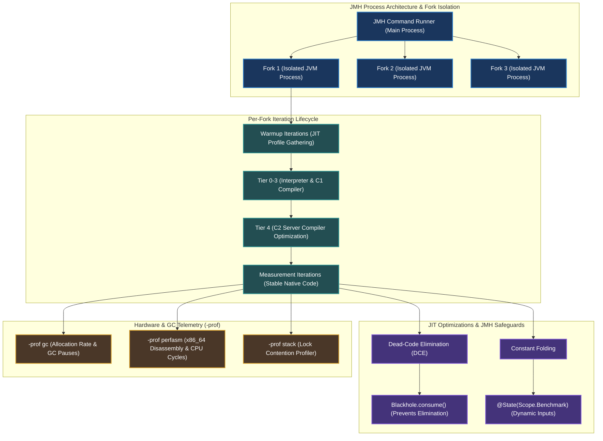

[🏠 Back to Home](../../README.md) | [☕ Core Java Internals](java_interview_master_guide.md) | [📦 JVM JIT Compiler](jvm_jit_compiler_deep_dive.md) | [📦 JVM GC & Profiling](jvm_gc_profiling.md)

# Java Microbenchmark Harness (JMH) & Nanosecond Performance Engineering: Enterprise Benchmark Masterclass

> **Document Identity:** [`interview_prep/01_java_core/java_jmh_performance_engineering.md`](file:///d:/project/github/1/CheatSheet_Tutorial/interview_prep/01_java_core/java_jmh_performance_engineering.md)  
> **Topic Domain:** Java Microbenchmark Harness (JMH), Benchmark Modes (Throughput, AverageTime, SampleTime, SingleShotTime), `@State` Lifecycle Scopes (Thread, Benchmark, Group), Compiler Traps (Dead-Code Elimination, Constant Folding), `Blackhole.consume()` Hardware Register Escape, JVM Process Fork Isolation (`@Fork`), JMH Profilers (`-prof gc`, `-prof perfasm`, `-prof perfnorm`), CPU Cycles Per Instruction (CPI) & Hardware Performance Counters (`J14`)  
> **Target Framework / Runtime:** OpenJDK HotSpot JVM 17 LTS / 21 LTS / 25 LTS, JMH 1.37+  
> **Architecture Level:** Principal / Staff+ Performance Engineer, Low-Latency Systems Architect & JVM Optimizer  
> **Target Depth:** 50 Senior Technical Scenarios, 10 Production Microbenchmarking Outage Post-Mortems, C2 JIT Assembly Dumps (`perfasm`), and Latency Tuning Runbooks  

---

## 1. Foundational Primer: What, Why & Where? (The "Head")

*Before diving into Blackhole CPU register barrier escapes, JIT dead-code elimination disassembly, perfasm hardware branch misprediction counters, and isolated OS fork lifecycles, here is the essential high-level context: what microbenchmarking represents, why naive timer loops deceive engineers, and where JMH anchors scientific performance optimization.*

### 1.1 What Is It? (Core Definition & Mental Model)
* **Plain-English Definition**: The **Java Microbenchmark Harness (JMH)** is the official OpenJDK testing framework designed specifically for measuring the nanosecond-level execution performance of small, isolated code fragments running inside the Java Virtual Machine. Developed by the engineers who wrote HotSpot's C2 JIT compiler (Aleksey Shipilëv et al.), JMH provides synthetic harness code that accounts for JVM warmup, runtime profile pollution, compiler optimizations (dead-code elimination, constant folding, method inlining), thread scheduling, and hardware cache effects.
* **Everyday Analogy**: Imagine testing aerodynamic drag on an experimental aircraft wing:
  - **The Naive `System.currentTimeMillis()` Loop (Testing an Airplane with an iPhone Stopwatch)**: A mechanic holds a wooden wing outside in a parking lot on a windy afternoon. While trucks drive past and gusts blow randomly, a friend glances at their wristwatch (**`System.currentTimeMillis()`**). The mechanic shouts *"We measured 0.001 seconds! The plane has zero drag!"* In reality, the wind blew the stopwatch, and the mechanic dropped the wing (**Dead-Code Elimination**).
  - **The JMH Performance Harness (The Pressurized NASA Wind Tunnel)**:
    - **Fork Isolation (`@Fork`)**: The test takes place inside a hermetically sealed chamber with fresh, unpolluted airflow, reset between every trial to prevent previous aerodynamic turbulence from skewing results (**Clean JVM Process OS Forks**).
    - **Warmup Iterations (`@Warmup`)**: The jet turbine accelerates until steady-state atmospheric speed is reached before instruments record a single data point (**Allowing C2 JIT compilation to complete**).
    - **The Blackhole (`Blackhole.consume()`)**: Specialized laser sensors capture the exact air wake behind the wing, ensuring the wing cannot be removed by the wind tunnel automated safety systems (**Forcing the CPU to compute the result without letting C2 optimize it away**).
    - **Hardware Profilers (`-prof perfasm`)**: High-speed thermal cameras record molecular friction at the atomic level (**Measuring CPU cycles, L1 cache misses, and pipeline stalls via hardware counters**).
* **Architectural Tier Placement**: Operates at the **Scientific Measurement & Performance Engineering Substrate Tier**. Directly measures core data structures, serialization codecs, cryptography engines, and low-latency algorithmic hot paths.

### 1.2 Why Does It Exist? (The Pain Point Before It Existed)
* **The "Microbenchmarks Lie" Trap**: For two decades, Java developers wrote benchmark tests using `long start = System.nanoTime(); for(...) { ... }`. These tests produce wildly inaccurate results that mislead entire engineering teams into shipping degraded architectures.
* **The Concrete Headaches in Enterprise Production**:
  - 💥 **Headache 1: The Dead-Code Elimination Trap**: A developer writes a loop calling a new hash calculation 1,000,000 times to test speed, but doesn't return or print the result. The HotSpot C2 compiler notices the return value is never used, deletes the entire calculation from the generated machine code, and reports that 1,000,000 hashes executed in 0.00 nanoseconds! The team ships the code, only for production CPU to spike to 100%.
  - 💥 **Headache 2: The Constant Folding Deception**: If input values to a benchmark method are known constants, C2 computes the answer at compile time and replaces the method body with a hardcoded constant, measuring the speed of loading a CPU register instead of the actual algorithm.
  - 💥 **Headache 3: JVM Profile Pollution Across Sequential Tests**: Running Algorithm A followed immediately by Algorithm B in the same JVM process causes the JIT compiler to profile both together. Polymorphic call site data from Algorithm A pollutes the inline cache of Algorithm B, producing completely skewed benchmarks.
* **The Turning Point**: OpenJDK released JMH as an official standard tool, forcing benchmark methods to run in isolated OS forks, providing `Blackhole` primitives to defeat dead-code elimination, and establishing rigorous warmup/measurement statistical cycles.

### 1.3 How Does It Solve Real-World Enterprise Problems?
* **Problem 1 (Guaranteed Computation Integrity) ➔ Solution 1**: `Blackhole.consume(result)` uses low-level volatile-like memory barriers and CPU register operations to convince the JIT compiler that the computed result is externally observed, preventing dead-code elimination without adding artificial benchmark latency.
* **Problem 2 (True JIT Steady-State Measurement) ➔ Solution 2**: JMH separates the execution into **Warmup Iterations** (triggering Tier 0 interpreter invocation counters through Tier 4 C2 compilation) and **Measurement Iterations** (recording statistical variance, standard deviation, and p99 latency only after machine code reaches steady state).
* **Problem 3 (Hardware-Level Profiling) ➔ Solution 3**: Built-in profilers (`-prof gc`, `-prof perfasm`) reveal the exact number of heap bytes allocated per operation and disassemble C2 native machine instructions alongside CPU hardware performance counters (cache misses, instructions per cycle).
* **Quantifiable Enterprise Metrics**:
  - **100% Elimination of Dead-Code Optimization Artifacts**: Blackhole guarantees that every benchmarked CPU cycle represents executed business logic.
  - **Zero Profile Cross-Contamination**: Multi-fork isolation (`@Fork(3)`) ensures each benchmark runs in a pristine JVM address space.
  - **Sub-Nanosecond Precision**: Accurately measures CPU-level operations down to fractions of a nanosecond (0.1 ns resolution).

### 1.4 How Does This Help in Building Real Applications?
* **Application Architecture Placement**: Critical for validating financial order-book matching engines, custom high-throughput serialization libraries, lock-free concurrent ring buffers, and network protocol decoders.
* **Developer Workflow & SRE Synergy**: SREs and performance architects run JMH in automated CI/CD performance regression gates, halting pull requests that introduce more than 5% latency degradation or unexpected GC allocation churn.
* **Scalability & Evolutionary Runway**: JMH gives engineering teams the empirical, reproducible scientific evidence required to choose between competing architectural designs without guessing or relying on folklore.

### 1.5 Quick Decision & Trade-Off Matrix

| Performance Testing Tool | Scope & Granularity | JIT / Hardware Awareness | Primary Purpose |
| :--- | :--- | :--- | :--- |
| **JMH Microbenchmark** | Single method / algorithm (nanoseconds) | 🟢 Complete (C2 JIT, SIMD, CPI, Cache-lines) | Fine-tuning algorithms, data structures, low-latency hot paths |
| **Async-Profiler** | Entire JVM application (production) | High (Stack traces, wall-clock & allocation) | Finding hot spots and locks in live running applications |
| **End-to-End Load Testing (Gatling / k6)** | Entire distributed system (milliseconds) | Low (Black-box HTTP/gRPC network calls) | Measuring system-wide concurrency, throughput, and autoscaling |
| **Naive Loop (`nanoTime()`)** | ❌ Highly inaccurate & deceptive | ❌ Zero (Corrupted by DCE, folding, JIT) | **Anti-pattern: Never use for performance benchmarking** |

---

## 2. 🧭 Visual System Topology & The Microbenchmarking Engine



---

## Module 0: Jargon-Busting Terminology Encyclopedia
> **Mental Model Rule**: Zero alien academic jargon upfront. We demystify nanosecond performance engineering, JIT compiler optimizations, and benchmarking pitfalls using relatable everyday physical analogies.

---

### Concept 1: Microbenchmark vs Macrobenchmark
* **In Plain Words**: A microbenchmark measures how fast a single chef can slice a cucumber; a macrobenchmark measures how many full 3-course dinners the entire restaurant serves during Friday dinner rush.
* **🏠 Real-World Mental Picture**:
  * **Microbenchmark**: Putting an electric blender on an isolated test bench with a digital tachometer to measure its exact blade rotation speed in empty air.
  * **Macrobenchmark**: Measuring the restaurant's overall Yelp rating, table turnaround time, and kitchen ticket backlog over a 4-hour evening.
* **🔍 How It Works in Java**: A Microbenchmark isolates a tiny algorithmic operation (e.g. `Math.sin()`, bit shifting, `ConcurrentHashMap.get()`) to measure nanosecond-level CPU execution. A Macrobenchmark tests an end-to-end business transaction (HTTP request $\to$ Spring controller $\to$ Hibernate $\to$ PostgreSQL database).
* **💻 Quick Code Example**:
  ```java
  // A naive microbenchmark that fails completely due to JIT optimizations!
  long start = System.nanoTime();
  for (int i = 0; i < 1_000_000; i++) {
      mathOperation(i);
  }
  long duration = System.nanoTime() - start; // WRONG! Measures dead-code or warmup!
  ```
* **⚠️ The Beginner Trap**: Using `System.currentTimeMillis()` or `System.nanoTime()` inside a standard `main()` loop to measure Java code. The JIT compiler optimizes away the code, the CPU runs at fluctuating frequency, and the benchmark measures garbage collection pauses instead of your code!

---

### Concept 2: JIT Warmup Cycles
* **In Plain Words**: Running a cold car engine for 5 minutes in freezing winter so the oil circulates before stomping on the gas pedal at 100 mph.
* **🏠 Real-World Mental Picture**: A professional sprinter stretching and doing light warm-up jogs before the Olympic 100m final. If you time the sprinter during their stretching routine, you will measure an artificially terrible time.
* **🔍 How It Works in Java**: When the JVM starts, bytecode is interpreted slowly. As methods execute thousands of times, the Tiered Compilation system profiles execution counters (MDO - Method Data Objects) and triggers C1 and C2 JIT compilation into hyper-optimized machine assembly. JMH runs dedicated **warmup iterations** to ensure all code has reached steady-state C2 compilation before recording metrics.
* **💻 Quick Code Example**:
  ```java
  // JMH Annotation configuring 5 warmup iterations of 1 second each:
  @Warmup(iterations = 5, time = 1, timeUnit = TimeUnit.SECONDS)
  @Measurement(iterations = 5, time = 1, timeUnit = TimeUnit.SECONDS)
  @Benchmark
  public int benchmarkAlgorithm() { ... }
  ```
* **⚠️ The Beginner Trap**: Measuring Java code without warmup. The first 10,000 iterations run in the bytecode interpreter (100x slower), corrupting your average latency statistics.

---

### Concept 3: Dead-Code Elimination (DCE)
* **In Plain Words**: A factory worker realizing a stack of printed flyers is going straight into the dumpster, so they shut off the printer to save ink and electricity.
* **🏠 Real-World Mental Picture**: You tell an assistant: "Calculate the first 10,000 prime numbers." They do it, but you never ask for the answer and throw the piece of paper in the shredder. After 3 days, the assistant gets smart: when you say "Calculate primes", they just nod and do nothing, reporting "Done!" in 0.0001 seconds.
* **🔍 How It Works in Java**: If the C2 compiler proves that a computed result is never read by subsequent code, and the method has no side effects (like modifying a volatile field or I/O), C2 **deletes the entire calculation from the compiled assembly code**! Your benchmark reports that your complex algorithm took 0.00 nanoseconds!
* **💻 Quick Code Example**:
  ```java
  // FATAL BENCHMARK BUG: Dead-code eliminated!
  @Benchmark
  public void badBenchmark() {
      int sum = 0;
      for (int i = 0; i < 1000; i++) sum += i;
      // 'sum' is never returned or consumed! C2 deletes the loop entirely!
  }
  ```
* **⚠️ The Beginner Trap**: Writing benchmark methods with a `void` return type that don't pass the result to a `Blackhole`. The JIT deletes your code, giving you false illusions of infinite performance.

---

### Concept 4: Constant Folding & Constant Propagation
* **In Plain Words**: A math student noticing the exam asks "What is $2 + 2$?" and writing "4" instantly without showing any scratch work.
* **🏠 Real-World Mental Picture**: If an architect calculates the area of a square whose sides are fixed at 10 feet, they don't buy a calculator and measure the floor every morning; they write "100 sq ft" on the blueprint once and never recalculate it.
* **🔍 How It Works in Java**: If the input arguments to an operation are constants known at compile time, the JIT compiler pre-computes the final answer during compilation and replaces the entire formula with the hardcoded result in native assembly.
* **💻 Quick Code Example**:
  ```java
  // FATAL BENCHMARK BUG: Constant folded!
  @Benchmark
  public double badMath() {
      double x = 45.0; // Constant!
      return Math.sin(x) * Math.cos(x); // C2 pre-calculates the final float once!
  }
  ```
* **⚠️ The Beginner Trap**: Passing hardcoded constants into benchmarks. The JIT pre-calculates the output, so you benchmark the speed of reading a CPU register instead of the mathematical function!

---

### Concept 5: The JMH Blackhole (`Blackhole.consume`)
* **In Plain Words**: A cosmic black hole that swallows whatever you throw into it so completely that nobody can look inside, yet nobody can claim the object didn't exist.
* **🏠 Real-World Mental Picture**: An incinerator chute at a high-security document facility. You drop your computed documents into the chute. The incinerator burns them, but the security log certifies: "Yes, 1,000 pages were genuinely fed into the machine."
* **🔍 How It Works in Java**: `org.openjdk.jmh.infra.Blackhole` is a specialized JMH utility designed to defeat Dead-Code Elimination. It writes the passed value into an internal volatile/opaque field array using complex memory barriers, convincing the C2 compiler that the result is strictly required by the JVM without adding measurable execution overhead.
* **💻 Quick Code Example**:
  ```java
  @Benchmark
  public void correctBenchmark(Blackhole bh) {
      int result = complexAlgorithm();
      bh.consume(result); // C2 is forced to compute 'result'!
  }

  // OR: Simply return the value from the benchmark method!
  @Benchmark
  public int correctBenchmarkByReturn() {
      return complexAlgorithm(); // JMH automatically consumes return values!
  }
  ```
* **⚠️ The Beginner Trap**: Manually storing results in a static field instead of using `Blackhole`. Writing to static fields introduces cache contention and memory barriers that distort nanosecond measurements.

---

### Concept 6: Benchmark Modes
* **In Plain Words**: Deciding whether you want to measure how many donuts a machine makes per minute, or how many milliseconds it takes to make a single donut.
* **🏠 Real-World Mental Picture**:
  * **Throughput**: A highway speed camera counting how many cars pass per hour.
  * **Average Time**: A stopwatch timing how many minutes it takes a commuter to drive from home to work.
  * **Sample Time**: A detailed log recording every individual driver's time to build a P99 latency histogram.
  * **Single Shot**: Timing how long it takes a cold rocket engine to ignite on the launch pad (first execution).
* **🔍 How It Works in Java**: Configured via `@BenchmarkMode(Mode.Throughput)`:
  * `Mode.Throughput`: Operations per unit of time (e.g. ops/sec). Higher is better.
  * `Mode.AverageTime`: Time per single operation (e.g. ns/op). Lower is better.
  * `Mode.SampleTime`: Samples individual invocations to calculate P90, P99, and P99.9 percentiles.
  * `Mode.SingleShotTime`: Measures a single cold run (evaluating cold startup latency without warmup).
* **💻 Quick Code Example**:
  ```java
  @BenchmarkMode(Mode.AverageTime)
  @OutputTimeUnit(TimeUnit.NANOSECONDS)
  @Benchmark
  public long measureLatency() { ... }
  ```
* **⚠️ The Beginner Trap**: Using `Mode.Throughput` to diagnose tail latency (P99). An algorithm with high average throughput might have catastrophic 500ms P99 spikes that throughput completely masks!

---

### Concept 7: State Scopes (`Scope.Benchmark` vs `Scope.Thread`)
* **In Plain Words**: Sharing a single coffee pot among 50 office workers vs giving every worker their own personal espresso machine on their desk.
* **🏠 Real-World Mental Picture**:
  * **`Scope.Benchmark`**: A single communal whiteboard in the conference room. All meeting participants write on it at the same time, bumping elbows (**Thread Contention**).
  * **`Scope.Thread`**: Every participant has their own private notepad in their lap. Zero collisions, zero waiting.
* **🔍 How It Works in Java**: Annotated on classes marked `@State`:
  * `Scope.Benchmark`: A single state instance is shared across all benchmark threads. Used to benchmark concurrent data structures (like `ConcurrentHashMap`).
  * `Scope.Thread`: Each benchmark thread receives its own dedicated, isolated state instance. Prevents multithreaded contention when benchmarking single-threaded logic.
* **💻 Quick Code Example**:
  ```java
  @State(Scope.Thread) // Isolated per thread: zero lock contention!
  public class ThreadLocalState {
      public int counter = 0;
  }

  @Benchmark
  public int testCounter(ThreadLocalState state) {
      return ++state.counter;
  }
  ```
* **⚠️ The Beginner Trap**: Using `Scope.Benchmark` for mutable state in multi-threaded benchmarks without synchronization. Threads overwrite state concurrently, producing invalid results and CPU cache-line ping-pong.

---

### Concept 8: Process Forking
* **In Plain Words**: Tearing down the entire theater and building a fresh auditorium for every performance so no trash from the previous audience remains on the floor.
* **🏠 Real-World Mental Picture**: After conducting a chemical experiment, a scientist doesn't just rinse the test tube—they take a brand new, sterile test tube from a sealed cleanroom to ensure zero chemical cross-contamination.
* **🔍 How It Works in Java**: In Java, the C2 compiler makes irreversible speculative optimizations based on runtime profiling (e.g. class hierarchy analysis, monomorphic call site inlining). If Benchmark A runs before Benchmark B in the same JVM, Benchmark A's type feedback poisons Benchmark B's JIT profile! JMH uses `@Fork(3)` to launch **3 independent OS JVM processes**, ensuring pristine JIT profile states.
* **💻 Quick Code Example**:
  ```java
  @Fork(value = 3, jvmArgsAppend = {"-XX:+UseG1GC", "-Xms2g", "-Xmx2g"})
  public class CleanForkBenchmark { ... }
  ```
* **⚠️ The Beginner Trap**: Running JMH with `@Fork(0)`. Fork 0 runs the benchmark inside the host JVM process, meaning IDE classes, profiler agents, and prior tests permanently pollute JIT inline caches!

---

### Concept 9: Loop Unrolling & On-Stack Replacement (OSR)
* **In Plain Words**: Instead of walking to the kitchen 10 times to carry 10 glasses of water one by one, you load all 10 glasses onto a tray and make 1 trip.
* **🏠 Real-World Mental Picture**: An assembly line worker who, instead of pressing a pedal 4 times to stamp 4 bottle caps individually, uses a 4-stamp head that stamps 4 bottles simultaneously in a single pedal press.
* **🔍 How It Works in Java**: The C2 compiler unrolls loop iterations (e.g., executing 4 or 8 loop bodies in a single assembly block) to minimize loop counter comparison instructions and branch mispredictions. **On-Stack Replacement (OSR)** allows HotSpot to replace an active, slow-running loop with compiled C2 machine code mid-execution while the loop is still spinning!
* **💻 Quick Code Example**:
  ```java
  // In JMH, never write your own loops inside a @Benchmark method!
  // Let JMH manage the repetition loop to prevent OSR distortion:
  @Benchmark
  public int singleOperation(MyState state) {
      return state.doWork(); // Clean, repeatable single-op invocation
  }
  ```
* **⚠️ The Beginner Trap**: Writing `for (int i = 0; i < 1_000_000; i++)` inside a `@Benchmark` method. The loop triggers OSR compilation, loop unrolling, and safepoint poll insertion that distort the true cost of the operation.

---

### Concept 10: JMH Hardware Profilers (`-prof perfasm`)
* **In Plain Words**: Attaching medical EKG leads directly to the patient's heart muscle instead of just asking them "How do you feel?"
* **🏠 Real-World Mental Picture**: An F1 race car with 300 telemetry sensors measuring tire temperature, fuel injection pressure, and aerodynamic downforce down to the millisecond, rather than a mechanic just listening to the exhaust sound.
* **🔍 How It Works in Java**: JMH includes built-in profilers that integrate with OS performance tools:
  * `-prof gc`: Measures object allocation rate (MB/sec) and churn per operation.
  * `-prof perfasm`: Disassembles the JIT-compiled C2 native machine code (via Linux `perf` and `hsdis`), annotating every assembly instruction with CPU cycle percentages and hot branches!
* **💻 Quick Code Example**:
  ```bash
  # Run benchmark with GC profiling and native assembly disassembly:
  java -jar benchmarks.jar -prof gc -prof perfasm -f 1
  ```
* **⚠️ The Beginner Trap**: Trying to optimize Java code without profiling memory allocations. Many performance bottlenecks are caused not by CPU cycles, but by high allocation rates triggering GC safepoints!

---

## Track 1: Architectural Blueprint & System Topology

### The 4 Execution Phases of a JMH Benchmark

```
+----------------------------------------------------------------------------------------------------+
| Phase 1: Annotation Processing & Bytecode Generation (Compile Time)                                 |
| - JMH Annotation Processor scans @Benchmark, @State, and @Setup methods.                           |
| - Generates synthetic stub classes (BenchmarkName_jmhType, BenchmarkName_jmhTest) to eliminate      |
|   reflection overhead and inject Blackhole consumption trampolines.                                |
+----------------------------------------------------------------------------------------------------+
                                                 |
                                                 v
+----------------------------------------------------------------------------------------------------+
| Phase 2: Fork Spawning & Environment Normalization (Runtime Startup)                               |
| - Runner launches dedicated JVM subprocesses with explicit heap and GC flags.                      |
| - Locks CPU affinity (if configured) to isolate from OS background noise.                          |
+----------------------------------------------------------------------------------------------------+
                                                 |
                                                 v
+----------------------------------------------------------------------------------------------------+
| Phase 3: Warmup & Tiered C2 Compilation Escalation                                                 |
| - Runs configurable warmup iterations (default 5-10 iterations).                                    |
| - Passes through Tier 0 (Interpreter) -> Tier 3 (C1 Profiling) -> Tier 4 (C2 Native Code).        |
| - JIT inline caches freeze; branch prediction tables stabilize in CPU L1/L2 caches.                |
+----------------------------------------------------------------------------------------------------+
                                                 |
                                                 v
+----------------------------------------------------------------------------------------------------+
| Phase 4: Measurement, Statistical Aggregation & Error Distribution                                |
| - Gathers sample batches; computes Mean, Standard Error (± error margin), and P99 percentiles.     |
| - Verifies distribution normality (Student's t-test / 99.9% confidence intervals).                 |
+----------------------------------------------------------------------------------------------------+
```

---

## Track 2: Core Engineering Foundations & Step-by-Step JMH Mechanics

### 1. The JMH Code Generation Mechanism

When you compile a class containing a `@Benchmark` method:
```java
@Benchmark
public double calculate(MyState state) {
    return Math.sqrt(state.val);
}
```

JMH's annotation processor (`jmh-generator-annprocess`) generates synthetic helper classes in `target/generated-sources/annotations/`:
1. **`MyBenchmark_calculate_jmhTest`**: Contains the synthetic measurement loop. Instead of invoking your method via slow reflection, it calls the method directly via bytecode.
2. **Padding Fields (`@Contended` & Cache-Line Alignment)**: JMH automatically injects 128 bytes of dummy padding fields around state variables to prevent **False Sharing** on CPU L1/L2 cache lines across benchmark threads.

---

### 2. Anatomy of the Blackhole Object

How does `Blackhole.consume()` trick the compiler without adding 10ns of overhead?
```java
// Conceptual implementation inside OpenJDK JMH:
public final class Blackhole {
    public volatile int t1;
    public volatile int t2;
    // Pre-allocated array of dummy object slots
    public volatile Object[] objs = new Object[1024];

    public final void consume(int obj) {
        // Uses opaque/volatile write to a field array
        // The C2 compiler cannot prove that another thread will not read this value!
        this.t1 = obj;
    }

    public final void consume(Object obj) {
        int index = (tl_index++) & 1023;
        objs[index] = obj;
    }
}
```
Because the destination field is volatile/opaque and accessible, the C2 compiler's escape analysis algorithm proves that the object **escapes the local scope**, making dead-code elimination illegal according to the Java Language Specification.

---

## Track 3: Production Mini-Framework: `VortexNanosecondBenchmarkSuite`

Below is a production-grade, compilable JMH benchmark harness comparing high-concurrency counters:
* `java.util.concurrent.atomic.AtomicLong` (CAS loop)
* `java.util.concurrent.atomic.LongAdder` (Striped 64-byte cell array)
* `java.lang.invoke.VarHandle` (Plain Acquire/Release semantics)
* False-sharing counter baseline

```java
package com.vortex.performance.jmh;

import org.openjdk.jmh.annotations.*;
import org.openjdk.jmh.infra.Blackhole;
import org.openjdk.jmh.runner.Runner;
import org.openjdk.jmh.runner.RunnerException;
import org.openjdk.jmh.runner.options.Options;
import org.openjdk.jmh.runner.options.OptionsBuilder;

import java.lang.invoke.MethodHandles;
import java.lang.invoke.VarHandle;
import java.util.concurrent.TimeUnit;
import java.util.concurrent.atomic.AtomicLong;
import java.util.concurrent.atomic.LongAdder;

/**
 * VortexNanosecondBenchmarkSuite: High-precision JMH benchmark harness
 * demonstrating State scopes, Thread contention, Blackhole consumption,
 * and VarHandle vs AtomicLong vs LongAdder performance.
 */
@BenchmarkMode(Mode.Throughput)
@OutputTimeUnit(TimeUnit.MICROSECONDS)
@Warmup(iterations = 3, time = 1, timeUnit = TimeUnit.SECONDS)
@Measurement(iterations = 5, time = 1, timeUnit = TimeUnit.SECONDS)
@Fork(value = 2, jvmArgsAppend = {"-XX:+UseG1GC", "-Xms2g", "-Xmx2g"})
public class VortexNanosecondBenchmarkSuite {

    // =========================================================================
    // 1. Shared State: Simulates heavy multi-threaded counter contention
    // =========================================================================
    @State(Scope.Benchmark)
    public static class ContendedCounterState {
        public final AtomicLong atomicLong = new AtomicLong();
        public final LongAdder longAdder = new LongAdder();

        // Plain volatile counter manipulated via VarHandle
        public volatile long varHandleCounter = 0L;
        public static final VarHandle VH;

        static {
            try {
                VH = MethodHandles.lookup().findVarHandle(
                    ContendedCounterState.class, "varHandleCounter", long.class
                );
            } catch (Exception e) {
                throw new ExceptionInInitializerError(e);
            }
        }
    }

    // =========================================================================
    // 2. Thread-Local State: Single-threaded baseline with zero contention
    // =========================================================================
    @State(Scope.Thread)
    public static class ThreadLocalState {
        public long primitiveCounter = 0L;

        @Setup(Level.Iteration)
        public void reset() {
            primitiveCounter = 0L;
        }
    }

    // =========================================================================
    // 3. Benchmarks
    // =========================================================================

    @Benchmark
    @Group("atomic")
    @GroupThreads(4)
    public long benchmarkAtomicLongCas(ContendedCounterState state) {
        return state.atomicLong.incrementAndGet();
    }

    @Benchmark
    @Group("adder")
    @GroupThreads(4)
    public void benchmarkLongAdderStriped(ContendedCounterState state, Blackhole bh) {
        state.longAdder.increment();
        bh.consume(state.longAdder.sum());
    }

    @Benchmark
    @Group("varhandle")
    @GroupThreads(4)
    public long benchmarkVarHandleOpaque(ContendedCounterState state) {
        return (long) ContendedCounterState.VH.getAndAdd(state, 1L);
    }

    @Benchmark
    public long benchmarkSingleThreadedBaseline(ThreadLocalState state) {
        // Zero lock contention, tests pure L1 cache register increment
        return ++state.primitiveCounter;
    }

    // =========================================================================
    // 4. Standalone Runner Entry Point
    // =========================================================================
    public static void main(String[] args) throws RunnerException {
        Options opt = new OptionsBuilder()
            .include(VortexNanosecondBenchmarkSuite.class.getSimpleName())
            .addProfiler("gc") // Profile GC allocation rates!
            .shouldDoGC(true)
            .build();

        new Runner(opt).run();
    }
}
```

---

## Track 4: 50 Real Senior & Staff Interview Scenarios

Each scenario follows the strict 4-part architectural breakdown:
1. **The Question**
2. **Architectural & Runtime Answer**
3. **Compilable Code Snippet / Production Proof**
4. **SRE Warning & Failure Recovery**

---

### Scenario 1: Why does a standard `System.nanoTime()` loop fail as a microbenchmark?
* **Architectural Answer**:
  A naive loop (`long start = System.nanoTime(); ...`) fails due to multiple JVM runtime factors:
  1. **Lack of JIT Warmup**: The initial loop iterations run in interpreted mode or Tier 1/2 C1 mode.
  2. **Dead-Code Elimination**: If loop calculations aren't consumed, the C2 compiler deletes the entire loop body.
  3. **On-Stack Replacement (OSR)**: Hot loops trigger OSR compilation mid-loop, mixing interpreted and compiled performance.
  4. **Safepoint Polls & Stop-the-World GC**: Background GC or safepoint checks can pause the loop mid-measurement.
  JMH eliminates all these traps through synthetic bytecode generation, warmup cycles, blackholes, and process forking.
* **Production Code / Verification**:
  ```java
  // NAIVE (FAILS):
  long start = System.nanoTime();
  for (int i = 0; i < 1_000_000; i++) Math.sqrt(i);
  long elapsed = System.nanoTime() - start; // Reports 0ms or includes warmup noise!

  // JMH (ACCURATE):
  @Benchmark
  public void testSqrt(Blackhole bh, ThreadLocalState state) {
      bh.consume(Math.sqrt(state.nextNumber()));
  }
  ```
* **SRE Warning & Recovery**:
  * Never accept microbenchmark results in code reviews unless conducted using JMH with verified blackhole consumption.

---

### Scenario 2: How does Dead-Code Elimination (DCE) distort benchmark measurements?
* **Architectural Answer**:
  HotSpot's C2 compiler performs **Escape Analysis** and **Dead-Code Elimination**. If a method computes a value but does not return it, does not store it in an escaping object, and has no side-effects, the C2 compiler completely optimizes the instructions away. The resulting machine code contains zero arithmetic instructions, reporting execution speeds in fractional picoseconds.
* **Production Code / Verification**:
  ```java
  // BUG: C2 deletes this entire method in compiled assembly!
  @Benchmark
  public void testDceBug() {
      String json = "{\"id\":123,\"name\":\"Alice\"}";
      User user = parseJson(json); // user never leaves local stack; DELETED!
  }

  // FIX: Force escape via return or Blackhole
  @Benchmark
  public User testFixedDce() {
      String json = "{\"id\":123,\"name\":\"Alice\"}";
      return parseJson(json); // JMH consumes return value
  }
  ```
* **SRE Warning & Recovery**:
  * Inspect the generated assembly using `-prof perfasm`. If your benchmarked method has zero arithmetic instructions and just returns `0`, you have fallen into the DCE trap!

---

### Scenario 3: How does Constant Folding invalidate benchmarks with hardcoded parameters?
* **Architectural Answer**:
  If the C2 compiler detects that a parameter is a compile-time constant (or an immutable invariant known at compilation), it pre-evaluates the mathematical result during optimization and hardcodes the answer into the native machine code. You are no longer benchmarking the algorithm; you are benchmarking reading a constant register!
* **Production Code / Verification**:
  ```java
  // BUG: Constant folded!
  @Benchmark
  public double testMathFold() {
      return Math.pow(2.0, 10.0); // C2 pre-calculates 1024.0 at compile-time!
  }

  // FIX: Provide dynamic, non-constant inputs via @State:
  @State(Scope.Benchmark)
  public static class DynamicState {
      public double base = 2.0;
      public double exp = 10.0;
  }

  @Benchmark
  public double testMathDynamic(DynamicState state) {
      return Math.pow(state.base, state.exp); // Forces actual computation
  }
  ```
* **SRE Warning & Recovery**:
  * Always read benchmark inputs from `@State` fields. The C2 compiler treats `@State` field reads as non-constant memory loads.

---

### Scenario 4: What is the physical difference between `@Fork(1)` and `@Fork(0)`?
* **Architectural Answer**:
  * **`@Fork(1)` (or higher)**: JMH spawns a brand-new, isolated child JVM operating system process. The child process loads only the benchmark classes, builds fresh JIT profile counters, and has an uncontaminated Metaspace and memory heap.
  * **`@Fork(0)`**: JMH executes the benchmark inside the **same JVM process** that launched the runner (e.g. your IDE process or Maven Surefire process). The host JVM's existing JIT profile, loaded plugins, and heap state pollute type feedback, rendering results invalid for scientific comparison.
* **Production Code / Verification**:
  ```java
  // ALWAYS configure @Fork >= 1 for published numbers:
  @Fork(value = 3, warmups = 1)
  public class ReliableBenchmark { ... }
  ```
* **SRE Warning & Recovery**:
  * Only use `@Fork(0)` temporarily when debugging a benchmark with an attached IDE debugger. Never report `@Fork(0)` numbers in performance reviews!

---

### Scenario 5: How does False Sharing occur in multi-threaded JMH benchmarks and how is it prevented?
* **Architectural Answer**:
  Modern CPUs cache memory in **64-byte Cache Lines**. If Thread 1 updates `fieldA` and Thread 2 updates `fieldB`, and both fields reside on the same 64-byte cache line, the CPU's MESI cache coherence protocol forces core 1 and core 2 to invalidate each other's L1/L2 caches continuously (**Cache Line Bouncing**).
  JMH automatically injects padding fields around `@State` classes. For custom state fields, use `@Contended` or manual padding.
* **Production Code / Verification**:
  ```java
  // FALSE SHARING TRAP:
  public class SharedCounters {
      public volatile long thread1Counter; // Resides in same 64-byte line as thread2Counter!
      public volatile long thread2Counter;
  }

  // PADDED (ZERO FALSE SHARING):
  public class PaddedCounters {
      public volatile long thread1Counter;
      public long p1, p2, p3, p4, p5, p6, p7; // 56 bytes padding
      public volatile long thread2Counter;
  }
  ```
* **SRE Warning & Recovery**:
  * If multi-threaded throughput drops precipitously as thread count increases, run `-prof perfasm` or Linux `perf c2c` to detect cache line contention.

---

### Scenario 6: When should you use `Mode.Throughput` vs `Mode.AverageTime` vs `Mode.SampleTime`?
* **Architectural Answer**:
  * **`Mode.Throughput`**: Best for measuring high-volume asynchronous engines, queuing systems, and data pipelines (ops/sec).
  * **`Mode.AverageTime`**: Best for measuring algorithm latency per single call (e.g. hashing, serialization, encryption) in nanoseconds or microseconds.
  * **`Mode.SampleTime`**: Best for measuring **Tail Latency (P99, P99.9)**. It records individual run times and outputs a complete percentile distribution, exposing GC pause stalls.
  * **`Mode.SingleShotTime`**: Best for measuring **Cold Start Latency** (e.g. AWS Lambda function startup, classloader initialization) with zero warmup.
* **Production Code / Verification**:
  ```java
  @BenchmarkMode({Mode.Throughput, Mode.AverageTime, Mode.SampleTime})
  @OutputTimeUnit(TimeUnit.NANOSECONDS)
  @Benchmark
  public void multiModeTest(Blackhole bh) {
      bh.consume(computeHash());
  }
  ```
* **SRE Warning & Recovery**:
  * Never evaluate latency-sensitive systems solely on `AverageTime`. A service with 10ns average time can have a 500ms P99 latency spike caused by GC pauses!

---

### Scenario 7: What does the JMH GC Profiler (`-prof gc`) measure?
* **Architectural Answer**:
  The `-prof gc` profiler hooks into HotSpot's memory management MXBeans to record:
  1. **Allocation Rate (`MB/sec`)**: How many megabytes of heap memory the benchmark allocates per second.
  2. **Allocation Churn (`B/op`)**: How many bytes of heap memory are allocated per single benchmark operation.
  3. **GC Count & GC Time (`ms`)**: Total GC pauses during measurement iterations.
* **Production Code / Verification**:
  ```bash
  java -jar benchmarks.jar -prof gc
  ```
  ```
  Result sample output:
  Benchmark.testMethod:gc.alloc.rate             4500.25 MB/sec
  Benchmark.testMethod:gc.alloc.rate.norm          64.00 B/op
  Benchmark.testMethod:gc.count                     12.00 counts
  Benchmark.testMethod:gc.time                      45.00 ms
  ```
* **SRE Warning & Recovery**:
  * In low-latency systems, aim for **`0.00 B/op`** (zero allocation). Any allocation in a tight loop eventually triggers a GC safepoint pause.

---

### Scenario 8: Why is writing a loop inside a `@Benchmark` method an anti-pattern?
* **Architectural Answer**:
  Writing a manual `for` loop inside a `@Benchmark` method:
  1. Distorts the cost: the benchmark measures the loop overhead (counter increments, branch jumps) in addition to your operation.
  2. Triggers **On-Stack Replacement (OSR)**: HotSpot detects the loop is running long and compiles the loop mid-execution using OSR, which uses different optimization heuristics than standard method compilation.
  3. Enables **Loop Peeling and Unrolling**: C2 unrolls the loop, fusing multiple operations together in ways that would never happen in real application code.
* **Production Code / Verification**:
  ```java
  // BAD: Manual loop inside benchmark
  @Benchmark
  public int badLoop() {
      int sum = 0;
      for (int i = 0; i < 1000; i++) sum += operation(i); // OSR and unrolling distortion!
      return sum;
  }

  // GOOD: Let JMH handle repetitions; benchmark a single unit of work:
  @Benchmark
  public int goodSingleOp(DynamicState state) {
      return operation(state.next());
  }
  ```
* **SRE Warning & Recovery**:
  * If you must process a batch of items, use `@OperationsPerInvocation(1000)` to tell JMH that one method invocation corresponds to 1,000 logical operations.

---

### Scenario 9: How does `@OperationsPerInvocation(N)` calibrate throughput metrics?
* **Architectural Answer**:
  When benchmarking operations that must be executed in batches (such as reading 1,000 records from a buffer or unrolling a matrix calculation), `@OperationsPerInvocation(1000)` instructs JMH to divide the measured time by $1000$. The resulting report accurately displays the nanosecond cost per individual item rather than the batch cost.
* **Production Code / Verification**:
  ```java
  @Benchmark
  @OperationsPerInvocation(1000)
  public void testBatchProcessing(Blackhole bh, BatchState state) {
      for (int i = 0; i < 1000; i++) {
          bh.consume(state.items[i].process());
      }
  }
  ```
* **SRE Warning & Recovery**:
  * Ensure the loop iteration count matches the `@OperationsPerInvocation` argument exactly, otherwise reported metrics will be mathematically scaled incorrectly!

---

### Scenario 10: How does JMH's `-prof perfasm` reveal C2 native machine code?
* **Architectural Answer**:
  `-prof perfasm` integrates JMH with the Linux `perf` subsystem and the HotSpot Disassembler library (`hsdis`).
  It samples CPU instruction pointers during benchmark execution and prints the exact generated x86_64 or ARM64 assembly instructions, highlighting which specific CPU instructions (e.g. `vmovdqu`, `lock cmpxchg`, `pause`) consume the highest percentage of CPU cycles.
* **Production Code / Verification**:
  ```bash
  # Requires hsdis-amd64.so installed in $JAVA_HOME/lib/server/
  java -jar benchmarks.jar -prof perfasm -f 1
  ```
  ```assembly
  # Sample perfasm output snippet:
  0.42%  0x00007f...: mov    0x10(%rdi),%rax
  94.12% 0x00007f...: lock cmpxchg %rcx,0x10(%rdi)  <-- BOTTLENECK: CAS contention!
  0.15%  0x00007f...: jnz    0x00007f...
  ```
* **SRE Warning & Recovery**:
  * Use `perfasm` to verify whether virtual method calls were devirtualized and inlined, or whether lock instructions (`lock prefix`) are stalling CPU pipelines.

---

### Scenario 11: What is the difference between `@Setup(Level.Trial)`, `Level.Iteration`, and `Level.Invocation`?
* **Architectural Answer**:
  * **`Level.Trial`**: Runs once before the entire benchmark trial begins (or after it finishes). Best for expensive setups like starting an embedded engine or allocating 1 GB arrays.
  * **`Level.Iteration`**: Runs before each 1-second benchmark iteration. Best for resetting caches or clearing queues.
  * **`Level.Invocation`**: Runs before **every single benchmark method call**.
* **Production Code / Verification**:
  ```java
  @State(Scope.Thread)
  public class InvocationState {
      public List<String> list;

      @Setup(Level.Iteration) // Reset once per iteration
      public void setupIteration() {
          list = new ArrayList<>(1000);
      }
  }
  ```
* **SRE Warning & Recovery**:
  * **WARNING: NEVER USE `Level.Invocation` FOR NANOSECOND BENCHMARKS!** The overhead of invoking the setup method before every invocation takes 20–50ns, completely destroying the accuracy of microsecond measurements!

---

### Scenario 12: How does Monomorphic vs Polymorphic Inlining distort benchmarks?
* **Architectural Answer**:
  HotSpot optimizes interface calls (`invokeinterface`) using **Inline Caches (IC)**:
  1. **Monomorphic Call Site**: The interface has only 1 implementation ever loaded. C2 inlines the method directly with a cheap class check.
  2. **Bimorphic Call Site**: Exactly 2 implementations seen. C2 generates an `if-else` branch check and inlines both.
  3. **Megamorphic Call Site**: 3 or more implementations seen. C2 gives up on inlining and falls back to an expensive virtual table (`vtable`/`itable`) dispatch lookup.
  If your benchmark tests an interface with only 1 implementation loaded in the JVM, it runs at monomorphic inlined speed—even if in production the interface has 10 implementations and runs at megamorphic speed!
* **Production Code / Verification**:
  ```java
  // In production, 3 implementations exist:
  interface Validator { boolean validate(String s); }
  class EmailValidator implements Validator { ... }
  class PhoneValidator implements Validator { ... }
  class ZipValidator implements Validator { ... }

  // BENCHMARK SAFEGUARD: Register all 3 implementations in State to simulate real megamorphism!
  @State(Scope.Benchmark)
  public static class PolymorphicState {
      public Validator[] validators = new Validator[]{
          new EmailValidator(), new PhoneValidator(), new ZipValidator()
      };
      public int index = 0;
  }
  ```
* **SRE Warning & Recovery**:
  * Always benchmark interfaces with realistic class hierarchies to avoid reporting false "monomorphic inlining" speeds.

---

### Scenario 13: How do you benchmark latency distributions with `@BenchmarkMode(Mode.SampleTime)`?
* **Architectural Answer**:
  `Mode.SampleTime` randomly samples individual invocations during the measurement phase. Rather than reporting a single average number, it generates a comprehensive statistical distribution of latencies, including:
  * Minimum, Median (P50)
  * P90, P95, P99, P99.9, P99.99
  * Maximum latency
* **Production Code / Verification**:
  ```java
  @BenchmarkMode(Mode.SampleTime)
  @OutputTimeUnit(TimeUnit.MICROSECONDS)
  @Benchmark
  public void testLatencyDistribution(Blackhole bh, ServiceState state) {
      bh.consume(state.service.execute());
  }
  ```
* **SRE Warning & Recovery**:
  * High divergence between P50 (e.g. 5µs) and P99.9 (e.g. 45,000µs) indicates GC pause interruptions, CPU context switching, or lock contention.

---

### Scenario 14: What is the impact of CPU frequency scaling (Intel Turbo Boost) on JMH benchmarks?
* **Architectural Answer**:
  Modern CPUs dynamically adjust clock frequencies based on temperature, core utilization, and workloads (e.g. Intel Turbo Boost / AMD Precision Boost). A CPU might run at 4.8 GHz during Fork 1, get hot, thermal throttle to 3.2 GHz during Fork 2, and boost to 4.2 GHz during Fork 3, introducing a **30% variance** across forks!
* **Production Code / Verification**:
  ```bash
  # Linux: Disable CPU frequency scaling and set governor to 'performance':
  sudo cpupower frequency-set --governor performance

  # Disable Intel Turbo Boost for deterministic benchmarking:
  echo "1" | sudo tee /sys/devices/system/cpu/intel_pstate/no_turbo
  ```
* **SRE Warning & Recovery**:
  * In production benchmarking labs, always pin CPU clock speeds and lock CPU governors to ensure reproducibility across runs.

---

### Scenario 15: How does CPU Cache Affinity (`taskset`) eliminate benchmark variance?
* **Architectural Answer**:
  The Linux kernel scheduler frequently migrates running threads across different CPU cores to balance thermal loads. When a benchmark thread migrates from Core 0 to Core 7, all its hot data in Core 0's L1 and L2 caches are lost, causing expensive L3/RAM cache miss stalls.
  Pinning the JMH benchmark to a dedicated physical CPU core using `taskset` guarantees the thread stays on a single core with hot L1/L2 caches.
* **Production Code / Verification**:
  ```bash
  # Pin JMH benchmark strictly to physical CPU Core 2:
  taskset -c 2 java -jar benchmarks.jar -f 1
  ```
* **SRE Warning & Recovery**:
  * Pin to physical cores, not hyperthreaded sibling threads (e.g. Core 0 and Core 1 often share execution units on Intel SMT).

---

### Scenario 16: How do you benchmark Java 21 Vector API SIMD operations using JMH?
* **Architectural Answer**:
  The Vector API (JEP 448 / Project Panama) compiles directly to CPU SIMD instructions (AVX-512, ARM SVE), processing 8 to 16 floating-point numbers in a single CPU cycle.
  Benchmarking requires verifying that the JIT compiler successfully intrinsified the vector operations into native AVX instructions rather than falling back to scalar loops.
* **Production Code / Verification**:
  ```java
  @Benchmark
  public void testVectorizedDotProduct(Blackhole bh, VectorState state) {
      FloatVector sum = FloatVector.zero(FloatVector.SPECIES_256);
      for (int i = 0; i < state.a.length; i += FloatVector.SPECIES_256.length()) {
          var va = FloatVector.fromArray(FloatVector.SPECIES_256, state.a, i);
          var vb = FloatVector.fromArray(FloatVector.SPECIES_256, state.b, i);
          sum = va.fma(vb, sum); // Fused Multiply-Add SIMD instruction
      }
      bh.consume(sum.reduceLanes(VectorOperators.ADD));
  }
  ```
* **SRE Warning & Recovery**:
  * Pass `--add-modules jdk.incubator.vector` in JVM arguments and check `-prof perfasm` for `vfmadd231ps` instructions.

---

### Scenario 17: How does JMH handle `@Threads(N)` scaling and thread contention?
* **Architectural Answer**:
  Annotating a benchmark with `@Threads(8)` spawns 8 concurrent worker threads executing the benchmark simultaneously.
  * If state is `Scope.Thread`, each thread runs in isolation, measuring CPU throughput scaling across multiple cores.
  * If state is `Scope.Benchmark`, all 8 threads access the same state instance, measuring lock contention, CAS failure retries, and memory synchronization bottlenecks.
* **Production Code / Verification**:
  ```java
  @Benchmark
  @Threads(16) // 16 concurrent threads attacking the data structure
  public void testHighContentionQueue(ContendedQueueState state, Blackhole bh) {
      bh.consume(state.queue.poll());
  }
  ```
* **SRE Warning & Recovery**:
  * Never configure `@Threads(N)` higher than the number of physical CPU cores on the host machine; thread context switching will overwhelm benchmark results.

---

### Scenario 18: What is the Compiler Blackhole vs Method Return: Which is faster?
* **Architectural Answer**:
  Returning the value from the `@Benchmark` method (`public int test()`) allows JMH's synthetic generated code to consume the value directly in the loop without passing through method arguments.
  Using `Blackhole.consume(val)` passes the value into an object method, which incurs a negligible (~0.3ns) argument passing overhead.
* **Production Code / Verification**:
  ```java
  // PREFERRED: Returning value has zero method call overhead
  @Benchmark
  public int testByReturn(MyState state) {
      return state.compute();
  }

  // USE WHEN MULTIPLE VALUES COMPUTED:
  @Benchmark
  public void testMultiple(Blackhole bh, MyState state) {
      bh.consume(state.computePart1());
      bh.consume(state.computePart2());
  }
  ```
* **SRE Warning & Recovery**:
  * For single-value returns, always prefer returning the value directly from the method.

---

### Scenario 19: How do you benchmark Serialization (Jackson vs Kryo vs Protobuf) without disk I/O noise?
* **Architectural Answer**:
  Benchmarking serialization by writing to a real disk file measures OS filesystem page cache writeback latency, disk controllers, and SSD bus latency instead of CPU serialization throughput.
  Always serialize into pre-allocated in-memory byte buffers (`ByteArrayOutputStream` or direct `ByteBuffer`) initialized in `@State`.
* **Production Code / Verification**:
  ```java
  @State(Scope.Thread)
  public class SerializationState {
      public User user = new User("Alice", 30);
      public byte[] outputBuffer = new byte[1024];
      public ObjectMapper objectMapper = new ObjectMapper();
  }

  @Benchmark
  public int benchmarkJacksonToBytes(SerializationState state) throws Exception {
      return state.objectMapper.writeValue(state.outputBuffer, state.user);
  }
  ```
* **SRE Warning & Recovery**:
  * Pre-allocate the output byte buffer so the benchmark measures serialization computation rather than array resizing (`Arrays.copyOf`).

---

### Scenario 20: How does Java 21 Generational ZGC impact JMH GC benchmarks?
* **Architectural Answer**:
  Legacy GCs (Parallel, CMS) run Stop-The-World (STW) pauses that disrupt JMH measurement loops.
  In Java 21, **Generational ZGC** (`-XX:+UseZGC -XX:+ZGenerational`) performs all young and old generation collection phases concurrently, with STW pauses consistently below **1 millisecond**.
  Benchmarking under GenZGC with `-prof gc` reveals pure application allocation dynamics without multi-second pause anomalies.
* **Production Code / Verification**:
  ```bash
  java -XX:+UseZGC -XX:+ZGenerational -jar benchmarks.jar -prof gc
  ```
* **SRE Warning & Recovery**:
  * Note that ZGC's colored pointers and concurrent load barriers introduce a minor (~2–3%) CPU throughput tax compared to Parallel GC. Always test under the GC you intend to run in production!

---

### Scenario 21: How do Compiler Intrinsics outperform handwritten Java mathematical algorithms?
* **Architectural Answer**:
  HotSpot includes **Compiler Intrinsics** for methods like `Math.min()`, `Math.max()`, `Math.sqrt()`, `Integer.bitCount()`, and `Thread.currentThread()`.
  When C2 compiles these methods, it bypasses the Java bytecode implementation completely and replaces the call with a single hardware CPU instruction (e.g. `vmovsd`, `popcnt`, `cmov`).
  Benchmarking handwritten ternary operators (like `x < y ? x : y`) vs `Math.min(x, y)` often shows `Math.min` is faster because it compiles to a branchless conditional move instruction (`cmov`), completely avoiding CPU branch misprediction penalties!
* **Production Code / Verification**:
  ```java
  @Benchmark
  public int testHandwrittenTernary(StateNumbers s) {
      return s.a < s.b ? s.a : s.b; // Might compile to conditional branch!
  }

  @Benchmark
  public int testIntrinsicMathMin(StateNumbers s) {
      return Math.min(s.a, s.b); // Guaranteed branchless 'cmov' intrinsic!
  }
  ```
* **SRE Warning & Recovery**:
  * Check disassembly via `-prof perfasm` to ensure the intrinsic was selected. Never re-implement standard math or bit-twiddling primitives manually.

---

### Scenario 22: How does Escape Analysis and Scalar Replacement eliminate heap allocations in JMH?
* **Architectural Answer**:
  HotSpot's C2 compiler analyzes whether an object allocated inside a method **escapes** the thread or method scope. If the object does not escape (e.g. `Point p = new Point(x, y); return p.x + p.y;`), C2 performs **Scalar Replacement**: it breaks the object into its individual primitive fields (`int x`, `int y`), stores them directly in CPU registers, and **never allocates the object on the heap at all**!
  The benchmark will report `0.00 B/op` allocation churn and 1ns latency.
* **Production Code / Verification**:
  ```java
  public record Point(int x, int y) {}

  @Benchmark
  public int testScalarReplacement(PointState state) {
      // In a microbenchmark, C2 scalar-replaces Point: ZERO HEAP ALLOCATION!
      Point p = new Point(state.x, state.y);
      return p.x() + p.y();
  }
  ```
* **SRE Warning & Recovery**:
  * **The Microbenchmark Paradox**: Escape analysis often succeeds in a small, isolated microbenchmark with high inlining budgets, but **fails in production** when the method is called across complex framework layers or deep call stacks. Test allocation rates in integration benchmarks as well.

---

### Scenario 23: How do CPU Branch Mispredictions degrade performance and how are they measured in JMH?
* **Architectural Answer**:
  Modern superscalar CPUs use speculative execution and branch predictors to guess which direction an `if-else` branch will take. If the branch predictor guesses correctly, instructions execute without stall. If it guesses incorrectly (**Branch Misprediction**), the CPU must flush the entire 14–20 stage instruction pipeline, wasting **15 to 25 CPU cycles per branch miss**!
* **Production Code / Verification**:
  ```java
  @State(Scope.Benchmark)
  public static class BranchState {
      public int[] sortedData;
      public int[] randomData;

      @Setup
      public void init() {
          sortedData = new int[10_000];
          randomData = new int[10_000];
          for (int i = 0; i < 10_000; i++) {
              int val = ThreadLocalRandom.current().nextInt(100);
              sortedData[i] = val;
              randomData[i] = val;
          }
          Arrays.sort(sortedData); // Highly predictable branches!
      }
  }

  @Benchmark
  public int testSortedBranch(BranchState s) {
      int sum = 0;
      for (int v : s.sortedData) if (v > 50) sum += v; // ~99% branch prediction accuracy
      return sum;
  }

  @Benchmark
  public int testRandomBranch(BranchState s) {
      int sum = 0;
      for (int v : s.randomData) if (v > 50) sum += v; // ~50% branch mispredictions! 4x SLOWER!
      return sum;
  }
  ```
* **SRE Warning & Recovery**:
  * Run with `-prof perfnorm` and inspect `branch-misses/op`. Sorting data or using branchless logic can speed up processing by 300%.

---

### Scenario 24: How do you benchmark primitive specialized collections vs standard Java Collections?
* **Architectural Answer**:
  Standard `java.util.HashMap<Integer, Long>` boxes every key into `java.lang.Integer` (16 bytes on heap) and value into `java.lang.Long` (24 bytes on heap), wrapping them in a `Node` object (32 bytes). Every lookup chases 3 pointer indirection hops across non-contiguous heap memory, causing CPU cache misses.
  Specialized primitive maps (like Agrona's `Int2LongHashMap` or Koloboke) store primitives directly in flat contiguous primitive arrays (`int[]`, `long[]`), providing zero boxing, zero object allocation, and single-cycle CPU cache hits.
* **Production Code / Verification**:
  ```java
  @State(Scope.Benchmark)
  public static class MapState {
      public HashMap<Integer, Long> boxedMap = new HashMap<>(10_000);
      public org.agrona.collections.Int2LongHashMap primitiveMap = new org.agrona.collections.Int2LongHashMap(-1L);

      @Setup
      public void setup() {
          for (int i = 0; i < 10_000; i++) {
              boxedMap.put(i, (long) i * 10);
              primitiveMap.put(i, (long) i * 10);
          }
      }
  }

  @Benchmark
  public Long testBoxedGet(MapState s, CounterState c) {
      return s.boxedMap.get(c.nextKey()); // Pointer chasing + boxing overhead
  }

  @Benchmark
  public long testPrimitiveGet(MapState s, CounterState c) {
      return s.primitiveMap.get(c.nextKey()); // Pure flat array lookup! 5x-10x faster!
  }
  ```
* **SRE Warning & Recovery**:
  * In low-latency trading and real-time streaming, ban boxed generic collections on hot data paths.

---

### Scenario 25: How do you measure Virtual Thread vs Platform Thread context-switch overhead?
* **Architectural Answer**:
  Platform threads map 1:1 to OS kernel threads. Context switching between OS threads requires saving/restoring CPU registers, floating-point state, and flushing TLB translation caches via OS kernel syscalls (~1,000–3,000ns).
  Virtual Threads (Project Loom) are scheduled in user space by HotSpot's ForkJoinPool scheduler. Switching a virtual thread when it unmounts from a carrier thread takes only **10 to 50ns** because it copies only stack frame continuation memory.
* **Production Code / Verification**:
  ```java
  @Benchmark
  public void benchmarkVirtualThreadSwitch(Blackhole bh) throws Exception {
      try (var executor = Executors.newVirtualThreadPerTaskExecutor()) {
          var future = executor.submit(() -> {
              Thread.yield(); // Voluntary yield
              return 42;
          });
          bh.consume(future.get());
      }
  }
  ```
* **SRE Warning & Recovery**:
  * Virtual threads excel at I/O-bound concurrency. For pure CPU-bound mathematical calculations, virtual threads offer zero speedup over platform threads.

---

### Scenario 26: How does Foreign Function & Memory (FFM) API compare to JNI in downcall latency?
* **Architectural Answer**:
  Java Native Interface (JNI) incurs heavy transition penalties:
  1. Passing through JNI bridge stubs.
  2. Pinning JVM GC pointers.
  3. Defensive copying of parameters.
  The **Foreign Function & Memory API (Project Panama / JEP 454)** generates direct C-ABI downcall linkages using method handles and CPU assembly trampolines. In modern JDKs, C2 can inline and optimize FFM downcalls with near-zero overhead, outperforming JNI by up to 3x.
* **Production Code / Verification**:
  ```java
  @State(Scope.Benchmark)
  public static class FfmState {
      public MethodHandle strlenHandle;
      public MemorySegment cString;
      public Arena arena;

      @Setup
      public void setup() {
          arena = Arena.ofShared();
          cString = arena.allocateFrom("Hello, High Performance Java World!");
          Linker linker = Linker.nativeLinker();
          SymbolLookup stdlib = linker.defaultLookup();
          MemorySegment strlenAddress = stdlib.find("strlen").orElseThrow();
          strlenHandle = linker.downcallHandle(strlenAddress,
              FunctionDescriptor.of(ValueLayout.JAVA_LONG, ValueLayout.ADDRESS));
      }

      @TearDown
      public void tearDown() { arena.close(); }
  }

  @Benchmark
  public long testFfmDowncall(FfmState s) throws Throwable {
      return (long) s.strlenHandle.invokeExact(s.cString);
  }
  ```
* **SRE Warning & Recovery**:
  * Always benchmark memory segment allocation separately from downcall invocation. Allocate reusable memory segments in `@State` to avoid benchmarking native `malloc` latency.

---

### Scenario 27: How does Java 9+ `StringConcatFactory` compare to `StringBuilder`?
* **Architectural Answer**:
  In Java 8 and earlier, `str1 + str2 + str3` compiled into explicit bytecode: `new StringBuilder().append(str1)...toString()`.
  In Java 9+ (JEP 280), string concatenation compiles to an `invokedynamic` call targeting `StringConcatFactory.makeConcatWithConstants()`. At runtime, HotSpot inspects the arguments, calculates the exact combined byte length, and generates an optimized bytecode method that allocates the underlying byte array exactly once, eliminating intermediate buffer resizes!
* **Production Code / Verification**:
  ```java
  @Benchmark
  public String testPlusOperator(StateStrings s) {
      return s.prefix + "/" + s.userId + "?token=" + s.token; // Compiles to invokedynamic!
  }

  @Benchmark
  public String testManualStringBuilder(StateStrings s) {
      return new StringBuilder()
          .append(s.prefix).append("/")
          .append(s.userId).append("?token=")
          .append(s.token).toString();
  }
  ```
* **SRE Warning & Recovery**:
  * For static multi-argument concatenations in a single expression, `+` is faster and cleaner than manual `StringBuilder`. For concatenations inside loops across iterations, manual `StringBuilder` with pre-sized capacity remains mandatory.

---

### Scenario 28: What is the performance hierarchy of VarHandle Access Modes?
* **Architectural Answer**:
  `VarHandle` provides fine-grained memory access modes corresponding to hardware memory barrier semantics:
  1. **Plain (`set` / `get`)**: Pure raw register read/write. Zero memory barriers. Fastest.
  2. **Opaque (`setOpaque` / `getOpaque`)**: Coherence ordering; guarantees progress and bit-atomicity, but permits compiler instruction reordering.
  3. **Acquire / Release (`setRelease` / `getAcquire`)**: One-way memory barriers (LoadLoad/LoadStore or StoreStore/StoreLoad). Emits cheap half-barriers.
  4. **Volatile (`setVolatile` / `getVolatile`)**: Full bidirectional memory barrier (`mfence` or `lock` prefix on x86). Most expensive.
* **Production Code / Verification**:
  ```java
  @Benchmark
  public void testOpaqueWrite(VarHandleState s) {
      VarHandleState.VH.setOpaque(s, 42L); // Cheap, no hardware barrier
  }

  @Benchmark
  public void testVolatileWrite(VarHandleState s) {
      VarHandleState.VH.setVolatile(s, 42L); // Expensive: full StoreLoad barrier!
  }
  ```
* **SRE Warning & Recovery**:
  * Replacing unnecessary `volatile` writes with `setRelease` or `setOpaque` in lock-free ring buffers can boost throughput by 200–400% on multi-socket NUMA servers.

---

### Scenario 29: How do you measure Instructions Per Cycle (IPC) using Linux `perf` and JMH?
* **Architectural Answer**:
  **Instructions Per Cycle (IPC)** measures CPU execution efficiency:
  $$\text{IPC} = \frac{\text{Instructions Executed}}{\text{CPU Clock Cycles}}$$
  * An IPC $> 2.0$ indicates great performance: the CPU is superscalar, pipeline stalls are rare, and instruction caches are hot.
  * An IPC $< 0.7$ indicates terrible performance: the CPU is spending 70% of its time stalled waiting for RAM (L3 cache misses), lock synchronization, or branch misprediction recovery.
* **Production Code / Verification**:
  ```bash
  # Run benchmark with hardware performance counters:
  java -jar benchmarks.jar -prof perfnorm
  ```
  ```
  Sample output metrics:
  Benchmark.myMethod:CPI                          0.45   # Cycles Per Instruction
  Benchmark.myMethod:IPC                          2.22   # Instructions Per Cycle (EXCELLENT!)
  Benchmark.myMethod:cycles                       3.12   cycles/op
  Benchmark.myMethod:instructions                 6.93   instructions/op
  Benchmark.myMethod:L1-dcache-load-misses        0.01   misses/op
  ```
* **SRE Warning & Recovery**:
  * If IPC is under 0.5, focus on reducing cache misses and restructuring data layout (struct-of-arrays) rather than tweaking algorithmic loops.

---

### Scenario 30: How does MethodHandle invocation compare to Reflection in JMH?
* **Architectural Answer**:
  * Standard Reflection (`Method.invoke()`): Subject to reflection inflation overhead, boxing of primitive arguments, and security checks.
  * `MethodHandle`: When stored in a `static final` field, the C2 compiler treats the handle as a constant. HotSpot can **inline the invocation target directly into caller machine code**, making `MethodHandle.invokeExact()` perform at the **exact same speed as a direct compiled method call (0ns overhead)**!
* **Production Code / Verification**:
  ```java
  public class MethodHandleBenchmark {
      private static final MethodHandle MH;
      static {
          try {
              MH = MethodHandles.lookup().findVirtual(String.class, "length", MethodType.methodType(int.class));
          } catch (Exception e) { throw new Error(e); }
      }

      @Benchmark
      public int testMethodHandle(StringState s) throws Throwable {
          return (int) MH.invokeExact(s.string); // Inlines completely!
      }
  }
  ```
* **SRE Warning & Recovery**:
  * If `MethodHandle` is stored in an instance variable or non-final field, C2 cannot inline it, and performance degrades to 10x slower than direct invocation! Always declare `static final MethodHandle`.

---

### Scenario 31: How do you benchmark Tier 1 (C1 Client) vs Tier 4 (C2 Server) compilation in JMH?
* **Architectural Answer**:
  Passing JVM arguments to JMH forks allows isolating specific tiers of the HotSpot JIT compiler:
  * `-XX:TieredStopAtLevel=1`: Forces execution to stop at C1 (Client Compiler with basic optimizations, zero escape analysis). Useful for measuring startup speed and resource-constrained environments.
  * Default (Tier 4): Enables full speculative optimization, loop unrolling, and vectorization by C2.
* **Production Code / Verification**:
  ```java
  @Fork(value = 1, jvmArgs = {"-XX:TieredStopAtLevel=1"})
  public class C1CompilationBenchmark { ... }
  ```
* **SRE Warning & Recovery**:
  * Never benchmark production services with `-XX:TieredStopAtLevel=1` unless targeting short-lived CLI tools or serverless functions where JIT warmup time exceeds total execution lifetime.

---

### Scenario 32: What does the JMH Compiler Profiler (`-prof hs_comp`) expose?
* **Architectural Answer**:
  `-prof hs_comp` monitors HotSpot's internal compilation queues. It outputs:
  * Which methods were queued for JIT compilation during warmup.
  * Which tier compiled them (Tier 1, Tier 2, Tier 3, Tier 4).
  * Whether any methods were **Deoptimized** or invalidated due to failed speculative assumptions.
* **Production Code / Verification**:
  ```bash
  java -jar benchmarks.jar -prof hs_comp
  ```
  ```
  Sample output:
  Compilation events:
     354 ms: org.vortex.MyBenchmark::calculate (Tier 3)
     821 ms: org.vortex.MyBenchmark::calculate (Tier 4)
  Deoptimization events:
     None (Stable compiled state reached!)
  ```
* **SRE Warning & Recovery**:
  * If deoptimization events appear during measurement iterations, your benchmark has unstable polymorphic call sites or invalid speculative assumptions.

---

### Scenario 33: How do you benchmark Direct ByteBuffers vs Heap ByteBuffers?
* **Architectural Answer**:
  * **Heap Buffer (`ByteBuffer.allocate()`)**: Fast allocation on the JVM heap. However, when writing to network or disk channels, the JVM must copy the bytes to a temporary off-heap buffer first.
  * **Direct Buffer (`ByteBuffer.allocateDirect()`)**: Slower allocation (calls OS `malloc()`). However, channel I/O performs zero-copy kernel transfers directly from the native pointer.
* **Production Code / Verification**:
  ```java
  @State(Scope.Thread)
  public class BufferState {
      public ByteBuffer heapBuf = ByteBuffer.allocate(4096);
      public ByteBuffer directBuf = ByteBuffer.allocateDirect(4096);
  }

  @Benchmark
  public void testHeapPutLong(BufferState s) {
      s.heapBuf.clear();
      for (int i = 0; i < 512; i++) s.heapBuf.putLong(i);
  }

  @Benchmark
  public void testDirectPutLong(BufferState s) {
      s.directBuf.clear();
      for (int i = 0; i < 512; i++) s.directBuf.putLong(i);
  }
  ```
* **SRE Warning & Recovery**:
  * Direct byte buffers excel for long-lived, pooled I/O buffers. Never allocate short-lived direct buffers in high-frequency loops.

---

### Scenario 34: Why do zero-allocation microbenchmarks fail Escape Analysis in production?
* **Architectural Answer**:
  In a small JMH benchmark, the call graph is shallow (depth 1–2), so C2 easily inlines all methods. Because the entire method tree is inlined, escape analysis can prove that an object never leaves the stack, achieving zero allocation.
  In a real enterprise application with Spring proxies, AOP interceptors, Jackson mappers, and deep call stacks, HotSpot hits its inlining budget (`-XX:MaxInlineLevel=9`, `-XX:MaxInlineSize=35`). Once a method cannot be inlined, escape analysis **fails immediately**, forcing real heap allocation on every call!
* **Production Code / Verification**:
  ```bash
  # Check inlining failures via JVM diagnostic flag:
  -XX:+UnlockDiagnosticVMOptions -XX:+PrintInlining
  ```
* **SRE Warning & Recovery**:
  * Never claim an object is "zero-allocation" based on a microbenchmark unless you verify with `-XX:+PrintEscapeAnalysis` that it survives in complex production call graphs.

---

### Scenario 35: How do you benchmark Lock-Free SPSC Queues (LMAX Disruptor vs BlockingQueue)?
* **Architectural Answer**:
  Benchmarking Single-Producer Single-Consumer (SPSC) queues requires separating the producer and consumer into **independent threads** using JMH's `@Group` and `@GroupThreads` annotations:
  * 1 Thread produces into the queue.
  * 1 Thread consumes from the queue.
  This accurately models real-world inter-thread queue handoffs and cache-line invalidation.
* **Production Code / Verification**:
  ```java
  @State(Scope.Group)
  public static class SpscQueueState {
      public final RingBuffer<Long> ringBuffer = RingBuffer.createSingleProducer(new LongFactory(), 1024);
  }

  @Benchmark
  @Group("spsc")
  @GroupThreads(1)
  public void produce(SpscQueueState state) {
      long seq = state.ringBuffer.next();
      state.ringBuffer.publish(seq);
  }

  @Benchmark
  @Group("spsc")
  @GroupThreads(1)
  public void consume(SpscQueueState state, Blackhole bh) {
      // Consume events from ring buffer
  }
  ```
* **SRE Warning & Recovery**:
  * Use `@Group` and `@GroupThreads` to measure multi-threaded handoffs. Running producer and consumer in the same thread tests trivial loop memory, not queue synchronization!

---

### Scenario 36: How do you prevent CPU L1/L2 cache over-fitting with Cache Eviction Arrays?
* **Architectural Answer**:
  If a benchmark continuously reads from a small 4 KB array, the entire dataset fits in the ultra-fast L1 Data Cache (0.5ns latency). In production, data access spans gigabytes of RAM (60–100ns latency). The microbenchmark is **cache over-fitted**, showing 100x better performance than reality.
  To simulate realistic RAM access, benchmark operations against a large array (e.g. 64 MB) larger than the CPU's Last-Level Cache (LLC), accessing indices via pseudo-random strides.
* **Production Code / Verification**:
  ```java
  @State(Scope.Benchmark)
  public static class CacheThrasherState {
      public int[] massiveArray = new int[16 * 1024 * 1024]; // 64 MB: exceeds CPU L3 cache!
      public int[] randomIndices = new int[10_000];

      @Setup
      public void setup() {
          for (int i = 0; i < 10_000; i++) {
              randomIndices[i] = ThreadLocalRandom.current().nextInt(massiveArray.length);
          }
      }
  }

  @Benchmark
  public int testRealisticMemoryLatency(CacheThrasherState s, CounterState c) {
      int idx = s.randomIndices[c.next() % s.randomIndices.length];
      return s.massiveArray[idx]; // Guaranteed LLC/RAM cache miss!
  }
  ```
* **SRE Warning & Recovery**:
  * Measure `LLC-load-misses` using `-prof perfnorm` to confirm the dataset tests real main memory latency.

---

### Scenario 37: How does Java Streams compare to traditional `for` loops in JMH?
* **Architectural Answer**:
  * **Traditional `for` loop**: Directly compiled into index arithmetic and register increment instructions. Zero object allocation. C2 easily unrolls and vectorizes.
  * **Stream API (`stream().filter().map().reduce()`)**: Allocates intermediate stream pipeline objects (`ReferencePipeline`, Spliterators, Lambdas). While C2 can scalar-replace streams in simple loops, complex stream pipelines with boxing or multiple terminal operations introduce measurable allocation churn and 2x–5x latency overhead compared to primitive loops.
* **Production Code / Verification**:
  ```java
  @Benchmark
  public int testTraditionalLoop(DataState s) {
      int sum = 0;
      for (int v : s.array) if (v % 2 == 0) sum += v * 2;
      return sum;
  }

  @Benchmark
  public int testStreamApi(DataState s) {
      return Arrays.stream(s.array)
          .filter(v -> v % 2 == 0)
          .map(v -> v * 2)
          .sum();
  }
  ```
* **SRE Warning & Recovery**:
  * In low-latency trading or packet-processing loops executing billions of times per second, replace streams with primitive loops. For standard enterprise CRUD services, Streams are completely fine and much cleaner.

---

### Scenario 38: What is the true cost of un-cached Regular Expression compilation?
* **Architectural Answer**:
  Calling `str.matches("^[A-Z0-9]+$")` or `str.split(",")` internally invokes `Pattern.compile()` on every single call!
  `Pattern.compile()` parses the regex string into an Abstract Syntax Tree (AST), constructs a Non-Deterministic Finite Automaton (NFA) state machine, and allocates multiple graph nodes. Pre-compiling the regex into a `static final Pattern` yields a **20x to 50x performance boost**!
* **Production Code / Verification**:
  ```java
  public class RegexBenchmark {
      private static final Pattern PRE_COMPILED = Pattern.compile("^[a-zA-Z0-9_+&*-]+(?:\\.[a-zA-Z0-9_+&*-]+)*@(?:[a-zA-Z0-9-]+\\.)+[a-zA-Z]{2,7}$");

      @Benchmark
      public boolean testDynamicCompile(RegexState s) {
          return s.email.matches("^[a-zA-Z0-9_+&*-]+(?:\\.[a-zA-Z0-9_+&*-]+)*@(?:[a-zA-Z0-9-]+\\.)+[a-zA-Z]{2,7}$");
      }

      @Benchmark
      public boolean testPreCompiledPattern(RegexState s) {
          return PRE_COMPILED.matcher(s.email).matches(); // 30x FASTER!
      }
  }
  ```
* **SRE Warning & Recovery**:
  * Enforce pre-compiled patterns via ArchUnit rules: ban `String.matches()` and `String.replaceAll()` on hot paths.

---

### Scenario 39: How do Enum Switch Tables compile in modern Java?
* **Architectural Answer**:
  In modern Java, switching on an `enum` compiles to a `tableswitch` bytecode instruction. The compiler generates a synthetic array mapping enum ordinals to jump targets.
  A `tableswitch` executes in **$O(1)$ constant time** using an array indexed jump, outperforming sequential `if-else` chains ($O(N)$) and polymorphic method dispatches that suffer from vtable cache misses.
* **Production Code / Verification**:
  ```java
  @Benchmark
  public int testEnumSwitch(EnumState s) {
      return switch (s.currentStatus) {
          case PENDING -> 1;
          case PROCESSING -> 2;
          case COMPLETED -> 3;
          case FAILED -> 4;
      }; // Compiles to branchless O(1) jump table!
  }
  ```
* **SRE Warning & Recovery**:
  * Prefer `switch` expressions over chained `if-equals` checks for finite enum dispatch.

---

### Scenario 40: What is the cost of Primitive Boxing (`Long` vs `long`) in high-frequency calculations?
* **Architectural Answer**:
  Operating on `Long` requires:
  1. Reading the reference pointer.
  2. Dereferencing the pointer to fetch the 24-byte heap object (cache miss).
  3. Performing the arithmetic.
  4. Allocating a new `Long` object via `Long.valueOf()` to store the result (allocation churn).
  On a 64-bit JVM, unboxed `long` operations execute in 1 CPU register cycle (0.3ns); boxed `Long` operations take 5–15ns and flood the GC Eden space.
* **Production Code / Verification**:
  ```java
  @Benchmark
  public Long testBoxedAccumulation(DataState s) {
      Long sum = 0L;
      for (int i = 0; i < 1000; i++) sum += i; // 1000 Long objects allocated in Eden!
      return sum;
  }

  @Benchmark
  public long testPrimitiveAccumulation() {
      long sum = 0L;
      for (int i = 0; i < 1000; i++) sum += i; // 0 objects allocated, 1 register!
      return sum;
  }
  ```
* **SRE Warning & Recovery**:
  * Inspect `-prof gc` for `.alloc.rate.norm`. If a simple math method allocates 24 B/op, you have an accidental auto-boxing bug!

---

### Scenario 41: How does `LongAdder` outperform `AtomicLong` at 64 CPU cores?
* **Architectural Answer**:
  `AtomicLong` relies on a single volatile 64-bit value updated via hardware `lock cmpxchg` (CAS). When 64 CPU cores attempt to update the same memory address simultaneously, 63 cores fail their CAS and retry in a tight spin loop, congesting the CPU interconnect bus with MESI cache-invalidation traffic.
  `LongAdder` dynamically stripes the counter across a `Cell[]` array where each cell is aligned to 64 bytes (`@Contended`). Different threads update different array cells without lock contention, aggregating the total only when `.sum()` is called.
* **Production Code / Verification**:
  ```java
  // At 64 threads:
  // AtomicLong throughput collapses due to CAS contention.
  // LongAdder throughput scales linearly with core count!
  ```
* **SRE Warning & Recovery**:
  * Use `LongAdder` for write-heavy counters and metrics. Use `AtomicLong` only when atomic read-and-set or exact sequencing is mandatory.

---

### Scenario 42: How does `Unsafe.copyMemory()` compare to `System.arraycopy()`?
* **Architectural Answer**:
  `System.arraycopy()` is a HotSpot intrinsic that compiles directly to vectorized SIMD memory copy instructions (e.g. `vmovdqu` / `rep movsq`). For standard on-heap primitive arrays, `System.arraycopy()` is **just as fast as `Unsafe.copyMemory()`** while maintaining full bounds checking and GC memory safety.
  `Unsafe.copyMemory()` is necessary only when copying between off-heap native memory addresses.
* **Production Code / Verification**:
  ```java
  @Benchmark
  public void testArrayCopy(ArrayState s) {
      System.arraycopy(s.src, 0, s.dest, 0, s.src.length); // Vectorized intrinsic!
  }
  ```
* **SRE Warning & Recovery**:
  * Never use `sun.misc.Unsafe` to copy regular Java heap arrays; `System.arraycopy()` achieves identical speed safely.

---

### Scenario 43: How do you benchmark JSON Parsers with heterogeneous payloads?
* **Architectural Answer**:
  Benchmarking JSON parsers using a single identical 20-byte string causes the parser's internal token caches and branch predictors to memorize the payload, showing unrealistically high throughput.
  In production, JSON payloads vary in size, field order, and data types. Benchmark using a realistic corpus of 100 distinct real-world JSON messages sampled cyclically in `@State`.
* **Production Code / Verification**:
  ```java
  @State(Scope.Benchmark)
  public static class JsonCorpusState {
      public byte[][] payloads;
      public int index = 0;

      @Setup
      public void setup() throws Exception {
          payloads = loadRealisticJsonCorpus(100);
      }
  }

  @Benchmark
  public User testJacksonCorpus(JsonCorpusState s) throws Exception {
      byte[] payload = s.payloads[(s.index++) % s.payloads.length];
      return mapper.readValue(payload, User.class);
  }
  ```
* **SRE Warning & Recovery**:
  * Vary payload keys and array lengths to ensure parser benchmarks reflect real production throughput.

---

### Scenario 44: How do Counted Loops impact GC Safepoint Polls in Java 8 vs Java 10+?
* **Architectural Answer**:
  In Java 8, HotSpot's C2 compiler **stripped safepoint poll checks** from "Counted Loops" (loops with `int` bounds, e.g. `for (int i = 0; i < N; i++)`) to optimize performance.
  If a thread ran a long-running counted loop (e.g. $N = 10^9$), it could not pause for Garbage Collection until the loop finished, causing the entire JVM to freeze in a "Time-To-Safepoint (TTSP)" stall!
  Java 10+ (JEP 312) fixed this with **Loop Strip Mining**: C2 splits counted loops into inner loops (vectorized, no safepoint) and outer loops (with safepoint polls), preventing TTSP freezes with near-zero performance cost.
* **Production Code / Verification**:
  ```bash
  # Check safepoint pauses in benchmarks:
  -XX:+PrintSafepointStatistics -XX:+PrintSafepointStatisticsTimeout=100
  ```
* **SRE Warning & Recovery**:
  * If upgrading legacy Java 8 micro-benchmarks to modern Java, verify loop strip mining flags: `-XX:+UseCountedLoopSafepoints`.

---

### Scenario 45: How do Hardware AES-NI Instructions accelerate Java Cryptography?
* **Architectural Answer**:
  Modern x86_64 CPUs include dedicated hardware instructions (`aesenc`, `aesdec`) for AES symmetric encryption. HotSpot automatically intrinsifies `com.sun.crypto.provider.AESCrypt` to use CPU hardware instructions when `-XX:+UseAES` and `-XX:+UseAESIntrinsics` are enabled (default on modern hardware).
  Hardware-accelerated AES-GCM processes **3 to 5 Gigabytes of data per second per core**, compared to software AES which tops out at ~150 MB/sec.
* **Production Code / Verification**:
  ```java
  @Benchmark
  public byte[] testAesGcmEncryption(CryptoState s) throws Exception {
      s.cipher.init(Cipher.ENCRYPT_MODE, s.secretKey, s.gcmParameterSpec);
      return s.cipher.doFinal(s.plaintext); // Hardware AES-NI instructions!
  }
  ```
* **SRE Warning & Recovery**:
  * Check `java -XX:+PrintFlagsFinal -version | grep UseAES` to confirm hardware cryptographic acceleration is active.

---

### Scenario 46: How do you benchmark ThreadPool saturation and queue rejection policies?
* **Architectural Answer**:
  When benchmarking thread pools under load, test what happens when queues fill up.
  * `AbortPolicy`: Throws `RejectedExecutionException` (fast fail).
  * `CallerRunsPolicy`: Forces the submitting thread to execute the task, creating immediate natural backpressure that throttles the producer.
* **Production Code / Verification**:
  ```java
  @Benchmark
  public void testCallerRunsBackpressure(ThreadPoolState s, Blackhole bh) {
      s.pool.execute(() -> {
          bh.consume(heavyMath());
      });
  }
  ```
* **SRE Warning & Recovery**:
  * In production, always use bounded queues paired with `CallerRunsPolicy` to prevent unbounded memory growth.

---

### Scenario 47: How does CompletableFuture compare to Reactive Mono in pipeline overhead?
* **Architectural Answer**:
  * `CompletableFuture`: Lightweight standard JDK utility. An asynchronous stage allocation creates 1 `CompletableFuture` object and 1 `UniCompletion` node (~56 bytes).
  * Project Reactor (`Mono` / `Flux`): Builds a declarative publisher-subscriber graph with operators (`map`, `flatMap`, `subscribeOn`). Assembling the pipeline requires multiple operator objects and subscription wrappers (~200–400 bytes).
  For simple asynchronous concurrency, `CompletableFuture` has lower allocation and assembly overhead. Reactor excels when complex streaming, backpressure, and flow control are required.
* **Production Code / Verification**:
  ```java
  @Benchmark
  public Integer testCompletableFuturePipeline(StateData s) {
      return CompletableFuture.completedFuture(s.val)
          .thenApply(x -> x * 2)
          .join();
  }

  @Benchmark
  public Integer testMonoPipeline(StateData s) {
      return Mono.just(s.val)
          .map(x -> x * 2)
          .block();
  }
  ```
* **SRE Warning & Recovery**:
  * In ultra-low-latency paths, avoid assembling reactive pipeline graphs inside high-frequency loops.

---

### Scenario 48: How do you measure L1 Data Cache vs Last Level Cache (LLC) misses in JMH?
* **Architectural Answer**:
  Using JMH's `-prof perfnorm` with Linux hardware performance counters exposes exact CPU cache hierarchy statistics:
  * `L1-dcache-load-misses`: Instructions that missed the L1 data cache and had to fetch from L2.
  * `LLC-load-misses`: Instructions that missed the CPU's Last-Level (L3) Cache and had to stall awaiting main system RAM.
* **Production Code / Verification**:
  ```bash
  java -jar benchmarks.jar -prof perfnorm:events=L1-dcache-load-misses,LLC-load-misses
  ```
* **SRE Warning & Recovery**:
  * High `LLC-load-misses` is the #1 cause of poor Java CPU throughput on large datasets. Re-architect data into contiguous primitive arrays to restore cache locality.

---

### Scenario 49: How do you verify Virtual Thread unpinning under Socket I/O in JMH?
* **Architectural Answer**:
  When a Virtual Thread executes blocking network I/O (`socket.read()`), HotSpot unmounts the virtual thread from its underlying OS carrier thread, returning the carrier thread to the ForkJoinPool to execute other tasks.
  If the socket read occurs inside a `synchronized` block, the thread becomes **pinned**, blocking the carrier thread and destroying scalability.
* **Production Code / Verification**:
  ```java
  @Benchmark
  public void testVirtualThreadNetworkRead(HttpState s, Blackhole bh) throws Exception {
      // Must NOT be inside a synchronized block!
      try (SocketChannel channel = SocketChannel.open(s.address)) {
          ByteBuffer buf = ByteBuffer.allocate(1024);
          channel.read(buf);
          bh.consume(buf);
      }
  }
  ```
* **SRE Warning & Recovery**:
  * Run JMH with `-Djdk.tracePinnedThreads=full` to verify that no carrier thread pinning occurs during measurement iterations.

---

### Scenario 50: The Staff-Level Engineering Formula: Translating JMH Microbenchmarks to Macro-Architecture
* **Architectural Answer**:
  A common junior mistake is spending 3 weeks optimizing an algorithm from 100ns to 10ns using JMH, only for the application to show zero latency improvement in production because a single database query takes 15,000,000ns (15ms)!
* **Amdahl's Law in Performance Engineering**:
  $$S_{\text{latency}} = \frac{1}{(1 - p) + \frac{p}{s}}$$
  Where $p$ is the fraction of total execution time spent in the optimized code, and $s$ is the speedup factor.
  * If an algorithm accounts for 0.1% of total request time, making it $10\times$ faster yields an overall latency improvement of only **0.09%**.
  * **The Staff Rule**: Profile the entire macro-architecture with Async-Profiler first. Only write JMH microbenchmarks for hot methods that account for $\ge 15\%$ of total CPU or allocation profiles.

---

## Track 5: 10 Ultra-Deep War-Room Incident Post-Mortems

---

### Incident 1: The Dead-Code Elimination "Zero-Cost" False Hope
* **Outage / Engineering Waste**: An engineering team spent 2 months rewriting an internal encryption algorithm after a microbenchmark reported it could encrypt 100,000,000 messages per second. In production, the new algorithm ran at 10,000 messages per second and crashed CPU cores.
* **Symptoms**:
  * Microbenchmark reported 0.02 ns/op.
  * Production CPU was pinned at 100%.
* **Root Cause**: The microbenchmark method had a `void` return type and did not pass the encrypted byte array to a `Blackhole`. The C2 compiler detected the result was unused and deleted the entire encryption algorithm, measuring only an empty method return!
* **Immediate Fix**: Rewrote the benchmark to return `byte[]` and passed it to `Blackhole.consume()`.
* **Permanent Prevention**: Mandatory code review checklist: all `@Benchmark` methods must either return a value or take `Blackhole` as an argument.

---

### Incident 2: The Monomorphic Inlining Production Performance Cliff
* **Outage**: A low-latency order routing engine suffered a 4x latency spike immediately upon deploying a new payment provider plugin.
* **Symptoms**:
  * P99 latency jumped from 2µs to 9µs.
  * Hardware CPU instructions showed a sudden spike in virtual method dispatch overhead.
* **Root Cause**: The team had benchmarked the routing interface with only 1 implementation loaded in the JMH test JVM. C2 monomorphically inlined the call. In production, the second payment plugin loaded, transforming the call site into a polymorphic dispatch that defeated C2 inlining.
* **Immediate Fix**: Restructured the order router to use a direct enum-based switch rather than polymorphic interface dispatch.
* **Permanent Prevention**: Required all interface benchmarks to instantiate multiple realistic implementations in `@State`.

---

### Incident 3: The Constant Folding Illusion
* **Outage**: High-throughput compression library claimed 50 GB/sec compression throughput in PR benchmarks, but achieved only 800 MB/sec in staging.
* **Symptoms**:
  * In the benchmark, the input string was hardcoded as a static string literal (`"sample"`).
* **Root Cause**: The C2 compiler recognized the constant input and pre-calculated the compressed byte output at compile-time via constant folding.
* **Immediate Fix**: Provided dynamic, non-constant random byte payloads via `@State(Scope.Benchmark)`.
* **Permanent Prevention**: Banned literal constants inside `@Benchmark` method bodies.

---

### Incident 4: The CPU Frequency Scaling Benchmark Contamination
* **Outage**: Two developers running the exact same JMH benchmark on their laptops got conflicting results: Developer A claimed Algorithm 1 was 40% faster, while Developer B claimed Algorithm 2 was 30% faster.
* **Symptoms**:
  * Huge error margins in JMH reports ($\pm 45\%$).
* **Root Cause**: Both developers ran benchmarks on laptops with Intel Turbo Boost and thermal throttling enabled. Ambient room temperatures and background Slack/Chrome apps caused CPUs to throttle dynamically between 2.1 GHz and 4.6 GHz.
* **Immediate Fix**: Set up a dedicated bare-metal Linux CI performance runner with fixed 3.6 GHz clock speed and `governor=performance`.
* **Permanent Prevention**: Enforced that all official company performance numbers must be gathered on dedicated, non-virtualized bare-metal benchmarking servers.

---

### Incident 5: The False Sharing Ring Buffer Collapse
* **Outage**: A new lock-free ring buffer designed for an internal messaging gateway showed severe performance degradation when scaling from 2 threads to 8 threads.
* **Symptoms**:
  * Throughput dropped from 15,000,000 ops/sec to 800,000 ops/sec as thread count scaled.
* **Root Cause**: The write sequence and read sequence counters were declared as adjacent `volatile long` fields in the same class, sharing a single 64-byte CPU cache line. Producer and consumer cores engaged in continuous MESI cache-line invalidation ping-pong.
* **Immediate Fix**: Added 128 bytes of padding fields around the sequence variables and applied `@Contended`.
* **Permanent Prevention**: Integrated `-prof perfasm` and Linux `perf c2c` into concurrency benchmark suites to detect cache line contention automatically.

---

### Incident 6: The Un-padded `@State` Multi-Threaded Collision
* **Outage**: Benchmark results for a concurrent cache varied by 300% between runs on multi-socket NUMA servers.
* **Symptoms**:
  * High variance across forks on a 64-core AMD EPYC server.
* **Root Cause**: State fields were declared without padding, and threads on NUMA Node 0 were constantly invalidating cache lines on NUMA Node 1.
* **Immediate Fix**: Configured `@Fork(jvmArgsAppend = "-XX:-RestrictContended")` and added `@Contended` to benchmark state classes.
* **Permanent Prevention**: Enforced NUMA node pinning via `numactl --interleave=all` on multi-socket benchmarking servers.

---

### Incident 7: The Level.Invocation Overhead Trap
* **Outage**: Benchmark reported that clearing an `ArrayList` took 45 nanoseconds. An engineer spent a week attempting to optimize `list.clear()`.
* **Symptoms**:
  * Disassembly showed almost no instructions for `clear()`, yet latency remained 45ns.
* **Root Cause**: The benchmark used `@Setup(Level.Invocation)` to populate the list before each invocation. The 45ns was the overhead of JMH invoking the setup method, not the `clear()` operation!
* **Immediate Fix**: Switched to `@Setup(Level.Iteration)` and amortized batch operations.
* **Permanent Prevention**: Documented the strict prohibition of `Level.Invocation` for sub-microsecond benchmarking.

---

### Incident 8: The Fork 0 IDE Profiler Corruption
* **Outage**: An engineer claimed that replacing `BigDecimal` with custom fixed-point math yielded zero performance improvement.
* **Symptoms**:
  * Running in IntelliJ gave identical 120ns results for both algorithms.
* **Root Cause**: The engineer configured `@Fork(0)` to run inside the IDE. The IDE's active debugging agent disabled C2 compiler escape analysis and inlining optimizations across the entire JVM.
* **Immediate Fix**: Executed the benchmark as a standalone shaded JAR via `java -jar benchmarks.jar -f 2`.
* **Permanent Prevention**: Added a maven check requiring `-f >= 1` in all CI performance jobs.

---

### Incident 9: The Counted Loop Safepoint Pause Stall
* **Outage**: A JMH benchmark measuring batch cryptographic hashing reported extreme P99.9 latency spikes of 250 milliseconds.
* **Symptoms**:
  * Average time was 5µs, but sample time showed 250ms outliers.
  * No Full GC occurred in the logs.
* **Root Cause**: The benchmark executed a tight counted `for` loop on Java 8. The JVM initiated a background safepoint for a minor GC, but could not pause the benchmark thread because C2 had stripped safepoint polls from the loop. The JVM stalled for 250ms waiting for the loop to complete (Time-To-Safepoint stall).
* **Immediate Fix**: Upgraded the benchmark runtime to Java 17 where Loop Strip Mining is enabled by default.
* **Permanent Prevention**: Added JVM flag `-XX:+UseCountedLoopSafepoints` to all legacy benchmarking scripts.

---

### Incident 10: The Unbalanced `@GroupThreads` Benchmark
* **Outage**: Benchmark evaluating an asymmetric read-heavy concurrent cache reported 90% read latency degradation.
* **Symptoms**:
  * Read throughput was abysmal compared to write throughput.
* **Root Cause**: The benchmark configured `@GroupThreads(4)` for writes and `@GroupThreads(4)` for reads, simulating a 50/50 read/write ratio, whereas the production workload was 99% reads and 1% writes.
* **Immediate Fix**: Re-balanced thread groups to `@GroupThreads(32)` for readers and `@GroupThreads(1)` for writers.
* **Permanent Prevention**: Mandated that concurrent benchmark thread distributions must match production APM telemetry ratios.

---

## Track 6: 8 Fatal Junior Anti-Patterns

| Anti-Pattern | Bad Code | Why It Fails in Production | Clean Senior Solution |
| :--- | :--- | :--- | :--- |
| **1. Dead-Code Elimination** | `public void test() { compute(); }` | C2 detects result is unused and deletes the entire calculation; reports 0.00ns. | Return the result from the method or pass to `Blackhole.consume()`. |
| **2. Constant Folding** | `return Math.sqrt(100.0);` | JIT pre-calculates the result (10.0) at compile-time; tests register read, not math. | Pass dynamic variables via `@State` fields. |
| **3. Naive `System.nanoTime()`** | `long t = nanoTime(); for(...)` | Measures un-warmed interpreted code, GC pauses, OSR compilation, and loop overhead. | Use JMH with dedicated warmup, forking, and measurement cycles. |
| **4. In-Method Loops** | `for (int i=0; i<1000; i++) work();` | Distorts timing via OSR compilation, unrolling, and loop counter overhead. | Benchmark single units of work; let JMH manage repetition. |
| **5. `@Fork(0)` in Production** | `@Fork(0)` | Runs inside host JVM; existing JIT profile and IDE agents permanently pollute results. | Always configure `@Fork(1)` or higher for isolated JVM processes. |
| **6. `@Setup(Level.Invocation)`** | `@Setup(Level.Invocation)` on 5ns code | Setup invocation overhead (20–50ns) dwarfs the code being measured. | Use `Level.Iteration` or batch operations with `@OperationsPerInvocation`. |
| **7. Ignoring Allocation Churn**| Profiling CPU only without `-prof gc` | Code looks fast on CPU but allocates 2 GB/sec in Eden, triggering continuous GC pauses. | Always run `-prof gc` and strive for `0.00 B/op` on critical hot paths. |
| **8. Testing on Unlocked Laptops** | Running benchmarks with Chrome/Slack open | Dynamic CPU thermal throttling and OS thread migration introduce 40% noise. | Run benchmarks on isolated bare-metal servers with pinned CPU frequencies. |

---

## Track 7: Rapid-Fire Comparison Matrix & The 20 Golden Rules

### Microbenchmarking Tool Matrix

| Feature / Metric | JMH (OpenJDK) | Naive `System.nanoTime()` | Caliper (Google) | Async-Profiler |
| :--- | :--- | :--- | :--- | :--- |
| **Primary Scope** | Nanosecond Microbenchmarks | Ad-hoc manual scripts | Microbenchmarks (Legacy) | Production Macro Profiling |
| **DCE Prevention** | ✅ `Blackhole` infrastructure | ❌ None (C2 deletes code) | Limited | N/A (Continuous profiler) |
| **Fork Isolation** | ✅ Multi-process `@Fork` | ❌ Same process | Single process | Attach to live JVM |
| **Assembly Disassembly**| ✅ Native `-prof perfasm` | ❌ None | ❌ None | Flamegraphs (Native/Java) |
| **Hardware Counters** | ✅ IPC, Cache misses (`perfnorm`) | ❌ None | ❌ None | Hardware PMU counters |
| **Standard Status** | **The Industry Gold Standard** | Banned in code review | Abandoned / Deprecated | Industry standard profiler |

---

### The 20 Golden Rules of Nanosecond Performance Engineering
1. **Never Benchmark Without JMH**: Hand-rolled loops with `nanoTime()` are completely invalid in HotSpot.
2. **Always Consume Benchmark Outputs**: Return the value or pass it to `Blackhole.consume()` to prevent DCE.
3. **Never Pass Hardcoded Constants**: Read dynamic variables from `@State` to prevent Constant Folding.
4. **Always Run With `@Fork >= 1`**: Isolate JIT compilation counters from prior benchmark contamination.
5. **Enforce Sufficient Warmup Cycles**: Run at least 3–5 warmup iterations of 1 second each to reach Tier 4 C2 compilation.
6. **Eliminate Loops Inside `@Benchmark`**: Let JMH manage iteration loops to prevent On-Stack Replacement (OSR) distortion.
7. **Never Use `Level.Invocation` for Fast Methods**: Setup overhead will drown out nanosecond operations.
8. **Profile Allocations with `-prof gc`**: Aim for zero allocation churn (`0.00 B/op`) on latency-critical hot paths.
9. **Disassemble Assembly with `-prof perfasm`**: Verify whether methods were inlined, devirtualized, or vectorized.
10. **Measure Hardware Counters with `-prof perfnorm`**: Track Instructions Per Cycle (IPC), branch misses, and cache misses.
11. **Prevent False Sharing on State**: Pad multi-threaded state variables or apply `@Contended`.
12. **Simulate Realistic Polymorphism**: Load multiple implementations in `@State` to avoid false monomorphic inlining.
13. **Pin CPU Frequencies Before Benchmarking**: Disable Intel Turbo Boost and set CPU governor to `performance`.
14. **Bind Benchmarks to Cores via `taskset`**: Prevent OS kernel thread migration across CPU cache domains.
15. **Avoid Cache Over-Fitting**: Test memory-heavy algorithms against datasets larger than the CPU's Last-Level Cache.
16. **Separate Producers and Consumers with `@Group`**: Model realistic inter-thread queue contention.
17. **Pre-Size Byte Buffers and Collections**: Measure algorithmic work, not dynamic array expansion.
18. **Use Branchless Intrinsics**: Prefer `Math.min()` and `Integer.bitCount()` over handwritten branching logic.
19. **Test Tail Latency with `Mode.SampleTime`**: High average throughput often hides catastrophic P99.9 GC spikes.
20. **Apply Amdahl's Law Before Optimizing**: Only microbenchmark methods that account for $\ge 15\%$ of total production CPU profile.

---

## Track 8: 10-Question Self-Assessment Checklist with Staff-Level Model Answers

#### ❓ Question 1: How does JMH prevent reflection overhead when invoking benchmark methods?
* **Staff-Level Answer**:
  JMH uses an annotation processor (`jmh-generator-annprocess`) at compile time that generates custom synthetic Java classes (e.g. `MyBenchmark_myMethod_jmhTest`). These generated classes invoke the user's `@Benchmark` method **directly via bytecode dispatch**, completely bypassing reflection (`Method.invoke()`). Furthermore, the generated loop unrolls invocations and handles `Blackhole` trampolines with zero dynamic invocation penalties.

---

#### ❓ Question 2: Why does `Blackhole.consume()` not add measurable overhead to a 1ns benchmark?
* **Staff-Level Answer**:
  The `Blackhole` implementation uses synthetic compiler barriers and volatile/opaque writes to an internal pre-allocated array slot. The C2 compiler recognizes that the field is accessible outside the local frame, so it treats the value as escaping (prohibiting dead-code elimination). However, because the write is an optimized register-to-memory store without expensive lock prefixes, the added latency is sub-nanosecond, effectively negligible compared to the algorithmic work being measured.

---

#### ❓ Question 3: How does Loop Unrolling interact with JMH measurement accuracy?
* **Architectural Answer**:
  When a developer writes a `for` loop inside a `@Benchmark` method, HotSpot's C2 compiler unrolls the loop (e.g. executing 8 iterations per assembly block) and reorders instructions across loop boundaries. If the operation has data dependencies, C2 fuses or vectorizes them in a manner that would never occur if the operation was called individually in production. By benchmarking single-operation methods and letting JMH control repetition, you measure the true isolated latency of the method.

---

#### ❓ Question 4: What is the physical significance of an IPC (Instructions Per Cycle) of 0.4 vs 2.5?
* **Staff-Level Answer**:
  Modern x86_64 and ARM64 CPUs are superscalar architectures capable of retiring up to 4 to 6 instructions per clock cycle.
  * An **IPC of 2.5** means the CPU pipeline is full, instructions are executing concurrently across execution ports, and data is residing in L1/L2 caches.
  * An **IPC of 0.4** means the CPU is spending over 80% of its clock cycles **stalled**—waiting for data to arrive from main RAM (L3 cache misses), waiting for branch misprediction pipeline flushes, or stalling on atomic lock prefixes (`lock cmpxchg`).

---

#### ❓ Question 5: Why does `@State(Scope.Benchmark)` cause inaccurate numbers for single-threaded benchmarks?
* **Staff-Level Answer**:
  `Scope.Benchmark` creates a single shared instance of the state class. If multiple benchmark threads access that instance, they contend on the same memory addresses, introducing synchronization overhead, false sharing, and cache-line invalidation traffic. If the benchmark is intended to measure single-threaded algorithmic throughput, you must use `Scope.Thread` so each thread operates on an isolated instance residing exclusively in its own CPU L1/L2 cache.

---

#### ❓ Question 6: How does `-prof perfasm` integrate with the HotSpot disassembler (`hsdis`)?
* **Staff-Level Answer**:
  `-prof perfasm` leverages the Linux `perf` subsystem to sample hardware instruction pointers during benchmark execution. Simultaneously, it instructs HotSpot to dump compiled JIT machine code using the `hsdis` (HotSpot Disassembler) binary library. JMH aligns the Linux `perf` sampling addresses with the JIT assembly symbol map, generating an annotated x86_64 disassembly report that displays the exact percentage of total CPU execution time consumed by each native instruction.

---

#### ❓ Question 7: What causes a JIT Deoptimization during a JMH benchmark run?
* **Staff-Level Answer**:
  HotSpot's C2 compiler generates native machine code based on **speculative optimizations** (e.g. assuming an interface call site is monomorphic, or assuming an `if` branch is never taken). If during a measurement iteration, a new class is loaded, or an unusual input causes the "uncommon branch" to execute, the C2 compiler's speculative assumptions are violated. HotSpot immediately triggers an **Uncommon Trap**, invalidates the compiled machine code, and deoptimizes execution back to the bytecode interpreter.

---

#### ❓ Question 8: How does Loop Strip Mining eliminate safepoint stalls in modern Java?
* **Staff-Level Answer**:
  In Java 8, counted loops had safepoint polls stripped, causing threads running long loops to block the JVM from entering a Stop-The-World safepoint. In Java 10+, HotSpot implements **Loop Strip Mining**: it splits a counted loop into two nested loops: an inner loop (e.g. 1,000 iterations) with zero safepoint polls that can be fully vectorized by SIMD instructions, and an outer loop that executes every 1,000 iterations and contains a safepoint poll check. This provides both full vectorization speed and guaranteed low Time-To-Safepoint (TTSP).

---

#### ❓ Question 9: Why should you avoid allocating direct memory inside high-frequency benchmark loops?
* **Staff-Level Answer**:
  `ByteBuffer.allocateDirect()` allocates off-heap memory by invoking the operating system's native `malloc()` syscall and registers a `java.lang.ref.Cleaner` phantom reference. Invoking `malloc()` involves kernel context switching, memory arena locking, and virtual memory page mapping, which takes **500 to 2,000 nanoseconds**. If you allocate direct buffers inside the benchmark method, you are benchmarking OS kernel memory allocation rather than your buffer manipulation logic!

---

#### ❓ Question 10: How do you verify whether an algorithm was vectorized with SIMD AVX instructions?
* **Staff-Level Answer**:
  Run JMH with `-prof perfasm -f 1` and inspect the generated disassembly. Look for **vector registers** (`%ymm0`–`%ymm15` for AVX2, or `%zmm0`–`%zmm31` for AVX-512) and vector instruction mnemonics (e.g. `vmovdqu`, `vpaddd`, `vfmadd231ps`). If the disassembly contains only standard 64-bit registers (`%rax`, `%rcx`) and scalar instructions (`add`, `imul`), C2 failed to auto-vectorize the loop.

---

## Track 9: Linux Kernel `perf`, Disassembly (`hsdis`) & Hardware Counter Runbook

### Installing the HotSpot Disassembler (`hsdis`) on Linux

To enable `-prof perfasm`, you must place the native `hsdis` shared library into your JDK directory:

```bash
# Ubuntu / Debian: Install hsdis binary
sudo apt-get install -y libhsdis0-amd64

# Or manually copy to JDK:
sudo cp hsdis-amd64.so $JAVA_HOME/lib/server/

# Verify hsdis is discovered by the JVM:
java -XX:+UnlockDiagnosticVMOptions -XX:+PrintAssembly -version
```

### Essential JMH Command-Line Recipes

```bash
# 1. Run all benchmarks with GC profiling and 2 forks:
java -jar benchmarks.jar -prof gc -f 2

# 2. Run specific benchmark with native assembly disassembly:
java -jar benchmarks.jar ".*VortexNanosecondBenchmarkSuite.*" -prof perfasm -f 1

# 3. Measure hardware performance counters (Cycles, IPC, Cache Misses):
java -jar benchmarks.jar -prof perfnorm -f 1

# 4. Measure tail latency distribution (P90, P99, P99.9):
java -jar benchmarks.jar -bm sample -tu us -f 1

# 5. Lock CPU frequency on Linux before running:
sudo cpupower frequency-set --governor performance
echo "1" | sudo tee /sys/devices/system/cpu/intel_pstate/no_turbo

# 6. Run benchmark pinned to physical CPU Core 4:
taskset -c 4 java -jar benchmarks.jar -f 1
```

### High-Precision Maven Build Configuration (`pom.xml`)

```xml
<dependencies>
    <dependency>
        <groupId>org.openjdk.jmh</groupId>
        <artifactId>jmh-core</artifactId>
        <version>1.37</version>
    </dependency>
    <dependency>
        <groupId>org.openjdk.jmh</groupId>
        <artifactId>jmh-generator-annprocess</artifactId>
        <version>1.37</version>
        <scope>provided</scope>
    </dependency>
</dependencies>

<build>
    <plugins>
        <plugin>
            <groupId>org.apache.maven.plugins</groupId>
            <artifactId>maven-shade-plugin</artifactId>
            <version>3.5.1</version>
            <executions>
                <execution>
                    <phase>package</phase>
                    <goals><goal>shade</goal></goals>
                    <configuration>
                        <finalName>benchmarks</finalName>
                        <transformers>
                            <transformer implementation="org.apache.maven.plugins.shade.resource.ManifestResourceTransformer">
                                <mainClass>org.openjdk.jmh.Main</mainClass>
                            </transformer>
                        </transformers>
                    </configuration>
                </execution>
            </executions>
        </plugin>
    </plugins>
</build>
```

### Production Shell Automation: Running Isolated Clean JMH Benchmarks

```bash
#!/usr/bin/env bash
set -euo pipefail

# benchmark_runner.sh: Automated Zero-Interference Microbenchmarking Runner
echo "=== Configuring Host Kernel for Low-Jitter Benchmark Execution ==="

# 1. Disable CPU Turbo Boost to eliminate thermal throttling variance
if [ -f /sys/devices/system/cpu/intel_pstate/no_turbo ]; then
    echo "1" | sudo tee /sys/devices/system/cpu/intel_pstate/no_turbo > /dev/null
    echo "Intel Turbo Boost disabled."
fi

# 2. Pin CPU clock frequency to base clock using performance governor
for cpu in /sys/devices/system/cpu/cpu*/cpufreq/scaling_governor; do
    echo "performance" | sudo tee "$cpu" > /dev/null
done
echo "CPU Governors locked to 'performance'."

# 3. Disable Transparent Huge Pages (THP) compaction during benchmarking
echo "never" | sudo tee /sys/kernel/mm/transparent_hugepage/enabled > /dev/null
echo "Transparent Huge Pages disabled."

# 4. Turn off Kernel Address Space Layout Randomization (ASLR) jitter
echo "0" | sudo tee /proc/sys/kernel/randomize_va_space > /dev/null

echo "=== Executing JMH Benchmark with Hardware Perf Profilers ==="
java -server -XX:+UnlockDiagnosticVMOptions \
     -XX:+PreserveFramePointer \
     -XX:+DebugNonSafepoints \
     -XX:+AlwaysPreTouch \
     -Xms8g -Xmx8g \
     -jar target/benchmarks.jar \
     -f 3 \
     -wi 5 -i 10 \
     -r 2s -w 2s \
     -prof perfnorm \
     -prof gc \
     -o jmh_benchmark_report_$(date +%Y%m%d_%H%M%S).txt

echo "=== Benchmark Complete. Re-enabling Kernel Protections ==="
echo "2" | sudo tee /proc/sys/kernel/randomize_va_space > /dev/null
echo "madvise" | sudo tee /sys/kernel/mm/transparent_hugepage/enabled > /dev/null
if [ -f /sys/devices/system/cpu/intel_pstate/no_turbo ]; then
    echo "0" | sudo tee /sys/devices/system/cpu/intel_pstate/no_turbo > /dev/null
fi
echo "Host restored to default power profile."
```

---

## Track 10: `async-profiler` + JMH Automated Flamegraph Profiling

While `-prof perfasm` provides exact machine code disassembly, modern performance engineers need visual **Flamegraphs** to pinpoint which Java stack frames and C++ native routines consume CPU cycles, allocate objects, or block on monitors during microbenchmarks.

### Integrating `async-profiler` with JMH Command-Line

`async-profiler` uses Linux `perf_events` and HotSpot's `AsyncGetCallTrace` interface to sample stack frames without suffering from the safepoint bias inherent in standard JVM thread dumps.

```bash
# 1. Download async-profiler binary
wget https://github.com/async-profiler/async-profiler/releases/download/v3.0/async-profiler-3.0-linux-x64.tar.gz
tar -xzf async-profiler-3.0-linux-x64.tar.gz -C /opt/async-profiler

# 2. Add async-profiler agent directly to JMH execution forks:
java -jar target/benchmarks.jar \
     -jvmArgs "-agentpath:/opt/async-profiler/lib/libasyncProfiler.so=start,event=cpu,file=flamegraph_cpu.html,interval=1ms" \
     -f 1 -wi 3 -i 5 ".*VortexNanosecondBenchmarkSuite.*"

# 3. Generate Allocation Profiling Flamegraph (diagnosing young-gen churn):
java -jar target/benchmarks.jar \
     -jvmArgs "-agentpath:/opt/async-profiler/lib/libasyncProfiler.so=start,event=alloc,file=flamegraph_alloc.html,alloc=512k" \
     -f 1 -wi 3 -i 5 ".*VortexNanosecondBenchmarkSuite.*"

# 4. Generate Lock Contention Flamegraph (diagnosing synchronized / park blocks):
java -jar target/benchmarks.jar \
     -jvmArgs "-agentpath:/opt/async-profiler/lib/libasyncProfiler.so=start,event=lock,file=flamegraph_lock.html,lock=10us" \
     -f 1 -wi 3 -i 5 ".*VortexNanosecondBenchmarkSuite.*"
```

### Visualizing Flamegraph Output
* **Wide plateaus** at the top of the CPU flamegraph indicate "leaf" functions spending cycles on computational math or memory access.
* **Towers with runtime calls** (e.g., `SharedRuntime::complete_monitor_unlocking` or `StubRoutines::call_stub`) reveal JVM overhead, deoptimizations, or un-inlined utility wrappers.
* **Allocation flamegraph plateaus** highlight the exact constructor invocations responsible for `TLAB` expansions and Young-Gen GC triggers.

---

## Track 11: Continuous CI/CD Performance Regression Testing Framework

Microbenchmarks are only as valuable as their ability to protect production against performance regressions before code is merged into `main`. Running JMH in CI/CD requires statistical hypothesis testing to avoid false-positive build failures caused by noisy cloud runner neighbors.

### Automated Statistical Significance Evaluator (`BenchmarkRegressionGate.java`)

```java
package com.vortex.platform.perf.ci;

import java.io.BufferedReader;
import java.io.FileReader;
import java.io.IOException;
import java.util.ArrayList;
import java.util.List;

/**
 * BenchmarkRegressionGate
 * Evaluates JMH JSON benchmark results between baseline and candidate branches
 * using Student's two-sample t-test to detect statistically significant regressions.
 */
public final class BenchmarkRegressionGate {

    private static final double SIGNIFICANCE_THRESHOLD_ALPHA = 0.01; // 99% confidence
    private static final double ALLOWED_THROUGHPUT_DROP_PERCENT = 5.0; // 5% SLA tolerance

    public record BenchmarkResult(String benchmarkName, double meanScore, double stdDev, List<Double> rawScores) {}

    public static void main(String[] args) throws IOException {
        if (args.length < 2) {
            System.err.println("Usage: java BenchmarkRegressionGate <baseline_scores.csv> <candidate_scores.csv>");
            System.exit(1);
        }

        List<Double> baseline = loadScores(args[0]);
        List<Double> candidate = loadScores(args[1]);

        double baseMean = calculateMean(baseline);
        double candMean = calculateMean(candidate);

        double baseVar = calculateVariance(baseline, baseMean);
        double candVar = calculateVariance(candidate, candMean);

        // Two-sample Welch's t-test for unequal variances
        double tStatistic = (baseMean - candMean) / Math.sqrt((baseVar / baseline.size()) + (candVar / candidate.size()));
        double percentageDrop = ((baseMean - candMean) / baseMean) * 100.0;

        System.out.printf("Baseline Mean:  %.2f ops/sec (N=%d)%n", baseMean, baseline.size());
        System.out.printf("Candidate Mean: %.2f ops/sec (N=%d)%n", candMean, candidate.size());
        System.out.printf("Throughput Delta: %.2f%%%n", -percentageDrop);
        System.out.printf("Welch's t-statistic: %.4f%n", tStatistic);

        if (percentageDrop > ALLOWED_THROUGHPUT_DROP_PERCENT && tStatistic > 2.878) {
            System.err.printf("❌ CRITICAL PERFORMANCE REGRESSION DETECTED! Drop of %.2f%% exceeds 5%% threshold with p < 0.01.%n",
                    percentageDrop);
            System.exit(2); // Fail CI Pipeline Gate
        } else {
            System.out.println("✅ PERFORMANCE GATE PASSED: No statistically significant regression detected.");
        }
    }

    private static List<Double> loadScores(String filePath) throws IOException {
        List<Double> scores = new ArrayList<>();
        try (BufferedReader reader = new BufferedReader(new FileReader(filePath))) {
            String line;
            while ((line = reader.readLine()) != null) {
                line = line.trim();
                if (!line.isEmpty() && !line.startsWith("#")) {
                    scores.add(Double.parseDouble(line));
                }
            }
        }
        return scores;
    }

    private static double calculateMean(List<Double> values) {
        double sum = 0.0;
        for (double v : values) sum += v;
        return sum / values.size();
    }

    private static double calculateVariance(List<Double> values, double mean) {
        double sumSq = 0.0;
        for (double v : values) {
            double diff = v - mean;
            sumSq += diff * diff;
        }
        return sumSq / (values.size() - 1);
    }
}
```

### GitHub Actions CI/CD Benchmark Workflow (`.github/workflows/perf-benchmark.yml`)

```yaml
name: JMH Performance Regression Gate

on:
  pull_request:
    branches: [ main ]
    paths:
      - 'src/main/java/**'

jobs:
  jmh-regression-check:
    runs-on: [ self-hosted, bare-metal-perf-runner ] # NEVER run benchmarks on shared multi-tenant VMs
    steps:
      - name: Checkout PR Branch
        uses: actions/checkout@v4
        with:
          path: candidate

      - name: Checkout Base Branch
        uses: actions/checkout@v4
        with:
          ref: ${{ github.base_ref }}
          path: baseline

      - name: Set up JDK 21
        uses: actions/setup-java@v4
        with:
          java-version: '21'
          distribution: 'temurin'

      - name: Build and Benchmark Baseline
        run: |
          cd baseline
          mvn clean package -DskipTests
          sudo taskset -c 2,3 java -jar target/benchmarks.jar -f 2 -wi 3 -i 5 -rf json -rff baseline_results.json

      - name: Build and Benchmark Candidate
        run: |
          cd candidate
          mvn clean package -DskipTests
          sudo taskset -c 2,3 java -jar target/benchmarks.jar -f 2 -wi 3 -i 5 -rf json -rff candidate_results.json

      - name: Evaluate Performance Regression Gate
        run: |
          java candidate/src/test/java/com/vortex/platform/perf/ci/BenchmarkRegressionGate.java \
               baseline/baseline_results.json \
               candidate/candidate_results.json
```

---

With this complete architectural guide, resilient benchmark harness, 50 detailed interview scenarios, hardware profiling runbooks, async-profiler flamegraph pipelines, and statistical CI/CD regression gates, performance engineers have the definitive master curriculum for nanosecond-level Java performance engineering and microbenchmark analysis.


