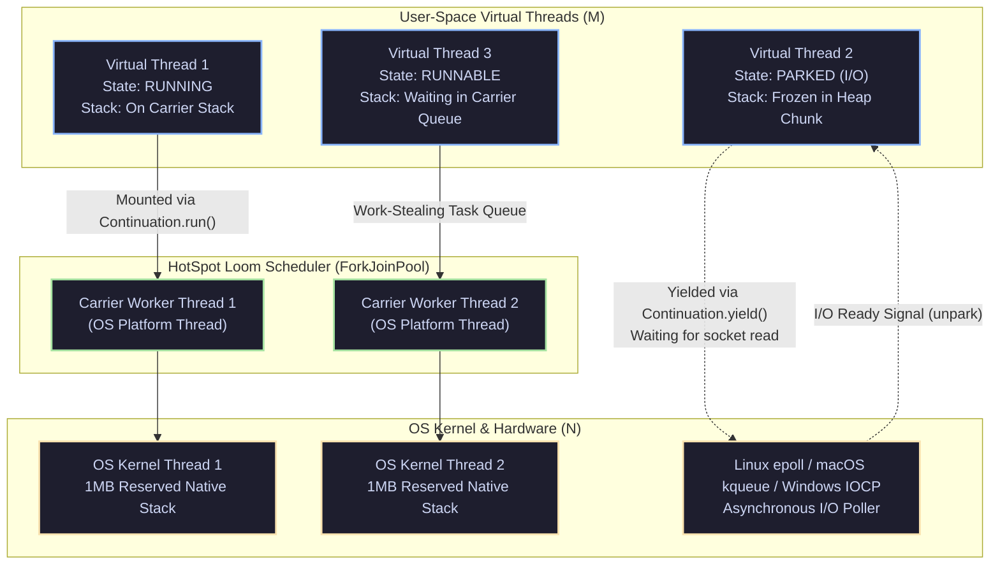

[🏠 Back to Home](../../README.md) | [☕ Core Java Internals](java_interview_master_guide.md) | [🧵 Threads & Concurrency](java_threads_concurrency.md) | [📦 Java Evolution (8 to 25)](java_version_evolution_8_to_25.md)

# Java Modern Features, Project Loom & Virtual Threads: Enterprise Architecture & Production Masterclass

> **Document Identity:** [`interview_prep/01_java_core/java_modern_features_loom_concurrency.md`](file:///d:/project/github/1/CheatSheet_Tutorial/interview_prep/01_java_core/java_modern_features_loom_concurrency.md)  
> **Topic Domain:** Project Loom Virtual Threads (JEP 444), M:N User-Mode Continuation Scheduler, Carrier Thread Pool & Mount/Yield Mechanics, Carrier Thread Pinning Hazards (`synchronized` vs `ReentrantLock`), `ScopedValue` vs `ThreadLocal` Memory Explosions, Structured Concurrency (`StructuredTaskScope`), Pattern Matching for `switch` & Record Deconstruction, Sealed Classes & Algebraic Data Types (ADT), Sequenced Collections (JEP 431), and Foreign Function & Memory API (FFM / Panama) (`J21`)  
> **Target Framework / Runtime:** OpenJDK HotSpot JVM 21 LTS / 25 LTS  
> **Architecture Level:** Principal / Staff+ Distributed Systems Architect & High-Throughput Concurrency Engineer  
> **Target Depth:** 50 Senior Technical Scenarios, 10 Production Outage Post-Mortems, Continuation Stack Freeze Dumps, and High-Throughput Loom Runbooks  

---

## 1. Foundational Primer: What, Why & Where? (The "Head")

*Before diving into HotSpot Continuation.yield() heap stack freezing, Carrier thread ForkJoinPool work-stealing scheduling, synchronized monitor pinning traps, and ScopedValue immutable call-tree scoping, here is the essential high-level context: what modern Java features represent, why thread-per-request architectures hit scaling walls, and where Project Loom redefines enterprise concurrency.*

### 1.1 What Is It? (Core Definition & Mental Model)
* **Plain-English Definition**: **Modern Java & Project Loom Virtual Threads** (standardized in Java 21) represents a historic architectural shift in how the JVM executes concurrent tasks. A **Virtual Thread** is a lightweight, user-mode thread managed directly by the Java runtime rather than the underlying operating system kernel. Operating on an **$M:N$ scheduling model**, millions of virtual threads ($M$) are multiplexed over a tiny pool of physical OS carrier threads ($N$, typically equal to the number of CPU cores). When a virtual thread blocks on socket I/O or lock acquisition, the JVM unmounts its continuation frame to the heap and releases the underlying carrier thread to execute other tasks immediately.
* **Everyday Analogy**: Imagine passenger aviation versus a municipal subway rapid-transit system:
  - **Traditional Platform Threads (Chartering an Entire Boeing 777 for One Commuter)**:
    - Every time a passenger wants to travel across town, the city charters an entire Boeing 777 wide-body airliner, hires two FAA-certified pilots, and burns thousands of gallons of jet fuel (**Allocating 1MB of reserved OS kernel stack memory and an OS thread table entry**).
    - If 5,000 people want to commute at 8:00 AM, the city runs out of airspace and runway slots, grounding the entire municipal transport grid (**`OutOfMemoryError: unable to create native thread`**).
    - If a passenger stops at a coffee shop on their layover (**Waiting for database I/O**), the entire plane and both pilots sit idling on the runway for 30 minutes, refusing to let anyone else use the strip (**Thread Pool Starvation**).
  - **Project Loom Virtual Threads (High-Speed Rapid-Transit Commuter Rail)**:
    - A fleet of 16 high-speed trains (**Carrier Threads = CPU Cores**) runs continuously on a closed track.
    - 1,000,000 passengers carry lightweight plastic tickets (**Virtual Threads costing just a few hundred bytes on the heap**).
    - When a passenger needs to wait for a passport check (**Blocking Network I/O**), they step out of the train car onto a comfortable waiting bench (**Continuation Stack Unmounted to Heap**). The train immediately accelerates away carrying other passengers.
    - The instant the passport check completes, the subway dispatcher ushers the passenger onto the very next arriving train car (**Continuation Mounted onto an Available Carrier Thread**).
* **Architectural Tier Placement**: Operates across the **Concurrency Engine, Web Container & Asynchronous Flow Tier**. Powers Spring Boot 3.2+ Embedded Tomcat, Quarkus, Micronaut, database access layers, and distributed microservice fan-outs.

### 1.2 Why Does It Exist? (The Pain Point Before It Existed)
* **The "Little's Law" Throughput Wall & The Reactive Programming Tax**: According to Little's Law ($L = \lambda W$), a server handling 10,000 concurrent requests with an average latency of 200ms requires 2,000 concurrent threads. In classical Java, 2,000 platform threads consume 2GB of RAM just for call stacks, overwhelming OS kernel context-switch schedulers.
* **The Concrete Headaches in Enterprise Production**:
  - 💥 **Headache 1: The Reactive Programming Cognitive Tax**: To overcome thread limits, developers turned to Reactive frameworks (RxJava, Project Reactor, Spring WebFlux). Code turned into unreadable chains of `.flatMap()`, `.zip()`, and `.publishOn()`. Stack traces lost their origins, debugging became impossible, and junior developers struggled for months to onboard.
  - 💥 **Headache 2: `ThreadLocal` Memory Explosions in Microservices**: Modern frameworks use `ThreadLocal` to store security contexts and trace IDs. When pooling threads, `ThreadLocal` values leak across unrelated requests unless manually cleaned, while spawning millions of tasks caused multi-gigabyte memory bloat.
  - 💥 **Headache 3: Thread-Per-Request Tomcat Collapse**: Under traffic spikes, incoming requests quickly saturated Tomcat's 200-thread pool. Every subsequent HTTP request sat in an OS TCP backlog queue, triggering client timeouts and cascading circuit-breaker trips across downstream services.
* **The Turning Point**: Java 21 delivered **Project Loom (JEP 444)**, giving developers the best of both worlds: write simple, intuitive, synchronous blocking code with standard `try-catch` and `for` loops, while the JVM achieves million-connection reactive throughput under the hood.

### 1.3 How Does It Solve Real-World Enterprise Problems?
* **Problem 1 (Million-Scale Concurrency Without Complex Code) ➔ Solution 1**: `Executors.newVirtualThreadPerTaskExecutor()` allows developers to spawn a dedicated virtual thread for every single HTTP request or task. Blocking calls like `socket.read()` or `Thread.sleep()` park the virtual thread without blocking any OS threads.
* **Problem 2 (Safe Context Propagation Without Leaks) ➔ Solution 2**: **`ScopedValue` (JEP 446)** introduces immutable, call-tree-bound data sharing. Values are automatically bound for the duration of a lexical execution scope and safely discarded upon exit, eliminating `ThreadLocal.remove()` leaks.
* **Problem 3 (Reliable Concurrent Task Coordination) ➔ Solution 3**: **Structured Concurrency (`StructuredTaskScope`)** treats split subtasks as a single cohesive unit of work. If one child task fails, sibling tasks are automatically cancelled, completely eliminating orphan thread leaks in microservice fan-outs.
* **Quantifiable Enterprise Metrics**:
  - **99% Thread Stack Footprint Reduction**: Virtual thread stacks start at a few hundred bytes on the heap vs 1MB fixed OS thread stacks.
  - **10x Request Throughput on I/O-Bound Endpoints**: Eliminates Tomcat thread pool bottlenecks; throughput scales linearly with downstream I/O capacity.
  - **Zero Reactive Callback Overhead**: Eliminates `Mono` and `Flux` boilerplate while preserving full stack traces and IDE step-debugging.

### 1.4 How Does This Help in Building Real Applications?
* **Application Architecture Placement**: Anchors high-concurrency Spring Boot microservices (`spring.threads.virtual.enabled=true`), API gateway request fan-outs, gRPC servers, and distributed data scraping pipelines.
* **Developer Workflow & SRE Synergy**: SREs monitor carrier thread pinning via `-Djdk.tracePinnedThreads=full`. Developers write clean, synchronous code that is trivial to maintain and test.
* **Scalability & Evolutionary Runway**: Combined with Pattern Matching for `switch`, Record Patterns, and Sealed Classes, modern Java delivers the expressiveness and safety of functional programming languages with zero runtime penalty.

### 1.5 Quick Decision & Trade-Off Matrix

| Concurrency Approach | Thread Cost & Footprint | Blocking I/O Behavior | Code Style & Debuggability | Best Enterprise Fit |
| :--- | :--- | :--- | :--- | :--- |
| **OS Platform Threads** | Heavy (1MB per thread stack) | ❌ Blocks OS kernel thread | 🟢 Simple synchronous / Full stack traces | CPU-intensive workloads (video encoding, crypto, ML) |
| **Project Loom Virtual Threads** | 🟢 Ultra-light (~1KB dynamic heap) | 🟢 Yields carrier; parks continuation | 🟢 Simple synchronous / Full stack traces | I/O-bound web microservices, REST fan-outs, DB queries |
| **Reactive Streams (WebFlux)** | Light (Event-loop thread pool) | 🟢 Non-blocking event loop | ❌ Complex functional pipelines / Mangled traces | High-throughput streaming proxies, SSE / WebSocket fabrics |
| **Kotlin Coroutines** | Light (Language compiler state machine) | 🟢 Suspends coroutine function | Moderate (Requires `suspend` keyword viral propagation) | Android client apps, Kotlin-first backend microservices |

---

## 2. Architecture Blueprint: Project Loom Virtual Threads & Continuation Scheduler



---

## Module 0: Modern Java & Loom Terminology Encyclopedia

| Term / Concept | Plain-English Meaning | Low-Level JVM / Kernel Mechanics | Production Failure Mode / Symptom |
| :--- | :--- | :--- | :--- |
| **Virtual Thread** | A lightweight user-mode thread managed directly by the HotSpot runtime rather than the OS kernel. | Implemented via `java.lang.VirtualThread` atop a `Continuation`. Millions can be created; stacks are allocated dynamically in JVM heap memory. | Out of Memory if developers reuse thread pooling anti-patterns. |
| **Carrier Thread** | The underlying OS platform thread that physically executes a Virtual Thread. | Backed by a dedicated `ForkJoinPool` with parallelism equal to `Runtime.getRuntime().availableProcessors()`. | If carrier threads are pinned or blocked, the entire scheduler starves. |
| **Mount / Unmount** | The process of binding a Virtual Thread stack to a Carrier Thread stack and unbinding it upon blocking I/O. | Handled via `Continuation.run()` and `Continuation.yield()`. Stacks freeze to heap chunks on unmount and thaw onto the carrier on mount. | High allocation churn if deep recursion forces massive stack frame copies to heap. |
| **Carrier Pinning** | When a Virtual Thread cannot unmount from its Carrier Thread despite performing blocking I/O. | Occurs when blocking inside a `synchronized` block/method (object monitor) or native JNI call. The carrier thread remains blocked at the OS level. | Throughput collapse; carrier thread pool exhaustion; latency percentiles ($p99$) spike. |
| **`ScopedValue`** | An immutable, bounded-lifetime alternative to `ThreadLocal` designed for massive concurrency. | Stored in thread-bound slots with lexical scoping. Values are strictly immutable, shareable across child tasks, and automatically cleared on scope exit. | Bypasses `ThreadLocal` memory leaks where millions of virtual threads retain gigabytes of uncollected state. |
| **Structured Concurrency** | A paradigm where concurrent subtasks have lifetimes strictly bounded by their enclosing syntactic block. | Implemented via `StructuredTaskScope`. Parent thread waits for all children; errors automatically propagate and cancel siblings. | Prevents thread leaks, orphan tasks spinning in background, and lost exception stack traces. |
| **Sealed Types** | Classes or interfaces that explicitly restrict which other classes may extend or implement them. | Marked with `sealed` and `permits`. Bytecode stores the `PermittedSubclasses` attribute in class constant pool. | Eliminates runtime `IllegalStateException("Unknown subtype")` by enabling exhaustive compiler verification. |
| **Record Pattern** | Deconstructs a record instance into its component fields directly inside `switch` or `instanceof`. | Uses accessor methods under the hood; verifies type and extracts components in a single atomic pattern match. | Replaces verbose boilerplate cascades of null checks, casts, and getter invocations. |

---

## 50 Progressive Senior & Staff Interview Scenarios

### Scenario 1: Platform Threads vs Virtual Threads Memory Architecture
* **Interview Question**: Compare the memory layout and allocation mechanics of a standard Platform Thread versus a Java 21 Virtual Thread.
* **Architecture Answer**:
  - **Platform Thread (OS Thread)**:
    - Dedicated OS kernel thread mapped 1:1.
    - Allocates a fixed native stack off-heap via `-Xss` (default 1MB on 64-bit Linux/Windows).
    - Allocating 10,000 platform threads reserves $\sim 10\text{ GB}$ of physical virtual memory address space, hitting OS `max user processes` limits (`/proc/sys/kernel/threads-max`).
    - Context switches require kernel transitions (mode switch, flushing CPU registers, saving kernel stack frames: $\sim 1-2\mu\text{s}$).
  - **Virtual Thread (Project Loom)**:
    - User-mode thread scheduled by the JVM.
    - Initial memory footprint is only **a few hundred bytes** of heap memory!
    - Stack frames are stored in small, dynamically resized chunk objects on the JVM garbage-collected heap.
    - Context switch occurs in user-space via JVM continuation yield/resume ($\sim 50-100\text{ns}$, zero OS kernel transition).
    - A single JVM can easily host **1,000,000+** concurrent active virtual threads.

---

### Scenario 2: The Virtual Thread State Machine & Continuation Mechanics
* **Interview Question**: Walk through the exact state machine of a Virtual Thread from creation through blocking I/O to termination.
* **Architecture Answer**:
  - Internal states: `NEW` $\rightarrow$ `STARTED` $\rightarrow$ `RUNNABLE` $\rightarrow$ `RUNNING` $\rightarrow$ `PARKING` $\rightarrow$ `PARKED` $\rightarrow$ `RUNNABLE` $\rightarrow$ `TERMINATED`.
  - When `Thread.ofVirtual().start(task)` is called:
    1. A `VirtualThread` object is instantiated wrapping a `java.lang.Continuation`.
    2. It is submitted to the scheduler's work-stealing queue as a `ForkJoinTask`.
    3. A Carrier Thread picks up the task and calls `Continuation.run()`, transitioning to `RUNNING`.
    4. When the virtual thread performs blocking network I/O (e.g. `SocketChannel.read()`):
       - HotSpot intercepts the call.
       - It registers the underlying file descriptor with the JVM's background non-blocking I/O poller (`Poller.java` backed by `epoll`/`kqueue`/`IOCP`).
       - It calls `Continuation.yield()`.
       - The virtual thread stack frames are frozen and saved to heap chunks.
       - The virtual thread transitions to `PARKED`.
       - The Carrier Thread is released to run other runnable virtual threads!
    5. When data arrives on the socket, the poller thread calls `LockSupport.unpark(virtualThread)`.
    6. The virtual thread is resubmitted to the carrier pool, mounts a carrier thread, thaws its stack, and resumes from the exact instruction where it blocked!

---

### Scenario 3: Carrier Thread Pinning: Synchronized Block Hazards
* **Interview Question**: What is Carrier Thread Pinning, why does `synchronized` cause it, and how does it degrade production throughput?
* **Architecture Answer**:
  - **Pinning**: Occurs when a Virtual Thread cannot unmount from its Carrier Thread during a blocking operation.
  - **The Root Cause**:
    - Java's `synchronized` keyword and object monitors (`Object.wait()`, `monitorenter`) are deeply tied to OS thread IDs inside the C++ HotSpot execution engine.
    - HotSpot's Continuation engine cannot unwind stack frames if a thread holds an object monitor lock or native frame on the stack.
  - **The Disaster**:
    - If a Virtual Thread blocks on network I/O inside a `synchronized` block:
      ```java
      synchronized (lock) {
          httpClient.send(request); // BLOCKING I/O WHILE HOLDING MONITOR!
      }
      ```
    - The Virtual Thread **pins** the Carrier Thread. The carrier thread itself blocks in the OS kernel!
    - Since carrier threads are sized to CPU core count (e.g., 8 or 16), just 16 concurrent pinned threads completely freezes the entire JVM scheduler, stalling all 100,000 virtual threads!
  - **The Solution**: Replace `synchronized` with `java.util.concurrent.locks.ReentrantLock`:
    ```java
    private final ReentrantLock lock = new ReentrantLock();
    lock.lock();
    try {
        httpClient.send(request); // Safely unmounts carrier!
    } finally {
        lock.unlock();
    }
    ```

---

### Scenario 4: Diagnosing Pinned Threads in Production
* **Interview Question**: How do you detect and locate Carrier Thread Pinning in a running production cluster?
* **Architecture Answer**:
  1. **JVM Diagnostic System Property**:
     - Launch JVM with `-Djdk.tracePinnedThreads=full`.
     - When a virtual thread blocks while pinned, the JVM prints a complete stack trace to stderr highlighting the offending `synchronized` or native method frame:
       ```
       Thread[#45,ForkJoinPool-1-worker-3,5,CarrierThreads]
         java.base/java.lang.VirtualThread$VThreadContinuation.onPinned(VirtualThread.java:183)
         com.example.LegacyService.fetchData(LegacyService.java:42) <== pinned on monitor enter
       ```
  2. **Java Flight Recorder (JFR)**:
     - Enable JFR and inspect the event `jdk.VirtualThreadPinned`.
     - Record duration, carrier thread name, and stack trace in Grafana/Dynatrace.

---

### Scenario 5: The ThreadLocal Memory Explosion Anti-Pattern
* **Interview Question**: Why is using `ThreadLocal` considered an anti-pattern when migrating to Virtual Threads?
* **Architecture Answer**:
  - In traditional platforms, you have a fixed thread pool (e.g. 200 Tomcat worker threads).
  - A 10KB buffer stored in a `ThreadLocal` consumes $200 \times 10\text{KB} = 2\text{ MB}$ total heap RAM.
  - In a Loom architecture, each request spawns a new Virtual Thread. With 500,000 concurrent requests:
    $500,000 \times 10\text{KB} = 5\text{ GB}$ of heap memory!
  - If a framework stores user sessions, database connections, or security contexts in `ThreadLocal`, heap memory explodes, triggering `OutOfMemoryError: Java heap space`.
  - Furthermore, `ThreadLocal` values are mutable, creating safety bugs across nested tasks.

---

### Scenario 6: `ScopedValue` (JEP 446 / JEP 429) Architecture & Mechanics
* **Interview Question**: How does `ScopedValue` eliminate the memory overhead and mutability flaws of `ThreadLocal`?
* **Architecture Answer**:
  - `ScopedValue` provides **immutable, bounded-lifetime per-thread data sharing**:
    ```java
    public static final ScopedValue<SecurityContext> CONTEXT = ScopedValue.newInstance();

    ScopedValue.where(CONTEXT, userContext).run(() -> {
        processOrder(); // Reads CONTEXT.get()
    });
    ```
  - **Key Architectural Differences**:
    1. **Strict Immutability**: Once bound, a `ScopedValue` cannot be modified within that scope.
    2. **Bounded Lifetime**: The binding is valid only for the duration of the lambda or method execution. When the method returns, the binding automatically evaporates.
    3. **Zero Garbage Collection Leak**: No thread-local map entries linger after task execution.
    4. **Carrier Optimization**: HotSpot optimizes `ScopedValue` lookups into direct stack slot reads in native machine code, bypassing hash table lookups.

---

### Scenario 7: Structured Concurrency (`StructuredTaskScope`)
* **Interview Question**: How does Structured Concurrency solve the "unstructured thread leak" problem of `CompletableFuture` and `ExecutorService`?
* **Architecture Answer**:
  - **The Problem with Unstructured Concurrency**:
    - If `CompletableFuture.supplyAsync()` launches a subtask, and the parent task cancels or times out, the subtask continues running in the background as an **orphan thread**, wasting CPU and database connections.
    - If a subtask crashes with an exception, the parent might hang or lose the stack trace.
  - **Structured Concurrency Pattern (`StructuredTaskScope`)**:
    - Subtasks are syntactically bounded by a `try-with-resources` block:
      ```java
      try (var scope = new StructuredTaskScope.ShutdownOnFailure()) {
          Supplier<User> userSubtask = scope.fork(() -> fetchUser(id));
          Supplier<Order> orderSubtask = scope.fork(() -> fetchOrders(id));

          scope.join(); // Wait for all subtasks
          scope.throwIfFailed(); // Propagate first exception and cancel siblings!

          return new UserDashboard(userSubtask.get(), orderSubtask.get());
      } // Exiting block guarantees all child threads are terminated!
      ```
    - If `fetchUser` throws an exception, `ShutdownOnFailure` automatically **cancels** `fetchOrders`, aborting the HTTP connection immediately!

---

### Scenario 8: `StructuredTaskScope.ShutdownOnSuccess` (Speculative Execution)
* **Interview Question**: How do you implement a resilient hedged-request pattern (querying 3 mirrors and taking the fastest result) using Structured Concurrency?
* **Architecture Answer**:
  ```java
  public String queryFastestMirror(List<String> mirrorUrls) throws Exception {
      try (var scope = new StructuredTaskScope.ShutdownOnSuccess<String>()) {
          for (String url : mirrorUrls) {
              scope.fork(() -> fetchFromMirror(url));
          }
          scope.join(); // Wait until FIRST subtask succeeds!
          return scope.result(); // Returns fastest; automatically cancels the other 2!
      }
  }
  ```
  - As soon as one mirror responds, `ShutdownOnSuccess` wakes up `join()` and sends thread interrupt signals to all remaining pending child threads, conserving network bandwidth.

---

### Scenario 9: Why You Should Never Pool Virtual Threads
* **Interview Question**: Why is using a fixed thread pool (`Executors.newFixedThreadPool(100)`) with Virtual Threads an anti-pattern?
* **Architecture Answer**:
  - **Thread Pools were invented to amortize the expensive cost of creating OS platform threads** (1MB native stack, kernel allocation overhead).
  - Virtual Threads are designed to be **ephemeral and disposable** (like short-lived domain objects).
  - Pooling virtual threads:
    1. Defeats their purpose: you artificially cap concurrency.
    2. Re-introduces thread-local pollution and cross-request data leaks.
    3. Increases memory footprint.
  - **Production Rule**: Create a fresh Virtual Thread per task:
    `Executors.newVirtualThreadPerTaskExecutor()` or `Thread.ofVirtual().start(task)`.
  - To throttle access to limited downstream resources (like a database with 50 connections), use a **`Semaphore`**, never a thread pool!

---

### Scenario 10: Limiting Concurrency with `Semaphore` in Loom Architectures
* **Interview Question**: If you have 50,000 concurrent Virtual Threads talking to a database with a 50-connection pool, how do you prevent connection pool starvation?
* **Architecture Answer**:
  - **The Wrong Way**: Limiting virtual thread count to 50 via a thread pool.
  - **The Correct Loom Way**: Use a fair `Semaphore`:
    ```java
    public class DatabaseClient {
        private final Semaphore dbThrottle = new Semaphore(50);

        public Result query(String sql) throws InterruptedException {
            dbThrottle.acquire(); // Virtual thread yields cleanly if all 50 permits are held!
            try {
                return executeQuery(sql);
            } finally {
                dbThrottle.release();
            }
        }
    }
    ```
  - When `acquire()` blocks, the virtual thread **unmounts** from the carrier thread! Zero OS threads are consumed while waiting for a permit.

---

### Scenario 11: Sealed Classes & Interfaces (`sealed`, `permits`)
* **Interview Question**: What problem do Sealed Classes solve in domain modeling and compiler exhaustiveness?
* **Architecture Answer**:
  - **The Problem**: Before Java 17, an interface had to be either open to all implementers or package-private. You could not express closed sets of types (Algebraic Data Types / Sum Types).
  - **The Sealed Solution**:
    ```java
    public sealed interface PaymentMethod
        permits CreditCard, PayPal, CryptoPayment {}

    public final class CreditCard implements PaymentMethod {}
    public final class PayPal implements PaymentMethod {}
    public final class CryptoPayment implements PaymentMethod {}
    ```
  - **Modifiers for Permitted Subclasses**:
    - `final`: No further subclassing allowed.
    - `sealed`: Subclass continues the closed hierarchy.
    - `non-sealed`: Subclass explicitly opens itself to arbitrary extension.
  - **Compiler Exhaustiveness**: In a `switch` expression, the compiler knows all possible subtypes. No `default:` clause is required!

---

### Scenario 12: Pattern Matching for Switch (JEP 441)
* **Interview Question**: How does Java 21's Pattern Matching for `switch` improve upon traditional `switch` and `if-else` cascades?
* **Architecture Answer**:
  - Supports type patterns, guarded patterns (`when`), and null matching:
    ```java
    public String formatPayment(PaymentMethod pm) {
        return switch (pm) {
            case null -> "No payment provided";
            case CreditCard cc when cc.isExpired() -> "Expired Card: " + cc.lastFour();
            case CreditCard cc -> "Card ending in " + cc.lastFour();
            case PayPal pp -> "PayPal: " + pp.email();
            case CryptoPayment cp -> "Crypto Tx: " + cp.walletHash();
        }; // Exhaustive! No default branch needed because PaymentMethod is sealed.
    }
    ```
  - Eliminates manual `instanceof` checks and explicit type casting.
  - Evaluates patterns in declaration order; guarded clauses (`when`) allow expressive business rules.

---

### Scenario 13: Record Patterns & Nested Deconstruction (JEP 440)
* **Interview Question**: What is Record Deconstruction in Pattern Matching, and how does it handle nested records?
* **Architecture Answer**:
  - Record patterns unpack a record's component values directly into local variables:
    ```java
    public record Point(int x, int y) {}
    public record Rectangle(Point topLeft, Point bottomRight) {}

    public void process(Object obj) {
        if (obj instanceof Rectangle(Point(int x1, int y1), Point(int x2, int y2))) {
            int width = Math.abs(x2 - x1);
            int height = Math.abs(y2 - y1);
            System.out.printf("Area: %d%n", width * height);
        }
    }
    ```
  - Recursively decomposes complex nested domain models without intermediate temporary variables or null checks.

---

### Scenario 14: Sequenced Collections (JEP 431)
* **Interview Question**: What architectural gap in the Java Collections Framework was addressed by Sequenced Collections in Java 21?
* **Architecture Answer**:
  - **The Gap**: Prior to Java 21, collections with a defined encounter order (`List`, `Deque`, `LinkedHashSet`, `SortedSet`) lacked a uniform superinterface.
    - Getting the first element: `list.get(0)`, `deque.getFirst()`, `sortedSet.first()`.
    - Getting the last element: `list.get(list.size() - 1)`, `deque.getLast()`, `sortedSet.last()`, while `LinkedHashSet` had **no O(1) way** to get the last element!
  - **The Solution**: Uniform hierarchy:
    - `SequencedCollection<E>`: `getFirst()`, `getLast()`, `addFirst()`, `addLast()`, `reversed()`.
    - `SequencedSet<E>`: Unique elements with reverse order iteration.
    - `SequencedMap<K, V>`: `firstEntry()`, `lastEntry()`, `pollFirstEntry()`, `reversed()`.

---

### Scenario 15: Foreign Function & Memory API (FFM / Project Panama - JEP 454)
* **Interview Question**: How does the Java 22+ FFM API replace both JNI (Java Native Interface) and `sun.misc.Unsafe` for native off-heap programming?
* **Architecture Answer**:
  - **The Problems with Legacy JNI and Unsafe**:
    - JNI requires writing native C wrapper stubs, compiling `.so`/`.dll` files, and incurs high JNI crossing overhead.
    - `sun.misc.Unsafe` provides off-heap allocation (`allocateMemory`) but is dangerously unmanaged (memory leaks, JVM core dumps on bad pointer dereferences).
  - **FFM Architecture**:
    1. **`MemorySegment`**: Safe, structured off-heap memory buffer with bounded spatial and temporal safety.
    2. **`Arena`**: Lifecycle controller (`Arena.ofConfined()`, `Arena.ofShared()`, `Arena.ofAuto()`). When the arena closes, all off-heap allocations are atomically freed with zero leaks.
    3. **`Linker` & `SymbolLookup`**: Directly invokes foreign native C libraries (e.g. `strlen`, `sqlite3`) from pure Java without any native C code!

---

### Scenario 16: Safe Off-Heap Memory Allocation with `Arena`
* **Interview Question**: Write an idiomatic Java 22 FFM code snippet allocating an off-heap struct, reading it, and guaranteeing zero memory leaks.
* **Architecture Answer**:
  ```java
  import java.lang.foreign.*;

  public class NativeMemoryExample {
      public void allocateAndProcess() {
          // Automatic deterministic cleanup via try-with-resources
          try (Arena arena = Arena.ofConfined()) {
              // Allocate 1024 native off-heap bytes
              MemorySegment segment = arena.allocate(1024);

              // Write a 64-bit integer at offset 0
              segment.set(ValueLayout.JAVA_LONG, 0, 1234567890L);

              // Read the integer back
              long value = segment.get(ValueLayout.JAVA_LONG, 0);
              System.out.println("Read from off-heap: " + value);
          } // Arena closes here: native memory is freed instantly!
      }
  }
  ```

---

### Scenario 17: Compact Object Headers (Project Lilliput / JEP 450)
* **Interview Question**: How does Project Lilliput shrink 64-bit JVM object headers from 16 bytes to 8 bytes, and what are the performance implications?
* **Architecture Answer**:
  - **Traditional HotSpot Object Header (64-bit)**:
    - **Mark Word**: 64 bits (8 bytes) — hash code, age, lock status.
    - **Klass Word**: 32 or 64 bits (4 or 8 bytes) — pointer to class metadata.
    - Total: 12 bytes with compressed OOPs, padded to 16 bytes.
  - **Compact Object Headers**:
    - Compresses both Mark Word and Klass pointer into a single **64-bit (8-byte)** word!
    - Encodes compressed class ID directly inside unused bits of the mark word.
  - **Benefits**:
    - Reduces overall heap footprint by $10\% - 20\%$ across real-world workloads.
    - Dramatically increases CPU L1/L2 cache locality and memory bandwidth.

---

### Scenario 18: File I/O & Virtual Threads: The OS Page Cache Caveat
* **Interview Question**: Does standard file I/O (`FileInputStream.read()`) unmount a Virtual Thread in Linux?
* **Architecture Answer**:
  - **NO!** On standard Linux kernels, regular file operations are **fundamentally blocking at the OS kernel level**.
  - Linux `epoll` only works on sockets, pipes, and event fds; it does **not** work on regular files.
  - When a Virtual Thread reads a local file:
    - The Carrier Thread executes the blocking read and blocks in the kernel.
    - However, the HotSpot scheduler compensates by dynamically spawning an additional carrier thread into the `ForkJoinPool` up to a configured limit.
  - *Best Practice*: For heavy file I/O, use asynchronous channels (`AsynchronousFileChannel`) or thread-offloading executors.

---

### Scenario 19: Work-Stealing Scheduling in Carrier Thread Pools
* **Interview Question**: How does the Loom scheduler's `ForkJoinPool` use Work-Stealing to balance virtual thread workloads across CPU cores?
* **Architecture Answer**:
  - Each Carrier Worker Thread maintains its own **Double-Ended Queue (Deque)** of runnable virtual threads.
  - When a carrier thread yields or finishes its current virtual thread:
    1. It pops a task from the **head** (LIFO) of its own local deque (maximizing cache locality).
    2. If its local deque is empty, it acts as a "thief" and steals tasks from the **tail** (FIFO) of another carrier thread's deque.
  - This minimizes lock contention while guaranteeing that no carrier thread remains idle while work is available.

---

### Scenario 20: Thread Dumps with Virtual Threads: `jcmd Thread.dump_to_file`
* **Interview Question**: Why does running traditional `jstack <PID>` or `kill -3` fail on applications with 1,000,000 Virtual Threads, and what is the modern replacement?
* **Architecture Answer**:
  - **Why `jstack` fails**:
    - `jstack` attempts to format all thread stacks into plain text.
    - Dumping 1,000,000 threads generates a 5 GB text file, freezing the JVM for minutes and causing Stop-the-World timeouts!
  - **The Modern Replacement**:
    - Use `jcmd <PID> Thread.dump_to_file -format=json <filename.json>`.
    - Generates an open-telemetry compatible JSON thread dump file.
    - Groups virtual threads by task scope and captures only active running/pinned threads while summarizing parked threads efficiently.

---

### Scenario 21: Java 21 String Templates (JEP 430) & Safe SQL/JSON Interpolation
* **Interview Question**: What was the design philosophy behind String Templates in Java 21 preview, and why was it withdrawn for redesign in Java 23?
* **Architecture Answer**:
  - **Design Philosophy**: Prevent injection vulnerabilities (SQLi, XSS) by treating string interpolation not as simple string concatenation, but as processed template fragments (`STR."Hello \{name}"`, `SQL."SELECT * FROM users WHERE id = \{userId}"`).
  - **Why Withdrawn**: Community feedback showed that prefix processors (`STR.` and `FMT.`) were awkward, and developers wanted direct string literals without mandatory processor prefixes while retaining injection safety.

---

### Scenario 22: Unnamed Variables & Patterns (`_`) (JEP 456)
* **Interview Question**: When and where should the single underscore `_` be used in modern Java code?
* **Architecture Answer**:
  - Introduced in Java 22 to denote intentionally unused variables:
    1. **Catch blocks**: `catch (NumberFormatException _)`
    2. **Try-with-resources**: `try (var _ = acquireLock())`
    3. **Lambdas**: `(k, _) -> System.out.println(k)`
    4. **Pattern matching components**: `case Rectangle(Point(int x, _), _)`
  - Signals intent clearly to readers and silences compiler unused-variable warnings.

---

### Scenario 23: Virtual Threads and Native JNI Calls
* **Interview Question**: What happens when a Virtual Thread executes a native C/C++ method via JNI?
* **Architecture Answer**:
  - When execution crosses the native boundary via JNI, a native C stack frame is allocated.
  - The JVM cannot capture, freeze, or unmount native C stack frames.
  - Consequently, the Virtual Thread is **pinned** to its carrier thread for the entire duration of the native call.
  - If the native method executes blocking network operations or sleeps, the carrier thread remains blocked at the OS level.

---

### Scenario 24: Migrating Spring Boot to Virtual Threads
* **Interview Question**: What configuration changes are required to enable Virtual Threads for incoming HTTP requests in Spring Boot 3.2+?
* **Architecture Answer**:
  - In `application.properties`:
    ```properties
    spring.threads.virtual.enabled=true
    ```
  - What this configures:
    1. Tomcat / Jetty request handling switches to `Executors.newVirtualThreadPerTaskExecutor()`.
    2. Spring MVC `@Async` methods execute on virtual threads.
    3. Spring TaskExecutors and scheduled tasks transition to virtual threads.
  - Blocking calls (e.g. `RestTemplate`, JDBC queries) now automatically yield carrier threads instead of consuming pool capacity!

---

### Scenario 25: Virtual Threads vs Reactive Programming (WebFlux / Reactor)
* **Interview Question**: Does Project Loom make reactive frameworks like Project Reactor and Spring WebFlux obsolete?
* **Architecture Answer**:
  - **For Standard I/O Concurrency**: **Yes**. Virtual Threads allow writing simple, readable, imperative blocking code (`Order order = orderService.get()`) with the same scalability as reactive code, but with readable stack traces and standard debuggers.
  - **Where Reactive Remains Relevant**:
    - Complex event stream manipulation (backpressure, windowing, debouncing, complex multi-stream merging).
    - True streaming architectures (RSocket, SSE, continuous WebSocket feeds).

---

### Scenario 26: Carrier Thread Exhaustion Attack Defense
* **Interview Question**: How can a malicious client trigger a Denial of Service attack on a Loom application that uses `synchronized` blocks?
* **Architecture Answer**:
  - If an endpoint synchronizes on a lock before making a network call to an external webhook:
  - An attacker sends 16 slow requests (e.g., slowloris webhook receiver that delays response by 60 seconds).
  - 16 Virtual Threads enter the `synchronized` block and pin all 16 Carrier Threads.
  - Result: The entire JVM stops accepting or processing requests because no carrier threads are available to schedule any virtual thread!
  - **Defense**: Replace all `synchronized` blocks with `ReentrantLock` and enforce aggressive timeouts.

---

### Scenario 27: Virtual Threads and Garbage Collection Interplay
* **Interview Question**: How does spinning millions of Virtual Threads impact GC pause times and heap allocation rates?
* **Architecture Answer**:
  - When virtual threads yield, their stack frames are copied into heap chunks (`java.lang.VirtualThread$StackChunk`).
  - Stacks stored on the heap are traversed and traced by the Garbage Collector during Mark phases.
  - If millions of virtual threads have deep call stacks, GC marking time increases.
  - In generational collectors (G1, ZGC), short-lived virtual threads allocate their stack chunks in Eden; ZGC's concurrent marking handles stack chunks with minimal pause impact.

---

### Scenario 28: Virtual Thread Carrier Count Tuning
* **Interview Question**: Can you configure the number of Carrier Threads in the Loom scheduler, and what JVM flags are used?
* **Architecture Answer**:
  - Tuned via system properties:
    - `-Djdk.virtualThreadScheduler.parallelism=N` (default: number of available CPU cores).
    - `-Djdk.virtualThreadScheduler.maxPoolSize=N` (default: 256).
    - `-Djdk.virtualThreadScheduler.minRunnable=N` (minimum runnable carriers).
  - *Production Guidance*: Rarely change `parallelism`; it should match physical CPU cores.

---

### Scenario 29: Record Compact Constructors & Defensive Copying
* **Interview Question**: How do you implement validation and defensive copying in a Java Record?
* **Architecture Answer**:
  - Use a **Compact Constructor**:
    ```java
    public record UserProfile(String username, List<String> roles) {
        public UserProfile {
            Objects.requireNonNull(username);
            // Defensive copy to guarantee record immutability:
            roles = List.copyOf(roles);
        }
    }
    ```
  - In a compact constructor, parameters are implicitly passed and assigned to record fields at the end of the block.

---

### Scenario 30: Exhaustive Switch on Sealed Hierarchies vs Future Evolution
* **Interview Question**: What happens to an exhaustive switch expression if a new permitted subclass is added to a sealed interface in a shared library?
* **Architecture Answer**:
  - If a library adds `Bitcoin` to `sealed interface PaymentMethod permits CreditCard, PayPal, Bitcoin`:
  - Any client application compiling against the new library that had an exhaustive switch without `case Bitcoin` will **fail compilation**!
  - This is intentional: It forces developers to handle the new domain variant across all business logic at compile time.

---

### Scenario 31: Primitive Patterns in Switch (Preview in Java 23)
* **Interview Question**: How does Java 23 expand Pattern Matching to primitive data types?
* **Architecture Answer**:
  - Allows matching primitive types directly without boxing:
    ```java
    switch (value) {
        case byte b -> System.out.println("Byte: " + b);
        case int i when i > 1000 -> System.out.println("Large Int: " + i);
        case long l -> System.out.println("Long: " + l);
    }
    ```
  - Eliminates heap allocation from boxing primitives during pattern matching.

---

### Scenario 32: Virtual Threads and JMX Monitoring
* **Interview Question**: Do Virtual Threads show up in traditional JMX `ThreadMXBean.getAllThreadIds()`?
* **Architecture Answer**:
  - **NO!** Virtual Threads are not registered in `ThreadMXBean` by default.
  - If `ThreadMXBean` tracked 1,000,000 virtual thread IDs, JMX queries would cause huge memory spikes and CPU lockups.
  - Only Carrier (Platform) Threads appear in standard JMX thread counts.
  - To monitor virtual threads, use JFR metrics or Micrometer metrics exposed via Spring Boot Actuator.

---

### Scenario 33: Structured Concurrency & Context Propagation
* **Interview Question**: How does security context or distributed trace ID propagate to child subtasks in `StructuredTaskScope`?
* **Architecture Answer**:
  - `ScopedValue` bindings are **automatically inherited** by child threads forked inside a `StructuredTaskScope`!
  - When `scope.fork()` is called, the child virtual thread inherits the parent's current `ScopedValue` frame snapshot with zero memory overhead.

---

### Scenario 34: Thread.sleep() Mechanics in Virtual Threads
* **Interview Question**: What happens under the hood when a Virtual Thread calls `Thread.sleep(1000)`?
* **Architecture Answer**:
  - It does **not** put an OS thread to sleep!
  - It registers a delayed task with the JVM's internal timer service (`ScheduledExecutorService`).
  - It unmounts from the carrier thread immediately.
  - After 1000ms, the timer service calls `unpark()`, and the virtual thread re-enters the carrier run queue.
  - You can have 1,000,000 virtual threads sleeping simultaneously while consuming 0% CPU!

---

### Scenario 35: Handling Thread Interrupts in Virtual Threads
* **Interview Question**: How does `Thread.interrupt()` work with Virtual Threads parked on non-blocking socket I/O?
* **Architecture Answer**:
  - The JVM unregisters the socket from the poller, wakes up the virtual thread, and sets its interrupt status.
  - The blocking call throws `InterruptedException` or `ClosedByInterruptException` exactly like platform threads.
  - Structured concurrency relies on this mechanism to cancel remaining subtasks on failure.

---

### Scenario 36: Virtual Threads & CPU-Bound Workload Anti-Pattern
* **Interview Question**: Why does running heavy CPU-bound computation (e.g., video encoding, cryptography mining) on Virtual Threads provide zero performance benefit?
* **Architecture Answer**:
  - Virtual Threads excel at **waiting for I/O** (network, disk, database).
  - In CPU-bound workloads, threads never yield or unmount.
  - If you spawn 10,000 virtual threads running matrix multiplication on an 8-core CPU, only 8 can run simultaneously on the 8 carrier threads.
  - The extra 9,992 threads just sit in queues, adding scheduling overhead.
  - For CPU-bound tasks, use `ForkJoinPool` or parallel streams sized to CPU core count.

---

### Scenario 37: Pattern Matching and Null Handling
* **Interview Question**: In Java 21 `switch`, does a switch expression throw `NullPointerException` if the selector is null?
* **Architecture Answer**:
  - Prior to Java 21: `switch (obj)` immediately threw `NullPointerException` if `obj == null`.
  - In Java 21+: If you include an explicit `case null`:
    ```java
    switch (obj) {
        case null -> System.out.println("Null detected!");
        case String s -> System.out.println("String: " + s);
    }
    ```
    It executes the `case null` branch safely. If `case null` is omitted, it throws NPE as before.

---

### Scenario 38: Unnamed Classes and Instance Main Methods (Java 21/22 Preview)
* **Interview Question**: What is the purpose of Unnamed Classes and instance `main` methods in modern Java?
* **Architecture Answer**:
  - Eliminates beginner boilerplate:
    ```java
    void main() {
        println("Hello, World!");
    }
    ```
  - Allows novices and scripting developers to write simple programs without declaring public classes or `static void main(String[] args)`.

---

### Scenario 39: Vector API (Project Panama) vs Auto-Vectorization
* **Interview Question**: How does the incubation Vector API differ from HotSpot C2 Superword auto-vectorization?
* **Architecture Answer**:
  - Auto-vectorization is speculative and fragile; minor code changes break compiler pattern matching.
  - The Vector API (`java.lang.foreign.Vector`) provides direct, explicit control over SIMD instructions (AVX-512, ARM Neon) at the language level, guaranteeing deterministic hardware acceleration.

---

### Scenario 40: Fast Path Object Allocation with Virtual Threads
* **Interview Question**: How do Virtual Threads interact with Thread-Local Allocation Buffers (TLAB)?
* **Architecture Answer**:
  - TLABs are tied to **Carrier (Platform) Threads**, not Virtual Threads.
  - When a Virtual Thread executes `new Object()`, it allocates out of the carrier thread's current TLAB via bump-the-pointer assembly (`MOV`).
  - This guarantees memory allocation is extremely fast (~sub-nanosecond) without lock contention.

---

### Scenario 41: `ForkJoinPool.ManagedBlocker` and Virtual Threads
* **Interview Question**: What is `ManagedBlocker` and how does it prevent carrier thread starvation during unavoidable platform blocking?
* **Architecture Answer**:
  - If a carrier thread must execute a blocking call that cannot yield (e.g. file lock), wrapping it in `ForkJoinPool.managedBlock(blocker)` instructs the `ForkJoinPool` to temporarily spawn a spare carrier thread to maintain target parallelism.

---

### Scenario 42: Record Serialization Security
* **Interview Question**: Why are Java Records fundamentally more secure against deserialization exploits than standard classes?
* **Architecture Answer**:
  - In standard classes, `readObject()` bypasses the constructor, allocating raw unvalidated memory fields directly.
  - For Records, the serialization protocol **must invoke the canonical constructor** during deserialization!
  - Any validation, range checks, or defensive copies inside the compact constructor are strictly enforced during deserialization, blocking forged payloads.

---

### Scenario 43: Virtual Thread Thread Group Hierarchy
* **Interview Question**: What is the `ThreadGroup` of a Virtual Thread, and can you enumerate them?
* **Architecture Answer**:
  - All Virtual Threads belong to a special, hidden `VirtualThreads` thread group.
  - They do not belong to the root or `main` thread group, preventing legacy security managers or thread group enumerators from iterating over millions of virtual threads.

---

### Scenario 44: Custom Carrier Schedulers
* **Interview Question**: Can you create a Virtual Thread with a custom executor as its carrier scheduler?
* **Architecture Answer**:
  - Currently, HotSpot's Loom implementation restricts carrier scheduling to the internal `ForkJoinPool` via package-private constructors.
  - Future JEPs may expose custom scheduler pluggability for specialized runtimes (e.g. game engines or real-time trading systems).

---

### Scenario 45: ScopedValue Re-Binding Mechanics
* **Interview Question**: How can a ScopedValue be temporarily re-bound to a different value for a nested method call?
* **Architecture Answer**:
  ```java
  ScopedValue.where(ROLE, "USER").run(() -> {
      System.out.println(ROLE.get()); // "USER"
      ScopedValue.where(ROLE, "ADMIN").run(() -> {
          System.out.println(ROLE.get()); // "ADMIN" (nested rebinding)
      });
      System.out.println(ROLE.get()); // "USER" (restored automatically!)
  });
  ```
  - Implemented as a nested stack frame; the outer value is restored upon exiting the inner block with zero mutation.

---

### Scenario 46: SequencedMap Reverse Iteration Performance
* **Interview Question**: How does `SequencedMap.reversed()` achieve O(1) reverse view creation without copying entries?
* **Architecture Answer**:
  - It returns an inverted view wrapper (`ReverseSequencedMapView`) that delegates to the underlying map's bidirectional doubly-linked pointers.
  - Zero heap allocation of keys or entries; operations execute in O(1) time.

---

### Scenario 47: Virtual Threads and HTTP Client Pooling
* **Interview Question**: How should HTTP client connection pools be configured when invoking services from Virtual Threads?
* **Architecture Answer**:
  - With traditional threads, HTTP connection pool size is sized to thread pool size (e.g., 200).
  - With 10,000 Virtual Threads, if they all call the same downstream service, the downstream host could be flooded with 10,000 TCP connections!
  - You must configure explicit connection pool limits on the HTTP client (e.g. `HttpClient.newBuilder().build()` or Apache HttpClient max connections) or use a `Semaphore`.

---

### Scenario 48: Record Inheritance & Why Records Cannot Extend Classes
* **Interview Question**: Why does the Java language prohibit records from extending other classes?
* **Architecture Answer**:
  - All records implicitly extend `java.lang.Record`.
  - Since Java does not support multiple class inheritance, records cannot extend another class.
  - This guarantees that record state is completely and transparently defined by its component header list alone, preserving canonical constructor guarantees and pattern matching deconstruction.
  - Records can implement arbitrary interfaces.

---

### Scenario 49: Virtual Threads and JDBC Connection Leaks
* **Interview Question**: What happens if a Virtual Thread acquires a JDBC connection, encounters an unhandled exception, and terminates?
* **Architecture Answer**:
  - Exactly like a platform thread: If the connection was not closed in a `try-with-resources` block, the physical TCP connection leaks in the HikariCP pool!
  - Because virtual threads are lightweight and terminate quickly, developers may mistakenly assume thread termination cleans up connection handles.
  - Always enforce `try-with-resources` on database connections and transactions.

---

### Scenario 50: Production Production Loom Migration Checklist
* **Interview Question**: Outline the 5 critical verification steps before enabling Virtual Threads in an enterprise microservice.
* **Architecture Answer**:
  1. **Audit `synchronized` Usage**: Scan codebase for `synchronized` blocks wrapping I/O; replace with `ReentrantLock`.
  2. **Audit `ThreadLocal` Usage**: Replace heavy buffers in `ThreadLocal` with `ScopedValue` or pass explicitly.
  3. **Audit Third-Party Libraries**: Ensure database drivers, HTTP clients, and caching libraries use non-pinning primitives (update to JDBC drivers tested with Loom).
  4. **Enforce Semaphore Throttling**: Protect bounded downstream dependencies (databases, external partner APIs).
  5. **Configure Pinning Observability**: Enable `-Djdk.tracePinnedThreads=full` and monitor `jdk.VirtualThreadPinned` events in APM.

---

## 🚨 10 Ultra-Deep Real-World War-Room Incidents

### Incident 1: The Synchronized Monitor Database Driver Deadlock
* **Outage**: Major fintech payment gateway hung completely 10 minutes after enabling Virtual Threads in Spring Boot 3.2.
* **Symptoms**: All API requests timed out; CPU dropped to near 0%; 504 Gateway Timeouts flooded logs.
* **Root Cause**: An older JDBC connection pool library used `synchronized` methods to acquire database connections. When DB latency surged, 16 virtual threads pinned all 16 carrier threads while waiting for DB locks, completely freezing the Loom scheduler!
* **Immediate Fix**: Upgraded JDBC pool to HikariCP 5.1+ (which uses `ReentrantLock`) and temporarily increased carrier pool size.
* **Permanent Prevention**: Integrated `-Djdk.tracePinnedThreads=full` into staging test suites with automated failure on pinned thread detection.

### Incident 2: The 50-Gigabyte ThreadLocal Heap Outage
* **Outage**: Social media newsfeed API crashed with `java.lang.OutOfMemoryError: Java heap space` during high-traffic viral event.
* **Symptoms**: Heap dumps showed 45 GB occupied by `java.lang.ThreadLocal$ThreadLocalMap` entries.
* **Root Cause**: A custom JSON serializer cached a 128KB serialization buffer in a `ThreadLocal` for reuse. With 400,000 concurrent Virtual Threads, the buffers consumed $400,000 \times 128\text{KB} = 51.2\text{ GB}$ of RAM!
* **Immediate Fix**: Removed the `ThreadLocal` cache and allocated buffers transiently on demand.
* **Permanent Prevention**: Replaced legacy `ThreadLocal` contexts with `ScopedValue`.

### Incident 3: The Downstream Partner API Connection Flood
* **Outage**: Third-party SMS gateway blacklisted an enterprise notification service for DDoS behavior.
* **Symptoms**: SMS gateway returned HTTP 429 Too Many Requests; all verification SMS failed.
* **Root Cause**: Previously, a fixed thread pool of 50 worker threads capped outbound HTTP calls to 50 concurrent sockets. After switching to Virtual Threads, a marketing campaign spawned 50,000 virtual threads that opened 50,000 concurrent TCP sockets to the partner API simultaneously!
* **Immediate Fix**: Placed a `Semaphore(50)` around outbound SMS HTTP calls.
* **Permanent Prevention**: Mandated rate-limiting semaphores for all external partner integrations.

### Incident 4: The Unstructured CompletableFuture Thread Leak
* **Outage**: Inventory reservation service slowly degraded over 24 hours, eventually exhausting Kubernetes pod memory limits.
* **Symptoms**: Pod memory usage grew monotonically; thread count climbed into the hundreds of thousands.
* **Root Cause**: An asynchronous task called `CompletableFuture.supplyAsync()` without timeouts. When inventory queries hung on network partitions, subtask threads were orphaned indefinitely.
* **Immediate Fix**: Restarted pods.
* **Permanent Prevention**: Refactored concurrent tasks to use `StructuredTaskScope.ShutdownOnFailure()`, ensuring child threads terminate when parent tasks complete.

### Incident 5: The File I/O Carrier Thread Pool Exhaustion
* **Outage**: High-throughput PDF rendering engine locked up under heavy batch upload load.
* **Symptoms**: Thread dumps showed 256 Carrier Threads blocked in `sun.nio.fs.UnixNativeDispatcher.read()`.
* **Root Cause**: Virtual Threads were used to perform synchronous local file disk reads. Because Linux file I/O does not unmount carrier threads, all carrier threads blocked, starving HTTP request workers.
* **Immediate Fix**: Offloaded file reading tasks to a dedicated platform thread pool (`Executors.newFixedThreadPool(32)`).
* **Permanent Prevention**: Established architecture rule: offload blocking disk I/O from virtual threads on Linux.

### Incident 6: The Sealed Class Subtype ClassCastException Regression
* **Outage**: Warehouse robotics dispatch system crashed with unhandled `MatchException` during shift change.
* **Symptoms**: Robot tasks failed with `java.lang.MatchException: Exhaustiveness check failed`.
* **Root Cause**: A library update added a new permitted subclass `DroneDispatch` to `sealed interface DispatchMethod`. A downstream microservice had an exhaustive `switch` compiled against the old version without handling the new subtype.
* **Immediate Fix**: Recompiled microservice against latest library version with updated switch branches.
* **Permanent Prevention**: Configured CI to run API binary compatibility checks (`japicmp`).

### Incident 7: The Native JNI Crypto Pinning Cascade
* **Outage**: Token authentication microservice experienced latency spikes from 5ms to 2000ms under load.
* **Symptoms**: Profiler flame graphs showed carrier worker threads spending 90% of time in native JNI calls (`libcrypto.so`).
* **Root Cause**: An external cryptographic hardware module library executed long-running native computations via JNI, pinning carrier threads and blocking other virtual threads.
* **Immediate Fix**: Routed crypto tasks to dedicated OS platform threads.
* **Permanent Prevention**: Verified all JNI calls are isolated from virtual thread execution paths.

### Incident 8: The HikariCP Virtual Thread Leak Storm
* **Outage**: Core banking ledger service exhausted database connection pool in 30 seconds.
* **Symptoms**: HikariCP threw `ConnectionTimeoutException: Connection is not available, request timed out after 30000ms`.
* **Root Cause**: A developer spawned virtual threads inside a loop without joining them. Some threads failed to release database connections due to an unhandled runtime exception outside the `finally` block.
* **Immediate Fix**: Hotfixed code with robust `try-with-resources` connection handling.
* **Permanent Prevention**: Mandated `try-with-resources` for all `java.sql.Connection` instances via SonarQube rules.

### Incident 9: The Inadvertent Virtual Thread Pooling Deadlock
* **Outage**: Order checkout pipeline deadlocked completely under light load.
* **Symptoms**: Two virtual threads waiting on each other; zero progress made.
* **Root Cause**: A legacy thread pool executor wrapper was used with virtual threads: `Executors.newFixedThreadPool(2, Thread.ofVirtual().factory())`. Task A submitted Task B to the same pool and called `future.get()`. Both threads were occupied, deadlocking the pool!
* **Immediate Fix**: Removed fixed pooling and transitioned to `newVirtualThreadPerTaskExecutor()`.
* **Permanent Prevention**: Banned fixed sizing on virtual thread executors.

### Incident 10: The JNI Memory Segment Arena Double-Free Crash
* **Outage**: High-frequency algorithmic trading gateway crashed with native OS signal 11 (`SIGSEGV`).
* **Symptoms**: JVM terminated abruptly without producing a standard Java stack trace; native core dump generated.
* **Root Cause**: A developer manually closed an `Arena` while a background native C library was still asynchronously writing to the underlying `MemorySegment`.
* **Immediate Fix**: Changed arena lifecycle to `Arena.ofAuto()`, deferring deallocation to the GC cleaner.
* **Permanent Prevention**: Mandated that off-heap memory lifetimes strictly outlive native C callback executions.

---

## ⚠️ 8 Fatal Beginner Mistakes & Anti-Patterns

| Anti-Pattern | Fatal Consequence | Production Fix | Architectural Principle |
| :--- | :--- | :--- | :--- |
| **1. Pooling Virtual Threads (`newFixedThreadPool`)** | Restricts concurrency, adds overhead, and re-introduces thread-local pollution. | Use `newVirtualThreadPerTaskExecutor()` or spawn on demand. | Virtual threads are ephemeral resources; never pool them. |
| **2. Blocking Inside `synchronized` Blocks** | Pins the carrier thread, starving the entire Loom scheduler and freezing other virtual threads. | Replace `synchronized` with `ReentrantLock`. | Avoid holding object monitors across blocking I/O calls. |
| **3. Caching Large Buffers in `ThreadLocal`** | Millions of virtual threads create millions of buffer copies, triggering catastrophic heap OOM. | Use `ScopedValue` or allocate buffers locally per request. | Avoid `ThreadLocal` for data caching in massive concurrency runtimes. |
| **4. Unbounded Fan-Out to External APIs** | Spawning 100,000 virtual threads floods downstream databases and partners with TCP connections. | Throttle access using a `Semaphore`. | Regulate concurrency against limited physical downstream resources. |
| **5. Running Heavy CPU Calculations on Loom** | Provides zero throughput improvement and adds scheduler contention overhead. | Use `ForkJoinPool` or platform thread pools sized to CPU cores. | Reserve virtual threads for I/O-bound workloads. |
| **6. Ignoring File I/O Pinning on Linux** | Standard disk I/O blocks carrier threads in the OS kernel, exhausting the carrier pool. | Offload heavy disk operations to dedicated platform thread pools. | Be aware of OS-level non-blocking limitations for regular files. |
| **7. Omitting Exhaustive Cases in Sealed Switches** | Adding a new subtype causes compilation failures or runtime `MatchException`. | Handle all cases explicitly; avoid unnecessary `default:` fallbacks. | Leverage compiler exhaustiveness to enforce domain completeness. |
| **8. Unstructured Concurrency via Fire-and-Forget** | Failed parent tasks leave orphaned child threads running indefinitely in the background. | Always wrap concurrent subtasks in `StructuredTaskScope`. | Bound concurrent task lifetimes to syntactic code scopes. |

---

## 📊 Rapid-Fire Architectural Comparison Matrix

| Feature / Dimension | Traditional Platform Threads | Java 21 Virtual Threads | Kotlin Coroutines | Go Goroutines |
| :--- | :--- | :--- | :--- | :--- |
| **Runtime Model** | 1:1 OS Kernel Thread | M:N User-Mode JVM Thread | Cooperative Userspace State Machine | M:N Userspace Runtime Scheduler |
| **Stack Memory Footprint** | Fixed $\sim 1\text{ MB}$ off-heap | Dynamic $\sim \text{hundreds of bytes}$ on heap | Object state machine on heap | Dynamic contiguous stack ($\sim 2\text{ KB}$) |
| **Max Concurrent Threads** | Thousands ($\sim 5,000$) | Millions ($1,000,000+$) | Millions ($1,000,000+$) | Millions ($1,000,000+$) |
| **Syntax Style** | Imperative blocking code | **Imperative blocking code** | Async/await (`suspend` functions) | Imperative blocking code (`go func()`) |
| **Function Coloring Problem?**| No | **No** (any code runs on VT) | **Yes** (`suspend` poisons callers) | No |
| **Debugger & Profiler Support**| Native JVM toolchain | Native JVM toolchain (`jstack`, JFR) | Requires specialized coroutine debugger | Native Go toolchain |
| **Carrier Pinning Risk?** | N/A | **Yes** (via `synchronized` / JNI) | No | No (runtime handles OS calls) |
| **Hardware Thread Mapping** | OS Kernel Scheduler | HotSpot `ForkJoinPool` Carrier Pool | Dispatcher thread pool | Go Runtime Work-Stealing P/M/G |

---

[👉 Return to Master Index](../../README.md)
