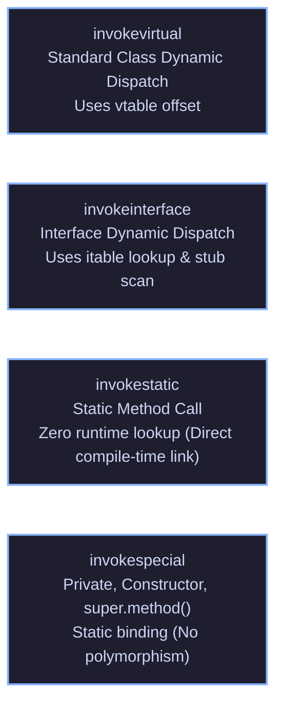

[🏠 Back to Home](../../README.md) | [☕ Core Java Internals](java_interview_master_guide.md) | [🧩 Design Principles & SOLID](design_principles_solid.md) | [🍃 Spring Ecosystem](../02_spring_framework/spring_core_ioc_boot.md)

# Java Core Fundamentals, OOP & Object Architecture: Enterprise Architecture & Production Masterclass

> **Document Identity:** [`interview_prep/01_java_core/java_oop_core_fundamentals.md`](file:///d:/project/github/1/CheatSheet_Tutorial/interview_prep/01_java_core/java_oop_core_fundamentals.md)  
> **Topic Domain:** Primitive vs Reference Memory Topologies, Strict Pass-by-Value Semantics, String Constant Pool (SCP) & Compact Strings (Latin-1), `Object` Contract Laws (`equals`, `hashCode`, `toString`, `clone`), OOP 4 Pillars at Bytecode Level (`invokevirtual`, `invokeinterface`, `invokespecial`, `invokestatic`), HotSpot `vtable` / `itable` Dynamic Dispatch, Interface Default Methods & Diamond Resolution, Deep Immutability & Defensive Copying, and Compressed OOPs Memory Alignment (`J01`)  
> **Target Framework / Runtime:** OpenJDK HotSpot JVM 17 LTS / 21 LTS / 25 LTS  
> **Architecture Level:** Principal / Staff+ Object-Oriented Systems Architect & Core Java Specialist  
> **Target Depth:** 50 Senior Technical Scenarios, 10 SEV-1 Object Corruption/Hash Leak Post-Mortems, HotSpot Bytecode Disassembly, and Production Runbooks  

---

## 1. Foundational Primer: What, Why & Where? (The "Head")

*Before diving into HotSpot vtable polymorphic dispatch offsets, bytecode invokeinterface constant pool cache misses, String CompactStrings Latin-1 coder flags, and 8-byte object alignment padding, here is the essential high-level context: what object-oriented fundamentals represent, why naive procedural coding fails in enterprise systems, and where object memory layouts anchor high-performance architectures.*

### 1.1 What Is It? (Core Definition & Mental Model)
* **Plain-English Definition**: **Java Core Object-Oriented Programming (OOP) & Object Architecture** is Java's foundational paradigm for structuring computational state and behavior. It models the real world through **Classes** (blueprints defining state fields and method behaviors) and **Objects** (dynamic instances allocated on the JVM Heap). Anchored by the four classic pillars—**Encapsulation** (data hiding and invariant protection), **Inheritance** (hierarchical behavioral extension), **Polymorphism** (dynamic method dispatch via interfaces and overrides), and **Abstraction** (contractual interfaces hiding internal complexity)—it establishes how software components maintain integrity and communicate.
* **Everyday Analogy**: Imagine a modern commercial municipal bank vault and teller system:
  - **Procedural Code (C-style Structs)**: An open table in the middle of a crowded street piled high with $100 bills. Anyone walking past can reach in, take money, change the ledgers, or burn the records with zero security checks (**No Encapsulation / Global Mutable State**).
  - **Encapsulated Class & Object**: A secure bank branch (**The Class Blueprint**).
    - Inside sits a reinforced titanium vault (**Private State Fields**).
    - Customers cannot touch the vault directly; they must interact with a certified bank teller through a bulletproof glass window (**Public Methods / Interface Contract**).
    - The teller verifies customer identification, checks available funds, and logs the transaction before dispensing cash (**Invariant Validation**).
  - **Polymorphism & Dynamic Dispatch (`invokevirtual` / `vtable`)**: You hand the teller an internationally recognized payment card (**The Interface `PaymentCard`**). Whether the physical plastic is a Visa debit card, an American Express corporate credit card, or a crypto rewards card (**Concrete Subclasses**), the teller simply swipes it through the terminal (`card.processCharge()`). The terminal automatically executes the card's specific cryptographic handshake at runtime without the teller knowing the internal electrical layout of the card (**Polymorphic Dispatch**).
* **Architectural Tier Placement**: Operates at the **Domain Modeling & Core Computational Substrate Tier**. Anchors all business entities, domain services, value objects, and design patterns across every Java application.

### 1.2 Why Does It Exist? (The Pain Point Before It Existed)
* **The Chaos of Unstructured Procedural Programming**: In procedural languages, data structures and functions were completely detached. A developer could pass any memory pointer to any function. As software grew past 50,000 lines, unrelated functions across the codebase mutated shared memory unpredictably, creating catastrophic bugs that took weeks to isolate.
* **The Concrete Headaches in Enterprise Production**:
  - 💥 **Headache 1: The Broken `equals()` / `hashCode()` HashDoS Collision**: An engineer overrides `equals()` to compare business keys but forgets to override `hashCode()`. When the object is placed into a `HashSet` or `HashMap`, the map uses the default identity hashcode from the JVM object header. Identical objects hash to different buckets, causing silent duplicate entities in databases and memory leaks.
  - 💥 **Headache 2: Mutable State Leaks (The Aliasing Trap)**: A class returns a direct reference to a private internal `Date` or `List` field (`return this.orderItems;`). An external caller mutates the list outside the class, bypassing business validation rules and silently corrupting the financial total.
  - 💥 **Headache 3: The Fragile Base Class Problem**: Changing a protected method in an abstract base class unexpectedly breaks 20 child classes written by different teams, violating behavioral contracts across the enterprise.
* **The Turning Point**: Java enforced strong type safety, strict pass-by-value semantics, universal single-rooted object hierarchies (`java.lang.Object`), and interface-based polymorphism to guarantee that object boundaries cannot be violated at runtime.

### 1.3 How Does It Solve Real-World Enterprise Problems?
* **Problem 1 (Guaranteed Invariant Protection) ➔ Solution 1**: Encapsulation and Immutable Value Objects (`record` in Java 17+) ensure that state can never be modified once created. Objects passed across asynchronous thread boundaries are completely immune to data races and accidental mutation.
* **Problem 2 (Decoupled Enterprise Extensibility) ➔ Solution 2**: Interface-driven polymorphism allows teams to write extensible architectures (e.g. `PaymentGateway`, `AuditLogger`) where new vendor implementations can be swapped in via Spring dependency injection with zero modifications to core business logic.
* **Problem 3 (String Memory Footprint Optimization) ➔ Solution 3**: The JVM's **String Constant Pool (SCP)** and **Compact Strings** (storing Latin-1 characters in byte arrays instead of 2-byte char arrays) cut heap consumption by 50% across enterprise applications that handle millions of text tokens.
* **Quantifiable Enterprise Metrics**:
  - **50% Heap Reduction**: Java 9+ Compact Strings reduces the memory footprint of textual data from 2 bytes per char to 1 byte per char.
  - **100% Thread Safety with Records**: Immutability eliminates defensive copy allocations and avoids synchronization locks on shared domain state.
  - **Zero Hash Table Corruption**: Rigorous adherence to the `equals` / `hashCode` contract guarantees constant-time $O(1)$ map lookups and prevents catastrophic memory leaks in caching layers.

### 1.4 How Does This Help in Building Real Applications?
* **Application Architecture Placement**: Anchors Domain-Driven Design (DDD) Aggregates, Value Objects, Entities, and Application Service interfaces.
* **Developer Workflow & SRE Synergy**: SREs monitor JVM object allocation rates and garbage collection pauses caused by excessive object allocations. Developers structure business logic into clean, cohesive domain modules that withstand decades of enterprise evolution.
* **Scalability & Evolutionary Runway**: Mastering object memory layout (Mark Word, Klass Word, Compressed OOPs) enables senior architects to design high-throughput cache lines, minimize GC churn, and prepare applications for Project Valhalla value types.

### 1.5 Quick Decision & Trade-Off Matrix

| Object Archetype | Java Syntax | Mutability | Memory Overhead | Best Enterprise Fit |
| :--- | :--- | :--- | :--- | :--- |
| **Immutable Value Record** | `record OrderId(String val)` | 🟢 Strictly Immutable | Minimal (Fields + header; zero defensive copy) | DTOs, API payloads, domain value objects, Kafka events |
| **Domain Entity Class** | `public class Account` | Mutable (Controlled via methods) | Standard (Object header + instance fields) | Stateful business entities with rich lifecycles and validation |
| **Contractual Interface** | `public interface PaymentGateway` | Stateless (Static constants only) | Zero runtime object instantiation | Defining contracts across architectural boundaries, DI |
| **Abstract Base Class** | `public abstract class BaseService` | Partially mutable state | Standard | Sharing foundational template code across related subclasses |
| **Domain Type Enum** | `public enum TransactionStatus` | 🟢 Strictly Immutable | Singletons per constant | Fixed sets of domain states, finite state machine transitions |

---

## 2. 🏛️ Master Architecture Blueprint: Memory Topologies & Dynamic Dispatch Engine

```mermaid
flowchart TD
    subgraph MemoryTopology ["1. Java Memory Topologies (Stack vs Heap)"]
        subgraph StackFrame ["Thread Stack Frame (LIFO execution)"]
            PrimitiveVal["Primitive Local Variable<br/>int x = 42<br/>(Stored directly in 32-bit stack slot)"]
            RefPointer["Reference Pointer Variable<br/>Order ref = 0x7FA3B000<br/>(32/64-bit Address Pointer)"]
        end

        subgraph JVMHeap ["JVM Heap Memory Space"]
            subgraph YoungEden ["Young Generation (Eden)"]
                ObjHeader["Object Header (12 Bytes with +UseCompressedClassPointers)<br/>• Mark Word (64 bits: Hash, Age, Biased/Lock Flags)<br/>• Klass Word (32 bits: Type Metadata Pointer)"]
                InstanceFields["Instance Fields Data<br/>• long id = 1001L (8 Bytes)<br/>• String orderId = 0x7FA3B120 (4 Bytes compressed OOP)"]
                Padding["Alignment Padding (0-7 Bytes to align to 8-byte boundary)"]
                ObjHeader --- InstanceFields --- Padding
            end

            subgraph StringPool ["Native String Constant Pool (SCP)"]
                SCPString["java.lang.String Instance<br/>Compact byte[] array (Latin-1 coder = 0)<br/>Shared across JVM literals"]
            end
        end

        RefPointer -.->|"Dereferences Address"| ObjHeader
        InstanceFields -.->|"References Interned Literal"| SCPString
    end

    subgraph DynamicDispatch ["2. HotSpot Dynamic Dispatch & Polymorphism Engine"]
        CallSite["Bytecode Call Site: invokevirtual #12"]
        ReceiverCheck["Null Check & Receiver Class Resolution (Klass*)"]
        VTableLookup["vtable (Virtual Method Table) Lookup<br/>Offset indexing O(1) in C++ InstanceKlass"]
        ITableLookup["itable (Interface Method Table) Lookup<br/>Stub resolution & interface offset table scan"]
        TargetMethod["Direct Machine Code Execution / C2 Inlined JIT Stub"]

        CallSite --> ReceiverCheck
        ReceiverCheck -->|"Class Method"| VTableLookup
        ReceiverCheck -->|"Interface Method"| ITableLookup
        VTableLookup --> TargetMethod
        ITableLookup --> TargetMethod
    end

    classDef stack fill:#1e1e2e,stroke:#89b4fa,stroke-width:2px,color:#cdd6f4;
    classDef heap fill:#1e1e2e,stroke:#a6e3a1,stroke-width:2px,color:#cdd6f4;
    classDef dispatch fill:#1e1e2e,stroke:#f9e2af,stroke-width:2px,color:#cdd6f4;

    class StackFrame,PrimitiveVal,RefPointer stack;
    class JVMHeap,YoungEden,ObjHeader,InstanceFields,Padding,StringPool,SCPString heap;
    class CallSite,ReceiverCheck,VTableLookup,ITableLookup,TargetMethod dispatch;
```



---

## 📖 Module 0: The Plain-English OOP Dictionary (Zero-Jargon Foundations)

Welcome to Object-Oriented Programming (OOP) in Java! If terms like *polymorphism*, *encapsulation*, or *references* feel alien, intimidating, or abstract, you are not alone. 

Instead of throwing compiler flags, bit shifts, or memory registers at you, this dictionary breaks down the **20 foundational concepts of Java OOP** using:
1. **In Plain Words**: One crystal-clear sentence anyone can understand.
2. **Real-World Mental Picture**: An everyday analogy (like houses, blueprints, wallets, or remote controls) that sticks in your mind forever.
3. **How It Works in Java**: A friendly step-by-step walkthrough of what happens in your program.
4. **Quick Code Example**: Clean, self-contained Java code with helpful comments.
5. **The Beginner Trap**: The exact mistake that confuses newcomers and how to avoid it.

---

### Part 1: The Core Building Blocks (What is Code Made Of?)

#### 🏷️ 0.1 Class vs. Object (The Blueprint vs The Physical House)

> **In Plain Words:** A **Class** is the paper design or recipe; an **Object** is the real, physical thing built from that recipe that takes up space in computer memory.

* 🏠 **Real-World Mental Picture**: Think of an architect's blueprint for a 3-bedroom house. You cannot sleep inside a blueprint, nor can you hang a television on paper walls. But when a construction team follows the blueprint, they build an actual physical house at `42 Oak Street`. You can use that single blueprint to build 100 different houses across town—each with its own furniture and paint color.
* 🔍 **How It Works in Java**: You write `class House { String paintColor; }` once in a file. When your program runs and executes `new House()`, Java reserves fresh memory space on the Heap and gives you an actual house you can interact with.
* 💻 **Quick Code Example**:
  ```java
  // The Blueprint (Class)
  class House {
      String paintColor;
  }

  // Two physical houses built from the same blueprint:
  House house1 = new House();
  house1.paintColor = "Blue";

  House house2 = new House();
  house2.paintColor = "Yellow";

  System.out.println(house1.paintColor); // Prints "Blue" (house2 has no effect on house1!)
  ```
* ⚠️ **The Beginner Trap**: Trying to store data directly inside the class name (like `House.paintColor = "Red"`) without creating an object using `new`. Unless a variable is marked `static`, the blueprint itself has no walls to paint!

---

#### 🏷️ 0.2 Primitive vs. Reference Variable (Cash in Your Wallet vs A House Address)

> **In Plain Words:** A **Primitive** stores the actual data value directly inside the variable; a **Reference** stores the directions (memory address) showing where to find the data.

* 🏠 **Real-World Mental Picture**: 
  * **Primitive (`int`, `boolean`, `double`)**: You have $50 cash in your wallet. The actual money is right there in your hands.
  * **Reference (`String`, `User`, `List`)**: You have a sticky note with the GPS address `123 Main Street`. You don't have a building in your pocket—you only have directions to the building.
* 🔍 **How It Works in Java**: Primitives (`byte`, `short`, `int`, `long`, `float`, `double`, `char`, `boolean`) hold their raw value directly. Any object variable (`User u = new User()`) holds a pointer to the location where the object lives on the JVM Heap.
  ```
  Primitive: [ age = 42 ]           (Holds raw value directly)
  Reference: [ user = 0x7FA1 ] ───► [ Heap Object: User(name="Alice") ]
  ```
* 💻 **Quick Code Example**:
  ```java
  // Primitive: Directly holds the number 42
  int age = 42; 

  // Reference: 'user' doesn't hold the person; it holds directions to the person
  User user = new User("Alice"); 

  User anotherPointer = user; // Copies the address!
  anotherPointer.setName("Bob"); // Changes the person at that address!

  System.out.println(user.getName()); // Prints "Bob"! Both variables point to the same person.
  ```
* ⚠️ **The Beginner Trap**: Thinking that assigning `User b = a;` makes an independent duplicate of the user. It only copies the address note! If you change `b`, you change `a`.

---

#### 🏷️ 0.3 The Stack vs. The Heap (Your Desk Scratchpad vs The Big Warehouse)

> **In Plain Words:** The **Stack** is your personal fast scratchpad that tracks what method you are currently running; the **Heap** is the giant shared warehouse where all objects live.

* 🏠 **Real-World Mental Picture**: Picture a carpenter at a workbench. On the desk, there is a small notepad (The Stack) where the carpenter jots down the current task: *"Step 3: assemble chair leg"*. In the back of the workshop is a huge warehouse (The Heap) where full furniture sets are stored. When the carpenter finishes a task, they tear off and discard the notepad sheet. But the furniture in the warehouse stays until the cleanup crew takes it away.
* 🔍 **How It Works in Java**: 
  * Every time a method is called, Java creates a small "frame" on the **Stack** for that method's local variables. When the method finishes (returns), that entire frame instantly disappears.
  * Objects created with `new` are always placed in the **Heap**. They stay there as long as at least one variable is pointing to them.
* 💻 **Quick Code Example**:
  ```java
  void calculate() {
      int localScore = 95;            // Stored directly on the Stack (scratchpad)
      User player = new User("Sam");  // 'player' address is on Stack; the actual User object is in Heap!
  } // When calculate() exits, 'localScore' and 'player' address vanish from Stack!
    // The User object on the Heap is later cleaned up by the Garbage Collector.
  ```
* ⚠️ **The Beginner Trap**: Worrying about running out of Stack space for huge objects. Objects never live on the Stack—only tiny address pointers do!

---

#### 🏷️ 0.4 The `this` Keyword & Constructors (Self-Reference & The Factory Assembly Line)

> **In Plain Words:** A **Constructor** is the startup setup instructions run when an object is born; **`this`** means "the current object I am working on right now".

* 🏠 **Real-World Mental Picture**: When a car rolls off the factory assembly line, the factory technician must install the engine and set the initial odometer to 0 before the car can be driven (The Constructor). When the car's internal computer says *"check my current fuel level"*, it is talking about itself, not another car down the street (That's `this`!).
* 🔍 **How It Works in Java**: A constructor has the exact same name as the class and no return type. The keyword `this` resolves ambiguity between a method's incoming parameter names and the object's internal fields.
* 💻 **Quick Code Example**:
  ```java
  class Player {
      String name; // Field belonging to the object

      // Constructor: runs automatically when 'new Player("Leo")' is called
      public Player(String name) {
          // 'this.name' means the object's field; 'name' means the incoming parameter
          this.name = name; 
      }
  }
  ```
* ⚠️ **The Beginner Trap**: Forgetting `this.` and writing `name = name;` inside the constructor. That just assigns the parameter to itself and leaves the object's field empty (`null`)!

---

#### 🏷️ 0.5 Pass-by-Value in Java (The Photocopy Machine)

> **In Plain Words:** Java **always** passes a photocopy of what is inside a variable—it never passes the original variable itself.

* 🏠 **Real-World Mental Picture**: Imagine you have a document with your home address on it. You place it on a photocopier and give the copy to a friend. 
  * If your friend takes a pencil and writes *"555-FOOD"* on *their* copy of the paper, does your original paper change? No! 
  * But if your friend uses the address to drive to your house and paints your front door bright red, is your front door red when you get home? Yes, because you both share the same physical house!
* 🔍 **How It Works in Java**: When you pass an object to a method, Java photocopies the reference pointer. If the method reassigns the parameter (`p = new Person()`), it only changed its own copy of the address. But if it calls a method on the object (`p.setAge(30)`), the shared object in the Heap is modified.
  ```
  Caller Frame: [ p = 0x1A4F ] ───┐
                                  ├──► [ Heap Object: Person(age: 30) ]
  Callee Frame: [ p = 0x1A4F ] ───┘
  ```
* 💻 **Quick Code Example**:
  ```java
  void reassign(User u) {
      u = new User("Changed"); // Only changes the local photocopy! Caller sees NO change!
  }

  void modify(User u) {
      u.setName("Changed");    // Follows address to the Heap object; Caller SEES this change!
  }
  ```
* ⚠️ **The Beginner Trap**: Writing a `swap(User a, User b)` method and expecting it to swap the caller's variables. It cannot, because Java cannot alter the caller's variable slots!

---

### Part 2: The 4 Pillars of OOP (How Objects Work Together)

#### 🏷️ 0.6 Encapsulation & Access Modifiers (The Car Dashboard vs Under the Hood)

> **In Plain Words:** **Encapsulation** means hiding the dangerous, complicated inner workings of an object and only exposing safe, easy-to-use buttons to the outside world.

* 🏠 **Real-World Mental Picture**: When you drive a car, you press the gas pedal or check the speedometer. You do **not** reach under the hood with a wrench while driving at 60 mph to adjust the fuel injector directly. The engine parts are locked away (`private`), while the steering wheel and pedals are available to you (`public`).
* 🔍 **How It Works in Java**: Java uses 4 access levels:
  * `private`: Only accessible inside this exact class.
  * *(default / package-private)*: Accessible by any class in the same folder (package).
  * `protected`: Accessible in the same package, plus any child subclasses anywhere.
  * `public`: Accessible by any class in the entire application.
* 💻 **Quick Code Example**:
  ```java
  class BankAccount {
      private double balance; // Hidden! Nobody can set balance = -999999 directly.

      public void deposit(double amount) {
          if (amount > 0) {   // Guard rule: protect internal integrity!
              this.balance += amount;
          }
      }

      public double getBalance() {
          return balance;     // Safe read-only access
      }
  }
  ```
* ⚠️ **The Beginner Trap**: Making every field `public` so it's "easy to access". Any other class can now corrupt your object's internal data with invalid values, causing random bugs that are nearly impossible to track down.

---

#### 🏷️ 0.7 Inheritance & The `super` Keyword (The Family Recipe)

> **In Plain Words:** **Inheritance** lets a new class automatically receive all the capabilities of an existing class, and **`super`** lets you talk to or reuse the parent's version.

* 🏠 **Real-World Mental Picture**: Your grandmother has a secret recipe for chocolate chip cookies. You inherit her recipe book. You don't have to re-invent how to mix flour, eggs, and sugar from scratch—you already have that. But you decide to add crushed sea salt on top to make it your own special version.
* 🔍 **How It Works in Java**: A child class uses the `extends` keyword. The child inherits all non-private fields and methods from the parent. If the child wants to run the parent's constructor or parent's method, it calls `super()`.
* 💻 **Quick Code Example**:
  ```java
  class Animal {
      void eat() { System.out.println("Eating food..."); }
  }

  class Dog extends Animal { // Dog inherits eat() automatically!
      void bark() { System.out.println("Woof!"); }

      @Override
      void eat() {
          super.eat(); // Reuses parent's logic first!
          System.out.println("Eating dog treats specifically!");
      }
  }
  ```
* ⚠️ **The Beginner Trap**: Overusing inheritance when things aren't actually related. Only use `extends` if you can genuinely say: *"Dog IS AN Animal"*. Never extend a class just to grab one helper method!

---

#### 🏷️ 0.8 Polymorphism & Dynamic Dispatch (The Universal Remote Control)

> **In Plain Words:** **Polymorphism** means you can treat different objects as if they belong to a shared parent type, and each object will still automatically run its own specific behavior.

* 🏠 **Real-World Mental Picture**: Think of a Universal Remote Control with a `"Power"` button. You point it at a Sony TV and press `"Power"`: the screen lights up. You point it at the air conditioner and press `"Power"`: the fan starts blowing cold air. You point it at a robotic vacuum and press `"Power"`: it starts cleaning the floor. One single button, but each device knows how to do its own job!
* 🔍 **How It Works in Java**: You write code that talks to a general type (like `Animal` or `PaymentMethod`). At runtime, Java automatically looks at the actual object in memory and runs that specific object's method. This is called **Dynamic Dispatch**.
* 💻 **Quick Code Example**:
  ```java
  abstract class Notification {
      abstract void send(String msg);
  }

  class EmailNotification extends Notification {
      void send(String msg) { System.out.println("Email: " + msg); }
  }

  class SmsNotification extends Notification {
      void send(String msg) { System.out.println("SMS: " + msg); }
  }

  // The caller doesn't need to know the specific type!
  void notifyUser(Notification notifier, String message) {
      notifier.send(message); // Java automatically runs the correct send() method!
  }
  ```
* ⚠️ **The Beginner Trap**: Writing huge `if-else` or `switch` chains (`if (type == "EMAIL") ... else if (type == "SMS") ...`). Polymorphism eliminates those ugly chains so you can add new types without touching existing code.

---

#### 🏷️ 0.9 Abstraction: Interfaces vs. Abstract Classes (A Legal Contract vs A Half-Built House)

> **In Plain Words:** An **Interface** is a contract of *what* a class must be able to do; an **Abstract Class** is a partially built foundation that provides shared code for children to finish.

* 🏠 **Real-World Mental Picture**:
  * **Interface (`Flyable`, `PaymentMethod`)**: Like a driver's license contract. To get a driver's license, the law says you must know how to steer, brake, and park. The license doesn't care if you drive an electric Tesla, a gasoline truck, or a hybrid sedan, as long as you fulfill the contract.
  * **Abstract Class (`Vehicle`, `GameCharacter`)**: Like a prefabricated modular home. The concrete foundation, outer walls, and roof are already installed for you (shared code). But you cannot move in yet because the bathroom fixtures and kitchen counters must be completed by the homeowner.
* 🔍 **How It Works in Java**: 
  * A class can implement **multiple interfaces** (`implements Serializable, Cloneable, Runnable`), but can only extend **one abstract class** (`extends Vehicle`).
  * Use an **Interface** when defining a capability or contract across unrelated classes.
  * Use an **Abstract Class** when several closely related classes share substantial common code.
* 💻 **Quick Code Example**:
  ```java
  // The Contract (Interface):
  interface Printable {
      void print(); // Any class implementing this MUST provide a print() method
  }

  // The Shared Foundation (Abstract Class):
  abstract class Document implements Printable {
      String title;
      Document(String title) { this.title = title; } // Shared state!

      void printHeader() { System.out.println("=== " + title + " ==="); } // Shared code!
      // Subclasses will complete the print() method!
  }
  ```
* ⚠️ **The Beginner Trap**: Trying to create an instance directly using `new Printable()` or `new Document()`. You cannot instantiate abstract types directly because they contain unfinished methods!

---

#### 🏷️ 0.10 Composition over Inheritance (Building with Lego Bricks vs Mutating DNA)

> **In Plain Words:** Instead of forcing a class to *be* another class through inheritance (`is-a`), give it another class as a tool to *use* (`has-a`).

* 🏠 **Real-World Mental Picture**: If you want to build a camper van, you don't take a biological snail and genetically modify it into a motorized vehicle just because a snail carries its house on its back! Instead, you take a regular van and place a bed and refrigerator inside it. You *compose* the van using existing tools.
* 🔍 **How It Works in Java**: Instead of writing `class CustomList extends ArrayList`, make `class CustomList` hold an internal `private final List<T> list` and delegate calls to it. This protects your class from breaking when the parent class changes in future updates.
* 💻 **Quick Code Example**:
  ```java
  // BAD: Fragile inheritance
  // class SuperEngine extends Car { ... } // Makes no sense! An engine is not a car!

  // GOOD: Clean composition (Car HAS an Engine)
  class Car {
      private final Engine engine; // Car has-a engine

      public Car(Engine engine) {
          this.engine = engine;
      }

      public void start() {
          this.engine.ignite(); // Delegates the work to the specialist
      }
  }
  ```
* ⚠️ **The Beginner Trap**: Creating deep, brittle inheritance trees (e.g. `ClassA extends ClassB extends ClassC extends ClassD`). When ClassA changes, all subclasses unpredictably break. Favor composition!

---

### Part 3: Object Behavior & Equality (How Objects Behave)

#### 🏷️ 0.11 Method Overloading vs. Overriding (Different Tools vs Replacing the Rule)

> **In Plain Words:** **Overloading** is having multiple methods with the same name but different input parameters; **Overriding** is a child class completely replacing the implementation of a parent class method.

* 🏠 **Real-World Mental Picture**:
  * **Overloading**: Think of a Swiss Army Knife. It has three blades: a large knife, a small knife, and a bottle opener. They are all called *"Open"*, but depending on whether you pass it a can, a bottle, or an envelope, you pick a different tool.
  * **Overriding**: Your parents had a rule: *"Curfew is at 9:00 PM"*. When you grow up and move into your own apartment, you override that rule: *"Curfew is whenever I feel like sleeping"*. You replaced their rule with your own.
* 🔍 **How It Works in Java**:
  * **Overloading**: Same class, same method name, different parameter types or counts. Decided at **compile-time**.
  * **Overriding**: Subclass provides a new body for a method already defined in the parent class with the exact same parameters. Decided at **runtime**. Always annotate with `@Override`.
* 💻 **Quick Code Example**:
  ```java
  class Calculator {
      // OVERLOADING: Same name 'add', different parameters
      int add(int a, int b) { return a + b; }
      double add(double a, double b) { return a + b; }
  }

  class Parent {
      void greet() { System.out.println("Hello from Parent"); }
  }

  class Child extends Parent {
      // OVERRIDING: Completely replaces the parent's greet() behavior
      @Override
      void greet() { System.out.println("Hello from Child!"); }
  }
  ```
* ⚠️ **The Beginner Trap**: Accidentally changing a parameter type when trying to override a method (e.g. parent has `void test(long x)`, child writes `void test(int x)`). Without the `@Override` annotation, Java silently treats it as an overload, causing the parent's method to run instead!

---

#### 🏷️ 0.12 Identity (`==`) vs. Equality (`.equals()`) (Physical Twins vs Passport Information)

> **In Plain Words:** `==` asks *"Are these two variables pointing to the exact same physical spot in memory?"*; `.equals()` asks *"Do these two objects contain the exact same logical information?"*

* 🏠 **Real-World Mental Picture**: Think of identical twins, Jack and John. If you ask *"Are they the exact same physical human being?"* (`==`), the answer is **NO**—they are two separate bodies taking up two separate chairs. But if you compare their DNA test results (`.equals()`), the data is 100% identical!
* 🔍 **How It Works in Java**: 
  * `==` checks reference addresses for objects. It only returns `true` if both variables point to the exact same memory location on the Heap.
  * `.equals()` is a method on `java.lang.Object`. By default it does `==`, but well-behaved classes (like `String`, `Integer`, `Date`) override it to compare their inner fields.
  ```
  s1 ──► [ "Java" at 0x1000 ]
  s2 ──► [ "Java" at 0x2000 ]
  s1 == s2      --> false (Different memory addresses)
  s1.equals(s2) --> true  (Same characters: 'J','a','v','a')
  ```
* 💻 **Quick Code Example**:
  ```java
  String s1 = new String("Java");
  String s2 = new String("Java");

  System.out.println(s1 == s2);      // FALSE! Two distinct objects on the Heap.
  System.out.println(s1.equals(s2));  // TRUE! Both contain the characters 'J', 'a', 'v', 'a'.
  ```
* ⚠️ **The Beginner Trap**: Using `if (name == "Admin")` to compare Strings. If `name` was read from a database or web request, `==` will return `false` even if the text is `"Admin"`! **Always use `.equals()` for Strings and objects.**

---

#### 🏷️ 0.13 The `hashCode()` Partner (The Coat-Check Locker System)

> **In Plain Words:** `hashCode()` turns an object into a number so that collections like `HashMap` and `HashSet` can find it in a fraction of a millisecond instead of searching millions of items one by one.

* 🏠 **Real-World Mental Picture**: Imagine a nightclub with a coat-check room holding 10,000 jackets. If the attendant had to walk down every aisle and inspect every jacket until finding yours, you would wait 3 hours in line! Instead, when you hand over your jacket, the attendant places it in Locker #42 and gives you a ticket with the number `42` on it. When you return, they walk straight to Locker #42 and only compare the 3 jackets inside it.
* 🔍 **How It Works in Java**:
  * Whenever you override `equals()`, you **MUST** also override `hashCode()`.
  * **The Golden Contract**: If two objects are equal according to `.equals()`, their `hashCode()` **MUST** produce the exact same integer number!
* 💻 **Quick Code Example**:
  ```java
  class User {
      int id;
      String name;

      public User(int id, String name) { this.id = id; this.name = name; }

      @Override
      public boolean equals(Object o) {
          if (this == o) return true;
          if (!(o instanceof User u)) return false;
          return this.id == u.id; // Equal if IDs match
      }

      @Override
      public int hashCode() {
          return Integer.hashCode(id); // Consistent with equals!
      }
  }
  ```
* ⚠️ **The Beginner Trap**: Overriding `equals()` but forgetting `hashCode()`. If you put `new User(1, "Alice")` into a `HashSet`, and later call `set.contains(new User(1, "Alice"))`, it returns `false`! The set looks in the wrong locker bucket and your item seems to have vanished!

---

#### 🏷️ 0.14 String Immutability & The String Constant Pool (Carved in Granite & The Shared Library)

> **In Plain Words:** Once a `String` is created in Java, it can **never** be modified; and Java reuses identical text strings in a shared library to save memory.

* 🏠 **Real-World Mental Picture**: Think of a historical monument carved into a giant slab of granite. You cannot change what is written on it. If you want to say something different, you must carve a brand-new stone tablet. Because millions of people use the phrase *"Welcome"*, the town keeps a single stone tablet with *"Welcome"* in the town square library and lets everyone point to it instead of carving a new one for every citizen.
* 🔍 **How It Works in Java**:
  * Every method that seems to change a String (`s.toUpperCase()`, `s.replace()`) does **not** change `s`. It builds and returns a brand-new `String` object!
  * Literal strings written in quotes (like `"hello"`) are stored in the **String Constant Pool**. If 500 classes use `"hello"`, they all share the exact same single object in memory.
* 💻 **Quick Code Example**:
  ```java
  String greeting = "hello";
  greeting.toUpperCase(); // TRAP: Does NOT change 'greeting'!
  System.out.println(greeting); // Still prints "hello"!

  // Correct way: store the newly returned String:
  String loudGreeting = greeting.toUpperCase();
  System.out.println(loudGreeting); // Prints "HELLO"!
  ```
* ⚠️ **The Beginner Trap**: Using `+` inside a loop to build a large string (`for (...) str += line;`). Because Strings cannot change, each loop iteration creates a whole new String in memory, slowing down your program dramatically. Use `StringBuilder` instead!

---

#### 🏷️ 0.15 Defensive Copying (Giving a Photocopy Instead of Your Birth Certificate)

> **In Plain Words:** Making a duplicate of an object before storing it or before returning it, so outside code cannot sneakily modify your private data.

* 🏠 **Real-World Mental Picture**: If a job application asks for your birth certificate, you don't hand them the original government document. If they spill coffee on it or write notes with a pen, your original is ruined forever! You hand them a photocopy.
* 🔍 **How It Works in Java**: If your class has a private list or array, never return it directly from a getter. If an outside caller calls `getList().clear()`, your internal data is wiped out! Return an unmodifiable copy (`List.copyOf(internalList)`).
* 💻 **Quick Code Example**:
  ```java
  public final class ShoppingCart {
      private final List<String> items;

      public ShoppingCart(List<String> items) {
          // Defensive copy on entry:
          this.items = new ArrayList<>(items);
      }

      public List<String> getItems() {
          // Defensive copy on exit: external code cannot tamper with our list!
          return Collections.unmodifiableList(items);
      }
  }
  ```
* ⚠️ **The Beginner Trap**: Declaring `private final List<String> items;` and thinking the list is protected. `final` only stops the pointer from being reassigned to a different list; anyone can still call `items.add("Hacked")`!

---

### Part 4: Modern Java & Daily Gotchas (Things That Confuse Beginners)

#### 🏷️ 0.16 Static vs. Instance Members (The Neighborhood Park vs Your Backyard)

> **In Plain Words:** An **Instance** variable belongs to one individual object; a **`static`** variable is shared by all objects of that class in the entire program.

* 🏠 **Real-World Mental Picture**: 
  * **Instance variable**: The flowers in your personal backyard. If you water them, only your flowers grow. Your neighbor's garden is unaffected.
  * **Static variable**: The public fountain in the center of the neighborhood square. If someone turns the fountain off, it is off for every single resident in the neighborhood.
* 🔍 **How It Works in Java**: 
  * If a variable has `static`, Java creates exactly one copy in memory when the class loads. Every object shares that same single copy.
  * If a method has `static`, you can call it without creating any object with `new` (e.g. `Math.max(5, 10)`).
* 💻 **Quick Code Example**:
  ```java
  class User {
      String username;            // Instance: each user has their own personal name
      static int totalUsers = 0;  // Static: shared counter for ALL users

      public User(String username) {
          this.username = username;
          totalUsers++; // Increases the shared counter for everyone!
      }
  }

  User u1 = new User("Alice");
  User u2 = new User("Bob");
  System.out.println(User.totalUsers); // Prints 2!
  ```
* ⚠️ **The Beginner Trap**: Trying to access an instance variable inside a `static` method (like inside `public static void main`). A static method belongs to the class as a whole and doesn't know *which* specific object's variables you are talking about!

---

#### 🏷️ 0.17 Autoboxing & The Integer Cache Trap (Automatic Gift-Wrapping)

> **In Plain Words:** **Autoboxing** is Java automatically converting a raw number (`int`) into an object wrapper (`Integer`), but it hides a famous equality trap between numbers below and above 127.

* 🏠 **Real-World Mental Picture**: Imagine a gift-wrapping service. If you hand them a small item (under 128), they grab a pre-made gift box from a shelf behind the counter. Because they grab the exact same box from the shelf, comparing the two boxes says they are identical. But for larger items (over 127), they custom-build a brand-new box from scratch every time!
* 🔍 **How It Works in Java**: Java caches `Integer` objects from `-128` to `127`. For numbers in that range, `Integer.valueOf(100)` returns a reused object from the cache. Above 127, it creates a fresh object in the Heap every time!
* 💻 **Quick Code Example**:
  ```java
  Integer a = 100;
  Integer b = 100;
  System.out.println(a == b); // TRUE! Both point to the cached box in memory.

  Integer x = 200;
  Integer y = 200;
  System.out.println(x == y); // FALSE! Two different boxes on the Heap!

  // The Fix: ALWAYS use .equals() for wrapper objects!
  System.out.println(x.equals(y)); // TRUE!
  ```
* ⚠️ **The Beginner Trap**: Using `==` to compare IDs (like `orderId1 == orderId2`). Your unit tests pass because your test IDs are small (`1`, `2`, `3`), but the code fails in production when customer order IDs cross `128`!

---

#### 🏷️ 0.18 Type Casting & Pattern Matching (`instanceof`) (Opening a Mystery Delivery Box)

> **In Plain Words:** Checking what kind of object you actually have in your hands before treating it like that specific type, so your program doesn't crash.

* 🏠 **Real-World Mental Picture**: A delivery driver hands you an unmarked cardboard box. You shouldn't immediately plug it into the wall with a power cord! First, you open the box and check: *"Is this an electric toaster?"* If yes, you plug it in. If it turns out to be a sweater, trying to plug it into the wall causes an accident!
* 🔍 **How It Works in Java**: 
  * If you have a general reference (`Object obj`), you cannot call specific methods on it directly.
  * Modern Java (Java 16+) provides **Pattern Matching for `instanceof`**: it checks the type and creates a typed variable in a single clean step.
* 💻 **Quick Code Example**:
  ```java
  // The Modern, Clean Way (Java 16+):
  void process(Object obj) {
      if (obj instanceof String s) {
          // 's' is automatically cast to a String right here!
          System.out.println("Text length: " + s.length());
      } else if (obj instanceof List<?> list) {
          System.out.println("List size: " + list.size());
      }
  }
  ```
* ⚠️ **The Beginner Trap**: Forgetting to check with `instanceof` and blindly casting `(String) obj;`. If `obj` is an `Integer`, Java immediately crashes with a `ClassCastException`!

---

#### 🏷️ 0.19 Modern Java Records (The Sealed Delivery Parcel)

> **In Plain Words:** A **Record** is a modern, 1-line way in Java to create a pure data carrier with built-in constructor, getters, `equals()`, `hashCode()`, and `toString()`.

* 🏠 **Real-World Mental Picture**: Before Records, if you wanted to send a letter with a recipient name and address, you had to hire a lawyer to write a 4-page legal agreement stating how the letter is packed, how to read the address, how to verify if two envelopes are identical, etc. A Record is a pre-printed postal envelope: you just write the fields on the front and you're done!
* 🔍 **How It Works in Java**: Writing `record Point(int x, int y) {}` automatically gives you immutable fields, a constructor, accessor methods `x()` and `y()`, and correct `equals()` and `hashCode()` implementations in a single line of code.
* 💻 **Quick Code Example**:
  ```java
  // Replaces 50 lines of boilerplate getters, setters, equals, and hashCode:
  public record UserProfile(long id, String email, boolean isActive) {}

  // Usage:
  UserProfile user = new UserProfile(101L, "alex@example.com", true);
  System.out.println(user.email()); // Note: records use email(), not getEmail()
  System.out.println(user);        // Automatically prints: UserProfile[id=101, email=alex@example.com, isActive=true]
  ```
* ⚠️ **The Beginner Trap**: Trying to add setters or mutate record fields. Records are **immutable by design**. If you need to change data, you create a new Record with the updated values.

---

#### 🏷️ 0.20 Garbage Collection (The Autonomous Cleaning Bot)

> **In Plain Words:** The automatic background system in Java that cleans up and recycles memory taken by objects that your program is no longer using.

* 🏠 **Real-World Mental Picture**: Imagine an autonomous robotic vacuum cleaner (like a Roomba) driving through a living room. If a child leaves a juice box on the floor and walks away, and nobody in the house is touching or using that juice box anymore, the cleaning robot sweeps it up and recycles it so the floor stays clean and spacious.
* 🔍 **How It Works in Java**: In older languages like C++, you had to manually delete every object yourself. If you forgot, your computer ran out of memory. In Java, as soon as an object has zero variables pointing to it, the **Garbage Collector (GC)** identifies it as unreachable and frees its memory automatically.
* 💻 **Quick Code Example**:
  ```java
  User user = new User("Alice"); // User object created in Heap
  user = null; // We dropped the sticky note! Nobody points to Alice anymore.

  // The Alice object is now eligible for Garbage Collection!
  // Java's background GC will automatically reclaim this memory.
  ```
* ⚠️ **The Beginner Trap**: Accidental memory leaks from holding onto old references in static lists or caches. If you keep adding objects to a `static List<User>` and never remove them, the GC thinks you still need them and can never clean them up, eventually causing an `OutOfMemoryError`!

---

---

## 🐣 Track 1: Junior & Entry-Level Foundations (Zero-to-Hero)

### 1.1 The Real-World Mental Models

#### 1. The Reference vs Value Mental Model (The Postal Address Analogy)
Imagine you have a piece of paper:
* **A Primitive Variable (`int`, `boolean`, `double`)**: You write the number `$50` directly on the paper. You hold the actual physical value right there in your hands. If you hand a copy of that paper to a friend, they receive their own `$50`. If they scribble on it, your `$50` remains completely untouched.
* **A Reference Variable (`Object`, `String`, `List`)**: You write the GPS coordinates of a physical warehouse on your paper (`123 Industrial Way, Sector 4`). You do **not** hold the warehouse in your pocket—you only hold the address pointer. When you pass that paper to a method, Java copies the GPS coordinates onto a second piece of paper. The friend now holds their own paper, but it points to the **exact same physical warehouse**! If they drive to the warehouse and paint the walls neon green, you will see neon green walls too. But if they erase the address on *their* paper and write a completely different warehouse address, your paper still points to the original warehouse.

```
Stack Slot (Caller):  [ 0x7FA3B000 ] ───┐
                                        ├──► [ Heap Object: Warehouse (walls: GREEN) ]
Stack Slot (Callee):  [ 0x7FA3B000 ] ───┘
```

#### 2. The String Constant Pool (The Master Blueprint Library)
Imagine a giant public architectural repository:
* When you write `"hello"` in your code, the JVM checks the master library. If the blueprint titled `"hello"` is already archived, the librarian simply hands you a catalog card pointing to that exact shelf slot.
* If 10,000 different classes across 100 packages all ask for `"hello"`, they all receive catalog cards pointing to that **single physical blueprint in memory**.
* However, if you explicitly invoke `new String("hello")`, you are ordering a brand new, private physical copy of the blueprint to be printed and delivered to your private desk in general heap memory—wasting memory and duplicating data!

#### 3. Object Equality vs Identity (The Identical Twin Analogy)
* **Identity (`==`)**: Compares whether two variables point to the exact same physical human being. Even if two people are identical twins with the same DNA, age, height, and clothes, `twin1 == twin2` evaluates to `false` because they occupy two distinct physical spaces in the universe.
* **Logical Equality (`.equals()`)**: Compares whether two distinct human beings share the exact same passport number, name, and attributes. If `twin1.getPassportNumber().equals(twin2.getPassportNumber())`, they are logically equivalent for identification purposes.

---

### 1.2 The 8 Primitive Types: Exact Hardware Specifications

Java defines 8 primitive data types with fixed, platform-independent bit widths defined strictly by the Java Virtual Machine Specification:

| Primitive Type | Bit Width | Byte Size | Default Value | Min Value (Exact) | Max Value (Exact) | Wrapper Class | JVM Stack Slot Size |
| :--- | :---: | :---: | :---: | :---: | :---: | :--- | :---: |
| `boolean` | 1 bit (logical) | 1 Byte (in array) / 4B (stack) | `false` | `false` | `true` | `java.lang.Boolean` | 1 Slot (32 bits) |
| `byte` | 8 bits | 1 Byte | `0` | $-128$ | $127$ | `java.lang.Byte` | 1 Slot (32 bits) |
| `short` | 16 bits | 2 Bytes | `0` | $-32,768$ | $32,767$ | `java.lang.Short` | 1 Slot (32 bits) |
| `char` | 16 bits | 2 Bytes | `'\u0000'` | `0` | $65,535$ (unsigned) | `java.lang.Character` | 1 Slot (32 bits) |
| `int` | 32 bits | 4 Bytes | `0` | $-2,147,483,648$ | $2,147,483,647$ | `java.lang.Integer` | 1 Slot (32 bits) |
| `long` | 64 bits | 8 Bytes | `0L` | $-9,223,372,036,854,775,808$ | $9,223,372,036,854,775,807$ | `java.lang.Long` | 2 Slots (64 bits) |
| `float` | 32 bits | 4 Bytes | `0.0f` | $\approx 1.4 \times 10^{-45}$ | $\approx 3.4028235 \times 10^{38}$ | `java.lang.Float` | 1 Slot (32 bits) |
| `double` | 64 bits | 8 Bytes | `0.0d` | $\approx 4.9 \times 10^{-324}$ | $\approx 1.7976931348623157 \times 10^{308}$ | `java.lang.Double` | 2 Slots (64 bits) |

```
Stack Frame Allocation Mechanics:
[ Slot 0: this pointer          ] (32/64 bits)
[ Slot 1: int age = 30          ] (32 bits)
[ Slot 2: long timestamp (Low)  ] \ 64 bits across 2 slots
[ Slot 3: long timestamp (High) ] /
[ Slot 4: Object ref = 0xAF40   ] (32 bits compressed OOP)
```

---

### 1.3 Step-by-Step Code Runway: From Fundamentals to Architectural Invariants

#### Step 1: The Classic "Pass-by-Value" Swap Trap Proved
Let us write the definitive swap demonstration that proves Java never passes by reference:

```java
public class PassByValueProof {

    static class Account {
        String owner;
        double balance;

        Account(String owner, double balance) {
            this.owner = owner;
            this.balance = balance;
        }
    }

    // Attempting to swap two reference pointers
    public static void badSwap(Account a1, Account a2) {
        // a1 and a2 are local stack variables holding COPIES of the addresses!
        System.out.println("Entering badSwap: a1 = " + a1.owner + ", a2 = " + a2.owner);
        Account temp = a1;
        a1 = a2; // Only reassigns local variable 'a1'
        a2 = temp; // Only reassigns local variable 'a2'
        System.out.println("Exiting badSwap: a1 = " + a1.owner + ", a2 = " + a2.owner);
        // Exiting this method pops and discards 'a1', 'a2', and 'temp' stack slots!
    }

    // Mutating the underlying object through the copied reference
    public static void deposit(Account target, double amount) {
        // 'target' holds a copy of the pointer, but dereferences the SAME heap object!
        target.balance += amount; 
    }

    public static void main(String[] args) {
        Account alice = new Account("Alice", 1000.0);
        Account bob = new Account("Bob", 500.0);

        System.out.println("Before Swap: Alice = " + alice.balance + ", Bob = " + bob.balance);
        badSwap(alice, bob);
        System.out.println("After Swap (NO CHANGE IN CALLER): Alice = " + alice.owner + ", Bob = " + bob.owner);

        // Mutating through reference
        deposit(alice, 250.0);
        System.out.println("After Deposit: Alice Balance = " + alice.balance); // 1250.0!
    }
}
```

#### Step 2: The String Constant Pool & String Mutation Reality
```java
public class StringPoolInternals {

    public static void main(String[] args) {
        // Literals are resolved at compile-time and stored in SCP
        String s1 = "JavaCore";
        String s2 = "JavaCore";

        // Explicit new allocation forces an object in standard Heap
        String s3 = new String("JavaCore");

        // Identity comparison (checks memory addresses)
        System.out.println("s1 == s2: " + (s1 == s2)); // true (Same SCP instance)
        System.out.println("s1 == s3: " + (s1 == s3)); // false (Heap instance vs SCP instance)

        // Logical equality (checks byte content)
        System.out.println("s1.equals(s3): " + s1.equals(s3)); // true

        // Manual interning: retrieves the SCP instance
        String s4 = s3.intern();
        System.out.println("s1 == s4: " + (s1 == s4)); // true!

        // String concatenation with literals vs variables
        String s5 = "Java" + "Core"; // Compiler optimizes at compile time to "JavaCore"
        System.out.println("s1 == s5: " + (s1 == s5)); // true!

        String part = "Core";
        String s6 = "Java" + part; // Dynamic evaluation via invokedynamic / StringBuilder
        System.out.println("s1 == s6: " + (s1 == s6)); // false!
    }
}
```

#### Step 3: The Fatal `equals()` and `hashCode()` Contract Trap
```java
import java.util.HashSet;
import java.util.Objects;
import java.util.Set;

public class EqualsHashCodeContract {

    // A flawed User key that overrides equals() but FORGETS hashCode()
    static class BrokenUser {
        private final long id;
        private final String email;

        public BrokenUser(long id, String email) {
            this.id = id;
            this.email = email;
        }

        @Override
        public boolean equals(Object o) {
            if (this == o) return true;
            if (!(o instanceof BrokenUser)) return false;
            BrokenUser that = (BrokenUser) o;
            return id == that.id && Objects.equals(email, that.email);
        }

        // hashCode() is NOT overridden! Inherits System.identityHashCode from Object!
    }

    public static void main(String[] args) {
        Set<BrokenUser> activeUsers = new HashSet<>();
        BrokenUser u1 = new BrokenUser(101L, "architect@enterprise.io");
        activeUsers.add(u1);

        // Create an identical user logically
        BrokenUser u2 = new BrokenUser(101L, "architect@enterprise.io");

        System.out.println("u1.equals(u2): " + u1.equals(u2)); // true!
        System.out.println("Contains u2 in HashSet? " + activeUsers.contains(u2)); 
        // PRINTS FALSE! Why?
        // HashSet computes: bucketIndex = (table.length - 1) & hash(u2)
        // Since hashCode() was not overridden, u1 and u2 produce random system hash codes.
        // u2 lands in a completely different bucket; HashSet reports it as NOT FOUND!
    }
}
```

#### Step 4: IEEE 754 Floating-Point Decomposition & Precision Trap
```java
public class FloatingPointTrap {

    public static void main(String[] args) {
        // Classic IEEE 754 precision failure
        double d1 = 0.1;
        double d2 = 0.2;
        double sum = d1 + d2;
        System.out.println("0.1 + 0.2 = " + sum); // 0.30000000000000004!
        System.out.println("sum == 0.3: " + (sum == 0.3)); // false!

        // Decomposing 0.1 into IEEE 754 64-bit IEEE bits
        long bits = Double.doubleToLongBits(0.1);
        long sign = (bits >>> 63) & 1;
        long exponent = (bits >>> 52) & 0x7FF;
        long mantissa = bits & 0xFFFFFFFFFFFFFL;

        System.out.println(String.format("Sign: %d, Exponent: %d (Bias %d), Mantissa: 0x%X",
                sign, exponent, exponent - 1023, mantissa));

        // In financial calculations, always use BigDecimal with String constructor!
        java.math.BigDecimal b1 = new java.math.BigDecimal("0.1");
        java.math.BigDecimal b2 = new java.math.BigDecimal("0.2");
        java.math.BigDecimal correctSum = b1.add(b2);
        System.out.println("BigDecimal Sum = " + correctSum); // 0.3 exactly!
    }
}
```

---

### 1.4 The 11 Core Methods of `java.lang.Object` (The Root Hierarchy)

Every single reference type in Java extends `java.lang.Object`. Understanding the exact specification and synchronization requirements for all 11 methods is fundamental for senior architecture:

```
                                  java.lang.Object
                                         │
        ┌───────────────┬────────────────┼───────────────┬───────────────┐
        ▼               ▼                ▼               ▼               ▼
   Metadata        Identity         Textual Rep      Lifecycle     Concurrency
  getClass()      equals()           toString()       clone()         wait() (x3)
                 hashCode()                          finalize()       notify()
                                                    (Deprecated)     notifyAll()
```

| # | Method Signature | Native? | Can Override? | Architectural Purpose & Exact Contract | Synchronization Prerequisite |
| :-: | :--- | :---: | :---: | :--- | :--- |
| **1** | `public final native Class<?> getClass()` | ✅ Yes | ❌ **No (final)** | Returns the runtime `java.lang.Class` instance representing the object's dynamic type metadata in Metaspace. | None |
| **2** | `public native int hashCode()` | ✅ Yes | ✅ Yes | Returns a hash value for bucket indexing in hash tables. Must remain consistent unless state mutates. | None |
| **3** | `public boolean equals(Object obj)` | ❌ No | ✅ Yes | Indicates whether some other object is "equal to" this one. Default implementation performs identity comparison (`this == obj`). | None |
| **4** | `protected native Object clone()` | ✅ Yes | ✅ Yes | Creates and returns a shallow field-by-field copy of the object. Requires class to implement `Cloneable`. | None |
| **5** | `public String toString()` | ❌ No | ✅ Yes | Returns a textual representation: default is `getClass().getName() + "@" + Integer.toHexString(hashCode())`. | None |
| **6** | `public final native void notify()` | ✅ Yes | ❌ **No (final)** | Wakes up a single thread waiting on this object's intrinsic monitor lock. Choice is arbitrary. | **Must own monitor** (`synchronized(this)`) |
| **7** | `public final native void notifyAll()` | ✅ Yes | ❌ **No (final)** | Wakes up all threads waiting on this object's intrinsic monitor lock. | **Must own monitor** (`synchronized(this)`) |
| **8** | `public final void wait()` | ❌ No | ❌ **No (final)** | Causes the current thread to wait until another thread invokes `notify()` or `notifyAll()`. Releases monitor. | **Must own monitor** (`synchronized(this)`) |
| **9** | `public final native void wait(long timeoutMillis)` | ✅ Yes | ❌ **No (final)** | Waits until notified or timeout expires. Releases monitor while waiting. | **Must own monitor** (`synchronized(this)`) |
| **10** | `public final void wait(long millis, int nanos)` | ❌ No | ❌ **No (final)** | Nanosecond fine-grained timeout wait. Delegates to native `wait(long)`. | **Must own monitor** (`synchronized(this)`) |
| **11** | `protected void finalize()` | ❌ No | ✅ Yes | Called by GC before reclamation. **Deprecated in Java 9, marked for removal in 18**. | None |

---

### 1.5 Java Operator Mechanics & Bitwise Precision Encyclopedia

#### 1. Shift Operators: `<<`, `>>`, and `>>>`
* **`<<` (Signed Left Shift)**: Shifts bits left, fills low-order bits with `0`. Equivalent to multiplying by $2^n$ (unless overflow occurs).
* **`>>` (Signed Right Shift)**: Shifts bits right, preserves the sign bit (fills high-order bits with `1` if negative, `0` if positive). Arithmetic shift.
* **`>>>` (Unsigned Right Shift)**: Shifts bits right, **always fills high-order bits with `0`**, regardless of sign! Logical shift.

```java
public class BitwiseShiftDemo {
    public static void main(String[] args) {
        int negative = -8; // 32-bit: 11111111 11111111 11111111 11111000

        int signedRight = negative >> 1;  // -4  (Fills with 1s)
        int unsignedRight = negative >>> 1; // 2147483644 (Fills with 0s!)

        System.out.println("Signed Right: " + signedRight);
        System.out.println("Unsigned Right: " + unsignedRight);
        System.out.println("Binary: " + Integer.toBinaryString(unsignedRight));
    }
}
```

#### 2. The Midpoint Calculation Overflow Bug (Famous Java JDK Bug #5045582)
For decades, standard computer science textbooks recommended finding the midpoint in binary search as:
$$\text{mid} = \frac{\text{low} + \text{high}}{2}$$
In 2006, Joshua Bloch revealed that this code contained a catastrophic bug when arrays exceeded $2^{30}$ elements:
$$\text{low} + \text{high} > \text{Integer.MAX\_VALUE} \implies \text{Overflew to negative number!}$$
The resulting index `mid` became negative, throwing `ArrayIndexOutOfBoundsException`.
* **The Modern Production Fix using Unsigned Right Shift**:
  $$\text{mid} = (\text{low} + \text{high}) \text{ >>> } 1$$
  Even if the sum overflows to a negative signed integer, `>>> 1` treats the 32-bit sum as unsigned and shifts in a zero, computing the mathematically perfect midpoint!

---

## ⚙️ Track 2: Deep Core Engineering & Production Framework Blueprint

Let us construct a real-world enterprise mini-library: **`nano-domain`**.  
This framework models an immutable Domain-Driven Design (DDD) Entity and Value Object engine, featuring:
1. Strict Value Object equality semantics with cached hash codes.
2. Defensive copying across collections and temporal boundaries.
3. Polymorphic Domain Event dispatching without reflection.
4. An In-Memory Aggregate Repository with optimistic locking and event draining.
5. An Asynchronous Domain Event Bus with subscriber error handling.
6. A Functional `Result<T, E>` monad replacing exception-driven control flow.

```java
package io.enterprise.nanodomain;

import java.io.Serializable;
import java.util.Arrays;

/**
 * Enterprise Value Object Contract.
 * Enforces deep immutability, mathematical equality, and cached hash code optimization.
 */
public abstract class ValueObject implements Serializable {

    private transient int cachedHashCode = 0;

    /**
     * Subclasses must provide all attribute values that contribute to identity.
     */
    protected abstract Object[] equalityAttributes();

    @Override
    public final boolean equals(Object other) {
        if (this == other) return true;
        if (other == null || getClass() != other.getClass()) return false;
        ValueObject that = (ValueObject) other;
        return Arrays.deepEquals(this.equalityAttributes(), that.equalityAttributes());
    }

    @Override
    public final int hashCode() {
        int h = cachedHashCode;
        if (h == 0) {
            h = Arrays.deepHashCode(equalityAttributes());
            if (h == 0) h = 1; // Prevent recalculating if computed hash is genuinely zero
            cachedHashCode = h;
        }
        return h;
    }

    @Override
    public String toString() {
        return getClass().getSimpleName() + Arrays.toString(equalityAttributes());
    }
}
```

```java
package io.enterprise.nanodomain;

import java.util.Currency;
import java.util.Objects;

/**
 * Concrete Immutable Financial Value Object: Money
 */
public final class Money extends ValueObject {

    private final long cents;
    private final Currency currency;

    public Money(long cents, Currency currency) {
        if (cents < 0) throw new IllegalArgumentException("Cents cannot be negative");
        this.cents = cents;
        this.currency = Objects.requireNonNull(currency, "Currency is mandatory");
    }

    public static Money of(double amount, String currencyCode) {
        long cents = Math.round(amount * 100);
        return new Money(cents, Currency.getInstance(currencyCode));
    }

    public Money add(Money other) {
        if (!this.currency.equals(other.currency)) {
            throw new IllegalArgumentException("Currency mismatch: " + this.currency + " vs " + other.currency);
        }
        return new Money(Math.addExact(this.cents, other.cents), this.currency);
    }

    public Money multiply(int quantity) {
        if (quantity < 0) throw new IllegalArgumentException("Quantity cannot be negative");
        return new Money(Math.multiplyExact(this.cents, quantity), this.currency);
    }

    public long getCents() { return cents; }
    public Currency getCurrency() { return currency; }

    @Override
    protected Object[] equalityAttributes() {
        return new Object[]{cents, currency};
    }
}
```

```java
package io.enterprise.nanodomain;

import java.util.Objects;

/**
 * Immutable Order Line Item Value Object
 */
public final class OrderItem extends ValueObject {

    private final String sku;
    private final int quantity;
    private final Money unitPrice;

    public OrderItem(String sku, int quantity, Money unitPrice) {
        this.sku = Objects.requireNonNull(sku, "SKU must not be null");
        if (quantity <= 0) throw new IllegalArgumentException("Quantity must be positive");
        this.quantity = quantity;
        this.unitPrice = Objects.requireNonNull(unitPrice, "UnitPrice must not be null");
    }

    public Money calculateSubtotal() {
        return unitPrice.multiply(quantity);
    }

    public String getSku() { return sku; }
    public int getQuantity() { return quantity; }
    public Money getUnitPrice() { return unitPrice; }

    @Override
    protected Object[] equalityAttributes() {
        return new Object[]{sku, quantity, unitPrice};
    }
}
```

```java
package io.enterprise.nanodomain;

import java.time.Instant;
import java.util.*;

/**
 * Base Enterprise Entity with Versioning and Encapsulated Domain Events
 */
public abstract class AggregateRoot<ID> {

    private final ID id;
    private final Instant createdAt;
    private long version = 0L;
    private final List<DomainEvent> domainEvents = new ArrayList<>();

    protected AggregateRoot(ID id) {
        this.id = Objects.requireNonNull(id, "Aggregate ID must not be null");
        this.createdAt = Instant.now();
    }

    public ID getId() { return id; }
    public Instant getCreatedAt() { return createdAt; }
    public long getVersion() { return version; }

    protected void incrementVersion() {
        this.version++;
    }

    protected void registerEvent(DomainEvent event) {
        this.domainEvents.add(Objects.requireNonNull(event, "Event cannot be null"));
    }

    /**
     * Defensive copy preventing callers from mutating internal event queue.
     */
    public List<DomainEvent> pullDomainEvents() {
        List<DomainEvent> events = List.copyOf(this.domainEvents);
        this.domainEvents.clear();
        return events;
    }

    @Override
    public final boolean equals(Object o) {
        if (this == o) return true;
        if (o == null || getClass() != o.getClass()) return false;
        AggregateRoot<?> that = (AggregateRoot<?>) o;
        return Objects.equals(id, that.id);
    }

    @Override
    public final int hashCode() {
        return Objects.hash(id);
    }
}
```

```java
package io.enterprise.nanodomain;

import java.time.Instant;

/**
 * Sealed Domain Event Hierarchy enabling Exhaustive Pattern Matching in Java 17/21
 */
public sealed interface DomainEvent permits OrderCreatedEvent, OrderPaidEvent, OrderCancelledEvent {
    String eventId();
    Instant timestamp();
}

record OrderCreatedEvent(String eventId, String orderId, Money total, Instant timestamp) implements DomainEvent {}
record OrderPaidEvent(String eventId, String orderId, String transactionRef, Instant timestamp) implements DomainEvent {}
record OrderCancelledEvent(String eventId, String orderId, String reason, Instant timestamp) implements DomainEvent {}
```

```java
package io.enterprise.nanodomain;

import java.time.Instant;
import java.util.*;

/**
 * Concrete Aggregate Root: Order with Rich Domain Invariants
 */
public final class Order extends AggregateRoot<String> {

    public enum OrderStatus { CREATED, PAID, CANCELLED }

    private OrderStatus status;
    private final List<OrderItem> lineItems = new ArrayList<>();
    private Money totalAmount;

    public Order(String orderId, String currencyCode) {
        super(orderId);
        this.status = OrderStatus.CREATED;
        this.totalAmount = Money.of(0.0, currencyCode);
    }

    public void addLineItem(OrderItem item) {
        if (this.status != OrderStatus.CREATED) {
            throw new IllegalStateException("Cannot add items to order in status: " + this.status);
        }
        this.lineItems.add(Objects.requireNonNull(item, "Item cannot be null"));
        recalculateTotal();
        incrementVersion();
        registerEvent(new OrderCreatedEvent(UUID.randomUUID().toString(), getId(), this.totalAmount, Instant.now()));
    }

    public void markPaid(String transactionRef) {
        if (this.status != OrderStatus.CREATED) {
            throw new IllegalStateException("Only CREATED orders can be paid");
        }
        if (this.lineItems.isEmpty()) {
            throw new IllegalStateException("Cannot pay for an empty order");
        }
        this.status = OrderStatus.PAID;
        incrementVersion();
        registerEvent(new OrderPaidEvent(UUID.randomUUID().toString(), getId(), transactionRef, Instant.now()));
    }

    public void cancel(String reason) {
        if (this.status == OrderStatus.CANCELLED) return;
        this.status = OrderStatus.CANCELLED;
        incrementVersion();
        registerEvent(new OrderCancelledEvent(UUID.randomUUID().toString(), getId(), reason, Instant.now()));
    }

    private void recalculateTotal() {
        Money sum = Money.of(0.0, this.totalAmount.getCurrency().getCurrencyCode());
        for (OrderItem item : lineItems) {
            sum = sum.add(item.calculateSubtotal());
        }
        this.totalAmount = sum;
    }

    /**
     * Defensive copy prevents external mutation of line items.
     */
    public List<OrderItem> getLineItems() {
        return List.copyOf(this.lineItems);
    }

    public OrderStatus getStatus() { return status; }
    public Money getTotalAmount() { return totalAmount; }
}
```

```java
package io.enterprise.nanodomain;

import java.util.concurrent.ConcurrentHashMap;
import java.util.Optional;

/**
 * Thread-Safe In-Memory Aggregate Repository with Optimistic Concurrency Control
 */
public class InMemoryAggregateRepository<ID, T extends AggregateRoot<ID>> {

    private final ConcurrentHashMap<ID, T> storage = new ConcurrentHashMap<>();
    private final ConcurrentHashMap<ID, Long> versions = new ConcurrentHashMap<>();

    public void save(T aggregate) {
        ID id = aggregate.getId();
        long currentVersion = aggregate.getVersion();

        versions.compute(id, (k, existingVersion) -> {
            if (existingVersion != null && existingVersion >= currentVersion) {
                throw new IllegalStateException("Optimistic Concurrency Conflict: Aggregate " + id 
                        + " version " + existingVersion + " is ahead of provided " + currentVersion);
            }
            storage.put(id, aggregate);
            return currentVersion;
        });
    }

    public Optional<T> findById(ID id) {
        return Optional.ofNullable(storage.get(id));
    }
}
```

```java
package io.enterprise.nanodomain;

import java.util.List;
import java.util.concurrent.*;
import java.util.function.Consumer;

/**
 * High-Throughput In-Memory Domain Event Bus
 */
public class DomainEventBus {

    private final ConcurrentHashMap<Class<? extends DomainEvent>, CopyOnWriteArrayList<Consumer<DomainEvent>>> subscribers = new ConcurrentHashMap<>();
    private final ExecutorService asyncExecutor = Executors.newVirtualThreadPerTaskExecutor();

    public <E extends DomainEvent> void subscribe(Class<E> eventType, Consumer<E> handler) {
        subscribers.computeIfAbsent(eventType, k -> new CopyOnWriteArrayList<>())
                   .add((Consumer<DomainEvent>) handler);
    }

    public void publishSync(DomainEvent event) {
        List<Consumer<DomainEvent>> handlers = subscribers.get(event.getClass());
        if (handlers != null) {
            for (Consumer<DomainEvent> handler : handlers) {
                try {
                    handler.accept(event);
                } catch (Exception ex) {
                    System.err.println("Handler failure for event " + event.eventId() + ": " + ex.getMessage());
                }
            }
        }
    }

    public void publishAsync(DomainEvent event) {
        asyncExecutor.submit(() -> publishSync(event));
    }
}
```

```java
package io.enterprise.nanodomain;

import java.util.function.Function;

/**
 * Enterprise Functional Result Monad replacing Exception Control Flow
 */
public sealed interface Result<T, E> permits Result.Success, Result.Failure {

    record Success<T, E>(T value) implements Result<T, E> {}
    record Failure<T, E>(E error) implements Result<T, E> {}

    static <T, E> Result<T, E> ok(T value) { return new Success<>(value); }
    static <T, E> Result<T, E> err(E error) { return new Failure<>(error); }

    default boolean isSuccess() { return this instanceof Success; }
    default boolean isFailure() { return this instanceof Failure; }

    default <U> Result<U, E> map(Function<T, U> mapper) {
        if (this instanceof Success<T, E>(var val)) {
            return Result.ok(mapper.apply(val));
        }
        return (Result<U, E>) this;
    }

    default <U> Result<U, E> flatMap(Function<T, Result<U, E>> mapper) {
        if (this instanceof Success<T, E>(var val)) {
            return mapper.apply(val);
        }
        return (Result<U, E>) this;
    }
}
```

---

## 🔬 Track 3: Low-Level JVM Internals & Mechanical Sympathy

### 3.1 The 4 Bytecode Invocation Instructions Compared

The HotSpot Execution Engine differentiates method invocations into four distinct bytecode opcodes:



Let us inspect the compiled bytecode with `javap -c -v`:

```java
public class DispatchDemo {
    public void execute() {
        List<String> list = new ArrayList<>();
        list.add("Java");            // invokeinterface
        ArrayList<String> arr = (ArrayList<String>) list;
        arr.trimToSize();            // invokevirtual
        Helper.staticMethod();       // invokestatic
        new DispatchDemo();          // invokespecial (constructor)
    }
}
```

Disassembly from `javap -c DispatchDemo.class`:
```bytecode
public void execute();
  Code:
     0: new           #2      // class java/util/ArrayList
     3: dup
     4: invokespecial #3      // Method java/util/ArrayList."<init>":()V
     7: astore_1
     8: aload_1
     9: ldc           #4      // String Java
    11: invokeinterface #5, 2 // InterfaceMethod java/util/List.add:(Ljava/lang/Object;)Z
    16: pop
    17: aload_1
    18: checkcast     #2      // class java/util/ArrayList
    21: astore_2
    22: aload_2
    23: invokevirtual #6      // Method java/util/ArrayList.trimToSize:()V
    26: invokestatic  #7      // Method Helper.staticMethod:()V
    29: new           #8      // class DispatchDemo
    32: dup
    33: invokespecial #9      // Method "<init>":()V
    36: pop
    37: return
```

### 3.2 HotSpot `vtable` vs `itable` Architecture

In HotSpot C++ source code (`src/hotspot/share/oops/instanceKlass.hpp`):
* **`vtable` (Virtual Table)**: Attached directly to the end of the `InstanceKlass` C++ object in Metaspace.
  - Every non-private, non-static method has a fixed integer index (e.g., `toString()` is always at index 2).
  - Calling `invokevirtual` takes the object reference $\to$ reads its `Klass*` pointer from the object header $\to$ offsets into the `vtable` at index $N$ in a single CPU instruction:
    $$\text{Target Method Address} = \text{KlassPointer} + \text{VTableOffset} + (N \times \text{PointerSize})$$
* **`itable` (Interface Table)**: Classes can implement multiple interfaces in arbitrary order. Class A can implement `(List, Serializable)`, while Class B implements `(Runnable, List)`.
  - Therefore, `List.add()` cannot have a fixed offset across all implementing classes!
  - HotSpot stores an array of `itableOffsetEntry` structures. Calling `invokeinterface` requires checking the `itable` header to find the specific interface table before jumping to the method stub.
  - Modern HotSpot caches the last resolved interface offset at the call site (**Inline Caching**) to achieve near-`vtable` speed for monomorphic call sites.

### 3.3 Object Memory Layout & Java Object Layout (JOL)

Under a 64-bit JVM with default flags (`-XX:+UseCompressedOops -XX:+UseCompressedClassPointers`):

```
+-------------------------------------------------------------------------+
|                              OBJECT HEADER                              |
+------------------------------------+------------------------------------+
|        Mark Word (64 bits / 8B)    |    Klass Pointer (32 bits / 4B)    |
| (Hash, Age, Biased, Lock State)    |  (Points to Metaspace Class Def)   |
+------------------------------------+------------------------------------+
|                             INSTANCE FIELDS                             |
+-------------------------------------------------------------------------+
|  Primitives (byte=1B, short=2B, int=4B, long=8B, float=4B, double=8B)   |
|  Reference Pointers (Compressed Oops = 4B each)                         |
+-------------------------------------------------------------------------+
|                            ALIGNMENT PADDING                            |
+-------------------------------------------------------------------------+
|  0 to 7 bytes to pad total object size to a multiple of 8 bytes         |
+-------------------------------------------------------------------------+
```

---

## 💼 Track 4: 50 Progressive Senior & Staff Interview Scenarios

---

### Scenario 1: Why is Java Strictly "Pass-by-Value" and Never "Pass-by-Reference"?
* **Interview Question**: Prove whether Java is pass-by-value or pass-by-reference. What happens under the hood when passing an object to a method?
* **Architecture Answer**:
  - Java is **strictly pass-by-value**. There is no scenario in Java where an argument is passed by reference.
  - When an object reference is passed, the value of the reference variable (the 32-bit or 64-bit memory address pointer) is copied onto the called method's stack frame.
  - Modifying the contents of the heap object affects the caller because both reference copies point to the same heap address.
  - However, reassigning the parameter reference inside the method (`obj = new Object()`) overwrites only the local stack copy. The caller's variable remains unchanged.
* **Production Code**:
  ```java
  public class PassByValueProof {
      public static void test(StringBuilder sb) {
          sb.append(" Modified"); // Mutates heap object
          sb = new StringBuilder("New Object"); // Overwrites local pointer only
      }

      public static void main(String[] args) {
          StringBuilder original = new StringBuilder("Initial");
          test(original);
          System.out.println(original); // Prints: "Initial Modified"
      }
  }
  ```
* **Production Trap**: Calling helper methods to initialize or replace objects (e.g., `initSession(User user)`) fails silently because the outer reference remains null.

---

### Scenario 2: String Pool (`SCP`) Interning vs Heap Allocation Mechanics
* **Interview Question**: How does `String s = new String("test")` differ from `String s = "test"`, and how many objects are created?
* **Architecture Answer**:
  - `String s = "test"`: Looks up `"test"` in the native String Constant Pool (`SCP`). If found, returns the pooled instance; if not, creates it in SCP. Creates **0 or 1 object**.
  - `String s = new String("test")`: Creates **two objects** if `"test"` is not already in the SCP (one in SCP, and one explicit copy in general Heap). If `"test"` is already pooled, it creates **one object** on the heap.
  - The heap instance points to its own internal `byte[] value` array, duplicating memory.
* **Production Code**:
  ```java
  String literal = "apple";
  String heapAllocated = new String("apple");
  System.out.println(literal == heapAllocated); // false
  System.out.println(literal == heapAllocated.intern()); // true (intern() returns SCP ref)
  ```
* **Production Trap**: Unbounded calling of `String.intern()` on arbitrary user input (e.g., UUIDs or request IDs) causes severe Metaspace/Native memory leaks in `StringTable` and triggers high GC stop-the-world pauses.

---

### Scenario 3: Compact Strings (Java 9+) Memory Layout Optimization
* **Interview Question**: How did Java 9 optimize String memory consumption, and what is the internal data structure?
* **Architecture Answer**:
  - In Java 8 and earlier, `java.lang.String` stored characters in a `char[]` array, allocating **2 bytes per character** regardless of whether the characters were ASCII/Latin-1.
  - Historical memory telemetry showed that 75%+ of strings in enterprise heaps contained only Latin-1 characters (values < 256).
  - Java 9 introduced **Compact Strings (JEP 254)**:
    - Replaced `char[] value` with `byte[] value`.
    - Added a `byte coder` field:
      - `coder = 0 (LATIN1)`: Uses 1 byte per character.
      - `coder = 1 (UTF16)`: Uses 2 bytes per character (if any character exceeds code point 255).
    - Reduced String heap footprint by 40–50% across enterprise applications.
* **Production Trap**: Legacy code using deep reflection to access `String.class.getDeclaredField("value")` and casting to `char[]` throws `ClassCastException` on Java 9+.

---

### Scenario 4: The Mathematical Contract of `equals()` and `hashCode()`
* **Interview Question**: Explain the exact relationship between `equals()` and `hashCode()`. Can unequal objects have identical hash codes?
* **Architecture Answer**:
  - The official Java Object specification dictates:
    1. **Consistency**: If `a.equals(b) == true`, then `a.hashCode() == b.hashCode()` **MUST ALWAYS** be true.
    2. **Hash Collisions**: If `a.hashCode() == b.hashCode()`, `a.equals(b)` is **NOT REQUIRED** to be true (hash collision).
    3. **Determinism**: Calling `hashCode()` multiple times on the same object must return the same integer provided no fields modified by `equals()` changed.
  - `HashMap` first computes bucket index via hash code. If two objects return different hash codes, `equals()` is never even checked!
* **Production Trap**: Implementing `equals()` using a mutable field (e.g., `id` populated by Hibernate post-save). If an object is inserted into a `HashSet` before saving, its hash code changes after database insert, making it permanently un-retrievable from the set!

---

### Scenario 5: Why `equals()` Must Be Reflexive, Symmetric, Transitive, and Consistent
* **Interview Question**: List the 5 mathematical properties required by the `equals()` contract. Provide a real-world violation of Symmetry.
* **Architecture Answer**:
  1. **Reflexive**: `x.equals(x)` must be `true`.
  2. **Symmetric**: `x.equals(y)` must return `true` if and only if `y.equals(x)` returns `true`.
  3. **Transitive**: If `x.equals(y)` and `y.equals(z)`, then `x.equals(z)` must be `true`.
  4. **Consistent**: Multiple invocations return the same result unless state is mutated.
  5. **Non-nullity**: `x.equals(null)` must return `false` (never throw `NullPointerException`).
* **Production Code (Symmetry Violation Trap)**:
  ```java
  // Fragile class trying to interoperate with String
  public class CaseInsensitiveString {
      private final String s;
      public CaseInsensitiveString(String s) { this.s = s; }

      @Override
      public boolean equals(Object o) {
          if (o instanceof CaseInsensitiveString) {
              return s.equalsIgnoreCase(((CaseInsensitiveString) o).s);
          }
          if (o instanceof String) { // Fatal Symmetry Violation!
              return s.equalsIgnoreCase((String) o);
          }
          return false;
      }
  }
  // cis.equals("hello") is TRUE, but "hello".equals(cis) is FALSE!
  ```
* **Production Trap**: Collections like `ArrayList.contains(cis)` vs `ArrayList.contains(str)` behave unpredictably depending on JDK version and search direction.

---

### Scenario 6: The Pitfalls of `instanceof` vs `getClass()` in `equals()`
* **Interview Question**: When should you use `instanceof` versus `getClass()` in an `equals()` implementation?
* **Architecture Answer**:
  - **`getClass()` Approach**: Enforces **strict type identity**. Subclasses can never equal superclasses. Respects symmetry and transitivity strictly, but violates the Liskov Substitution Principle (LSP) if subclasses only add behaviors, not state.
  - **`instanceof` Approach**: Allows subclasses to equal superclasses. Required by Hibernate/JPA because Hibernate wraps entities in runtime CGLIB/ByteBuddy dynamic proxies (e.g., `User$HibernateProxy$abc`). With `getClass()`, a proxy never equals the real entity!
  - **The Golden Rule**: Use `getClass()` for standard domain Value Objects. Use `instanceof` for Hibernate entities, but make the `equals()` method `final` and compare only identity primary keys (`getId()`).
* **Production Trap**: Using `getClass()` in JPA entities causes entity lookups in loaded sessions to fail intermittently when proxies are compared to detached entities.

---

### Scenario 7: Why `Double.NaN.equals(Double.NaN)` is `true` but `NaN == NaN` is `false`
* **Interview Question**: Why does `Double.NaN == Double.NaN` evaluate to `false`, but `Double.valueOf(Double.NaN).equals(Double.valueOf(Double.NaN))` evaluates to `true`?
* **Architecture Answer**:
  - In IEEE 754 floating-point standard, `NaN` (Not a Number) represents an undefined or unrepresentable value. IEEE 754 explicitly defines that `NaN == NaN` must evaluate to `false`.
  - However, Java's `Object.equals()` contract requires **reflexivity**: an object must equal itself (`x.equals(x)` must be `true`).
  - If `Double.equals()` followed IEEE 754, you could not insert `Double.NaN` into a `HashSet` and retrieve it!
  - Therefore, Java `Double.equals()` uses IEEE bitwise representation (`Double.doubleToLongBits()`), treating all `NaN` bit patterns as identical to preserve the collection contract.
* **Production Trap**: Performing mathematical validation using `== Double.NaN` in calculations fails silently; always use `Double.isNaN(val)`.

---

### Scenario 8: Interface Evolution: Java 8 `default` Methods vs Abstract Classes
* **Interview Question**: Since Java 8 interfaces can have `default` and `static` methods, and Java 9 added `private` methods, why do we still need abstract classes?
* **Architecture Answer**:
  - **Interfaces**:
    - Multiple inheritance permitted.
    - **No instance state (fields)**: All variables are implicitly `public static final` constants.
    - Cannot define constructors.
    - Methods can access state only via getters/abstract methods.
  - **Abstract Classes**:
    - Single inheritance only.
    - **Full instance state**: Can declare non-static, non-final fields (`private`, `protected`).
    - Define constructors to enforce invariants upon subclass instantiation.
    - Can define final methods that subclasses cannot override.
* **Production Trap**: Using interfaces with default methods to share state via static `ThreadLocal` or static maps, causing severe memory leaks across web request threads.

---

### Scenario 9: Resolving the Interface Diamond Problem in Java
* **Interview Question**: How does Java resolve conflicts when a class implements two interfaces that provide identical `default` method signatures?
* **Architecture Answer**:
  - Java uses a strict **3-Rule Diamond Resolution Algorithm**:
    1. **Classes Win Over Interfaces**: A method declaration in a superclass or super-interface hierarchy always takes precedence over any `default` method from an interface.
    2. **Sub-Interfaces Win**: If interface `B extends A`, and both define `default void run()`, `B.run()` wins.
    3. **Explicit Disambiguation Required**: If two unrelated interfaces provide the same signature, the compiler throws `class inherits unrelated defaults for method()`. The developer **MUST explicitly override** the method in the class and disambiguate using `InterfaceName.super.method()`.
* **Production Code**:
  ```java
  interface LoggerA { default void log(String msg) { System.out.println("A: " + msg); } }
  interface LoggerB { default void log(String msg) { System.out.println("B: " + msg); } }

  class UnifiedService implements LoggerA, LoggerB {
      @Override
      public void log(String msg) {
          // Explicit resolution
          LoggerA.super.log(msg);
          LoggerB.super.log(msg);
      }
  }
  ```

---

### Scenario 10: Dynamic Dispatch Bytecode: `invokevirtual` vs `invokeinterface`
* **Interview Question**: Why is `invokevirtual` historically faster than `invokeinterface`, and how does HotSpot optimize it?
* **Architecture Answer**:
  - `invokevirtual` uses a class `vtable` where method pointers are stored at fixed integer offsets known at class loading time ($O(1)$ direct array index).
  - `invokeinterface` cannot use a fixed offset because different classes implement the same interface at different positions. HotSpot must scan the class's `itable` list to find the interface offset.
  - **Optimization**: HotSpot implements **Monomorphic Inline Caching (MIC)**. If 99% of calls at a call site pass the same concrete type, HotSpot caches the target method directly in machine code. If a second type appears (Bimorphic), it uses a conditional branch. If more than 2 types appear (Megamorphic), it falls back to full `itable` stub lookup.
* **Production Trap**: Writing microbenchmarks that test an interface with only 1 implementation. In production with 5 implementations, throughput drops by 3–4x due to megamorphic call site de-optimization!

---

### Scenario 11: The Fragile Base Class Problem & Item 18 (Favor Composition Over Inheritance)
* **Interview Question**: Demonstrate how inheriting from `HashSet` to count added elements creates a fatal double-counting bug. How does composition fix this?
* **Architecture Answer**:
  - Subclass overrides both `add()` and `addAll()`.
  - Inside `addAll()`, it increments `count += c.size()` and calls `super.addAll(c)`.
  - However, inside JDK's `HashSet.addAll()`, the internal implementation iterates and calls `this.add()`.
  - Because of dynamic dispatch, `this.add()` calls the **subclass's overridden `add()` method**, which increments the count a second time!
* **Production Code (Composition Fix)**:
  ```java
  // Composition wrapper pattern (Forwarding Set)
  public class InstrumentedSet<E> implements Set<E> {
      private final Set<E> delegate;
      private int addCount = 0;

      public InstrumentedSet(Set<E> delegate) { this.delegate = delegate; }

      @Override
      public boolean add(E e) {
          addCount++;
          return delegate.add(e);
      }

      @Override
      public boolean addAll(Collection<? extends E> c) {
          addCount += c.size();
          return delegate.addAll(c); // delegate does NOT call our add()!
      }
      public int getAddCount() { return addCount; }
      // Forward remaining Set methods to delegate...
  }
  ```

---

### Scenario 12: Creating Truly Deep-Immutable Objects in Modern Java
* **Interview Question**: What are the strict architectural rules required to create a 100% deep-immutable class in Java?
* **Architecture Answer**:
  1. Make the class `final` (or use private constructors with static factories) to prevent subclassing.
  2. Make all fields `private` and `final`.
  3. Do not provide any mutator / setter methods.
  4. Perform **defensive copies** of all mutable arguments passed to constructors.
  5. Perform **defensive copies** of all mutable objects returned by accessor methods (or wrap in `Collections.unmodifiableList` / `List.copyOf`).
  6. Ensure constructor does not leak `this` before initialization finishes.
* **Production Trap**: Using `Collections.unmodifiableList(internalList)` and returning it. If internal code modifies `internalList`, the caller's "unmodifiable" view mutates concurrently! Use `List.copyOf(internalList)` instead (introduced in Java 10).

---

### Scenario 13: `Cloneable` and `clone()` Architectural Failure Modes
* **Interview Question**: Why is the `Cloneable` interface widely considered broken by Java language architects (including Joshua Bloch)?
* **Architecture Answer**:
  - `Cloneable` is a **marker interface without any methods**! The `clone()` method is declared `protected` in `java.lang.Object`. Implementing `Cloneable` does not force the class to provide a public `clone()` method.
  - If a class invokes `super.clone()`, it bypasses constructor invocation entirely! It performs a raw memory bit-copy (shallow copy), leading to shared mutable references.
  - Throws checked `CloneNotSupportedException`.
  - **Modern Replacement**: Use **Copy Constructors** (`public User(User other)`) or **Static Factory Methods** (`public static User copyOf(User other)`).
* **Production Trap**: Modifying an array inside an object cloned via `super.clone()` mutates the original object's array because shallow copy shared the array reference.

---

### Scenario 14: Finalizer Deprecation & `java.lang.ref.Cleaner` Mechanics
* **Interview Question**: Why was `finalize()` deprecated in Java 9 and marked for removal in Java 18? How does `Cleaner` solve the problem?
* **Architecture Answer**:
  - **`finalize()` Flaws**:
    1. Unpredictable execution timing: GC may never run finalizers before JVM shutdown.
    2. Severe performance degradation: Objects with finalizers must survive at least one extra GC cycle.
    3. **Object Resurrection Vulnerability**: Inside `finalize()`, an object can assign `this` to a static reference, resurrecting a half-dead, corrupt object!
    4. Swallows exceptions silently.
  - **`java.lang.ref.Cleaner`**:
    - Runs cleaning actions via dedicated background daemon threads.
    - Registered actions **must not refer to the target object** (avoids resurrection).
    - Backed by phantom references.
* **Production Code**:
  ```java
  public class NativeResource implements AutoCloseable {
      private static final Cleaner CLEANER = Cleaner.create();
      private static class State implements Runnable {
          private long nativeHandle;
          State(long handle) { this.nativeHandle = handle; }
          @Override
          public void run() {
              if (nativeHandle != 0) {
                  // Free native memory safely
                  nativeHandle = 0;
              }
          }
      }
      private final State state;
      private final Cleaner.Cleanable cleanable;

      public NativeResource(long handle) {
          this.state = new State(handle);
          this.cleanable = CLEANER.register(this, state);
      }
      @Override
      public void close() { cleanable.clean(); }
  }
  ```

---

### Scenario 15: Autoboxing, Cache Ranges & Identity Hazards
* **Interview Question**: Why does `Integer a = 127; Integer b = 127; a == b` evaluate to `true`, but `Integer c = 128; Integer d = 128; c == d` evaluate to `false`?
* **Architecture Answer**:
  - Autoboxing calls `Integer.valueOf(int)`.
  - The Java Virtual Machine maintains an internal flyweight cache (`IntegerCache`) for values in the range **`-128` to `127`** (configurable via `-XX:AutoBoxCacheMax=<size>`).
  - For values within this range, `Integer.valueOf()` returns the exact same cached reference from `IntegerCache.cache[]`.
  - Beyond this range, `Integer.valueOf()` executes `new Integer(i)`, allocating fresh heap instances with distinct addresses.
* **Production Trap**: Using `==` instead of `.equals()` on Long or Integer primary keys in order processing. Works perfectly in staging with small order IDs (1 to 100), but immediately crashes production when order IDs cross 128!

---

### Scenario 16: Abstract Classes with Method Clashes vs Interfaces
* **Interview Question**: What happens if an abstract class and an interface define the same method signature with different return types? Can a concrete class extend both?
* **Architecture Answer**:
  - If return types are incompatible (e.g., `void run()` in interface vs `int run()` in abstract class), the class **cannot compile**. Java does not support method overloading based solely on return type.
  - If return types are covariant (e.g., `Object get()` in superclass vs `String get()` in interface), the subclass can compile by implementing the most specific return type (`String get()`).
* **Production Code**:
  ```java
  abstract class BaseService {
      public abstract CharSequence getStatus();
  }
  interface StatusProvider {
      String getStatus(); // Covariant return type (String is a CharSequence)
  }
  class ConcreteService extends BaseService implements StatusProvider {
      @Override
      public String getStatus() { // Satisfies BOTH contracts!
          return "ACTIVE";
      }
  }
  ```
* **Production Trap**: Upgrading dependencies where an interface adds a default method whose return type clashes with an internal domain superclass method, breaking CI builds.

---

### Scenario 17: Static vs Non-Static Inner Classes & Memory Leaks
* **Interview Question**: Why should inner classes almost always be declared `static`? What hidden field does a non-static inner class contain?
* **Architecture Answer**:
  - A non-static inner class contains an implicit synthetic reference to its enclosing outer instance: `Outer.this`.
  - Even if the inner class only needs access to one local variable, it keeps the **entire outer instance reachable in heap memory**!
  - If an inner class instance is retained (e.g., passed to an event listener or background thread), the entire outer class (which may hold large collections, HTTP sessions, or bitmaps) cannot be garbage-collected, creating a massive memory leak.
  - A `static` nested class does **not** maintain an enclosing instance pointer.
* **Production Code**:
  ```java
  public class WindowManager {
      private byte[] heavyBuffer = new byte[50 * 1024 * 1024]; // 50MB

      // LEAK TRAP: Non-static inner class holds WindowManager.this!
      public Runnable createLeakingTask() {
          return new Runnable() {
              @Override public void run() { System.out.println("Processing..."); }
          };
      }

      // SAFE ARCHITECTURE: Static nested class holds zero outer reference
      public static class SafeTask implements Runnable {
          @Override public void run() { System.out.println("Processing safely..."); }
      }
  }
  ```
* **Production Trap**: Registering non-static `Runnable` or Android `Handler` classes; leads to continuous OutOfMemoryError in long-running services.

---

### Scenario 18: Anonymous Inner Classes vs Lambdas Bytecode Disparity
* **Interview Question**: Compare the compilation and runtime execution of an Anonymous Inner Class vs a Java 8 Lambda expression.
* **Architecture Answer**:
  - **Anonymous Inner Class**:
    - The compiler generates an actual physical `.class` file on disk: `Outer$1.class`.
    - Instantiated via `new Outer$1(this)` using `invokespecial`.
    - Allocates an object on the heap on **every single invocation**.
  - **Lambda Expression**:
    - Emits an **`invokedynamic` (indy)** instruction targeting `LambdaMetafactory`.
    - Generates a synthetic method in the host class.
    - JVM lazily spins a dynamic `CallSite` using `MethodHandles`.
    - Non-capturing lambdas are **cached as singletons** by HotSpot, allocating **zero heap memory** on subsequent invocations!
* **Production Code**:
  ```java
  public class LambdaBytecodeProof {
      public void test() {
          // Emits: new LambdaBytecodeProof$1; invokespecial
          Runnable r1 = new Runnable() { @Override public void run() {} };

          // Emits: invokedynamic #2, 0 (LambdaMetafactory)
          Runnable r2 = () -> {};
      }
  }
  ```

---

### Scenario 19: Object Construction Sequence and Superclass Method Invocation Trap
* **Interview Question**: What happens if a superclass constructor invokes an overridden method? Trace the exact order of field initialization.
* **Architecture Answer**:
  - **Order of Initialization**:
    1. Superclass static initializers.
    2. Subclass static initializers.
    3. Superclass instance field initializers & initial block.
    4. Superclass constructor.
    5. Subclass instance field initializers & initial block.
    6. Subclass constructor.
  - **The Fatal Flaw**: If the superclass constructor calls an overridden method, the method executes **before the subclass instance fields have been initialized**!
  - Primitive fields read their default values (`0`, `false`), and reference fields read `null`, causing `NullPointerException`.
* **Production Code**:
  ```java
  class SuperClass {
      SuperClass() { printState(); } // NEVER CALL OVERRIDABLE METHODS IN CONSTRUCTORS!
      void printState() { System.out.println("Super default"); }
  }
  class SubClass extends SuperClass {
      private String value = "INITIALIZED";
      @Override
      void printState() {
          System.out.println("Sub state: " + value.toLowerCase()); // CRASH! value is null!
      }
  }
  ```

---

### Scenario 20: Sealed Classes & Exhaustive Pattern Matching (Java 17/21)
* **Interview Question**: How do Sealed Classes (`sealed`, `permits`) provide Algebraic Data Types (ADTs) and eliminate `default` branches in switch expressions?
* **Architecture Answer**:
  - Sealed classes restrict which subclasses can extend them.
  - Subclasses must be declared `final`, `sealed`, or `non-sealed`, and must reside in the same package (or module).
  - In Java 21, `switch` pattern matching recognizes the closed set of permitted subclasses.
  - The compiler can mathematically prove that all possibilities are covered, making the `switch` **exhaustive** without requiring a dummy `default -> throw new IllegalStateException()`.
  - If a new permitted subclass is added in the future, the compiler immediately flags all unhandled `switch` expressions across the codebase!
* **Production Code**:
  ```java
  public sealed interface Command permits StartCommand, StopCommand, RestartCommand {}
  final class StartCommand implements Command {}
  final class StopCommand implements Command {}
  final class RestartCommand implements Command {}

  public class CommandProcessor {
      public String process(Command cmd) {
          return switch (cmd) {
              case StartCommand s -> "Starting engine...";
              case StopCommand s -> "Stopping engine...";
              case RestartCommand s -> "Restarting engine...";
              // No default branch required! Exhaustiveness proven by compiler!
          };
      }
  }
  ```

---

### Scenario 21: Java 14+ Records vs Traditional Java Beans
* **Interview Question**: How does a `record` differ from a standard immutable class? What bytecode does `javac` generate?
* **Architecture Answer**:
  - A `record` is a transparent carrier for immutable data.
  - It automatically generates:
    - `private final` fields for each component.
    - Public accessor methods with the same name as the component (e.g., `id()`, not `getId()`).
    - Standard `equals()`, `hashCode()`, and `toString()` implementations based on all components.
    - A canonical constructor.
  - **Bytecode & Hierarchy**:
    - Implicitly extends `java.lang.Record`.
    - Cannot extend any class (Java single inheritance), but can implement interfaces.
    - Is implicitly `final`.
    - Serialization does **not** invoke `readObject()`; it reconstructs records strictly using the canonical constructor, immune to serialization gadget attacks!
* **Production Code**:
  ```java
  public record Point(int x, int y) {
      // Compact constructor for validation
      public Point {
          if (x < 0 || y < 0) throw new IllegalArgumentException("Coordinates must be non-negative");
      }
  }
  ```

---

### Scenario 22: Primitive Widening, Narrowing and Silent Numeric Overflow
* **Interview Question**: What is the result of `int a = 1_000_000_000; int b = 3; long c = a * b;`? Explain numeric promotion.
* **Architecture Answer**:
  - The result is **negative: -1294967296**!
  - `a * b` multiplies two 32-bit `int` values. The calculation occurs in 32-bit integer arithmetic on the operand stack.
  - $1,000,000,000 \times 3 = 3,000,000,000$, which exceeds `Integer.MAX_VALUE` ($2,147,483,647$).
  - The value silently overflows and wraps around into negative two's complement.
  - Only *after* the overflow occurs is the 32-bit result widened to a 64-bit `long` via `i2l` instruction!
  - **Fix**: Perform widening before the operation: `long c = (long) a * b;` or use `Math.multiplyExact(a, b)`.
* **Production Code**:
  ```java
  public class NumericOverflowAudit {
      public static void main(String[] args) {
          int a = 1_000_000_000;
          int b = 3;
          long silentOverflow = a * b; // -1294967296
          long correct = (long) a * b; // 3000000000L
          System.out.println("Silent Overflow: " + silentOverflow);
          System.out.println("Correct Value: " + correct);
      }
  }
  ```

---

### Scenario 23: IEEE 754 Floating-Point Precision and `BigDecimal` Constructors
* **Interview Question**: Why does `new BigDecimal(0.1)` produce `0.1000000000000000055511151231257827021181583404541015625`, while `BigDecimal.valueOf(0.1)` produces `0.1`?
* **Architecture Answer**:
  - The `double` literal `0.1` cannot be represented exactly in binary floating-point (IEEE 754). It is stored as an approximation.
  - `new BigDecimal(double)` passes that exact imprecise binary representation into the `BigDecimal` constructor!
  - In contrast, `BigDecimal.valueOf(double)` internally calls `Double.toString(double)`, converting the number to its canonical decimal String representation before creating the `BigDecimal`.
* **Production Trap**: Always use `new BigDecimal("0.1")` or `BigDecimal.valueOf(0.1)` for financial and currency calculations. Never pass raw double literals to the `BigDecimal(double)` constructor!

---

### Scenario 24: Bitwise Operators vs Logical Operators Short-Circuit Evaluation
* **Interview Question**: Distinguish between `&&` vs `&` and `||` vs `|` when applied to boolean expressions.
* **Architecture Answer**:
  - `&&` and `||` are **short-circuit conditional operators**:
    - If the left operand of `&&` is `false`, the right operand is **never evaluated**.
    - If the left operand of `||` is `true`, the right operand is **never evaluated**.
  - `&` and `|` are **logical and bitwise operators**:
    - **Both operands are ALWAYS evaluated**, regardless of the left operand's value.
* **Production Code**:
  ```java
  User user = null;
  // Short-circuit: safe from NullPointerException
  if (user != null && user.isActive()) { /* Safe */ }

  // Bitwise: CRASHES with NullPointerException!
  if (user != null & user.isActive()) { /* Crashes! */ }
  ```

---

### Scenario 25: Ternary Operator Auto-Unboxing `NullPointerException` Hazard
* **Interview Question**: Why does `Integer a = null; boolean flag = false; Double b = flag ? 1.0 : a;` throw `NullPointerException`?
* **Architecture Answer**:
  - In a ternary expression `condition ? expr1 : expr2`, the compiler must determine the **common return type** of the second and third expressions.
  - `1.0` is a primitive `double`. `a` is an `Integer` object.
  - The JLS rules for binary numeric promotion dictate that when a primitive `double` meets an `Integer`, the `Integer` **must be unboxed to `int` and widened to `double`**!
  - When evaluating `flag == false`, the JVM evaluates `a`. To convert `a` to `double`, it invokes `a.intValue()`.
  - Since `a` is `null`, `a.intValue()` throws `java.lang.NullPointerException`!
* **Production Trap**: Hidden NPE in ternary logging or configuration fallbacks.

---

### Scenario 26: `Comparable<T>` vs `Comparator<T>` Architectural Separation
* **Interview Question**: Compare `Comparable` and `Comparator`. When should each be applied in domain modeling?
* **Architecture Answer**:
  - **`Comparable<T>`**:
    - Represents **Natural Ordering**.
    - Implemented directly on the domain entity: `class User implements Comparable<User>`.
    - Single implementation per class via `compareTo(T other)`.
    - Enforces that `(x.compareTo(y) == 0) == x.equals(y)`.
  - **`Comparator<T>`**:
    - Represents **Custom / External Ordering Strategy** (Strategy Design Pattern).
    - Decoupled from the domain class: `Comparator.comparing(User::getAge).thenComparing(User::getLastName)`.
    - Can define infinite different sorting strategies (by price, by timestamp, descending, nulls-first).
* **Production Code**:
  ```java
  public record Employee(String name, int salary, int age) implements Comparable<Employee> {
      @Override
      public int compareTo(Employee o) {
          return Integer.compare(this.salary, o.salary); // Natural ordering by salary
      }
  }

  // External sort strategy
  Comparator<Employee> byAgeThenName = Comparator.comparingInt(Employee::age)
                                                .thenComparing(Employee::name);
  ```

---

### Scenario 27: The Liskov Substitution Principle (LSP) in Class Hierarchies
* **Interview Question**: Explain how the classic "Square extends Rectangle" problem violates LSP.
* **Architecture Answer**:
  - LSP states: *Objects of a superclass should be replaceable with objects of a subclass without breaking application correctness.*
  - A `Rectangle` allows independent mutation of `width` and `height`:
    ```java
    void resize(Rectangle r) {
        r.setWidth(5);
        r.setHeight(10);
        assert r.getArea() == 50; // Invariant of a Rectangle!
    }
    ```
  - If `Square extends Rectangle`, setting `setWidth(5)` also sets `setHeight(5)`. The subsequent `setHeight(10)` overwrites `width` to 10.
  - The assert evaluates $10 \times 10 = 100 \neq 50$, violating the superclass contract!
  - Subclasses must not strengthen preconditions or weaken postconditions.

---

### Scenario 28: Encapsulation Leak via Mutable Arrays and Collections
* **Interview Question**: Why does declaring `private final String[] roles` fail to achieve encapsulation?
* **Architecture Answer**:
  - Marking an array `final` means the **reference variable `roles` cannot be reassigned** to point to another array.
  - However, the **elements inside the array are completely mutable**!
  - If a getter returns `this.roles`, the external caller can write `getRoles()[0] = "SUPER_ADMIN"`, silently modifying internal class state without validation.
  - **Resolution**: Always return a cloned array (`roles.clone()`) or expose as an immutable list (`List.of(roles)`).
* **Production Code**:
  ```java
  public final class SecurityContext {
      private final String[] permissions;
      public SecurityContext(String[] permissions) {
          this.permissions = permissions.clone(); // Defensive copy in
      }
      public String[] getPermissions() {
          return permissions.clone(); // Defensive copy out
      }
  }
  ```

---

### Scenario 29: Variable Shadowing vs Method Overriding
* **Interview Question**: What is the difference between field shadowing and method overriding? Can fields be overridden polymorphically?
* **Architecture Answer**:
  - **Fields CANNOT be overridden polymorphically in Java**. Fields are resolved at **compile-time based on the declared reference type**, not the runtime object type!
  - If `SubClass` declares `public int count = 20`, and `SuperClass` declares `public int count = 10`:
    ```java
    SuperClass obj = new SubClass();
    System.out.println(obj.count); // Prints 10! (SuperClass field)
    ```
  - Methods, conversely, are resolved at **runtime via dynamic dispatch (vtable)**:
    ```java
    System.out.println(obj.getCount()); // Prints 20! (SubClass overridden method)
    ```

---

### Scenario 30: Covariant Method Return Types
* **Interview Question**: What is a covariant return type, and how does the compiler implement it in bytecode?
* **Architecture Answer**:
  - Since Java 5, an overriding method in a subclass can declare a return type that is a **subclass** of the return type declared in the superclass method.
  - Example: `SuperClass` defines `Object clone()`, and `SubClass` defines `User clone()`.
  - **Bytecode Implementation**: The Java Virtual Machine specification requires matching exact method descriptors.
  - To maintain compatibility, `javac` generates a **synthetic bridge method** (`ACC_BRIDGE, ACC_SYNTHETIC`):
    ```bytecode
    public java.lang.Object clone();
      Code:
         0: aload_0
         1: invokevirtual #2 // Method clone:()LUser;
         4: areturn
    ```

---

### Scenario 31: Abstract Classes with Constructors
* **Interview Question**: If an abstract class cannot be instantiated using `new`, why does it have constructors?
* **Architecture Answer**:
  - An abstract class defines the initial state and invariants for its entire inheritance hierarchy.
  - When a concrete subclass constructor executes, its first statement is an explicit or implicit call to `super()`.
  - The abstract class constructor initializes the abstract class's private final fields, verifies non-null arguments, and establishes base invariants before the subclass constructor executes.
* **Production Code**:
  ```java
  public abstract class BaseEntity {
      private final String id;
      private final Instant createdAt;

      protected BaseEntity(String id) {
          this.id = Objects.requireNonNull(id, "ID mandatory");
          this.createdAt = Instant.now();
      }
  }
  ```

---

### Scenario 32: The Hidden Cost of String Concatenation in Loops
* **Interview Question**: Why should you never use `s += str` inside a loop? Contrast Java 8 and Java 9+ bytecode.
* **Architecture Answer**:
  - In a loop executing $N$ times, `s += str`:
    - Allocates a new `StringBuilder` on every iteration.
    - Appends the strings, copies characters, and allocates a new `String` object via `toString()`.
    - Generates $O(N^2)$ memory copying overhead and massive GC allocation churn.
  - Always use an explicit `StringBuilder` allocated outside the loop with a pre-sized capacity.
* **Production Code**:
  ```java
  // HORRIBLE: Allocates N StringBuilders and N byte arrays
  String result = "";
  for (int i = 0; i < 10000; i++) result += i;

  // OPTIMAL: Pre-sized buffer, single allocation
  StringBuilder sb = new StringBuilder(50000);
  for (int i = 0; i < 10000; i++) sb.append(i);
  String optimalResult = sb.toString();
  ```

---

### Scenario 33: Java 9+ String Concatenation with `invokedynamic` (Indy)
* **Interview Question**: How did Java 9 replace `StringBuilder` for string concatenation outside loops?
* **Architecture Answer**:
  - Prior to Java 9, `javac` statically translated `"a" + b + "c"` into `new StringBuilder().append("a").append(b)...toString()`.
  - In Java 9+ (JEP 280), `javac` emits an **`invokedynamic`** instruction with bootstrap method `StringConcatFactory.makeConcatWithConstants()`.
  - HotSpot inspects the call site at runtime and generates optimized bytecode or assembly stubs tailored to CPU architecture, avoiding intermediate heap buffers.

---

### Scenario 34: Static Method Hiding vs Instance Method Overriding
* **Interview Question**: What happens when a subclass defines a static method with the exact same signature as a static method in its superclass?
* **Architecture Answer**:
  - Static methods **cannot be overridden**; they are **hidden**!
  - Static method calls are resolved at **compile-time via `invokestatic`** based on the compile-time type of the reference variable.
  - If `Animal a = new Dog(); a.makeNoise()`, and `makeNoise()` is static in both classes, `Animal.makeNoise()` executes!
  - Polymorphism does not apply to static members.

---

### Scenario 35: Polymorphism and Variable Arity (`varargs`) Overloading Traps
* **Interview Question**: How are varargs methods compiled into bytecode, and how does overload resolution pick between varargs and exact signatures?
* **Architecture Answer**:
  - A varargs parameter `void log(String... args)` is compiled into an array parameter: `void log(String[] args)` with an `ACC_VARARGS` flag.
  - The compiler resolves method overloads in 3 phases:
    1. Phase 1: Subtyping without autoboxing or varargs.
    2. Phase 2: Subtyping with autoboxing, without varargs.
    3. Phase 3: Subtyping with varargs.
  - Exact signature matches **always win over varargs**.
  - Calling a varargs method allocates a new heap array (`new String[]{...}`) on every call unless empty or cached!
* **Production Code**:
  ```java
  public class VarargsOverload {
      public static void print(String s) { System.out.println("Exact String: " + s); }
      public static void print(String... s) { System.out.println("Varargs String Array"); }

      public static void main(String[] args) {
          print("Hello"); // Executes print(String s)! No array allocation!
          print("A", "B"); // Executes print(String... s)
      }
  }
  ```

---

### Scenario 36: Method Overloading with `null` Literals and Most-Specific Rule
* **Interview Question**: Given `void test(Object o)` and `void test(String s)`, which method executes when invoking `test(null)`?
* **Architecture Answer**:
  - `test(String s)` executes!
  - When matching an ambiguous argument like `null`, the compiler searches for the **most specific method** in the type hierarchy.
  - Since `String` is a subtype of `Object`, `String` is strictly more specific than `Object`.
  - If a third overload `void test(Integer i)` is added, the compiler fails with `reference to test is ambiguous` because neither `String` nor `Integer` extends the other!

---

### Scenario 37: Transient Fields and Object Serialization Lifecycle
* **Interview Question**: How does the `transient` keyword work during serialization, and what happens to transient fields during deserialization?
* **Architecture Answer**:
  - A `transient` field is ignored by default Java Object Serialization (`ObjectOutputStream.writeObject()`).
  - During deserialization (`ObjectInputStream.readObject()`), the JVM **does not invoke the class constructor**!
  - The transient field is initialized to its **default type value** (`null` for references, `0` for numbers, `false` for booleans).
  - To reconstruct transient state, implement custom `private void readObject(ObjectInputStream in)` or use `readResolve()`.

---

### Scenario 38: The `serialVersionUID` Versioning Hazard
* **Interview Question**: What happens if a class implements `Serializable` but does not declare `serialVersionUID`?
* **Architecture Answer**:
  - If omitted, the compiler automatically computes a default 64-bit hash based on all class members, interfaces, and compiler-generated synthetic artifacts.
  - If you add a single innocent private method or change a compiler version, the computed hash changes!
  - Attempting to deserialize a previously serialized object will throw `java.io.InvalidClassException: local class incompatible`.
  - Always declare an explicit: `private static final long serialVersionUID = 1L;`.

---

### Scenario 39: Multiple Interface Inheritance with Different Generic Types
* **Interview Question**: Can a class implement `Comparable<String>` and `Comparable<Integer>` simultaneously?
* **Architecture Answer**:
  - **NO!** The compiler rejects this with: `cannot be inherited with different type arguments`.
  - Due to **Type Erasure**, both interfaces erase to raw `Comparable` implementing `int compareTo(Object)`.
  - A class cannot have two methods with the exact same parameter types and erasure on the same class.

---

### Scenario 40: Identity vs Equality in Collection Keys
* **Interview Question**: How does `IdentityHashMap` differ from standard `HashMap`?
* **Architecture Answer**:
  - `HashMap` compares keys using `.hashCode()` and `.equals()`.
  - `IdentityHashMap` compares keys using **reference equality (`==`)** and `System.identityHashCode()`.
  - Two distinct `String` objects with identical text `"token"` will be treated as two independent, unique keys in an `IdentityHashMap`.
  - Primary use case: Graph traversal algorithms to track visited object nodes and prevent circular cycles during serialization.
* **Production Code**:
  ```java
  Map<String, String> identityMap = new IdentityHashMap<>();
  String k1 = new String("key");
  String k2 = new String("key");
  identityMap.put(k1, "value1");
  identityMap.put(k2, "value2");
  System.out.println("Size in IdentityHashMap: " + identityMap.size()); // Prints 2!
  ```

---

### Scenario 41: Defensive Copying with Date and Array Mutability
* **Interview Question**: Spot the security bug:
  ```java
  public final class UserSession {
      private final String userId;
      private final Date loginTime;
      public UserSession(String userId, Date loginTime) {
          this.userId = userId;
          this.loginTime = loginTime;
      }
      public Date getLoginTime() { return loginTime; }
  }
  ```
* **Architecture Answer**:
  - `Date` is mutable via `loginTime.setTime(0L)`.
  - External callers can pass a `Date` reference, hold onto it, and mutate it post-construction!
  - In `getLoginTime()`, returning the internal reference allows callers to alter session timestamps.
  - **Fix**: Use modern immutable `java.time.Instant`, or clone the `Date` in both constructor and getter.

---

### Scenario 42: The Unmodifiable View Trap (`Collections.unmodifiableList`)
* **Interview Question**: Why is `Collections.unmodifiableList(list)` an "unmodifiable view" rather than an "immutable list"?
* **Architecture Answer**:
  - `Collections.unmodifiableList()` creates a wrapper object around the original backing list.
  - The wrapper prevents modifications through its own interface (`throw UnsupportedOperationException`).
  - However, if the underlying original list is modified by another thread or internal code, the "unmodifiable" list changes dynamically!
  - To create a truly immutable snapshot, use `List.copyOf(list)` (Java 10+).

---

### Scenario 43: Staff Architectural Design: Domain Event Publisher without Reflection
* **Interview Question**: Design a zero-reflection, type-safe Domain Event Bus leveraging Java 21 Record Pattern Matching.
* **Architecture Answer**:
  ```java
  public class DomainEventDispatcher {
      public void dispatch(DomainEvent event) {
          switch (event) {
              case OrderCreatedEvent(var id, var orderId, var total, var ts) ->
                  System.out.println("Processing Order Creation: " + orderId + " for " + total);
              case OrderPaidEvent(var id, var orderId, var ref, var ts) ->
                  System.out.println("Settling Payment: " + ref + " for " + orderId);
              case OrderCancelledEvent(var id, var orderId, var reason, var ts) ->
                  System.out.println("Cancelling Order: " + orderId + " Reason: " + reason);
          }
      }
  }
  ```
  - Eliminates reflection dispatchers, dynamic proxy overhead, and casting errors.
  - Compiler guarantees all sealed event subclasses are handled at compile time.

---

### Scenario 44: Staff Systems Design: Value Objects vs Database Entities
* **Interview Question**: In enterprise software architecture, what distinguishes an Entity from a Value Object?
* **Architecture Answer**:
  - **Entity**: Defined by **Identity** (e.g., UUID or DB Sequence ID). Two entities with different IDs are different, even if all their data attributes match. Entities have a lifecycle and mutate over time.
  - **Value Object**: Defined entirely by **Attributes / Value**. They have no distinct identity. Two value objects with identical attributes are interchangeable. Value objects **MUST be immutable**.

---

### Scenario 45: Object Header Overhead and Cache-Line Alignment in Large Arrays
* **Interview Question**: How much memory does an array of 1,000,000 `Long` objects consume vs an array of 1,000,000 primitive `long`s?
* **Architecture Answer**:
  - **`long[] array = new long[1_000_000]`**:
    - Array Header: 16 bytes.
    - Primitives: $1,000,000 \times 8\text{ bytes} = 8\text{ MB}$. Total $\approx \mathbf{8\text{ MB}}$.
    - Perfectly cache-friendly (contiguous memory, hardware prefetching).
  - **`Long[] array = new Long[1_000_000]`**:
    - Array Header: 16 bytes.
    - References: $1,000,000 \times 4\text{ bytes} (\text{compressed oops}) = 4\text{ MB}$.
    - Heap Objects: Each `Long` object = 12 bytes header + 8 bytes payload + 4 bytes padding = 24 bytes.
    - Total Objects: $1,000,000 \times 24\text{ bytes} = 24\text{ MB}$.
    - Total Memory: $4\text{ MB} + 24\text{ MB} = \mathbf{28\text{ MB}}$ ($3.5\times$ more memory!).
    - Pointer chasing kills CPU L1/L2 cache locality.

---

### Scenario 46: Final Fields and the JMM Freeze Action Guarantee
* **Interview Question**: Why does the Java Memory Model provide special publication guarantees for `final` fields?
* **Architecture Answer**:
  - Under JMM Section 17.5, a thread that reads a properly constructed object reference is **guaranteed to see the correctly initialized values of all its `final` fields**, without requiring synchronization or `volatile` locks!
  - At the end of a constructor initializing `final` fields, HotSpot emits a **StoreStore / Freeze barrier** before returning the reference.
  - This prevents the CPU from reordering field writes after the reference publication.

---

### Scenario 47: HotSpot Megamorphic Inlining Collapse
* **Interview Question**: What is a megamorphic call site, and what threshold triggers HotSpot to abandon inlining?
* **Architecture Answer**:
  - HotSpot Tiered Compilation tracks type feedback profile data (MDOs).
  - Call sites:
    - **Monomorphic (1 type)**: Inlined directly.
    - **Bimorphic (2 types)**: Inlined with an `if (klass == TypeA) ... else ...` guard.
    - **Megamorphic ($\ge 3$ types)**: Inlining is abandoned.
  - The C2 compiler emits an indirect `itable` or `vtable` call, destroying CPU branch prediction.

---

### Scenario 48: ClassCastException in Generic Casts vs Runtime Type Checks
* **Interview Question**: Why does `(List<String>) obj` compile with only an unchecked warning, but fails with `ClassCastException` later during iteration?
* **Architecture Answer**:
  - Java Generics are implemented via **Type Erasure**.
  - At runtime, `List<String>` is simply `List`.
  - The cast `(List<String>) obj` compiles to a simple check: `checkcast java/util/List`.
  - If `obj` contains integers, the cast succeeds!
  - The failure only occurs when calling `String s = list.get(0)`, where `javac` inserted an implicit synthetic cast: `(String) list.get(0)`.

---

### Scenario 49: Deep Cloning via Serialization vs Manual Copy Constructors
* **Interview Question**: Evaluate deep-cloning an object graph via byte streams (Java serialization / Jackson) versus handwritten copy constructors.
* **Architecture Answer**:
  - **Serialization Deep Copy**:
    - High CPU overhead: Reflection traversal, byte buffer allocations, serial stream parsing.
    - Security risk: Deserialization gadget chain exploits.
  - **Handwritten Copy Constructor / Builder**:
    - Compiled to direct bytecode instructions ($100\times$ faster).
    - Zero reflection overhead, fully type-safe.

---

### Scenario 50: The Philosophy of Java Object Architecture: Value Types (Project Valhalla)
* **Interview Question**: What fundamental problem in Java's Object Model is Project Valhalla designed to solve?
* **Architecture Answer**:
  - *The problem*: "Codes like class, works like int."
  - In modern CPUs, memory access is the primary bottleneck. Traditional Java objects are scattered across heap memory via identity pointers.
  - Valhalla introduces **Value Objects (Identityless Objects)**:
    - Eliminate object headers (saving 8–16 bytes per instance).
    - Enable arrays of value objects to be flattened directly into contiguous memory, eliminating pointer dereferences and restoring modern hardware cache-line efficiency!

---

## 🚨 Track 5: 10 Ultra-Deep Real-World War-Room Incidents

### Incident 1: The String.intern() CPU Freeze Outage
* **Outage**: High-throughput trading gateway suffered 100% CPU lockup and severe connection timeouts within 2 hours of deployment.
* **Symptoms**: All worker threads hung in `String.intern()`; profiler flame graphs showed 65% CPU time spent in `StringTable::intern()`.
* **Root Cause**: A developer attempted to save memory by interning incoming FIX protocol message IDs (`UUID.randomUUID().toString().intern()`). Millions of random keys saturated the native HotSpot StringTable hash map, turning $O(1)$ lookups into $O(N)$ bucket collisions.
* **Immediate Fix**: Removed `String.intern()`; replaced with a bounded Guava `Interner` with 50,000 max size.
* **Permanent Prevention**: Established static analysis linting banning direct invocation of `String.intern()`.

---

### Incident 2: The Mutable HashSet Memory Leak
* **Outage**: Order Management Service memory climbed continuously, terminating with `java.lang.OutOfMemoryError: Java heap space`.
* **Symptoms**: Heap dumps showed 12 million `Order` instances retained in a static `HashSet`, even though the cleanup worker was calling `set.remove(order)`.
* **Root Cause**: `Order.hashCode()` computed its hash based on mutable `status` (`NEW`, `FILLED`). Orders were inserted into the `HashSet` when `NEW`. After transition to `FILLED`, their hash codes changed! When `set.remove(order)` ran, it looked in the new hash bucket and found nothing. The orders became permanently un-removable zombies!
* **Immediate Fix**: Re-indexed the set using immutable `orderId`.
* **Permanent Prevention**: Mandated that `hashCode()` and `equals()` attributes must be strictly `final`.

---

### Incident 3: The Broken Double-Checked Locking Outage
* **Outage**: Multi-threaded report generator produced corrupted PDF documents with randomly missing header sections.
* **Symptoms**: Intermittent, non-reproducible `NullPointerException` on heavily loaded 64-core Linux servers.
* **Root Cause**: Singleton helper used classic Double-Checked Locking without declaring the singleton field `volatile`. On ARM/x86 architectures, the CPU reordered instance field writes after reference assignment. Worker threads read a non-null singleton reference before its internal fields were initialized!
* **Immediate Fix**: Added `volatile` modifier to the singleton reference field.
* **Permanent Prevention**: Enforced standard Bill Pugh Initialization-on-demand holder idiom or Enum singletons.

---

### Incident 4: The UnmodifiableList ConcurrentModification Disaster
* **Outage**: Billing engine threw intermittent `ConcurrentModificationException` during monthly subscription billing cycles.
* **Symptoms**: Exception stack traces pointed to an iterator inside a method receiving an `unmodifiableList`.
* **Root Cause**: Developer returned `Collections.unmodifiableList(orders)`. The receiving thread assumed the list was immutable and iterated over it while another background thread was adding completed orders to the backing list!
* **Immediate Fix**: Replaced `Collections.unmodifiableList(orders)` with `List.copyOf(orders)` to create a snapshot.
* **Permanent Prevention**: Enabled SonarQube rule enforcing `List.copyOf` for defensive exports.

---

### Incident 5: The Silent Finalizer Resurrection Deadlock
* **Outage**: Batch database connection pool exhausted all native sockets, locking up payment reconciliation.
* **Symptoms**: Thousands of `Socket` objects stuck in `Finalizer` queue; GC threads pegged at 100%.
* **Root Cause**: A legacy database wrapper implemented `finalize()` to return connections to the pool. When the finalizer threw an unexpected `NullPointerException`, the finalizer thread hung, preventing millions of other objects in the queue from ever being finalized!
* **Immediate Fix**: Migrated to `try-with-resources` and `AutoCloseable`.
* **Permanent Prevention**: Added `-XX:+RegisterFinalizersAtInit=false` and banned `finalize()`.

---

### Incident 6: The Long Integer Autoboxing Performance Spike
* **Outage**: Real-time telemetry aggregator latency surged from 5ms to 850ms, breaching critical SLAs.
* **Symptoms**: Massive Young Generation GC churn (allocating 15 GB/sec of heap garbage).
* **Root Cause**: Inside an ultra-hot loop processing 10 million metrics per second:
  `Long sum = 0L; for (long val : metrics) { sum += val; }`
  Autoboxing allocated 10 million distinct `Long` heap objects on every aggregation pass!
* **Immediate Fix**: Changed `Long sum = 0L` to primitive `long sum = 0L`.
* **Permanent Prevention**: Enforced JMH microbenchmarks and GC allocation rate thresholds on all data pipeline PRs.

---

### Incident 7: The Superclass Constructor Overridden Method Crash
* **Outage**: Microservice crashed immediately upon initialization after adding a new auditing feature.
* **Symptoms**: `NullPointerException` at class startup during Spring context initialization.
* **Root Cause**: Base class constructor invoked `initAuditing()`, which was overridden in the child class to log `this.auditService.log()`. Because child instance fields initialize *after* the superclass constructor finishes, `auditService` was `null` when `initAuditing()` executed!
* **Immediate Fix**: Removed overridable method invocation from the constructor; used Spring `@PostConstruct`.
* **Permanent Prevention**: Added ArchUnit rule checking that no constructors call non-final methods.

---

### Incident 8: The Float Precision Financial Rounding Error
* **Outage**: Foreign exchange settlement system reported a $42,310 discrepancy during end-of-day bank clearing.
* **Symptoms**: Fractional currency imbalances across multi-leg currency swaps.
* **Root Cause**: Developer used primitive `float` and `double` for currency conversions instead of `BigDecimal`. Successive rounding errors accumulated across 500,000 transactions.
* **Immediate Fix**: Rewrote all monetary math using `BigDecimal` with explicit `RoundingMode.HALF_EVEN` (Banker's Rounding).
* **Permanent Prevention**: Added automated linters banning `double` and `float` in billing/accounting packages.

---

### Incident 9: The Polymorphic Call Site Megamorphic Collapse
* **Outage**: Financial order book matching throughput dropped by 70% following a plugin release.
* **Symptoms**: High CPU utilization; HotSpot JIT deoptimizing hot execution paths continuously.
* **Root Cause**: A third payment provider plugin was registered, causing an interface call site to transition from Bimorphic (2 types) to Megamorphic (3 types). C2 compiler abandoned inlining, forcing full itable lookups on every trade execution.
* **Immediate Fix**: Used a static enum dispatch switch table to restore direct inlining.
* **Permanent Prevention**: Monitored JIT compilation logs with `-XX:+PrintInlining` in performance test pipelines.

---

### Incident 10: The Unchecked Exception Discard in AutoCloseable
* **Outage**: Kafka event streaming pipeline silently lost tracking events without any error logs.
* **Symptoms**: Message counters showed gaps; database records missing audit records.
* **Root Cause**: A custom `AutoCloseable` resource threw an exception during `close()`. In legacy try-catch-finally code, the exception in `finally` masked and suppressed the genuine business exception from the `try` block, dropping the event silently!
* **Immediate Fix**: Migrated to Java standard `try-with-resources`, ensuring secondary exceptions are preserved as **suppressed exceptions** (`e.getSuppressed()`).
* **Permanent Prevention**: Banned manual resource cleanup in `finally` blocks in favor of `try-with-resources`.

---

## ⚠️ Track 6: 8 Fatal Beginner Mistakes & Anti-Patterns

| Anti-Pattern | Fatal Consequence | Production Fix | Architectural Principle |
| :--- | :--- | :--- | :--- |
| **1. Using `==` on Reference Types** | Compares memory addresses instead of contents. Breaks unpredictably when values exceed cached ranges (-128 to 127). | Always use `.equals()` for object comparison, or `Objects.equals(a, b)`. | Identity $\neq$ Equality. |
| **2. Mutating Hash Keys After Insertion** | Changes the object's hash code; object becomes permanently unreachable and leaks memory in maps/sets. | Ensure all fields used in `hashCode()` and `equals()` are `private final`. | Map keys must be strictly immutable. |
| **3. Calling Overridable Methods in Constructors** | Executes subclass logic before subclass fields are initialized, triggering `NullPointerException`. | Make constructors call only `final` or `private` methods. | Objects must be completely initialized before dynamic dispatch. |
| **4. Returning Direct References to Mutable Fields** | Callers can mutate internal state from outside, destroying encapsulation. | Perform defensive copying using `List.copyOf()` or return cloned instances. | Maintain encapsulation boundaries. |
| **5. Using Floating Point (`double`/`float`) for Money** | Inexact binary floating-point representation causes silent rounding and accumulation errors. | Use `BigDecimal` with explicit scale and `RoundingMode.HALF_EVEN`. | Never use floating-point for financial calculations. |
| **6. Non-Static Inner Classes in Long-Lived Objects** | Implicit `Outer.this` pointer prevents garbage collection of outer class, leaking memory. | Declare inner classes `static`. Pass only required data as constructor arguments. | Minimize reference retention scopes. |
| **7. Unbounded Calling of `String.intern()`** | Fills native HotSpot `StringTable` hash map, driving GC CPU to 100%. | Use explicit bounded caches (e.g., Caffeine or Guava `Interner`). | Off-heap and native resources must be strictly bounded. |
| **8. Implementing `Cloneable` instead of Copy Constructors** | Bypasses constructor validation, performs shallow bit-copies, and throws checked exceptions. | Use copy constructors (`User(User other)`) or factory methods. | Explicit constructor execution is mandatory for state safety. |

---

## 📊 Track 7: Rapid-Fire Architectural Comparison Matrix

### 1. Primitive vs Boxed vs String vs Record Architecture Matrix

| Architectural Feature | Primitives (`int`, `long`) | Boxed Objects (`Integer`, `Long`) | Strings (`java.lang.String`) | Records (`java.lang.Record`) |
| :--- | :--- | :--- | :--- | :--- |
| **Memory Allocation** | Stack (local) or contiguous in Heap (array) | Heap Object with 12–16B Header | Heap Object + SCP Table pointer | Heap Object with standard Header |
| **Memory Size** | 4 Bytes (`int`), 8 Bytes (`long`) | 16–24 Bytes per instance | 24B Header + Compact `byte[]` | Sum of component sizes + Header |
| **Equality Comparison** | Value equality via `==` | Reference `==` vs `.equals()` | Reference `==` vs `.equals()` | Automatic component `.equals()` |
| **Mutability** | Value replacement | Immutable | Deeply Immutable (Compact Strings) | Shallowly Immutable |
| **CPU Cache Locality** | **Maximum** (L1/L2 prefetching) | Poor (Pointer chasing) | Moderate | Moderate |
| **Default Value** | `0`, `0.0`, `false` | `null` | `null` | `null` |
| **Thread Safety** | Thread-confined (except shared fields) | Thread-safe (Immutable) | **100% Thread-Safe** | Thread-safe if components immutable |

---

### 2. Access Modifiers & Visibility Scopes Matrix

| Modifier | Same Class | Same Package | Subclass (Different Package) | World (Everywhere) |
| :--- | :---: | :---: | :---: | :---: |
| **`public`** | ✅ Yes | ✅ Yes | ✅ Yes | ✅ Yes |
| **`protected`** | ✅ Yes | ✅ Yes | ✅ Yes (via inheritance only) | ❌ No |
| *(default / package-private)* | ✅ Yes | ✅ Yes | ❌ No | ❌ No |
| **`private`** | ✅ Yes | ❌ No | ❌ No | ❌ No |

---

### 3. Abstract Class vs Interface Evolution Matrix

| Feature / Capability | Pre-Java 8 Interface | Java 8 Interface | Java 9+ Interface | Abstract Class |
| :--- | :---: | :---: | :---: | :---: |
| **Abstract Methods** | ✅ Yes | ✅ Yes | ✅ Yes | ✅ Yes |
| **Default Methods** | ❌ No | ✅ Yes (`default`) | ✅ Yes (`default`) | ❌ No (standard concrete methods) |
| **Static Methods** | ❌ No | ✅ Yes (`public static`) | ✅ Yes (`public/private static`) | ✅ Yes |
| **Private Methods** | ❌ No | ❌ No | ✅ Yes (`private`) | ✅ Yes |
| **Instance Fields (State)** | ❌ No (constants only) | ❌ No (constants only) | ❌ No (constants only) | ✅ **Full Instance State** |
| **Constructors** | ❌ No | ❌ No | ❌ No | ✅ **Constructors Allowed** |
| **Multiple Inheritance** | ✅ **Yes** | ✅ **Yes** | ✅ **Yes** | ❌ **No (Single Class Only)** |

---

### 4. Immutability Mechanisms Comparison Matrix

| Approach / Technology | Mutability Protection | Boilerplate Overhead | Inheritance Allowed | Serialization Safety |
| :--- | :--- | :--- | :--- | :--- |
| **Manual Immutable Class** | Deep (with defensive copies) | High (Constructors, getters, equals) | No (`final class`) | Requires `readResolve` / custom `readObject` |
| **Java 14+ Record** | Shallow (Fields final, components mutable) | **Zero (One line)** | No (Extends `Record`) | **Native Immunity** (Uses Canonical Constructor) |
| **`Collections.unmodifiableList`** | Dynamic view only (Bypassed if backing list mutated) | Low | N/A | Wraps original list |
| **`List.copyOf` (Java 10+)** | **True Snapshot Immutability** | Zero | N/A | Immutable list serialization |
| **Lombok `@Value`** | Shallow by default | Zero (Annotation) | No (Generates final class) | Standard Java serialization risks |

---

### 5. Hardware Latency & CPU Memory Hierarchy Matrix

Mechanical sympathy requires understanding how memory access times impact object-oriented design and memory allocation patterns:

| Memory Subsystem | CPU Cycles | Typical Latency | Human Scale Analogy | Implication for Object Architecture |
| :--- | :---: | :---: | :---: | :--- |
| **CPU L1 D-Cache** | 3–4 cycles | $\approx 1$ ns | 1 Second | Primitive values and registers; scalar replacement executes here. |
| **CPU L2 Cache** | 10–12 cycles | $\approx 3$–$4$ ns | 3 Seconds | Small contiguous arrays (`byte[]`, `int[]`). |
| **CPU L3 Shared Cache** | 30–50 cycles | $\approx 10$–$15$ ns | 12 Seconds | Objects fitting within local CPU socket boundaries. |
| **Main Memory (DRAM)** | 150–250 cycles | $\approx 60$–$100$ ns | 1.5 Minutes | Pointer chasing in scattered heap objects; object header overhead penalties. |
| **OS Thread Context Switch**| 2,000–5,000 cycles | $\approx 1$–$2$ $\mu$s | 1.5 Hours | Monitor lock contention inflating from thin CAS to fat OS mutex. |
| **NVMe SSD I/O** | 200,000 cycles | $\approx 50$–$100$ $\mu$s | 1.5 Days | Disk persistence and database WAL flushes. |
| **Network Call (Same DC)**| 1,000,000 cycles | $\approx 0.5$–$1$ ms | 1.5 Weeks | RPC / REST call serialization overhead. |

---

### 6. HotSpot 64-bit Object Header Mark Word Bitfield Topology

The 64-bit Mark Word changes its internal bit allocation dynamically based on the locking and GC state of the object:

| Object Lock / GC State | Bits 63–3 | Bits 2 (Biased Lock Flag) | Bits 1–0 (Lock Tag) | Exact Internal Content & Meaning |
| :--- | :--- | :---: | :---: | :--- |
| **Unlocked (Normal)** | `[Unused: 25b][Identity Hash Code: 31b][Unused: 1b][Age: 4b]` | `0` | `01` | Default state. Identity hash code is lazily populated on first `System.identityHashCode()`. |
| **Biased Locking (Legacy)** | `[JavaThread*: 54b][Epoch: 2b][Unused: 1b][Age: 4b]` | `1` | `01` | Biased toward a single thread. (Deprecated in Java 15). |
| **Lightweight (Thin Lock)**| `[Pointer to Lock Record in Thread Stack Frame: 62b]` | `N/A` | `00` | Thin lock contention via CAS spinning. |
| **Heavyweight (Fat Lock)** | `[Pointer to ObjectMonitor C++ Structure: 62b]` | `N/A` | `10` | High contention. Thread suspended on OS kernel mutex. |
| **Marked for GC (Forwarded)**| `[Pointer to Forwarded Object Location in Heap: 62b]` | `N/A` | `11` | Set during GC compaction/copying phase. |

---

### 7. The 20 Architectural Golden Rules of Enterprise Java OOP

1. **Rule 1 (Pass-by-Value)**: Always remember that Java passes references by value. Never attempt to reassign method parameters to instantiate objects for callers.
2. **Rule 2 (Equals & HashCode Invariant)**: Always override `hashCode()` whenever you override `equals()`. Ensure all attributes used in the calculation are immutable.
3. **Rule 3 (Immutable Map Keys)**: Never use mutable domain entities as keys in `HashMap` or elements in `HashSet`.
4. **Rule 4 (Composition over Inheritance)**: Favor composition over inheritance (Item 18). Inherit only when an "is-a" relationship is mathematically sound and preconditions are not tightened.
5. **Rule 5 (Defensive Copying)**: Always defensively copy mutable inputs in constructors and defensively copy internal mutable collections in getters (`List.copyOf`).
6. **Rule 6 (Constructor Safety)**: Never invoke overridable methods inside constructors.
7. **Rule 7 (Currency Math)**: Never use `float` or `double` for money or accounting calculations; use `BigDecimal(String)` with explicit `RoundingMode`.
8. **Rule 8 (Static Nested Classes)**: Declare nested classes `static` unless access to the enclosing instance is strictly required, preventing heap memory leaks.
9. **Rule 9 (String Pooling)**: Never call `new String("literal")`. Avoid unbounded manual `String.intern()` on dynamic inputs.
10. **Rule 10 (StringBuilder Sizing)**: Never concatenate strings with `+=` inside loops. Pre-size `StringBuilder` capacity when estimating length.
11. **Rule 11 (Autoboxing Overhead)**: Avoid boxing primitives inside hot loops or streaming aggregators; prefer primitive specialized collections (`IntStream`, Trove/fastutil).
12. **Rule 12 (Ternary Unboxing)**: Beware of mixed-type ternary expressions (`flag ? 1.0 : nullableInteger`), which cause silent `NullPointerException`.
13. **Rule 13 (Interface Default Methods)**: Use default methods strictly for non-breaking API evolution, not as pseudo-multiple-inheritance state containers.
14. **Rule 14 (Sealed Exhaustiveness)**: Prefer sealed hierarchies over unrestricted abstract classes for domain modeling to leverage compiler-enforced pattern matching exhaustiveness.
15. **Rule 15 (Modern Records)**: Use Java Records for Value Objects, DTOs, and event payloads to eliminate boilerplate and obtain serialization safety.
16. **Rule 16 (Cloneable Hazard)**: Avoid `Cloneable` and `clone()`; provide explicit copy constructors or factory methods.
17. **Rule 17 (Cleaner over Finalize)**: Never use `Object.finalize()`. Use `AutoCloseable` with `try-with-resources` or `java.lang.ref.Cleaner`.
18. **Rule 18 (Covariant Returns)**: Exploit covariant return types when overriding factory or builder methods to eliminate type casting for callers.
19. **Rule 19 (Unsigned Right Shift)**: Calculate midpoints in binary search and indexing algorithms using `(low + high) >>> 1` to prevent signed 32-bit overflow.
20. **Rule 20 (Monomorphic Call Sites)**: Design performance-critical hot paths to maintain monomorphic or bimorphic call sites, enabling HotSpot JIT method inlining.

---

### 8. Master Self-Assessment & Bar-Raiser Interview Checklist

*Test your understanding against these 10 staff-level rapid-fire questions:*

1. **Q**: If `obj1.hashCode() == obj2.hashCode()`, is `obj1.equals(obj2)` guaranteed to be true?  
   **A**: **No**. Hash collisions are mathematically inevitable due to the Pigeonhole Principle ($2^{32}$ possible integers vs infinite object states).
2. **Q**: What happens to an object's Mark Word when `System.identityHashCode(obj)` is called on an instance of a class that overrides `hashCode()`?  
   **A**: The JVM computes the native identity hash code and stores it in the Mark Word bits 63–8. If the object previously had biased locking enabled, biased locking is revoked permanently.
3. **Q**: Can an interface define a static initializer block (`static { ... }`)?  
   **A**: **No**. Interfaces cannot contain static initializer blocks, though they can initialize `public static final` fields with inline expressions.
4. **Q**: Why does `Arrays.asList(array)` produce an unmodifiable-size list but allows element mutation?  
   **A**: `Arrays.asList()` returns a private `java.util.Arrays.ArrayList` wrapper around the original array. It does not implement `add()` or `remove()` (throws `UnsupportedOperationException`), but calling `set(i, val)` mutates the underlying array directly!
5. **Q**: How does Java's `StringConcatFactory` optimize `"User: " + id + " Status: " + status` at runtime in Java 9+?  
   **A**: It uses an `invokedynamic` call site with recipe string `"User: \u0001 Status: \u0001"`. At runtime, it generates a custom bytecode method handle that allocates a single byte array with the exact calculated capacity and copies the bytes directly without intermediate `StringBuilder` objects.
6. **Q**: Why does `try-with-resources` require resources to implement `AutoCloseable` rather than `Closeable`?  
   **A**: `Closeable` (Java 5) was restricted to I/O streams and threw `IOException`. `AutoCloseable` (Java 7) is a broader parent interface whose `close()` method throws `Exception`, allowing non-I/O resources (database connections, locks, thread pools) to participate in ARM blocks.
7. **Q**: How does HotSpot differentiate between a thin lock and a fat lock?  
   **A**: By inspecting the last 2 bits of the Mark Word: `00` indicates a Lightweight (Thin) Lock pointing to a stack lock record; `10` indicates a Heavyweight (Fat) Lock pointing to an OS `ObjectMonitor`.
8. **Q**: Does extending a class that implements `Serializable` automatically make the subclass serializable?  
   **A**: **Yes**. Subclasses inherit the `Serializable` contract. However, any new fields declared in the subclass must also be serializable, otherwise serialization will throw `NotSerializableException`.
9. **Q**: What is the difference between `java.lang.Class.forName("com.example.User")` and `ClassLoader.loadClass("com.example.User")`?  
   **A**: `Class.forName()` loads and **initializes** the class (executes static initializers `<clinit>`). `ClassLoader.loadClass()` only loads and links the class; it does **not** initialize it until first use.
10. **Q**: Why can a Java `record` not declare instance fields outside its component header?  
    **A**: Because records are designed to be mathematical tuples where the state of the record is completely and transparently defined by its component list. Allowing hidden instance fields would violate the canonical constructor, equality, and pattern matching invariants.

---

[👉 Return to Master Index](../../README.md)

