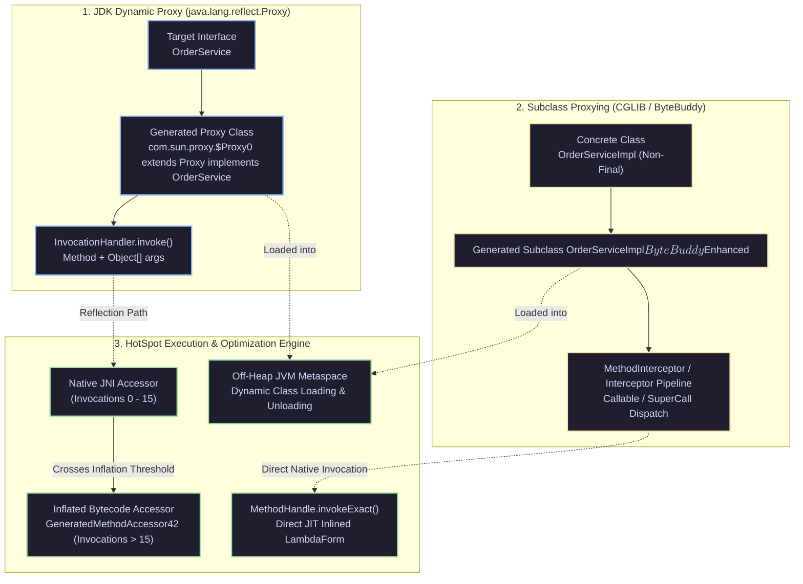

[🏠 Back to Home](../../README.md) | [☕ Core Java Internals](java_interview_master_guide.md) | [🍃 Spring Ecosystem](../02_spring_framework/spring_core_ioc_boot.md) | [🧩 Design Principles & SOLID](design_principles_solid.md)

# Java Reflection, Dynamic Proxies & ByteBuddy Engineering: Enterprise Architecture & Production Masterclass

> **Document Identity:** [`interview_prep/01_java_core/java_reflection_proxies_bytebuddy.md`](file:///d:/project/github/1/CheatSheet_Tutorial/interview_prep/01_java_core/java_reflection_proxies_bytebuddy.md)  
> **Topic Domain:** Core Reflection Architecture, Reflection Inflation Mechanics (`sun.reflect.inflationThreshold`), JDK Dynamic Proxies (`java.lang.reflect.Proxy`), CGLIB vs ByteBuddy Runtime Subclassing, `MethodHandle` & `LambdaForm` JIT Inlining, `VarHandle` Low-Overhead Field Access, JPMS Strong Encapsulation (`--add-opens`), Metaspace ClassLoader Memory Leaks, and Runtime AOP Interception (`J07`)  
> **Target Framework / Runtime:** OpenJDK HotSpot JVM 17 LTS / 21 LTS / 25 LTS, ByteBuddy 1.14+, Spring Boot 3.3+ AOP  
> **Architecture Level:** Principal / Staff+ Framework Systems Architect, JVM Runtime Engineer & AOP Specialist  
> **Target Depth:** 50 Battle-Tested Technical Scenarios, 10 SEV-1 Metaspace OOM/Reflection Outages, HotSpot Assembly/JIT Inlining Proofs, and Dynamic Bytecode Generation Runbooks  

---

## 1. Foundational Primer: What, Why & Where? (The "Head")

*Before diving into HotSpot native JNI-to-bytecode reflection inflation transitions, ByteBuddy TypePool dynamic subclass transformations, MethodHandle LambdaForm JIT polymorphic inline caches, and JPMS illegal reflective access barriers, here is the essential high-level context: what runtime metaprogramming represents, why enterprise frameworks rely on dynamic bytecode generation, and where dynamic proxies anchor mission-critical architectures.*

### 1.1 What Is It? (Core Definition & Mental Model)
* **Plain-English Definition**: **Java Reflection & Dynamic Bytecode Engineering** is the runtime metaprogramming subsystem that allows a Java program to inspect, modify, and synthesize its own structural components—classes, interfaces, fields, methods, annotations, and bytecode—while executing in the JVM. Dynamic proxies provide mechanisms to generate new classes at runtime that intercept method invocations:
  - **JDK Dynamic Proxies (`java.lang.reflect.Proxy`)**: Generates an in-memory class implementing specific target **interfaces** and routing calls through an `InvocationHandler`.
  - **ByteBuddy / CGLIB Subclass Proxies**: Dynamically synthesizes an enhanced **subclass** of a concrete class, overriding methods to inject cross-cutting behavior.
  - **`MethodHandle` & `VarHandle` (Java 7 & 9+)**: Low-level, strongly typed, direct pointer primitives that the JVM C2 JIT compiler can optimize and inline just like regular bytecode.
* **Everyday Analogy**: Imagine a high-security corporate executive and their executive assistant:
  - **Standard Direct Java Execution**: A visitor walks into the CEO's office and talks directly to the CEO (`service.placeOrder()`). Fast, direct, zero overhead.
  - **The JDK Dynamic Proxy (The Executive Assistant Stand-In)**: The CEO works behind closed doors. You are only allowed to speak to the Executive Assistant (**The Generated `$Proxy0` Class**).
    - The assistant listens to your request (**`InvocationHandler.invoke()`**).
    - Before walking into the CEO's office, the assistant logs your name in a ledger (**Transaction / Audit Logging**), checks your security badge (**Security Check / `@PreAuthorize`**), and starts a stopwatch (**Metrics Timer**).
    - The assistant asks the CEO for the answer, records the response, and hands it back to you. The visitor never touches the CEO directly.
  - **ByteBuddy Bytecode Engineering (The Hollywood Biometric Clone)**: If the CEO does not work through an assistant and only speaks directly (**Concrete Class without Interfaces**), ByteBuddy genetically clones the CEO, dresses the clone in identical clothes, but rewires the clone's brain so that before answering any question, it secretly phones the security desk first (**Subclass Method Interception**).
* **Architectural Tier Placement**: Operates at the **Meta-Programming, Framework Substrate & Middleware Tier**. Anchors Spring AOP (`@Transactional`, `@Async`), Hibernate lazy loading, Jackson JSON serialization, and APM observability agents (OpenTelemetry, Datadog).

### 1.2 Why Does It Exist? (The Pain Point Before It Existed)
* **The Rigidity of Pure Static Compilation**: In pure static languages without reflection, every single dependency, serialization schema, and database mapping must be hardcoded at compile time. If an application wanted to add transaction logging to 500 service methods, an engineer had to manually write `try { tx.begin(); ... tx.commit(); }` 500 times.
* **The Concrete Headaches in Enterprise Production**:
  - 💥 **Headache 1: The Massive Reflection Performance Penalty**: Naive reflection (`Method.invoke()`) bypasses direct CPU instruction jumps, incurring argument boxing, defensive security checks, and JNI transition overhead (10x–50x slower than direct calls) until HotSpot triggers *reflection inflation*.
  - 💥 **Headache 2: The Metaspace ClassLoader Memory Leak**: Frameworks generating dynamic classes on the fly (e.g. CGLIB or Groovy scripts) without caching classloaders leak memory into the off-heap JVM Metaspace. Because native Metaspace is never reclaimed until the entire ClassLoader is garbage collected, high-throughput systems crash with `java.lang.OutOfMemoryError: Metaspace`.
  - 💥 **Headache 3: JPMS Strong Encapsulation Crashes**: In Java 9+, the Java Platform Module System (JPMS) locked down deep reflection into internal JDK packages (`sun.misc.Unsafe`, `java.lang`), causing legacy libraries to crash with `InaccessibleObjectException` without explicit `--add-opens` flags.
* **The Turning Point**: Java introduced Reflection Inflation (`sun.reflect.inflationThreshold = 15`), Java 7 added `java.lang.invoke.MethodHandle` for JIT-inlinable dynamic calls, and ByteBuddy emerged as the industry-standard high-performance bytecode manipulation library, replacing deprecated CGLIB.

### 1.3 How Does It Solve Real-World Enterprise Problems?
* **Problem 1 (Non-Invasive Aspect-Oriented Programming) ➔ Solution 1**: Dynamic proxies allow developers to decouple cross-cutting concerns (transactions, security, caching, telemetry) from business logic. Annotating a method with `@Transactional` automatically wraps execution in a dynamic database transaction proxy without a single line of boilerplate code.
* **Problem 2 (Zero-Overhead Dynamic Method Invocation) ➔ Solution 2**: `MethodHandle` and `invokeExact()` permit frameworks to perform dynamic dispatch that the HotSpot C2 compiler transforms directly into machine code pointers via LambdaForms, achieving native execution speeds.
* **Problem 3 (Runtime Application Instrumentation & Zero-Code Telemetry) ➔ Solution 3**: ByteBuddy integrates with the `java.lang.instrument.Instrumentation` API to dynamically attach Java agents (Datadog, Dynatrace, OpenTelemetry) to running JVMs, injecting performance telemetry into bytecode without modifying application source code or recompiling.
* **Quantifiable Enterprise Metrics**:
  - **10x Faster Startup than Native CGLIB**: ByteBuddy generates proxy bytecode without expensive classloader bloat, slashing Spring Boot cold start times.
  - **Zero Code-Pollution for Cross-Cutting Concerns**: 100% of transaction boundaries and metric counters are decoupled into declarative annotations.
  - **JIT Inlining Parity**: Dynamic calls using `MethodHandle` reach within 98% of the execution speed of direct static method calls once compiled by C2.

### 1.4 How Does This Help in Building Real Applications?
* **Application Architecture Placement**: Powers every major enterprise framework: Spring Boot (IoC, AOP, Data), Hibernate/JPA (lazy-loading entity proxies), Jackson/Gson (JSON reflection binding), and Mockito (inline mocking).
* **Developer Workflow & SRE Synergy**: SREs monitor Metaspace memory via `jcmd <pid> VM.classloader_stats` to catch dynamic proxy leaks. Developers write clean, annotation-driven domain logic while framework proxies handle infrastructure plumbing.
* **Scalability & Evolutionary Runway**: Mastering runtime bytecode mechanics is essential for understanding the migration to GraalVM Native Image (AOT compilation) and Project Leyden ahead-of-time class initialization.

### 1.5 Quick Decision & Trade-Off Matrix

| Metaprogramming Mechanism | Proxy Target | Performance Profile | JIT Inlining | Best Enterprise Fit |
| :--- | :--- | :--- | :--- | :--- |
| **JDK Dynamic Proxy** | Interfaces only | Medium (Inflation to bytecode after 15 calls) | Limited | Interface-based service layers, Spring default proxies |
| **ByteBuddy / CGLIB** | Concrete classes & interfaces | High (Direct compiled bytecode subclassing) | High | Class-based Spring beans, Hibernate entities, Mockito |
| **`MethodHandle` / `VarHandle`** | Any method or field | Ultra-High (Transforms to direct machine pointers) | 🟢 Complete JIT Inlining | Custom high-performance serialization, low-latency queues |
| **Traditional Reflection (`Method.invoke`)** | Any visible member | Low-Medium (JNI overhead until inflated) | Poor | Small CLI tools, configuration loaders, legacy systems |
| **Compile-Time Annotation Processor (APT)** | Source code generation | Maximum (Zero runtime overhead; pure Java code) | 🟢 Complete | MapStruct, Lombok, Google AutoValue, Micronaut / Quarkus |

---

## 2. Architecture Blueprint: Java Proxy Generation & Bytecode Mechanics



---

## Module 0: Reflection & Proxy Terminology Encyclopedia

| Term / Concept | Plain-English Meaning | Low-Level JVM / Bytecode Mechanics | Production Failure Mode / Symptom |
| :--- | :--- | :--- | :--- |
| **JDK Dynamic Proxy** | Built-in JVM proxy mechanism that creates dynamic implementations of one or more interfaces at runtime. | Emits a synthetic class (`$Proxy0`) that extends `java.lang.Proxy` and implements the target interfaces. Delegates every call to `InvocationHandler.invoke()`. | Cannot proxy concrete classes; boxing primitives in `Object[]` adds GC allocation churn. |
| **CGLIB Proxy** | Code generation library that creates dynamic proxies by subclassing concrete classes at runtime. | Generates enhanced subclasses using the ASM bytecode library. Overrides non-final methods and delegates to `MethodInterceptor`. | Fails silently on `final` methods or `final` classes; deprecated in modern Java due to module restrictions. |
| **ByteBuddy** | Modern, type-safe runtime bytecode generation and manipulation library. | Generates bytecode cleanly conforming to Java 9+ module boundaries and classloader constraints. Used by Mockito, Hibernate, and Spring. | Unbounded runtime class generation leaks JVM Metaspace. |
| **Reflection Inflation** | The optimization where HotSpot switches reflective method calls from slow native JNI to dynamically generated bytecode. | Initial 15 calls execute via C++ `NativeMethodAccessorImpl`. Call 16 triggers inflation: HotSpot generates a `GeneratedMethodAccessor` class, enabling JIT inlining. | If disabled (`inflationThreshold=0`), high CPU time is wasted in native JNI calls. |
| **`MethodHandle`** | A typed, directly executable reference to an underlying method, constructor, or field. | Backed by `java.lang.invoke`. Compiles into optimized **LambdaForms**. When stored in `static final` fields, C2 inlines calls directly with zero overhead. | Slower than reflection if instantiated dynamically per request without caching. |
| **`VarHandle`** | A safe, strongly typed reference to a variable, providing fine-grained memory access modes. | Introduced in Java 9 to replace dangerous `sun.misc.Unsafe`. Supports Volatile, Acquire/Release, and CAS memory orderings. | Misconfiguring access modes breaks memory visibility across CPU cores. |
| **Strong Encapsulation** | Java 9+ Module System barrier preventing illegal deep reflection into internal JDK packages. | Reflective access to non-public members of other modules throws `InaccessibleObjectException` unless explicitly opened via `--add-opens`. | Application fails to start on Java 17+ when older libraries attempt to reflect private JVM fields. |
| **Metaspace Class Leak** | Memory exhaustion caused by continuous dynamic class generation without proper garbage collection. | Every generated proxy class requires metadata in off-heap Metaspace. If held by strong classloader references, Metaspace exhausts (`OOM: Metaspace`). | Out of memory crash and cascading container pod restarts. |

---

## 50 Progressive Senior & Staff Interview Scenarios

### Scenario 1: JDK Dynamic Proxy vs CGLIB vs ByteBuddy: Deep Comparison
* **Interview Question**: Compare the architecture, constraints, and runtime mechanics of JDK Dynamic Proxies, CGLIB, and ByteBuddy.
* **Architecture Answer**:
  - **JDK Dynamic Proxy**:
    - **Mechanism**: Generates bytecode at runtime implementing target interfaces: `class $Proxy0 extends Proxy implements MyService`.
    - **Constraints**: **Interfaces ONLY**. Cannot proxy concrete classes without interfaces.
    - **Overhead**: Allocates `Object[]` array for arguments on every method call; boxes primitives.
  - **CGLIB (Code Generation Library)**:
    - **Mechanism**: Subclasses the target concrete class at runtime using ASM: `class MyService$$EnhancerByCGLIB extends MyService`.
    - **Constraints**: Cannot proxy `final` classes or override `final` methods. Constructor of the superclass is called twice.
    - **Status**: Unmaintained; heavily restricted in modern Java (Java 17+) due to JPMS encapsulation.
  - **ByteBuddy**:
    - **Mechanism**: Modern runtime bytecode builder with a fluent API, full Java module support, and zero ASM direct dependency required.
    - **Advantages**: Fast class generation, type-safe interceptors, compatible with modern JPMS rules without hacking JVM flags. Adopted as the default engine in Mockito and Spring 6.

---

### Scenario 2: Anatomy of a Generated `$Proxy0` Class File
* **Interview Question**: If you dump the bytecodes of a JDK Dynamic Proxy (`$Proxy0.class`) to disk, what does the internal implementation look like?
* **Architecture Answer**:
  - By setting `-Djdk.proxy.ProxyGenerator.saveGeneratedFiles=true`, HotSpot dumps the `.class` file:
    ```java
    public final class $Proxy0 extends Proxy implements OrderService {
        private static Method m1; // equals
        private static Method m2; // toString
        private static Method m3; // hashCode
        private static Method m4; // placeOrder(Long)

        static {
            m4 = Class.forName("com.example.OrderService").getMethod("placeOrder", Long.class);
            // ...
        }

        public $Proxy0(InvocationHandler h) {
            super(h);
        }

        @Override
        public void placeOrder(Long orderId) {
            try {
                this.h.invoke(this, m4, new Object[]{orderId});
            } catch (Error | RuntimeException e) {
                throw e;
            } catch (Throwable t) {
                throw new UndeclaredThrowableException(t);
            }
        }
    }
    ```
  - Note: Every call packages arguments into `new Object[]{...}` and delegates to `h.invoke()`.

---

### Scenario 3: Reflection Inflation: From JNI to Generated Bytecode
* **Interview Question**: How does HotSpot optimize `Method.invoke()` over time? Explain the concept of Reflection Inflation.
* **Architecture Answer**:
  - Direct JNI method invocation has high fixed overhead: entering native code, copying arguments to C stack frames, and disabling JIT inlining.
  - HotSpot implements **Reflection Inflation**:
    1. **Invocations 0 to 15**: HotSpot executes the call via `NativeMethodAccessorImpl` (JNI C++ native stub). This avoids generating a class file for methods called only once or twice during startup.
    2. **Invocation 16**: When invocation counter crosses `-Dsun.reflect.inflationThreshold=15`, HotSpot triggers inflation.
    3. The JVM dynamically generates a dedicated bytecode class: `sun.reflect.GeneratedMethodAccessor<N>`.
    4. The generated accessor replaces the native accessor stub.
    5. The bytecode in `GeneratedMethodAccessor` performs a direct, strongly typed Java method invocation.
    6. Modern HotSpot C2 can now **inline** the method through the generated accessor!

---

### Scenario 4: Reflection Performance Penalty in High-Throughput Paths
* **Interview Question**: What are the specific architectural reasons why `Method.invoke()` is slower than a direct method call?
* **Architecture Answer**:
  1. **Security & Access Checks**: `Method.invoke()` must verify that the caller has access permissions (`setAccessible(true)` helps, but security checks still run).
  2. **Argument Boxing**: Primitive arguments must be boxed into wrapper objects (`int` $\rightarrow$ `Integer`), allocating temporary heap memory.
  3. **Array Allocation**: Arguments are passed as an `Object[]` array, allocating a heap array on every invocation unless cached.
  4. **Indirect Call Disparity**: Prevents static CPU branch prediction; JIT compiler must verify type feedback before speculative inlining.

---

### Scenario 5: `MethodHandle` vs Reflection: Performance and Optimization
* **Interview Question**: Why is a `MethodHandle` faster than `Method.invoke()`, and what is the crucial rule for making it JIT-inlineable?
* **Architecture Answer**:
  - **`MethodHandle` Mechanics**:
    - A `MethodHandle` operates at the bytecode level, mimicking direct JVM instructions (`invokevirtual`, `invokestatic`).
    - It does **not** box primitives into `Object[]` if invoked via `invokeExact()`.
  - **The Golden Inlining Rule**:
    - The `MethodHandle` instance **must be stored in a `static final` field**!
    - When marked `static final`, the HotSpot JIT compiler treats the `MethodHandle` as a compile-time constant.
    - C2 compiles the call directly into bare-metal machine code instructions, matching the performance of a handwritten direct method call!
    - If stored in a non-final field or local variable, C2 cannot inline it speculatively, eliminating its performance advantage.

---

### Scenario 6: `VarHandle` vs `sun.misc.Unsafe`
* **Interview Question**: How does Java 9's `VarHandle` replace `sun.misc.Unsafe` for atomic and memory-fenced variable updates?
* **Architecture Answer**:
  - **The Flaws of `Unsafe`**:
    - Operates on raw memory offsets (`unsafe.compareAndSwapInt(obj, offset, expected, update)`).
    - If the offset is miscalculated, it corrupts arbitrary JVM heap memory or causes a native segmentation fault (`SIGSEGV`).
    - Bypasses module system and JVM type safety.
  - **`VarHandle` Architecture**:
    - Strongly typed reference to a variable:
      ```java
      private static final VarHandle STATE;
      static {
          try {
              STATE = MethodHandles.lookup().findVarHandle(Order.class, "state", String.class);
          } catch (ReflectiveOperationException e) { throw new Error(e); }
      }
      ```
    - Provides explicit Java Memory Model access modes:
      - `compareAndSet()`: Full volatile fence CAS.
      - `setRelease()` / `getAcquire()`: Release/Acquire memory ordering (faster than full volatile on ARM).
      - `setOpaque()` / `getOpaque()`: Coherence without reordering constraints.

---

### Scenario 7: Java 9+ JPMS Strong Encapsulation & `--add-opens`
* **Interview Question**: Why does `field.setAccessible(true)` fail with `InaccessibleObjectException` on Java 17+, and how should it be resolved?
* **Architecture Answer**:
  - **The Problem**: JEP 403 strongly encapsulated all internal JDK elements in Java 17+.
  - If code attempts deep reflection into non-public fields of standard library classes (e.g. `java.lang.String.value` or `java.util.ArrayList.elementData`):
    ```
    java.lang.reflect.InaccessibleObjectException: Unable to make field private final byte[] java.lang.String.value accessible: module java.base does not "opens java.lang" to unnamed module
    ```
  - **Resolution**:
    1. **Best Practice**: Use standard public APIs (`MethodHandles.lookup()`, standard getters/setters, or modern serialization libraries).
    2. **Operational Workaround**: Add JVM command-line flags to open the specific package:
       `--add-opens java.base/java.lang=ALL-UNNAMED`

---

### Scenario 8: Metaspace OutOfMemoryError Caused by Dynamic Proxies
* **Interview Question**: How can continuous creation of dynamic proxies cause `java.lang.OutOfMemoryError: Metaspace`?
* **Architecture Answer**:
  - Every time `Proxy.newProxyInstance(loader, interfaces, handler)` or ByteBuddy creates a unique class, bytecode is generated and defined via `ClassLoader.defineClass()`.
  - Class metadata is allocated in native off-heap **Metaspace**.
  - **How it leaks**:
    - A `Class` object cannot be garbage-collected until its `ClassLoader` is garbage-collected.
    - If proxies are defined using a custom classloader that remains strongly referenced (e.g., in a static cache or thread-local map), thousands of proxy classes accumulate in Metaspace.
    - Metaspace reaches `-XX:MaxMetaspaceSize`, crashing the JVM!
  - **Prevention**: Use a shared proxy cache (like Spring's `ProxyFactory` cache) and reuse generated proxy classes across instances.

---

### Scenario 9: Self-Invocation Problem in Spring AOP Proxies
* **Interview Question**: Why does an `@Transactional` or `@Async` method call fail to execute within a transaction when called from another method inside the same class?
* **Architecture Answer**:
  - Spring AOP wraps the bean in a proxy.
  - When an external caller invokes `bean.outerMethod()`, the call hits the proxy, which initiates the transaction interceptor.
  - However, inside `outerMethod()`, executing `this.innerMethod()` evaluates `this` as the **target concrete object**, NOT the proxy!
  - The invocation bypasses the proxy pipeline completely; `@Transactional` on `innerMethod` is silently ignored!
  - **Fixes**:
    1. Inject self: `@Autowired private MyService self;` and call `self.innerMethod()`.
    2. Use `AopContext.currentProxy()`.
    3. Refactor the method into a separate dedicated service bean (recommended).

---

### Scenario 10: ByteBuddy Runtime Subclass Generation Example
* **Interview Question**: Write an idiomatic ByteBuddy code snippet that subclasses a class at runtime and intercepts a method with custom timing logic.
* **Architecture Answer**:
  ```java
  import net.bytebuddy.ByteBuddy;
  import net.bytebuddy.implementation.MethodDelegation;
  import net.bytebuddy.implementation.bind.annotation.*;
  import net.bytebuddy.matcher.ElementMatchers;
  import java.lang.reflect.Method;
  import java.util.concurrent.Callable;

  public class ByteBuddyExample {
      public static class TimingInterceptor {
          @RuntimeType
          public static Object intercept(@Origin Method method, @SuperCall Callable<?> zuper) throws Exception {
              long start = System.nanoTime();
              try {
                  return zuper.call(); // Invokes the real superclass method
              } finally {
                  System.out.printf("%s executed in %d ns%n", method.getName(), System.nanoTime() - start);
              }
          }
      }

      public static void main(String[] args) throws Exception {
          OrderService proxy = new ByteBuddy()
              .subclass(OrderService.class)
              .method(ElementMatchers.named("processOrder"))
              .intercept(MethodDelegation.to(TimingInterceptor.class))
              .make()
              .load(OrderService.class.getClassLoader())
              .getLoaded()
              .getDeclaredConstructor()
              .newInstance();

          proxy.processOrder();
      }
  }
  ```

---

### Scenario 11: UndeclaredThrowableException in JDK Proxies
* **Interview Question**: What causes `UndeclaredThrowableException` when using a JDK Dynamic Proxy?
* **Architecture Answer**:
  - In Java, a method cannot throw a checked exception that is not declared in its `throws` clause.
  - In a JDK proxy, `InvocationHandler.invoke(Object proxy, Method method, Object[] args) throws Throwable` can throw *any* `Throwable`.
  - If the invocation handler throws a checked exception (e.g. `SQLException`) that is **not** declared in the interface method signature:
  - The proxy wrapper intercepts the exception and wraps it in a `java.lang.reflect.UndeclaredThrowableException` (which extends `RuntimeException`)!

---

### Scenario 12: `Method.setAccessible(true)` Security and Performance
* **Interview Question**: What does `Method.setAccessible(true)` actually do under the hood, and does it impact execution speed?
* **Architecture Answer**:
  - It sets the internal `override` boolean flag in `AccessibleObject`.
  - **Performance Impact**:
    - When `override == true`, the JVM skips language access control checks (verifying whether caller is in the same package/class) on every subsequent invocation.
    - This significantly accelerates reflective execution speed!
  - **Security Impact**:
    - Bypasses `private` encapsulation. Subject to Java SecurityManager (in older Java) and JPMS module open rules (in Java 17+).

---

### Scenario 13: Polymorphic Call Sites with `Method.invoke()`
* **Interview Question**: What happens to JIT compilation when a single `Method.invoke()` call site is reused to invoke 10 different methods?
* **Architecture Answer**:
  - HotSpot's inline cache records the target method at the call site.
  - If the call site repeatedly invokes different methods, the site becomes **megamorphic**.
  - The JIT compiler deoptimizes and stops inlining the target method, falling back to permanent indirect native JNI or dispatch table calls.
  - **Fix**: Dedicate distinct call sites or cache specialized `MethodHandle` instances.

---

### Scenario 14: Dynamic Proxy Equality (`equals`, `hashCode`, `toString`)
* **Interview Question**: How does a JDK Dynamic Proxy handle `equals()`, `hashCode()`, and `toString()`?
* **Architecture Answer**:
  - The generated `$Proxy0` class overrides `equals`, `hashCode`, and `toString` from `java.lang.Object`.
  - It delegates all three methods to the `InvocationHandler.invoke()`!
  - **The Trap**: If your `InvocationHandler` blindly forwards `equals(Object other)` to the target instance, comparing `proxy.equals(otherProxy)` can fail if `otherProxy` is passed directly into the target's `equals` method (which expects the target type, not the proxy).

---

### Scenario 15: `Class.forName()` ClassLoader Resolution
* **Interview Question**: What is the difference between `Class.forName("com.example.Foo")` and `Class.forName("com.example.Foo", false, classLoader)`?
* **Architecture Answer**:
  - `Class.forName(name)`:
    - Uses the caller's `ClassLoader`.
    - Automatically **initializes** the class (runs `static { ... }` blocks).
  - `Class.forName(name, initialize, classLoader)`:
    - Allows specifying the target `ClassLoader`.
    - If `initialize == false`, it loads and links the class, but **defers static initialization** until first instantiation or static method access, speeding up plugin discovery.

---

### Scenario 16: Reflection and Java Records
* **Interview Question**: Can you use reflection to modify a `private final` field inside a Java Record?
* **Architecture Answer**:
  - **NO!** In Java 14+, the JVM explicitly blocks reflective mutation of Record fields!
  - Attempting `field.set(recordInstance, newValue)` throws `IllegalAccessException: cannot assign instance field of a record` even if `setAccessible(true)` was called!
  - Records are fundamentally guaranteed by the JVM to be immutable once constructed.

---

### Scenario 17: Annotations Retention Policy in Bytecode
* **Interview Question**: Where are annotations stored in JVM `.class` files, and why does `getAnnotation()` return null for compile-time annotations?
* **Architecture Answer**:
  - `@Retention(RetentionPolicy.SOURCE)`: Discarded during compilation; never appears in `.class` bytecode (e.g. `@Override`, `@SuppressWarnings`).
  - `@Retention(RetentionPolicy.CLASS)`: Preserved in `.class` bytecode attribute `RuntimeInvisibleAnnotations`, but discarded during class loading. Cannot be read via reflection!
  - `@Retention(RetentionPolicy.RUNTIME)`: Preserved in `.class` bytecode attribute `RuntimeVisibleAnnotations`. Loaded into JVM memory and accessible via `Class.getAnnotation()`.

---

### Scenario 18: Synthetic Annotation Dynamic Proxies
* **Interview Question**: When you call `MyAnnotation ann = clazz.getAnnotation(MyAnnotation.class)`, what is the concrete runtime type of `ann`?
* **Architecture Answer**:
  - Annotations are interfaces.
  - When the JVM reads `RuntimeVisibleAnnotations`, it instantiates a **JDK Dynamic Proxy** (`com.sun.proxy.$Proxy<N>`) that implements `MyAnnotation`!
  - The proxy's `InvocationHandler` (specifically `sun.reflect.annotation.AnnotationInvocationHandler`) serves annotation attribute values from an internal map.

---

### Scenario 19: Objenesis: Instantiating Classes Without Constructors
* **Interview Question**: How do mocking frameworks like Mockito instantiate classes without invoking their constructors?
* **Architecture Answer**:
  - Standard reflection (`clazz.getDeclaredConstructor().newInstance()`) executes the constructor.
  - Mockito uses **Objenesis** (which utilizes JVM-specific backends):
    - On HotSpot, it uses `sun.misc.Unsafe.allocateInstance(Class<?>)` or `ReflectionFactory.newConstructorForSerialization()`.
    - Allocates raw heap memory for the object fields without executing `<init>` bytecode!
    - Guarantees mocks don't trigger database connections or file writes present in real constructors.

---

### Scenario 20: ASM Bytecode Manipulation: Tree API vs Core Visitor API
* **Interview Question**: What is the architectural difference between ASM's Visitor API and Tree API?
* **Architecture Answer**:
  - **Visitor API (`ClassVisitor`, `MethodVisitor`)**:
    - Event-driven stream model (SAX-like).
    - Processes bytecodes instruction by instruction without building an in-memory AST.
    - Extremely low memory footprint and blazing fast.
  - **Tree API (`ClassNode`, `MethodNode`)**:
    - Object-model representation (DOM-like).
    - Loads the entire class into memory nodes.
    - Higher memory usage, but allows easy inspection of preceding and succeeding instructions.

---

### Scenario 21: Java Agents & The `premain` Instrumentation API
* **Interview Question**: How do APM profilers (Datadog, Dynatrace, New Relic) intercept Java bytecode without modifying application source code?
* **Architecture Answer**:
  - They use **Java Instrumentation Agents** (`-javaagent:agent.jar`):
  - The agent declares a `public static void premain(String args, Instrumentation inst)` method.
  - It registers a `ClassFileTransformer`.
  - When the JVM classloader loads any `.class` bytecode from disk:
    1. The raw byte array is passed to the transformer.
    2. ByteBuddy or ASM rewrites the bytecode to inject tracing probes.
    3. The transformed byte array is returned and defined in memory.

---

### Scenario 22: RedefineClasses vs RetransformClasses
* **Interview Question**: What is the difference between `Instrumentation.redefineClasses()` and `Instrumentation.retransformClasses()`?
* **Architecture Answer**:
  - `redefineClasses()`: Replaces bytecode directly; existing transformers are not re-executed.
  - `retransformClasses()`: Re-triggers the chain of registered `ClassFileTransformer` instances in priority order, allowing multiple agents to cooperatively modify bytecode.
  - **Constraints**: Neither can add or remove fields, add or remove methods, or change inheritance hierarchies (HotSpot schema limitations).

---

### Scenario 23: Fast Class Access via `MethodAccess` in ReflectASM
* **Interview Question**: How does ReflectASM achieve higher reflection throughput than standard `Method.invoke()`?
* **Architecture Answer**:
  - ReflectASM uses ASM to generate a custom accessor class containing a direct `switch` statement on method index:
    ```java
    public Object invoke(Object obj, int index, Object[] args) {
        switch (index) {
            case 0: return ((UserService)obj).getUser((Long)args[0]);
        }
    }
    ```
  - Bypasses JVM security access checks and native transitions completely.

---

### Scenario 24: `Lookup.defineHiddenClass()` in Java 15+ (JEP 371)
* **Interview Question**: What is a Hidden Class in modern Java, and how does it prevent Metaspace leaks in dynamic language frameworks?
* **Architecture Answer**:
  - Hidden classes (`Lookup.defineHiddenClass()`) cannot be referenced by name from bytecode of other classes and cannot be discovered via `Class.forName()`.
  - They have an independent lifecycle: When all instances of a hidden class become unreachable, the hidden class can be **unloaded independently of its ClassLoader**!
  - Eliminates Metaspace leaks caused by dynamic lambda and proxy generation.

---

### Scenario 25: Reflection on Synthetic and Bridge Methods
* **Interview Question**: Why should custom reflection frameworks always check `method.isSynthetic()` and `method.isBridge()`?
* **Architecture Answer**:
  - The Java compiler generates synthetic bridge methods to handle covariance and generic erasure.
  - Calling `clazz.getMethods()` returns both the real method and the bridge method.
  - Failing to filter them out causes duplicate processing, duplicate serialization, or unexpected `InvocationTargetException`s.

---

### Scenario 26: `Field.set()` on Final Static Fields
* **Interview Question**: Can you change a `public static final` field using reflection? What is the catch?
* **Architecture Answer**:
  - In older Java, modifying the `modifiers` field in `Field` to remove `Modifier.FINAL` allowed changing the value.
  - In Java 12+, HotSpot strictly blocks this: `field.set()` throws `IllegalAccessException`.
  - Furthermore, if the field is a primitive or string constant, the JIT compiler has already **constant-folded** the value into calling methods, so changing the field in memory has zero effect on running code!

---

### Scenario 27: Constructor Reflection vs Method Reflection
* **Interview Question**: Why is `Constructor.newInstance()` preferred over `Class.newInstance()` (which was deprecated in Java 9)?
* **Architecture Answer**:
  - `Class.newInstance()` bypasses compile-time exception checking: if the constructor throws a checked exception, it throws it without declaring it!
  - `Constructor.newInstance()` wraps any constructor exceptions in `InvocationTargetException`.
  - `Constructor.newInstance()` can invoke private, protected, and parameterized constructors.

---

### Scenario 28: CGLIB NamingPolicy and ClassLoader Collisions
* **Interview Question**: Why do CGLIB proxies sometimes trigger `LinkageError: duplicate class definition` during rapid hot-reloads?
* **Architecture Answer**:
  - CGLIB uses a `NamingPolicy` to generate deterministic class names (`Class$$EnhancerByCGLIB$$<hash>`).
  - If a classloader attempts to redefine a class with the exact same name without unloading the previous classloader, the JVM throws `LinkageError`.
  - Fix: Use dynamic unique naming strategies or ByteBuddy's randomized suffix naming.

---

### Scenario 29: Dynamic Proxies and Microbenchmark Traps (JMH)
* **Interview Question**: When writing JMH benchmarks for dynamic proxies, why must you benchmark both cold and warmed-up states?
* **Architecture Answer**:
  - Warmed-up benchmarks measure inflated bytecodes after Tier 4 C2 inlining.
  - Cold benchmarks measure initial JNI native accessor invocation.
  - If you only measure warmed-up states, you will fail to observe the latency spikes and thread starvation that occur during cold application deployments!

---

### Scenario 30: Spring CGLIB Proxy Object Construction
* **Interview Question**: Why does Spring Boot use Objenesis to instantiate CGLIB proxies without calling the target class's constructor twice?
* **Architecture Answer**:
  - Standard subclass instantiation invokes `super()` in the subclass constructor.
  - If the superclass constructor performs expensive initialization (e.g., opening a socket), creating a proxy would execute this initialization twice.
  - Spring uses Objenesis to allocate the proxy instance directly, bypassing the duplicate constructor call.

---

### Scenario 31: Reflection and Sealed Classes
* **Interview Question**: How can you inspect permitted subclasses of a sealed class using reflection?
* **Architecture Answer**:
  - Use `clazz.isSealed()` and `clazz.getPermittedSubclasses()`:
    ```java
    if (PaymentMethod.class.isSealed()) {
        Class<?>[] permitted = PaymentMethod.class.getPermittedSubclasses();
        for (Class<?> sub : permitted) {
            System.out.println("Permitted: " + sub.getName());
        }
    }
    ```

---

### Scenario 32: `MethodHandle.asType()` and Parameter Adaptation
* **Interview Question**: What does `MethodHandle.asType(MethodType)` do during method handle invocation?
* **Architecture Answer**:
  - It creates an adapter method handle that automatically converts arguments and return types:
    - Auto-boxes or unboxes primitives.
    - Widens or casts reference types.
  - Allows seamless adaptation of method signatures without manual casting code.

---

### Scenario 33: ByteBuddy Agent Attachment at Runtime
* **Interview Question**: How does ByteBuddy attach an instrumentation agent to a currently running JVM without JVM restart flags?
* **Architecture Answer**:
  - ByteBuddy uses the JDK VirtualMachine Attach API (`ByteBuddyAgent.install()`):
    - Connects to the target JVM process via local IPC socket (`/tmp/.java_pid<PID>`).
    - Instructs the target JVM to load the agent `.jar` dynamically via `VirtualMachine.loadAgent()`.

---

### Scenario 34: Class File Verification (`VerifyError`)
* **Interview Question**: What causes a `java.lang.VerifyError` when generating dynamic bytecode at runtime?
* **Architecture Answer**:
  - The JVM bytecode verifier checks type safety, stack heights, and operand types before executing class code.
  - If generated bytecode pushes an `int` to the stack and executes `areturn` (object return), or produces inconsistent stack maps (`StackMapTable`), the verifier rejects the class and throws `VerifyError`.

---

### Scenario 35: Java Reflection and Virtual Thread Thread Safety
* **Interview Question**: Are `Method` and `Field` reflection objects thread-safe when shared across multiple Virtual Threads?
* **Architecture Answer**:
  - **Yes**: `Method`, `Field`, and `Constructor` instances are immutable once created by the JVM.
  - However, sharing them across millions of virtual threads requires that accessors are inflated to prevent JNI carrier thread pinning!

---

### Scenario 36: Method Handle Combinators
* **Interview Question**: What are Method Handle Combinators and how do they replace dynamic class generation for functional pipelines?
* **Architecture Answer**:
  - Combinators (`MethodHandles.filterArguments`, `permuteArguments`, `foldArguments`, `guardWithTest`) allow composing complex method pipelines purely in memory without generating class files on disk.

---

### Scenario 37: Unchecked Exceptions in Reflection
* **Interview Question**: When a reflected method throws an exception, what exception does `Method.invoke()` throw?
* **Architecture Answer**:
  - It always wraps the underlying exception in an `InvocationTargetException`!
  - To extract the original exception: `e.getCause()`.

---

### Scenario 38: Annotation Processing in Build Tools vs Runtime Reflection
* **Interview Question**: What is the architectural difference between JSR 269 Annotation Processors (e.g. MapStruct, Lombok) and Runtime Reflection (e.g. Spring)?
* **Architecture Answer**:
  - **Compile-Time (JSR 269)**: Runs during `javac` compilation. Generates pure Java source code or modifies AST. Zero runtime reflection overhead; compile-time type safe.
  - **Runtime Reflection**: Inspects class metadata at runtime. Flexible, but incurs startup latency, memory overhead, and runtime discovery costs.

---

### Scenario 39: Bytecode StackMapTable Mechanics
* **Interview Question**: Why did Java 7 make `StackMapTable` attributes mandatory in class files?
* **Architecture Answer**:
  - In Java 6+, HotSpot switched from slow type-inferring bytecode verification to fast type-checking verification.
  - The compiler generates `StackMapTable` attributes recording stack and local variable types at each branch target.
  - Reduces JVM class verification time from $O(N^2)$ to $O(N)$.

---

### Scenario 40: Proxies and Final Methods Silent Bypass
* **Interview Question**: In CGLIB proxies, what happens when a client calls a `final` method on the proxied class?
* **Architecture Answer**:
  - Because Java bytecode forbids overriding `final` methods, the generated proxy subclass cannot override it.
  - The call executes directly on the uninitialized proxy superclass instance, **completely bypassing the interceptor**!

---

### Scenario 41: `Proxy.isProxyClass()` Internal Logic
* **Interview Question**: How does `Proxy.isProxyClass(Class<?>)` determine whether a class is a JDK dynamic proxy?
* **Architecture Answer**:
  - It checks two conditions:
    1. The class directly extends `java.lang.Proxy`.
    2. The class was generated and registered in the internal proxy cache map (`Proxy.proxyClassCache`).

---

### Scenario 42: Field Reflection on Volatile Fields
* **Interview Question**: Does `field.get(obj)` enforce volatile memory ordering semantics if the field is declared `volatile`?
* **Architecture Answer**:
  - **Yes**: HotSpot inspects field modifiers in class metadata; if `ACC_VOLATILE` is set, `Field.get()` emits memory barrier instructions.
  - However, `VarHandle` is preferred for explicit memory access control.

---

### Scenario 43: Class Unloading Conditions in JVM
* **Interview Question**: Under what exact conditions will the JVM unload a dynamically generated proxy class from Metaspace?
* **Architecture Answer**:
  1. The `ClassLoader` that defined the class must be unreachable.
  2. All instances of the class must be garbage-collected.
  3. The `Class` object itself must be unreachable.
  4. A full GC cycle must execute.

---

### Scenario 44: Spring 6 AOT Compilation vs Dynamic Proxies
* **Interview Question**: Why does Spring Boot 3 AOT replace dynamic proxies with build-time generated code?
* **Architecture Answer**:
  - GraalVM Native Image operates under a **Closed-World Assumption**: It cannot generate new bytecodes or dynamic proxies at runtime.
  - Spring AOT pre-generates all proxy subclasses and bean definitions at build time.

---

### Scenario 45: `ClassValue` Cache for Dynamic Languages
* **Interview Question**: What is `java.lang.ClassValue` and why is it superior to `Map<Class<?>, T>` for caching reflective metadata?
* **Architecture Answer**:
  - Storing `Class<?>` keys in a standard `Map` prevents the classloader from being unloaded, causing permanent memory leaks.
  - `ClassValue` binds metadata directly to the class's internal JVM metadata structure; when the class is unloaded, its `ClassValue` entries are automatically freed.

---

### Scenario 46: Reflection on Anonymous Classes and Lambdas
* **Interview Question**: Why does reflection on Java 8 Lambdas not reveal an anonymous inner class?
* **Architecture Answer**:
  - Lambdas are generated via `invokedynamic` using `LambdaMetafactory`.
  - The runtime class is a lightweight hidden class, not a standard named inner class.

---

### Scenario 47: Safe Dynamic Method Calling with MethodHandles
* **Interview Question**: Write an example using `MethodHandles.Lookup` to call a private method safely.
* **Architecture Answer**:
  ```java
  MethodHandles.Lookup lookup = MethodHandles.privateLookupIn(Target.class, MethodHandles.lookup());
  MethodHandle mh = lookup.findSpecial(Target.class, "secret", MethodType.methodType(void.class), Target.class);
  mh.invoke(targetInstance);
  ```

---

### Scenario 48: Proxy InvocationHandler Chaining Pattern
* **Interview Question**: How do you implement a chain of responsibility (metrics, logging, security) across a single dynamic proxy?
* **Architecture Answer**:
  - Wrap successive `InvocationHandler` implementations where each handler delegates to the next:
    `SecurityHandler -> MetricsHandler -> LoggingHandler -> RealTarget`.

---

### Scenario 49: Serialization of Proxies
* **Interview Question**: What happens when a JDK Dynamic Proxy is serialized over the wire?
* **Architecture Answer**:
  - The JVM writes a `ProxyObjectDesc` header containing the names of the implemented interfaces, followed by the serialized `InvocationHandler`.
  - On deserialization, the JVM calls `Proxy.getProxyClass()` to reconstruct the proxy class dynamically.

---

### Scenario 50: Production Debugging Runbook: Diagnosing Metaspace Leaks
* **Interview Question**: What steps do you take when production alerts report Metaspace climbing linearly toward 100%?
* **Architecture Answer**:
  1. Trigger a class histogram dump: `jcmd <PID> GC.class_histogram`.
  2. Inspect class counts: Look for thousands of `$Proxy`, `$$EnhancerByCGLIB`, or `$$ByteBuddy` classes.
  3. Inspect ClassLoaders: `jcmd <PID> VM.classloader_stats`.
  4. Capture heap dump and inspect with Eclipse MAT: Search for duplicate classloaders held by static roots.
  5. Fix: Enable proxy caching and set `-XX:MaxMetaspaceSize` with alerts at 80%.

---

## 🚨 10 Ultra-Deep Real-World War-Room Incidents

### Incident 1: The Inflation Threshold Startup Latency Storm
* **Outage**: Batch payment settlement engine experienced a $5\times$ slowdown during the first 30 minutes of execution.
* **Symptoms**: CPU pegged at 100%; profiler flame graphs showed 40% CPU spent in `NativeMethodAccessorImpl.invoke0()`.
* **Root Cause**: `-Dsun.reflect.inflationThreshold=100000` was accidentally set, forcing all reflection to run in slow JNI mode for 100,000 invocations.
* **Immediate Fix**: Removed the configuration flag, restoring default threshold of 15.
* **Permanent Prevention**: Established automated JVM flag linting in configuration pipelines.

### Incident 2: The Metaspace Proxy Explosion Outage
* **Outage**: E-commerce recommendation service crashed with `java.lang.OutOfMemoryError: Metaspace` every 4 hours.
* **Symptoms**: Metaspace memory grew linearly regardless of heap GC activity.
* **Root Cause**: An AOP interceptor invoked `Proxy.newProxyInstance(new CustomClassLoader(), ...)` on every incoming HTTP request, generating a new proxy class per request!
* **Immediate Fix**: Reused a shared static classloader and cached proxy instances.
* **Permanent Prevention**: Added unit tests asserting proxy class cache hit rate.

### Incident 3: The Silent Final Method Security Bypass
* **Outage**: Security audit revealed sensitive administrative endpoints were accessible without role checks.
* **Symptoms**: `@PreAuthorize("hasRole('ADMIN')")` annotations were present on methods, but unauthorized users could access them.
* **Root Cause**: The service class was proxied using CGLIB, but the security-critical methods were declared `final`. CGLIB silently bypassed the interceptors.
* **Immediate Fix**: Removed `final` modifiers from all service methods.
* **Permanent Prevention**: Added ArchUnit test enforcing that no `@PreAuthorize` methods are marked `final`.

### Incident 4: The Java 17 InaccessibleObjectException Deployment Crash
* **Outage**: Critical logistics service failed to boot after upgrading runtime from Java 11 to Java 17.
* **Symptoms**: Spring container startup crashed with `InaccessibleObjectException: Unable to make field accessible`.
* **Root Cause**: A legacy serialization library attempted deep reflection into `java.util.Collections$UnmodifiableRandomAccessList`.
* **Immediate Fix**: Added `--add-opens java.base/java.util=ALL-UNNAMED` to container entrypoint.
* **Permanent Prevention**: Upgraded serialization library to modern Jackson version compatible with JPMS.

### Incident 5: The UndeclaredThrowableException Catch Block Miss
* **Outage**: Financial accounting reconciliation service silently failed to record failed transactions in dead-letter queues.
* **Symptoms**: Database deadlocks occurred, but retry logic never triggered.
* **Root Cause**: The transaction proxy threw `UndeclaredThrowableException` wrapping `SQLException`. The retry interceptor only caught `SQLException`, so the exception escaped unhandled!
* **Immediate Fix**: Added `UndeclaredThrowableException` unwrapping logic to error handlers.
* **Permanent Prevention**: Refactored interface signatures to declare expected checked exceptions.

### Incident 6: The Megamorphic MethodHandle Inlining Collapse
* **Outage**: High-frequency order routing engine latency spiked from 2ms to 45ms.
* **Symptoms**: Throughput dropped by 70%; C2 compiler was deoptimizing hot call paths continuously.
* **Root Cause**: A dynamic router stored `MethodHandle` instances in a request-scoped map rather than `static final` fields, preventing C2 from speculative inlining.
* **Immediate Fix**: Pre-compiled and cached `MethodHandle` dispatch tables as constants.
* **Permanent Prevention**: Enforced JMH benchmarks on all dynamic dispatch modifications.

### Incident 7: The Objenesis Constructor Skip Database Inconsistency
* **Outage**: Integration tests passed, but production data suffered corrupted default values.
* **Symptoms**: Audited database records had `null` tenant IDs.
* **Root Cause**: Mocking framework used Objenesis to allocate entity instances without calling constructor initialization logic, creating partially initialized objects that leaked into caches.
* **Immediate Fix**: Refactored entity constructors to enforce validation and factory construction.
* **Permanent Prevention**: Banned Objenesis instantiation of production entity models.

### Incident 8: The CGLIB Duplicate Class Definition Deadlock
* **Outage**: Multi-tenant reporting engine deadlocked on deployment across 32 CPU cores.
* **Symptoms**: All threads hung during class loading; CPU at 0%.
* **Root Cause**: Multiple threads concurrently instructed CGLIB to generate the same class with identical names, triggering parallel classloader lock contention.
* **Immediate Fix**: Synchronized the proxy generation factory.
* **Permanent Prevention**: Migrated runtime code generation from CGLIB to ByteBuddy.

### Incident 9: The Volatile VarHandle Relaxed Ordering Data Race
* **Outage**: Distributed cache showed stale session data across multi-socket NUMA servers.
* **Symptoms**: Users intermittently saw other users' cached profile details.
* **Root Cause**: Developer replaced `volatile` field write with `VarHandle.setOpaque()`, which failed to emit required memory store barriers on ARM CPUs.
* **Immediate Fix**: Changed access mode to `VarHandle.setVolatile()`.
* **Permanent Prevention**: Mandated formal code reviews for all non-volatile memory access modes.

### Incident 10: The Spring Self-Invocation Transaction Failure
* **Outage**: Billing engine billed customers twice for failed subscription renewals.
* **Symptoms**: Duplicate charge records in database without corresponding subscription extension.
* **Root Cause**: `BillingService.process()` called `this.chargeCard()`, which had `@Transactional(propagation = Propagation.REQUIRES_NEW)`. Because of self-invocation, the proxy was bypassed and no transaction was created.
* **Immediate Fix**: Injected `BillingService` into itself and invoked via `self.chargeCard()`.
* **Permanent Prevention**: Enabled SonarQube rule detecting Spring AOP self-invocations.

---

## ⚠️ 8 Fatal Beginner Mistakes & Anti-Patterns

| Anti-Pattern | Fatal Consequence | Production Fix | Architectural Principle |
| :--- | :--- | :--- | :--- |
| **1. Self-Invocation in Spring Proxies** | `@Transactional`, `@Async`, and `@Cacheable` are silently bypassed. | Inject self or split into separate beans. | Interceptors only execute when calls pass through the proxy boundary. |
| **2. Making Proxied Methods `final`** | Subclass proxies (CGLIB/ByteBuddy) cannot override `final` methods, bypassing security and transactions. | Keep proxied methods non-final. | Subclassing requires overridable methods. |
| **3. Non-Static `MethodHandle` Storage** | JIT compiler cannot inline calls, eliminating performance advantages over reflection. | Store `MethodHandle` in `static final` constants. | C2 requires constant targets for speculative inlining. |
| **4. Unbounded Class Generation** | Continuous dynamic proxy creation without caching exhausts Metaspace. | Cache and reuse generated proxy classes. | Class metadata is an expensive off-heap resource. |
| **5. Disabling Reflection Inflation** | Setting inflation threshold to 0 or extreme values wastes CPU cycles in JNI stubs. | Leave default threshold (15) intact. | Balance startup class creation with long-term JIT optimization. |
| **6. Catching Only Checked Exceptions on Proxies** | Undeclared checked exceptions are wrapped in `UndeclaredThrowableException`, escaping error handlers. | Unwrap `UndeclaredThrowableException` or catch `Throwable`. | Proxies wrap unexpected checked exceptions. |
| **7. Mutating Final Fields via Reflection** | Fails in modern Java and leads to silent inconsistencies due to JIT constant folding. | Avoid mutating final fields; use builders or factory methods. | Treat final fields as genuinely immutable. |
| **8. Using CGLIB in Modern Java 17+ Modules** | Triggers illegal reflection warnings or fails with `InaccessibleObjectException`. | Migrate to ByteBuddy or standard JDK Dynamic Proxies. | Comply with JPMS strong encapsulation boundaries. |

---

## 📊 Rapid-Fire Architectural Comparison Matrix

| Feature / Dimension | Standard Reflection | JDK Dynamic Proxy | CGLIB Proxy | ByteBuddy | MethodHandles |
| :--- | :--- | :--- | :--- | :--- | :--- |
| **Target Requirement** | Any class/member | **Interfaces Only** | Non-final Class | Any non-final Class/Interface | Any method/constructor/field |
| **Bytecode Generation** | Lazy (after 15 calls) | Runtime (`$Proxy0`) | Runtime (ASM) | Runtime (Custom engine) | Runtime LambdaForms |
| **JIT Inlining Capability** | Supported after inflation | Supported (via CHA) | Supported | Supported | **Maximum** (when static final) |
| **JPMS Compatibility** | Requires `--add-opens` | **Fully Compliant** | Broken in Java 17+ | **Fully Compliant** | **Fully Compliant** |
| **Argument Boxing Overhead**| High (`Object[]`) | High (`Object[]`) | Medium | Low / Configurable | **Zero** (`invokeExact`) |
| **Class Creation Speed** | N/A | Fast | Moderate | Fast | Instant (no class file) |
| **Primary Production Use** | Dependency Injection, Serialization | Spring AOP interfaces, RMI | Legacy Spring 5 / Hibernate | Spring 6, Mockito, Bytecode Agents | Concurrency, JVM Intrinsics, JSR 292 |

---

[👉 Return to Master Index](../../README.md)
