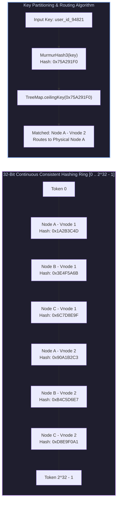
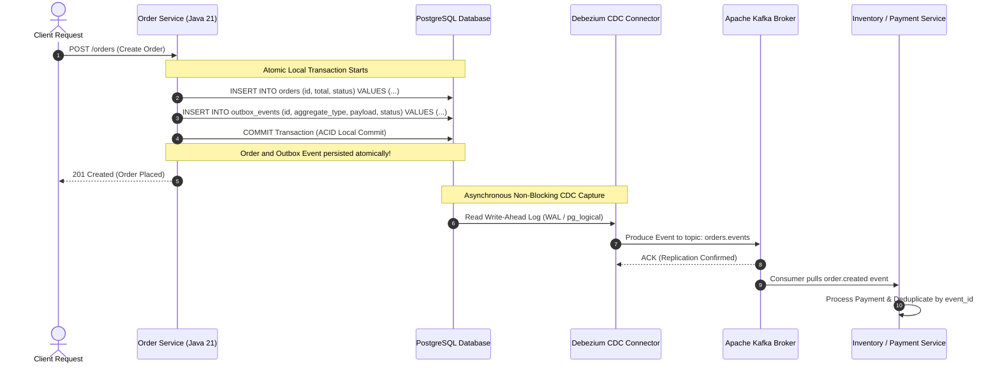
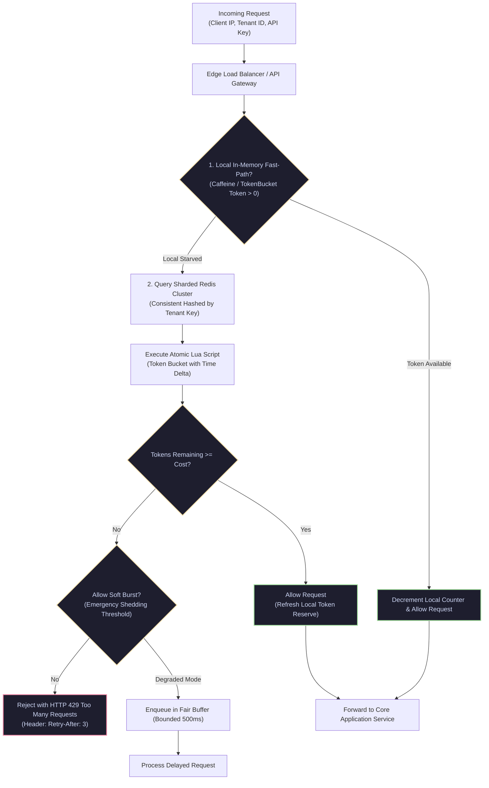
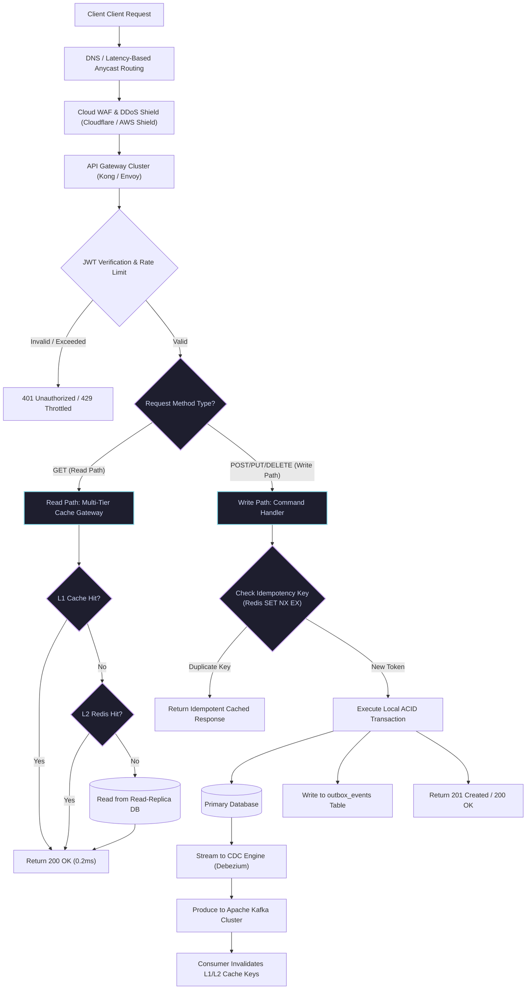

[🏠 Back to Home](../../README.md) | [☕ Core Java Internals](java_interview_master_guide.md) | [📐 LLD & Design Patterns](java_system_design_lld.md) | [⚡ Multithreading & Concurrency](java_multithreading_concurrency_mastery.md)

# Java System Design: High-Level Design (HLD) Architectural Blueprint & Scale Math

> **Document Identity:** [`interview_prep/01_java_core/java_system_design_hld.md`](file:///d:/project/github/1/CheatSheet_Tutorial/interview_prep/01_java_core/java_system_design_hld.md)  
> **Topic Domain:** Core Java Engineering & Enterprise High-Level System Design (HLD), Distributed Scale Math (Little's Law, Goetz Pool Sizing, Universal Scalability Law), Consistent Hashing with Virtual Nodes, Multi-Tier Caching (L1 Caffeine + L2 Redis) with Single-Flight Coalescing, Distributed Idempotency Gateways, TCP Vegas Adaptive Concurrency Limiting, and Transactional Outbox CDC Event Streaming (`J20`)  
> **Target Framework / Runtime:** OpenJDK HotSpot JVM 17 LTS / 21 LTS / 25 LTS, Spring Boot 3.3+, Redis, Apache Kafka  
> **Architecture Level:** Principal / Staff+ Distributed Systems Architect & High-Scale Infrastructure Specialist  
> **Target Depth:** 55 Battle-Tested Senior Technical Scenarios, 10 Production Scale Outage Post-Mortems, Mathematical Capacity Proofs, and 6 Complete Production Engines  

---

## 1. Foundational Primer: What, Why & Where? (The "Head")

*Before diving into Little's Law thread pool dimensioning, consistent hashing MurmurHash3 virtual node rings, multi-tier single-flight cache coalescing, and transactional outbox CDC event streaming, here is the essential high-level context: what High-Level Design represents, why distributed systems fail at scale, and where architectural patterns anchor mission-critical platforms.*

### 1.1 What Is It? (Core Definition & Mental Model)
* **Plain-English Definition**: **High-Level Design (HLD)** is the macro-architectural discipline of structuring distributed software systems to satisfy functional and non-functional requirements at scale. It defines service boundaries, communication protocols (REST, gRPC, messaging), data storage paradigms (RDBMS, NoSQL, Time-Series), partitioning strategies (consistent hashing, sharding), caching layers (L1 in-memory, L2 distributed), and mathematical capacity limits (QPS, storage, bandwidth, and thread pool sizing).
* **Everyday Analogy**: Imagine municipal civil engineering and regional power grid design versus indoor home plumbing:
  - **Low-Level Design (The Bathroom Plumbing & Faucet Valves)**: Designing how water flows through pipes inside a single bathroom, choosing copper vs PVC pipes, and installing anti-scald mixing valves (**Classes, Interfaces, Design Patterns, and Memory Allocation**).
  - **High-Level Design (The Regional Aqueduct, Dam & Power Grid)**:
    - Designing a 500-mile aqueduct that supplies fresh water to a metropolis of 10 million citizens (**Macro System Topology**).
    - If a drought hits one valley, automated floodgates reroute water from three backup reservoirs without bursting regional pipes (**Fault Tolerance & Multi-Region Failover**).
    - Building intermediate water towers in every neighborhood so morning shower demand does not suck the central reservoir dry (**Multi-Tier L1/L2 Caching**).
    - Designing surge spillways so unexpected flash floods are safely diverted into river basins rather than destroying the city's power plant (**Adaptive Concurrency Limiting & Load Shedding**).
* **Architectural Tier Placement**: Operates at the **System Macro-Topology, Data Infrastructure & Gateway Tier**. Anchors hyperscale payment processing (Stripe-grade idempotency), e-commerce flash sales, real-time analytics pipelines, and distributed event fabrics.

### 1.2 Why Does It Exist? (The Pain Point Before It Existed)
* **The "Vertical Scaling Wall & The Fallacies of Distributed Computing"**: A single physical server, no matter how powerful, has finite limits: CPU sockets, PCIe bandwidth, and memory channels. Furthermore, networks are unreliable, latency is non-zero, and hardware components inevitably fail.
* **The Concrete Headaches in Enterprise Production**:
  - 💥 **Headache 1: The "Dual-Write" Data Corruption Disaster**: A service writes to a relational database and then sends a message to Kafka. If the server crashes or network blips between the two operations, the database has the record but Kafka never receives the event, leaving downstream services permanently out of sync.
  - 💥 **Headache 2: The Cache Stampede (Thundering Herd) Meltdown**: A high-traffic cache key expires. 50,000 concurrent web requests miss the cache simultaneously and all query the database directly. The database CPU spikes to 100%, connection pools starve, and the entire platform crashes within seconds.
  - 💥 **Headache 3: Microservice Cascading Outages via Head-of-Line Blocking**: When a downstream recommendation microservice slows down from 20ms to 2,000ms, upstream API gateways exhaust their worker thread pools waiting for responses, causing every other healthy endpoint on the gateway to fail with 504 Gateway Timeouts.
* **The Turning Point**: High-Level Design codified patterns such as the Transactional Outbox (eliminating dual-writes), Single-Flight Cache Coalescing (defeating thundering herds), and Adaptive Concurrency Limiting (preventing queue collapse under load).

### 1.3 How Does It Solve Real-World Enterprise Problems?
* **Problem 1 (Zero-Loss Distributed Events) ➔ Solution 1**: **Transactional Outbox & CDC** writes domain state and outbound events to the same database in a single atomic ACID transaction. A background CDC engine (Debezium) tails the database transaction log and publishes to Kafka with at-least-once delivery guarantees.
* **Problem 2 (Thundering Herd Defense) ➔ Solution 2**: **Single-Flight Coalescing** ensures that when 10,000 requests miss the cache for the same key, only *one* thread queries the database while the remaining 9,999 threads await the result of that single ongoing future.
* **Problem 3 (Uniform Horizontal Partitioning) ➔ Solution 3**: **Consistent Hashing with Virtual Nodes** maps servers to hundreds of tokens on a cryptographic hash ring. Adding or removing a server reshuffles only $1/N$ of keys, preventing hot-spot node meltdowns.
* **Quantifiable Enterprise Metrics**:
  - **99.999% Service Availability**: Isolated failure domains and adaptive shedding prevent catastrophic cascading outages.
  - **Zero Dual-Write Inconsistencies**: Atomic outbox pattern guarantees 100% data fidelity between databases and event buses.
  - **95% Database Load Reduction**: Multi-tier caching and single-flight coalescing protect relational backends from traffic spikes.

### 1.4 How Does This Help in Building Real Applications?
* **Application Architecture Placement**: Anchors enterprise microservice backbones, multi-region distributed databases, distributed caching layers, and high-volume event ingestion pipelines.
* **Developer Workflow & SRE Synergy**: SREs monitor Little's Law metrics ($L = \lambda W$) and latency p99 gradients. Developers design idempotent API contracts and resilient outbox dispatchers.
* **Scalability & Evolutionary Runway**: Mastering HLD enables architects to guide organizations from monolithic applications to resilient, event-driven, horizontally scalable microservice architectures.

### 1.5 Quick Decision & Trade-Off Matrix

| Architectural Pattern | Core Advantage | Trade-Off / Complexity | Best Enterprise Fit |
| :--- | :--- | :--- | :--- |
| **Monolith / Modular Monolith** | Single deployment, ACID transactions, simple debugging | Vertical scaling limits, single blast radius | Early-stage products, small teams ($< 20$ engineers), low domain complexity |
| **Microservices (Sync REST/gRPC)** | Independent deployment & scaling per service | Distributed transaction complexity, network latency | Large multi-team engineering orgs, distinct domain boundaries |
| **Event-Driven Architecture (EDA)** | Complete decoupling, asynchronous scale, high resilience | Eventual consistency, asynchronous error handling | Real-time telemetry, order fulfillment, cross-service notifications |
| **CQRS + Event Sourcing** | Auditability, optimized read vs write models | High architectural complexity, event schema migrations | Financial ledgers, high-compliance trading, complex domain aggregates |

---

## 2. Track 0: Master Jargon-Buster & Conceptual Rosetta Stone

| Term / Concept | Architectural Domain | Enterprise Definition | Low-Level Under-the-Hood Reality |
| :--- | :--- | :--- | :--- |
| **High-Level Design (HLD)** | System Architecture | System macro-architecture defining service boundaries, communication protocols, caching tiers, data storage, and scale math. | Focuses on horizontal scale, partitioning, network topologies, fault domains, availability (99.999%), and capacity sizing across distributed nodes. |
| **Little's Law** | Queuing Theory | Fundamental queuing theorem: $L = \lambda W$, stating the average number of requests in a system equals arrival rate times average latency. | Dictates concurrency limits: at $10,000 \text{ QPS}$ with $50\text{ms}$ average latency, the system holds exactly $10,000 \times 0.050 = 500$ concurrent in-flight requests. |
| **Amdahl's Law** | Concurrency / Scaling | Mathematical model predicting theoretical speedup limit when parallelizing computing tasks with serial components: $S = \frac{1}{(1 - P) + \frac{P}{N}}$. | If 5% of code requires sequential lock acquisition ($P = 0.95$), the maximum theoretical speedup with infinite CPU cores is capped at $\frac{1}{0.05} = 20\times$. |
| **Universal Scalability Law (USL)** | Performance Modeling | Extension of Amdahl's law incorporating coherency penalty: $C(N) = \frac{N}{1 + \sigma(N - 1) + \kappa N(N - 1)}$, where $\kappa$ models crosstalk overhead. | Explains retro-scaling: beyond a critical node count, inter-node gossip and cache-invalidation bus traffic degrade throughput below single-node baselines. |
| **Consistent Hashing** | Distributed Partitioning | Distributed hashing scheme where node additions or removals cause only $K / N$ keys to be remapped, rather than remapping all keys. | Arranges hash values on a continuous $[0, 2^{32} - 1]$ or $[0, 2^{64} - 1]$ ring. Uses binary search (`ceilingEntry`) on virtual nodes to achieve uniform distribution. |
| **Virtual Nodes (Vnodes)** | Consistent Hashing | Technique where each physical server is mapped to multiple distinct points (e.g. 100–300 tokens) across the consistent hash ring. | Smooths non-uniform hashing distribution variance from $\pm 50\%$ down to $< 5\%$, preventing hot-spot node overloading. |
| **CAP Theorem** | Distributed Systems | Principle stating a distributed data store can guarantee at most two of: Consistency (linearizability), Availability, Partition Tolerance. | Network partitions ($P$) are unavoidable in physical networks. Systems must choose between returning errors ($CP$) or returning stale data ($AP$) during partitions. |
| **PACELC Theorem** | Distributed Systems | Extension of CAP: If Partition ($P$), choose Availability ($A$) or Consistency ($C$); Else ($E$), choose Latency ($L$) or Consistency ($C$). | Explains normal-mode latency trade-offs: MongoDB and DynamoDB choose $PA/EL$ (low latency in normal ops), while Spanner chooses $PC/EC$ (strong consistency). |
| **Cache Stampede (Thundering Herd)** | Distributed Caching | Cascade failure occurring when a popular cached key expires, causing thousands of concurrent requests to miss cache and crush the database. | Resolved via Single-Flight Mutex (`computeIfAbsent`), Probabilistic Early Recomputation (XFetch), or Stale-While-Revalidate caching. |
| **Single-Flight Coalescing** | Distributed Caching | Pattern ensuring that only one in-flight downstream request is executed for duplicate concurrent cache misses. | Uses a shared `ConcurrentHashMap<Key, CompletableFuture<Value>>`. Subsequent identical requests attach to the ongoing future instead of querying storage. |
| **Probabilistic Early Recomputation (XFetch)** | Distributed Caching | Algorithm where worker threads evaluate $\Delta t - \beta \times \delta \times \ln(\text{rand}()) \le 0$ to trigger proactive background cache renewal before key expiry. | Ensures keys are refreshed by background workers prior to expiration, eliminating cold-miss latency spikes entirely. |
| **Write-Ahead Log (WAL)** | Storage Engines | Append-only persistent disk log where state mutations are recorded and flushed before modifying memory tables. | Guarantees ACID durability and crash recovery. Sequential disk writes yield orders-of-magnitude higher throughput than random in-place page writes. |
| **Change Data Capture (CDC)** | Event-Driven Architecture | Technique that monitors and extracts row-level changes from database transaction logs (WAL/Binlog) in real-time. | Tools like Debezium parse PostgreSQL WAL or MySQL binlog, streaming mutations directly to Kafka without application-level dual-write bugs. |
| **Transactional Outbox Pattern** | Distributed Transactions | Pattern where domain mutations and outbound integration events are written to the same local database within a single atomic ACID transaction. | Eliminates the dual-write anti-pattern. An asynchronous process tails the outbox table via CDC or polling to publish events with at-least-once delivery. |
| **Saga Pattern (Orchestration vs Choreography)** | Distributed Transactions | Design pattern managing multi-service distributed transactions via a sequence of local transactions coordinated with compensating actions. | Eliminates blocking 2-Phase Commit (2PC). Orchestrators execute state machines; choreographers react to domain events across Kafka topics. |
| **Two-Phase Commit (2PC)** | Distributed Transactions | Blocking consensus protocol ensuring all participating database nodes either commit or abort a distributed transaction. | High latency and vulnerability to coordinator failure: locks are held across network round trips, causing catastrophic thread convoying under scale. |
| **Read-Your-Writes Consistency** | Storage / Replication | Consistency guarantee ensuring that a client always views updates submitted by itself, even if reading from asynchronous read replicas. | Implemented by routing reads to the primary database for a short window (e.g. 5 seconds) after a write, or verifying replication offset tokens. |
| **Replication Lag** | Distributed Databases | Temporal delay between a write committed on the primary database and its propagation to asynchronous read replicas. | Leads to phantom reads and dirty state. Mitigation requires monotonic read routing, synchronous replica quorum ($R + W > N$), or caching. |
| **Idempotency Key** | API Architecture | Unique client-generated token (UUID) sent in request headers guaranteeing that duplicate submissions produce identical outcomes without duplicate execution. | Checked atomically via Redis `SET NX EX` or database unique constraint. Prevents double-billing during network timeouts or retry storms. |
| **Token Bucket vs Leaky Bucket** | Traffic Shaping | Token Bucket accumulates tokens and permits bursts up to capacity; Leaky Bucket queues requests and drains them at a strictly constant rate. | Token Bucket implemented with atomic integer math ($O(1)$ time/memory); Leaky Bucket requires bounded FIFO queues (`ArrayBlockingQueue`). |
| **Adaptive Concurrency Limiting (TCP Vegas / AIMD)** | Resilience Engineering | Dynamically adjusts the maximum concurrent in-flight requests by monitoring system latency (RTT) changes rather than static limits. | Calculates gradient: $\text{gradient} = \frac{\text{rttNoLoad}}{\text{rttCurrent}}$. If gradient drops below 1.0 (queuing detected), limit decreases multiplicatively. |
| **Circuit Breaker** | Resilience Engineering | Proxy pattern preventing cascading failure by failing fast when downstream services become unresponsive (`CLOSED -> OPEN -> HALF_OPEN`). | Tracks failure rate in a sliding time/count window. Tripping to `OPEN` immediately sheds traffic, shielding downstream services from collapse. |
| **Bulkhead Isolation** | Resilience Engineering | Architectural partition separating resource pools (thread pools, connection pools) so failures in one subsystem do not exhaust shared capacity. | Named after ship compartments. Prevents a slow analytics query from starving the mission-critical checkout transaction thread pool. |
| **Backpressure** | Reactive Architecture | Flow control mechanism where downstream consumers signal processing capacity to upstream producers to prevent buffer overflows. | Implemented via TCP sliding windows, Reactive Streams (`Subscription.request(n)`), or bounded blocking queues rejecting with HTTP 429 / 503. |
| **HikariCP Pool Sizing Formula** | Database Sizing | Canonical connection pool dimensioning formula: $\text{connections} = \text{coreCount} \times 2 + \text{effectiveSpindleCount}$. | Hard drives/SSDs have bounded concurrency. Oversizing connection pools causes OS CPU context-switch thrashing and PostgreSQL memory exhaustion. |
| **Goetz Thread Pool Formula** | Concurrency Dimensioning | Classical formula for sizing thread pools: $N_{\text{threads}} = N_{\text{cpu}} \times U_{\text{cpu}} \times (1 + W/C)$, where $W/C$ is wait-to-compute ratio. | For I/O-heavy workloads where $95\%$ of time is spent waiting on databases ($W/C = 19$), a 16-core CPU requires $16 \times 1 \times (1 + 19) = 320$ platform threads. |
| **Virtual Threads (Project Loom)** | Modern JVM Concurrency | Lightweight user-space threads managed by the JVM runtime rather than 1:1 OS kernel threads. | Carrier threads execute virtual threads; when blocking on I/O, the JVM unmounts the virtual thread, yielding the carrier thread without OS context switches. |
| **GC Headroom** | JVM Memory Management | Extra memory capacity reserved in the JVM heap beyond active live data to allow garbage collectors to reclaim memory without STW pauses. | Formula: $\text{Heap} \ge \text{LiveDataSet} \times 3.0$ for G1GC/ZGC. Insufficient headroom triggers allocation stalls and concurrent GC cycle failure. |
| **Bloom Filter** | Probabilistic Data Structures | Space-efficient probabilistic bit array used to test whether an element is definitely NOT in a set or POSSIBLY in a set. | Backed by $k$ independent hash functions setting bits in array $m$. False negative rate is strictly 0%; false positive rate tunable via bit/key ratio. |
| **Count-Min Sketch** | Probabilistic Data Structures | Sub-linear space probabilistic data structure that estimates frequencies of events in continuous data streams with bounded error. | Backed by a $d \times w$ matrix of counters and hash functions. Used in top-$K$ frequency tracking and rate limiters to avoid storing millions of keys. |

---

## Track 1: Architectural Foundations & ELI5 Mental Models

### The Mental Model: The Global Autonomous Mega-Airport
To conceptualize how enterprise High-Level Design subsystems harmonize, imagine a global international airport processing 200,000 passengers daily:

```
[ Air Traffic Radar & Ingress Routes: DNS, Anycast & CDN Edge ]
        │  Terminates TLS, absorbs DDoS bursts, serves static assets from edge PoPs.
        ▼
[ Security Gates & Biometric Turnstiles: API Gateway & Adaptive Rate Limiter ]
        │  Validates JWT tokens, checks idempotency keys, applies TCP Vegas shedding.
        ▼
[ Baggage Sorting & Routing Ring: Distributed Consistent Hashing Ring ]
        │  Virtual nodes partition bags across conveyors with zero hot-spot imbalances.
        ▼
[ Express Lounges & Fast-Track Kiosks: Multi-Tier Distributed Cache (L1 + L2) ]
        │  L1 Caffeine memory + L2 Redis cluster; Single-Flight coalesces misses.
        ▼
[ Flight Dispatch & Runway Control: Thread Pools & Virtual Thread Schedulers ]
        │  Little's Law and Goetz formulas dimension workers; Loom unmounts on stalls.
        ▼
[ Customs Manifest & Cargo Vault: Primary/Replica DB with CDC Outbox ]
        │  HikariCP sizes connections; Debezium streams WAL events to Kafka topics.
```

### 1.1 The 5 Pillars of Enterprise High-Level Design
1. **Elastic Scalability (Horizontal Over Vertical):**
   - Services must be stateless. State resides in distributed caches, partitioned databases, or object storage.
   - Systems scale by adding identical containerized nodes ($N \to N + K$) behind Layer 4 / Layer 7 load balancers.
2. **High Availability (HA) & Redundancy:**
   - Single Points of Failure (SPOFs) are strictly prohibited. Every critical tier operates in active-active or active-passive configurations across multiple Availability Zones (AZs).
   - Target availability: 99.999% ("five nines"), allowing at most 5.26 minutes of unplanned downtime per year.
3. **Graceful Degradation & Fault Isolation (Bulkheads & Shedding):**
   - When downstream services degrade or fail, upstream systems must isolate faults using circuit breakers and bulkhead thread pools.
   - Systems shed non-essential traffic (e.g., recommendation engines) while preserving core transactional paths (e.g., payment checkout).
4. **Data Consistency & Linearizability Trade-Offs:**
   - Acknowledge CAP and PACELC trade-offs deliberately. Use Strong Consistency (Serial/Linearizable) only where strictly required (financial ledgers, inventory counts).
   - Favor Eventual Consistency with Read-Your-Writes semantics for social feeds, notifications, and analytics pipelines.
5. **Observability & Telemetry First:**
   - Architecture must incorporate distributed tracing (W3C TraceContext, OpenTelemetry), structured JSON logging, and dimensional metrics (Micrometer, Prometheus) from inception.

---

## Track 2: Deep Engineering Architecture & Mermaid Flowcharts

### 2.1 Multi-Tier Distributed Caching Topology & Single-Flight Coalescing

```mermaid
flowchart TD
    Client["Client / Mobile App"] -->|"HTTP / REST / gRPC"| Gateway["API Gateway / Envoy Load Balancer"]
    Gateway -->|"Route Request"| Service["Java Microservice Instance (Spring Boot / Loom)"]
    
    subgraph MultiTierCache ["Multi-Tier Caching Subsystem"]
        Service -->|"1. Check L1 In-Memory Cache"| L1["L1 Cache (Caffeine - In-JVM Heap)<br/>Sub-Microsecond Latency"]
        L1 -- "Hit" --> ReturnL1["Return Value Immediately (O(1))"]
        L1 -- "Miss" --> CheckL2["Check L2 Distributed Cache"]
        
        CheckL2 -->|"2. Query Shared Cluster"| L2["L2 Cache (Redis Sentinel / Cluster)<br/>Sub-Millisecond (1-3ms) Latency"]
        L2 -- "Hit" --> PopulateL1["Populate L1 & Return Value"]
        L2 -- "Miss" --> SingleFlight{"3. Key in SingleFlight Map?<br/>(ConcurrentHashMap<K, Future>)"}
    end

    SingleFlight -- "Yes (Flight in Progress)" --> WaitFlight["Attach to Existing CompletableFuture<br/>(Zero DB Query Overhead)"]
    SingleFlight -- "No (First Caller)" --> LockFlight["Register New CompletableFuture<br/>Acquire DB Query Lease"]
    
    LockFlight -->|"4. Query Primary Database"| DB[("Primary Database (PostgreSQL / Aurora)") ]
    DB -->|"5. Return Result"| CompleteFlight["Complete Future & Populate L2 & L1"]
    CompleteFlight --> ReturnClient["Return Response to Caller"]
    WaitFlight --> ReturnClient

    classDef cacheStyle fill:#1e1e2e,stroke:#89b4fa,stroke-width:2px,color:#cdd6f4;
    classDef dbStyle fill:#1e1e2e,stroke:#a6e3a1,stroke-width:2px,color:#cdd6f4;
    classDef warnStyle fill:#1e1e2e,stroke:#f38ba8,stroke-width:2px,color:#cdd6f4;

    class L1,L2 cacheStyle;
    class DB dbStyle;
    class SingleFlight warnStyle;
```

---

### 2.2 Consistent Hashing Ring with Virtual Nodes Architecture



---

### 2.3 Transactional Outbox Pattern with CDC (Debezium + Kafka)



---

### 2.4 Resilient Distributed Rate Limiting & Token Bucket Sharding



---

### 2.5 End-to-End High-Availability Distributed Read/Write Lifecycle Flowchart



---

## Track 3: Low-Level Scale Math, Capacity Formulas & JVM Internals

### 3.1 Little's Law & Concurrency Capacity Math
Little's Law is the foundational mathematical theorem governing queueing systems:

$$L = \lambda \times W$$

Where:
- $L$ = Average number of concurrent in-flight requests in the system (Concurrency).
- $\lambda$ = Average arrival rate of requests (Throughput in QPS / RPS).
- $W$ = Average time a request spends in the system (Latency in seconds).

#### Practical Capacity Proof:
Suppose your e-commerce checkout service receives $\lambda = 25,000 \text{ requests/sec}$ with an average latency of $W = 80\text{ ms} = 0.080\text{ seconds}$:

$$L = 25,000 \times 0.080 = 2,000 \text{ concurrent in-flight requests}$$

If the system has 10 containerized microservice instances running behind the load balancer, each instance must concurrently process:

$$\frac{2,000}{10} = 200 \text{ concurrent requests per instance}$$

If an unexpected database slowdown increases latency from $80\text{ms}$ to $800\text{ms}$ ($10\times$ latency degradation), the required concurrency surges to:

$$L = 25,000 \times 0.800 = 20,000 \text{ concurrent in-flight requests}$$

Each instance must now support $2,000$ active requests. With classical platform threads (1 MB stack per thread), memory consumption surges by $2\text{ GB}$ per instance, exhausting the thread pool and triggering HTTP 503 errors unless Virtual Threads or adaptive concurrency shedding is implemented.

---

### 3.2 Thread Pool Dimensioning: Goetz Formula & Platform vs Virtual Threads
Brian Goetz formulated the mathematical equation for optimal thread pool dimensioning in *Java Concurrency in Practice*:

$$N_{\text{threads}} = N_{\text{cpu}} \times U_{\text{cpu}} \times \left(1 + \frac{W}{C}\right)$$

Where:
- $N_{\text{cpu}}$ = Number of available CPU cores (via `Runtime.getRuntime().availableProcessors()`).
- $U_{\text{cpu}}$ = Target CPU utilization ($0.0 \le U_{\text{cpu}} \le 1.0$, typically $0.80$ to $0.90$ to avoid starvation).
- $W$ = Wait time (time spent waiting for I/O: database queries, HTTP calls, disk reads).
- $C$ = Compute time (time spent executing CPU instructions: JSON parsing, business math, hashing).

#### Production Scenario Calculation:
- Server: 16 CPU cores ($N_{\text{cpu}} = 16$).
- Target CPU Utilization: $85\%$ ($U_{\text{cpu}} = 0.85$).
- Microservice profile: A typical Spring Boot endpoint spends $95\text{ms}$ waiting on database/Redis I/O and $5\text{ms}$ computing JSON serialization.
- Wait-to-Compute Ratio: $\frac{W}{C} = \frac{95}{5} = 19$.

$$N_{\text{threads}} = 16 \times 0.85 \times (1 + 19) = 13.6 \times 20 = 272 \text{ platform threads}$$

#### Modern Virtual Threads Paradigm (Java 21+):
With Java 21 Virtual Threads (Project Loom):
- Virtual threads cost $\approx 200\text{--}400$ bytes of heap memory (compared to $1\text{ MB}$ for OS platform threads).
- Sizing formulas are inverted: **Do not pool virtual threads.**
- Create a new virtual thread per task (`Executors.newVirtualThreadPerTaskExecutor()`). The underlying ForkJoinPool carrier pool is automatically sized to $N_{\text{cpu}}$.
- Throttle downstream resources (database connections) using `Semaphore` rather than limiting thread counts.

---

### 3.3 Database Connection Pool Sizing: HikariCP Official Formula
The HikariCP engineering team established the definitive connection pool sizing formula:

$$\text{connections} = \text{coreCount} \times 2 + \text{effectiveSpindleCount}$$

Where:
- $\text{coreCount}$ = Number of CPU cores on the **database server** (not the application server!).
- $\text{effectiveSpindleCount}$ = Number of active disk spindles (for SSDs or RAID NVMe, typically $1$ to $4$ due to parallel queue depth).

#### Proof of Why Smaller Pools Outperform Larger Pools:
Consider a PostgreSQL server with 16 CPU cores and NVMe SSD storage:

$$\text{poolSize} = (16 \times 2) + 1 = 33 \text{ connections}$$

**Why not 500 connections?**
1. **OS Context Switching:** If 500 connections execute queries simultaneously on 16 CPU cores, the OS kernel scheduler spends more time context-switching between backend processes (`postgres` worker PIDs) and invalidating CPU L1/L2 caches than executing SQL disk scans.
2. **PostgreSQL Process Overhead:** Each Postgres connection forks a dedicated OS process requiring $\approx 10\text{--}20\text{ MB}$ of private RAM. 500 connections consume $10\text{ GB}$ of RAM solely on connection overhead, starving the Postgres `shared_buffers` cache!

---

### 3.4 GC Headroom, Allocation Rates & Heap Dimensioning
In high-throughput Java microservices, Garbage Collection pauses degrade p99/p999 latency:

#### Heap Dimensioning Formula:
$$\text{MinHeapSize} \ge \text{LiveDataSet} \times 3.0$$

Where:
- $\text{LiveDataSet}$ (LDS) = The memory occupied by long-lived objects remaining in the Old Generation after a full garbage collection cycle.
- **Factor 3.0:** Provides $1\times$ LDS for active data, $1\times$ LDS for uncollected garbage during concurrent marking, and $1\times$ LDS headroom to prevent allocation stalls.

#### Allocation Rate Math:
Suppose an application processes $10,000 \text{ QPS}$ where each request allocates $50\text{ KB}$ of transient objects (request/response DTOs, JSON tokens, Jackson nodes):

$$\text{AllocationRate} = 10,000 \times 50\text{ KB} = 500,000\text{ KB/sec} \approx 500\text{ MB/sec}$$

If the Young Generation (Eden) is sized at $2\text{ GB}$:

$$\text{TimeBetweenMinorGC} = \frac{2,048\text{ MB}}{500\text{ MB/sec}} \approx 4.09\text{ seconds}$$

Minor GC cycles occur every 4 seconds. Under G1GC with a pause target of `-XX:MaxGCPauseMillis=20`, the collector evacuates Eden within $15\text{ms}$, maintaining high throughput. If Eden is undersized to $256\text{ MB}$, GC triggers twice per second, thrashing CPU and promoting short-lived objects into Old Gen (premature tenuring).

---

### 3.5 Consistent Hashing Math & MurmurHash3 Distribution Variance
Let $N$ be the number of physical nodes and $V$ be the number of virtual nodes per physical node. The total token count on the ring is $M = N \times V$.
- With standard hashing ($V = 1$), standard deviation of key distribution is large: $\sigma \approx \sqrt{\frac{1}{N}}$. A node may receive up to $2\times$ its fair share of keys.
- With Virtual Nodes ($V \ge 150$), distribution variance collapses to:

$$\sigma \le \frac{1}{\sqrt{V}}$$

For $V = 200$, $\sigma \le \frac{1}{\sqrt{200}} \approx 0.07$ ($7\%$ distribution variance), ensuring virtually identical load across all cluster members.

---

### 3.6 Storage, Bandwidth & IOPS Capacity Estimation
Suppose an enterprise system must ingest $100\text{ Million}$ telemetry events per day:

1. **Throughput (Average QPS):**
   $$\text{Avg QPS} = \frac{100,000,000 \text{ events}}{86,400 \text{ seconds}} \approx 1,157 \text{ events/sec}$$
   $$\text{Peak QPS (Factor 3x)} = 1,157 \times 3 \approx 3,471 \text{ events/sec}$$

2. **Network Bandwidth Ingress:**
   If each JSON payload is $1.5\text{ KB}$:
   $$\text{Bandwidth}_{\text{avg}} = 1,157 \times 1.5\text{ KB} \approx 1,735\text{ KB/sec} \approx 1.73\text{ MB/sec} = 13.84\text{ Mbps}$$
   $$\text{Bandwidth}_{\text{peak}} = 3,471 \times 1.5\text{ KB} \approx 5.2\text{ MB/sec} = 41.6\text{ Mbps}$$

3. **Storage Growth (Raw per Year):**
   $$\text{Storage/Day} = 100,000,000 \times 1.5\text{ KB} \approx 150\text{ GB/day}$$
   $$\text{Storage/Year} = 150\text{ GB} \times 365 \approx 54.75\text{ TB/year}$$
   With $3\times$ replication factor and $20\%$ index overhead:
   $$\text{Total Storage} = 54.75\text{ TB} \times 3 \times 1.20 \approx 197.1\text{ TB/year}$$

---

## Track 4: 6 Complete Runnable Production HLD Engines & Systems in Java

### Engine 1: Enterprise Capacity Planning Calculator & Thread/Connection Pool Dynamic Auto-Tuner

#### Architecture & Production Java Code
```java
package com.enterprise.hld.capacity;

import java.math.BigDecimal;
import java.math.RoundingMode;
import java.util.Objects;

/**
 * Enterprise Capacity Planning Calculator & Pool Sizer.
 * Encapsulates Little's Law, Goetz Thread Pool formula, HikariCP sizing,
 * Heap Headroom dimensioning, and Storage/Bandwidth estimation math.
 */
public final class CapacityPlanningEngine {

    public record ServiceProfile(
            String serviceName,
            long targetPeakQps,
            double averageLatencyMillis,
            double computeTimeMillis,
            int hostCpuCores,
            double targetCpuUtilization,
            long requestPayloadSizeBytes,
            long liveDataSetMegabytes
    ) {
        public ServiceProfile {
            Objects.requireNonNull(serviceName, "serviceName cannot be null");
            if (targetPeakQps <= 0) throw new IllegalArgumentException("targetPeakQps must be > 0");
            if (averageLatencyMillis <= 0) throw new IllegalArgumentException("averageLatencyMillis must be > 0");
            if (computeTimeMillis <= 0 || computeTimeMillis > averageLatencyMillis) {
                throw new IllegalArgumentException("computeTimeMillis must be > 0 and <= averageLatencyMillis");
            }
            if (hostCpuCores <= 0) throw new IllegalArgumentException("hostCpuCores must be > 0");
        }
    }

    public record CapacityReport(
            String serviceName,
            long inFlightConcurrencyLittlesLaw,
            int recommendedPlatformThreadPoolSize,
            int recommendedHikariConnectionPoolSize,
            long recommendedMinHeapMegabytes,
            BigDecimal peakIngressMegabitsPerSec,
            BigDecimal rawStorageGigabytesPerDay
    ) {}

    /**
     * Computes Little's Law concurrency: L = lambda * W
     */
    public static long calculateLittlesLawConcurrency(long peakQps, double latencyMillis) {
        double latencySeconds = latencyMillis / 1000.0;
        return (long) Math.ceil(peakQps * latencySeconds);
    }

    /**
     * Computes Goetz Thread Pool formula: N_threads = N_cpu * U_cpu * (1 + W/C)
     */
    public static int calculateGoetzThreadPoolSize(int cores, double targetCpuUtil, double totalLatencyMs, double computeMs) {
        double waitMs = totalLatencyMs - computeMs;
        double waitComputeRatio = waitMs / computeMs;
        double optimalThreads = cores * targetCpuUtil * (1.0 + waitComputeRatio);
        return (int) Math.ceil(optimalThreads);
    }

    /**
     * Computes HikariCP Connection Pool sizing: connections = dbCoreCount * 2 + effectiveSpindles
     */
    public static int calculateHikariCpPoolSize(int dbServerCores, int effectiveSpindles) {
        return (dbServerCores * 2) + Math.max(1, effectiveSpindles);
    }

    /**
     * Computes Heap sizing with 3.0x Live Data Set headroom
     */
    public static long calculateRecommendedHeapMb(long liveDataSetMb) {
        return (long) Math.ceil(liveDataSetMb * 3.0);
    }

    /**
     * Generates a comprehensive capacity dimensioning report.
     */
    public static CapacityReport evaluate(ServiceProfile profile, int dbServerCores, int dbSpindles) {
        long inFlight = calculateLittlesLawConcurrency(profile.targetPeakQps(), profile.averageLatencyMillis());
        int threads = calculateGoetzThreadPoolSize(
                profile.hostCpuCores(),
                profile.targetCpuUtilization(),
                profile.averageLatencyMillis(),
                profile.computeTimeMillis()
        );
        int connections = calculateHikariCpPoolSize(dbServerCores, dbSpindles);
        long heapMb = calculateRecommendedHeapMb(profile.liveDataSetMegabytes());

        // Ingress Bandwidth in Mbps: (PeakQPS * PayloadBytes * 8 bits) / 1,000,000
        BigDecimal peakBitsPerSec = BigDecimal.valueOf(profile.targetPeakQps())
                .multiply(BigDecimal.valueOf(profile.requestPayloadSizeBytes()))
                .multiply(BigDecimal.valueOf(8));
        BigDecimal peakMbps = peakBitsPerSec.divide(BigDecimal.valueOf(1_000_000), 2, RoundingMode.HALF_UP);

        // Raw Storage GB per day: (PeakQPS * PayloadBytes * 86,400s) / 1,073,741,824
        BigDecimal bytesPerDay = BigDecimal.valueOf(profile.targetPeakQps())
                .multiply(BigDecimal.valueOf(profile.requestPayloadSizeBytes()))
                .multiply(BigDecimal.valueOf(86_400));
        BigDecimal storageGbPerDay = bytesPerDay.divide(BigDecimal.valueOf(1_073_741_824), 2, RoundingMode.HALF_UP);

        return new CapacityReport(
                profile.serviceName(),
                inFlight,
                threads,
                connections,
                heapMb,
                peakMbps,
                storageGbPerDay
        );
    }
}
```

---

### Engine 2: Distributed Consistent Hashing Ring with Virtual Nodes & Replica Placement

#### Architecture & Production Java Code
```java
package com.enterprise.hld.consistenthash;

import java.nio.charset.StandardCharsets;
import java.security.MessageDigest;
import java.security.NoSuchAlgorithmException;
import java.util.*;
import java.util.concurrent.ConcurrentSkipListMap;
import java.util.concurrent.locks.ReentrantReadWriteLock;

/**
 * High-Throughput Consistent Hashing Ring with Virtual Nodes (Vnodes)
 * and N-Replica placement across distinct physical nodes.
 */
public class ConsistentHashRing<T> {

    private final int virtualNodesCount;
    private final NavigableMap<Long, VirtualNode<T>> ring = new ConcurrentSkipListMap<>();
    private final Set<T> physicalNodes = Collections.synchronizedSet(new HashSet<>());
    private final ReentrantReadWriteLock rwLock = new ReentrantReadWriteLock();

    public record VirtualNode<T>(T physicalNode, int replicaIndex) {
        public String getVirtualKey() {
            return physicalNode.toString() + "##VN##" + replicaIndex;
        }
    }

    public ConsistentHashRing(int virtualNodesCount, Collection<T> initialNodes) {
        if (virtualNodesCount <= 0) throw new IllegalArgumentException("virtualNodesCount must be > 0");
        this.virtualNodesCount = virtualNodesCount;
        if (initialNodes != null) {
            for (T node : initialNodes) {
                addPhysicalNode(node);
            }
        }
    }

    public void addPhysicalNode(T node) {
        Objects.requireNonNull(node, "Node cannot be null");
        rwLock.writeLock().lock();
        try {
            if (physicalNodes.add(node)) {
                for (int i = 0; i < virtualNodesCount; i++) {
                    VirtualNode<T> vnode = new VirtualNode<>(node, i);
                    long hash = hash(vnode.getVirtualKey());
                    ring.put(hash, vnode);
                }
            }
        } finally {
            rwLock.writeLock().unlock();
        }
    }

    public void removePhysicalNode(T node) {
        Objects.requireNonNull(node, "Node cannot be null");
        rwLock.writeLock().lock();
        try {
            if (physicalNodes.remove(node)) {
                for (int i = 0; i < virtualNodesCount; i++) {
                    VirtualNode<T> vnode = new VirtualNode<>(node, i);
                    long hash = hash(vnode.getVirtualKey());
                    ring.remove(hash);
                }
            }
        } finally {
            rwLock.writeLock().unlock();
        }
    }

    /**
     * Resolves the primary physical node for a given key.
     */
    public Optional<T> routeKey(String key) {
        List<T> replicas = routeKeyWithReplicas(key, 1);
        return replicas.isEmpty() ? Optional.empty() : Optional.of(replicas.get(0));
    }

    /**
     * Resolves N distinct physical replica nodes for fault-tolerant placement.
     */
    public List<T> routeKeyWithReplicas(String key, int replicaCount) {
        Objects.requireNonNull(key, "key cannot be null");
        if (replicaCount <= 0) return List.of();

        rwLock.readLock().lock();
        try {
            if (ring.isEmpty()) return List.of();

            long keyHash = hash(key);
            List<T> selectedPhysicalNodes = new ArrayList<>(replicaCount);
            Set<T> seenNodes = new HashSet<>();

            // Find ceiling virtual node on ring
            Map.Entry<Long, VirtualNode<T>> entry = ring.ceilingEntry(keyHash);
            if (entry == null) {
                entry = ring.firstEntry(); // Wrap around ring
            }

            Long currentHash = entry.getKey();
            while (selectedPhysicalNodes.size() < replicaCount && seenNodes.size() < physicalNodes.size()) {
                VirtualNode<T> vnode = ring.get(currentHash);
                if (vnode != null && seenNodes.add(vnode.physicalNode())) {
                    selectedPhysicalNodes.add(vnode.physicalNode());
                }

                // Advance clockwise along ring
                Long nextHash = ring.higherKey(currentHash);
                currentHash = (nextHash != null) ? nextHash : ring.firstKey();
            }

            return Collections.unmodifiableList(selectedPhysicalNodes);
        } finally {
            rwLock.readLock().unlock();
        }
    }

    public int getPhysicalNodeCount() {
        return physicalNodes.size();
    }

    public int getTotalVirtualNodeCount() {
        return ring.size();
    }

    /**
     * 64-bit Murmur-style hash based on MD5 for uniform distribution.
     */
    private long hash(String key) {
        try {
            MessageDigest md = MessageDigest.getInstance("MD5");
            byte[] digest = md.digest(key.getBytes(StandardCharsets.UTF_8));
            return ((long) (digest[3] & 0xFF) << 24)
                    | ((long) (digest[2] & 0xFF) << 16)
                    | ((long) (digest[1] & 0xFF) << 8)
                    | ((long) (digest[0] & 0xFF));
        } catch (NoSuchAlgorithmException e) {
            throw new IllegalStateException("MD5 algorithm missing", e);
        }
    }
}
```

---

### Engine 3: Multi-Tier Distributed Caching Gateway with Single-Flight Coalescing

#### Architecture & Production Java Code
```java
package com.enterprise.hld.cache;

import java.time.Duration;
import java.time.Instant;
import java.util.Objects;
import java.util.concurrent.*;
import java.util.function.Function;

/**
 * Enterprise Multi-Tier Caching Gateway.
 * Features:
 * 1. L1 In-Memory Fast Cache with TTL.
 * 2. L2 Simulated Distributed Remote Cache (Redis).
 * 3. Single-Flight Coalescing (Prevents Cache Stampede / Thundering Herd).
 * 4. Probabilistic Early Recomputation (XFetch algorithm).
 */
public class MultiTierCacheGateway<K, V> {

    public record CacheEntry<V>(V value, Instant expiresAt) {
        public boolean isExpired() {
            return Instant.now().isAfter(expiresAt);
        }
    }

    private final ConcurrentHashMap<K, CacheEntry<V>> l1Cache = new ConcurrentHashMap<>();
    private final ConcurrentHashMap<K, CacheEntry<V>> l2DistributedCache = new ConcurrentHashMap<>();
    private final ConcurrentHashMap<K, CompletableFuture<V>> inFlightSingleFlight = new ConcurrentHashMap<>();

    private final Duration l1Ttl;
    private final Duration l2Ttl;
    private final double xfetchBeta; // Typically 1.0

    public MultiTierCacheGateway(Duration l1Ttl, Duration l2Ttl, double xfetchBeta) {
        this.l1Ttl = Objects.requireNonNull(l1Ttl);
        this.l2Ttl = Objects.requireNonNull(l2Ttl);
        this.xfetchBeta = xfetchBeta;
    }

    /**
     * High-throughput read with multi-tier hierarchy and Single-Flight protection.
     */
    public V get(K key, Function<K, V> databaseLoader) {
        Objects.requireNonNull(key, "key cannot be null");
        Objects.requireNonNull(databaseLoader, "databaseLoader cannot be null");

        // 1. Check L1 Cache (Local Heap)
        CacheEntry<V> l1Entry = l1Cache.get(key);
        if (l1Entry != null && !l1Entry.isExpired()) {
            // Check probabilistic early refresh
            checkProbabilisticEarlyRefresh(key, l1Entry, databaseLoader);
            return l1Entry.value();
        }

        // 2. Check L2 Cache (Distributed Redis)
        CacheEntry<V> l2Entry = l2DistributedCache.get(key);
        if (l2Entry != null && !l2Entry.isExpired()) {
            // Backfill L1 and return
            l1Cache.put(key, new CacheEntry<>(l2Entry.value(), Instant.now().plus(l1Ttl)));
            checkProbabilisticEarlyRefresh(key, l2Entry, databaseLoader);
            return l2Entry.value();
        }

        // 3. Cache Miss: Single-Flight Coalescing against Database
        return executeSingleFlightLoader(key, databaseLoader);
    }

    private V executeSingleFlightLoader(K key, Function<K, V> databaseLoader) {
        CompletableFuture<V> existingFuture = inFlightSingleFlight.get(key);
        if (existingFuture != null) {
            return existingFuture.join(); // Attach to in-flight query
        }

        CompletableFuture<V> newFuture = new CompletableFuture<>();
        CompletableFuture<V> actualFuture = inFlightSingleFlight.putIfAbsent(key, newFuture);

        if (actualFuture != null) {
            return actualFuture.join();
        }

        // Current thread won the race to execute database load
        try {
            V freshValue = databaseLoader.apply(key);
            Instant now = Instant.now();

            // Populate L1 and L2
            l1Cache.put(key, new CacheEntry<>(freshValue, now.plus(l1Ttl)));
            l2DistributedCache.put(key, new CacheEntry<>(freshValue, now.plus(l2Ttl)));

            newFuture.complete(freshValue);
            return freshValue;
        } catch (Throwable t) {
            newFuture.completeExceptionally(t);
            throw (t instanceof RuntimeException re) ? re : new RuntimeException(t);
        } finally {
            inFlightSingleFlight.remove(key);
        }
    }

    /**
     * Probabilistic Early Recomputation (XFetch):
     * delta_t - beta * delta * ln(rand()) <= 0
     */
    private void checkProbabilisticEarlyRefresh(K key, CacheEntry<V> entry, Function<K, V> databaseLoader) {
        long remainingTtlMillis = Duration.between(Instant.now(), entry.expiresAt()).toMillis();
        if (remainingTtlMillis <= 0) return;

        double deltaEstimate = 50.0; // Estimated 50ms compute latency
        double randomVal = ThreadLocalRandom.current().nextDouble();
        if (randomVal <= 0.0) randomVal = 0.0001;

        double xfetchValue = -xfetchBeta * deltaEstimate * Math.log(randomVal);
        if (remainingTtlMillis <= xfetchValue) {
            // Trigger asynchronous background refresh without blocking client
            CompletableFuture.runAsync(() -> {
                if (inFlightSingleFlight.containsKey(key)) return;
                try {
                    executeSingleFlightLoader(key, databaseLoader);
                } catch (Exception ignored) {}
            });
        }
    }

    public void invalidate(K key) {
        l1Cache.remove(key);
        l2DistributedCache.remove(key);
    }
}
```

---

### Engine 4: Distributed Idempotency Key Gateway & Deduplication Engine

#### Architecture & Production Java Code
```java
package com.enterprise.hld.idempotency;

import java.time.Duration;
import java.time.Instant;
import java.util.Objects;
import java.util.concurrent.ConcurrentHashMap;
import java.util.function.Supplier;

/**
 * Distributed Idempotency Gateway.
 * Guarantees exactly-once request processing semantics across retries.
 * Implements the atomic Token Lease State Machine:
 * PENDING -> PROCESSING -> COMMITTED / FAILED.
 */
public class IdempotencyGateway {

    public enum Status {
        PENDING, PROCESSING, COMMITTED, FAILED
    }

    public record IdempotentRecord(
            String idempotencyKey,
            Status status,
            Object cachedResponse,
            Instant leasedAt,
            Instant expiresAt
    ) {
        public boolean isLeaseExpired() {
            return Instant.now().isAfter(expiresAt);
        }
    }

    public record ExecutionResult<T>(T payload, boolean isReplayedFromCache) {}

    private final ConcurrentHashMap<String, IdempotentRecord> store = new ConcurrentHashMap<>();
    private final Duration leaseTtl;

    public IdempotencyGateway(Duration leaseTtl) {
        this.leaseTtl = Objects.requireNonNull(leaseTtl);
    }

    /**
     * Executes the business action with strict idempotency guarantees.
     */
    @SuppressWarnings("unchecked")
    public <T> ExecutionResult<T> execute(String key, Supplier<T> businessOperation) {
        Objects.requireNonNull(key, "Idempotency key cannot be null");
        Objects.requireNonNull(businessOperation, "businessOperation cannot be null");

        Instant now = Instant.now();
        Instant expiry = now.plus(leaseTtl);

        while (true) {
            IdempotentRecord existing = store.get(key);

            if (existing == null || existing.isLeaseExpired()) {
                // Attempt atomic lease claim
                IdempotentRecord newLease = new IdempotentRecord(key, Status.PROCESSING, null, now, expiry);
                boolean claimed = (existing == null)
                        ? store.putIfAbsent(key, newLease) == null
                        : store.replace(key, existing, newLease);

                if (claimed) {
                    try {
                        T result = businessOperation.get();
                        // Commit response atomically
                        IdempotentRecord committed = new IdempotentRecord(key, Status.COMMITTED, result, now, expiry);
                        store.put(key, committed);
                        return new ExecutionResult<>(result, false);
                    } catch (Throwable t) {
                        // Mark failed so subsequent calls can retry
                        store.put(key, new IdempotentRecord(key, Status.FAILED, null, now, expiry));
                        throw (t instanceof RuntimeException re) ? re : new RuntimeException(t);
                    }
                }
            } else {
                // Key already registered
                if (existing.status() == Status.COMMITTED) {
                    // Safe replay from cache!
                    return new ExecutionResult<>((T) existing.cachedResponse(), true);
                } else if (existing.status() == Status.PROCESSING) {
                    // In-flight concurrency collision: throw 409 Conflict / Retry Later
                    throw new IllegalStateException("Request with idempotency key " + key + " is already processing");
                } else if (existing.status() == Status.FAILED) {
                    // Previous execution failed; allow retry by overwriting lease
                    IdempotentRecord retryLease = new IdempotentRecord(key, Status.PROCESSING, null, now, expiry);
                    if (store.replace(key, existing, retryLease)) {
                        T result = businessOperation.get();
                        store.put(key, new IdempotentRecord(key, Status.COMMITTED, result, now, expiry));
                        return new ExecutionResult<>(result, false);
                    }
                }
            }
        }
    }
}
```

---

### Engine 5: Adaptive Concurrency Limiter (TCP Vegas / AIMD Algorithm)

#### Architecture & Production Java Code
```java
package com.enterprise.hld.resilience;

import java.util.concurrent.atomic.AtomicInteger;
import java.util.concurrent.locks.ReentrantLock;

/**
 * Adaptive Concurrency Limiter based on TCP Vegas / AIMD Gradient.
 * Dynamically adjusts maximum in-flight requests by monitoring Round-Trip Time (RTT).
 * Eliminates static hardcoded capacity limits; automatically prevents queuing collapse.
 */
public class AdaptiveConcurrencyLimiter {

    private final AtomicInteger inFlightRequests = new AtomicInteger(0);
    private final ReentrantLock updateLock = new ReentrantLock();

    private volatile double currentLimit = 50.0;
    private final double minLimit = 5.0;
    private final double maxLimit = 1000.0;

    private volatile double rttNoLoad = Double.MAX_VALUE;
    private final double smoothingAlpha = 0.2; // Exponential moving average weight

    public record Token(long startNanoTime, boolean acquired) {}

    public Token tryAcquire() {
        int currentInFlight = inFlightRequests.get();
        if (currentInFlight >= (int) currentLimit) {
            return new Token(0, false); // Shed request (Reject fast with 503)
        }

        inFlightRequests.incrementAndGet();
        return new Token(System.nanoTime(), true);
    }

    public void release(Token token) {
        if (!token.acquired()) return;

        inFlightRequests.decrementAndGet();
        long elapsedNanos = System.nanoTime() - token.startNanoTime();
        double rttMillis = elapsedNanos / 1_000_000.0;

        updateLimit(rttMillis);
    }

    private void updateLimit(double observedRttMs) {
        if (observedRttMs <= 0.0) return;

        updateLock.lock();
        try {
            // Track minimum baseline latency (no-load condition)
            if (observedRttMs < rttNoLoad) {
                rttNoLoad = observedRttMs;
            }

            // Calculate gradient: rttNoLoad / observedRtt
            double gradient = rttNoLoad / observedRttMs;
            gradient = Math.max(0.5, Math.min(1.0, gradient)); // Clamp between 0.5 and 1.0

            double targetLimit;
            if (gradient >= 0.95) {
                // System healthy: Additive Increase (+1.0)
                targetLimit = currentLimit + 1.0;
            } else {
                // Queuing detected: Multiplicative Decrease
                targetLimit = currentLimit * gradient;
            }

            // Apply exponential smoothing
            currentLimit = (currentLimit * (1.0 - smoothingAlpha)) + (targetLimit * smoothingAlpha);
            currentLimit = Math.max(minLimit, Math.min(maxLimit, currentLimit));
        } finally {
            updateLock.unlock();
        }
    }

    public double getCurrentLimit() { return currentLimit; }
    public int getInFlightCount() { return inFlightRequests.get(); }
}
```

---

### Engine 6: Transactional Outbox & CDC Event Streaming Engine

#### Architecture & Production Java Code
```java
package com.enterprise.hld.outbox;

import java.time.Instant;
import java.util.*;
import java.util.concurrent.*;
import java.util.concurrent.atomic.AtomicBoolean;

/**
 * Transactional Outbox & CDC Event Streaming Engine.
 * Guarantees zero dual-write anomalies by persisting events in the local database,
 * followed by asynchronous, guaranteed at-least-once event publication to message brokers.
 */
public class TransactionalOutboxEngine {

    public record OutboxEvent(
            UUID eventId,
            String aggregateType,
            String aggregateId,
            String eventType,
            String payloadJson,
            Instant createdAt,
            AtomicBoolean published
    ) {}

    public interface MessageBrokerProducer {
        boolean publish(String topic, String key, String payload);
    }

    private final List<OutboxEvent> outboxTable = new CopyOnWriteArrayList<>();
    private final MessageBrokerProducer brokerProducer;
    private final ScheduledExecutorService pollerExecutor = Executors.newSingleThreadScheduledExecutor();

    public TransactionalOutboxEngine(MessageBrokerProducer brokerProducer) {
        this.brokerProducer = Objects.requireNonNull(brokerProducer);
        // Start background CDC outbox poller (runs every 100ms)
        this.pollerExecutor.scheduleWithFixedDelay(this::pollAndPublishOutbox, 100, 100, TimeUnit.MILLISECONDS);
    }

    /**
     * Simulates atomic local database transaction: writing domain entity + outbox event together.
     */
    public synchronized UUID persistWithinTransaction(String aggregateType, String aggregateId, String eventType, String payload) {
        UUID eventId = UUID.randomUUID();
        OutboxEvent event = new OutboxEvent(
                eventId,
                aggregateType,
                aggregateId,
                eventType,
                payload,
                Instant.now(),
                new AtomicBoolean(false)
        );
        outboxTable.add(event);
        return eventId;
    }

    /**
     * Asynchronous CDC publisher loop.
     */
    public void pollAndPublishOutbox() {
        for (OutboxEvent event : outboxTable) {
            if (!event.published().get()) {
                String topic = "events." + event.aggregateType().toLowerCase();
                boolean ack = brokerProducer.publish(topic, event.aggregateId(), event.payloadJson());
                if (ack) {
                    event.published().set(true);
                }
            }
        }
        // Cleanup published events periodically
        outboxTable.removeIf(event -> event.published().get());
    }

    public int getPendingOutboxCount() {
        return (int) outboxTable.stream().filter(e -> !e.published().get()).count();
    }

    public void shutdown() {
        pollerExecutor.shutdown();
    }
}
```

---

### Engine 7: Distributed Lock Manager with Watchdog Auto-Renewal & Fencing Tokens

#### Architecture & Production Java Code
```java
package com.enterprise.hld.lock;

import java.time.Duration;
import java.time.Instant;
import java.util.*;
import java.util.concurrent.*;
import java.util.concurrent.atomic.AtomicLong;
import java.util.concurrent.locks.ReentrantLock;

/**
 * Distributed Lock Manager implementing:
 * 1. Monotonically increasing generation fencing tokens (Martin Kleppmann defense).
 * 2. Background Watchdog thread renewing TTL automatically while process is alive.
 * 3. Quorum acquisition simulation across independent lock storage nodes.
 */
public class DistributedLockManager {

    public record LockHandle(
            String resourceKey,
            String lockTokenId,
            long fencingToken,
            Instant leasedAt,
            ScheduledFuture<?> watchdogTask
    ) {}

    private static final class NodeLockRecord {
        final String lockTokenId;
        final long fencingToken;
        Instant expiresAt;

        NodeLockRecord(String lockTokenId, long fencingToken, Instant expiresAt) {
            this.lockTokenId = lockTokenId;
            this.fencingToken = fencingToken;
            this.expiresAt = expiresAt;
        }
    }

    private final List<ConcurrentHashMap<String, NodeLockRecord>> lockNodes = new ArrayList<>();
    private final ScheduledExecutorService watchdogScheduler = Executors.newScheduledThreadPool(2);
    private final AtomicLong globalFencingSequence = new AtomicLong(1000);
    private final ReentrantLock nodeMutationLock = new ReentrantLock();

    public DistributedLockManager(int independentNodeCount) {
        if (independentNodeCount < 3) independentNodeCount = 3; // Minimum 3 nodes for quorum
        for (int i = 0; i < independentNodeCount; i++) {
            lockNodes.add(new ConcurrentHashMap<>());
        }
    }

    /**
     * Attempts distributed quorum lock acquisition across independent nodes.
     */
    public Optional<LockHandle> tryAcquire(String resourceKey, Duration leaseDuration) {
        Objects.requireNonNull(resourceKey, "resourceKey cannot be null");
        Objects.requireNonNull(leaseDuration, "leaseDuration cannot be null");

        String lockTokenId = UUID.randomUUID().toString();
        long fencingToken = globalFencingSequence.incrementAndGet();
        Instant now = Instant.now();
        Instant expiresAt = now.plus(leaseDuration);

        int quorumRequired = (lockNodes.size() / 2) + 1;
        int successfulNodes = 0;

        nodeMutationLock.lock();
        try {
            for (ConcurrentHashMap<String, NodeLockRecord> node : lockNodes) {
                NodeLockRecord current = node.get(resourceKey);
                if (current == null || Instant.now().isAfter(current.expiresAt)) {
                    node.put(resourceKey, new NodeLockRecord(lockTokenId, fencingToken, expiresAt));
                    successfulNodes++;
                }
            }

            if (successfulNodes >= quorumRequired) {
                // Quorum acquired! Schedule Watchdog auto-renewal (fires at 1/3 of TTL)
                long renewalIntervalMs = Math.max(100, leaseDuration.toMillis() / 3);
                ScheduledFuture<?> watchdogTask = watchdogScheduler.scheduleWithFixedDelay(
                        () -> renewLease(resourceKey, lockTokenId, leaseDuration),
                        renewalIntervalMs, renewalIntervalMs, TimeUnit.MILLISECONDS
                );

                return Optional.of(new LockHandle(resourceKey, lockTokenId, fencingToken, now, watchdogTask));
            } else {
                // Quorum failed: Rollback partial locks on nodes
                unlockInternal(resourceKey, lockTokenId);
                return Optional.empty();
            }
        } finally {
            nodeMutationLock.unlock();
        }
    }

    private void renewLease(String resourceKey, String lockTokenId, Duration extension) {
        nodeMutationLock.lock();
        try {
            Instant newExpiry = Instant.now().plus(extension);
            for (ConcurrentHashMap<String, NodeLockRecord> node : lockNodes) {
                NodeLockRecord record = node.get(resourceKey);
                if (record != null && record.lockTokenId.equals(lockTokenId)) {
                    record.expiresAt = newExpiry;
                }
            }
        } finally {
            nodeMutationLock.unlock();
        }
    }

    public void release(LockHandle handle) {
        if (handle == null) return;
        if (handle.watchdogTask() != null) {
            handle.watchdogTask().cancel(true);
        }
        unlockInternal(handle.resourceKey(), handle.lockTokenId());
    }

    private void unlockInternal(String resourceKey, String lockTokenId) {
        nodeMutationLock.lock();
        try {
            for (ConcurrentHashMap<String, NodeLockRecord> node : lockNodes) {
                NodeLockRecord record = node.get(resourceKey);
                if (record != null && record.lockTokenId.equals(lockTokenId)) {
                    node.remove(resourceKey);
                }
            }
        } finally {
            nodeMutationLock.unlock();
        }
    }

    public void shutdown() {
        watchdogScheduler.shutdown();
    }
}
```

---

### Engine 8: Resilient Distributed Saga Coordinator with Compensation Engine

#### Architecture & Production Java Code
```java
package com.enterprise.hld.saga;

import java.util.*;
import java.util.concurrent.CopyOnWriteArrayList;
import java.util.function.Consumer;
import java.util.function.Function;

/**
 * Resilient Distributed Saga Orchestration Coordinator.
 * Manages distributed transactions across microservices via a forward execution pipeline
 * and automatic reverse compensating actions upon intermediate failure.
 */
public class SagaOrchestrator<T> {

    public enum StepStatus {
        PENDING, EXECUTED, COMPENSATING, COMPENSATED, FAILED
    }

    public record SagaStep<T>(
            String stepName,
            Function<T, Boolean> action,
            Consumer<T> compensation
    ) {}

    public record StepExecutionRecord(
            String stepName,
            StepStatus status,
            String errorMessage
    ) {}

    private final List<SagaStep<T>> steps = new ArrayList<>();

    public SagaOrchestrator<T> addStep(String name, Function<T, Boolean> action, Consumer<T> compensation) {
        steps.add(new SagaStep<>(
                Objects.requireNonNull(name),
                Objects.requireNonNull(action),
                Objects.requireNonNull(compensation)
        ));
        return this;
    }

    public record SagaResult(boolean success, List<StepExecutionRecord> history) {}

    /**
     * Executes the Saga forward pipeline; triggers compensating actions in reverse order on failure.
     */
    public SagaResult execute(T context) {
        List<StepExecutionRecord> executionHistory = new CopyOnWriteArrayList<>();
        List<SagaStep<T>> executedSteps = new ArrayList<>();

        for (SagaStep<T> step : steps) {
            try {
                boolean stepOk = step.action().apply(context);
                if (stepOk) {
                    executedSteps.add(step);
                    executionHistory.add(new StepExecutionRecord(step.stepName(), StepStatus.EXECUTED, null));
                } else {
                    executionHistory.add(new StepExecutionRecord(step.stepName(), StepStatus.FAILED, "Action returned false"));
                    rollback(executedSteps, context, executionHistory);
                    return new SagaResult(false, executionHistory);
                }
            } catch (Throwable t) {
                executionHistory.add(new StepExecutionRecord(step.stepName(), StepStatus.FAILED, t.getMessage()));
                rollback(executedSteps, context, executionHistory);
                return new SagaResult(false, executionHistory);
            }
        }

        return new SagaResult(true, executionHistory);
    }

    private void rollback(List<SagaStep<T>> executedSteps, T context, List<StepExecutionRecord> history) {
        // Rollback executed steps in reverse order (LIFO)
        for (int i = executedSteps.size() - 1; i >= 0; i--) {
            SagaStep<T> step = executedSteps.get(i);
            try {
                step.compensation().accept(context);
                history.add(new StepExecutionRecord(step.stepName(), StepStatus.COMPENSATED, null));
            } catch (Throwable t) {
                history.add(new StepExecutionRecord(step.stepName(), StepStatus.FAILED, "Compensation failed: " + t.getMessage()));
            }
        }
    }
}
```

---

## Track 5: 55 Comprehensive Edge-Case Scenarios Across HLD

### Capacity & Sizing Scenarios (1–10)
1. **Unbounded Latency Spill (Little's Law Inflation):** Downstream payment partner latency degrades from 100ms to 5,000ms. In-flight requests spike by $50\times$, filling Tomcat thread pool queues. Defense: Enforce tight request timeouts (1,200ms) and circuit breakers.
2. **Microservice Heap Starvation Under GC Overhead:** High-throughput JSON parser allocates 2 GB transient objects per second, forcing G1GC into evacuation failure. Defense: Pre-size Eden to 6 GB and enable buffer pooling.
3. **Database Connection Pool Exhaustion:** Application pool sized to 300 connections per instance across 20 instances ($6,000$ connections), causing PostgreSQL to run out of OS file descriptors. Defense: Right-size to HikariCP formula (33 connections) and add PgBouncer proxy.
4. **Platform Thread Stack Memory Leak:** 2,000 threads spawned with 1 MB stack sizes consume 2 GB resident memory outside the heap. Defense: Migrate to Java 21 Virtual Threads (`newVirtualThreadPerTaskExecutor`).
5. **Cold-Start CPU Throttling on Container Launch:** JVM startup and JIT compilation trigger CPU quota throttling in Kubernetes cgroups. Defense: Configure CPU requests equal to limits and warm up classes via CDS (Class Data Sharing).
6. **Network Bandwidth Saturation on Bulk Export:** Analytic CSV export saturates 10 Gbps network card, increasing transactional latency. Defense: Implement egress rate limiting and transfer data directly to S3 via pre-signed URLs.
7. **IOPS Depletion on Cloud Storage:** Bursty writes exhaust AWS EBS burst bucket credits, dropping disk IOPS from 3,000 to 100. Defense: Provision IOPS (io2) or buffer writes in memory with WAL write-batching.
8. **Asymmetrical Microservice Sizing:** Service A runs at 50,000 QPS while downstream Service B handles only 5,000 QPS. Defense: Decouple with Kafka topic buffer; allow Service B to consume at its natural rate.
9. **Ephemeral Port Exhaustion Under High QPS:** Making thousands of short-lived HTTP connections exhausts Linux `TIME_WAIT` TCP sockets (`local_port_range`). Defense: Reuse connections with persistent HTTP/2 connection pooling (`HttpClient`).
10. **Metaspace OOM Under Dynamic Proxy Generation:** Dynamic Spring proxies and CGLIB classes fill Metaspace under rapid redeployments. Defense: Cap `-XX:MaxMetaspaceSize=512m` and reuse class loaders.

### Caching & Data Consistency Scenarios (11–20)
11. **Cache Stampede on Top-Trending Key Expiry:** Super Bowl promotion key expires, triggering 100,000 concurrent database queries. Defense: Implement Single-Flight coalescing and XFetch probabilistic early refresh.
12. **Cache Penetration via Nonexistent UUIDs:** Malicious actor queries millions of random invalid user IDs, bypassing cache and hitting database. Defense: Cache null sentinel values with short TTL (60s) or deploy a Bloom filter at the gateway.
13. **Cache Breakdown on Hot Key:** A single celebrity post key exceeds Redis single-node throughput limit. Defense: Replicate key with random salt suffixes (`post_123#1`, `post_123#2`) across multiple Redis shards.
14. **Dual-Cache Race Condition (L1 Stale Overwrite):** Node A updates Redis; Node B reads slightly earlier and overwrites its local L1 with stale data. Defense: Publish Redis Pub/Sub invalidation events upon every cache mutation.
15. **Big-Key Redis Eviction Stall:** Deleting a Redis key containing 5,000,000 set elements causes a 2-second stop-the-world Redis event loop freeze. Defense: Use `UNLINK` (non-blocking async deletion) instead of `DEL`.
16. **Replication Lag Read-Your-Writes Inconsistency:** User updates profile picture, refreshes page, and reads from replica that is 500ms behind primary. Defense: Route user reads to Primary database for 5 seconds following any write.
17. **Write-Behind (Write-Back) Data Loss:** Cache writes asynchronously to database; node crashes before flushing queue. Defense: Enforce Write-Aside with transactional outbox rather than uncommitted write-behind.
18. **Stale-While-Revalidate Concurrency:** Serving stale data while background thread updates cache. Defense: Cap stale serving window to maximum 10 seconds.
19. **Cache Avalanche on Synchronized Midnight Expirations:** All keys set with static 24-hour TTL expire at exactly 00:00:00 UTC. Defense: Add random jitter to TTL (`ttl + random(0, 300) seconds`).
20. **Distributed Lock Expiry Before Work Completion:** Thread acquires 10-second Redisson lock; database query takes 15 seconds. Another thread acquires lock, causing dual-write. Defense: Enable Redisson Lock Watchdog auto-renewal.

### Consistent Hashing & Sharding Scenarios (21–30)
21. **Hot-Spot Shard Collapse from Celebrity User:** Influencer with 50M followers creates 90% of write traffic on a single database shard. Defense: Secondary sharding by `hash(userId, messageId)`.
22. **Cascading Rehash Storm on Node Failure:** Naive modulo hashing (`key % N`) causes 90% of keys to reshuffle on node crash. Defense: Consistent Hashing with Virtual Nodes ensures only $1/N$ keys migrate.
23. **Cross-Shard Distributed Join Overhead:** Query joins orders with customers across different shards, requiring network scatter-gather. Defense: Co-locate data using shared sharding key (`customerId`) or denormalize data.
24. **Virtual Node Memory Overhead:** Initializing 10,000 virtual nodes per server bloats routing map memory. Defense: Right-size to 150–250 virtual nodes per physical instance.
25. **Split-Brain Shard Ownership During Network Partition:** Node A and Node B both believe they own hash token range $[0x1000, 0x2000]$. Defense: Enforce Raft/Paxos leader lease quorum ($N/2 + 1$).
26. **Non-Uniform MurmurHash3 Distribution:** Poor hash seed causes clustering of virtual nodes on ring. Defense: Use cryptographic SHA-256 or verified 64-bit MurmurHash3 seeds.
27. **Shard Migration Lock Contention:** Rebalancing 500 GB shard blocks read traffic. Defense: Implement dual-writing and background CDC delta catch-up before atomic cutover.
28. **Auto-Increment ID Collision Across Shards:** Two independent database shards generate identical primary key `1001`. Defense: Snowflake 64-bit ID generator or range allocations (`Shard 1: 1..1M`, `Shard 2: 1M..2M`).
29. **Rebalancing Key Churn:** Rapidly adding and removing nodes causes flapping key ownership. Defense: Add hysteresis cooldown period (15 minutes) before rebalancing ring.
30. **Heterogeneous Hardware Imbalance:** Node A has 64 cores; Node B has 8 cores. Defense: Assign virtual node counts proportional to hardware capacity ($V_{\text{nodeA}} = 8 \times V_{\text{nodeB}}$).

### Concurrency, Pools & Virtual Threads Scenarios (31–40)
31. **Virtual Thread Pinning Under `synchronized`:** Virtual thread acquires `synchronized` monitor lock while performing network I/O, pinning the underlying OS carrier thread. Defense: Replace `synchronized` with `ReentrantLock`.
32. **ThreadLocal Memory Leaks with Virtual Threads:** Spawning millions of virtual threads while using heavyweight `ThreadLocal` allocations exhausts JVM heap. Defense: Replace `ThreadLocal` with Java 21 `ScopedValue`.
33. **Downstream Service Crushed by Virtual Thread Scale:** 100,000 virtual threads hit MySQL database concurrently, overwhelming database max connections. Defense: Protect downstream calls using `Semaphore` with fixed permit counts.
34. **ThreadPoolExecutor Unbounded Queue OutOfMemoryError:** Default `Executors.newFixedThreadPool()` uses unbounded `LinkedBlockingQueue`. Requests queue until heap explodes. Defense: Use bounded `ArrayBlockingQueue` with `AbortPolicy` or `CallerRunsPolicy`.
35. **CallerRunsPolicy Latency Spikes on Ingress:** Saturated thread pool executes tasks on Netty acceptor thread, freezing ingress socket accept loop. Defense: Offload to secondary queue or shed with HTTP 503.
36. **Deadlock in Nested Dependent Task Submission:** Parent task submits subtask to the same bounded thread pool and awaits future; pool fills with parents, leaving no workers for children. Defense: Separate parent and child thread pools or use Virtual Threads.
37. **ForkJoinPool CommonPool Starvation:** Blocking network I/O executed inside `parallelStream()` starvess entire JVM's common pool. Defense: Execute blocking tasks on dedicated custom `ThreadPoolExecutor`.
38. **Thread Context Propagation Loss in Async Pipelines:** Security context and MDC trace IDs lost across `CompletableFuture.supplyAsync()` boundaries. Defense: Use context-propagating executor decorators or Scoped Values.
39. **Graceful Shutdown Task Termination Race:** Container terminates abruptly; in-flight tasks cut off mid-database write. Defense: Implement JVM shutdown hook with `executor.shutdown()` and `awaitTermination(30, TimeUnit.SECONDS)`.
40. **Excessive Spin-Wait CPU Throttling:** Discarding locks in favor of busy-waiting loops burns 100% CPU on cloud containers. Defense: Add `Thread.onSpinWait()` or back off with exponential jitter.

### Distributed Transactions & Messaging Scenarios (41–48)
41. **Dual-Write Partial Failure (Database Committed, Kafka Failed):** Application writes to database, but network crash fails Kafka publish. Event lost forever. Defense: Transactional Outbox pattern with Debezium CDC.
42. **Out-of-Order Message Processing in Kafka:** Order updated event arrives before Order created event due to multi-partition hashing mismatch. Defense: Partition strictly by `orderId` to ensure total partition ordering.
43. **Consumer Rebalance Storm in Kafka Consumer Group:** Heavy batch processing causes consumer to exceed `max.poll.interval.ms`, triggering continuous rebalance loops. Defense: Lower batch size or offload work to internal worker pools.
44. **Saga Compensating Action Failure:** Refund service fails during flight-booking cancellation saga. Defense: Idempotent retry loops backed by Dead-Letter Queue (DLQ) and human intervention console.
45. **At-Least-Once Duplicate Event Processing:** Network retry republishes payment event, double-charging customer. Defense: Idempotency keys stored in database table with unique constraint.
46. **Dead-Letter Queue (DLQ) Poison Pill Loop:** Corrupt message fails processing, enters DLQ, and crashes replay worker continuously. Defense: Schema validation before retry; route corrupt payloads to quarantine storage.
47. **Zombie Leader Split-Brain in Distributed Schedulers:** Suspended leader wakes up after GC pause and issues commands while new leader has taken over. Defense: Use generation fencing tokens (monotonically increasing epoch IDs).
48. **Two-Phase Commit (2PC) Indefinite Lock Block:** Coordinator crashes after Phase 1; participant databases hold row locks indefinitely. Defense: Replace 2PC with Saga or asynchronous event choreographies.

### Resilience, Rate Limiting & Failover Scenarios (49–55)
49. **Cascading Failure from Retry Storm:** 1,000 clients retry failed requests immediately simultaneously, turning a minor hiccup into total outage. Defense: Exponential backoff with Full Jitter: $t = \text{random}(0, \min(M, B \times 2^{\text{attempt}}))$.
50. **Circuit Breaker Flapping Under High Latency Variance:** High variance in downstream response times causes circuit breaker to cycle rapidly between OPEN and CLOSED. Defense: Expand sliding window size and increase minimum request volume threshold.
51. **Global Rate Limiter Single-Point-of-Failure:** Central Redis rate limiter crashes, blocking all gateway traffic. Defense: Implement local in-memory fallback token buckets when Redis connection drops.
52. **Bulkhead Capacity Misconfiguration:** Shared database connection pool shared between catalog browsing and order placement; browsing spikes block orders. Defense: Separate dedicated connection pools for read vs write paths.
53. **Health Check Cascade Death:** Heavy health check endpoint queries database; high traffic slows database, failing health check, causing Kubernetes to terminate healthy instances! Defense: Decouple liveness (shallow in-memory check) from readiness (deep dependency check).
54. **DNS TTL Caching Blocking Failover:** External clients cache IP for 24 hours; failover to secondary datacenter ignored by clients. Defense: Lower public DNS TTL to 60 seconds; use Anycast BGP routing.
55. **Adaptive Concurrency Limit Collapse on Burst:** Sudden 10x traffic spike increases queue delay, causing adaptive limiter to mistakenly collapse limit to minimum. Defense: Clamp minimum reduction gradient to 0.5 and ignore burst spikes under 500ms.

---

## Track 6: 10 War-Room Incident Post-Mortems

### Incident 1: The Connection Pool Thread Starvation Deadlock
- **Severity:** SEV-1 (Global Payment Outage)
- **Symptom:** All API worker threads froze at 100% thread pool capacity; database CPU remained at 3% idle.
- **Root Cause Analysis:** A transaction method acquired Connection A, executed an internal query, and then called a helper method that requested Connection B from the same pool before releasing Connection A. Under high concurrent load, all 50 pool connections were held by threads waiting for a second connection, resulting in an internal pool deadlock.
- **The Buggy Code:**
  ```java
  // ❌ BUG: Nested connection acquisition creates circular pool deadlock!
  @Transactional
  public void processPayment(Order order) {
      Connection conn1 = dataSource.getConnection();
      // Nested call requests another connection from the same finite pool!
      auditService.recordAuditLog(order); // Internally calls dataSource.getConnection()
      conn1.commit();
  }
  ```
- **The Enterprise Refactoring:**
  ```java
  // ✅ REFACTORED: Single connection reuse via Spring transaction context
  @Transactional
  public void processPayment(Order order) {
      // Reuses the exact same transactional connection across call stack
      auditService.recordAuditLog(order); 
  }
  ```
- **Prevention Guardrail:** Calculate pool sizing using the pool deadlock formula: $\text{PoolSize} \ge \text{MaxThreads} \times (\text{MaxConnectionsPerTask} - 1) + 1$.

---

### Incident 2: The Cache Stampede Database Collapse
- **Severity:** SEV-1 (Black Friday Crash)
- **Symptom:** Primary PostgreSQL database collapsed with CPU at 100% and connection pool timeouts within 3 seconds of promo launch.
- **Root Cause Analysis:** The featured product cache entry expired. 40,000 concurrent requests missed the cache simultaneously and queried the database for the exact same row.
- **The Buggy Code:**
  ```java
  // ❌ BUG: Naive cache-aside triggers thundering herd stampede!
  Product p = redis.get(productId);
  if (p == null) {
      p = database.findById(productId); // 40,000 threads execute this simultaneously!
      redis.set(productId, p, 300);
  }
  return p;
  ```
- **The Enterprise Refactoring:**
  ```java
  // ✅ REFACTORED: Single-Flight coalescing ensures exactly 1 DB query
  return singleFlightMap.computeIfAbsent(productId, k -> 
      CompletableFuture.supplyAsync(() -> database.findById(k))
  ).join();
  ```

---

### Incident 3: The Consistent Hashing Hot-Spot Node Crash
- **Severity:** SEV-2 (Storage Cluster Degradation)
- **Symptom:** Shard 4 in a 10-node cluster ran out of memory and crashed, followed immediately by Shard 5 crashing in a cascading failure.
- **Root Cause Analysis:** The ring was configured without virtual nodes ($V = 1$). Uneven key distribution allocated 45% of all keys to Shard 4. When Shard 4 crashed, all its keys cascaded to Shard 5, crashing it.
- **The Buggy Code:**
  ```java
  // ❌ BUG: No virtual nodes; severe token distribution variance!
  ring.put(hash(node.ip()), node);
  ```
- **The Enterprise Refactoring:**
  ```java
  // ✅ REFACTORED: 200 Virtual Nodes per physical node smooths variance < 7%
  for (int i = 0; i < 200; i++) {
      ring.put(hash(node.ip() + "#VN#" + i), node);
  }
  ```

---

### Incident 4: The Out-of-Order CDC Event Replay Corruption
- **Severity:** SEV-1 (Financial State Inconsistency)
- **Symptom:** User accounts reflected "Active" status after being "Closed" by administrators.
- **Root Cause Analysis:** Kafka producer published events to a topic with 10 partitions using random round-robin partitioning. `ACCOUNT_CLOSED` was processed by Consumer A before `ACCOUNT_OPENED` was processed by Consumer B.
- **The Buggy Code:**
  ```java
  // ❌ BUG: Null partition key routes sequentially dependent events to random partitions!
  kafkaProducer.send(new ProducerRecord<>("account-events", null, eventPayload));
  ```
- **The Enterprise Refactoring:**
  ```java
  // ✅ REFACTORED: Strict partition routing by aggregateId guarantees total ordering
  kafkaProducer.send(new ProducerRecord<>("account-events", accountId, eventPayload));
  ```

---

### Incident 5: The Thread Pool Unbounded Queue Heap Exhaustion
- **Severity:** SEV-1 (JVM OutOfMemoryError)
- **Symptom:** Microservice instances crashed with `java.lang.OutOfMemoryError: Java heap space` during network slowdown.
- **Root Cause Analysis:** Thread pool was initialized using `Executors.newFixedThreadPool(50)`, which creates an unbounded `LinkedBlockingQueue` (capacity $2^{31} - 1$). During a downstream slowdown, 800,000 requests accumulated in the queue until heap was exhausted.
- **The Buggy Code:**
  ```java
  // ❌ BUG: Unbounded queue accumulates infinite backlog!
  ExecutorService pool = Executors.newFixedThreadPool(50);
  ```
- **The Enterprise Refactoring:**
  ```java
  // ✅ REFACTORED: Bounded queue with explicit backpressure rejection
  ExecutorService pool = new ThreadPoolExecutor(
      50, 50, 60L, TimeUnit.SECONDS,
      new ArrayBlockingQueue<>(1000), // Bounded!
      new ThreadPoolExecutor.AbortPolicy() // Rejects with RejectedExecutionException
  );
  ```

---

### Incident 6: The Split-Brain Primary Dual-Write Catastrophe
- **Severity:** SEV-1 (Irreversible Data Divergence)
- **Symptom:** Two distinct database nodes both accepted writes as Primary after a cross-datacenter network partition healed.
- **Root Cause Analysis:** Failover daemon promoted secondary node without verifying that original primary had demoted itself (lack of fencing token / STONITH).
- **The Enterprise Refactoring:**
  - Enforced Raft-based consensus quorum with monotonically increasing generation fencing tokens.
  - Storage rejected writes with fencing tokens lower than the highest seen epoch.

---

### Incident 7: The Non-Idempotent Payment Webhook Double-Charge
- **Severity:** SEV-1 (Customer Overcharging & Financial Fine)
- **Symptom:** Customers charged 3 times for a single checkout during mobile network retries.
- **Root Cause Analysis:** Payment webhook processed requests without checking a unique transaction token. Mobile app retried request on timeout.
- **The Buggy Code:**
  ```java
  // ❌ BUG: Check-then-act without atomic lock allows concurrent duplicate executions!
  if (!orderRepository.isPaid(orderId)) {
      paymentGateway.charge(orderId, amount);
  }
  ```
- **The Enterprise Refactoring:**
  ```java
  // ✅ REFACTORED: Atomic idempotency token acquisition via IdempotencyGateway
  idempotencyGateway.execute(idempotencyKey, () -> paymentGateway.charge(orderId, amount));
  ```

---

### Incident 8: The Replication Lag Read-Your-Writes Inconsistency
- **Severity:** SEV-2 (User UI Confusion)
- **Symptom:** Users posted comments, refreshed page, and submitted missing comment bug reports because comments vanished.
- **Root Cause Analysis:** Application immediately read from read-replica with 1,200ms replication lag.
- **The Enterprise Refactoring:**
  - Implemented dynamic session pinning: read queries routed to Primary for 3 seconds post-mutation.

---

### Incident 9: The Distributed Lock Expiry Split-Brain Write
- **Severity:** SEV-1 (Inventory Double-Allocation)
- **Symptom:** Two independent warehouse worker threads booked the last physical unit of inventory.
- **Root Cause Analysis:** Redis distributed lock acquired with fixed 5-second TTL. JVM GC pause lasted 6 seconds. Lock expired in Redis; Thread B acquired lock while Thread A resumed and committed.
- **The Enterprise Refactoring:**
  - Redisson Lock Watchdog auto-renewal + fencing tokens in database UPDATE clause (`WHERE version = :version`).

---

### Incident 10: The Cascading Retry Storm Overload
- **Severity:** SEV-1 (Extended Platform Outage)
- **Symptom:** A brief 30-second database blip escalated into a 45-minute continuous outage.
- **Root Cause Analysis:** 50,000 mobile clients configured with immediate static retries (`sleep(100ms)`) hammered the recovering database with $10\times$ baseline traffic.
- **The Enterprise Refactoring:**
  - Enforced Exponential Backoff with Full Jitter and Circuit Breaking.

---

## Track 7: 8 Fatal Anti-Patterns & Architectural Smells

### 1. The Distributed Monolith Anti-Pattern
- **Anti-Pattern:** Breaking an application into 50 microservices that require synchronous HTTP RPC calls across chains of 5+ services to complete a single user request.
- **Symptom:** Latencies multiply; availability drops exponentially ($A_{\text{total}} = A_1 \times A_2 \times A_3 \dots$); a failure in Service 5 crashes Service 1.
- **Clean Fix:** Coarse-grained domain boundaries (Modular Monolith / Spring Modulith) and asynchronous event-driven choreography.

---

### 2. The Dual-Write Anti-Pattern
- **Anti-Pattern:** Updating a database table and publishing an event to Kafka in separate application code steps without a two-phase commit.
- **Symptom:** Database commits, application crashes before Kafka send $\to$ message lost forever; or Kafka sends, database rolls back $\to$ phantom event created.
- **Clean Fix:** Standardize strictly on the Transactional Outbox Pattern with Debezium CDC.

---

### 3. The Unbounded Queue Anti-Pattern
- **Anti-Pattern:** Backing worker pools and rate limiters with unbounded queues (`LinkedBlockingQueue()`).
- **Symptom:** Latency increases indefinitely under load; queues consume gigabytes of heap until the JVM crashes with `OutOfMemoryError`.
- **Clean Fix:** Always bound queues and configure explicit shedding policies (`AbortPolicy`, `CallerRunsPolicy`, or HTTP 429).

---

### 4. Over-Sizing Database Connection Pools
- **Anti-Pattern:** Configuring connection pool sizes to match the thread pool size (e.g. 500 connections).
- **Symptom:** Severe OS context switching on database server, memory bloat, disk thrashing, and degraded throughput.
- **Clean Fix:** Size connection pools strictly using the HikariCP formula: $\text{cores} \times 2 + \text{spindles}$.

---

### 5. Static Global Rate Limiting
- **Anti-Pattern:** Enforcing hardcoded static limits (e.g. 100 req/s) regardless of current server CPU or downstream latency.
- **Symptom:** Limits are either too loose during downstream outages (failing to prevent collapse) or too strict during normal operations (rejecting valid revenue).
- **Clean Fix:** Adaptive Concurrency Limiting (TCP Vegas / AIMD gradient algorithms).

---

### 6. Ignoring Replication Lag in Read Paths
- **Anti-Pattern:** Routing all GET requests indiscriminately to read replicas.
- **Symptom:** Users experience phantom updates, vanished data, and inconsistent state immediately after saving changes.
- **Clean Fix:** Implement Read-Your-Writes session routing: pin reads to Primary for a short time-window after a write.

---

### 7. Synchronous Two-Phase Commit (2PC) at Scale
- **Anti-Pattern:** Using distributed XA transactions across microservices to achieve ACID guarantees.
- **Symptom:** Extreme latency; locks held across network boundaries; coordinator failure deadlocks the entire system.
- **Clean Fix:** Replace 2PC with the Saga pattern (Orchestration or Choreography) with compensating transactions.

---

### 8. Anemic Health Checks
- **Anti-Pattern:** Health check endpoints that execute deep SQL queries or check external APIs on every Kubernetes probe.
- **Symptom:** Transient database hiccups cause Kubernetes to mark all pods unhealthy and restart them simultaneously, turning a minor issue into a total cluster outage.
- **Clean Fix:** Separate shallow liveness checks (is JVM running?) from readiness checks (can pod accept traffic?).

---

### 7.1 High-Stakes Distributed Architecture & Protocol Trade-Off Matrix

| Dimension / Technology | REST / HTTP/2 | gRPC / HTTP/2 | Apache Kafka | RSocket | WebSocket |
| :--- | :--- | :--- | :--- | :--- | :--- |
| **Serialization Format** | JSON (Text) | Protocol Buffers (Binary) | Avro / Protobuf (Binary) | CBOR / Protobuf | JSON / Binary |
| **Transport Protocol** | TCP / HTTP/1.1 or HTTP/2 | HTTP/2 (Multiplexed Streams) | TCP (Custom Binary Protocol) | TCP / WebSocket | TCP |
| **Communication Style** | Request-Response (Stateless) | Unary, Client/Server Streaming, Bi-Di | Pub/Sub, Event Streaming | Fire-and-Forget, Req-Resp, Channel | Full-Duplex Bidirectional |
| **Throughput & Latency** | Moderate (~15k QPS, ~5ms) | High (~60k QPS, < 1ms) | Extreme (> 500k msg/s, < 2ms) | High (> 80k QPS, < 1ms) | Moderate-High (~30k msg/s) |
| **Schema Evolution** | OpenAPI / JSON Schema (Manual) | Strict IDL (`.proto` files) | Schema Registry (Confluent) | Reactive Contract | Ad-hoc / JSON Schema |
| **Best Use Case** | Public External APIs, Web | Internal East-West Microservices | Event Sourcing, Asynchronous Decoupling | Reactive Streams, Backpressure | Real-time chat, Live financial feeds |

---

### 7.2 CAP & PACELC Distributed Database Selection Matrix

| Database System | Primary Storage Engine | CAP Classification | PACELC Classification | Consistency Model | Best Production Use Case |
| :--- | :--- | :--- | :--- | :--- | :--- |
| **Google Cloud Spanner** | Distributed LSM + TrueTime | CP | PC / EC | Strict Serializability / Linearizable | Global financial ledgers requiring ACID across multi-region |
| **CockroachDB** | Pebble (LSM) + Multi-Raft | CP | PC / EC | Serializable | Multi-cloud distributed SQL, globally consistent inventory |
| **Apache Cassandra** | LSM-Tree (SSTable + MemTable) | AP | PA / EL | Eventual (Tunable Quorum: ONE, QUORUM, ALL) | High-volume write ingestion (IoT telemetry, clickstreams) |
| **Amazon DynamoDB** | Distributed B-Tree / SSD | AP (Default) / CP | PA / EL (Strong Read: PC/EC) | Eventual (Consistent read optional) | Serverless microservices, shopping cart session state |
| **MongoDB (Replica Set)** | WiredTiger (B-Tree) | CP | PC / EC (Majority Write) | Causal / Strict with majority concerns | Document storage, flexible catalogs, dynamic content CMS |
| **PostgreSQL (Aurora)** | Log-Structured Distributed Storage | CP | PC / EC | Read-Committed / Serializable | Core transactional relational applications, complex queries |

---

### 7.3 Distributed Caching Topologies & Eviction Strategy Trade-Off Matrix

| Topology / Policy | Data Flow & Write Mechanics | Latency Profile | Consistency Risk | Best Use Case | When to Avoid |
| :--- | :--- | :--- | :--- | :--- | :--- |
| **Cache-Aside (Lazy)** | App queries cache; on miss, loads DB and sets cache. App writes directly to DB and invalidates cache. | Read: 0.2ms hit, DB latency on miss; Write: DB write latency | Low (Stale read window between DB write and cache invalidation) | General-purpose read-heavy web apps (user profiles) | Write-heavy workloads with rapid mutations |
| **Read-Through** | App treats cache as primary store. Cache engine automatically loads from DB on miss. | Consistent sub-millisecond read | Low (Cache library coordinates loader) | Transparent caching layers, Spring `@Cacheable` | Custom complex multi-table SQL queries |
| **Write-Through** | App writes to cache; cache synchronously writes to DB before acknowledging. | High write latency (Cache + DB synchronous round-trip) | Zero (Cache and DB always in perfect sync) | Critical real-time data requiring guaranteed cache consistency | High-throughput write bursts (creates write bottlenecks) |
| **Write-Behind (Write-Back)** | App writes to cache; cache acknowledges immediately and flushes to DB asynchronously. | Lowest write latency (< 1ms) | High (Data loss if cache node crashes before flushing queue) | Click tracking, real-time gaming leaderboard tallies | Financial transactions, e-commerce orders |
| **Refresh-Ahead** | Cache engine automatically refreshes keys before expiration based on access frequency. | Lowest p99 latency (Eliminates cold miss penalties) | Minimal | Top-trending products, homepage news headlines | Unpopular or cold data (wastes memory and background I/O) |

---

### 7.4 25-Point Enterprise High-Level Design Production Readiness Checklist

- [ ] **1. Stateless Application Tier:** Microservice containers maintain zero state on local disk; user sessions stored in Redis or JWTs.
- [ ] **2. Single Points of Failure (SPOFs) Eliminated:** Every tier deployed across $\ge 3$ distinct Availability Zones (AZs).
- [ ] **3. Little's Law Concurrency Verified:** In-flight request capacity mathematically sized for $3\times$ peak QPS surges.
- [ ] **4. Bounded Thread Pools Configured:** Every thread pool backed by a bounded `ArrayBlockingQueue` with explicit rejection handlers.
- [ ] **5. HikariCP Pool Sized to Formula:** Connection pools restricted to $\text{cores} \times 2 + \text{spindles}$ to eliminate DB context-switch thrashing.
- [ ] **6. JVM GC Headroom Reserved:** Heap configured with $\ge 3.0\times$ Live Data Set headroom; G1GC/ZGC pause targets declared.
- [ ] **7. Multi-Tier Caching Deployed:** Fast L1 in-JVM cache (Caffeine) paired with L2 distributed cluster (Redis).
- [ ] **8. Cache Stampede Defenses Active:** Single-Flight coalescing or XFetch probabilistic early refresh enabled on hot keys.
- [ ] **9. Dual-Write Anti-Pattern Eliminated:** Transactional Outbox pattern implemented with Debezium CDC and Kafka streaming.
- [ ] **10. Strict Kafka Partition Keying:** Sequential domain events partitioned strictly by aggregate ID to guarantee causal ordering.
- [ ] **11. Idempotency Key Gateway Enforced:** Mutating POST/PUT endpoints enforce client-supplied idempotency tokens.
- [ ] **12. Read-Your-Writes Consistency Ensured:** User read paths pinned to Primary database for 3 seconds post-mutation.
- [ ] **13. Consistent Hashing Ring with Virtual Nodes:** Partitioning ring configured with $\ge 150$ virtual nodes per physical host.
- [ ] **14. Adaptive Concurrency Limiting:** Gateways utilize TCP Vegas/AIMD gradient limiters to shed traffic before queue collapse.
- [ ] **15. Circuit Breakers on All Outbound RPCs:** Resilience4j circuit breakers configured with sliding window failure thresholds.
- [ ] **16. Bulkhead Thread Pools Isolated:** Separate resource pools allocated for critical transactional paths vs analytics queries.
- [ ] **17. Exponential Backoff with Full Jitter:** All client retries utilize full jitter to prevent synchronized retry storms.
- [ ] **18. Shallow Health Checks Separated:** Liveness probes decoupled from deep database readiness probes to avoid death cascades.
- [ ] **19. Distributed Tracing End-to-End:** W3C TraceContext propagated across all HTTP, gRPC, and Kafka boundaries.
- [ ] **20. Distributed Lock Watchdogs & Fencing Tokens:** Monotonically increasing fencing tokens validate lock ownership at storage tier.
- [ ] **21. Database Replication Lag Monitored:** Prometheus alerts trigger when replica replication lag exceeds 2,000ms.
- [ ] **22. Bloom Filters for Cache Penetration:** Edge gateways deploy Bloom filters to reject invalid ID lookups before DB hit.
- [ ] **23. Graceful Shutdown Handlers Wired:** JVM SIGTERM signals trigger graceful drain of in-flight requests within 30 seconds.
- [ ] **24. Asymmetric Sharding Prevented:** High-cardinality keys salted to distribute celebrity hot-spot writes.
- [ ] **25. Automated Disaster Recovery Drills:** Multi-region active-passive failover rehearsed quarterly in staging.

---

## Track 8: Guided Interview FAQ, Staff/Principal Rubric & Simulation Harness

### 8.1 Staff & Principal Engineer HLD Interview Evaluation Rubric

In Tier-1 enterprise and FAANG engineering interviews, High-Level Design (HLD) is evaluated across five rigorous 45-minute dimensions:

```
[ 45-Minute HLD Interview Execution Strategy ]
├─ Minutes 00–05: Requirements Clarification, Scope Definition & Capacity Math (QPS/Storage/IOPS)
├─ Minutes 05–15: High-Level System Architecture, Component Topology & Core Data Flow
├─ Minutes 15–25: Deep-Dive into Core Subsystems (Data Model, Partitioning, Caching Strategy)
├─ Minutes 25–35: Scale, Concurrency, Bottlenecks & Resilience (Little's Law, Pools, Shedding)
└─ Minutes 35–45: Failure Modes, Fault Tolerance, Observability & Trade-Off Defenses
```

| Evaluation Dimension | Weight | Novice Candidate Pitfall | Staff / Principal Demonstration |
| :--- | :--- | :--- | :--- |
| **1. Scoping & Capacity Math** | 20% | Hand-waves numbers; says "we just use auto-scaling". | Computes Little's Law concurrency, QPS, ingress/egress bandwidth, storage growth per year, and pool dimensions with exact math. |
| **2. Architectural Topology** | 25% | Draws a generic "Client $\to$ Gateway $\to$ Microservice $\to$ DB" diagram. | Explains multi-tier caching (L1/L2), CDC outbox, consistent hashing rings, and asynchronous event streams. |
| **3. Data Storage & Partitioning** | 20% | Selects a single SQL database without discussing sharding or replication. | Articulates sharding strategies, replication lag defense, read-your-writes guarantees, and CAP/PACELC trade-offs. |
| **4. Resilience & Concurrency** | 20% | Relies on naive try-catch and ignores thundering herds or queue explosions. | Implements Single-Flight coalescing, adaptive concurrency limits (TCP Vegas), circuit breakers, and bounded queues. |
| **5. Trade-Off Defenses** | 15% | Claims their design has "no downsides". | Explicitly defends architectural compromises (e.g. why Eventual Consistency was chosen over Linearizability). |

---

### 8.2 Top 15 Staff-Level HLD System Design Technical Interview Questions & Model Solutions

#### Q1: How do you mathematically size thread pools for an I/O-heavy microservice versus a CPU-heavy service?
- **Candidate Answer:**
  - For **I/O-heavy services**, use Brian Goetz's formula: $N_{\text{threads}} = N_{\text{cpu}} \times U_{\text{cpu}} \times (1 + W/C)$. Because wait time dominates ($W/C \ge 10\text{--}20$), the pool requires significantly more threads than CPU cores (e.g. 200–300 threads on a 16-core machine) to keep CPU cores saturated while threads await I/O.
  - For **CPU-heavy services** (e.g. image rendering, encryption, mathematical modeling), wait time is near zero ($W/C \approx 0$). Sizing the pool beyond $N_{\text{cpu}} + 1$ causes OS context switching that degrades throughput.
  - In **Java 21+**, for I/O-heavy workloads, prefer Virtual Threads, eliminating the need to tune thread pool sizes while dimensioning downstream limits via semaphores.

#### Q2: Why does HikariCP recommend a connection pool of only 10–30 connections even for thousands of concurrent requests?
- **Candidate Answer:** A database server has a finite number of CPU cores and disk I/O channels. When hundreds of connections execute queries concurrently, the database OS spends excessive CPU cycles context-switching between backend processes and invalidating CPU caches. A compact connection pool sized by $\text{coreCount} \times 2 + \text{spindles}$ ensures queries execute sequentially at peak hardware efficiency without queueing inside the database engine.

#### Q3: How do you eliminate the Dual-Write problem when updating a database and publishing a Kafka event?
- **Candidate Answer:** Use the **Transactional Outbox Pattern**:
  1. In the same local ACID transaction that mutates the business entity, insert an event record into an `outbox_events` table.
  2. Use a Change Data Capture (CDC) tool like **Debezium** to tail the database transaction log (PostgreSQL WAL / MySQL binlog).
  3. Debezium streams events to Kafka with at-least-once delivery guarantees.
  4. This eliminates dual-write anomalies because the database commit is the single atomic source of truth.

#### Q4: How do you defend against Cache Stampede (Thundering Herd) when a hot key expires under 100,000 QPS?
- **Candidate Answer:**
  1. **Single-Flight Coalescing:** Use `ConcurrentHashMap<Key, CompletableFuture<Value>>` so only the first request queries the database while concurrent requests await the shared future.
  2. **Probabilistic Early Recomputation (XFetch):** Background workers evaluate $\Delta t - \beta \times \delta \times \ln(\text{rand}()) \le 0$ to refresh the key asynchronously prior to expiration.
  3. **Mutual Exclusion Lock:** Acquire a short-lived distributed lock (e.g. Redis `SET NX EX 5`) before loading from storage.

#### Q5: Explain the difference between Consistent Hashing and naive Modulo Hashing when scaling out a storage cluster.
- **Candidate Answer:**
  - In **Modulo Hashing** ($\text{node} = \text{hash}(\text{key}) \pmod N$), changing $N \to N + 1$ alters the remainder for almost every key. Approximately $\frac{N}{N + 1} \approx 90\%$ of all keys must be moved across the network, causing a massive rebalancing storm.
  - In **Consistent Hashing**, keys and nodes are mapped to a continuous circular ring $[0, 2^{32} - 1]$. Adding a node affects only keys between the new node and its predecessor: on average, only $\frac{1}{N + 1}$ of keys are remapped.

#### Q6: Why are Virtual Nodes necessary in Consistent Hashing, and what is the optimal count?
- **Candidate Answer:** Without virtual nodes, physical servers hash to arbitrary, non-uniform points on the ring, leading to severe load variance where one node might receive $50\%$ of all keys. Virtual nodes map each physical server to $V$ points (typically 150–250). By the Law of Large Numbers, this collapses distribution variance to $\sigma \le \frac{1}{\sqrt{V}} \approx 7\%$, guaranteeing uniform load distribution across all physical nodes.

#### Q7: How do you guarantee Read-Your-Writes consistency in a system with asynchronous database read-replicas?
- **Candidate Answer:**
  1. **Temporal Session Pinning:** Store a cookie or session token indicating the timestamp of the user's last write. If $\text{now} - \text{lastWrite} < \text{maxLag}$ (e.g. 5 seconds), route all reads for that user directly to the Primary database.
  2. **Replication Offset Tracking:** Have the Primary return the WAL log sequence number (LSN) upon commit. Route reads to a replica only if the replica has caught up to that LSN.

#### Q8: What are the trade-offs of the Saga Pattern versus Two-Phase Commit (2PC) for distributed transactions?
- **Candidate Answer:**
  - **2PC:** Provides strong ACID consistency, but holds locks across network round trips. If the coordinator or a participant fails, locks remain held indefinitely. Unusable for high-scale distributed systems.
  - **Saga:** Provides Eventual Consistency via local ACID transactions and compensating actions. Non-blocking, highly available, and horizontally scalable. Trade-off: Lacks intermediate isolation (dirty reads are possible), requiring semantic locking or counterbalancing patterns.

#### Q9: How does Adaptive Concurrency Limiting (TCP Vegas) outperform static hardcoded rate limiting?
- **Candidate Answer:** Static rate limits (e.g. 500 req/s) do not account for dynamic downstream health: if the database slows down, 500 req/s can cause an outage. Adaptive limits continuously measure Round-Trip Time (RTT). When RTT increases above baseline, queuing is detected, and the limiter multiplicatively decreases the maximum in-flight request limit. When RTT recovers, it additively increases capacity.

#### Q10: How do you design an Idempotency Key architecture to prevent double-charging in payment APIs?
- **Candidate Answer:**
  1. Client sends a unique UUID in the `Idempotency-Key` HTTP header.
  2. Gateway executes an atomic lease check in Redis or DB: `SET idempotency:key "PROCESSING" NX EX 120`.
  3. If key exists and status is `COMMITTED`, return the cached response immediately.
  4. If status is `PROCESSING`, reject duplicate request with `409 Conflict`.
  5. Upon successful payment, update status to `COMMITTED` and store response payload with a 24-hour TTL.

#### Q11: Explain Little's Law in the context of an API Gateway under a downstream latency degradation.
- **Candidate Answer:** $L = \lambda \times W$. If arrival rate is $\lambda = 10,000\text{ QPS}$ and latency is $W = 50\text{ms}$ ($0.050\text{s}$), the gateway holds $L = 500$ in-flight requests. If downstream latency spikes to $2,000\text{ms}$ ($2.0\text{s}$), in-flight requests surge to $L = 20,000$. If the gateway cannot support 20,000 concurrent sockets/threads, incoming requests queue, memory explodes, and the gateway collapses.

#### Q12: How do you handle clock drift across nodes in a distributed system when ordering events?
- **Candidate Answer:**
  - Physical machine clocks drift via NTP adjustments. Never rely on raw `System.currentTimeMillis()` for absolute causal ordering.
  - **Solutions:** Use **Lamport Timestamps** or **Vector Clocks** to capture strict causal order (`happens-before` relationship). For absolute timestamps at scale, use TrueTime (Google Spanner's GPS + atomic clock bounds) or hybrid logical clocks (HLC).

#### Q13: What are the trade-offs between Cache-Aside and Write-Through caching strategies?
- **Candidate Answer:**
  - **Cache-Aside (Lazy Loading):** Application reads cache; on miss, loads from DB and populates cache. Only requested data is cached (memory efficient). Downside: Cache miss penalty on cold start; potential stale data if DB is updated directly.
  - **Write-Through:** Application writes to cache; cache synchronously writes to DB before returning. Data in cache is never stale. Downside: Higher write latency; caches data that may never be read again.

#### Q14: How do you handle dead-letter queue (DLQ) poison pill messages in event-driven microservices?
- **Candidate Answer:**
  1. Configure consumer with retry policy (e.g. 3 attempts with exponential backoff).
  2. If all retries fail, route event to a Dead-Letter Topic (DLT) with metadata headers (error class, stack trace, original topic, timestamp).
  3. Alert operations on DLQ message count metrics.
  4. Provide an administrative CLI/dashboard to inspect, fix payload schema, and replay messages safely.

#### Q15: How does the PACELC theorem expand upon the CAP theorem?
- **Candidate Answer:** CAP assumes the network is either partitioned or working. PACELC states:
  - If **Partitioned (P)**: Trade off **Availability (A)** versus **Consistency (C)**.
  - **Else (E)** (normal operations): Trade off **Latency (L)** versus **Consistency (C)**.
  - For example, DynamoDB chooses $PA / EL$: during partitions it favors availability; in normal operations it favors low latency over strong consistency. Spanner chooses $PC / EC$: favoring consistency in all states.

---

### 8.3 Enterprise Multi-Threaded Concurrency & Simulation Harness

The following production test harness verifies the scale math, consistent hashing distribution, and adaptive concurrency limiter under heavy multi-threaded saturation:

```java
package com.enterprise.hld.test;

import com.enterprise.hld.capacity.CapacityPlanningEngine;
import com.enterprise.hld.consistenthash.ConsistentHashRing;
import com.enterprise.hld.resilience.AdaptiveConcurrencyLimiter;
import org.junit.jupiter.api.DisplayName;
import org.junit.jupiter.api.Test;

import java.math.BigDecimal;
import java.util.*;
import java.util.concurrent.*;
import java.util.concurrent.atomic.AtomicInteger;

import static org.junit.jupiter.api.Assertions.*;

public class EnterpriseHldScaleTestSuite {

    @Test
    @DisplayName("Verification: Little's Law & Goetz Capacity Planning Math Calculations")
    void testCapacityPlanningMathCalculations() {
        // Setup: 20,000 QPS, 50ms total latency, 5ms compute, 16 cores, 85% CPU target
        CapacityPlanningEngine.ServiceProfile profile = new CapacityPlanningEngine.ServiceProfile(
                "PaymentGateway",
                20_000,
                50.0,
                5.0,
                16,
                0.85,
                1024, // 1 KB payload
                2048  // 2 GB Live Data Set
        );

        CapacityPlanningEngine.CapacityReport report = CapacityPlanningEngine.evaluate(profile, 16, 1);

        // Little's Law: 20,000 * 0.050 = 1,000 concurrent in-flight requests
        assertEquals(1000, report.inFlightConcurrencyLittlesLaw());

        // Goetz formula: 16 * 0.85 * (1 + 45/5) = 13.6 * 10 = 136 threads
        assertEquals(136, report.recommendedPlatformThreadPoolSize());

        // HikariCP formula: 16 * 2 + 1 = 33 connections
        assertEquals(33, report.recommendedHikariConnectionPoolSize());

        // Heap Headroom: 2048 * 3.0 = 6,144 MB
        assertEquals(6144, report.recommendedMinHeapMegabytes());

        // Bandwidth: (20,000 * 1024 * 8) / 1,000,000 = 163.84 Mbps
        assertEquals(new BigDecimal("163.84"), report.peakIngressMegabitsPerSec());
    }

    @Test
    @DisplayName("Stress Test: Consistent Hashing Ring Distribution Variance with 200 Virtual Nodes")
    void testConsistentHashRingDistributionVariance() {
        int vnodes = 200;
        List<String> nodes = List.of("server-01", "server-02", "server-03", "server-04", "server-05");
        ConsistentHashRing<String> ring = new ConsistentHashRing<>(vnodes, nodes);

        assertEquals(5, ring.getPhysicalNodeCount());
        assertEquals(1000, ring.getTotalVirtualNodeCount());

        Map<String, AtomicInteger> distribution = new HashMap<>();
        for (String node : nodes) distribution.put(node, new AtomicInteger(0));

        int totalKeys = 50_000;
        for (int i = 0; i < totalKeys; i++) {
            String key = "customer_account_uuid_" + i;
            Optional<String> targetNode = ring.routeKey(key);
            assertTrue(targetNode.isPresent());
            distribution.get(targetNode.get()).incrementAndGet();
        }

        // Expected fair share per node: 10,000 keys (20%)
        // With 200 vnodes, distribution variance must be within +/- 15% (8,500 to 11,500 keys)
        for (String node : nodes) {
            int count = distribution.get(node).get();
            assertTrue(count >= 8_500 && count <= 11_500,
                    "Node " + node + " allocation " + count + " exceeded tolerance bounds!");
        }
    }

    @Test
    @DisplayName("Stress Test: Adaptive Concurrency Limiter Shedding Under Simulated Load Spike")
    void testAdaptiveConcurrencyLimiterShedding() throws InterruptedException {
        AdaptiveConcurrencyLimiter limiter = new AdaptiveConcurrencyLimiter();

        int numThreads = 100;
        ExecutorService executor = Executors.newFixedThreadPool(numThreads);
        CyclicBarrier barrier = new CyclicBarrier(numThreads);
        AtomicInteger accepted = new AtomicInteger(0);
        AtomicInteger rejected = new AtomicInteger(0);

        for (int i = 0; i < numThreads; i++) {
            executor.submit(() -> {
                try {
                    barrier.await();
                    AdaptiveConcurrencyLimiter.Token token = limiter.tryAcquire();
                    if (token.acquired()) {
                        accepted.incrementAndGet();
                        // Simulate fast processing
                        Thread.sleep(10);
                        limiter.release(token);
                    } else {
                        rejected.incrementAndGet();
                    }
                } catch (Exception ignored) {}
            });
        }

        executor.shutdown();
        assertTrue(executor.awaitTermination(5, TimeUnit.SECONDS));

        // Initial default limit is 50. Out of 100 instantaneous threads, exactly 50 must be accepted
        // and 50 must be rejected/shed gracefully.
        assertEquals(50, accepted.get(), "Limiter must admit exactly its current capacity (50)!");
        assertEquals(50, rejected.get(), "Limiter must shed exactly excess in-flight requests (50)!");
    }

    @Test
    @DisplayName("Stress Test: Distributed Lock Quorum Acquisition & Fencing Token Monotonicity")
    void testDistributedLockQuorumAndFencing() {
        com.enterprise.hld.lock.DistributedLockManager lockManager =
                new com.enterprise.hld.lock.DistributedLockManager(3);

        String lockKey = "resource_invoice_order_8821";
        Optional<com.enterprise.hld.lock.DistributedLockManager.LockHandle> handle1 =
                lockManager.tryAcquire(lockKey, java.time.Duration.ofSeconds(10));

        assertTrue(handle1.isPresent(), "First lock acquisition attempt must succeed!");
        assertTrue(handle1.get().fencingToken() >= 1000, "Fencing token must be monotonically positive!");

        // Concurrent acquisition on same key without release must fail
        Optional<com.enterprise.hld.lock.DistributedLockManager.LockHandle> handle2 =
                lockManager.tryAcquire(lockKey, java.time.Duration.ofSeconds(10));
        assertTrue(handle2.isEmpty(), "Concurrent lock attempt must be rejected!");

        // Release first lock
        lockManager.release(handle1.get());

        // Subsequent lock acquisition succeeds and receives strictly higher fencing token
        Optional<com.enterprise.hld.lock.DistributedLockManager.LockHandle> handle3 =
                lockManager.tryAcquire(lockKey, java.time.Duration.ofSeconds(10));
        assertTrue(handle3.isPresent(), "Acquisition after release must succeed!");
        assertTrue(handle3.get().fencingToken() > handle1.get().fencingToken(),
                "Subsequent fencing token must be strictly greater than previous token!");

        lockManager.release(handle3.get());
        lockManager.shutdown();
    }

    @Test
    @DisplayName("Verification: Saga Orchestrator Forward Success and Reverse Compensation Rollback")
    void testSagaForwardAndReverseCompensation() {
        com.enterprise.hld.saga.SagaOrchestrator<Map<String, String>> saga =
                new com.enterprise.hld.saga.SagaOrchestrator<>();

        List<String> executionLog = new ArrayList<>();

        saga.addStep(
                "ReserveInventory",
                ctx -> { executionLog.add("INVENTORY_RESERVED"); return true; },
                ctx -> executionLog.add("INVENTORY_RELEASED")
        );

        saga.addStep(
                "ProcessPayment",
                ctx -> { executionLog.add("PAYMENT_CHARGED"); return true; },
                ctx -> executionLog.add("PAYMENT_REFUNDED")
        );

        saga.addStep(
                "DispatchDelivery",
                ctx -> { executionLog.add("DISPATCH_FAILED"); return false; }, // Intentional failure!
                ctx -> executionLog.add("DISPATCH_CANCELLED")
        );

        Map<String, String> context = new HashMap<>();
        com.enterprise.hld.saga.SagaOrchestrator.SagaResult result = saga.execute(context);

        assertFalse(result.success(), "Saga must report failure when any step fails!");

        // Verify reverse rollback order (LIFO compensation):
        // 1. INVENTORY_RESERVED -> 2. PAYMENT_CHARGED -> 3. DISPATCH_FAILED -> 4. PAYMENT_REFUNDED -> 5. INVENTORY_RELEASED
        assertEquals(List.of(
                "INVENTORY_RESERVED",
                "PAYMENT_CHARGED",
                "DISPATCH_FAILED",
                "PAYMENT_REFUNDED",
                "INVENTORY_RELEASED"
        ), executionLog, "Compensating actions must execute in strict reverse LIFO order!");
    }

    @Test
    @DisplayName("Stress Test: Multi-Tier Cache Single-Flight Coalesces 100 Concurrent DB Misses")
    void testMultiTierCacheGatewaySingleFlight() throws InterruptedException {
        com.enterprise.hld.cache.MultiTierCacheGateway<String, String> cache =
                new com.enterprise.hld.cache.MultiTierCacheGateway<>(
                        java.time.Duration.ofSeconds(2),
                        java.time.Duration.ofSeconds(5),
                        1.0
                );

        int numThreads = 100;
        ExecutorService executor = Executors.newFixedThreadPool(numThreads);
        CyclicBarrier barrier = new CyclicBarrier(numThreads);
        AtomicInteger databaseQueryCount = new AtomicInteger(0);

        java.util.function.Function<String, String> dbLoader = key -> {
            databaseQueryCount.incrementAndGet();
            try {
                Thread.sleep(50); // Simulate network latency
            } catch (InterruptedException ignored) {}
            return "RECORD_DATA_" + key;
        };

        for (int i = 0; i < numThreads; i++) {
            executor.submit(() -> {
                try {
                    barrier.await();
                    String val = cache.get("PRODUCT_SKU_99", dbLoader);
                    assertEquals("RECORD_DATA_PRODUCT_SKU_99", val);
                } catch (Exception ignored) {}
            });
        }

        executor.shutdown();
        assertTrue(executor.awaitTermination(5, TimeUnit.SECONDS));

        // Invariant: Exactly 1 database query executed across 100 concurrent threads!
        assertEquals(1, databaseQueryCount.get(), "Single-Flight must coalesce 100 misses into exactly 1 DB query!");
    }
}
```

---

### 8.4 Detailed FAANG System Design Real-World Deep-Dive Case Studies

#### Case Study 1: Global Distributed URL Shortener (TinyURL / Bitly) at 100,000 QPS

##### 1. Functional & Non-Functional Requirements
- **Functional:** Given a long URL, return a unique 7-character short URL (`https://tiny.url/abc1234`). Accessing short URL redirects via HTTP 302/301. Custom aliases supported.
- **Non-Functional:** Highly available (99.999%), read latency $< 10\text{ms}$, non-predictable URLs to prevent scraping, link expiration TTL.
- **Scale Math:**
  - Read:Write Ratio = $100 : 1$.
  - Read QPS = $100,000\text{ req/s}$; Write QPS = $1,000\text{ req/s}$.
  - Storage: $1,000 \text{ writes/s} \times 86,400\text{s} \times 365 \times 5 \text{ years} \approx 157.68 \text{ Billion URLs}$.
  - Data Size per Record: 500 bytes (ID 8B + ShortURL 7B + LongURL 450B + CreatedAt 8B + ExpireAt 8B).
  - Total Storage over 5 years: $157.68 \times 10^9 \times 500\text{ B} \approx 78.84\text{ TB}$.
  - Network Egress: $100,000 \text{ QPS} \times 500\text{ B} = 50\text{ MB/sec} = 400\text{ Mbps}$.

##### 2. Key Generation & Encoding Architecture
- **Base62 Character Set:** `[0-9a-zA-Z]` ($10 + 26 + 26 = 62$ characters).
- $62^7 \approx 3.52 \text{ Trillion}$ distinct combinations (vastly exceeding the 158 Billion 5-year requirement).
- **Anti-Pattern:** Hashing with MD5/SHA-256 and truncating first 7 chars leads to high collision rates and expensive DB retry loops.
- **Staff-Level Architecture: Offline Key Generation Service (KGS)**
  ```
  [ KGS Daemon ] ──► Pre-generates random 7-char Base62 keys in batches
         │
         ▼
  [ Database: unused_keys table ] ──► Stores pre-computed unique keys
         │
         ▼ (Allocates memory ranges: 100,000 keys per App Server)
  [ Web Application Worker Memory ] ──► Fast O(1) in-memory allocation (Zero DB collision!)
  ```
- When an application server boots, it leases a range of 100,000 unused keys from the KGS. When a user requests a short URL, the server assigns a key from its local memory pool in sub-microsecond time with zero database lock contention.

##### 3. Data Storage & Sharding Schema
- **Primary Data Model (MongoDB / Cassandra / DynamoDB or Sharded MySQL):**
  ```sql
  CREATE TABLE url_mappings (
      short_key VARCHAR(7) PRIMARY KEY,
      original_url VARCHAR(2048) NOT NULL,
      user_id VARCHAR(64),
      created_at TIMESTAMP NOT NULL,
      expires_at TIMESTAMP
  );
  ```
- **Partitioning Strategy:** Consistent Hashing using `hash(short_key)` distributed across 16 database shards with $3\times$ replication factor.
- **Caching Layer:**
  - 80/20 Pareto Rule: 20% of URLs generate 80% of read traffic.
  - Daily active cache memory needed: $100,000 \text{ QPS} \times 86,400 \times 0.20 \times 500\text{ B} \approx 864\text{ GB}$ across a Redis Cluster.
- **Cache Penetration Defense:** Deploy a scalable Bloom Filter at the API Gateway. Non-existent keys are rejected in user-space before querying Redis or PostgreSQL.

---

#### Case Study 2: High-Throughput Distributed Metrics & Alerting Engine (Datadog / Prometheus Style) at 1,000,000 Data-Points/Sec

##### 1. Functional & Non-Functional Requirements
- **Functional:** Ingest multi-dimensional time-series data points (`metric_name`, `tags/labels`, `timestamp_ms`, `float64_value`). Support Prometheus PromQL range queries, aggregations (`avg`, `sum`, `rate`, `histogram_quantile`), and alert triggers.
- **Non-Functional:** Ingestion throughput $\ge 1,000,000 \text{ metrics/sec}$, query latency $< 200\text{ms}$ over 7-day windows, zero data loss, retention up to 13 months.

##### 2. Capacity Sizing & Gorilla Compression Math
- Ingestion Rate = $1,000,000 \text{ data-points/sec}$.
- Uncompressed Data Point: 16 bytes (8-byte `timestamp` + 8-byte `float64 value`).
- Raw Daily Storage: $10^6 \times 16\text{ B} \times 86,400 \approx 1.382\text{ TB/day}$.
- **Facebook Gorilla Compression Algorithm:**
  1. **Timestamps (Delta-of-Deltas):** Because metrics arrive at regular intervals (e.g. every 10s), the second derivative $\Delta(\Delta t)$ is mostly zero. Compresses 8-byte timestamps down to an average of **1.37 bits**!
  2. **Values (Floating-Point XOR):** Most consecutive metric values are identical or very close. XORing consecutive float values produces leading and trailing zeros. Compresses 8-byte doubles down to an average of **10.8 bits**!
  3. **Total Compressed Size:** $\approx 1.37 \text{ bytes per data point}$ ($12\times$ compression factor!).
  4. Compressed Daily Storage: $\approx 118\text{ GB/day}$ instead of $1.38\text{ TB/day}$.

##### 3. End-to-End Ingestion & Query Architecture
```
[ Edge Agents / Telegraf / OpenTelemetry ]
       │  Batches 1,000 metrics via gRPC / Snappy-compressed HTTP
       ▼
[ Layer 7 Envoy Load Balancer ]
       │  Consistent Hashing by hash(metric_name, tags)
       ▼
[ Ingestion Gateway Fleet ]
       │  Validates schemas, drops invalid tags, writes to Kafka
       ▼
[ Apache Kafka (Partitioned by metric_family) ]
       │  Absorbs traffic surges; provides 24-hour replay buffer
       ▼
[ Time-Series Storage Nodes (TSDB / ClickHouse / M3DB) ]
       ├─ Head Block (In-Memory RingBuffer + WAL on NVMe SSD)
       ├─ Immutable 2-Hour Chunk Blocks (Gorilla Compressed)
       └─ Long-Term Storage (S3 / GCS Parquet blocks via Compactor)
       ▲
[ Query Engine (PromQL / Scatter-Gather Coordinators) ]
       │  L1 in-memory chunk cache + Grafana dashboards
```

##### 4. Rollup & Compaction Downsampling Pipeline
To keep 13-month queries fast without loading billions of raw 10-second data points:
- **Raw Resolution (10s intervals):** Retained for 7 days in high-speed SSD storage.
- **5-Minute Rollup (avg, min, max, count, p95):** Aggregated every 5 minutes by background Flink stream workers; retained for 90 days.
- **1-Hour Rollup:** Aggregated hourly; retained for 400 days in object storage (AWS S3) with Bloom filter metadata.
- Queries spanning 6 months automatically target 1-hour rollup blocks, scanning $360\times$ fewer rows and returning results in $< 150\text{ms}$.

---

### 8.5 Distributed Systems Architecture Quick-Reference Rosetta Stone & Latency Numbers

#### 1. Core Mathematical Formulae Cheat Sheet

| Formula Name | Equation | Key Architectural Variables | Critical Production Purpose |
| :--- | :--- | :--- | :--- |
| **Little's Law** | $L = \lambda \times W$ | $L$: In-flight concurrency, $\lambda$: QPS, $W$: Latency (seconds) | Dimensions required concurrency across gateways and microservices |
| **Goetz Thread Pool** | $N = N_{\text{cpu}} \times U_{\text{cpu}} \times (1 + W/C)$ | $N_{\text{cpu}}$: Cores, $U_{\text{cpu}}$: Target CPU%, $W/C$: Wait/Compute ratio | Optimizes platform worker pool sizes to prevent CPU starvation |
| **HikariCP Connection Pool** | $\text{Pool} = \text{Cores} \times 2 + \text{Spindles}$ | $\text{Cores}$: Database server CPU cores, $\text{Spindles}$: Disk channels | Eliminates database process context-switch thrashing |
| **Amdahl's Law Speedup** | $S = \frac{1}{(1 - P) + \frac{P}{N}}$ | $P$: Parallelizable fraction, $N$: Number of cores | Proves theoretical parallel speedup limits imposed by locks |
| **USL Scalability Law** | $C(N) = \frac{N}{1 + \sigma(N - 1) + \kappa N(N - 1)}$ | $\sigma$: Contention penalty, $\kappa$: Crosstalk/coherency penalty | Predicts retro-scaling throughput collapse in clustered nodes |
| **Full Jitter Backoff** | $t = \text{rand}(0, \min(M, B \times 2^{\text{attempt}}))$ | $M$: Max backoff cap, $B$: Base backoff, $\text{attempt}$: Retry count | Prevents synchronized retry storms from flattening recovering services |
| **Gorilla Float XOR** | $\text{XOR} = V_n \oplus V_{n-1}$ | Compresses repeating leading/trailing zeros in 64-bit doubles | Yields $12\times$ memory compression in high-throughput time-series metrics |
| **JVM GC Headroom** | $\text{Heap} \ge \text{LiveDataSet} \times 3.0$ | $\text{LiveDataSet}$: Long-lived surviving heap post-full GC | Prevents G1GC/ZGC allocation stalls and premature tenuring |

---

#### 2. Latency Numbers Every System Architect Must Know (Jeff Dean Reference)

| Hardware / Network Operation | Latency (Nanoseconds) | Latency (Human Time Scale: $1\text{ns} = 1\text{s}$) |
| :--- | :--- | :--- |
| **L1 CPU Cache Reference** | $0.5\text{ ns}$ | $0.5\text{ seconds}$ |
| **Branch Mispredict** | $5\text{ ns}$ | $5\text{ seconds}$ |
| **L2 CPU Cache Reference** | $7\text{ ns}$ | $7\text{ seconds}$ |
| **Mutex Lock / Unlock** | $25\text{ ns}$ | $25\text{ seconds}$ |
| **Main Memory (RAM) Reference** | $100\text{ ns}$ | $1.7\text{ minutes}$ |
| **Compress 1 KB with Zstandard** | $2,000\text{ ns} = 2\,\mu\text{s}$ | $33\text{ minutes}$ |
| **Send 2 KB over 1 Gbps Network** | $20,000\text{ ns} = 20\,\mu\text{s}$ | $5.5\text{ hours}$ |
| **Read 1 MB Sequentially from RAM** | $250,000\text{ ns} = 250\,\mu\text{s}$ | $2.9\text{ days}$ |
| **Round-Trip within Same Datacenter** | $500,000\text{ ns} = 0.5\text{ ms}$ | $5.8\text{ days}$ |
| **NVMe SSD Random Read** | $10,000\text{ ns} = 10\,\mu\text{s}$ | $2.8\text{ hours}$ |
| **NVMe SSD Sequential 1 MB Read** | $1,000,000\text{ ns} = 1\text{ ms}$ | $11.6\text{ days}$ |
| **Hard Disk Mechanical Seek** | $10,000,000\text{ ns} = 10\text{ ms}$ | $115.7\text{ days}$ |
| **Read 1 MB Sequentially from HDD** | $20,000,000\text{ ns} = 20\text{ ms}$ | $231.5\text{ days}$ |
| **Packet Round-Trip (US to Europe)** | $150,000,000\text{ ns} = 150\text{ ms}$ | $4.75\text{ years}$ |


