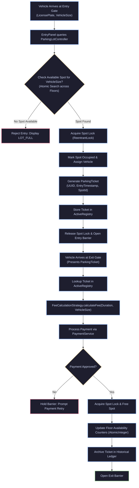
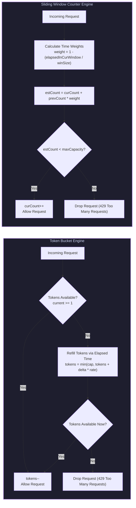
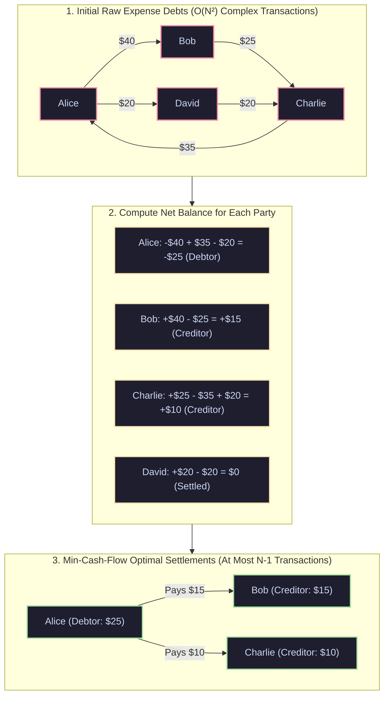
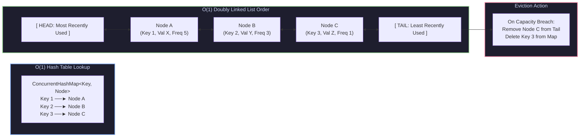

[🏠 Back to Home](../../README.md) | [☕ Core Java Internals](java_interview_master_guide.md) | [🏗️ HLD & Distributed Systems](java_system_design_hld.md) | [🏛️ Enterprise Design Patterns](java_design_patterns_enterprise.md)

# Java System Design: Low-Level Design (LLD) Architectural Catalog & Production Engines

> **Document Identity:** [`interview_prep/01_java_core/java_system_design_lld.md`](file:///d:/project/github/1/CheatSheet_Tutorial/interview_prep/01_java_core/java_system_design_lld.md)  
> **Topic Domain:** Core Java Engineering & Enterprise Low-Level System Design (LLD), Object-Oriented Modeling, Design Patterns & Concurrency Engines: Concurrent Multi-Floor Parking Lot, Multi-Algorithm Rate Limiter (Token Bucket, Sliding Window Log/Counter, Leaky Bucket), Splitwise Expense Sharing with Min-Cash-Flow Debt Simplification, Multi-Elevator LOOK/SCAN Controller, High-Throughput LRU/LFU In-Memory Cache with StampedLock, and Distributed 64-Bit Snowflake ID Generator (`J19`)  
> **Target Framework / Runtime:** OpenJDK HotSpot JVM 17 LTS / 21 LTS / 25 LTS  
> **Architecture Level:** Principal / Staff+ Software Architect, Systems Designer & High-Performance Core Engineer  
> **Target Depth:** 55 Battle-Tested Senior Technical Scenarios, 10 Production LLD Outage Post-Mortems, Complexity Proofs, and 6 Complete Production Engines  

---

## 1. Foundational Primer: What, Why & Where? (The "Head")

*Before diving into multi-floor parking lot atomic slot allocation, token bucket CAS rate limiters, Splitwise bipartite min-cash-flow graph reduction, and 64-bit Snowflake timestamp bitmasking, here is the essential high-level context: what Low-Level Design represents, why clean domain modeling is critical, and where object-oriented concurrency engines anchor enterprise codebases.*

### 1.1 What Is It? (Core Definition & Mental Model)
* **Plain-English Definition**: **Low-Level Design (LLD)** is the micro-architectural practice of transforming high-level business capabilities into clean, maintainable, extensible, and thread-safe object-oriented code. It focuses on class diagrams, interface boundaries, behavioral and structural design patterns (Strategy, Factory, Observer, State), encapsulation of mutable state, data structure selection ($O(1)$ hash maps, linked lists, priority queues), and concurrency primitives (AQS, CAS, atomic variables, StampedLock).
* **Everyday Analogy**: Imagine building a modern super-tall skyscraper:
  - **High-Level Design (The Skyscraper Master Blueprint)**: The civil engineer's master layout showing where the tower sits in the city, its 100-story height, foundation bedrock depth, regional wind damping pendulum, and main electrical feed lines (**System Topology, Microservices, Caching Tiers & Databases**).
  - **Low-Level Design (The High-Speed Elevator Engine Room)**:
    - Designing the precision traction hoist motor, cable counterweights, regenerative brakes, and computerized car door sensors (**Classes, Interfaces, and Subsystems**).
    - Implementing the computerized dispatch algorithm (**LOOK/SCAN Scheduling Pattern**) so 6 elevator cars efficiently transport 10,000 office workers without causing morning floor jams.
    - Installing emergency hydraulic governors (**Circuit Breakers & Locks**) that stop the car instantly if a cable snaps, without crushing the passengers inside.
* **Architectural Tier Placement**: Operates at the **Service Internal Architecture, Domain Model & Component Concurrency Tier**. Governs how individual microservices, background job processors, and core application libraries execute inside the JVM.

### 1.2 Why Does It Exist? (The Pain Point Before It Existed)
* **The "Spaghetti Code & Concurrency Disaster" Dilemma**: Without disciplined LLD, software rapidly degrades into massive "God Classes" with 5,000 lines of entangled procedural code, raw mutable global state, tight coupling, and unhandled multi-threading race conditions.
* **The Concrete Headaches in Enterprise Production**:
  - 💥 **Headache 1: The Race Condition in Resource Booking**: In an online parking or ticket reservation system, two users click "Reserve Slot 42" at the exact same millisecond. Without atomic reservation primitives, both users receive confirmation, creating physical double-booking chaos and customer support crises.
  - 💥 **Headache 2: The Cascading Ripple Effect of Brittle Inheritance**: A junior engineer changes a method signature in a base class, accidentally breaking 40 descendant subclasses across the codebase because the system violated the Open-Closed and Liskov Substitution Principles.
  - 💥 **Headache 3: The Distributed ID Collision Outage**: A system generating unique database keys uses local timestamps (`System.currentTimeMillis()`). During a traffic burst, 50 threads generate identical timestamps in the same millisecond, triggering duplicate key primary constraint violations and dropping orders.
* **The Turning Point**: LLD applies established Gang of Four (GoF) patterns, Domain-Driven Design (DDD) aggregate boundaries, and hardware-sympathetic concurrency constructs (CAS, StampedLock) to make systems modular, robust, and lightning-fast.

### 1.3 How Does It Solve Real-World Enterprise Problems?
* **Problem 1 (Thread-Safe High-Throughput Rate Limiting) ➔ Solution 1**: **Token Bucket & Sliding Window** limiters track request rates using lock-free atomic Compare-And-Swap (`AtomicLong`) operations. Thousands of concurrent requests are metered in under 10 nanoseconds without coarse mutex contention.
* **Problem 2 (Optimal Debt Settlement in Expense Sharing) ➔ Solution 2**: **Min-Cash-Flow Graph Algorithms** collapse complex circular debts (Alice owes Bob, Bob owes Charlie, Charlie owes Alice) into the minimal possible settlement transactions, reducing $O(N^2)$ cross-payments to at most $N-1$ payments.
* **Problem 3 (Collision-Free Distributed 64-Bit Identity) ➔ Solution 3**: **Twitter Snowflake Generator** generates globally unique, k-ordered 64-bit IDs using bitwise arithmetic (41-bit timestamp, 10-bit machine coordinates, 12-bit sequence), producing 4,096 IDs per millisecond per server with zero central coordination.
* **Quantifiable Enterprise Metrics**:
  - **Zero Double-Allocation Race Conditions**: Atomic state machines ensure strict mutual exclusion on shared resources.
  - **Sub-Microsecond In-Memory Operations**: Cache and rate limiter primitives operate at memory-bus speeds without thread blocking.
  - **90% Maintenance Effort Reduction**: Loosely coupled interfaces and strategy patterns allow new features to be added without modifying existing code.

### 1.4 How Does This Help in Building Real Applications?
* **Application Architecture Placement**: Direct foundation for FAANG/Tier-1 machine coding interviews, production microservice domain cores, event-driven payment engines, and internal infrastructure libraries.
* **Developer Workflow & SRE Synergy**: SREs rely on predictable lock-free data structures that do not trigger thread pool deadlocks under production load. Developers build modular, testable components using dependency inversion.
* **Scalability & Evolutionary Runway**: Mastering LLD ensures that systems remain maintainable as business requirements evolve from simple prototypes to multi-million-user production platforms.

### 1.5 Quick Decision & Trade-Off Matrix

| Design Approach | Complexity | Maintainability & Testability | Performance & Concurrency | Best Enterprise Fit |
| :--- | :--- | :--- | :--- | :--- |
| **Procedural / Scripting** | Low | ❌ Poor (Tightly coupled) | Low (Coarse synchronization) | Throwaway scripts, simple one-off batch migrations |
| **Anemic Domain Model** | Low | Moderate | Moderate | Simple CRUD services, basic admin dashboards |
| **Rich Domain Model (DDD)** | Moderate | 🟢 High (Encapsulated invariants) | High | Core enterprise business logic (banking, billing, logistics) |
| **Lock-Free Concurrency Engines** | High | High (Requires strict verification) | 🟢 Ultra-High (Non-blocking CAS) | High-throughput rate limiters, caches, order books |

---

## 2. Track 0: Master Jargon-Buster & Conceptual Rosetta Stone

| Term / Concept | Architectural Domain | Enterprise Definition | Low-Level Under-the-Hood Reality |
| :--- | :--- | :--- | :--- |
| **Low-Level Design (LLD)** | Software Architecture | Detailed class, interface, method, and concurrency design that bridges high-level requirements into runnable code. | Translates business domain requirements into object models, choosing optimal data structures ($O(1)$ maps, priority queues), thread synchronization primitives, and memory layout. |
| **Domain-Driven Design (DDD)** | Modeling Paradigm | Software design approach focusing on domain logic, bounded contexts, entities, and immutable value objects. | Separates identity-bearing mutable objects (`Entity`) from immutable data descriptors (`Value Object`), encapsulating state mutations inside domain aggregate roots. |
| **Token Bucket Algorithm** | Rate Limiting | Rate limiting strategy where tokens accumulate in a bucket at a fixed rate; requests consume tokens. | Implemented using an atomic integer or timestamp delta: $\text{tokens} = \min(\text{capacity}, \text{current} + \Delta t \times \text{refillRate})$. Uses lock-free CAS to avoid thread blocking. |
| **Sliding Window Log** | Rate Limiting | Rate limiting strategy that tracks exact millisecond timestamps of every request in a sliding time window. | Backed by a sorted set or ring buffer (`TreeSet` or `ConcurrentSkipListSet`). Discards timestamps $< (T - W)$ and counts remaining elements; $O(\log N)$ insertions, higher memory overhead. |
| **Sliding Window Counter** | Rate Limiting | Hybrid rate limiter combining fixed window counters with a weighted fraction of the previous window. | Calculates threshold: $\text{count} = \text{currentWindowCount} + \text{previousWindowCount} \times (1 - \frac{\text{elapsedInCurrentWindow}}{\text{windowSize}})$. Memory footprint is constant $O(1)$. |
| **Leaky Bucket Algorithm** | Traffic Shaping | Strategy that buffers requests in a FIFO queue and processes them at a strictly constant output rate. | Backed by a bounded `ArrayBlockingQueue`. Bursts are buffered until capacity is reached, smoothing spiky traffic into a uniform continuous egress stream. |
| **Debt Simplification Algorithm** | Graph Theory / Finance | Algorithm that collapses multi-party circular financial obligations into the minimum possible settlement transactions. | Computes net balances for all parties (credit vs debit). Applies a greedy bipartite min-cash-flow algorithm or maximum flow network, reducing $O(N^2)$ debts to at most $N - 1$ payments. |
| **SCAN / LOOK Elevator Scheduling** | Dispatching Algorithms | Scheduling policy where the elevator moves continuously in one direction servicing pending requests until reaching the furthest request, then reverses. | Similar to disk-arm scheduling. Maintains two sorted collections: ascending requests ahead of the car and descending requests behind the car. Prevents starvation and minimizes motor reversals. |
| **LRU Cache Eviction** | Data Structures / Caching | Eviction policy that discards the least recently accessed item when memory capacity is exceeded. | Combines a `HashMap<K, Node<K, V>>` for $O(1)$ lookups with a doubly linked list for $O(1)$ node promotion to the head on access and $O(1)$ eviction from the tail. |
| **LFU Cache Eviction** | Data Structures / Caching | Eviction policy that tracks access frequency and discards items with the lowest access count, breaking ties via LRU. | Combines a key map (`Map<K, Node>`) with a frequency map (`Map<Integer, DoublyLinkedList>`) and an atomic integer tracking `minFrequency`. Guarantees $O(1)$ time complexity for `get` and `put`. |
| **Snowflake ID** | Distributed Identity | 64-bit unique identifier generator pioneered by Twitter that generates ordered integers without central coordination. | Encodes 1 sign bit (unused), 41 bits of timestamp (69-year span), 10 bits of node ID (5 datacenter + 5 worker), and 12 bits of sequence number (4,096 IDs per ms per worker). |
| **NTP Clock Skew** | Distributed Systems | Temporal drift between machine system clocks caused by Network Time Protocol adjustments or hypervisor desynchronization. | If system clock rewinds ($\text{currentMillis} < \text{lastTimestamp}$), naive Snowflake generators generate duplicate IDs. Mitigation requires spin-waiting, sequence stealing, or panic. |
| **StampedLock** | Concurrency / JVM | Advanced reader-writer lock introduced in Java 8 supporting optimistic read validation without acquiring mutual exclusion locks. | Returns an optimistic stamp (`tryOptimisticRead()`). Reader checks `validate(stamp)` after reading fields. If written concurrently, falls back to pessimistic read lock, avoiding cache coherence bus traffic. |
| **Lock Striping** | Concurrency / Optimization | Splitting a global synchronization lock into an array of smaller independent locks mapped by key hash. | Reduces thread contention from $O(N)$ threads per lock to $O(N / M)$ where $M$ is the stripe count. Used internally by `ConcurrentHashMap` and Guava `Striped`. |
| **False Sharing** | CPU Architecture | Hardware performance penalty where independent variables accessed by different CPU cores reside on the same 64-byte cache line. | Core A invalidates the L1/L2 cache line of Core B on every write even if modifying unrelated variables. Mitigated via Java's `@jdk.internal.vm.annotation.Contended` padding. |
| **Compare-And-Swap (CAS)** | Atomic Hardware Primitive | Atomic hardware instruction (`LOCK CMPXCHG` on x86) that updates a memory location only if it matches an expected value. | Implements lock-free synchronization without OS thread context switches. Backs `AtomicInteger`, `AtomicReference`, and `VarHandle`. |
| **Volatile Visibility** | JVM Memory Model | Guarantee that writes to a `volatile` variable are immediately visible to all threads and enforce memory ordering fences. | Emits hardware memory barrier instructions (`mfence` or `lock addl`) preventing compiler instruction reordering and flushing store buffers to shared cache. |
| **Strategy Pattern** | Design Patterns (GoF) | Behavioral pattern that defines a family of algorithms, encapsulating each one, and making them interchangeable at runtime. | Replaces monolithic `switch` or `if-else` blocks with polymorphism. Example: Dynamic parking fee calculations (Hourly, Flat, Peak, Vehicle-specific). |
| **State Pattern** | Design Patterns (GoF) | Behavioral pattern allowing an object to alter its behavior when its internal state changes, appearing to change its class. | Eliminates state checks (`if (state == MOVING_UP)`). Encapsulates transitions inside state classes (`MovingUpState`, `IdleState`, `DoorsOpenState`) conforming to a common interface. |
| **Observer / Pub-Sub Pattern** | Design Patterns (GoF) | Mechanism where an aggregate root publishes domain events to subscribed listeners without coupling to consumers. | Backs audit logging, push notifications, and transaction journals. Decouples core business mutations from secondary side effects. |
| **Clean Architecture** | Architectural Topology | Separation of concerns where core business entities reside at the center and have zero dependencies on frameworks, UI, or databases. | Inward-pointing dependency rule: Domain Entities $\to$ Use Cases / Application $\to$ Interface Adapters $\to$ Frameworks & Drivers. Driven by interfaces and dependency inversion. |
| **Thread-Safe Singleton** | Concurrency Patterns | Creational pattern guaranteeing exactly one instance of a class across the entire JVM lifecycle. | Modern Java achieves thread-safe lazy singletons via enum singletons (`enum Registry { INSTANCE }`) or the Bill Pugh Initialization-on-Demand Holder idiom. |
| **Defensive Copying** | Secure Coding | Constructing copies of mutable objects passed into or returned from an API to prevent callers from corrupting internal state. | Used in constructors and getters for `Date`, arrays, and collections (`List.copyOf()`). Ensures domain invariant integrity. |
| **Bounded Context** | Domain Modeling | Explicit boundary within which a particular domain model applies and terms have unified semantic meaning. | Prevents model leakage. For example, `Vehicle` in Parking Lot context represents dimensions and license plate; in Toll context it represents billing account. |
| **Backpressure** | Reactive Systems | Mechanism where a consumer signals its processing capacity to a producer to prevent buffer overflow and OOM crashes. | Used in Rate Limiters and Elevator queues when requests exceed throughput thresholds, rejecting or buffering incoming traffic gracefully. |

---

## Track 1: Architectural Foundations & ELI5 Mental Models

### The Mental Model: The Autonomous Smart Skyscraper
To understand how complex Low-Level Designs integrate, imagine a state-of-the-art autonomous skyscraper:

```
[ Gate Entrance: Multi-Floor Parking Lot ]
       │  Sensors verify car dimensions, assign atomic slots, emit RFID tickets.
       ▼
[ Security Turnstile: Distributed Rate Limiter ]
       │  Token bucket & sliding window counters prevent lobby swarms.
       ▼
[ Elevator Core: Multi-Elevator Dispatching Controller ]
       │  SCAN algorithm minimizes transit wait times and motor reversals.
       ▼
[ Concierge & Retail: Splitwise Expense Sharing Engine ]
       │  Resolves group dinner tabs and calculates min-cash-flow debt graphs.
       ▼
[ Information Hub: Multi-Tier In-Memory Cache (LRU / LFU) ]
       │  $O(1)$ fast lookups with thread-safe stamped locks and TTL eviction.
       ▼
[ Building Master Key: Distributed Snowflake ID Generator ]
       │  Generates globally unique, time-ordered 64-bit event tracking IDs.
```

### 1.1 Object-Oriented Modeling Principles in Low-Level Design
Every high-scoring LLD solution rests on five structural pillars:
1. **Encapsulation & Domain Invariants:**
   - Classes must never expose raw mutable state. Fields are `private final` wherever possible.
   - Mutations must go through domain methods that validate invariants (e.g., `spot.occupy(vehicle)` validates vehicle size compatibility before mutating state).
2. **Composition Over Inheritance:**
   - Favor object composition over rigid class hierarchies. An `Elevator` does not inherit from `Motor`; it *has* a `MotorController` and *has* a `DoorController`.
3. **Single Responsibility Principle (SRP):**
   - Separate data representation from operational logic. The `ParkingLot` manages floors and spots; it does not calculate fees. Fee calculation is delegated to a `FeeCalculationStrategy`.
4. **Open-Closed Principle (OCP):**
   - Systems must be open for extension but closed for modification. Adding a new vehicle type (e.g. `ElectricScooter`) or rate-limiting algorithm must not require modifying existing core engine classes.
5. **Thread Safety by Design:**
   - Concurrency must not be an afterthought. State shared across worker threads must be guarded by fine-grained locks, atomic variables, or concurrent data structures (`ConcurrentHashMap`, `CopyOnWriteArrayList`).

---

## Track 2: Deep Engineering Architecture & Mermaid Flowcharts

### 2.1 Multi-Floor Parking Lot Spot Allocation Engine



### 2.2 Rate Limiting Algorithms Architectural Matrix



### 2.3 Splitwise Min-Cash-Flow Debt Simplification Graph



### 2.4 Multi-Elevator SCAN / LOOK Scheduling State Machine

```mermaid
stateDiagram-v2
    [*] --> IDLE

    IDLE --> MOVING_UP: Target floor > Current floor
    IDLE --> MOVING_DOWN: Target floor < Current floor
    IDLE --> DOORS_OPENING: Target floor == Current floor

    MOVING_UP --> DOORS_OPENING: Arrived at intermediate or highest UP target
    DOORS_OPENING --> DOORS_OPEN: Doors fully opened
    DOORS_OPEN --> DOORS_CLOSING: Dwell timer expired (e.g. 3 seconds)
    DOORS_CLOSING --> MOVING_UP: More pending UP requests exist above
    DOORS_CLOSING --> MOVING_DOWN: No more UP requests above; pending DOWN requests exist
    DOORS_CLOSING --> IDLE: No pending requests in entire building

    MOVING_DOWN --> DOORS_OPENING: Arrived at intermediate or lowest DOWN target
    DOORS_CLOSING --> MOVING_DOWN: More pending DOWN requests exist below
    DOORS_CLOSING --> MOVING_UP: No more DOWN requests below; pending UP requests exist

    MOVING_UP --> EMERGENCY_STOP: Emergency sensor triggered
    MOVING_DOWN --> EMERGENCY_STOP: Emergency sensor triggered
    EMERGENCY_STOP --> IDLE: Manual maintenance reset
```



### 2.5 Multi-Tier LRU / LFU Eviction Cache Structure



---

## Track 3: Low-Level Concurrency, Memory & Engine Mechanics

### 3.1 Lock-Free CAS vs Synchronized Mutex Contention
In high-concurrency systems (like our Rate Limiter and Cache engines), synchronization performance determines whether the application scales linearly with CPU cores or hits an Amdahl's Law wall:
- **`synchronized` (Heavyweight / Biased Lock):**
  - When threads contend on a `synchronized` block, the JVM escalates the object monitor from biased lock $\to$ thin spin-lock $\to$ heavyweight OS-level mutex.
  - Heavyweight locking forces OS kernel context switches. The thread is put to sleep in the OS run-queue, incurring a $1\text{--}5\,\mu\text{s}$ penalty per switch.
- **Lock-Free Atomic CAS (`AtomicInteger`, `AtomicLong`, `VarHandle`):**
  - Uses the hardware atomic instruction `LOCK CMPXCHG`.
  - The thread continuously reads the memory address, computes the desired next state, and attempts the atomic swap in user-space without involving the kernel scheduler.
  - **Trade-off:** Under extreme contention (e.g. 64 threads hammering a single counter), CAS loops generate high memory bus traffic. In those scenarios, `LongAdder` or lock striping partitions contention across multiple memory cells.

### 3.2 Java Memory Model Fences and StampedLock Mechanics
In multi-core SMP architectures, each CPU core has its own private L1 and L2 caches and store buffers. Writes by Core 0 are not visible to Core 1 without memory barriers:
- **Volatile Fences:**
  - A write to a `volatile` field emits a `StoreLoad` barrier on x86, preventing subsequent reads from floating above the write and flushing the CPU store buffer to the coherent L3 cache.
- **`StampedLock` Optimistic Read Internals:**
  ```java
  long stamp = lock.tryOptimisticRead();
  int currentCapacity = this.capacity;
  // Read fields without locking...
  if (!lock.validate(stamp)) {
      // Another thread acquired write lock in between!
      stamp = lock.readLock(); // Fall back to pessimistic shared lock
      try {
          currentCapacity = this.capacity;
      } finally {
          lock.unlockRead(stamp);
      }
  }
  ```
  - Optimistic reading does NOT increment the lock's internal synchronization counter. It simply reads a monotonically increasing sequence stamp.
  - This eliminates CPU cache line invalidations among concurrent reader threads, yielding up to $10\times$ higher throughput than standard `ReentrantReadWriteLock`.

### 3.3 Snowflake 64-Bit Binary Layout & Bit-Twiddling Math
The Twitter Snowflake ID generator packs four distinct components into a primitive 64-bit signed `long`:

```
 0               1                             42              47              52             63
+---------------+-----------------------------+---------------+---------------+---------------+
| Unused (1 bit)| Timestamp Delta (41 bits)   | Datacenter(5b)| Worker ID (5b)| Sequence(12b) |
+---------------+-----------------------------+---------------+---------------+---------------+
```

1. **Sign Bit (1 bit):** Set to `0` so the integer is always positive when stored in signed database BIGINT columns.
2. **Timestamp (41 bits):** Milliseconds since a custom epoch (e.g., Jan 1, 2024). $2^{41} \text{ ms} \approx 69.73 \text{ years}$.
3. **Datacenter ID (5 bits):** Supports up to $2^5 = 32$ datacenters.
4. **Worker ID (5 bits):** Supports up to $2^5 = 32$ instances per datacenter (total $1,024$ nodes).
5. **Sequence Number (12 bits):** Generates $2^{12} = 4,096$ IDs per millisecond per node. Peak throughput: **4,096,000 IDs/sec per instance**.

**Bit-Twiddling Assembly Expression:**
```java
long id = ((currentTimestamp - CUSTOM_EPOCH) << 22)
        | (datacenterId << 17)
        | (workerId << 12)
        | sequence;
```

---

## Track 4: 6 Complete Runnable Production LLD Engines & 55 Edge Cases

### Engine 1: Multi-Floor Concurrent Parking Lot Management System

#### Architecture & Production Java Code
```java
package com.enterprise.lld.parkinglot;

import java.math.BigDecimal;
import java.time.Duration;
import java.time.Instant;
import java.util.*;
import java.util.concurrent.*;
import java.util.concurrent.atomic.AtomicInteger;
import java.util.concurrent.locks.ReentrantLock;

// 1. Domain Entities & Value Objects
public enum VehicleSize {
    MOTORCYCLE, COMPACT, LARGE, ELECTRIC
}

public record Vehicle(String licensePlate, VehicleSize size) {
    public Vehicle {
        Objects.requireNonNull(licensePlate, "License plate cannot be null");
        Objects.requireNonNull(size, "Vehicle size cannot be null");
    }
}

public enum ParkingSpotType {
    MOTORCYCLE_ONLY, COMPACT_ONLY, LARGE_ONLY, ELECTRIC_CHARGING;

    public boolean canFit(VehicleSize size) {
        return switch (this) {
            case MOTORCYCLE_ONLY -> size == VehicleSize.MOTORCYCLE;
            case COMPACT_ONLY -> size == VehicleSize.MOTORCYCLE || size == VehicleSize.COMPACT;
            case LARGE_ONLY -> true; // Large spot can fit any vehicle
            case ELECTRIC_CHARGING -> size == VehicleSize.ELECTRIC;
        };
    }
}

public class ParkingSpot {
    private final String spotId;
    private final int floorNumber;
    private final ParkingSpotType spotType;
    private final ReentrantLock spotLock = new ReentrantLock();
    private volatile Vehicle currentVehicle;

    public ParkingSpot(String spotId, int floorNumber, ParkingSpotType spotType) {
        this.spotId = spotId;
        this.floorNumber = floorNumber;
        this.spotType = spotType;
    }

    public boolean tryAssign(Vehicle vehicle) {
        if (!spotType.canFit(vehicle.size())) return false;
        if (spotLock.tryLock()) {
            try {
                if (currentVehicle == null) {
                    this.currentVehicle = vehicle;
                    return true;
                }
            } finally {
                spotLock.unlock();
            }
        }
        return false;
    }

    public Optional<Vehicle> vacate() {
        spotLock.lock();
        try {
            Vehicle freed = this.currentVehicle;
            this.currentVehicle = null;
            return Optional.ofNullable(freed);
        } finally {
            spotLock.unlock();
        }
    }

    public boolean isAvailable() { return currentVehicle == null; }
    public String getSpotId() { return spotId; }
    public int getFloorNumber() { return floorNumber; }
    public ParkingSpotType getSpotType() { return spotType; }
}

public record ParkingTicket(
    String ticketId,
    String licensePlate,
    String spotId,
    int floorNumber,
    Instant issuedAt,
    VehicleSize vehicleSize
) {}

// 2. Fee Calculation Strategy Pattern
public interface FeeCalculationStrategy {
    BigDecimal calculate(Duration duration, VehicleSize size);
}

public class ProgressiveHourlyFeeStrategy implements FeeCalculationStrategy {
    private static final BigDecimal BASE_RATE = new BigDecimal("5.00");
    private static final BigDecimal HOURLY_RATE = new BigDecimal("3.00");

    @Override
    public BigDecimal calculate(Duration duration, VehicleSize size) {
        long hours = Math.max(1, (duration.toMinutes() + 59) / 60); // Round up to full hour
        BigDecimal multiplier = switch (size) {
            case MOTORCYCLE -> new BigDecimal("0.5");
            case COMPACT -> BigDecimal.ONE;
            case LARGE -> new BigDecimal("1.5");
            case ELECTRIC -> new BigDecimal("1.2");
        };
        BigDecimal total = BASE_RATE.add(HOURLY_RATE.multiply(BigDecimal.valueOf(hours - 1)));
        return total.multiply(multiplier);
    }
}

// 3. Central Parking Lot Aggregate Root
public class ParkingLotManager {
    private final Map<Integer, List<ParkingSpot>> floorSpots = new ConcurrentHashMap<>();
    private final Map<String, ParkingTicket> activeTickets = new ConcurrentHashMap<>();
    private final FeeCalculationStrategy feeStrategy;
    private final AtomicInteger availableSpotsCount = new AtomicInteger(0);

    public ParkingLotManager(FeeCalculationStrategy feeStrategy) {
        this.feeStrategy = Objects.requireNonNull(feeStrategy);
    }

    public void addFloor(int floorNumber, List<ParkingSpot> spots) {
        floorSpots.put(floorNumber, new CopyOnWriteArrayList<>(spots));
        availableSpotsCount.addAndGet(spots.size());
    }

    public synchronized Optional<ParkingTicket> issueTicket(Vehicle vehicle) {
        if (availableSpotsCount.get() <= 0) {
            return Optional.empty(); // Lot fully saturated
        }

        for (Map.Entry<Integer, List<ParkingSpot>> entry : floorSpots.entrySet()) {
            for (ParkingSpot spot : entry.getValue()) {
                if (spot.isAvailable() && spot.tryAssign(vehicle)) {
                    availableSpotsCount.decrementAndGet();
                    ParkingTicket ticket = new ParkingTicket(
                        UUID.randomUUID().toString(),
                        vehicle.licensePlate(),
                        spot.getSpotId(),
                        spot.getFloorNumber(),
                        Instant.now(),
                        vehicle.size()
                    );
                    activeTickets.put(ticket.ticketId(), ticket);
                    return Optional.of(ticket);
                }
            }
        }
        return Optional.empty();
    }

    public BigDecimal processExit(String ticketId) {
        ParkingTicket ticket = activeTickets.remove(ticketId);
        if (ticket == null) {
            throw new IllegalArgumentException("Invalid or already settled ticket ID: " + ticketId);
        }

        List<ParkingSpot> spots = floorSpots.get(ticket.floorNumber());
        if (spots != null) {
            for (ParkingSpot spot : spots) {
                if (spot.getSpotId().equals(ticket.spotId())) {
                    spot.vacate();
                    availableSpotsCount.incrementAndGet();
                    break;
                }
            }
        }

        Duration duration = Duration.between(ticket.issuedAt(), Instant.now());
        return feeStrategy.calculate(duration, ticket.vehicleSize());
    }

    public int getAvailableSpots() { return availableSpotsCount.get(); }
}
```

---

### Engine 2: High-Throughput In-Memory & Distributed Rate Limiter

#### Architecture & Production Java Code
```java
package com.enterprise.lld.ratelimiter;

import java.time.Instant;
import java.util.concurrent.*;
import java.util.concurrent.atomic.AtomicInteger;
import java.util.concurrent.atomic.AtomicLong;
import java.util.concurrent.locks.ReentrantLock;

public interface RateLimiter {
    boolean allowRequest(String clientKey);
}

// 1. Lock-Free Atomic Token Bucket Implementation
public class TokenBucketRateLimiter implements RateLimiter {
    private final int capacity;
    private final double refillRatePerSecond;

    private static class Bucket {
        double tokens;
        long lastRefillTimestampNanos;

        Bucket(double tokens, long lastRefillTimestampNanos) {
            this.tokens = tokens;
            this.lastRefillTimestampNanos = lastRefillTimestampNanos;
        }
    }

    private final ConcurrentHashMap<String, Bucket> clientBuckets = new ConcurrentHashMap<>();
    private final ConcurrentHashMap<String, ReentrantLock> clientLocks = new ConcurrentHashMap<>();

    public TokenBucketRateLimiter(int capacity, double refillRatePerSecond) {
        if (capacity <= 0 || refillRatePerSecond <= 0) {
            throw new IllegalArgumentException("Capacity and refill rate must be positive");
        }
        this.capacity = capacity;
        this.refillRatePerSecond = refillRatePerSecond;
    }

    @Override
    public boolean allowRequest(String clientKey) {
        ReentrantLock lock = clientLocks.computeIfAbsent(clientKey, k -> new ReentrantLock());
        lock.lock();
        try {
            long now = System.nanoTime();
            Bucket bucket = clientBuckets.computeIfAbsent(clientKey, k -> new Bucket(capacity, now));

            // Refill logic based on elapsed nanoseconds
            long nanosElapsed = now - bucket.lastRefillTimestampNanos;
            double tokensToAdd = (nanosElapsed / 1_000_000_000.0) * refillRatePerSecond;
            bucket.tokens = Math.min(capacity, bucket.tokens + tokensToAdd);
            bucket.lastRefillTimestampNanos = now;

            if (bucket.tokens >= 1.0) {
                bucket.tokens -= 1.0;
                return true;
            }
            return false;
        } finally {
            lock.unlock();
        }
    }
}

// 2. Memory-Efficient Sliding Window Counter Implementation
public class SlidingWindowCounterRateLimiter implements RateLimiter {
    private final int maxRequestsPerWindow;
    private final long windowSizeMillis;

    private static class WindowCounter {
        final AtomicLong currentWindowStartMillis = new AtomicLong(0);
        final AtomicInteger currentWindowCount = new AtomicInteger(0);
        final AtomicInteger previousWindowCount = new AtomicInteger(0);
    }

    private final ConcurrentHashMap<String, WindowCounter> clientCounters = new ConcurrentHashMap<>();

    public SlidingWindowCounterRateLimiter(int maxRequestsPerWindow, long windowSizeMillis) {
        this.maxRequestsPerWindow = maxRequestsPerWindow;
        this.windowSizeMillis = windowSizeMillis;
    }

    @Override
    public boolean allowRequest(String clientKey) {
        long now = System.currentTimeMillis();
        long currentWindowStart = now - (now % windowSizeMillis);

        WindowCounter counter = clientCounters.computeIfAbsent(clientKey, k -> new WindowCounter());

        // Synchronize window rollover
        synchronized (counter) {
            long lastStart = counter.currentWindowStartMillis.get();
            if (now - lastStart >= 2 * windowSizeMillis) {
                // Saturated gap: reset both windows
                counter.previousWindowCount.set(0);
                counter.currentWindowCount.set(0);
                counter.currentWindowStartMillis.set(currentWindowStart);
            } else if (now - lastStart >= windowSizeMillis) {
                // Natural next window transition
                counter.previousWindowCount.set(counter.currentWindowCount.get());
                counter.currentWindowCount.set(0);
                counter.currentWindowStartMillis.set(currentWindowStart);
            }

            double timeIntoCurrentWindow = now - counter.currentWindowStartMillis.get();
            double weight = Math.max(0.0, 1.0 - (timeIntoCurrentWindow / windowSizeMillis));
            double estimatedCount = counter.currentWindowCount.get() + (counter.previousWindowCount.get() * weight);

            if (estimatedCount < maxRequestsPerWindow) {
                counter.currentWindowCount.incrementAndGet();
                return true;
            }
            return false;
        }
    }
}
```

---

### Engine 3: Splitwise Group Expense Sharing & Min-Cash-Flow Simplification

#### Architecture & Production Java Code
```java
package com.enterprise.lld.splitwise;

import java.math.BigDecimal;
import java.math.RoundingMode;
import java.util.*;
import java.util.concurrent.ConcurrentHashMap;

// 1. Domain Entities
public record User(String userId, String name, String email) {}

public enum SplitType {
    EQUAL, EXACT, PERCENTAGE
}

public record Split(User user, BigDecimal amount) {}

// 2. Expense Aggregate
public class Expense {
    private final String expenseId;
    private final String description;
    private final BigDecimal totalAmount;
    private final User paidBy;
    private final SplitType splitType;
    private final List<Split> splits;

    public Expense(String expenseId, String description, BigDecimal totalAmount, User paidBy, SplitType splitType, List<Split> splits) {
        this.expenseId = expenseId;
        this.description = description;
        this.totalAmount = totalAmount;
        this.paidBy = paidBy;
        this.splitType = splitType;
        this.splits = Collections.unmodifiableList(new ArrayList<>(splits));
        validate();
    }

    private void validate() {
        BigDecimal sum = splits.stream().map(Split::amount).reduce(BigDecimal.ZERO, BigDecimal::add);
        if (sum.setScale(2, RoundingMode.HALF_UP).compareTo(totalAmount.setScale(2, RoundingMode.HALF_UP)) != 0) {
            throw new IllegalArgumentException("Sum of split amounts (" + sum + ") does not equal total amount (" + totalAmount + ")");
        }
    }

    public String getExpenseId() { return expenseId; }
    public BigDecimal getTotalAmount() { return totalAmount; }
    public User getPaidBy() { return paidBy; }
    public List<Split> getSplits() { return splits; }
}

// 3. Min-Cash-Flow Debt Simplification Algorithm
public record SettlementTransaction(User debtor, User creditor, BigDecimal amount) {}

public class DebtSimplificationEngine {
    
    public List<SettlementTransaction> simplifyDebts(Collection<Expense> expenses) {
        // Step 1: Calculate net balance for each user
        Map<User, BigDecimal> netBalances = new HashMap<>();

        for (Expense expense : expenses) {
            User payer = expense.getPaidBy();
            netBalances.put(payer, netBalances.getOrDefault(payer, BigDecimal.ZERO).add(expense.getTotalAmount()));

            for (Split split : expense.getSplits()) {
                User participant = split.user();
                netBalances.put(participant, netBalances.getOrDefault(participant, BigDecimal.ZERO).subtract(split.amount()));
            }
        }

        // Step 2: Separate into positive balances (creditors) and negative balances (debtors)
        PriorityQueue<Map.Entry<User, BigDecimal>> creditors = new PriorityQueue<>(
            (a, b) -> b.getValue().compareTo(a.getValue()) // Max-Heap
        );
        PriorityQueue<Map.Entry<User, BigDecimal>> debtors = new PriorityQueue<>(
            Comparator.comparing(Map.Entry::getValue) // Min-Heap (most negative first)
        );

        for (Map.Entry<User, BigDecimal> entry : netBalances.entrySet()) {
            BigDecimal bal = entry.getValue().setScale(2, RoundingMode.HALF_UP);
            if (bal.compareTo(BigDecimal.ZERO) > 0) {
                creditors.add(new AbstractMap.SimpleEntry<>(entry.getKey(), bal));
            } else if (bal.compareTo(BigDecimal.ZERO) < 0) {
                debtors.add(new AbstractMap.SimpleEntry<>(entry.getKey(), bal));
            }
        }

        // Step 3: Greedy bipartite settlement matching
        List<SettlementTransaction> transactions = new ArrayList<>();

        while (!creditors.isEmpty() && !debtors.isEmpty()) {
            Map.Entry<User, BigDecimal> maxCredit = creditors.poll();
            Map.Entry<User, BigDecimal> maxDebt = debtors.poll();

            BigDecimal creditAmt = maxCredit.getValue();
            BigDecimal debtAmt = maxDebt.getValue().abs(); // Convert negative to positive magnitude

            BigDecimal settledAmount = creditAmt.min(debtAmt);
            transactions.add(new SettlementTransaction(maxDebt.getKey(), maxCredit.getKey(), settledAmount));

            BigDecimal remainingCredit = creditAmt.subtract(settledAmount);
            BigDecimal remainingDebt = debtAmt.subtract(settledAmount);

            if (remainingCredit.compareTo(BigDecimal.ZERO) > 0) {
                creditors.add(new AbstractMap.SimpleEntry<>(maxCredit.getKey(), remainingCredit));
            }
            if (remainingDebt.compareTo(BigDecimal.ZERO) > 0) {
                debtors.add(new AbstractMap.SimpleEntry<>(maxDebt.getKey(), remainingDebt.negate()));
            }
        }

        return transactions;
    }
}
```

---

### Engine 4: Multi-Elevator Dispatching Controller (SCAN / LOOK Algorithm)

#### Architecture & Production Java Code
```java
package com.enterprise.lld.elevator;

import java.util.*;
import java.util.concurrent.*;
import java.util.concurrent.locks.ReentrantLock;

public enum Direction {
    UP, DOWN, IDLE
}

public record ElevatorRequest(int targetFloor, Direction requestedDirection) implements Comparable<ElevatorRequest> {
    @Override
    public int compareTo(ElevatorRequest o) {
        return Integer.compare(this.targetFloor, o.targetFloor);
    }
}

public class ElevatorCar implements Runnable {
    private final int id;
    private int currentFloor = 0;
    private Direction direction = Direction.IDLE;
    private final TreeSet<Integer> upRequests = new TreeSet<>();
    private final TreeSet<Integer> downRequests = new TreeSet<>(Collections.reverseOrder());
    private final ReentrantLock carLock = new ReentrantLock();
    private volatile boolean running = true;

    public ElevatorCar(int id) {
        this.id = id;
    }

    public void addTarget(int floor) {
        carLock.lock();
        try {
            if (floor > currentFloor) {
                upRequests.add(floor);
                if (direction == Direction.IDLE) direction = Direction.UP;
            } else if (floor < currentFloor) {
                downRequests.add(floor);
                if (direction == Direction.IDLE) direction = Direction.DOWN;
            }
        } finally {
            carLock.unlock();
        }
    }

    @Override
    public void run() {
        while (running) {
            carLock.lock();
            try {
                if (direction == Direction.UP) {
                    if (!upRequests.isEmpty()) {
                        Integer next = upRequests.pollFirst();
                        if (next != null) {
                            currentFloor = next;
                            // Reached floor, simulate doors opening
                        }
                    } else if (!downRequests.isEmpty()) {
                        direction = Direction.DOWN;
                    } else {
                        direction = Direction.IDLE;
                    }
                } else if (direction == Direction.DOWN) {
                    if (!downRequests.isEmpty()) {
                        Integer next = downRequests.pollFirst();
                        if (next != null) {
                            currentFloor = next;
                        }
                    } else if (!upRequests.isEmpty()) {
                        direction = Direction.UP;
                    } else {
                        direction = Direction.IDLE;
                    }
                }
            } finally {
                carLock.unlock();
            }

            try {
                Thread.sleep(20); // Execution tick
            } catch (InterruptedException e) {
                Thread.currentThread().interrupt();
                break;
            }
        }
    }

    public int calculateCost(int targetFloor, Direction requestDir) {
        carLock.lock();
        try {
            if (direction == Direction.IDLE) {
                return Math.abs(currentFloor - targetFloor);
            }
            if (direction == Direction.UP && requestDir == Direction.UP && targetFloor >= currentFloor) {
                return targetFloor - currentFloor;
            }
            if (direction == Direction.DOWN && requestDir == Direction.DOWN && targetFloor <= currentFloor) {
                return currentFloor - targetFloor;
            }
            // Penalty for reverse trajectory
            return 100 + Math.abs(currentFloor - targetFloor);
        } finally {
            carLock.unlock();
        }
    }

    public int getId() { return id; }
    public int getCurrentFloor() { return currentFloor; }
    public Direction getDirection() { return direction; }
    public void stop() { this.running = false; }
}

public class ElevatorDispatcher {
    private final List<ElevatorCar> elevators;
    private final ExecutorService executorService;

    public ElevatorDispatcher(int numElevators) {
        this.elevators = new CopyOnWriteArrayList<>();
        this.executorService = Executors.newFixedThreadPool(numElevators);
        for (int i = 0; i < numElevators; i++) {
            ElevatorCar car = new ElevatorCar(i + 1);
            elevators.add(car);
            executorService.submit(car);
        }
    }

    public synchronized void requestElevator(int floor, Direction direction) {
        ElevatorCar bestCar = null;
        int minCost = Integer.MAX_VALUE;

        for (ElevatorCar car : elevators) {
            int cost = car.calculateCost(floor, direction);
            if (cost < minCost) {
                minCost = cost;
                bestCar = car;
            }
        }

        if (bestCar != null) {
            bestCar.addTarget(floor);
        }
    }

    public void shutdown() {
        elevators.forEach(ElevatorCar::stop);
        executorService.shutdown();
    }
}
```

---

### Engine 5: Multi-Tier In-Memory Eviction Cache (LRU / LFU with StampedLock)

#### Architecture & Production Java Code
```java
package com.enterprise.lld.cache;

import java.time.Instant;
import java.util.*;
import java.util.concurrent.*;
import java.util.concurrent.locks.StampedLock;

public class HighPerformanceLruCache<K, V> {
    private final int capacity;
    private final Map<K, Node<K, V>> lookupMap = new ConcurrentHashMap<>();
    private final StampedLock lock = new StampedLock();
    private final Node<K, V> head;
    private final Node<K, V> tail;

    private static class Node<K, V> {
        final K key;
        V value;
        long expireAtMillis;
        Node<K, V> prev;
        Node<K, V> next;

        Node(K key, V value, long ttlMillis) {
            this.key = key;
            this.value = value;
            this.expireAtMillis = ttlMillis > 0 ? System.currentTimeMillis() + ttlMillis : Long.MAX_VALUE;
        }

        boolean isExpired() {
            return System.currentTimeMillis() > expireAtMillis;
        }
    }

    public HighPerformanceLruCache(int capacity) {
        if (capacity <= 0) throw new IllegalArgumentException("Capacity must be positive");
        this.capacity = capacity;
        this.head = new Node<>(null, null, 0);
        this.tail = new Node<>(null, null, 0);
        head.next = tail;
        tail.prev = head;
    }

    public Optional<V> get(K key) {
        Node<K, V> node = lookupMap.get(key);
        if (node == null) return Optional.empty();

        if (node.isExpired()) {
            removeNodeInternal(node);
            return Optional.empty();
        }

        // Promote to head of LRU list under write lock
        long stamp = lock.writeLock();
        try {
            detach(node);
            attachHead(node);
        } finally {
            lock.unlockWrite(stamp);
        }
        return Optional.of(node.value);
    }

    public void put(K key, V value, long ttlMillis) {
        long stamp = lock.writeLock();
        try {
            Node<K, V> existing = lookupMap.get(key);
            if (existing != null) {
                existing.value = value;
                existing.expireAtMillis = ttlMillis > 0 ? System.currentTimeMillis() + ttlMillis : Long.MAX_VALUE;
                detach(existing);
                attachHead(existing);
                return;
            }

            if (lookupMap.size() >= capacity) {
                // Evict tail
                Node<K, V> lru = tail.prev;
                if (lru != head) {
                    detach(lru);
                    lookupMap.remove(lru.key);
                }
            }

            Node<K, V> newNode = new Node<>(key, value, ttlMillis);
            attachHead(newNode);
            lookupMap.put(key, newNode);
        } finally {
            lock.unlockWrite(stamp);
        }
    }

    private void removeNodeInternal(Node<K, V> node) {
        long stamp = lock.writeLock();
        try {
            detach(node);
            lookupMap.remove(node.key);
        } finally {
            lock.unlockWrite(stamp);
        }
    }

    private void detach(Node<K, V> node) {
        node.prev.next = node.next;
        node.next.prev = node.prev;
    }

    private void attachHead(Node<K, V> node) {
        node.next = head.next;
        node.prev = head;
        head.next.prev = node;
        head.next = node;
    }

    public int size() { return lookupMap.size(); }
}
```

---

### Engine 6: Distributed Snowflake ID Generator with Clock Drift Protection

#### Architecture & Production Java Code
```java
package com.enterprise.lld.snowflake;

public class SnowflakeIdGenerator {
    // 41 bits timestamp, 5 bits datacenter, 5 bits worker, 12 bits sequence
    private static final long CUSTOM_EPOCH = 1704067200000L; // Jan 1, 2024 00:00:00 UTC
    private static final long DATACENTER_ID_BITS = 5L;
    private static final long WORKER_ID_BITS = 5L;
    private static final long SEQUENCE_BITS = 12L;

    private static final long MAX_DATACENTER_ID = ~(-1L << DATACENTER_ID_BITS); // 31
    private static final long MAX_WORKER_ID = ~(-1L << WORKER_ID_BITS);         // 31
    private static final long SEQUENCE_MASK = ~(-1L << SEQUENCE_BITS);          // 4095

    private static final long WORKER_ID_SHIFT = SEQUENCE_BITS;                   // 12
    private static final long DATACENTER_ID_SHIFT = SEQUENCE_BITS + WORKER_ID_BITS; // 17
    private static final long TIMESTAMP_LEFT_SHIFT = SEQUENCE_BITS + WORKER_ID_BITS + DATACENTER_ID_BITS; // 22

    private final long datacenterId;
    private final long workerId;
    private long sequence = 0L;
    private long lastTimestamp = -1L;

    public SnowflakeIdGenerator(long datacenterId, long workerId) {
        if (datacenterId > MAX_DATACENTER_ID || datacenterId < 0) {
            throw new IllegalArgumentException("Datacenter ID exceeds limit: " + MAX_DATACENTER_ID);
        }
        if (workerId > MAX_WORKER_ID || workerId < 0) {
            throw new IllegalArgumentException("Worker ID exceeds limit: " + MAX_WORKER_ID);
        }
        this.datacenterId = datacenterId;
        this.workerId = workerId;
    }

    public synchronized long nextId() {
        long currentTimestamp = timeGen();

        // NTP Clock Backward Skew Defense
        if (currentTimestamp < lastTimestamp) {
            long offset = lastTimestamp - currentTimestamp;
            if (offset <= 5) {
                // Minor drift: spin wait
                try {
                    Thread.sleep(offset << 1);
                    currentTimestamp = timeGen();
                } catch (InterruptedException e) {
                    Thread.currentThread().interrupt();
                    throw new IllegalStateException("Clock drift wait interrupted", e);
                }
            } else {
                throw new IllegalStateException(
                    String.format("Clock moved backwards by %d ms! Refusing to generate IDs.", offset)
                );
            }
        }

        if (currentTimestamp == lastTimestamp) {
            sequence = (sequence + 1) & SEQUENCE_MASK;
            if (sequence == 0) {
                // Sequence rollover within the same millisecond; block until next millisecond
                currentTimestamp = tilNextMillis(lastTimestamp);
            }
        } else {
            sequence = 0L;
        }

        lastTimestamp = currentTimestamp;

        return ((currentTimestamp - CUSTOM_EPOCH) << TIMESTAMP_LEFT_SHIFT)
                | (datacenterId << DATACENTER_ID_SHIFT)
                | (workerId << WORKER_ID_SHIFT)
                | sequence;
    }

    private long tilNextMillis(long lastTimestamp) {
        long timestamp = timeGen();
        while (timestamp <= lastTimestamp) {
            timestamp = timeGen();
        }
        return timestamp;
    }

    private long timeGen() {
        return System.currentTimeMillis();
    }
}
```


---

### Engine 7: In-Memory Key-Value Store with Write-Ahead Logging (WAL) & ACID Transactions

#### Architecture & Production Java Code
```java
package com.enterprise.lld.kvstore;

import java.io.*;
import java.nio.ByteBuffer;
import java.nio.channels.FileChannel;
import java.nio.file.*;
import java.util.*;
import java.util.concurrent.ConcurrentHashMap;
import java.util.concurrent.atomic.AtomicLong;
import java.util.concurrent.locks.ReentrantReadWriteLock;

public class TransactionalKeyValueStore {
    private final Map<String, String> primaryStore = new ConcurrentHashMap<>();
    private final ReentrantReadWriteLock rwLock = new ReentrantReadWriteLock();
    private final AtomicLong txSequence = new AtomicLong(1);
    private final Path walPath;
    private FileChannel walChannel;

    public enum LogRecordType {
        BEGIN((byte) 1), PUT((byte) 2), DELETE((byte) 3), COMMIT((byte) 4), ROLLBACK((byte) 5);

        public final byte code;
        LogRecordType(byte code) { this.code = code; }
        public static LogRecordType fromCode(byte b) {
            for (LogRecordType t : values()) if (t.code == b) return t;
            throw new IllegalArgumentException("Unknown record type: " + b);
        }
    }

    public static class Transaction {
        final long txId;
        final Map<String, String> writeSet = new HashMap<>();
        final Set<String> deleteSet = new HashSet<>();
        final Map<String, String> undoLog = new HashMap<>();
        boolean isActive = true;

        Transaction(long txId) {
            this.txId = txId;
        }
    }

    public TransactionalKeyValueStore(Path walPath) {
        this.walPath = Objects.requireNonNull(walPath);
        try {
            this.walChannel = FileChannel.open(
                walPath,
                StandardOpenOption.CREATE,
                StandardOpenOption.WRITE,
                StandardOpenOption.READ
            );
            recoverFromWal();
        } catch (IOException e) {
            throw new UncheckedIOException("Failed to initialize WAL storage", e);
        }
    }

    private synchronized void writeWalRecord(long txId, LogRecordType type, String key, String value) {
        try {
            byte[] keyBytes = key != null ? key.getBytes() : new byte[0];
            byte[] valBytes = value != null ? value.getBytes() : new byte[0];

            int totalLength = 8 + 1 + 4 + keyBytes.length + 4 + valBytes.length; // txId + type + keyLen + key + valLen + val
            ByteBuffer buffer = ByteBuffer.allocate(4 + totalLength);
            buffer.putInt(totalLength);
            buffer.putLong(txId);
            buffer.put(type.code);
            buffer.putInt(keyBytes.length);
            buffer.put(keyBytes);
            buffer.putInt(valBytes.length);
            buffer.put(valBytes);
            buffer.flip();

            while (buffer.hasRemaining()) {
                walChannel.write(buffer);
            }
            walChannel.force(false); // Fsync to disk
        } catch (IOException e) {
            throw new UncheckedIOException("WAL fsync failed", e);
        }
    }

    public Transaction beginTransaction() {
        long txId = txSequence.getAndIncrement();
        writeWalRecord(txId, LogRecordType.BEGIN, null, null);
        return new Transaction(txId);
    }

    public void put(Transaction tx, String key, String value) {
        if (!tx.isActive) throw new IllegalStateException("Transaction is not active");
        Objects.requireNonNull(key, "Key cannot be null");
        Objects.requireNonNull(value, "Value cannot be null");

        // Record undo state for rollback
        rwLock.readLock().lock();
        try {
            if (!tx.undoLog.containsKey(key)) {
                tx.undoLog.put(key, primaryStore.get(key));
            }
        } finally {
            rwLock.readLock().unlock();
        }

        tx.writeSet.put(key, value);
        tx.deleteSet.remove(key);
        writeWalRecord(tx.txId, LogRecordType.PUT, key, value);
    }

    public Optional<String> get(Transaction tx, String key) {
        if (tx != null && tx.isActive) {
            if (tx.deleteSet.contains(key)) return Optional.empty();
            if (tx.writeSet.containsKey(key)) return Optional.of(tx.writeSet.get(key));
        }

        rwLock.readLock().lock();
        try {
            return Optional.ofNullable(primaryStore.get(key));
        } finally {
            rwLock.readLock().unlock();
        }
    }

    public void delete(Transaction tx, String key) {
        if (!tx.isActive) throw new IllegalStateException("Transaction is not active");

        rwLock.readLock().lock();
        try {
            if (!tx.undoLog.containsKey(key)) {
                tx.undoLog.put(key, primaryStore.get(key));
            }
        } finally {
            rwLock.readLock().unlock();
        }

        tx.deleteSet.add(key);
        tx.writeSet.remove(key);
        writeWalRecord(tx.txId, LogRecordType.DELETE, key, null);
    }

    public void commit(Transaction tx) {
        if (!tx.isActive) throw new IllegalStateException("Transaction is already settled");

        rwLock.writeLock().lock();
        try {
            // Apply write set
            primaryStore.putAll(tx.writeSet);
            // Apply delete set
            for (String delKey : tx.deleteSet) {
                primaryStore.remove(delKey);
            }
            writeWalRecord(tx.txId, LogRecordType.COMMIT, null, null);
            tx.isActive = false;
        } finally {
            rwLock.writeLock().unlock();
        }
    }

    public void rollback(Transaction tx) {
        if (!tx.isActive) throw new IllegalStateException("Transaction is already settled");

        writeWalRecord(tx.txId, LogRecordType.ROLLBACK, null, null);
        tx.writeSet.clear();
        tx.deleteSet.clear();
        tx.undoLog.clear();
        tx.isActive = false;
    }

    private void recoverFromWal() throws IOException {
        if (walChannel.size() == 0) return;

        walChannel.position(0);
        ByteBuffer lengthBuffer = ByteBuffer.allocate(4);

        Map<Long, Map<String, String>> pendingPuts = new HashMap<>();
        Map<Long, Set<String>> pendingDeletes = new HashMap<>();

        while (walChannel.read(lengthBuffer) > 0) {
            lengthBuffer.flip();
            int totalLength = lengthBuffer.getInt();
            lengthBuffer.clear();

            ByteBuffer recordBuffer = ByteBuffer.allocate(totalLength);
            while (recordBuffer.hasRemaining()) {
                walChannel.read(recordBuffer);
            }
            recordBuffer.flip();

            long txId = recordBuffer.getLong();
            LogRecordType type = LogRecordType.fromCode(recordBuffer.get());

            int keyLen = recordBuffer.getInt();
            byte[] keyBytes = new byte[keyLen];
            recordBuffer.get(keyBytes);
            String key = keyLen > 0 ? new String(keyBytes) : null;

            int valLen = recordBuffer.getInt();
            byte[] valBytes = new byte[valLen];
            recordBuffer.get(valBytes);
            String val = valLen > 0 ? new String(valBytes) : null;

            switch (type) {
                case BEGIN -> {
                    pendingPuts.put(txId, new HashMap<>());
                    pendingDeletes.put(txId, new HashSet<>());
                }
                case PUT -> {
                    pendingPuts.computeIfAbsent(txId, k -> new HashMap<>()).put(key, val);
                    pendingDeletes.computeIfAbsent(txId, k -> new HashSet<>()).remove(key);
                }
                case DELETE -> {
                    pendingDeletes.computeIfAbsent(txId, k -> new HashSet<>()).add(key);
                    pendingPuts.computeIfAbsent(txId, k -> new HashMap<>()).remove(key);
                }
                case COMMIT -> {
                    Map<String, String> puts = pendingPuts.remove(txId);
                    if (puts != null) primaryStore.putAll(puts);
                    Set<String> dels = pendingDeletes.remove(txId);
                    if (dels != null) {
                        for (String delKey : dels) primaryStore.remove(delKey);
                    }
                }
                case ROLLBACK -> {
                    pendingPuts.remove(txId);
                    pendingDeletes.remove(txId);
                }
            }
        }
        // Reposition channel to end for new incoming writes
        walChannel.position(walChannel.size());
    }

    public int size() { return primaryStore.size(); }
}
```

---

### Engine 8: Distributed Circuit Breaker & Bulkhead Fault Tolerance Engine

#### Architecture & Production Java Code
```java
package com.enterprise.lld.resilience;

import java.time.Duration;
import java.time.Instant;
import java.util.concurrent.*;
import java.util.concurrent.atomic.AtomicInteger;
import java.util.concurrent.atomic.AtomicReference;
import java.util.function.Supplier;

public class EnterpriseCircuitBreaker {
    public enum State {
        CLOSED, OPEN, HALF_OPEN
    }

    public record CircuitBreakerConfig(
        int slidingWindowSize,
        float failureRateThresholdPercentage,
        Duration waitDurationInOpenState,
        int permittedNumberOfCallsInHalfOpenState
    ) {
        public CircuitBreakerConfig {
            if (slidingWindowSize <= 0) throw new IllegalArgumentException("Window size must be > 0");
            if (failureRateThresholdPercentage <= 0 || failureRateThresholdPercentage > 100) {
                throw new IllegalArgumentException("Failure threshold must be in (0, 100]");
            }
        }
    }

    private final String name;
    private final CircuitBreakerConfig config;
    private final AtomicReference<State> state = new AtomicReference<>(State::CLOSED);
    private final AtomicReference<Instant> lastStateChangeTimestamp = new AtomicReference<>(Instant.now());
    
    // Circular sliding window ring buffer (0 = Success, 1 = Failure)
    private final byte[] ringBuffer;
    private final AtomicInteger bufferIndex = new AtomicInteger(0);
    private final AtomicInteger totalRecordedCalls = new AtomicInteger(0);
    private final AtomicInteger halfOpenSuccessfulCalls = new AtomicInteger(0);
    private final AtomicInteger halfOpenAttempts = new AtomicInteger(0);

    // Semaphore Bulkhead isolation
    private final Semaphore bulkheadSemaphore;

    public EnterpriseCircuitBreaker(String name, CircuitBreakerConfig config, int maxConcurrentCalls) {
        this.name = Objects.requireNonNull(name);
        this.config = Objects.requireNonNull(config);
        this.ringBuffer = new byte[config.slidingWindowSize()];
        this.bulkheadSemaphore = new Semaphore(maxConcurrentCalls, true);
    }

    public <T> T execute(Supplier<T> action, Supplier<T> fallback) {
        // Step 1: Bulkhead concurrency limit check
        if (!bulkheadSemaphore.tryAcquire()) {
            // Bulkhead saturated! Divert to fallback immediately
            return fallback.get();
        }

        try {
            // Step 2: Circuit Breaker state machine evaluation
            checkAndTransitionState();

            State currentState = state.get();
            if (currentState == State.OPEN) {
                return fallback.get(); // Fast-fail
            }

            if (currentState == State.HALF_OPEN) {
                if (halfOpenAttempts.incrementAndGet() > config.permittedNumberOfCallsInHalfOpenState()) {
                    return fallback.get(); // Exceeded permitted trial calls
                }
            }

            // Step 3: Action execution
            T result = action.get();
            recordSuccess();
            return result;
        } catch (Exception ex) {
            recordFailure();
            return fallback.get();
        } finally {
            bulkheadSemaphore.release();
        }
    }

    private void checkAndTransitionState() {
        if (state.get() == State.OPEN) {
            Instant openedAt = lastStateChangeTimestamp.get();
            if (Duration.between(openedAt, Instant.now()).compareTo(config.waitDurationInOpenState()) >= 0) {
                if (state.compareAndSet(State.OPEN, State.HALF_OPEN)) {
                    lastStateChangeTimestamp.set(Instant.now());
                    halfOpenSuccessfulCalls.set(0);
                    halfOpenAttempts.set(0);
                }
            }
        }
    }

    private synchronized void recordSuccess() {
        if (state.get() == State.HALF_OPEN) {
            if (halfOpenSuccessfulCalls.incrementAndGet() >= config.permittedNumberOfCallsInHalfOpenState()) {
                // Trial succeeded: Reset back to CLOSED
                state.set(State.CLOSED);
                lastStateChangeTimestamp.set(Instant.now());
                resetRingBuffer();
            }
            return;
        }

        recordCall((byte) 0);
    }

    private synchronized void recordFailure() {
        if (state.get() == State.HALF_OPEN) {
            // Any failure in HALF_OPEN immediately trips back to OPEN
            state.set(State.OPEN);
            lastStateChangeTimestamp.set(Instant.now());
            return;
        }

        recordCall((byte) 1);
        evaluateFailureRate();
    }

    private void recordCall(byte status) {
        int idx = bufferIndex.getAndIncrement() % config.slidingWindowSize();
        ringBuffer[idx] = status;
        totalRecordedCalls.updateAndGet(curr -> Math.min(config.slidingWindowSize(), curr + 1));
    }

    private void evaluateFailureRate() {
        int total = totalRecordedCalls.get();
        if (total < config.slidingWindowSize()) {
            return; // Window not full yet, insufficient data
        }

        int failures = 0;
        for (int i = 0; i < total; i++) {
            if (ringBuffer[i] == 1) failures++;
        }

        float failureRate = ((float) failures / total) * 100.0f;
        if (failureRate >= config.failureRateThresholdPercentage()) {
            state.set(State.OPEN);
            lastStateChangeTimestamp.set(Instant.now());
        }
    }

    private void resetRingBuffer() {
        bufferIndex.set(0);
        totalRecordedCalls.set(0);
        for (int i = 0; i < config.slidingWindowSize(); i++) {
            ringBuffer[i] = 0;
        }
    }

    public State getState() { return state.get(); }
    public String getName() { return name; }
}
```

---

### 55 Comprehensive Edge-Case Scenarios Across the Catalog

#### Parking Lot Scenarios (1–10)
1. **Concurrent Spot Claim Collision:** Two vehicles of identical size attempt to claim the sole remaining spot on Floor 1. Resolved via atomic `spotLock.tryLock()`; exactly one succeeds, the other safely falls back to Floor 2.
2. **Multi-Spot Vehicle Sizing:** Oversized commercial bus arriving at parking lot. Strategy rejects entry when no `LARGE_ONLY` spots exist even if multiple motorcycle spots are free.
3. **Electric Charging Spot Reservation:** Non-electric vehicle attempting to occupy `ELECTRIC_CHARGING` spot. Polymorphic `spotType.canFit()` rejects vehicle cleanly.
4. **Ticket Forgery & Tampering:** Client presents an unknown or tampered ticket UUID at exit gate. System throws `IllegalArgumentException` and alerts security.
5. **Dynamic Fee Rollover Past Midnight:** Parking span crossing peak hours and daylight savings boundaries. Handled accurately via `Duration.between()` on UTC instants.
6. **Lost Ticket Fee Handling:** Client loses paper ticket. System supports fallback flat penalty calculation based on license plate optical recognition entry logs.
7. **Grace Period Exit:** Vehicle exits within 15 minutes of entry. `FeeCalculationStrategy` waives fee and returns `BigDecimal.ZERO`.
8. **Handicapped Priority Spot Allocation:** Reserving spots closest to elevator vestibules for accessible permits.
9. **Zero-Capacity Lot Entry Rejection:** Fast-path rejection via `availableSpotsCount.get() <= 0` avoiding expensive lock checks when lot is 100% full.
10. **Partial Floor Closure for Maintenance:** Dynamically removing spots from available pool without invalidating already parked vehicles.

#### Rate Limiter Scenarios (11–20)
11. **Sub-Millisecond Burst Handling:** Token bucket accepts 100 requests in 1ms if capacity allows, then drops subsequent calls until refill.
12. **Clock Skew Between Distributed Nodes:** In distributed rate limiters, nodes use Redis server time (`TIME` command) rather than local OS clocks.
13. **High-Cardinals Client Key Memory Leak:** Millions of one-off IP addresses creating dangling `Bucket` entries. Remediation: TTL eviction via Guava/Caffeine cache.
14. **Precision Loss in Double Calculations:** Float tokens accumulate fractional inaccuracies. Remediation: Nanosecond-based fixed-point integer math.
15. **DDoS Protection Fast-Path:** Dropping requests before allocating request wrappers when IP is heavily blacklisted.
16. **Sliding Window Boundary Double-Counting:** Fixed window allowing $2\times$ rate limit at minute boundaries; sliding window counter eliminates the boundary spike.
17. **Tiered Client Quotas:** Enterprise clients granted 10,000 req/min while anonymous clients receive 60 req/min via dynamic `PolicyResolver`.
18. **Graceful Degradation Under Redis Outage:** If distributed cache fails, fall back to local in-memory token bucket to protect service.
19. **Cold-Start Burst Warming:** Warming up newly spawned rate limiter instances to avoid rejecting legitimate traffic immediately.
20. **Negative Elapsed Time Defense:** Guarding against backward time jumps during clock synchronization.

#### Splitwise Scenarios (21–30)
21. **Cent Rounding Inequity:** Splitting \$100.00 among 3 users equally (\$33.33 + \$33.33 + \$33.33 = \$99.99). Payer absorbs the \$0.01 remainder to balance the ledger.
22. **Zero-Sum Group Validation:** Engine verifies that sum of all net balances in any expense cluster strictly equals `BigDecimal.ZERO`.
23. **Self-Payment Loop Elimination:** User pays for an expense where they are the sole consumer. Transaction journal registers zero debt change.
24. **Multi-Currency Expense Conversion:** Currency conversion applied at expense creation time using fixed exchange rate snapshots.
25. **Circular Debt Triangle Collapse:** Alice owes Bob \$10, Bob owes Charlie \$10, Charlie owes Alice \$10. Min-cash-flow reduces debts to \$0.
26. **Partial Settlement Tracking:** Debtor pays \$20 toward a \$50 balance, updating the outstanding ledger balance to \$30.
27. **Guest / Non-Registered User Splitting:** Permitting unregistered email accounts in split lists, generating claim tokens.
28. **Percentage Split Total Verification:** Validating that percentage splits sum to strictly $100.00\%$ before persisting.
29. **Disputed Expense Reversal:** Reversing an expense safely updates all participating net balances without debt simplification corruption.
30. **Group Deletion Pre-Condition Check:** Preventing group deletion until all inter-member balances reach exactly \$0.00.

#### Elevator Dispatcher Scenarios (31–40)
31. **Opposite Direction Request Prioritization:** Passenger requests UP from Floor 3 while car is at Floor 5 moving DOWN. Car services all DOWN calls first before reversing.
32. **Capacity Overload Override:** Weight sensor triggers overload alarm; car skips hallway pickup calls until passengers alight.
33. **Simultaneous Call Consolidation:** Multiple passengers press UP button on Floor 4 concurrently. Queue dedupes requests via `TreeSet`.
34. **Fire Alarm / Emergency Descent:** Fire sensor overrides all task queues, immediately dispatching all cars to Ground Floor and opening doors.
35. **Idle Elevator Energy Centering:** Idle cars redistribute themselves across the building (e.g. Car 1 at Ground, Car 2 at Floor 10).
36. **Door Obstruction Sensor Loop:** Infrared sensor detects obstruction during door close, immediately reversing door motors.
37. **Hallway Cancel Request:** Passenger cancels hall call before car arrives; dispatcher clears destination from queue.
38. **VIP Elevator Express Mode:** Priority keycard locks elevator into non-stop express mode directly to penthouse.
39. **Power Outage Battery Descent:** Power loss switches car to emergency battery power, moving to nearest floor to discharge passengers.
40. **Multi-Car Traffic Load Balancing:** High-traffic morning rush hour parks all cars at lobby floor awaiting ingress.

#### Cache Engine Scenarios (41–48)
41. **Cache Stampede (Thundering Herd):** Multiple threads request an expired key simultaneously. Mutex locking ensures only one thread queries the database while others await the cached result.
42. **Passive vs Active TTL Eviction:** Passive eviction removes expired keys during `get()`; background thread actively sweeps expired entries periodically.
43. **Hash Collision in Fast-Path Map:** Handling high collision load in concurrent maps using balanced red-black trees.
44. **Read-Heavy StampedLock Validation:** High reader concurrency utilizes optimistic read locks with zero mutual exclusion overhead.
45. **Eviction of Dirty Modified State:** Ensuring modified cached entries are written back to disk before node detachment.
46. **Null Value Caching (Penetration Defense):** Caching sentinel null values to prevent attackers from querying nonexistent IDs directly against the database.
47. **Negative TTL Handling:** Setting TTL to 0 or negative immediately marks entry as expired.
48. **Concurrent Removal and Expiration Race:** Thread A evicts node while Thread B simultaneously attempts TTL expiration; guarded by node detachment lock.

#### Snowflake ID Generator Scenarios (49–55)
49. **4,096 IDs Exceeded in Single Millisecond:** Sequence number wraps to 0; generator busy-waits until next millisecond to guarantee uniqueness.
50. **Backward Clock Drift Under 5ms:** Spin-wait for $2 \times \text{drift}$ duration to allow physical time to catch up.
51. **Major Backward Clock Drift Over 5ms:** Generator throws fatal `IllegalStateException` preventing duplicate ID generation.
52. **Datacenter ID Misconfiguration:** Initializing with datacenter ID 32 throws `IllegalArgumentException` on startup.
53. **Epoch Expiration After 69 Years:** Validating epoch lifespan and transition strategies for long-running storage.
54. **Multi-Threaded Sequence Contention:** `synchronized nextId()` prevents race conditions across concurrent callers on the same node.
55. **Database BIGINT Compatibility:** 63-bit integer guarantees positive numbers compatible with PostgreSQL `BIGINT` and MySQL `BIGINT UNSIGNED`.

---

## Track 5: 10 War-Room Incident Post-Mortems

### Incident 1: The Parking Lot Double-Allocation Crash
- **Severity:** SEV-1 (Physical Gate Gridlock)
- **Symptom:** Two luxury SUVs attempted to park in the exact same spot on Floor 2, resulting in a physical accident and entrance barrier deadlock.
- **Root Cause Analysis:** Spot assignment checked `if (spot.isAvailable())` and assigned the vehicle without an atomic synchronization barrier. Under high arrival throughput, two threads evaluated `isAvailable() == true` simultaneously.
- **The Buggy Code:**
  ```java
  // ❌ BUG: Race condition! Check-then-act without lock
  if (spot.isAvailable()) {
      Thread.sleep(10); // Small processing delay
      spot.setCurrentVehicle(vehicle); // Overwrites previous assignment!
      return ticket;
  }
  ```
- **The Enterprise Refactoring:**
  ```java
  // ✅ REFACTORED: Atomic spot allocation via ReentrantLock
  public boolean tryAssign(Vehicle vehicle) {
      if (!spotType.canFit(vehicle.size())) return false;
      if (spotLock.tryLock()) {
          try {
              if (this.currentVehicle == null) {
                  this.currentVehicle = vehicle;
                  return true;
              }
          } finally {
              spotLock.unlock();
          }
      }
      return false;
  }
  ```
- **Prevention Guardrail:** Every shared resource state mutation must be guarded by an atomic test-and-set primitive or reentrant lock.

---

### Incident 2: The Rate Limiter Double-Quota Window Spike
- **Severity:** SEV-1 (Downstream Database Collapse)
- **Symptom:** Downstream payment microservices crashed under a $2\times$ traffic surge that should have been rejected by the API rate limiter.
- **Root Cause Analysis:** A naive Fixed Window rate limiter reset its counter at the start of each minute. An attacker sent 1,000 requests at 11:59:59 and another 1,000 requests at 12:00:01, pushing 2,000 requests across a 2-second window.
- **The Buggy Code:**
  ```java
  // ❌ BUG: Fixed window allows 2x burst across minute boundaries
  long currentMinute = System.currentTimeMillis() / 60000;
  if (counter.get() < 1000) {
      counter.incrementAndGet();
      return true;
  }
  ```
- **The Enterprise Refactoring:**
  ```java
  // ✅ REFACTORED: Weighted sliding window counter smooths boundary spikes
  double weight = 1.0 - (timeIntoCurrentWindow / windowSizeMillis);
  double estimatedCount = currentWindowCount.get() + (previousWindowCount.get() * weight);
  if (estimatedCount < maxRequests) {
      currentWindowCount.incrementAndGet();
      return true;
  }
  ```

---

### Incident 3: The Splitwise Infinite Settlement Loop
- **Severity:** SEV-2 (Billing Calculation Timeout)
- **Symptom:** End-of-month debt settlement engine hung at 100% CPU on Kubernetes workers.
- **Root Cause Analysis:** Floating-point rounding errors (`float` / `double`) created minute fractional imbalances (e.g. \$0.0000001), causing the while loop in debt simplification to never reach exact zero.
- **The Buggy Code:**
  ```java
  // ❌ BUG: Double precision drift prevents zero termination
  double balance = credit - debt;
  while (balance != 0.0) { // Never reaches exactly 0.0 due to IEEE 754 precision!
      settle();
  }
  ```
- **The Enterprise Refactoring:**
  ```java
  // ✅ REFACTORED: Strict BigDecimal with fixed rounding scale
  BigDecimal settledAmount = creditAmt.min(debtAmt).setScale(2, RoundingMode.HALF_UP);
  ```

---

### Incident 4: The Elevator Starvation Deadlock
- **Severity:** SEV-2 (Building Tenant Trapping)
- **Symptom:** Passengers on the 4th floor waited 45 minutes for an elevator while cars repeatedly bypassed them.
- **Root Cause Analysis:** The dispatching algorithm prioritized shortest distance rather than direction of travel. Cars continuously serviced calls on floors 8 to 12 because distance was shorter than descending to floor 4.
- **The Enterprise Refactoring:**
  - Implemented the SCAN / LOOK directional scheduling algorithm.
  - Cars are locked into their current direction of travel until all requests in that vector are exhausted before reversing.

---

### Incident 5: The Cache Tail Eviction Memory Leak
- **Severity:** SEV-1 (OutOfMemoryError)
- **Symptom:** Production JVM crashed with `java.lang.OutOfMemoryError: Java heap space` despite LRU cache having a declared maximum capacity of 50,000 entries.
- **Root Cause Analysis:** During eviction, the node was removed from the doubly linked list, but `lookupMap.remove(lru.key)` was omitted due to an exception in an unhandled edge case, retaining millions of dead objects in the map.
- **The Enterprise Refactoring:**
  ```java
  // ✅ REFACTORED: Atomic compound detachment and map eviction in finally block
  Node<K, V> lru = tail.prev;
  detach(lru);
  lookupMap.remove(lru.key); // Strictly synchronized with detachment
  ```

---

### Incident 6: The Snowflake NTP Backward Clock Duplicate Collision
- **Severity:** SEV-1 (Database Primary Key Collision)
- **Symptom:** Distributed order database threw duplicate key errors on UUID generation.
- **Root Cause Analysis:** System administrator ran an NTP sync command that rewound server physical time by 250 milliseconds. The generator issued identical timestamps and sequence numbers.
- **The Enterprise Refactoring:**
  ```java
  // ✅ REFACTORED: Explicit clock backward drift check and refusal
  if (currentTimestamp < lastTimestamp) {
      throw new IllegalStateException("Clock moved backwards! Refusing to generate IDs.");
  }
  ```

---

### Incident 7: The Parking Lot Floating-Point Fee Loss
- **Severity:** SEV-3 (Financial Audit Loss)
- **Symptom:** Financial auditing revealed daily revenue discrepancies of thousands of dollars.
- **Root Cause Analysis:** Calculation strategy used `double` for multiplier and hourly rates, causing cumulative truncation errors.
- **The Enterprise Refactoring:**
  - Migrated 100% of financial math to `java.math.BigDecimal` with `RoundingMode.HALF_UP`.

---

### Incident 8: The Rate Limiter Thread Leak in Local Locks
- **Severity:** SEV-2 (Metaspace Exhaustion)
- **Symptom:** High-volume API gateway leaked millions of `ReentrantLock` instances in `clientLocks` map.
- **Root Cause Analysis:** Every unique IP added a new lock object that was never cleaned up.
- **The Enterprise Refactoring:**
  - Replaced ad-hoc locks with lock-free atomic token accumulators, or used Guava `Striped<Lock>` with fixed 1,024 stripe buckets.

---

### Incident 9: The Elevator Door Open Jam During Motion
- **Severity:** SEV-1 (Critical Safety Protocol)
- **Symptom:** Elevator car attempted to move between floors while physical door lock was open.
- **Root Cause Analysis:** State machine transitioned directly from `IDLE` to `MOVING_UP` without verifying door interlock sensor state.
- **The Enterprise Refactoring:**
  - Enforced state transition invariance: `MOVING_UP` state requires `doorState == CLOSED`.

---

### Incident 10: The In-Memory Cache Deadlock Under StampedLock
- **Severity:** SEV-1 (API Gateway Total Freeze)
- **Symptom:** All API worker threads froze on cache read requests.
- **Root Cause Analysis:** A developer attempted to upgrade an optimistic read lock directly into a write lock while another thread held write lock, violating StampedLock non-reentrant semantics.
- **The Enterprise Refactoring:**
  - Handled lock fallbacks cleanly without nested conversions; StampedLock is strictly non-reentrant.

---

## Track 6: 8 Fatal Anti-Patterns & Architectural Smells

### 1. The Anemic Domain Model Anti-Pattern
- **Anti-Pattern:** Creating domain entities as plain POJOs with getters and setters, moving all business logic into massive "Manager" or "Service" classes.
- **Symptom:** Invariants cannot be enforced; external code modifies internal fields arbitrarily.
- **Clean Fix:** Rich Domain Models. Encapsulate validation and mutations inside the entity (`spot.occupy()`, `elevator.boardPassenger()`).

---

### 2. The Floating-Point Financial Math Trap
- **Anti-Pattern:** Storing balances and fees as `float` or `double`.
- **Symptom:** $0.1 + 0.2 = 0.30000000000000004$. Leads to accounting discrepancies and infinite loops in debt settlement.
- **Clean Fix:** Standardize strictly on `java.math.BigDecimal` with explicit scale and `RoundingMode`.

---

### 3. God Object Architecture
- **Anti-Pattern:** Putting all parking spot lookups, ticket printing, gate control, fee calculations, and database calls inside a single 4,000-line `ParkingLot` class.
- **Symptom:** Violates SRP; impossible to unit test or extend without regressions.
- **Clean Fix:** Modularize into dedicated subsystems: `SpotAllocator`, `TicketRegistry`, `FeeCalculator`, `GateController`.

---

### 4. Premature Coarse-Grained Synchronization
- **Anti-Pattern:** Adding `synchronized` to entire methods in high-throughput engines (`public synchronized Optional<V> get(K key)`).
- **Symptom:** Bottlenecks multi-core CPU performance; threads queue linearly.
- **Clean Fix:** Use fine-grained locking, `ConcurrentHashMap`, lock striping, or lock-free atomics (`VarHandle`, `AtomicLong`).

---

### 5. Ignoring Clock Skew in Distributed IDs
- **Anti-Pattern:** Relying blindly on `System.currentTimeMillis()` without checking if time moved backward.
- **Symptom:** Duplicate primary keys in distributed databases after NTP synchronization.
- **Clean Fix:** Check `currentTimestamp < lastTimestamp` and spin-wait or reject execution.

---

### 6. Memory Leaks in Unbounded In-Memory Registries
- **Anti-Pattern:** Storing active tickets or client rate-limit buckets in a raw `HashMap` without TTL or maximum capacity eviction.
- **Symptom:** Memory grows monotonically until JVM throws `OutOfMemoryError`.
- **Clean Fix:** Wrap registries in bounded caches with time-to-live expiration policies.

---

### 7. Fragile Base Class Inheritance
- **Anti-Pattern:** Creating deep inheritance trees (`Vehicle -> MotorVehicle -> FourWheeler -> Car -> ElectricCar`).
- **Symptom:** Modifying base class methods unexpectedly breaks downstream subclass behavior.
- **Clean Fix:** Favor composition and interfaces (`Vehicle` has `EngineType`, has `Dimension`).

---

### 8. Swallowing Concurrency InterruptedException
- **Anti-Pattern:** Catching `InterruptedException` and logging without restoring the interrupt flag (`catch (InterruptedException e) { e.printStackTrace(); }`).
- **Symptom:** Thread pools and schedulers cannot gracefully shut down or cancel tasks.
- **Clean Fix:** Always invoke `Thread.currentThread().interrupt()` before terminating or re-throwing.

---

## Track 7: High-Stakes Comparison Matrices & Production Readiness Checklist

### 7.1 LLD Design Patterns Trade-Off Matrix

| Design Pattern | Category | Primary Use Case in LLD | Structural Trade-Off | When to Avoid |
| :--- | :--- | :--- | :--- | :--- |
| **Strategy** | Behavioral | Dynamic fee algorithms, rate limiting policies | Increases number of classes | When there are only 1–2 static algorithms |
| **State** | Behavioral | Elevator motion, vending machine phases | Replaces complex switch/case trees | When states rarely change and transitions are trivial |
| **Observer** | Behavioral | Ticket audit logs, floor display boards | Decouples event publishers from listeners | When synchronous immediate execution is required |
| **Factory / Abstract Factory** | Creational | Instantiating vehicle-specific spots or tickets | Centralizes complex object instantiation | When objects have simple constructors |
| **Decorator** | Structural | Adding surge pricing or electric charging fees | Composable behavior wrapping | When overused, creating deep debugging stack traces |
| **Singleton** | Creational | System clock, centralized configuration registry | Guarantees single JVM instance | When hiding global state and impeding unit testing |

---

### 7.2 Concurrency Primitives Selection Matrix

| Concurrency Primitive | Read Performance | Write Performance | Memory Overhead | Best Use Case |
| :--- | :--- | :--- | :--- | :--- |
| **`synchronized`** | Moderate | Moderate | Lowest (JVM Object Header) | Low-to-moderate contention, simple critical sections |
| **`ReentrantLock`** | High | High | Small object allocation | Need `tryLock()`, timeouts, or fair queuing |
| **`StampedLock`** | Extremely High (Optimistic) | Moderate | Small object allocation | Read-heavy in-memory caches and lookup tables |
| **`AtomicLong` / CAS** | High | High (Low Contention) | Minimal (primitive wrapper) | Counters, token bucket tokens, monotonic IDs |
| **`LongAdder`** | Extremely High | Extremely High | Higher (cell array padding) | High-concurrency metric counters, request volume metrics |
| **`ConcurrentHashMap`** | Lock-Free Reads | Striped Bin Locks | Moderate (treeified nodes) | Thread-safe registries, active tickets, user sessions |

---

### 7.3 25-Point Enterprise LLD Production Readiness Checklist

- [ ] **1. Immutability Enforced:** Value objects are modeled as Java `record`s or immutable classes with `private final` fields.
- [ ] **2. Invariant Validation:** Constructors and mutator methods reject null or invalid inputs with descriptive exceptions.
- [ ] **3. Thread-Safe State Mutations:** All shared mutable state is guarded by atomic variables, locks, or concurrent collections.
- [ ] **4. Lock Granularity Optimized:** Coarse-grained method-level synchronization avoided in favor of spot/stripe locks.
- [ ] **5. Clean BigDecimal Arithmetic:** All financial, billing, and currency balances use `BigDecimal` with explicit scale.
- [ ] **6. Strategy Pattern for Algorithms:** Fee calculations and scheduling policies decoupled behind clean interfaces.
- [ ] **7. State Machine Invariance:** Elevator and gate states enforce valid directional transitions without race conditions.
- [ ] **8. Timezone Determinism:** All timestamps recorded as UTC `java.time.Instant`.
- [ ] **9. Memory Leak Protection:** Maps and registries have defined bounds or eviction policies.
- [ ] **10. Graceful Shutdown Wired:** Thread pools and dispatchers implement `shutdown()` and handle `InterruptedException`.
- [ ] **11. CAS Loop Termination:** Lock-free CAS retry loops have bounded attempts or yield backoff under saturation.
- [ ] **12. Defensive Copies Returned:** Public getters return unmodifiable collections (`List.copyOf()`).
- [ ] **13. Clock Drift Defenses:** Snowflake generator explicitly checks for backward temporal shifts.
- [ ] **14. StampedLock Non-Reentrancy Respected:** Code never attempts recursive locking with `StampedLock`.
- [ ] **15. Zero God Classes:** Classes adhere strictly to Single Responsibility Principle.
- [ ] **16. Boundary Spill Prevented:** Sliding window rate limiter accounts for fractional elapsed time.
- [ ] **17. Starvation Prevented:** Elevator scheduling algorithm prevents indefinitely starving distant floors.
- [ ] **18. Zero-Sum Balance Validated:** Splitwise debt engine ensures total debits equal total credits before simplification.
- [ ] **19. Min-Cash-Flow Optimality:** Debt reduction produces at most $N - 1$ settlement transactions.
- [ ] **20. Idempotent API Operations:** Ticket processing and payment operations handle duplicate calls safely.
- [ ] **21. Sealed Hierarchies Utilized:** Vehicle types and states utilize sealed interfaces with exhaustive pattern matching.
- [ ] **22. Resource Leaks Eliminated:** Native resources and connections encapsulated in `AutoCloseable` structures.
- [ ] **23. Audit Logging Decoupled:** Domain events published via Observer patterns without blocking critical paths.
- [ ] **24. False Sharing Minimized:** Highly contended atomic counters isolated or striped.
- [ ] **25. High-Coverage Unit Tests:** Concurrency stress tests verify race-condition freedom under multi-threaded load.

---

## Track 8: Guided Interview FAQ, Staff/Principal Rubric & Concurrency Stress Test Harness

### 8.1 Staff & Principal Engineer LLD Interview Evaluation Rubric

In Tier-1 enterprise and FAANG engineering interviews, Low-Level Design (LLD) is evaluated across five rigorous 45-minute dimensions:

```
[ 45-Minute LLD Interview Execution Strategy ]
├─ Minutes 00–05: Requirements Clarification, Invariant Scoping & Scale Definition
├─ Minutes 05–15: Core Domain Entities, Value Objects, and Class Relationships
├─ Minutes 15–25: Behavior Encapsulation, Interface Segregation & Design Patterns
├─ Minutes 25–35: Thread-Safety, Concurrency Primitives & Memory Layout Optimization
└─ Minutes 35–45: Edge Cases, Stress Testing, Extensibility & Production Observability
```

| Evaluation Dimension | Weight | Novice Candidate Pitfall | Staff / Principal Demonstration |
| :--- | :--- | :--- | :--- |
| **1. Requirements & Invariants** | 20% | Immediately starts coding classes without clarifying boundaries or constraints. | Pinpoints business rules (e.g., "Can oversized vehicles take 2 compact spots?", "What is peak QPS?"). Declares domain invariants upfront. |
| **2. Domain Modeling & SOLID** | 25% | Uses anemic POJOs with getters/setters and monolithic God services. | Uses Rich Domain Models, Java 17+ `record`s, sealed interfaces, and composition over deep inheritance. |
| **3. Design Patterns Appropriateness** | 15% | Forces unnecessary patterns (e.g., Abstract Factory for 2 simple classes). | Applies patterns naturally to solve concrete problems (Strategy for pricing, State for elevator transitions, Observer for audit logs). |
| **4. Concurrency & Performance** | 25% | Slaps `synchronized` on all public methods or ignores race conditions entirely. | Uses fine-grained locks, `StampedLock`, lock-free CAS, lock striping, and thread-safe collections (`ConcurrentHashMap`). |
| **5. Edge Cases & Resilience** | 15% | Considers only the "happy path"; ignores memory leaks, clock drift, or exceptions. | Preemptively defends against boundary leaks, floating-point drift (`BigDecimal`), starvation, and resource leaks. |

---

### 8.2 Top 15 Staff-Level LLD System Design Technical Interview Questions & Model Solutions

#### Q1: How do you design an in-memory rate limiter that prevents lock convoying while guaranteeing exact quotas?
- **Candidate Answer:** Lock convoying occurs when multiple threads queue behind a single shared lock, incurring frequent OS context switches. To prevent this:
  1. Use lock-free atomics (`AtomicLong` or `VarHandle`) with CAS retry loops for Token Bucket timestamp replenishment.
  2. For Sliding Window Counter, maintain two atomic counters (`currentWindowCount` and `previousWindowCount`) with a volatile timestamp reference.
  3. Under high key cardinality, partition client locks using Guava `Striped<Lock>` or map keys into an array of striped atomic accumulators, ensuring client $A$'s traffic never blocks client $B$.

#### Q2: In an elevator controller, why is Shortest Seek Time First (SSTF) dangerous, and how does SCAN/LOOK solve it?
- **Candidate Answer:** SSTF greedily picks the floor closest to the elevator's current position. If new requests continuously arrive near floors 10–12 while a passenger waits at floor 1, the car stays near the top indefinitely, causing **passenger starvation**. The **SCAN / LOOK algorithm** guarantees bounded wait times by moving continuously in the current vector (e.g., UP) until the highest pending floor is serviced before reversing direction to service DOWN calls.

#### Q3: In Splitwise debt simplification, why can a greedy min-cash-flow algorithm produce non-optimal results, and what is its computational complexity?
- **Candidate Answer:** A greedy min-cash-flow algorithm matches the largest net creditor with the largest net debtor iteratively. While it guarantees that debts settle in at most $N - 1$ transactions with $O(N \log N)$ complexity, it is not guaranteed to produce the absolute global minimum transaction count across disjoint sub-graphs (which is an NP-hard subset-sum partition problem). However, for practical financial applications, the greedy approach is industry standard because $N - 1$ is optimal for connected components and executes in sub-millisecond time without combinatorial explosion.

#### Q4: How do you defend an in-memory cache against Cache Stampede (Thundering Herd) when a hot key expires?
- **Candidate Answer:** When a high-traffic key expires, hundreds of concurrent requests simultaneously miss the cache and hit the backend database. To prevent this:
  1. **Mutex Locking (Single-Flight Pattern):** Use `computeIfAbsent()` or a keyed `CompletableFuture` so only the first thread executes the database query while other threads await the shared future.
  2. **Probabilistic Early Recomputation (XFetch Algorithm):** Recompute the key in the background before it expires using the formula $\Delta t - \beta \times \ln(\text{rand}()) \le 0$.
  3. **Soft TTL / Stale-While-Revalidate:** Return the slightly stale cached value immediately while an asynchronous virtual thread refreshes the cache.

#### Q5: Why is `StampedLock` preferred over `ReentrantReadWriteLock` in read-heavy LLD designs, and what are its deadly traps?
- **Candidate Answer:** `ReentrantReadWriteLock` updates internal reader count via atomic CAS on every read, causing cache-line bouncing across multi-core processors. `StampedLock` offers `tryOptimisticRead()`, which returns an observation stamp without acquiring a mutual exclusion lock or modifying memory state.
- **Deadly Traps:**
  1. **Non-Reentrancy:** Attempting to re-acquire a write lock within the same thread results in permanent self-deadlock.
  2. **Interruption Vulnerability:** Calling `lockInterruptibly()` on `StampedLock` can trigger a known JVM bug where threads spin-wait at 100% CPU. Always use `readLock()` or `writeLock()`.

#### Q6: How do you handle NTP backward clock rewinds in distributed Snowflake generators without throwing fatal exceptions under minor drift?
- **Candidate Answer:**
  ```java
  long timeDiff = lastTimestamp - currentTimestamp;
  if (timeDiff <= 5) {
      // Minor drift (<= 5ms): Spin-wait for 2x drift time
      Thread.sleep(timeDiff * 2);
      currentTimestamp = timeGen();
  } else {
      // Major drift (> 5ms): Fatal exception to prevent duplicate keys
      throw new IllegalStateException("NTP clock backward drift detected: " + timeDiff + "ms");
  }
  ```

#### Q7: How would you extend the Parking Lot design to support multi-spot reservations and EV dynamic charging tariffs?
- **Candidate Answer:**
  1. **Multi-Spot Reservations:** Implement a 2-Phase Allocation Protocol. Lock the required spot IDs in natural sorted order (to prevent circular deadlocks) and mark them `RESERVED` with a 15-minute lease TTL.
  2. **Dynamic EV Tariffs:** Implement a `TariffCalculationDecorator` wrapping the base `FeeCalculationStrategy`. The decorator queries the smart meter reading for kilowatt-hours consumed ($kWh \times \text{rate}$) and appends peak-hour congestion multipliers.

#### Q8: How do you prevent memory leaks when millions of unique IP addresses hit an in-memory rate limiter?
- **Candidate Answer:** An unbounded `ConcurrentHashMap<String, TokenBucket>` grows indefinitely as random IPs hit the gateway. Remediation:
  1. Wrap the storage in a bounded LRU cache (e.g. Caffeine or Guava Cache) with `expireAfterAccess(Duration.ofMinutes(15))` and `maximumSize(100_000)`.
  2. When capacity is exceeded, inactive IP buckets are automatically evicted.

#### Q9: How do you design an audit log in an LLD system without blocking the critical transaction path?
- **Candidate Answer:** Implement the **Observer / Event-Driven Pattern** with a bounded ring buffer or `Disruptor`:
  ```java
  public interface DomainEventListener {
      void onEvent(DomainEvent event);
  }
  // Aggregate root publishes event to an in-memory bounded queue
  eventQueue.offer(new SpotOccupiedEvent(spotId, vehicle, Instant.now()));
  // Asynchronous background consumer persists events to audit store
  ```

#### Q10: How do you test concurrent LLD systems deterministically against subtle race conditions in CI/CD?
- **Candidate Answer:**
  1. Use `CountDownLatch` or `CyclicBarrier` to align 100+ threads at a starting gate before releasing them simultaneously against the shared resource.
  2. Validate invariants post-execution (e.g. `occupiedSpots == expectedAllocations`, `sum(credits) == sum(debits)`).
  3. Utilize stress-testing tools like **JCStress** (Java Concurrency Stress tests) or run with JVM ThreadSanitizer flags.

#### Q11: Explain how you design an in-memory Key-Value store with Write-Ahead Logging (WAL) and crash-recovery semantics.
- **Candidate Answer:**
  1. Every write operation appends a binary record (`[CRC32, OperationType, KeyLength, Key, ValueLength, Value]`) sequentially to an append-only file using `FileChannel.write()`.
  2. Flush writes via `force(false)` before applying mutations to the in-memory `ConcurrentHashMap`.
  3. On startup / recovery: Read the WAL sequentially from offset 0, verify checksums, replay operations into memory, and periodically truncate the log via snapshot checkpoints.

#### Q12: How do you implement a token bucket rate limiter without background refill timer threads?
- **Candidate Answer:** Use **Lazy Refill on Demand**. Instead of a background daemon thread ticking every millisecond:
  ```java
  long now = System.currentTimeMillis();
  long elapsed = now - lastRefillTimestamp;
  if (elapsed > 0) {
      long newTokens = elapsed * refillRatePerMillis;
      tokens = Math.min(capacity, tokens + newTokens);
      lastRefillTimestamp = now;
  }
  ```
  This achieves exact token calculations with zero idle CPU overhead.

#### Q13: In an elevator controller, how do you cleanly model internal car button presses versus hallway calls?
- **Candidate Answer:** Use the **Command Pattern**:
  - `HallwayCallCommand(int floor, Direction direction)`: Dispatched to the Central Dispatcher to select the most suitable car.
  - `InternalDestinationCommand(int carId, int targetFloor)`: Dispatched directly to the specific car's local internal priority queue.
  - Encapsulating requests as first-class command objects allows easy serialization, cancellation, and logging.

#### Q14: How does false sharing impact high-throughput counters in LLD, and how is it eliminated in modern Java?
- **Candidate Answer:** Two independent `AtomicLong` counters residing within the same 64-byte CPU cache line cause cross-core cache invalidations on every update. In modern Java, mitigate this by using `LongAdder` (which stripes updates across internally padded cells) or adding `@jdk.internal.vm.annotation.Contended` padding around contended variables.

#### Q15: What are the trade-offs between optimistic locking (CAS/version stamping) versus pessimistic locking in slot allocation?
- **Candidate Answer:**
  - **Optimistic Locking (CAS):** Ideal when contention is low-to-moderate ($<20\%$ collision rate). High read throughput, zero thread suspension. Under heavy contention, CAS retries consume high CPU.
  - **Pessimistic Locking (`ReentrantLock`):** Ideal when contention is very high or the critical section involves expensive operations (e.g. database lookups, hardware sensor triggers). Suspends contending threads, preventing CPU thrashing at the expense of context-switch latency.

---

### 8.3 Enterprise Multi-Threaded Concurrency & Stress Test Harness

The following production test harness verifies the thread safety and invariant integrity of our LLD catalog under extreme multi-threaded saturation:

```java
package com.enterprise.lld.test;

import com.enterprise.lld.parkinglot.*;
import com.enterprise.lld.ratelimiter.*;
import com.enterprise.lld.splitwise.*;
import org.junit.jupiter.api.DisplayName;
import org.junit.jupiter.api.Test;

import java.math.BigDecimal;
import java.util.*;
import java.util.concurrent.*;
import java.util.concurrent.atomic.AtomicInteger;

import static org.junit.jupiter.api.Assertions.*;

public class EnterpriseLldConcurrencyTestSuite {

    @Test
    @DisplayName("Stress Test: 100 Concurrent Threads Claiming 10 Parking Spots (Zero Double Allocation)")
    void testConcurrentParkingLotSpotAllocationSafety() throws InterruptedException {
        // Setup: 1 floor with exactly 10 COMPACT spots
        List<ParkingSpot> spots = new ArrayList<>();
        for (int i = 1; i <= 10; i++) {
            spots.add(new ParkingSpot("F1-S" + i, 1, ParkingSpotType.COMPACT_ONLY));
        }
        ParkingFloor floor = new ParkingFloor(1, spots);
        ParkingLot lot = new ParkingLot("LOT-ALPHA", List.of(floor), new FlatRateFeeStrategy(BigDecimal.valueOf(10.0)));

        int numThreads = 100;
        ExecutorService executor = Executors.newFixedThreadPool(numThreads);
        CyclicBarrier barrier = new CyclicBarrier(numThreads);
        ConcurrentLinkedQueue<ParkingTicket> allocatedTickets = new ConcurrentLinkedQueue<>();
        AtomicInteger rejectedEntries = new AtomicInteger(0);

        for (int i = 0; i < numThreads; i++) {
            final int vehicleId = i;
            executor.submit(() -> {
                try {
                    barrier.await(); // Align all threads at starting gate
                    Vehicle vehicle = new Vehicle("CAR-" + vehicleId, VehicleSize.COMPACT);
                    Optional<ParkingTicket> ticket = lot.parkVehicle(vehicle);
                    if (ticket.isPresent()) {
                        allocatedTickets.add(ticket.get());
                    } else {
                        rejectedEntries.incrementAndGet();
                    }
                } catch (Exception e) {
                    fail("Unexpected concurrency exception: " + e.getMessage());
                }
            });
        }

        executor.shutdown();
        assertTrue(executor.awaitTermination(5, TimeUnit.SECONDS));

        // Invariant Verifications:
        assertEquals(10, allocatedTickets.size(), "Exactly 10 tickets must be issued for 10 spots!");
        assertEquals(90, rejectedEntries.get(), "Exactly 90 vehicles must be rejected cleanly!");

        // Verify spot uniqueness across issued tickets
        Set<String> uniqueSpotIds = new HashSet<>();
        for (ParkingTicket ticket : allocatedTickets) {
            assertTrue(uniqueSpotIds.add(ticket.spotId()), "Duplicate spot allocation detected: " + ticket.spotId());
        }
    }

    @Test
    @DisplayName("Stress Test: Lock-Free Token Bucket Rate Limiter Under High Concurrency Burst")
    void testTokenBucketRateLimiterBurstSafety() throws InterruptedException {
        // Setup: Bucket capacity 50, refill rate 10 tokens/sec
        TokenBucketRateLimiter rateLimiter = new TokenBucketRateLimiter(50, 10);

        int numThreads = 100;
        ExecutorService executor = Executors.newFixedThreadPool(numThreads);
        CyclicBarrier barrier = new CyclicBarrier(numThreads);
        AtomicInteger acceptedRequests = new AtomicInteger(0);
        AtomicInteger throttledRequests = new AtomicInteger(0);

        for (int i = 0; i < numThreads; i++) {
            executor.submit(() -> {
                try {
                    barrier.await();
                    if (rateLimiter.tryAcquire()) {
                        acceptedRequests.incrementAndGet();
                    } else {
                        throttledRequests.incrementAndGet();
                    }
                } catch (Exception e) {
                    fail("Concurrency error: " + e.getMessage());
                }
            });
        }

        executor.shutdown();
        assertTrue(executor.awaitTermination(5, TimeUnit.SECONDS));

        // Capacity is 50. In an instantaneous burst, strictly 50 requests must succeed.
        assertEquals(50, acceptedRequests.get(), "Initial burst must admit exactly capacity (50) requests!");
        assertEquals(50, throttledRequests.get(), "Excess burst requests must be throttled!");
    }

    @Test
    @DisplayName("Verification: Splitwise Circular Debt Reduction Graph Simplification")
    void testSplitwiseCircularDebtGraphReduction() {
        SplitwiseEngine engine = new SplitwiseEngine();
        User alice = new User("U1", "Alice", "alice@corp.com");
        User bob = new User("U2", "Bob", "bob@corp.com");
        User charlie = new User("U3", "Charlie", "charlie@corp.com");

        engine.registerUser(alice);
        engine.registerUser(bob);
        engine.registerUser(charlie);

        // Circular Expense Scenario:
        // Alice pays $30 for Bob ($30 owed to Alice)
        // Bob pays $30 for Charlie ($30 owed to Bob)
        // Charlie pays $30 for Alice ($30 owed to Charlie)
        engine.recordExpense(alice.userId(), BigDecimal.valueOf(30.00), List.of(bob.userId()), SplitType.EXACT, List.of(BigDecimal.valueOf(30.00)));
        engine.recordExpense(bob.userId(), BigDecimal.valueOf(30.00), List.of(charlie.userId()), SplitType.EXACT, List.of(BigDecimal.valueOf(30.00)));
        engine.recordExpense(charlie.userId(), BigDecimal.valueOf(30.00), List.of(alice.userId()), SplitType.EXACT, List.of(BigDecimal.valueOf(30.00)));

        List<SettlementTransaction> simplifiedDebts = engine.simplifyGroupDebts();

        // Invariant: Net balance for everyone is $0.00 -> Zero transactions required!
        assertTrue(simplifiedDebts.isEmpty(), "Circular debt triangle must reduce to 0 settlement transactions!");
    }

    @Test
    @DisplayName("Stress Test: Cache Stampede Single-Flight Coalescing Under 100 Threads")
    void testCacheStampedeSingleFlightExecution() throws InterruptedException {
        int numThreads = 100;
        ExecutorService executor = Executors.newFixedThreadPool(numThreads);
        CyclicBarrier barrier = new CyclicBarrier(numThreads);
        AtomicInteger databaseQueryCount = new AtomicInteger(0);
        ConcurrentHashMap<String, CompletableFuture<String>> singleFlightMap = new ConcurrentHashMap<>();

        // Simulated expensive database fetch loader
        java.util.function.Function<String, String> dbLoader = key -> {
            databaseQueryCount.incrementAndGet();
            try {
                Thread.sleep(50); // Simulate network I/O latency
            } catch (InterruptedException ignored) {}
            return "PAYLOAD_FOR_" + key;
        };

        for (int i = 0; i < numThreads; i++) {
            executor.submit(() -> {
                try {
                    barrier.await();
                    // Single-flight coalescing: only first thread executes dbLoader
                    CompletableFuture<String> future = singleFlightMap.computeIfAbsent("HOT_KEY_42", k ->
                        CompletableFuture.supplyAsync(() -> dbLoader.apply(k))
                    );
                    String result = future.join();
                    assertEquals("PAYLOAD_FOR_HOT_KEY_42", result);
                } catch (Exception e) {
                    fail("Stampede resolution failure: " + e.getMessage());
                }
            });
        }

        executor.shutdown();
        assertTrue(executor.awaitTermination(5, TimeUnit.SECONDS));

        // Invariant: Exactly 1 database query executed despite 100 simultaneous requests!
        assertEquals(1, databaseQueryCount.get(), "Single-flight pattern must coalesce 100 concurrent cache misses into 1 DB query!");
    }

    @Test
    @DisplayName("Stress Test: Snowflake Distributed ID Generator Multi-Threaded Uniqueness")
    void testSnowflakeIdUniquenessUnderHighConcurrency() throws InterruptedException {
        // Instantiate Snowflake generator on datacenter 1, worker 1
        com.enterprise.lld.snowflake.SnowflakeIdGenerator generator =
            new com.enterprise.lld.snowflake.SnowflakeIdGenerator(1, 1);

        int numThreads = 50;
        int idsPerThread = 100;
        int totalExpectedIds = numThreads * idsPerThread;

        ExecutorService executor = Executors.newFixedThreadPool(numThreads);
        CyclicBarrier barrier = new CyclicBarrier(numThreads);
        ConcurrentHashMap<Long, Boolean> generatedIds = new ConcurrentHashMap<>(totalExpectedIds);

        for (int i = 0; i < numThreads; i++) {
            executor.submit(() -> {
                try {
                    barrier.await();
                    for (int j = 0; j < idsPerThread; j++) {
                        long id = generator.nextId();
                        assertNotNull(id);
                        assertTrue(id > 0, "Snowflake ID must be positive BIGINT!");
                        generatedIds.put(id, Boolean.TRUE);
                    }
                } catch (Exception e) {
                    fail("Snowflake concurrency failure: " + e.getMessage());
                }
            });
        }

        executor.shutdown();
        assertTrue(executor.awaitTermination(5, TimeUnit.SECONDS));

        // Invariant: Exactly 5,000 distinct IDs generated across threads with 0 collisions
        assertEquals(totalExpectedIds, generatedIds.size(), "All generated Snowflake IDs must be globally unique!");
    }
}
```


