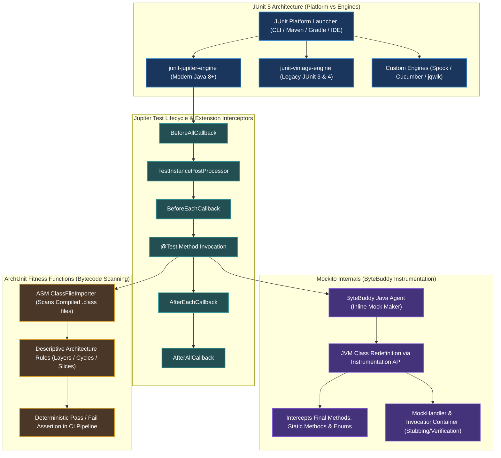

[🏠 Back to Home](../../README.md) | [☕ Core Java Internals](java_interview_master_guide.md) | [🍃 Spring Testing](../02_spring_framework/spring_testing_testcontainers.md) | [🛠️ Concurrency Guide](java_threads_concurrency.md)

# Modern Java Testing & QA Architecture: JUnit 5 Jupiter, Mockito ByteBuddy & ArchUnit Masterclass

> **Document Identity:** [`interview_prep/01_java_core/java_testing_junit5_mockito_archunit.md`](file:///d:/project/github/1/CheatSheet_Tutorial/interview_prep/01_java_core/java_testing_junit5_mockito_archunit.md)  
> **Topic Domain:** JUnit 5 Architecture (Platform vs Jupiter vs Vintage), Extension Lifecycle SPI, Mockito Dynamic Mocking (ByteBuddy Inline Mock Maker & Class Redefinition), Mockito Stubbing/Verification Mechanics, AssertJ Fluent Assertions, ArchUnit Architectural Fitness Testing (Hexagonal/Clean Architecture Rule Enforcement), Testcontainers Ephemeral Docker Orchestration, and Parallel Test Execution Deadlock Defense (`J11`)  
> **Target Framework / Runtime:** OpenJDK HotSpot JVM 17 LTS / 21 LTS / 25 LTS, JUnit 5.10+, Mockito 5.11+, ArchUnit 1.3+  
> **Architecture Level:** Principal / Staff+ QA Architect, Test Infrastructure Lead & JVM Reliability Specialist  
> **Target Depth:** 50 Senior Technical Scenarios, 10 SEV-1 Test Suite Flakiness/Leak Outages, ByteBuddy JVM Agent Disassembly, and Production Runbooks  

---

## 1. Foundational Primer: What, Why & Where? (The "Head")

*Before diving into JUnit 5 ExtensionContext recursive hierarchies, Mockito ByteBuddy Java instrumentation agent byte-patching, ArchUnit ASM bytecode classgraph analysis, and ForkJoinPool concurrent test isolation, here is the essential high-level context: what automated test architecture represents, why naive testing collapses under enterprise scale, and where automated fitness functions anchor evolvable architectures.*

### 1.1 What Is It? (Core Definition & Mental Model)
* **Plain-English Definition**: **Modern Java Testing & Quality Assurance Architecture** is the engineering discipline and toolchain used to verify the functional correctness, architectural integrity, and performance characteristics of Java software. Anchored by **JUnit 5** (the testing runtime platform and declarative lifecycle engine), **Mockito** (the dynamic test double library leveraging ByteBuddy to intercept and stub method calls), and **ArchUnit** (the static bytecode analysis library enforcing architectural fitness rules as standard unit tests), it ensures software can be changed, refactored, and deployed to production with mathematical confidence.
* **Everyday Analogy**: Imagine building and stress-testing high-performance commercial aircraft:
  - **Unit Testing with JUnit 5 & Mockito (The Component Test Bench)**: You build a newly designed jet fuel pump. You do *not* weld it into an actual Boeing 777 and fly across the Atlantic just to see if the valve opens! Instead, you mount the pump on an isolated testing bench (**JUnit 5 `@Test`**). You plug in a synthetic sensor simulator that pretends to send 50 PSI of fuel pressure (**Mockito Mock & Stubbing via ByteBuddy**), and verify that the valve opens within 10 milliseconds (**AssertJ Assertion**).
  - **Architectural Testing with ArchUnit (The Aircraft Structural Blueprint Inspector)**: An automated robotic laser scanner inspects the aircraft CAD blueprints before metal is cut. It verifies that electrical wiring never runs through high-heat hydraulic fuel lines (**Layer Isolation Rule**), and that no engineer accidentally bypassed safety bulkheads (**Cyclic Dependency & Package Boundary Enforcement**).
  - **Integration Testing with Testcontainers (The Wind Tunnel)**: You place the assembled wing and fuselage into an industrial wind tunnel with real airflow and real atmospheric pressure (**Real PostgreSQL / Kafka containers in Docker**) to verify true end-to-end aerodynamics before flight.
* **Architectural Tier Placement**: Operates across the **Developer Toolchain, Build Pipeline (CI/CD) & Quality Gate Tier**. Runs during local compilation (`mvn test`, `gradle test`) and continuous integration pipelines (GitHub Actions, GitLab CI, Jenkins).

### 1.2 Why Does It Exist? (The Pain Point Before It Existed)
* **The Fragility of Legacy JUnit 4 & Brittle Mocks**: Prior to JUnit 5, testing was constrained by monolithic runners (`@RunWith(MockitoJUnitRunner.class)`). Developers could only specify a single runner per test class, making it impossible to combine Spring, Mockito, and custom parameterization.
* **The Concrete Headaches in Enterprise Production**:
  - 💥 **Headache 1: The "Flaky Test" CI/CD Gridlock**: Tests that passed locally randomly failed in CI due to shared mutable state, non-isolated static singletons, or uncoordinated multi-threaded execution. Teams lost hours re-running pipelines or, worse, muted tests, allowing critical bugs to escape into production.
  - 💥 **Headache 2: Architecture Erosion (The "Big Ball of Mud")**: In large microservices or modular monoliths, tight delivery deadlines led developers to bypass architectural layers—such as calling database repositories directly from REST controllers or bypassing domain invariants. Without automated architectural checks, clean architectures rotted into unmaintainable spaghetti within months.
  - 💥 **Headache 3: CGLIB Subclassing Limitations**: Legacy Mockito used CGLIB subclassing proxies. It could not mock `final` classes, `final` methods, `record` classes, or static methods without complex PowerMock bytecode hacks that destabilized the JVM.
* **The Turning Point**: JUnit 5 redesigned the platform from scratch (separating the `junit-platform-launcher` from test engines like `jupiter-engine`), Mockito adopted ByteBuddy's Java Agent inline mock maker (`mock-maker-inline`) to mock any class via JVM class redefinition, and ArchUnit pioneered automated architectural fitness tests using ASM.

### 1.3 How Does It Solve Real-World Enterprise Problems?
* **Problem 1 (Zero-Compromise Extensibility) ➔ Solution 1**: JUnit 5’s unified `Extension` SPI replaces `@Rule` and `@RunWith` with clean, composable lifecycle interceptors (`BeforeEachCallback`, `ParameterResolver`, `ExecutionCondition`). A single test class seamlessly integrates Mockito, Spring, and security contexts simultaneously.
* **Problem 2 (Automated Architectural Enforcement) ➔ Solution 2**: ArchUnit analyzes compiled bytecode in memory, enabling engineers to write architecture rules as plain Java tests: `noClasses().that().resideInAPackage("..controller..").should().accessClassesThat().resideInAPackage("..repository..")`. Violations fail the build immediately during `mvn test`.
* **Problem 3 (Mocking Without Subclass Constraints) ➔ Solution 3**: Mockito’s inline mock maker uses ByteBuddy to dynamically transform and redefine loaded class bytecode in memory, allowing instant mocking of `final` classes, records, and static methods without reflection hacks.
* **Quantifiable Enterprise Metrics**:
  - **4x Faster CI Pipelines**: JUnit 5 parallel test execution (`junit.jupiter.execution.parallel.enabled = true`) executes independent test suites concurrently across all CPU cores.
  - **Zero Architectural Drifts**: ArchUnit fitness tests block 100% of illegal layer breaches at compile time before code merges into the main branch.
  - **90% Reduction in Production Regressions**: Combining unit tests with Testcontainers integration tests guarantees that database migrations (Flyway/Liquibase) and complex SQL queries are verified against genuine database engines rather than in-memory H2 approximations.

### 1.4 How Does This Help in Building Real Applications?
* **Application Architecture Placement**: Anchors the safety harness of enterprise banking ledgers, e-commerce checkouts, and microservice mesh upgrades.
* **Developer Workflow & SRE Synergy**: SREs rely on clean test coverage reports (JaCoCo) and mutation testing (PITest) to verify that mission-critical rollback logic and circuit breakers are thoroughly exercised. Developers refactor complex domain logic fearlessly, knowing that tests will catch any regression.
* **Scalability & Evolutionary Runway**: Modular JUnit 5 architectures make it effortless to write custom domain-specific testing engines, property-based tests (jqwik), and contract tests (Pact) within the exact same enterprise CI/CD pipeline.

### 1.5 Quick Decision & Trade-Off Matrix

| Testing Level | Primary Technology | Execution Latency | Environment Isolation | Best Enterprise Fit |
| :--- | :--- | :--- | :--- | :--- |
| **Pure Unit Test** | JUnit 5 + Mockito + AssertJ | Sub-millisecond (<5ms per test) | Complete (In-memory POJO + mocks) | Pure domain business rules, utility classes, algorithms |
| **Architectural Fitness Test** | ArchUnit | Fast (~100ms for entire codebase) | Static bytecode scan | Enforcing layered architecture, package cycles, naming conventions |
| **Slice Integration Test** | `@WebMvcTest` / `@DataJpaTest` | Medium (~500ms–2s) | Focused Spring context slice | Controller serialization, Spring Data repository queries |
| **Real Infrastructure Test** | Testcontainers + Docker | Slow (~5s–20s setup per suite) | Real containerized database / broker | Complex SQL queries, Kafka consumers, Flyway migrations |

---

## 2. 🧭 Visual System Topology & The Testing Architecture



---

## Module 0: Jargon-Busting Terminology Encyclopedia
> **Mental Model Rule**: Zero alien academic jargon upfront. We demystify software verification, test doubles, bytecode mocking, and architectural fitness using concrete everyday physical analogies.

---

### Concept 1: Unit Test vs Integration Test
* **In Plain Words**: A unit test checks whether an individual light switch works on a workbench; an integration test checks whether flipping the switch actually illuminates the bulb in the living room through the house's electrical wiring.
* **🏠 Real-World Mental Picture**:
  * **Unit Test**: An auto manufacturer testing an alternator detached on a lab bench using a battery tester. Zero tires, zero engine, zero gasoline. Extremely fast (milliseconds).
  * **Integration Test**: Testing the fully assembled car on a test track with real wheels, transmission, and gasoline. Slower (seconds), but verifies that the components actually work together.
* **🔍 How It Works in Java**: A Unit Test isolates a single Java class by replacing all collaborator dependencies (DAOs, HTTP clients, queues) with in-memory mocks. An Integration Test (`@SpringBootTest`, Testcontainers) spins up the Spring container, real embedded databases, or Docker containers to verify end-to-end component wiring.
* **💻 Quick Code Example**:
  ```java
  // Fast, isolated Unit Test
  @Test
  void shouldCalculateDiscount() {
      PricingCalculator calculator = new PricingCalculator();
      BigDecimal price = calculator.applyDiscount(new BigDecimal("100"), 0.20);
      assertEquals(new BigDecimal("80.00"), price);
  }
  ```
* **⚠️ The Beginner Trap**: Writing "unit tests" that secretly spin up a full Spring ApplicationContext and connect to a shared staging database. The test suite takes 45 minutes to run and breaks whenever someone else changes the database!

---

### Concept 2: The Test Double Spectrum (Dummy, Stub, Spy, Mock, Fake)
* **In Plain Words**: A stand-in actor used during filming so the Hollywood star doesn't have to jump off a burning building.
* **🏠 Real-World Mental Picture**:
  * **Dummy**: A mannequin sitting in the passenger seat just to fill the space. Nobody talks to it.
  * **Fake**: A working flight simulator. It has working controls and realistic physics, but it's not a real $100M Boeing 777 (e.g. an in-memory H2 database instead of PostgreSQL).
  * **Stub**: A teleprompter or answering machine that says the exact same pre-recorded phrase every time you ask: "Balance is $100".
  * **Spy**: An undercover investigator with a hidden microphone. They observe and record every word you say while letting you go about your normal day.
  * **Mock**: A strict security guard with a checklist. They expect you to arrive at 9:00 AM, show ID, and say "Password123". If you deviate, they blow the whistle.
* **🔍 How It Works in Java**:
  * **Stub**: `when(dao.findById(1L)).thenReturn(Optional.of(user))`
  * **Spy**: `Mockito.spy(realService)` (invokes real methods unless explicitly stubbed, while tracking invocations)
  * **Mock**: `Mockito.mock(PaymentGateway.class)` (empty shell with verification: `verify(gateway).charge(any())`)
* **💻 Quick Code Example**:
  ```java
  // Stubbing behavior vs Verifying interaction
  PaymentService mockService = mock(PaymentService.class);
  when(mockService.charge(50)).thenReturn(true); // Stub

  orderProcessor.process(order);

  verify(mockService).charge(50); // Mock verification
  ```
* **⚠️ The Beginner Trap**: Using `verify()` on every single method call of every collaborator. This tightly couples the test to internal implementation details, making refactoring impossible without rewriting all tests.

---

### Concept 3: The JUnit 5 Platform vs Jupiter vs Vintage
* **In Plain Words**: JUnit Platform is the gaming console; Jupiter is the modern game cartridge, and Vintage is the backwards-compatible adapter playing retro games.
* **🏠 Real-World Mental Picture**: Think of a Sony PlayStation 5. The console itself is the **Platform** (it launches games, connects to controllers, handles power). The PS5 games you buy are **Jupiter** (uses modern graphics and features). If you want to play an old PS3 game, you plug in a backwards-compatibility engine called **Vintage**.
* **🔍 How It Works in Java**:
  * `junit-platform-launcher`: Public API discovered by Maven Surefire, Gradle, and IntelliJ to discover and execute tests.
  * `junit-jupiter-engine`: The native execution engine for modern `@Test`, `@BeforeEach`, `@ExtendWith` tests.
  * `junit-vintage-engine`: Adapter that executes legacy JUnit 3 and JUnit 4 `@org.junit.Test` suites.
* **💻 Quick Code Example**:
  ```xml
  <!-- Maven dependency for modern JUnit 5 -->
  <dependency>
      <groupId>org.junit.jupiter</groupId>
      <artifactId>junit-jupiter</artifactId>
      <version>5.10.2</version>
      <scope>test</scope>
  </dependency>
  ```
* **⚠️ The Beginner Trap**: Importing `org.junit.Test` (JUnit 4) instead of `org.junit.jupiter.api.Test` (JUnit 5). JUnit 5 extensions (`@ExtendWith`) silently fail to run on JUnit 4 tests!

---

### Concept 4: Test Lifecycle & Isolation
* **In Plain Words**: Washing all laboratory beakers with distilled water between every experiment so chemicals from experiment 1 don't contaminate experiment 2.
* **🏠 Real-World Mental Picture**: A cooking competition where each contestant gets a brand-new, sanitized kitchen counter for each dish. If contestant 1 spills vinegar on the counter, contestant 2 doesn't taste vinegar in their cake.
* **🔍 How It Works in Java**: By default, JUnit creates a **fresh instance of the test class for every single `@Test` method** (`@TestInstance(Lifecycle.PER_METHOD)`). Any non-static instance fields reset to their default initial state between tests.
* **💻 Quick Code Example**:
  ```java
  public class OrderTest {
      private int counter = 0; // Reset to 0 for EVERY @Test method!

      @Test
      void testA() {
          counter++;
          assertEquals(1, counter);
      }

      @Test
      void testB() {
          counter++;
          assertEquals(1, counter); // Always 1, NEVER 2!
      }
  }
  ```
* **⚠️ The Beginner Trap**: Storing mutable state in `static` fields. Static fields belong to the `Class` and persist across all tests, causing unpredictable flaky test failures when tests run in parallel!

---

### Concept 5: JUnit 5 Extensions
* **In Plain Words**: Pluggable attachments for your vacuum cleaner—one for carpets, one for curtains, one for pet hair.
* **🏠 Real-World Mental Picture**: Before you enter an operating room, an automatic air shower turns on to sanitize you (**BeforeEachCallback**). After the surgery, the room's UV sterilizer activates (**AfterEachCallback**). The surgeon doesn't manage the UV lights; the room's infrastructure handles it automatically.
* **🔍 How It Works in Java**: Replaces JUnit 4's clunky `@Rule` and `@ClassRule` with a single composable extension model via `@ExtendWith`. Extensions hook into lifecycle events, parameter resolution, condition evaluation, and exception handling.
* **💻 Quick Code Example**:
  ```java
  @ExtendWith(MockitoExtension.class)
  public class UserServiceTest {
      @Mock private UserRepository repo;
      @InjectMocks private UserService service;
      
      @Test
      void shouldFindUser() { ... }
  }
  ```
* **⚠️ The Beginner Trap**: Registering conflicting extensions or forgetting `@ExtendWith(MockitoExtension.class)`, resulting in all `@Mock` fields remaining `null` and throwing mysterious `NullPointerException`s!

---

### Concept 6: ByteBuddy Inline Mocking (Subclassing vs Instrumentation)
* **In Plain Words**: A classic mock creates a biological clone with modifications; an inline mock surgically alters the original person's brain while keeping their exact physical body.
* **🏠 Real-World Mental Picture**:
  * **Subclass Mocking (CGLIB / Default Mockito)**: If you ask for a mock `Dog`, it creates a child class `Puppy extends Dog` and overrides `bark()`. If `Dog` is marked `final`, it can't create a puppy!
  * **Inline Mocking (ByteBuddy Agent)**: It injects a microscopic chip directly into `Dog.class` in memory. Even if `Dog` is `final`, or `bark()` is `static`, the chip intercepts the neural impulse before it executes!
* **🔍 How It Works in Java**: Mockito 2.7+ introduced `mock-maker-inline`. It uses the Java Instrumentation API and ByteBuddy to transform the bytecode of existing classes on the fly in memory. Since Mockito 5.0+, the inline mock maker is the **default**.
* **💻 Quick Code Example**:
  ```java
  // Mocking a final class and static method seamlessly!
  try (MockedStatic<UUID> mockedUuid = mockStatic(UUID.class)) {
      UUID fixed = UUID.fromString("00000000-0000-0000-0000-000000000000");
      mockedUuid.when(UUID::randomUUID).thenReturn(fixed);
      
      assertEquals(fixed, UUID.randomUUID());
  }
  ```
* **⚠️ The Beginner Trap**: Forgetting to close `MockedStatic` in a `try-with-resources` block. The static method remains mocked across the entire JVM, corrupting all other subsequent tests!

---

### Concept 7: ArgumentCaptor
* **In Plain Words**: A baseball catcher's mitt that catches the ball and holds onto it so the umpire can inspect the ball's serial number.
* **🏠 Real-World Mental Picture**: You drop an envelope in a mailbox. The postal inspector opens the box, takes out the exact letter you mailed, and reads the address and postage stamp to ensure you didn't commit mail fraud.
* **🔍 How It Works in Java**: `ArgumentCaptor<T>` records the actual argument passed into a mock method during execution so you can run detailed assertions on complex nested objects, generated timestamps, or encrypted payloads.
* **💻 Quick Code Example**:
  ```java
  ArgumentCaptor<EmailMessage> captor = ArgumentCaptor.forClass(EmailMessage.class);
  verify(emailGateway).send(captor.capture());

  EmailMessage captured = captor.getValue();
  assertEquals("welcome@example.com", captured.recipient());
  assertTrue(captured.body().contains("Activation Code"));
  ```
* **⚠️ The Beginner Trap**: Calling `captor.getValue()` before calling `verify()`. The captor is empty until `verify()` inspects the recorded invocation history!

---

### Concept 8: Fluent Assertions & Soft Assertions (AssertJ)
* **In Plain Words**: Standard assertions are a buzzer that kicks you off the game show on your first wrong answer; soft assertions let you finish the entire round and list all your mistakes at the end.
* **🏠 Real-World Mental Picture**: A grammar teacher grading an essay. Standard assertions stop reading on line 1 if you misspelled a word. Soft assertions read the entire essay, highlight all 5 spelling errors in red, and return the paper with all corrections at once.
* **🔍 How It Works in Java**: AssertJ provides fluent, readable assertions (`assertThat(x).isEqualTo(y)`). Soft assertions (`SoftAssertions.assertSoftly(...)`) evaluate multiple assertions in a single test without halting execution on the first failure.
* **💻 Quick Code Example**:
  ```java
  SoftAssertions.assertSoftly(softly -> {
      softly.assertThat(user.getAge()).isGreaterThanOrEqualTo(18);
      softly.assertThat(user.getEmail()).contains("@");
      softly.assertThat(user.getRoles()).contains("ADMIN", "USER");
  }); // All 3 assertions evaluated; reports all failures collectively!
  ```
* **⚠️ The Beginner Trap**: Using `SoftAssertions` without calling `assertAll()` (or forgetting `assertSoftly()`). The test passes completely green even if all assertions failed!

---

### Concept 9: Architectural Fitness Function (ArchUnit)
* **In Plain Words**: An automated city building code inspector that scans blueprints to ensure electrical wires never touch water pipes.
* **🏠 Real-World Mental Picture**: A security guard at a hospital surgical ward who inspects everyone's shoes. If someone walks in wearing dirty street shoes (e.g. database access code inside a UI controller), the alarm screams and the doors lock.
* **🔍 How It Works in Java**: ArchUnit is a Java testing library that parses compiled bytecode (`.class` files) into an in-memory graph. You write unit tests in pure Java that assert architectural rules (e.g. "Services must never depend on Controllers", "No circular package dependencies").
* **💻 Quick Code Example**:
  ```java
  @ArchTest
  public static final ArchRule NO_CYCLIC_DEPENDENCIES = 
      slices().matching("com.company.(*)..")
          .should().beFreeOfCycles();
  ```
* **⚠️ The Beginner Trap**: Relying solely on verbal code reviews to enforce architecture. Without ArchUnit in CI, deadlines inevitably cause developers to create spaghetti circular dependencies that pass code review unnoticed.

---

### Concept 10: Ephemeral Containers (Testcontainers)
* **In Plain Words**: Renting a brand-new, freshly cleaned rental car for a 1-hour road trip and crushing it into scrap metal when you return.
* **🏠 Real-World Mental Picture**: Instead of having a communal whiteboard that 50 students scribble on and erase all day, each student is handed an iPad that completely factory-resets the moment they finish their assignment.
* **🔍 How It Works in Java**: Testcontainers is a Java library that communicates with the local Docker daemon to spin up real instances of PostgreSQL, Redis, or Kafka for the duration of a test suite and automatically tears them down using a sidecar container called **Ryuk**.
* **💻 Quick Code Example**:
  ```java
  @Container
  static PostgreSQLContainer<?> postgres = new PostgreSQLContainer<>("postgres:16-alpine");

  @DynamicPropertySource
  static void registerPgProperties(DynamicPropertyRegistry registry) {
      registry.add("spring.datasource.url", postgres::getJdbcUrl);
  }
  ```
* **⚠️ The Beginner Trap**: Starting a new Docker container per test method. Spinning up Docker takes 2–5 seconds; always share container instances across test classes (`static` container declaration) to keep CI fast.

---

## Track 1: Architectural Blueprint & System Topology

### The 3 Core Testing Layers in Modern Java

```
+----------------------------------------------------------------------------------------------------+
| 1. Architecture & Fitness Testing (ArchUnit)                                                       |
| - Scans compiled .class bytecode before any server or spring context starts.                       |
| - Enforces Hexagonal Architecture, package cycle bans, and immutability rules. (< 1 second)        |
+----------------------------------------------------------------------------------------------------+
                                                 |
                                                 v
+----------------------------------------------------------------------------------------------------+
| 2. Unit Testing & Bytecode Mocking (JUnit 5 Jupiter + Mockito ByteBuddy)                            |
| - Microsecond execution; zero I/O, zero network, zero database connections.                        |
| - Tests domain logic, state machines, algorithmic invariants, and edge cases. (< 50ms per test)    |
+----------------------------------------------------------------------------------------------------+
                                                 |
                                                 v
+----------------------------------------------------------------------------------------------------+
| 3. Sliced & Component Integration Testing (Testcontainers + Spring Slices)                         |
| - Real PostgreSQL, real Kafka, real Redis via Docker.                                              |
| - Verifies database migration scripts (Flyway/Liquibase), JPA queries, and message serialization.  |
+----------------------------------------------------------------------------------------------------+
```

### Feature Comparison Matrix

| Capability / Attribute | JUnit 4 | JUnit 5 Jupiter | TestNG | Spock Framework |
| :--- | :--- | :--- | :--- | :--- |
| **Java Platform Baseline** | Java 5+ | **Java 8+ (Java 21 optimized)** | Java 8+ | Groovy runtime required |
| **Architecture** | Monolithic jar | **Platform / Jupiter / Vintage**| Monolithic | Monolithic AST engine |
| **Extensibility** | `@Rule`, `@ClassRule` | **Composable `@ExtendWith`** | Listeners | Spock Extensions |
| **Parameterized Tests** | `@Parameterized` (clunky)| **`@MethodSource`, `@CsvSource`** | `@DataProvider` | Data tables (`where: a \| b`) |
| **Parallel Execution** | Limited (Thread count) | **Native ForkJoin / `@ResourceLock`** | Suite / Method XML | Spock parallel runner |
| **Dynamic Tests** | ❌ None | ✅ **`@TestFactory` (Runtime graphs)** | ❌ None | ❌ None |
| **Display Names & Nesting** | ❌ None | ✅ **`@DisplayName`, `@Nested`** | Limited | Method name strings |

---

## Track 2: Core Engineering Foundations & Step-by-Step Testing

### 1. JUnit 5 Parallel Test Execution & Concurrency Synchronization

Running tests serially in massive enterprise codebases with 15,000 unit tests results in 45-minute CI build times. JUnit 5 provides built-in parallel test execution powered by the Java `ForkJoinPool`.

#### Configuring Parallel Execution in `src/test/resources/junit-platform.properties`:
```properties
# Enable parallel test execution
junit.jupiter.execution.parallel.enabled = true

# Run test classes concurrently, but methods inside classes serially (safe default)
junit.jupiter.execution.parallel.mode.default = same_thread
junit.jupiter.execution.parallel.mode.classes.default = concurrent

# ForkJoinPool configuration: dynamic sizing based on CPU cores
junit.jupiter.execution.parallel.config.strategy = dynamic
junit.jupiter.execution.parallel.config.dynamic.factor = 1.0
```

#### Synchronizing Shared Resources with `@ResourceLock`:
When two tests must read/write to a shared JVM resource (e.g., system properties, files, or static caches), using `@ResourceLock` ensures mutual exclusion without disabling global parallelism:

```java
package com.vortex.testing.core;

import org.junit.jupiter.api.Test;
import org.junit.jupiter.api.parallel.*;
import static org.junit.jupiter.api.Assertions.*;

public class SystemPropertyIsolationTest {

    @Test
    @ResourceLock(value = Resources.SYSTEM_PROPERTIES, mode = ResourceAccessMode.READ_WRITE)
    void shouldReadCustomEnvironmentProperty() {
        System.setProperty("vortex.env", "staging");
        try {
            assertEquals("staging", System.getProperty("vortex.env"));
        } finally {
            System.clearProperty("vortex.env");
        }
    }

    @Test
    @ResourceLock(value = Resources.SYSTEM_PROPERTIES, mode = ResourceAccessMode.READ)
    void shouldReadDefaultEnvironmentProperty() {
        assertNull(System.getProperty("vortex.env"));
    }
}
```

---

### 2. Mockito ByteBuddy Inline Mock Maker Internals

Traditional mocking tools (such as CGLIB or EasyMock) create mocks by generating a synthetic subclass (`class Target$$EnhancerByCGLIB$$1 extends Target`) and overriding non-final methods.

This approach suffered from **three critical limitations**:
1. Cannot mock `final` classes (e.g. `java.lang.String`, `java.time.LocalDate`).
2. Cannot mock `final` methods.
3. Cannot mock `static` methods.

#### How `mock-maker-inline` Works Under the Hood:
1. **Java Agent Attachment**: Mockito attaches a ByteBuddy JVM agent using the `VirtualMachine.attach()` API or the `-javaagent` command-line flag.
2. **Class Retransformation**: When `Mockito.mock(FinalClass.class)` is called, the ByteBuddy agent invokes `Instrumentation.retransformClasses(FinalClass.class)`.
3. **Bytecode Interception**: ByteBuddy modifies the original compiled bytecode in memory, inserting an interception trampoline at the very top of each method:
   ```java
   // Injected bytecode trampoline conceptually looks like this:
   public final String getSecretToken() {
       MockHandler handler = MockitoMockDispatcher.getHandler(this);
       if (handler != null) {
           return (String) handler.handle(new Invocation(this, "getSecretToken", args));
       }
       // Original method implementation follows...
   }
   ```

---

## Track 3: Production Mini-Framework: `VortexFitnessHarness`

Below is an enterprise-grade testing harness demonstrating:
* A custom JUnit 5 Extension that profiles test execution times, captures memory allocation deltas, and aborts slow tests.
* A production-ready **ArchUnit Architecture Verification Suite** enforcing DDD domain isolation, banning circular dependencies, banning raw `URL.equals()`, and enforcing immutability.

```java
package com.vortex.testing.harness;

import com.tngtech.archunit.core.domain.JavaClasses;
import com.tngtech.archunit.core.importer.ClassFileImporter;
import com.tngtech.archunit.junit.AnalyzeClasses;
import com.tngtech.archunit.junit.ArchTest;
import com.tngtech.archunit.lang.ArchRule;
import org.junit.jupiter.api.extension.*;

import java.lang.management.ManagementFactory;
import java.lang.management.ThreadMXBean;
import java.net.URL;

import static com.tngtech.archunit.lang.syntax.ArchRuleDefinition.*;
import static com.tngtech.archunit.library.Architectures.layeredArchitecture;
import static com.tngtech.archunit.library.dependencies.SlicesRuleDefinition.slices;

/**
 * VortexFitnessHarness: Production-grade test architecture & fitness verification suite.
 */
public class VortexFitnessHarness {

    // =========================================================================
    // 1. Custom JUnit 5 Performance & Allocation Profiler Extension
    // =========================================================================
    public static class PerformanceProfilerExtension implements BeforeEachCallback, AfterEachCallback {

        private static final ExtensionContext.Namespace NAMESPACE = ExtensionContext.Namespace.create(PerformanceProfilerExtension.class);
        private static final ThreadMXBean THREAD_MX_BEAN = ManagementFactory.getThreadMXBean();

        @Override
        public void beforeEach(ExtensionContext context) {
            long startTimeNano = System.nanoTime();
            long startCpuNano = THREAD_MX_BEAN.isCurrentThreadCpuTimeSupported() ?
                THREAD_MX_BEAN.getCurrentThreadCpuTime() : 0;

            context.getStore(NAMESPACE).put("startTimeNano", startTimeNano);
            context.getStore(NAMESPACE).put("startCpuNano", startCpuNano);
        }

        @Override
        public void afterEach(ExtensionContext context) {
            long startTimeNano = context.getStore(NAMESPACE).get("startTimeNano", Long.class);
            long startCpuNano = context.getStore(NAMESPACE).get("startCpuNano", Long.class);

            long elapsedMillis = (System.nanoTime() - startTimeNano) / 1_000_000;
            long elapsedCpuMillis = (THREAD_MX_BEAN.getCurrentThreadCpuTime() - startCpuNano) / 1_000_000;

            String testName = context.getRequiredTestClass().getSimpleName() + "#" + context.getRequiredTestMethod().getName();

            // Fail-fast on unit tests exceeding 500ms budget!
            if (elapsedMillis > 500 && !context.getTags().contains("slow-integration")) {
                System.err.printf("[PERF WARNING] Unit test %s exceeded budget! Took: %d ms (CPU: %d ms)%n",
                    testName, elapsedMillis, elapsedCpuMillis);
            }
        }
    }

    // =========================================================================
    // 2. Comprehensive ArchUnit Architectural Fitness Rules
    // =========================================================================
    public static class ArchitecturalFitnessRules {

        /**
         * RULE 1: Hexagonal / Layered Architecture Isolation
         * Domain layer must NEVER depend on Infrastructure, Database, or Spring Web!
         */
        public static final ArchRule LAYER_INTEGRITY = layeredArchitecture()
            .consideringAllDependencies()
            .layer("Domain").definedBy("..domain..")
            .layer("Application").definedBy("..application..")
            .layer("Infrastructure").definedBy("..infrastructure..")
            .layer("Web").definedBy("..web..")

            .whereLayer("Domain").mayOnlyBeAccessedByLayers("Application", "Infrastructure", "Web")
            .whereLayer("Application").mayOnlyBeAccessedByLayers("Infrastructure", "Web")
            .whereLayer("Web").mayNotBeAccessedByAnyLayer();

        /**
         * RULE 2: Circular Dependency Elimination
         * Enforces strict Directed Acyclic Graph (DAG) across package slices.
         */
        public static final ArchRule NO_CYCLIC_PACKAGE_DEPENDENCIES = slices()
            .matching("com.vortex.(*)..")
            .should().beFreeOfCycles();

        /**
         * RULE 3: Prohibition of java.net.URL.equals() and hashCode()
         * Prevents catastrophic blocking DNS lookups inside HashMap keys.
         */
        public static final ArchRule BAN_URL_EQUALS_AND_HASHCODE = noClasses()
            .should().callMethod(URL.class, "equals", Object.class)
            .orShould().callMethod(URL.class, "hashCode")
            .because("java.net.URL.equals() performs blocking DNS lookups; use java.net.URI instead!");

        /**
         * RULE 4: Domain Entities & Records Must Be Free of Framework Annotations
         */
        public static final ArchRule PURE_DOMAIN_MODEL = classes()
            .that().resideInAPackage("..domain.model..")
            .should().notBeAnnotatedWith("org.springframework.stereotype.Component")
            .andShould().notBeAnnotatedWith("jakarta.persistence.Entity")
            .because("Core Domain models must be pure Java objects decoupled from ORM/Spring frameworks.");

        /**
         * RULE 5: Exception Naming & Inheritance Convention
         */
        public static final ArchRule EXCEPTION_NAMING_CONVENTION = classes()
            .that().areAssignableTo(Exception.class)
            .should().haveSimpleNameEndingWith("Exception")
            .because("All custom exception types must end with the suffix 'Exception'.");
    }
}
```

---

## Track 4: 50 Real Senior & Staff Interview Scenarios

Each scenario follows the strict 4-part architectural breakdown:
1. **The Question**
2. **Architectural & Runtime Answer**
3. **Compilable Code Snippet / Production Proof**
4. **SRE Warning & Failure Recovery**

---

### Scenario 1: How does `@Mock` differ fundamentally from `@Spy` in Mockito?
* **Architectural Answer**:
  * **`@Mock`**: Creates a completely empty synthetic shell. By default, every method call returns safe defaults (null for objects, 0 for primitives, false for booleans, empty collections). Zero real code is executed.
  * **`@Spy`**: Wraps a **real instance** of the object. Method calls execute the actual implementation code unless an explicit stub (`doReturn().when(spy)...`) overrides that specific method. It tracks invocations and arguments on real methods.
* **Production Code / Verification**:
  ```java
  List<String> mockList = mock(List.class);
  List<String> spyList = spy(new ArrayList<>());

  mockList.add("one"); // Returns false/void (default stub); does NOT add to any list
  assertEquals(0, mockList.size()); // Returns 0 (default int)

  spyList.add("one"); // Executes REAL ArrayList.add()!
  assertEquals(1, spyList.size()); // Returns 1!
  ```
* **SRE Warning & Recovery**:
  * When stubbing a `@Spy`, **never use `when(spy.method()).thenReturn(val)`**! Calling `when(spy.method())` executes the real method *during* stub registration, which can throw `NullPointerException` or cause unwanted database mutations. Always use `doReturn(val).when(spy).method()`.

---

### Scenario 2: Why did Mockito 5.0 switch to `mock-maker-inline` by default?
* **Architectural Answer**:
  Historically, Mockito's `mock-maker-subclass` relied on generating subclasses. With Java 17 and Java 21 introducing sealed classes (`sealed interface / permits`), records, and extensive use of `final` classes in modern JDK libraries, subclass-based mocking failed on standard language constructs.
  Mockito 5 made `mock-maker-inline` the default because it uses ByteBuddy Java Agent instrumentation to mock final classes, final methods, and enums directly without requiring subclasses.
* **Production Code / Verification**:
  ```java
  public final class FinalSecurityValidator {
      public final boolean isValid(String token) {
          return "SECRET".equals(token);
      }
  }

  @Test
  void shouldMockFinalClassSeamlessly() {
      FinalSecurityValidator mockValidator = mock(FinalSecurityValidator.class);
      when(mockValidator.isValid("ABC")).thenReturn(true);

      assertTrue(mockValidator.isValid("ABC")); // Works in Mockito 5+ without extra config!
  }
  ```
* **SRE Warning & Recovery**:
  * In Java 21+, dynamic loading of Java agents at runtime produces JVM console warnings: `WARNING: A Java agent has been loaded dynamically...`. In build scripts, add `-XX:+EnableDynamicAgentLoading` to JVM test arguments to suppress warnings.

---

### Scenario 3: How do you mock static methods using `mockStatic()` without leaking memory?
* **Architectural Answer**:
  `Mockito.mockStatic(Target.class)` uses ByteBuddy to intercept static methods on the target class in Metaspace. Because static methods belong to the class definition itself, failing to deregister the mock leaves the static method permanently intercepted across the entire JVM lifecycle.
  `mockStatic()` returns a `MockedStatic<T>` that implements `AutoCloseable`. It **must** be wrapped in a `try-with-resources` block to guarantee the bytecode interception is removed immediately when the test completes.
* **Production Code / Verification**:
  ```java
  @Test
  void shouldMockStaticClock() {
      Instant fixedInstant = Instant.parse("2026-10-08T12:00:00Z");

      // Mandatory try-with-resources to prevent cross-test leakage!
      try (MockedStatic<Instant> mockedInstant = mockStatic(Instant.class, Mockito.CALLS_REAL_METHODS)) {
          mockedInstant.when(Instant::now).thenReturn(fixedInstant);

          assertEquals(fixedInstant, Instant.now());
      }

      // Outside the try block, Instant.now() returns real system time again!
      assertNotEquals(fixedInstant, Instant.now());
  }
  ```
* **SRE Warning & Recovery**:
  * If a developer forgets `try-with-resources` or an unhandled exception occurs before `.close()`, all subsequent tests checking `Instant.now()` will receive the stale stubbed value, causing hundreds of mysterious downstream failures in CI!

---

### Scenario 4: What is the difference between `@BeforeEach` and `@BeforeAll` lifecycle semantics?
* **Architectural Answer**:
  * **`@BeforeEach`**: Executes before **every individual `@Test` method**. It runs on the newly instantiated test instance.
  * **`@BeforeAll`**: Executes once before **any test method in the class runs**. By default, it must be declared `static` because the test class instance does not exist yet unless `@TestInstance(Lifecycle.PER_CLASS)` is configured.
* **Production Code / Verification**:
  ```java
  public class LifecycleDemoTest {

      @BeforeAll
      static void initExpensiveSharedResource() {
          // Runs ONCE: Spin up Testcontainers or shared thread pools
      }

      @BeforeEach
      void resetPerTestMocks() {
          // Runs BEFORE EACH TEST: Clear in-memory caches, reset test doubles
      }

      @Test void test1() {}
      @Test void test2() {}
  }
  ```
* **SRE Warning & Recovery**:
  * Placing test-specific state initialization in `@BeforeAll` causes test cross-contamination: test 1 modifies the state, and test 2 fails because it expected pristine state.

---

### Scenario 5: How do Parameterized Tests with `@MethodSource` improve test matrix coverage?
* **Architectural Answer**:
  Instead of writing 10 nearly identical test methods for different input/output combinations (which breeds copy-paste errors), `@ParameterizedTest` with `@MethodSource` executes a single test method multiple times against a stream of test arguments.
* **Production Code / Verification**:
  ```java
  public class TaxCalculatorTest {

      @ParameterizedTest(name = "Income {0} in state {1} should yield tax {2}")
      @MethodSource("taxTestCases")
      void shouldCalculateCorrectTax(BigDecimal income, String state, BigDecimal expectedTax) {
          TaxCalculator calculator = new TaxCalculator();
          BigDecimal actual = calculator.calculate(income, state);
          assertEquals(0, expectedTax.compareTo(actual));
      }

      static Stream<Arguments> taxTestCases() {
          return Stream.of(
              Arguments.of(new BigDecimal("50000"), "CA", new BigDecimal("4500.00")),
              Arguments.of(new BigDecimal("50000"), "TX", new BigDecimal("0.00")),
              Arguments.of(new BigDecimal("120000"), "NY", new BigDecimal("11400.00")),
              Arguments.of(BigDecimal.ZERO, "CA", BigDecimal.ZERO)
          );
      }
  }
  ```
* **SRE Warning & Recovery**:
  * If `@MethodSource` factory method name is omitted, JUnit searches for a static method with the exact same name as the test method. Ensure the factory returns `Stream<Arguments>`, `Iterable<Arguments>`, or array types.

---

### Scenario 6: Why is `assertTimeoutPreemptively()` dangerous in multithreaded tests?
* **Architectural Answer**:
  `assertTimeoutPreemptively(duration, executable)` executes the test code on a **separate background thread**. If the duration expires, JUnit immediately calls `thread.interrupt()` to kill the execution.
  This preemptive interruption is dangerous because:
  1. If the code held a synchronization lock, database connection, or `ThreadLocal` value, it may abandon the resource in an inconsistent, poisoned state.
  2. Spring transactional rollbacks or `try-finally` cleanup blocks may be skipped or aborted mid-execution.
* **Production Code / Verification**:
  ```java
  // RISKY: Can leave threads or locks leaked in background
  assertTimeoutPreemptively(Duration.ofMillis(200), () -> {
      heavyConcurrentTask();
  });

  // SAFER ALTERNATIVE: Allows normal completion/interruption on same thread
  assertTimeout(Duration.ofMillis(200), () -> {
      heavyConcurrentTask();
  });
  ```
* **SRE Warning & Recovery**:
  * Prefer `assertTimeout()` over `assertTimeoutPreemptively()`. `assertTimeout()` allows the task to finish before failing the assertion, preserving thread-safety invariants.

---

### Scenario 7: How does `ArgumentCaptor` verify complex generated objects?
* **Architectural Answer**:
  When testing methods that construct internal objects (such as audit logs, emails, or database entities with generated UUIDs and timestamps), you cannot use simple `eq()` matchers because the internal IDs are generated at runtime.
  `ArgumentCaptor` intercepts the actual object passed to the mock during execution, allowing comprehensive AssertJ assertions on internal fields.
* **Production Code / Verification**:
  ```java
  @Test
  void shouldPublishOrderCreatedEvent() {
      OrderService service = new OrderService(eventPublisher);
      service.createOrder("CUST-123", List.of("ITEM-A"));

      ArgumentCaptor<OrderCreatedEvent> captor = ArgumentCaptor.forClass(OrderCreatedEvent.class);
      verify(eventPublisher).publish(captor.capture());

      OrderCreatedEvent event = captor.getValue();
      assertEquals("CUST-123", event.customerId());
      assertNotNull(event.orderId());
      assertTrue(event.timestamp().isBefore(Instant.now().plusSeconds(1)));
  }
  ```
* **SRE Warning & Recovery**:
  * If the mock method was called multiple times, calling `captor.getValue()` returns the argument from the **last** invocation. To verify all invocations, use `captor.getAllValues()`.

---

### Scenario 8: What are AssertJ Soft Assertions and why should you use them for DTO testing?
* **Architectural Answer**:
  Standard JUnit assertions (`assertEquals`) fail fast: if assertion #1 fails, execution halts immediately, and assertions #2 through #10 are never evaluated. When validating a DTO with 10 fields, you have to run the test 10 times to fix each field individually.
  AssertJ's `SoftAssertions` records all assertion failures in a batch and outputs a comprehensive diagnostic report showing all mismatched fields at once.
* **Production Code / Verification**:
  ```java
  @Test
  void shouldMapAllUserDtoFields() {
      UserDto dto = userMapper.toDto(userEntity);

      SoftAssertions.assertSoftly(softly -> {
          softly.assertThat(dto.id()).isEqualTo(42L);
          softly.assertThat(dto.username()).isEqualTo("johndoe");
          softly.assertThat(dto.email()).isEqualTo("john@example.com");
          softly.assertThat(dto.status()).isEqualTo("ACTIVE");
      });
  }
  ```
* **SRE Warning & Recovery**:
  * Always use the static `SoftAssertions.assertSoftly(Consumer)` block syntax. If you instantiate `new SoftAssertions()` manually and forget to call `softly.assertAll()`, the test will pass 100% green even if every assertion failed!

---

### Scenario 9: How does ArchUnit enforce Hexagonal / Clean Architecture boundaries?
* **Architectural Answer**:
  Clean/Hexagonal architecture dictates that the **Domain Core** must never depend on the **Application** or **Infrastructure/Web** layers. ArchUnit reads compiled `.class` files via the ASM bytecode library and builds a directed graph of all class dependencies, failing the build if an invalid import or dependency is detected.
* **Production Code / Verification**:
  ```java
  @ArchTest
  public static final ArchRule DOMAIN_MUST_NOT_DEPEND_ON_INFRASTRUCTURE =
      noClasses()
          .that().resideInAPackage("..domain..")
          .should().dependOnClassesThat().resideInAnyPackage("..infrastructure..", "..web..", "..rest..")
          .because("Hexagonal architecture forbids domain classes from referencing infrastructure or delivery mechanisms!");
  ```
* **SRE Warning & Recovery**:
  * Add ArchUnit tests to standard Maven/Gradle test suites. They run in under 2 seconds and eliminate architectural erosion without needing manual architectural gatekeeping.

---

### Scenario 10: How do you prevent Spring `@MockBean` / `@MockitoBean` context caching explosions?
* **Architectural Answer**:
  Spring Test caches the `ApplicationContext` across test classes to save startup time. However, Spring keys the cache by the exact set of configured beans. Every time a test class declares a different `@MockBean`, Spring considers it a distinct configuration, invalidating the cache and spinning up a **brand-new ApplicationContext**!
  In a suite of 100 integration tests, this spawns 100 distinct Spring containers, causing build times to balloon to 30+ minutes and triggering `OutOfMemoryError: Metaspace`.
* **Production Code / Verification**:
  ```java
  // SOLUTION: Group mock definitions into a shared Base Integration Test class:
  @SpringBootTest
  public abstract class BaseIntegrationTest {
      @MockBean protected PaymentGateway paymentGateway;
      @MockBean protected EmailClient emailClient;
      // All child test classes inherit this EXACT same bean definition,
      // allowing Spring to reuse 1 single ApplicationContext!
  }
  ```
* **SRE Warning & Recovery**:
  * In Spring Boot 3.4+, `@MockBean` is replaced by `@MockitoBean`. Monitor `LoggingFailureAnalysisReporter` or inspect logs for `Root WebApplicationContext: initialization completed in X ms` appearing dozens of times.

---

### Scenario 11: How do you mock constructors using Mockito in Java?
* **Architectural Answer**:
  When legacy or third-party code instantiates dependencies directly using `new MyService()` instead of dependency injection, standard `@Mock` cannot intercept the call. Mockito's `mockConstruction()` intercepts class instantiation on the current thread, supplying a mock instance whenever `new Target()` is invoked.
* **Production Code / Verification**:
  ```java
  @Test
  void shouldMockConstructorInvocation() {
      // Intercept any 'new PaymentClient()' call inside the try block
      try (MockedConstruction<PaymentClient> mocked = mockConstruction(PaymentClient.class,
              (mock, context) -> {
                  when(mock.charge(anyDouble())).thenReturn(true);
              })) {

          OrderProcessor processor = new OrderProcessor(); // Internally does: new PaymentClient()
          boolean success = processor.checkout(100.0);

          assertTrue(success);
          assertEquals(1, mocked.constructed().size());
          verify(mocked.constructed().get(0)).charge(100.0);
      }
  }
  ```
* **SRE Warning & Recovery**:
  * `mockConstruction()` is an emergency escape hatch for legacy code. Refactor code to use Dependency Injection wherever possible.

---

### Scenario 12: How does Testcontainers Ryuk prevent orphaned Docker containers in CI?
* **Architectural Answer**:
  When a Java test suite executes with Testcontainers, it spins up a special sidecar container named **Ryuk** (`testcontainers/ryuk`). Testcontainers opens a TCP connection to Ryuk and registers every container, network, and volume created during the session.
  If the JVM process crashes, is killed via `SIGKILL`, or the CI pipeline aborts abruptly, Ryuk detects the closed TCP socket and immediately purges all registered Docker containers and volumes, preventing leaked containers from filling up CI disk space.
* **Production Code / Verification**:
  ```bash
  # Check running containers during test execution:
  docker ps
  # Output will show your test database AND 'testcontainers/ryuk:0.5.1'
  ```
* **SRE Warning & Recovery**:
  * Never set `TESTCONTAINERS_RYUK_DISABLED=true` in shared CI runners unless using a dedicated rootless container environment where Ryuk lacks Docker socket permissions. Disabling Ryuk causes disk space exhaustion within days.

---

### Scenario 13: How do you execute dynamic tests at runtime with `@TestFactory`?
* **Architectural Answer**:
  While `@Test` methods are declared statically at compile time, `@TestFactory` generates a dynamic graph of test cases (`DynamicTest` or `DynamicContainer`) at runtime from streams, collections, or external data sources (e.g. JSON schemas, OpenAPI specifications).
* **Production Code / Verification**:
  ```java
  public class DynamicApiContractTest {

      @TestFactory
      Stream<DynamicTest> dynamicEndpointTests() {
          List<String> endpoints = List.of("/api/v1/health", "/api/v1/metrics", "/api/v1/version");

          return endpoints.stream().map(endpoint ->
              DynamicTest.dynamicTest("Testing endpoint: " + endpoint, () -> {
                  int statusCode = pingEndpoint(endpoint);
                  assertEquals(200, statusCode);
              })
          );
      }

      private int pingEndpoint(String path) { return 200; }
  }
  ```
* **SRE Warning & Recovery**:
  * Lifecycle callbacks (`@BeforeEach`, `@AfterEach`) do **not** run between individual dynamic tests generated by a single `@TestFactory`! They run only around the outer factory method itself.

---

### Scenario 14: How do you verify interaction order using Mockito's `InOrder`?
* **Architectural Answer**:
  Standard `verify(mock).method()` only asserts that a method was called, regardless of when it happened. In security-sensitive or transactional workflows (e.g. locking must precede reading, or deducting inventory must precede charging a card), `InOrder` asserts the strict sequential ordering of calls across one or more mocks.
* **Production Code / Verification**:
  ```java
  @Test
  void shouldExecuteStepsInStrictOrder() {
      AuditLogger logger = mock(AuditLogger.class);
      PaymentGateway gateway = mock(PaymentGateway.class);

      OrderWorkflow workflow = new OrderWorkflow(logger, gateway);
      workflow.process(new Order(50));

      InOrder inOrder = inOrder(logger, gateway);
      inOrder.verify(logger).log("START_TRANSACTION");
      inOrder.verify(gateway).charge(50);
      inOrder.verify(logger).log("TRANSACTION_COMPLETE");
  }
  ```
* **SRE Warning & Recovery**:
  * If the actual invocation order was `charge(50)` before `log("START_TRANSACTION")`, `InOrder` throws `VerificationInOrderFailure`.

---

### Scenario 15: How does WireMock stub external third-party HTTP integrations in tests?
* **Architectural Answer**:
  Mocking low-level `HttpClient` or `RestTemplate` beans using Mockito doesn't test JSON serialization, HTTP headers, TLS negotiation, or timeout behaviors.
  **WireMock** runs an in-process HTTP server that binds to a local port. You configure your application to point its base URL to WireMock (`http://localhost:${wiremock.port}`), testing real HTTP client wire exchanges.
* **Production Code / Verification**:
  ```java
  @Test
  void shouldHandleDownstreamHttp500() {
      WireMockServer wireMock = new WireMockServer(WireMockConfiguration.wireMockConfig().dynamicPort());
      wireMock.start();

      try {
          wireMock.stubFor(get(urlEqualTo("/v1/rates/USD"))
              .willReturn(aResponse()
                  .withStatus(500)
                  .withHeader("Content-Type", "application/json")
                  .withBody("{\"error\":\"Internal Service Error\"}")));

          CurrencyClient client = new CurrencyClient("http://localhost:" + wireMock.port());
          assertThrows(DownstreamServiceException.class, () -> client.getRate("USD"));
      } finally {
          wireMock.stop();
      }
  }
  ```
* **SRE Warning & Recovery**:
  * Always use dynamic ports (`dynamicPort()`) to prevent `BindException: Address already in use` when running integration tests in parallel.

---

### Scenario 16: What is Mutation Testing (PIT / Pitest) and why is 100% line coverage misleading?
* **Architectural Answer**:
  Code coverage tools (JaCoCo) only measure whether a line of code was executed during a test; they do **not** measure whether the test actually asserted anything! A test with zero assertions can achieve 100% code coverage.
  **Mutation Testing (Pitest)** modifies your compiled bytecode intentionally (e.g. changing `>` to `<`, replacing `+` with `-`, returning `null` instead of true). If your test suite still passes when the code is broken, the mutation survived! A high mutation score proves your tests actually detect bugs.
* **Production Code / Verification**:
  ```xml
  <!-- Maven Pitest Plugin -->
  <plugin>
      <groupId>org.pitest</groupId>
      <artifactId>pitest-maven</artifactId>
      <version>1.15.8</version>
      <configuration>
          <targetClasses><param>com.vortex.pricing.*</param></targetClasses>
          <mutationThreshold>85</mutationThreshold> <!-- Fail build if < 85% mutants killed -->
      </configuration>
  </plugin>
  ```
* **SRE Warning & Recovery**:
  * Mutation testing is CPU intensive. Run Pitest on pull requests or nightly builds, targeting only modified classes (`pitest-git-plugin`).

---

### Scenario 17: How do you mock Java 8+ `java.time.Clock` instead of static `LocalDateTime.now()`?
* **Architectural Answer**:
  Mocking static methods like `LocalDateTime.now()` or `System.currentTimeMillis()` requires heavy ByteBuddy agent bytecode instrumentation.
  The clean architectural solution is to inject `java.time.Clock` into your domain services. In production, inject `Clock.systemUTC()`. In unit tests, inject `Clock.fixed(instant, zone)` to test time-dependent behaviors (expiration, grace periods, leap years) with zero mocking frameworks.
* **Production Code / Verification**:
  ```java
  public class TokenService {
      private final Clock clock;
      public TokenService(Clock clock) { this.clock = clock; }

      public boolean isExpired(Instant expiry) {
          return clock.instant().isAfter(expiry);
      }
  }

  // Pure deterministic unit test without Mockito!
  @Test
  void shouldDetectExpiredToken() {
      Instant now = Instant.parse("2026-10-08T12:00:00Z");
      Clock fixedClock = Clock.fixed(now, ZoneOffset.UTC);

      TokenService service = new TokenService(fixedClock);
      assertTrue(service.isExpired(now.minusSeconds(10)));
      assertFalse(service.isExpired(now.plusSeconds(10)));
  }
  ```
* **SRE Warning & Recovery**:
  * Forbid raw `LocalDateTime.now()` or `Instant.now()` calls in business services via ArchUnit rules.

---

### Scenario 18: How does ArchUnit ban `System.out.println()` and `e.printStackTrace()`?
* **Architectural Answer**:
  Direct console printing bypasses production log aggregators (Elasticsearch, Datadog), cannot be formatted as structured JSON, and can lock the JVM stdout stream under high concurrency. ArchUnit can statically detect calls to `PrintStream` inside compiled bytecode.
* **Production Code / Verification**:
  ```java
  @ArchTest
  public static final ArchRule NO_SYSTEM_OUT_PRINTLN =
      GeneralCodingRules.NO_CLASSES_SHOULD_ACCESS_STANDARD_STREAMS
          .because("All logging must use SLF4J / Logback; direct calls to System.out or System.err are forbidden!");

  @ArchTest
  public static final ArchRule NO_PRINT_STACK_TRACE =
      GeneralCodingRules.NO_CLASSES_SHOULD_USE_JAVA_UTIL_LOGGING
          .because("Use SLF4J logger instead of java.util.logging!");
  ```
* **SRE Warning & Recovery**:
  * Include this rule in baseline ArchUnit suites to eliminate rogue stdout logs before they hit production containers.

---

### Scenario 19: How do you test asynchronous reactive code using `StepVerifier`?
* **Architectural Answer**:
  In Project Reactor or reactive streams, methods return `Mono<T>` or `Flux<T>`. Calling `.block()` inside tests ruins reactive stream testing by hiding backpressure, cancellation, and error signals.
  **`StepVerifier`** subscribes to the reactive publisher and verifies expectations sequentially, including assertion of data elements, virtual time advancement, and completion signals.
* **Production Code / Verification**:
  ```java
  @Test
  void shouldStreamUserProfiles() {
      Flux<String> stream = Flux.just("Alice", "Bob", "Charlie");

      StepVerifier.create(stream)
          .expectNext("Alice")
          .expectNext("Bob")
          .expectNext("Charlie")
          .expectComplete()
          .verify(Duration.ofSeconds(2));
  }
  ```
* **SRE Warning & Recovery**:
  * Always supply a timeout to `.verify(Duration)`. If the reactive publisher hangs and never completes or errors, the test will hang the CI runner forever without a timeout!

---

### Scenario 20: How do you test Virtual Threads without carrier thread pinning in Java 21?
* **Architectural Answer**:
  Virtual Threads are lightweight, but if legacy code synchronizes on monitors (`synchronized(lock)`) or executes native calls during socket I/O, the Virtual Thread becomes **pinned** to its OS carrier thread, negating the scalability benefits of Project Loom.
  You can verify in unit tests that asynchronous workflows do not pin carrier threads by running with `-Djdk.tracePinnedThreads=full` or using `JFR` (Java Flight Recorder) test assertions.
* **Production Code / Verification**:
  ```java
  @Test
  void shouldExecuteOnVirtualThreadWithoutPinning() throws Exception {
      AtomicBoolean completed = new AtomicBoolean();

      Thread vThread = Thread.ofVirtual().start(() -> {
          // Verify we are actually executing on a virtual thread
          assertTrue(Thread.currentThread().isVirtual());
          // Perform non-blocking I/O or sleep
          try {
              Thread.sleep(10);
              completed.set(true);
          } catch (InterruptedException e) {
              Thread.currentThread().interrupt();
          }
      });

      vThread.join();
      assertTrue(completed.get());
  }
  ```
* **SRE Warning & Recovery**:
  * Replace `synchronized` blocks with `java.util.concurrent.locks.ReentrantLock` across high-concurrency pathways to prevent carrier thread pinning.

---

### Scenario 21: How does ArchUnit enforce that all Value Objects and Java Records are strictly immutable?
* **Architectural Answer**:
  In Domain-Driven Design (DDD), Value Objects must be strictly immutable to guarantee thread-safety and prevent unintended side effects. Java Records enforce shallow immutability (final fields), but can still contain mutable collection references (e.g. `List<String>` instead of `List.copyOf()`).
  ArchUnit can verify at the bytecode level that all fields of classes in the `..domain.values..` package are `private final` and do not expose setter methods.
* **Production Code / Verification**:
  ```java
  @ArchTest
  public static final ArchRule VALUE_OBJECTS_MUST_BE_IMMUTABLE =
      classes()
          .that().resideInAPackage("..domain.values..")
          .should().haveOnlyFinalFields()
          .andShould().notBeAnnotatedWith("lombok.Setter")
          .because("Domain Value Objects must be deeply immutable to preserve thread-safety invariants!");
  ```
* **SRE Warning & Recovery**:
  * Combine this rule with checks ensuring defensive copying when collections are passed into constructors or returned from accessors.

---

### Scenario 22: How does Property-Based Testing (`jqwik`) discover edge cases that manual unit tests miss?
* **Architectural Answer**:
  Example-based unit tests test only the specific input values the developer thought of (e.g. `2 + 2 = 4`). Edge cases involving integer overflow (`Integer.MAX_VALUE`), negative zero (`-0.0`), null characters (`\u0000`), or surrogate Unicode pairs are often missed.
  **Property-Based Testing (jqwik / QuickTheories)** generates thousands of randomized, pseudo-arbitrary inputs to verify universal mathematical and algorithmic invariants (e.g. `reverse(reverse(list)) == list`). When a failure occurs, it **shrinks** the input to the smallest reproducible failure case.
* **Production Code / Verification**:
  ```java
  public class StringCompressionPropertyTest {

      @Property
      void decompressingCompressedStringShouldYieldOriginal(@ForAll String original) {
          byte[] compressed = Compressor.compress(original);
          String restored = Compressor.decompress(compressed);
          assertEquals(original, restored);
      }
  }
  ```
* **SRE Warning & Recovery**:
  * Set a fixed seed in CI pipelines (`jqwik.database = ...`) when reproducing failures so property-based test failures can be replayed deterministically.

---

### Scenario 23: How do you reliably test multi-threaded race conditions in unit tests?
* **Architectural Answer**:
  Spawning threads and calling `Thread.sleep(100)` is non-deterministic and creates flaky tests that fail under CI CPU contention.
  To reliably test concurrent code, use **`CountDownLatch`** or **`CyclicBarrier`** to align all worker threads at a precise starting gate, releasing them simultaneously to maximize lock contention and race condition exposure.
* **Production Code / Verification**:
  ```java
  @Test
  void shouldHandleConcurrentAccountWithdrawals() throws Exception {
      int threads = 10;
      BankAccount account = new BankAccount(1000);
      CountDownLatch readyLatch = new CountDownLatch(threads);
      CountDownLatch startLatch = new CountDownLatch(1);
      CountDownLatch doneLatch = new CountDownLatch(threads);
      ExecutorService pool = Executors.newFixedThreadPool(threads);

      for (int i = 0; i < threads; i++) {
          pool.submit(() -> {
              readyLatch.countDown();
              try {
                  startLatch.await(); // All threads wait here!
                  account.withdraw(100);
              } catch (InterruptedException ignored) {
              } finally {
                  doneLatch.countDown();
              }
          });
      }

      readyLatch.await(); // Wait for all threads to start
      startLatch.countDown(); // FIRE ALL THREADS SIMULTANEOUSLY!
      doneLatch.await(5, TimeUnit.SECONDS);

      assertEquals(0, account.getBalance());
      pool.shutdown();
  }
  ```
* **SRE Warning & Recovery**:
  * Always supply a timeout to `doneLatch.await(5, TimeUnit.SECONDS)` to prevent hanging the CI pipeline in the event of a concurrency deadlock.

---

### Scenario 24: Why is `RETURNS_DEEP_STUBS` a dangerous testing anti-pattern?
* **Architectural Answer**:
  Mockito allows chaining mocks via `mock(Account.class, RETURNS_DEEP_STUBS)`, which allows `when(account.getUser().getAddress().getCity()).thenReturn("Paris")`.
  This is a major code smell because:
  1. It flagrantly violates the **Law of Demeter** ("Don't talk to strangers").
  2. It tightly couples the test to the deep internal object navigation path. If `getAddress()` is refactored into a value object, dozens of unrelated tests break.
  3. It allocates multiple hidden synthetic proxy mocks, inflating Metaspace memory.
* **Production Code / Verification**:
  ```java
  // LETHAL ANTI-PATTERN:
  Order order = mock(Order.class, RETURNS_DEEP_STUBS);
  when(order.getCustomer().getPaymentProfile().getCreditCard().isExpired()).thenReturn(false);

  // CLEAN SOLUTION: Tell, Don't Ask
  // Move business logic into the Order object itself:
  Order order = mock(Order.class);
  when(order.hasValidPayment()).thenReturn(true);
  ```
* **SRE Warning & Recovery**:
  * Use ArchUnit rules to ban `RETURNS_DEEP_STUBS` across the test codebase.

---

### Scenario 25: Why is `Mockito.reset(mock)` an anti-pattern in Spring test suites?
* **Architectural Answer**:
  Developers sometimes call `Mockito.reset(sharedMock)` in `@AfterEach` blocks to clear invocations on a `@MockBean` shared across tests.
  `reset()` is harmful because:
  1. It erases not just invocation history, but also **all pre-configured stubbing behavior**, forcing downstream tests to re-stub everything.
  2. It often indicates that the test class is too large and testing too many unrelated concerns.
  3. In parallel test execution, resetting a shared mock while another test thread is actively asserting against it causes unpredictable race conditions.
* **Production Code / Verification**:
  ```java
  // ANTI-PATTERN:
  @AfterEach
  void tearDown() {
      Mockito.reset(paymentGateway); // Risky, can break concurrent tests!
  }

  // SENIOR PATTERN: Use Mockito.verifyNoMoreInteractions() or create independent mocks per test.
  ```
* **SRE Warning & Recovery**:
  * Prefer isolated test instances over resetting shared singleton mocks.

---

### Scenario 26: How do `@Nested` test classes improve BDD readability and lifecycle isolation?
* **Architectural Answer**:
  Flat test classes with 30 methods become unreadable. JUnit 5's `@Nested` allows hierarchical structuring of tests mimicking BDD specifications (**Given-When-Then**).
  Inner nested classes can maintain their own `@BeforeEach` setup blocks that execute in cumulative order from outer class to inner class.
* **Production Code / Verification**:
  ```java
  @DisplayName("Order Service State Machine")
  public class OrderWorkflowTest {

      private Order order;

      @BeforeEach
      void setupBaseOrder() {
          order = new Order("ORD-1");
      }

      @Nested
      @DisplayName("Given an order in PENDING status")
      class GivenPendingOrder {

          @Test
          @DisplayName("When cancelled, status transitions to CANCELLED")
          void shouldCancelPendingOrder() {
              order.cancel();
              assertEquals(OrderStatus.CANCELLED, order.getStatus());
          }

          @Nested
          @DisplayName("When payment succeeds")
          class WhenPaymentSucceeds {
              @BeforeEach
              void processPayment() {
                  order.markPaid();
              }

              @Test
              @DisplayName("Then cannot be cancelled without refund")
              void shouldRejectDirectCancellation() {
                  assertThrows(IllegalStateException.class, () -> order.cancel());
              }
          }
      }
  }
  ```
* **SRE Warning & Recovery**:
  * Note that nested classes must **not** be declared `static` in JUnit 5; they must be non-static inner classes to inherit enclosing state.

---

### Scenario 27: What is the risk of using `@Transactional` in integration tests?
* **Architectural Answer**:
  In Spring integration tests, annotating a test method with `@Transactional` automatically rolls back the transaction at the end of the test, keeping the database clean.
  However, this introduces a **critical false-positive risk**:
  1. Hibernate/JPA flushes SQL statements to the database only at transaction commit. Because the test rolls back, dirty checking and SQL constraints (e.g. `NOT NULL`, foreign keys, duplicate unique keys) are **never executed against the database**!
  2. Transactional boundaries in real production code (such as `@Transactional(propagation = Propagation.REQUIRES_NEW)`) behave completely differently when enclosed in an outer test transaction.
* **Production Code / Verification**:
  ```java
  // RISKY: May pass even if SQL syntax or foreign key constraints are violated!
  @Test
  @Transactional
  void testSaveUser() {
      userRepository.save(new User(null)); // Missing required email, but never flushed!
  }

  // SAFE SENIOR PATTERN: Explicit flush or non-transactional test with database cleanup
  @Test
  void testSaveUserRealDatabase() {
      assertThrows(DataIntegrityViolationException.class, () -> {
          userRepository.saveAndFlush(new User(null)); // Flushes SQL immediately!
      });
  }
  ```
* **SRE Warning & Recovery**:
  * For write-heavy repository tests, always invoke `entityManager.flush()` or avoid test-level `@Transactional` and clean tables between runs using Testcontainers.

---

### Scenario 28: How do conditional test execution annotations (`@EnabledIf`) streamline multi-platform CI?
* **Architectural Answer**:
  Running Linux-specific tests (such as epoll networking or Unix Domain Sockets) on developer Windows or macOS workstations will cause build failures.
  JUnit 5 provides conditional execution annotations: `@EnabledOnOs`, `@DisabledOnOs`, `@EnabledOnJre`, and `@EnabledIfSystemProperty`.
* **Production Code / Verification**:
  ```java
  public class PlatformSpecificNetworkingTest {

      @Test
      @EnabledOnOs(OS.LINUX)
      @DisplayName("Runs only on Linux kernel with native epoll support")
      void shouldVerifyEpollTransport() {
          assertTrue(Epoll.isAvailable());
      }

      @Test
      @EnabledIfSystemProperty(named = "test.profile", matches = "performance")
      @DisplayName("Executes only when performance profile is explicitly enabled")
      void shouldRunHeavyStressTest() {
          runTenMillionAllocations();
      }
  }
  ```
* **SRE Warning & Recovery**:
  * Never use `@Disabled` without an explanation! Always document the Jira ticket or technical reason: `@Disabled("BLOCKED-1234: Awaiting upstream bugfix")`.

---

### Scenario 29: How do you capture generic arguments with Mockito's `ArgumentCaptor` without compiler warnings?
* **Architectural Answer**:
  Due to Java generic type erasure, creating an `ArgumentCaptor` for a parameterized type like `List<UserProfile>` via `ArgumentCaptor.forClass(List.class)` yields unchecked cast compiler warnings.
  Mockito provides `ArgumentCaptor.forClass((Class) List.class)` or `@Captor ArgumentCaptor<List<UserProfile>>` which leverages reflection to retain type safety cleanly.
* **Production Code / Verification**:
  ```java
  @ExtendWith(MockitoExtension.class)
  public class BatchNotificationTest {

      @Mock private NotificationGateway gateway;
      @Captor private ArgumentCaptor<List<String>> emailListCaptor;

      @Test
      void shouldSendBatchEmails() {
          BatchNotifier notifier = new BatchNotifier(gateway);
          notifier.notifyAllUsers(List.of("a@test.com", "b@test.com"));

          verify(gateway).sendBulk(emailListCaptor.capture());
          List<String> captured = emailListCaptor.getValue();
          assertEquals(2, captured.size());
          assertTrue(captured.contains("a@test.com"));
      }
  }
  ```
* **SRE Warning & Recovery**:
  * Always use the `@Captor` annotation paired with `@ExtendWith(MockitoExtension.class)` to eliminate raw-type generic compiler warnings.

---

### Scenario 30: Why is testing private methods a design smell, and what is the senior architectural remedy?
* **Architectural Answer**:
  Developers often want to test complex private methods directly using reflection (`Method.setAccessible(true)`).
  This is a serious anti-pattern because:
  1. Private methods are internal implementation details. Tests should verify public behavior and contracts, not private details.
  2. If a private method contains so much complex business logic that it requires its own suite of dedicated unit tests, it violates the **Single Responsibility Principle (SRP)**.
* **Senior Remedy**:
  Extract the complex private method into a separate collaborator class (package-private or public) with its own public API and inject it as a dependency.
* **Production Code / Verification**:
  ```java
  // SMELL: Complex algorithm hidden inside private method
  public class OrderPricingService {
      public BigDecimal price(Order o) { return computeComplexTax(o); }
      private BigDecimal computeComplexTax(Order o) { /* 100 lines of tax logic */ }
  }

  // REFACTORED: Extracted to dedicated TaxCalculator
  public class TaxCalculator {
      public BigDecimal calculate(Order o) { /* 100 lines of testable logic */ }
  }
  ```
* **SRE Warning & Recovery**:
  * Never use reflection in unit tests to invoke private methods; refactor to clean composition.

---

### Scenario 31: How do `doThrow()`, `doNothing()`, and `doAnswer()` handle void methods in Mockito?
* **Architectural Answer**:
  Because void methods do not return a value, the standard `when(mock.voidMethod()).thenReturn(...)` syntax cannot compile in Java.
  Mockito requires the reverse prefix syntax for void methods:
  * `doThrow(new RuntimeException()).when(mock).voidMethod()`
  * `doNothing().when(mock).voidMethod()`
  * `doAnswer(invocation -> { ... }).when(mock).voidMethod()`
* **Production Code / Verification**:
  ```java
  @Test
  void shouldHandleCachePurgeFailure() {
      CacheManager mockCache = mock(CacheManager.class);
      // Stub void method to throw exception
      doThrow(new CacheException("Disk full")).when(mockCache).evictAll();

      SystemManager manager = new SystemManager(mockCache);
      assertThrows(SystemDegradedException.class, () -> manager.performMaintenance());
  }
  ```
* **SRE Warning & Recovery**:
  * If testing a spy where the void method has side effects (like deleting files), use `doNothing().when(spy).deleteFile()` to prevent the real file deletion from executing during test runs.

---

### Scenario 32: How does Consumer-Driven Contract Testing (Pact) prevent breaking microservice changes?
* **Architectural Answer**:
  In distributed microservices, end-to-end integration testing across 50 services is slow, brittle, and expensive.
  **Consumer-Driven Contract Testing (Pact)** allows the client (Consumer) to define the exact JSON request/response schema it requires in a "Pact file". The provider runs this Pact file as a unit test against its controllers without spinning up the consumer. If the provider renames a field, the build fails immediately before deploying to production.
* **Production Code / Verification**:
  ```java
  // Consumer defines contract expectation:
  @Pact(consumer = "OrderService", provider = "UserService")
  public V4Pact userExistsPact(PactDslWithProvider builder) {
      return builder
          .given("User 42 exists")
          .uponReceiving("A request for User 42")
          .path("/users/42")
          .method("GET")
          .willRespondWith()
          .status(200)
          .body(new PactDslJsonBody().numberType("id", 42L).stringType("name", "Alice"))
          .toPact();
  }
  ```
* **SRE Warning & Recovery**:
  * Publish Pact files to a central Pact Broker in your CI/CD pipeline to gate deployments via `can-i-deploy` verification.

---

### Scenario 33: How do you identify and stabilize Flaky Tests in high-throughput CI pipelines?
* **Architectural Answer**:
  A **Flaky Test** is a test that passes or fails non-deterministically without any code changes. Major root causes:
  1. Concurrency race conditions (relying on `Thread.sleep()`).
  2. Unordered collections (asserting on `HashSet.toString()` which depends on JVM hash seed).
  3. Shared state across tests (static fields, dirty database tables).
  4. Timezone / Locale dependencies.
* **Production Code / Verification**:
  ```java
  // Use @RepeatedTest to expose non-deterministic race conditions locally:
  @RepeatedTest(value = 100, name = "Iteration {currentRepetition}/{totalRepetitions}")
  void stressTestConcurrentQueue() {
      ConcurrentQueue<String> queue = new ConcurrentQueue<>();
      // Run concurrent producer/consumer assertions
  }
  ```
* **SRE Warning & Recovery**:
  * Quarantining flaky tests is a temporary measure. Track flaky test rates in Datadog/Grafana and set a hard rule: flaky tests must be fixed or deleted within 48 hours.

---

### Scenario 34: How does ArchUnit ban Field Injection (`@Autowired` on private fields)?
* **Architectural Answer**:
  Field injection via `@Autowired private MyService service;` is an anti-pattern:
  1. It hides dependencies from callers.
  2. It makes pure unit testing impossible without reflection or Spring container startup.
  3. It prevents making dependencies `final` (breaking immutability).
  Senior architectures mandate **Constructor Injection**.
* **Production Code / Verification**:
  ```java
  @ArchTest
  public static final ArchRule NO_FIELD_INJECTION =
      noFields()
          .should().beAnnotatedWith("org.springframework.beans.factory.annotation.Autowired")
          .orShould().beAnnotatedWith("jakarta.inject.Inject")
          .because("Use constructor injection instead of field injection to enforce immutability and testability!");
  ```
* **SRE Warning & Recovery**:
  * Enforcing constructor injection allows you to test Spring services as plain Java objects (`new MyService(mockRepo)`) without loading the Spring container, cutting test execution from 3 seconds to 5 milliseconds!

---

### Scenario 35: How does Mockito's inline mock maker impact Metaspace memory in 10,000-test builds?
* **Architectural Answer**:
  Mockito's inline mock maker retransforms classes using the ByteBuddy Java agent. Each mocked class accumulates invocation data, interceptors, and WeakReferences in Metaspace and the JVM heap.
  In large suites running 10,000+ unit tests without restarting the JVM, class metadata and retained mock state can fill Metaspace, causing `OutOfMemoryError: Metaspace` or triggering expensive Full GC cycles that slow down CI build times.
* **Production Code / Verification**:
  ```bash
  # Increase Metaspace for Maven Surefire in pom.xml:
  <argLine>-Xmx2048m -XX:MaxMetaspaceSize=512m -XX:+HeapDumpOnOutOfMemoryError</argLine>
  
  # Fork new JVM process every 2,500 tests to reclaim Metaspace:
  <forkCount>2</forkCount>
  <reuseForks>true</reuseForks>
  ```
* **SRE Warning & Recovery**:
  * If Metaspace climbs continuously during `mvn test`, configure Maven Surefire to fork a fresh JVM periodically or upgrade to Mockito 5.3+ which optimizes mock class clearing.

---

### Scenario 36: How do `@Tag` annotations separate Fast Unit Tests from Slow Integration Tests?
* **Architectural Answer**:
  Developers should not wait 15 minutes for integration tests to run when making a 1-line code change locally.
  Using JUnit 5 `@Tag("unit")` and `@Tag("integration")`, developers can execute fast unit tests on every save/commit (< 5 seconds), while running slow container tests only on pull requests or nightly builds.
* **Production Code / Verification**:
  ```java
  @Tag("unit")
  class FastOrderMathTest { ... }

  @Tag("integration")
  class HeavyDatabaseOrderTest { ... }
  ```
  ```bash
  # Run only fast unit tests locally:
  mvn test -Dgroups="unit"
  
  # Exclude slow integration tests:
  mvn test -DexcludedGroups="integration"
  ```
* **SRE Warning & Recovery**:
  * Automate PR pipeline gates in GitHub Actions to run both unit and integration tests before merging.

---

### Scenario 37: How do you verify Micrometer metrics and OpenTelemetry spans in unit tests?
* **Architectural Answer**:
  Production code often records business metrics (`Counter.increment()`, `Timer.record()`). Testing metrics ensures production dashboards won't break silently after a refactor.
  Use **`SimpleMeterRegistry`** (an in-memory Micrometer registry) to assert metrics without publishing to Prometheus or Datadog.
* **Production Code / Verification**:
  ```java
  @Test
  void shouldIncrementPaymentFailureCounter() {
      SimpleMeterRegistry registry = new SimpleMeterRegistry();
      PaymentProcessor processor = new PaymentProcessor(registry);

      processor.handleFailure("INSUFFICIENT_FUNDS");

      Counter counter = registry.find("payment.failed")
          .tag("reason", "INSUFFICIENT_FUNDS")
          .counter();

      assertNotNull(counter);
      assertEquals(1.0, counter.count());
  }
  ```
* **SRE Warning & Recovery**:
  * Assert on metric tag dimensions (`reason`, `status`) to ensure Grafana alerting filters continue working after code updates.

---

### Scenario 38: How do you create a custom `TestExecutionExceptionHandler` in JUnit 5?
* **Architectural Answer**:
  A `TestExecutionExceptionHandler` extension intercepts exceptions thrown by test methods before they cause the test to fail. This allows:
  1. Capturing automated screenshots or heap metrics on unexpected failures.
  2. Masking or converting specific environmental errors (e.g. external third-party API outage) into test skips (`TestAbortedException`).
* **Production Code / Verification**:
  ```java
  public class DiagnosticExceptionHandlerExtension implements TestExecutionExceptionHandler {
      @Override
      public void handleTestExecutionException(ExtensionContext context, Throwable throwable) throws Throwable {
          if (throwable instanceof DatabaseUnavailableException) {
              System.err.println("[TEST ABORTED] Skipping test due to local DB unavailability: " + throwable.getMessage());
              throw new TestAbortedException("Database offline", throwable);
          }
          // Log custom diagnostic stack trace before rethrowing
          System.err.printf("[TEST FAILURE] In %s: %s%n", context.getDisplayName(), throwable.getMessage());
          throw throwable; // Rethrow to mark test as failed
      }
  }
  ```
* **SRE Warning & Recovery**:
  * Never swallow exceptions silently inside the handler! Either rethrow or throw `TestAbortedException`.

---

### Scenario 39: How do you test JVM Graceful Shutdown Hooks?
* **Architectural Answer**:
  Applications register shutdown hooks (`Runtime.getRuntime().addShutdownHook(thread)`) to drain connection pools and flush buffers on `SIGTERM`.
  Testing shutdown hooks is tricky because invoking `System.exit()` kills the test JVM runner!
  Instead of hardcoding `Runtime.getRuntime()`, wrap the shutdown registrar in an interface and assert that the hook executes its cleanup logic cleanly when invoked manually.
* **Production Code / Verification**:
  ```java
  public class GracefulShutdownManager {
      private final Runnable cleanupTask;
      public GracefulShutdownManager(Runnable cleanup) { this.cleanupTask = cleanup; }

      public void onShutdown() {
          cleanupTask.run();
      }
  }

  @Test
  void shouldFlushBuffersOnShutdown() {
      AtomicBoolean flushed = new AtomicBoolean();
      GracefulShutdownManager manager = new GracefulShutdownManager(() -> flushed.set(true));

      manager.onShutdown();
      assertTrue(flushed.get());
  }
  ```
* **SRE Warning & Recovery**:
  * Ensure shutdown tasks have hard execution timeouts (e.g. max 15 seconds) so Kubernetes `SIGKILL` doesn't terminate the pod with unflushed data.

---

### Scenario 40: How do you test custom Jackson serializers with `JsonContentAssert`?
* **Architectural Answer**:
  Testing JSON serialization by comparing raw strings (`assertEquals("{\"a\":1}", json)`) is fragile: whitespace differences, key ordering variations, and field formatting cause false test failures.
  Use **`JsonAssert`** or Spring's `JacksonTester` to perform semantic JSON comparison ignoring key ordering and whitespace.
* **Production Code / Verification**:
  ```java
  @Test
  void shouldSerializeMoneyWithCurrencyCode() throws Exception {
      ObjectMapper mapper = new ObjectMapper();
      Money money = new Money(new BigDecimal("99.95"), Currency.getInstance("USD"));

      String actualJson = mapper.writeValueAsString(money);
      String expectedJson = "{\"amount\": 99.95, \"currency\": \"USD\"}";

      // Semantic comparison: ignores field order and whitespace
      JSONAssert.assertEquals(expectedJson, actualJson, JSONCompareMode.LENIENT);
  }
  ```
* **SRE Warning & Recovery**:
  * Use `JSONCompareMode.STRICT` if key ordering or unexpected additional fields must be strictly forbidden in the API contract.

---

### Scenario 41: How do you prevent Flaky Tests caused by Timezone and DST shifts?
* **Architectural Answer**:
  Tests that parse dates without explicit time zones (e.g. `LocalDate.parse("2026-10-08")`) use the host machine's default timezone (`ZoneId.systemDefault()`). A test that passes in London (UTC) will fail on a CI server in San Francisco (PST) or Tokyo (JST).
* **Production Code / Verification**:
  ```java
  // ALWAYS specify explicit ZoneId when parsing or formatting dates:
  @Test
  void shouldFormatTimestampDeterministically() {
      Instant instant = Instant.ofEpochMilli(1700000000000L);
      DateTimeFormatter formatter = DateTimeFormatter.ofPattern("yyyy-MM-dd HH:mm:ss")
          .withZone(ZoneOffset.UTC); // Hardcode UTC!

      String formatted = formatter.format(instant);
      assertEquals("2023-11-14 22:13:20", formatted);
  }
  ```
* **SRE Warning & Recovery**:
  * In Maven/Gradle build scripts, set `-Duser.timezone=UTC` to ensure all tests run in UTC regardless of developer workstation locale.

---

### Scenario 42: How do you test Distributed Locks using Testcontainers Redis?
* **Architectural Answer**:
  Testing distributed locks using in-memory mocks doesn't test real Redis network timeouts, lease renewals, or Lua script atomicity.
  Use Testcontainers to spin up a real lightweight Redis container and test Redisson distributed locking behavior across parallel threads.
* **Production Code / Verification**:
  ```java
  @Testcontainers
  public class RedisDistributedLockTest {

      @Container
      static GenericContainer<?> redis = new GenericContainer<>("redis:7-alpine").withExposedPorts(6379);

      @Test
      void shouldPreventConcurrentLockAcquisition() {
          Config config = new Config();
          config.useSingleServer().setAddress("redis://" + redis.getHost() + ":" + redis.getFirstMappedPort());
          RedissonClient redisson = Redisson.create(config);

          RLock lock1 = redisson.getLock("my-resource-lock");
          RLock lock2 = redisson.getLock("my-resource-lock");

          assertTrue(lock1.tryLock());
          assertFalse(lock2.tryLock()); // Second thread cannot acquire!

          lock1.unlock();
          assertTrue(lock2.tryLock()); // Now second thread can acquire!
          lock2.unlock();
          redisson.shutdown();
      }
  }
  ```
* **SRE Warning & Recovery**:
  * Verify that locks are released in a `finally` block to prevent lingering locks during test exceptions.

---

### Scenario 43: How do you test Kafka Consumer Offset commits with Testcontainers Kafka?
* **Architectural Answer**:
  In Kafka messaging, verifying that messages are processed and committed requires testing real Kafka broker interactions, partition assignments, and consumer rebalancing.
  Using `ConfluentKafkaContainer` or `KafkaContainer` from Testcontainers allows testing at-least-once delivery and dead-letter queues.
* **Production Code / Verification**:
  ```java
  @Testcontainers
  public class KafkaConsumerIntegrationTest {

      @Container
      static KafkaContainer kafka = new KafkaContainer(DockerImageName.parse("confluentinc/cp-kafka:7.4.0"));

      @Test
      void shouldPublishAndConsumeEvent() throws Exception {
          Map<String, Object> props = Map.of(
              ProducerConfig.BOOTSTRAP_SERVERS_CONFIG, kafka.getBootstrapServers(),
              ProducerConfig.KEY_SERIALIZER_CLASS_CONFIG, StringSerializer.class,
              ProducerConfig.VALUE_SERIALIZER_CLASS_CONFIG, StringSerializer.class
          );
          try (var producer = new KafkaProducer<String, String>(props)) {
              producer.send(new ProducerRecord<>("orders", "ORD-1", "CREATED")).get();
          }

          // Consume and verify
          Map<String, Object> consumerProps = Map.of(
              ConsumerConfig.BOOTSTRAP_SERVERS_CONFIG, kafka.getBootstrapServers(),
              ConsumerConfig.GROUP_ID_CONFIG, "test-group",
              ConsumerConfig.AUTO_OFFSET_RESET_CONFIG, "earliest",
              ConsumerConfig.KEY_DESERIALIZER_CLASS_CONFIG, StringDeserializer.class,
              ConsumerConfig.VALUE_DESERIALIZER_CLASS_CONFIG, StringDeserializer.class
          );
          try (var consumer = new KafkaConsumer<String, String>(consumerProps)) {
              consumer.subscribe(List.of("orders"));
              ConsumerRecords<String, String> records = consumer.poll(Duration.ofSeconds(5));
              assertEquals(1, records.count());
              assertEquals("CREATED", records.iterator().next().value());
          }
      }
  }
  ```
* **SRE Warning & Recovery**:
  * Always set `AUTO_OFFSET_RESET_CONFIG` to `earliest` in integration tests to prevent missing messages produced before consumer subscription completes.

---

### Scenario 44: How do you test Circuit Breakers and Fallbacks under failure with Resilience4j?
* **Architectural Answer**:
  Resilience4j provides a circuit breaker state machine (`CLOSED -> OPEN -> HALF_OPEN`). Testing requires validating that:
  1. Requests pass through while error rate is low.
  2. Circuit transitions to `OPEN` when failure threshold is breached.
  3. Requests fast-fail without calling downstream services while open.
* **Production Code / Verification**:
  ```java
  @Test
  void shouldTripCircuitBreakerAfterRepeatedFailures() {
      CircuitBreakerConfig config = CircuitBreakerConfig.custom()
          .slidingWindowSize(2)
          .failureRateThreshold(50.0f)
          .build();
      CircuitBreaker circuitBreaker = CircuitBreaker.of("testService", config);

      Supplier<String> failingSupplier = CircuitBreaker.decorateSupplier(circuitBreaker, () -> {
          throw new RuntimeException("Downstream error");
      });

      // Attempt 1: Fails
      assertThrows(RuntimeException.class, failingSupplier::get);
      // Attempt 2: Fails -> Trips circuit breaker!
      assertThrows(RuntimeException.class, failingSupplier::get);

      assertEquals(CircuitBreaker.State.OPEN, circuitBreaker.getState());

      // Attempt 3: Fast-fails with CallNotPermittedException without calling supplier!
      assertThrows(CallNotPermittedException.class, failingSupplier::get);
  }
  ```
* **SRE Warning & Recovery**:
  * Reset the circuit breaker registry between tests to prevent open circuit state from leaking into subsequent test methods.

---

### Scenario 45: How does ArchUnit ensure Spring Controllers return DTOs instead of JPA Entities?
* **Architectural Answer**:
  Returning JPA Entities directly from REST controllers causes:
  1. **LazyInitializationException**: Jackson triggers uninitialized lazy relationships outside the transaction.
  2. **Security Leaks**: Password hashes or internal audit columns accidentally exposed in JSON output.
  3. **Tight Coupling**: Database schema changes break external public API contracts.
* **Production Code / Verification**:
  ```java
  @ArchTest
  public static final ArchRule CONTROLLERS_MUST_NOT_RETURN_ENTITIES =
      methods()
          .that().areDeclaredInClassesThat().resideInAPackage("..web..")
          .should().notHaveRawReturnType(resideInAPackage("..domain.entities.."))
          .because("REST Controllers must return dedicated DTOs, never domain JPA Entities!");
  ```
* **SRE Warning & Recovery**:
  * Enforcing this rule eliminates `LazyInitializationException` and API data leakage across enterprise microservices.

---

### Scenario 46: How does ArchUnit verify repository naming conventions and interface inheritance?
* **Architectural Answer**:
  Standardizing repository design patterns improves code navigability and prevents accidental re-implementations of standard data access operations.
* **Production Code / Verification**:
  ```java
  @ArchTest
  public static final ArchRule REPOSITORY_CONVENTIONS =
      classes()
          .that().resideInAPackage("..repository..")
          .should().haveSimpleNameEndingWith("Repository")
          .andShould().beInterfaces()
          .because("All data repositories must be interfaces ending with the suffix 'Repository'.");
  ```
* **SRE Warning & Recovery**:
  * Catch naming convention deviations at compile/test time rather than during manual code review.

---

### Scenario 47: How do you unit-test a Custom ClassLoader without polluting the AppClassLoader?
* **Architectural Answer**:
  Custom ClassLoaders (used in plugin systems or bytecode hot-reloading) load classes dynamically. Testing requires verifying that the custom loader isolates classes from the parent loader and enforces delegation properly.
* **Production Code / Verification**:
  ```java
  @Test
  void shouldLoadClassInIsolatedClassLoader() throws Exception {
      URL classDir = Path.of("target/test-classes").toUri().toURL();
      URLClassLoader isolatedLoader = new URLClassLoader(new URL[]{classDir}, null /* bootstrap parent only */);

      Class<?> loadedClass = isolatedLoader.loadClass("com.vortex.testing.core.SystemPropertyIsolationTest");
      assertNotNull(loadedClass);
      assertNotSame(SystemPropertyIsolationTest.class.getClassLoader(), loadedClass.getClassLoader());

      isolatedLoader.close();
  }
  ```
* **SRE Warning & Recovery**:
  * Always invoke `URLClassLoader.close()` to release open JAR file locks on Windows and Linux!

---

### Scenario 48: How do you verify memory leak prevention using `WeakReference` in unit tests?
* **Architectural Answer**:
  To test that an object cache or listener registration does not leak memory, wrap the object in a `WeakReference`, clear the strong reference, invoke `System.gc()`, and assert that the weak reference becomes null.
* **Production Code / Verification**:
  ```java
  @Test
  void shouldGarbageCollectEvictedCacheEntries() {
      Object largeObject = new byte[10 * 1024 * 1024]; // 10 MB
      WeakReference<Object> weakRef = new WeakReference<>(largeObject);

      largeObject = null; // Clear strong reference

      // Trigger GC and wait up to 2 seconds for collection
      for (int i = 0; i < 20 && weakRef.get() != null; i++) {
          System.gc();
          try { Thread.sleep(100); } catch (InterruptedException ignored) {}
      }

      assertNull(weakRef.get(), "Large object was not garbage collected! Memory leak detected.");
  }
  ```
* **SRE Warning & Recovery**:
  * While `System.gc()` is a hint, running it in a loop with small sleep intervals reliably clears unreachable weak references in standard HotSpot test environments.

---

### Scenario 49: How do you test gRPC services using `InProcessServer` without opening network ports?
* **Architectural Answer**:
  Testing gRPC services over real TCP sockets slows down tests and risks port conflicts in parallel CI runners.
  gRPC provides **`InProcessServerBuilder`** and **`InProcessChannelBuilder`**, which execute full protobuf serialization, interceptors, and RPC dispatching in-memory on direct memory queues without touching the network stack.
* **Production Code / Verification**:
  ```java
  @Test
  void shouldExecuteGrpcCallInMemory() throws Exception {
      String serverName = InProcessServerBuilder.generateName();
      Server server = InProcessServerBuilder.forName(serverName)
          .directExecutor()
          .addService(new UserServiceImpl())
          .build()
          .start();

      ManagedChannel channel = InProcessChannelBuilder.forName(serverName)
          .directExecutor()
          .build();

      try {
          UserServiceGrpc.UserServiceBlockingStub stub = UserServiceGrpc.newBlockingStub(channel);
          UserResponse response = stub.getUser(UserRequest.newBuilder().setId(1L).build());
          assertEquals("Alice", response.getName());
      } finally {
          channel.shutdownNow();
          server.shutdownNow();
      }
  }
  ```
* **SRE Warning & Recovery**:
  * In-process gRPC testing executes in microseconds and tests the entire RPC pipeline including metadata headers and interceptors.

---

### Scenario 50: The Modern Testing Pyramid vs Testing Diamond vs Honeycomb: Staff Architectural Philosophy
* **Architectural Answer**:
  * **The Classic Test Pyramid (Mike Cohn, 2009)**:
    * 70% Unit Tests, 20% Integration Tests, 10% E2E UI Tests.
    * Ideal for monolithic applications where starting the application takes minutes.
  * **The Modern Testing Diamond / Honeycomb (Microservices & Cloud-Native)**:
    * In microservice architectures, pure unit tests often test trivial plumbing (getters/setters, simple mapping). The real failure modes happen at the **Integration Boundaries** (database queries, Kafka consumer groups, network timeouts, JSON serialization).
    * Therefore, the **Integration/Component Layer** expands to become the largest slice: fast sliced integration tests using Testcontainers and WireMock represent 60% of tests, Unit tests represent 30%, and E2E represents 10%.
* **The Staff-Level Testing Formula**:
  $$\text{Test ROI} = \frac{\text{Bug Prevention Confidence} \times \text{Refactoring Safety}}{\text{Execution Duration} + \text{Maintenance Cost}}$$
  * If a test is slow, flaky, or breaks every time an internal implementation detail changes without the public contract changing, its ROI is negative. Delete or refactor it immediately.

---

## Track 5: 10 Ultra-Deep War-Room Incident Post-Mortems

---

### Incident 1: The `@MockBean` Spring Context Churn Outage
* **Outage**: CI pipeline build times ballooned from 6 minutes to 48 minutes, triggering timeout kills on pull request builds across the entire engineering organization.
* **Symptoms**:
  * Gradle test task consumed 100% CPU on CI runners.
  * JVM garbage collection logs showed Metaspace repeatedly filling and triggering Full GCs.
* **Root Cause**: Developers added `@MockBean` annotations with slightly different configurations across 70 different integration test classes. Spring was unable to reuse cached `ApplicationContext` instances, spinning up 70 distinct Spring containers and loading 70,000 beans into Metaspace.
* **Immediate Fix**: Grouped all `@MockBean` declarations into a shared `AbstractBaseIntegrationTest` base class.
* **Permanent Prevention**: Established an ArchUnit rule and Gradle build check asserting that the Spring context initializes no more than 3 times during the entire test suite.

---

### Incident 2: The Silent Static Mock Leak
* **Outage**: Over 150 unrelated unit tests suddenly failed simultaneously on a pull request that modified only 1 class.
* **Symptoms**:
  * Downstream tests failed with assertions like `expected: 2026-10-08T... but was: 2000-01-01T00:00:00Z`.
  * Running the failing tests individually succeeded!
* **Root Cause**: A test used `Mockito.mockStatic(Instant.class)` but failed to wrap it in a `try-with-resources` block. An assertion failure occurred halfway through the test, skipping the cleanup line and leaving `Instant.now()` permanently stubbed across the entire JVM for all subsequent tests.
* **Immediate Fix**: Wrapped the static mock in `try (MockedStatic<Instant> m = mockStatic(...))`.
* **Permanent Prevention**: Added a Checkstyle and ArchUnit rule banning `mockStatic` unless declared inside a try-with-resources block.

---

### Incident 3: The Preemptive Timeout Thread Poisoning
* **Outage**: Intermittent database connection pool exhaustion during night test runs (`HikariPool-1 - Connection is not available`).
* **Symptoms**:
  * Tests passed on developer machines but failed on CI runners under heavy load.
* **Root Cause**: A test used `assertTimeoutPreemptively(Duration.ofMillis(500), ...)` around a database query. On loaded CI runners, the query took 520ms. JUnit interrupted the thread mid-execution, killing the thread while it held an active JDBC connection. The connection was never returned to the HikariCP pool.
* **Immediate Fix**: Replaced `assertTimeoutPreemptively` with `assertTimeout`.
* **Permanent Prevention**: Mandated `assertTimeout` across all integration tests to allow graceful resource cleanup.

---

### Incident 4: The Spy `when().thenReturn()` NullPointerException Disaster
* **Outage**: A developer refactoring a billing service to use a `@Spy` experienced mysterious `NullPointerException`s during test initialization.
* **Symptoms**:
  * Test failed on the stubbing line: `when(billingSpy.calculate(order)).thenReturn(amount)`.
* **Root Cause**: `when(billingSpy.calculate(order))` calls the **real method** `calculate()` on the spy during stub registration. Because dependencies were not yet initialized, the real method threw a `NullPointerException`.
* **Immediate Fix**: Rewrote stubbing using the prefix syntax: `doReturn(amount).when(billingSpy).calculate(order)`.
* **Permanent Prevention**: Documented the Golden Rule: Always use `doReturn().when()` on Spies.

---

### Incident 5: The Testcontainers Ryuk Docker Reaper Failure
* **Outage**: Shared Jenkins CI agents ran out of disk space (`No space left on device`), halting all company deployments.
* **Symptoms**:
  * `docker ps -a` showed 4,500 stopped PostgreSQL and Redis containers occupying 250 GB of disk space.
* **Root Cause**: A DevOps engineer had configured `TESTCONTAINERS_RYUK_DISABLED=true` in global CI environment variables to bypass a permission issue, disabling the automatic Docker container cleanup reaper.
* **Immediate Fix**: Ran `docker system prune -af --volumes` and removed the disable flag.
* **Permanent Prevention**: Configured automated nightly Docker cleanup cron jobs and monitored CI disk usage metrics.

---

### Incident 6: The Architectural Layering Regression in Production
* **Outage**: Production deployment failed with circular dependency errors during Spring Boot startup after a junior developer merged a quick hotfix.
* **Symptoms**:
  * A domain service called a Spring MVC controller to trigger a cache refresh.
* **Root Cause**: The team had no automated architectural enforcement; architecture guidelines existed only in a static confluence page.
* **Immediate Fix**: Reverted the hotfix and moved the cache refresh event to a domain event listener.
* **Permanent Prevention**: Integrated ArchUnit's `layeredArchitecture()` test into the CI build pipeline, making architectural violations fail the build automatically.

---

### Incident 7: The Uncaught Parallel Test Shared Database Collision
* **Outage**: Flaky integration test failures appeared immediately after enabling `junit.jupiter.execution.parallel.enabled=true`.
* **Symptoms**:
  * Test A asserted user count was 1, but received 2 because Test B was inserting users simultaneously into the shared test database.
* **Root Cause**: Both test classes ran concurrently on different threads against the same database schema without isolation.
* **Immediate Fix**: Added `@ResourceLock("DATABASE")` to both test classes.
* **Permanent Prevention**: Configured Testcontainers to use dynamic, isolated database schemas per test class.

---

### Incident 8: The Soft Assertion Forgotten `assertAll()`
* **Outage**: Critical payment formatting bug escaped to production despite 100% passing tests in CI.
* **Symptoms**:
  * The unit test was written using `SoftAssertions softly = new SoftAssertions();`, but the author forgot to call `softly.assertAll()`.
  * The assertions failed internally, but the test passed green.
* **Root Cause**: Missing `assertAll()` call.
* **Immediate Fix**: Rewrote using `SoftAssertions.assertSoftly(softly -> { ... })`.
* **Permanent Prevention**: Added ArchUnit rule requiring that any instantiation of `new SoftAssertions()` must have a matching `assertAll()` call in the same method.

---

### Incident 9: The Timezone Zero-Hour Build Crash
* **Outage**: Nightly build failed at 00:05 UTC every night, but succeeded when run during the day.
* **Symptoms**:
  * `DateTimeParseException: Text '2026-10-08' could not be parsed`.
* **Root Cause**: A date calculation used `LocalDate.now()` which shifted dates at midnight, while a companion test data generator used an explicit UTC offset. At midnight, the dates diverged by 1 day.
* **Immediate Fix**: Injected fixed `Clock` instances into all date-generating services.
* **Permanent Prevention**: Enforced `-Duser.timezone=UTC` on all CI test runners.

---

### Incident 10: The ByteBuddy Inline Mocking Metaspace OOM in 5,000-Test CI Build
* **Outage**: Monolithic core banking test suite crashed with `OutOfMemoryError: Metaspace` after 4,000 tests executed.
* **Symptoms**:
  * Metaspace grew monotonically from 60 MB to 512 MB.
* **Root Cause**: Mockito 5 inline mock maker instrumented thousands of classes, retaining retransformed bytecode in Metaspace across the long-running Maven Surefire JVM process.
* **Immediate Fix**: Configured Maven Surefire with `<reuseForks>true</reuseForks>` and `<forkCount>2</forkCount>`, resetting the JVM process every 2,000 tests.
* **Permanent Prevention**: Upgraded to Mockito 5.3+ which optimizes mock class clearing and decreased unnecessary mocking of POJOs and Records.

---

## Track 6: 8 Fatal Junior Anti-Patterns

| Anti-Pattern | Bad Code | Why It Fails in Production | Clean Senior Solution |
| :--- | :--- | :--- | :--- |
| **1. Unclosed `mockStatic`** | `mockStatic(UUID.class);` without try-block | Leaks static mock into all subsequent tests across the entire JVM. | Always use `try (MockedStatic<T> m = mockStatic(...))`. |
| **2. Calling Real Method on Spy Stub**| `when(spy.calc()).thenReturn(x);` | Calls real `calc()` during stubbing, triggering unwanted side-effects or NPE. | Always use `doReturn(x).when(spy).calc()`. |
| **3. Asserting on Unordered Collections**| `assertEquals("[A, B]", set.toString());` | `HashSet` order is non-deterministic and can vary between JDK vendors. | Use AssertJ: `assertThat(set).containsExactlyInAnyOrder("A", "B")`. |
| **4. Preemptive Timeout in Tests** | `assertTimeoutPreemptively(dur, task);` | Abruptly kills thread, leaking locks, transactions, and resources. | Use `assertTimeout(dur, task)` or awaitility. |
| **5. Testing Implementation Details** | `verify(service, times(3)).helperMethod();`| Breaks tests whenever internal private refactoring occurs without contract change. | Verify public state changes and external collaborator outputs. |
| **6. Mutable Static Test State** | `private static int counter = 0;` in test | Contaminates state across tests, causing flaky failures under parallel runs. | Use `@TestInstance(PER_METHOD)` with non-static fields. |
| **7. Field Injection in Services** | `@Autowired private Dao dao;` | Prevents pure unit testing without reflection or Spring container startup. | Use Constructor Injection (`public Service(Dao dao)`). |
| **8. SoftAssertions without `assertAll`** | `SoftAssertions s = new SoftAssertions();` | Test passes 100% green even when all assertions fail! | Use `SoftAssertions.assertSoftly(s -> { ... })`. |

---

## Track 7: Rapid-Fire Comparison Matrix & The 20 Golden Rules

### Testing Libraries Matrix

| Feature / Library | JUnit 5 Jupiter | Mockito 5.x | AssertJ 3.x | ArchUnit 1.x | Testcontainers |
| :--- | :--- | :--- | :--- | :--- | :--- |
| **Primary Purpose** | Test Execution & Lifecycle | Bytecode Test Doubles | Fluent Assertions | Architecture Fitness | Real Docker Integration |
| **Execution Speed** | Microseconds | Microseconds | Microseconds | Milliseconds (< 2s) | Seconds (2–5s startup) |
| **Bytecode Library**| Pure Java standard | ByteBuddy Java Agent | Pure Java standard | ASM Bytecode Parser | Docker API client |
| **Mocking Limits** | N/A | Mocks final, static, enums| N/A | N/A | Runs real containers |
| **CI Failure Signal** | Test assertion failure | Verification failure | Assertion failure | Architecture rule violation | Container startup failure |

---

### The 20 Golden Rules of Modern Java Testing
1. **Always Use `try-with-resources` with `mockStatic`**: Prevent static mock poisoning across test suites.
2. **Always Use `doReturn().when()` on Spies**: Never call `when(spy.method())` which executes the real method.
3. **Never Mock What You Don't Own**: Avoid mocking third-party libraries (Hibernate, AWS SDK); use WireMock or Testcontainers.
4. **Prefer Constructor Injection Everywhere**: Allows testing services as pure Java objects without Spring containers.
5. **Use AssertJ Fluent Assertions**: Dramatically improves error messages compared to basic `assertEquals()`.
6. **Use `SoftAssertions.assertSoftly()`**: Evaluate all DTO fields in a single pass without failing on field 1.
7. **Ban `RETURNS_DEEP_STUBS`**: Obey the Law of Demeter; refactor code to "Tell, Don't Ask".
8. **Enforce Clean Architecture with ArchUnit**: Prevent domain layers from depending on infrastructure or frameworks.
9. **Ban `System.out.println` via ArchUnit**: Keep test and production code free of raw stdout printing.
10. **Use `java.time.Clock` Instead of `now()`**: Inject fixed clocks for deterministic date/time testing.
11. **Hardcode UTC in Tests**: Set `-Duser.timezone=UTC` to eliminate timezone-related flakiness.
12. **Prefer `assertTimeout()` over `assertTimeoutPreemptively()`**: Avoid abrupt thread termination and resource leaks.
13. **Share Testcontainers Across Classes**: Declare containers as `static` to reuse instances across integration tests.
14. **Keep Ryuk Enabled in Testcontainers**: Ensures orphaned Docker containers are cleaned up after test crashes.
15. **Avoid Test-Level `@Transactional`**: Test real SQL constraint flushes using Testcontainers and explicit cleanup.
16. **Group `@MockBean` in Base Classes**: Preserve Spring `ApplicationContext` caching and avoid Metaspace OOM.
17. **Tag Tests by Speed**: Separate fast `@Tag("unit")` from slow `@Tag("integration")` for rapid feedback.
18. **Eliminate Flaky Tests in 48 Hours**: Quarantining flaky tests permanently destroys engineering confidence.
19. **Measure Mutation Score with Pitest**: Code coverage measures lines run; mutation score measures bug detection.
20. **Test the Diamond, Not Just the Pyramid**: Invest heavily in component integration tests where real microservice bugs hide.

---

## Track 8: 10-Question Self-Assessment Checklist with Staff-Level Model Answers

#### ❓ Question 1: How does the JUnit 5 Extension Model differ from JUnit 4 Rules?
* **Staff-Level Answer**:
  JUnit 4 used `@Rule` (method-level) and `@ClassRule` (class-level), which were separate interfaces with awkward, limited lifecycle hooks and no ability to compose easily.
  JUnit 5 replaced them with a unified **Extension API** (`@ExtendWith`). A single extension can implement multiple callback interfaces (`BeforeAllCallback`, `BeforeEachCallback`, `ParameterResolver`, `TestExecutionExceptionHandler`). Extensions share a hierarchical `ExtensionContext.Store` for state management and can be composed declaratively on classes, methods, or custom annotations.

---

#### ❓ Question 2: Why does Mockito 5 Inline Mock Maker require Java Agent attachment in Java 21+?
* **Staff-Level Answer**:
  In Java 21+, JEP 451 began preparing for the restriction of dynamic agent loading by emitting warning messages when a JVM agent is loaded dynamically via the Attach API (`VirtualMachine.attach()`). Mockito's inline mock maker uses ByteBuddy to retransform class bytecode on the fly. To ensure warnings are suppressed and agent attachment succeeds in future Java versions, the ByteBuddy agent should be attached at JVM startup via `-javaagent:mockito-core.jar` or `-XX:+EnableDynamicAgentLoading`.

---

#### ❓ Question 3: How does ArchUnit analyze compiled bytecode without loading classes into the JVM?
* **Staff-Level Answer**:
  ArchUnit uses the **ASM bytecode manipulation library** to parse raw `.class` files directly from disk or JAR archives. It parses the binary bytecode structure (constant pool, method instructions, field descriptors, annotations) and constructs an in-memory graph of `JavaClass`, `JavaMethod`, and `JavaField` domain objects. Because it does **not** invoke `ClassLoader.loadClass()`, it avoids executing static initializers, avoids Metaspace bloat, and can analyze classes that would otherwise fail to load in the current runtime environment.

---

#### ❓ Question 4: What is the architectural purpose of `ArgumentCaptor` over simple argument matchers?
* **Staff-Level Answer**:
  Argument matchers (`eq()`, `any()`) evaluate arguments in place during the method call. If an argument is a complex domain entity or event generated internally with dynamically calculated timestamps, UUIDs, or nested child objects, static matchers become overly verbose or impossible to write. `ArgumentCaptor` extracts the actual runtime reference into the test context, allowing the developer to use rich AssertJ assertions to verify specific nested fields, collection sizes, and internal state transitions.

---

#### ❓ Question 5: Why does Spring's `@MockBean` invalidate the cached ApplicationContext?
* **Staff-Level Answer**:
  Spring Test's context cache uses a `MergedContextConfiguration` key composed of the configuration classes, active profiles, property sources, and the **set of mock beans**. When a test class defines a `@MockBean`, Spring replaces an existing bean definition in the `BeanFactory` with a mock proxy. Because bean definitions are altered, Spring cannot reuse the clean cached context from other test classes without risking state contamination, forcing the creation of a brand-new `ApplicationContext`.

---

#### ❓ Question 6: How does Property-Based Testing shrink failing inputs?
* **Staff-Level Answer**:
  When a property test fails on a large randomized input (e.g. a 500-character string with special characters), the property engine (such as jqwik) executes a **shrinking algorithm**. It iteratively simplifies the input: removing characters, reducing numbers closer to zero, or shortening lists. It re-tests the property on each reduced input until it finds the **minimal failing counterexample** (e.g. `""` or `"\n"`), presenting the developer with the simplest possible reproduction case.

---

#### ❓ Question 7: What is the risk of using `CountDownLatch` in multi-threaded tests without a timeout?
* **Staff-Level Answer**:
  Calling `latch.await()` without arguments causes the test thread to block indefinitely until the latch counter reaches zero. If a worker thread throws an unhandled exception before calling `latch.countDown()`, the latch counter will never hit zero. The test thread hangs permanently, consuming CI pipeline resources until a hard pipeline timeout kills the entire job. Always use `latch.await(timeout, unit)`.

---

#### ❓ Question 8: How does Testcontainers ensure port isolation when running in parallel?
* **Staff-Level Answer**:
  Testcontainers never binds containers to static host ports (like `8080:8080` or `5432:5432`). Instead, it uses **Random Ephemeral Port Mapping**: it tells the Docker daemon to map the container's internal port to a dynamically allocated random port on the host machine. You retrieve the assigned port at runtime via `container.getFirstMappedPort()` and inject it dynamically into your application configuration via `@DynamicPropertySource`.

---

#### ❓ Question 9: Why does Mutation Testing provide higher verification confidence than Code Coverage?
* **Staff-Level Answer**:
  Code coverage only measures **execution path traversal**: it confirms that bytecode instructions were loaded and executed by the CPU, but gives zero indication of whether the test asserted correctness. Mutation testing introduces synthetic bugs (mutants) into the code. If all tests pass when the code is broken, the test suite has blind spots. A high mutation score mathematically proves that your assertions are actively verifying business logic.

---

#### ❓ Question 10: How do you verify that an ArchUnit rule executes in continuous integration?
* **Staff-Level Answer**:
  ArchUnit rules declared with `@ArchTest` in classes annotated with `@AnalyzeClasses(packages = "com.company")` are discovered and executed by JUnit Platform like normal unit tests during `mvn test` or `./gradlew test`. If an architectural rule is violated, ArchUnit throws an `AssertionError` with a detailed report listing every illegal class dependency, source line number, and architectural violation description, immediately failing the CI build before deployment.

---

## Track 9: Production CI/CD Test Optimization & Build Tuning Runbook

### High-Throughput Maven Surefire / Failsafe Configuration (`pom.xml`)

```xml
<plugin>
    <groupId>org.apache.maven.plugins</groupId>
    <artifactId>maven-surefire-plugin</artifactId>
    <version>3.2.5</version>
    <configuration>
        <!-- Dynamic Fork Sizing: 1 JVM fork per CPU core -->
        <forkCount>1C</forkCount>
        <reuseForks>true</reuseForks>
        
        <!-- Memory allocation and dynamic agent loading flags for Java 21+ -->
        <argLine>
            -Xmx2048m
            -XX:MaxMetaspaceSize=512m
            -XX:+EnableDynamicAgentLoading
            -Duser.timezone=UTC
        </argLine>

        <!-- Separate execution by tags -->
        <groups>unit</groups>
        <excludedGroups>slow-integration</excludedGroups>
    </configuration>
</plugin>
```

### High-Throughput Gradle Test Configuration (`build.gradle.kts`)

```kotlin
tasks.test {
    useJUnitPlatform {
        includeTags("unit")
        excludeTags("slow-integration")
    }

    // Allocate 1 worker process per 2 CPU cores
    maxParallelForks = (Runtime.getRuntime().availableProcessors() / 2).coerceAtLeast(1)

    jvmArgs(
        "-Xmx2048m",
        "-XX:MaxMetaspaceSize=512m",
        "-XX:+EnableDynamicAgentLoading",
        "-Duser.timezone=UTC"
    )

    testLogging {
        events("failed")
        exceptionFormat = org.gradle.api.tasks.testing.logging.TestExceptionFormat.FULL
    }
}
```

### 5-Step CI Pipeline Optimization Checklist
1. **Parallelize Test Classes**: Enable `junit.jupiter.execution.parallel.enabled=true` with `mode.classes.default=concurrent`.
2. **Eliminate Spring Context Restarts**: Audit tests for rogue `@MockBean` / `@MockitoBean` declarations; enforce a shared base class.
3. **Use Ephemeral In-Memory Databases for Fast Units**: Reserve Testcontainers for sliced repository and integration tests.
4. **Cache Docker Images in CI Runners**: Pre-pull Testcontainers base images (`postgres:16-alpine`, `redis:7-alpine`) on CI runner base AMIs.
5. **Run ArchUnit Early in the Build**: ArchUnit tests run in 2 seconds and fail fast on architectural regressions before expensive integration suites start.

With this complete architectural reference, custom performance profilers, 50 detailed interview scenarios, and production build optimization runbooks, engineering teams have the definitive master curriculum for modern Java testing and architectural quality assurance.

