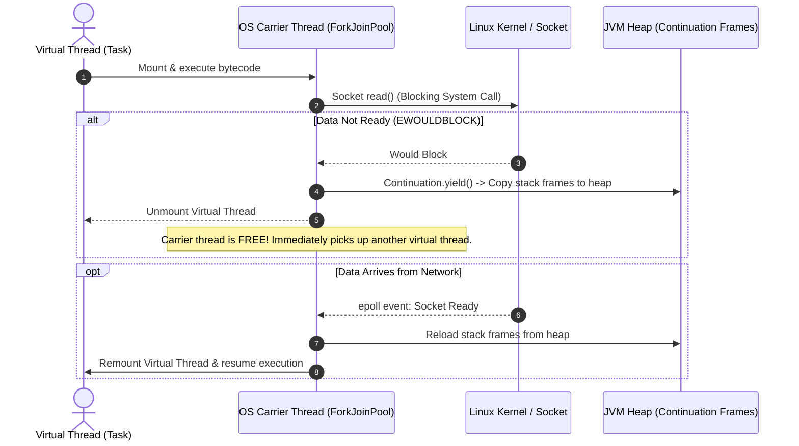

[🏠 Back to Home](../../README.md) | [☕ Core Java Internals](java_interview_master_guide.md) | [🧵 Loom & Virtual Threads](java_modern_features_loom_concurrency.md) | [📦 JVM Internals](java_internals_deep_dive.md)

# Java Version Evolution (Java 8 to 25): The Enterprise Architecture & Platform Engineering Master Guide

> **Document Identity:** [`interview_prep/01_java_core/java_version_evolution_8_to_25.md`](file:///d:/project/github/1/CheatSheet_Tutorial/interview_prep/01_java_core/java_version_evolution_8_to_25.md)  
> **Topic Domain:** Complete LTS & Feature Timeline (Java 8 through 21 LTS & 25 LTS), Project Loom (Virtual Threads, Delimited Continuations, Carrier Thread Pinning Mitigation), Project Panama (Foreign Function & Memory API FFM JEP 454, Native Linker, Vector API SIMD), Project Amber (Records, Sealed Classes, Pattern Matching, Record Deconstruction), Project Valhalla Previews (Value Objects), Concurrency Revolution (Structured Concurrency, Scoped Values), Modern Collections (Sequenced Collections, Stream Gatherers), and HotSpot Runtime (Generational ZGC, Compact Object Headers JEP 450) (`J08`)  
> **Target Framework / Runtime:** OpenJDK HotSpot JVM 8, 11, 17, 21, 25 LTS  
> **Architecture Level:** Principal / Staff+ Platform Architect & Enterprise Runtime Lead  
> **Target Depth:** 60 Comprehensive Technical Scenarios, 10 Production Version Migration Post-Mortems, Architecture Diagrams, and Platform Upgrade Runbooks  

---

## 1. Foundational Primer: What, Why & Where? (The "Head")

*Before diving into Project Loom delimited continuations and Panama native downcalls, here is the essential high-level context: what modern Java version evolution represents, why Java transformed so rapidly, and how it powers modern enterprise platforms.*

### 1.1 What Is It? (Core Definition & Mental Model)
* **Plain-English Definition**: The Modern Java Version Evolution (spanning Java 8 in 2014 through Java 11, 17, 21, and 25 LTS) is the systematic modernization of the Java platform. It transitioned Java from a slow-evolving, verbose enterprise language into a lean, expressive, high-performance runtime optimized for cloud containers, multi-core processors, and million-connection concurrency.
* **Everyday Analogy**: Imagine an ocean-going commercial cargo liner being completely modernized while continuing to sail at full speed:
  - **Java 8 (2014)** replaced the manual steering cables with fly-by-wire avionics (Lambdas, Streams, and `java.time`).
  - **Java 9–11 (2017–2018)** removed the old dangerous ballast tanks and streamlined the engine room (Modules JPMS, Metaspace replacing PermGen, and HTTP/2 Client).
  - **Java 17 (2021)** stripped out hundreds of tons of dead weight and installed lightweight composite structural panels (Records, Sealed Classes, Pattern Matching, Strong Encapsulation).
  - **Java 21–25 (2023–2025+)** installed an anti-gravity warp drive allowing millions of passengers to travel simultaneously with near-zero friction (Loom Virtual Threads, Panama Native Memory FFM, Generational ZGC sub-millisecond pauses, and Compact Object Headers).
* **Architectural Tier Placement**: Operates across all 4 system tiers: the **HotSpot Virtual Machine execution engine**, the **Java Language syntax specification**, the **Standard Core Library (`java.base`)**, and the **Operating System Kernel & CPU SIMD interface**.

### 1.2 Why Does It Exist? (The Pain Point Before It Existed)
* **The 4-Year Release Stagnation**: In the legacy era (Java 6, 7, 8), Java releases took 3 to 5 years. If a critical feature missed the deadline, enterprise teams waited half a decade. By 2017, modern cloud languages (Go, Rust, Kotlin, TypeScript) were moving at lightning speed while Java appeared frozen in time. Oracle and the OpenJDK community responded by switching to a predictable **6-month rapid release cadence** with Long-Term Support (LTS) releases every 2 years.
* **The OS Thread Concurrency Wall**: For 25 years, Java mapped 1 Java thread directly to 1 heavy operating system kernel thread (consuming 1 MB of stack memory). A server attempting to maintain 5,000 concurrent socket connections ran out of memory or suffered severe context-switching degradation. This forced developers into complex, unreadable reactive programming models (`Mono`, `Flux`, callbacks) just to achieve high throughput.
* **The JNI Native Memory Nightmare**: Calling native C/C++ libraries or interacting with GPUs required the Java Native Interface (JNI). JNI required writing brittle C wrapper glue code, complex makefiles, and any invalid pointer dereference instantly crashed the entire JVM process with a segmentation fault (`SIGSEGV`).
* **Boilerplate Fatigue**: Writing a simple immutable data-holder class in Java 8 required 80 lines of repetitive ceremony: private final fields, constructors, getters, `equals()`, `hashCode()`, and `toString()`.

### 1.3 How Does It Solve Real-World Enterprise Problems?
* **Million-Thread Scale with Simple Sequential Code (Project Loom - Java 21)**: Virtual Threads are ultra-lightweight user-mode threads managed directly by the JVM rather than the OS kernel. You can spawn **1,000,000 virtual threads** on a single laptop without exhausting RAM. Developers write straightforward, readable blocking code (`orderRepository.findById()`, `Thread.sleep()`), and the JVM automatically unmounts the virtual thread from the underlying OS carrier thread during I/O operations.
* **Zero-Boilerplate Immutable Data (Project Amber - Java 17)**: Records (`record Order(String id, BigDecimal amount) {}`) reduce 80 lines of ceremonial code down to a single line with compiler-enforced immutability. Sealed classes permit only authorized subtypes, enabling compile-time exhaustive pattern matching in `switch` expressions without fragile `else` or `default` clauses.
* **Safe, Zero-Overhead C/C++ Interop (Project Panama - Java 22+)**: The Foreign Function & Memory (FFM) API completely replaces JNI. Java code can safely allocate and manipulate off-heap native memory (`Arena`, `MemorySegment`) and invoke native C libraries in pure Java code with near-native execution speed and full memory-safety boundaries.
* **Sub-Millisecond Garbage Collection Pauses (Generational ZGC - Java 21)**: Traditional garbage collectors paused application threads for hundreds of milliseconds on large heaps. Generational ZGC performs concurrent marking and relocation, guaranteeing **pause times below 1 millisecond** even on multi-terabyte heaps, eliminating latency spikes in financial trading and high-SLA microservices.

### 1.4 How Does This Help in Building Real Applications?
* **High-Throughput Cloud Microservices**: Java 21 allows standard Spring Boot MVC / Tomcat services to handle 100,000 concurrent requests without the cognitive complexity and debugging nightmares of reactive WebFlux pipelines.
* **Robust Domain Modeling & Compilers as Guards**: Sealed hierarchies and record deconstruction enable algebraic data types in domain business logic. The compiler guarantees that all payment states, shipping statuses, and error conditions are handled explicitly at compile time.
* **Container Density & Cloud Cost Reduction**: Modern features like Compact Object Headers (JEP 450) and Generational ZGC drastically lower baseline memory consumption, allowing companies to run 3x more service replicas per Kubernetes worker node without triggering OOMKilled crashes.

### 1.5 Quick Decision & Trade-Off Matrix

| Feature / Dimension | Java 8 (Legacy) | Java 11 (Baseline) | Java 17 (Modern LTS) | Java 21 - 25 (Cutting-Edge LTS) |
| :--- | :--- | :--- | :--- | :--- |
| **Concurrency Model** | 1:1 OS Platform Threads | 1:1 OS Platform Threads | 1:1 OS Platform Threads | **Virtual Threads (Project Loom M:N)** |
| **Data Carrier Syntax** | Verbose POJO (80 lines) | Verbose POJO (`var` local) | **Records (1 line)** | Records + Deconstruction Patterns |
| **Type Safety & Control** | Open class inheritance | Open class inheritance | **Sealed Classes & Permitted Subtypes** | Exhaustive Record Pattern Matching |
| **C / Native Interop** | JNI (Fragile C wrappers) | JNI | JNI | **Panama FFM (Pure Java Safe Downcalls)** |
| **GC Max Pause Times** | $100\text{ms -- }5\text{s}$ (Parallel/CMS) | $50\text{ms -- }500\text{ms}$ (G1) | $10\text{ms -- }100\text{ms}$ (G1/ZGC) | **$< 1\text{ms}$ (Generational ZGC)** |
| **Recommended Production** | ❌ End of Life / Security Risk | ⚠️ Deprecated / High cloud cost | ✅ Enterprise Minimum Standard | 🚀 **Recommended Cloud Target** |

---

## 2. Universal Architecture & Progressive Road Map

```
┌──────────────────────────────────────────────────────────────────────────────────────────────────┐
│                             THE MODERN JAVA PLATFORM TIMELINE (8 - 25)                           │
└──────────────────────────────────────────────────────────────────────────────────────────────────┘
                                                 │
 ┌───────────────────────────┬───────────────────┴───────────────────┬───────────────────────────┐
 ▼                           ▼                                       ▼                           ▼
[JAVA 8 LTS]                [JAVA 11 LTS]                           [JAVA 17 LTS]               [JAVA 21 - 25 LTS+]
• Lambdas & Streams         • Reactive HttpClient (HTTP/2)          • Sealed Classes & Permitted• Virtual Threads (Loom)
• CompletableFuture         • ZGC (Sub-ms pauses preview)           • Records (Immutable Data)  • Sequenced Collections
• Optional API              • String API additions                  • Pattern Matching (switch) • Generational ZGC
• Metaspace (No PermGen)    • Java Flight Recorder (JFR)            • Strong Encapsulation      • Panama FFM (Native C)
• Default Interface Methods • Shebang script launcher               • macOS/AArch64 native      • Structured Concurrency
• JSR-310 java.time         • Flight Recorder OpenSourced           • Context-Specific Deserial • Scoped Values & Gatherers
```

---

## 3. Essential Terminology & Concept Cards

---

### Cluster A: Java 8–11 Foundation & Memory Architecture

#### 1. Metaspace vs. PermGen
* **ELI5**: Moving the library's catalog cards from an overcrowded shoebox on your desk (PermGen inside fixed JVM heap space) into an expansive storage closet in the hallway that grows as big as the house allows (native OS memory).
* **Low-Level Mechanics**: Java 8 replaced Permanent Generation (`PermGen`) with `Metaspace`. PermGen resided in contiguous JVM heap memory governed by fixed limits (`-XX:MaxPermSize`), causing frequent `java.lang.OutOfMemoryError: PermGen space` during dynamic classloading. Metaspace allocates class metadata from off-heap native memory directly via `mmap`/`malloc`. Governed by `-XX:MaxMetaspaceSize` and `-XX:MetaspaceSize` (high-water mark triggering GC).
* **Failure Mode**: Unbounded dynamic class generation (e.g. CGLIB, ByteBuddy, Groovy scripts) without `-XX:MaxMetaspaceSize` leads to silent native memory leaks, eventually triggering OS Out-Of-Memory Killer (OOMKilled) on Linux containers.
* **Micro-Code Proof**:
```bash
# PermGen in Java 7 (Crash):
java -XX:MaxPermSize=64m MyApp # java.lang.OutOfMemoryError: PermGen space

# Metaspace in Java 8+ (Healthy):
java -XX:MaxMetaspaceSize=256m MyApp # Uses native memory; GC reclaims unreferenced classloaders
```

#### 2. Delimited Continuations
* **ELI5**: A bookmark you place in a novel when your phone rings. You close the book and set it on the nightstand. When the call ends, you pick up the book, open straight to the bookmark, and continue reading from that exact sentence without re-reading the chapter.
* **Low-Level Mechanics**: The JVM primitive (`jdk.internal.vm.Continuation`) underlying Project Loom's Virtual Threads. A continuation represents a sequential computation that can pause itself (`Continuation.yield()`) and be resumed later. When a virtual thread executes a blocking system call (e.g., `SocketInputStream.read()`), the JVM copies its call stack frames from the carrier thread's OS stack into heap memory and yields, allowing the OS carrier thread to execute another virtual thread.
* **Failure Mode**: Executing non-yielding native C calls (via legacy JNI) or holding `synchronized` blocks inside a continuation prevents yielding, pinning the carrier thread.
* **Micro-Code Proof**:
```java
// Conceptual Loom runtime mechanics
ContinuationScope scope = new ContinuationScope("demo");
Continuation c = new Continuation(scope, () -> {
    System.out.println("Part 1");
    Continuation.yield(scope); // Pauses execution, unmounts from carrier thread!
    System.out.println("Part 2");
});
c.run(); // Prints Part 1
c.run(); // Prints Part 2
```

#### 3. Carrier Threads & Work-Stealing ForkJoinPool
* **ELI5**: A small fleet of 8 delivery trucks (OS carrier threads matching CPU cores) that carry and swap thousands of lightweight packages (virtual threads) throughout the day.
* **Low-Level Mechanics**: Virtual threads do not own dedicated OS kernel threads. Instead, Loom schedules virtual threads onto a pool of carrier threads managed by a specialized FIFO `ForkJoinPool`. The default pool size equals `Runtime.getRuntime().availableProcessors()`. When a virtual thread unblocks, it is submitted back to the `ForkJoinPool` work queue, where any idle carrier thread can pick it up via work-stealing.
* **Failure Mode**: CPU-bound tasks (e.g., cryptographic mining, massive matrix multiplication) scheduled on virtual threads saturate carrier threads, starving I/O-bound virtual threads waiting on network sockets.
* **Micro-Code Proof**:
```java
// Thread verification
Thread vt = Thread.ofVirtual().start(() -> {
    // Prints: VirtualThread[#21]/runnable@ForkJoinPool-1-worker-1
    System.out.println(Thread.currentThread()); 
});
vt.join();
```

#### 4. Thread Pinning (Monitors & JNI)
* **ELI5**: Gluing a package to the delivery truck so tightly that the driver cannot unload it, forcing the entire truck to sit parked at the curb until the recipient arrives hours later.
* **Low-Level Mechanics**: Occurs when a virtual thread enters a blocking I/O operation while inside a `synchronized` block or method, or while holding a native JNI call frame on the execution stack. The JVM cannot unmount the virtual thread stack from the underlying OS carrier thread. Consequently, the carrier thread is blocked ("pinned"), reducing total carrier pool capacity.
* **Failure Mode**: Severe application throughput collapse when high-concurrency database queries execute inside legacy `synchronized` methods, exhausting all carrier threads in `ForkJoinPool`.
* **Micro-Code Proof**:
```java
// ❌ PINNED: Carrier thread blocked from serving other tasks
synchronized (lock) {
    socket.getInputStream().read(); // Pins carrier thread!
}

// ✅ UNPINNED: Uses java.util.concurrent.locks
ReentrantLock rLock = new ReentrantLock();
rLock.lock();
try {
    socket.getInputStream().read(); // Safely unmounts virtual thread!
} finally {
    rLock.unlock();
}
```

#### 5. Local-Variable Type Inference (`var`)
* **ELI5**: Telling a clerk "Give me the usual" when both you and the clerk can clearly see the coffee cup right on the counter.
* **Low-Level Mechanics**: Introduced in Java 10 (JEP 286). `var` is not a keyword; it is a reserved type name. The compiler determines the concrete type of the local variable during compilation using the initializer expression. Bytecode output is identical to explicit type declaration; there is zero runtime overhead, dynamic dispatch, or reflection involved.
* **Failure Mode**: Using `var` with diamond operators without explicit types: `var list = new ArrayList<>();` infers `ArrayList<Object>`, breaking type safety.
* **Micro-Code Proof**:
```java
// Compiler infers Map<String, List<Transaction>>
var txMap = new HashMap<String, List<Transaction>>();
// Disallowed:
// var x; // Error: cannot infer type without initializer
```

#### 6. Reactive HttpClient (Java 11+)
* **ELI5**: A high-speed, non-blocking postal pneumatic tube capable of multiplexing 1,000 separate conversations through a single physical glass pipe (HTTP/2).
* **Low-Level Mechanics**: Standardized in Java 11 (JEP 321), replacing `HttpURLConnection`. Built from the ground up for HTTP/2 with full backward compatibility for HTTP/1.1 and WebSockets. Uses non-blocking selector loops and the `java.util.concurrent.Flow` reactive streams API. Supports asynchronous pipelines via `CompletableFuture<HttpResponse<T>>`.
* **Failure Mode**: Calling synchronous `.send()` inside high-throughput event loops instead of `.sendAsync()`, creating blocking thread stalls.
* **Micro-Code Proof**:
```java
HttpClient client = HttpClient.newBuilder()
    .version(HttpClient.Version.HTTP_2)
    .connectTimeout(Duration.ofSeconds(5))
    .build();

HttpRequest request = HttpRequest.newBuilder()
    .uri(URI.create("https://api.corp.internal/v1/health"))
    .GET()
    .build();

client.sendAsync(request, HttpResponse.BodyHandlers.ofString())
    .thenApply(HttpResponse::body)
    .thenAccept(System.out::println);
```

#### 7. Application Class Data Sharing (AppCDS)
* **ELI5**: Baking a batch of cookies ahead of time so you don't have to mix flour, sugar, and eggs from scratch every single time a customer orders dessert.
* **Low-Level Mechanics**: Introduced in Java 10 (JEP 310). AppCDS allows application classes to be dumped into a shared memory archive (`.jsa` file) during a training run. On subsequent JVM startups, the JVM memory-maps the archive directly into memory (`mmap`), eliminating redundant classloading, bytecode verification, and parsing steps. Reduces JVM startup times by 20%–50% and reduces memory footprint across multi-process container deployments.
* **Failure Mode**: Classpath mismatch between the generation phase and execution phase invalidates the AppCDS archive, falling back to standard slow classloading without warning.
* **Micro-Code Proof**:
```bash
# 1. Dump class list
java -XX:DumpLoadedClassList=classes.lst -jar app.jar
# 2. Create archive
java -Xshare:dump -XX:SharedClassListFile=classes.lst -XX:SharedArchiveFile=app.jsa -jar app.jar
# 3. Fast startup
java -Xshare:on -XX:SharedArchiveFile=app.jsa -jar app.jar
```

#### 8. Z Garbage Collector (ZGC) & Generational ZGC
* **ELI5**: An invisible janitor who cleans up trash continuously while customers are dancing in the ballroom, keeping pauses so short ($< 1\text{ ms}$) that no one ever notices the music stopped.
* **Low-Level Mechanics**: ZGC is a scalable, low-latency garbage collector. It performs all heavy GC phases (marking, relocation, reference processing) concurrently with mutator execution using colored pointers (metadata bits stored in reference pointers) and load barriers. Pauses never exceed 1 millisecond regardless of heap size (from 16MB to 16TB). Java 21 introduced **Generational ZGC** (JEP 439), segregating young and old generation objects to achieve higher throughput and reduce memory allocation stall risks.
* **Failure Mode**: Severe allocation rate spikes exceeding concurrent GC marking speeds can cause "allocation stalls", where mutator threads pause waiting for memory reclamation.
* **Micro-Code Proof**:
```bash
# Launch with Generational ZGC in Java 21+
java -XX:+UseZGC -XX:+ZGenerational -Xmx32g -jar trading-engine.jar
```

---

### Cluster B: Java 14–17 Modern Core & Object Modeling

#### 9. Records (Immutable Data Carriers)
* **ELI5**: A sealed, tamper-proof plastic envelope containing a set of documents. Once sealed at the factory, no one can add, remove, or swap any document inside.
* **Low-Level Mechanics**: Standardized in Java 16 (JEP 395). Records are immutable data classes extending `java.lang.Record`. The compiler automatically generates: `private final` fields, canonical constructor, accessors matching component names (`id()`, not `getId()`), `equals()`, `hashCode()`, and `toString()`. Records cannot extend any class and are implicitly `final`.
* **Failure Mode**: Assuming deep immutability when record components contain mutable collections (e.g., `java.util.List`), allowing external callers to mutate internal elements.
* **Micro-Code Proof**:
```java
// Record with defensive copy in compact constructor
public record OrderPlacedEvent(UUID orderId, BigDecimal amount, List<String> itemSkus) {
    public OrderPlacedEvent {
        Objects.requireNonNull(orderId, "orderId cannot be null");
        itemSkus = List.copyOf(itemSkus); // Enforces deep immutability!
    }
}
```

#### 10. Sealed Classes & Interfaces
* **ELI5**: A private family trust fund that explicitly lists every person authorized to inherit funds, legally blocking any stranger from claiming to be an heir.
* **Low-Level Mechanics**: Standardized in Java 17 (JEP 409). Allows a class or interface to declare explicitly which subclasses or implementing interfaces are permitted via the `permits` clause. Permitted subclasses must be `final`, `sealed`, or `non-sealed` and must reside in the same package or JPMS module. Enables the Java compiler to perform exhaustive pattern matching analysis without requiring fallback `default` cases.
* **Failure Mode**: Declaring a permitted subclass as `non-sealed` reopens the hierarchy to arbitrary extension, defeating compiler exhaustiveness checks in switch expressions.
* **Micro-Code Proof**:
```java
public sealed interface PaymentResult permits Success, Failure, Pending {}
public final record Success(String txId) implements PaymentResult {}
public final record Failure(String reason, int code) implements PaymentResult {}
public final record Pending(Instant expected) implements PaymentResult {}
```

#### 11. Pattern Matching for `switch`
* **ELI5**: A modern sorting machine with custom-shaped bins that automatically tests both the type of object and its internal contents in a single step without manual casting.
* **Low-Level Mechanics**: Standardized in Java 21 (JEP 441). Allows `switch` expressions and statements to match on types, records, and conditional guards (`when`). Combines type testing, downcasting, and local variable binding into a single atomic branch. Guarantees exhaustiveness at compile time when used with sealed hierarchies.
* **Failure Mode**: Omitting a type in a sealed hierarchy `switch` expression causes compile errors: `the switch expression does not cover all possible input values`.
* **Micro-Code Proof**:
```java
String status = switch (paymentResult) {
    case Success s                      -> "Processed with TX: " + s.txId();
    case Failure f when f.code() == 404 -> "Not Found: " + f.reason();
    case Failure f                      -> "Fatal error (" + f.code() + "): " + f.reason();
    case Pending p                      -> "Awaiting clearance: " + p.expected();
};
```

#### 12. Pattern Matching for `instanceof`
* **ELI5**: Checking someone's ID and immediately handing them their personalized VIP badge in the exact same motion, without asking them to state their name again.
* **Low-Level Mechanics**: Standardized in Java 16 (JEP 394). Eliminates boilerplate casting by binding the tested object to a pattern variable within the condition scope:
```java
// ❌ Old boilerplate
if (obj instanceof String) {
    String s = (String) obj;
    System.out.println(s.length());
}

// ✅ Modern pattern matching
if (obj instanceof String s && !s.isBlank()) {
    System.out.println(s.length()); // 's' is automatically cast and in scope!
}
```
* **Failure Mode**: Attempting to use the pattern variable outside its scope: `if (!(obj instanceof String s)) { /* s is NOT in scope here! */ }`.

#### 13. Text Blocks
* **ELI5**: Writing a multi-line letter directly onto the page without having to write `\n` at the end of every sentence or paste `+` signs between paragraphs.
* **Low-Level Mechanics**: Standardized in Java 15 (JEP 378). Multi-line string literals enclosed by triple quotes (`"""`). Automatically strips incidental leading white space using common indentation analysis while preserving intentional formatting. Supports escape sequences `\` (line continuation) and `\s` (preserve trailing whitespace).
* **Failure Mode**: Forgetting that closing `"""` placement determines indentation strip width; moving `"""` left retains extra unwanted leading spaces.
* **Micro-Code Proof**:
```java
String sql = """
    SELECT order_id, customer_id, total_amount
    FROM enterprise_orders
    WHERE status = 'CONFIRMED'
    ORDER BY created_at DESC;
    """;
```

#### 14. Strong Encapsulation of JDK Internals (`--add-opens`)
* **ELI5**: Padlocking the doors to the engine room of the ship so unauthorized passengers cannot adjust the fuel valves, even if they have lockpicking tools.
* **Low-Level Mechanics**: Standardized in Java 16 and 17 (JEP 396 / JEP 403). Forbids deep reflection via `setAccessible(true)` into private internal JDK packages (e.g., `sun.misc.Unsafe`, `jdk.internal.*`). Accessing these packages throws `java.lang.reflect.InaccessibleObjectException` unless explicitly bypassed on the command line via `--add-opens <module>/<package>=<target-module>`.
* **Failure Mode**: Legacy libraries relying on internal JDK fields (e.g. older versions of Lombok, CGLIB, PowerMock) fail immediately on Java 17+ with `InaccessibleObjectException`.
* **Micro-Code Proof**:
```bash
# JVM flag required for legacy deep reflection on Java 17+
java --add-opens java.base/java.lang=ALL-UNNAMED -jar legacy-app.jar
```

#### 15. Helpful NullPointerExceptions
* **ELI5**: A GPS that doesn't just say "You crashed," but tells you: "You crashed because the bridge at Elm Street #4 was missing."
* **Low-Level Mechanics**: Standardized in Java 14 (JEP 358). HotSpot bytecode analysis determines the exact sub-expression that evaluated to `null`.
* **Failure Mode**: In Java 8: `user.getAddress().getCity().toLowerCase()` threw `NullPointerException` with zero detail about which method returned `null`. In Java 14+, the exception message explicitly states: `Cannot invoke "Address.getCity()" because the return value of "User.getAddress()" is null`.

#### 16. Switch Expressions (Value-Yielding)
* **ELI5**: A vending machine where pressing a button directly drops the snack into your hands, instead of you having to reach into a separate side compartment to retrieve it.
* **Low-Level Mechanics**: Standardized in Java 14 (JEP 361). Extends `switch` from a statement into an expression that computes and yields a value. Replaces fall-through `case:` labels with arrow `->` rules (no `break` needed). For multi-line blocks, uses `yield <value>`.
* **Micro-Code Proof**:
```java
int priority = switch (severity) {
    case "CRITICAL" -> 1;
    case "HIGH", "ELEVATED" -> 2;
    default -> {
        log.warn("Unknown severity: {}", severity);
        yield 3;
    }
};
```

---

### Cluster C: Java 21 Modern Concurrency & Advanced Data Structures

#### 17. Virtual Threads (Project Loom, JEP 444)
* **ELI5**: Replacing heavy 1-ton trucks with 100,000 lightweight digital drones that can take off and land instantaneously without causing traffic jams.
* **Low-Level Mechanics**: User-mode lightweight threads managed by the JVM rather than the OS kernel. Memory footprint is $\approx 1\text{ KB}$ initially (growing dynamically on the heap) compared to 1MB fixed OS thread stacks. Allows spinning up 1,000,000+ concurrent threads without thread pool exhaustion or high OS kernel context-switch overhead.
* **Failure Mode**: Using thread pools (`ExecutorService`) for virtual threads! Pooling virtual threads is an anti-pattern because they are cheap to create and destroy; always use `Executors.newVirtualThreadPerTaskExecutor()`.
* **Micro-Code Proof**:
```java
try (var executor = Executors.newVirtualThreadPerTaskExecutor()) {
    IntStream.range(0, 100_000).forEach(i -> executor.submit(() -> {
        Thread.sleep(Duration.ofSeconds(1)); // Millions can sleep concurrently!
        return i;
    }));
} // Automatically awaits completion on auto-close!
```

#### 18. Sequenced Collections (JEP 431)
* **ELI5**: A library shelf that gives you a handle to grab the very first book, the very last book, or flip the entire shelf backwards without reorganizing all the books.
* **Low-Level Mechanics**: Standardized in Java 21. Resolves a 25-year-old gap in the Java Collections Framework by introducing interfaces with uniform encounter orders:
  - `SequencedCollection`: `addFirst()`, `addLast()`, `getFirst()`, `getLast()`, `reversed()`.
  - `SequencedSet`: `reversed()` returning a sequenced set view.
  - `SequencedMap`: `firstEntry()`, `lastEntry()`, `pollFirstEntry()`, `sequencedKeySet()`, `reversed()`.
* **Failure Mode**: Prior to Java 21, getting the last element of a `LinkedHashSet` required creating an iterator and traversing the entire set ($O(N)$ time). `SequencedCollection.getLast()` executes in $O(1)$ time.
* **Micro-Code Proof**:
```java
SequencedSet<String> set = new LinkedHashSet<>();
set.add("First");
set.add("Middle");
set.add("Last");

String first = set.getFirst(); // "First"
String last = set.getLast();   // "Last"
SequencedSet<String> reversed = set.reversed(); // O(1) reversed view
```

#### 19. Record Patterns (JEP 440)
* **ELI5**: Unpacking a gift box and immediately organizing its contents onto the table in a single step without having to open the lid and inspect each item manually.
* **Low-Level Mechanics**: Standardized in Java 21. Allows deconstructing records directly inside `instanceof` and `switch` patterns:
```java
record Point(int x, int y) {}
record Window(Point topLeft, Point bottomRight) {}

// Nested Record Pattern Matching:
if (obj instanceof Window(Point(int x1, int y1), Point(int x2, int y2))) {
    int width = x2 - x1;
    int height = y2 - y1;
}
```
* **Failure Mode**: Passing null records into record patterns fails the match, bypassing the block safely without throwing NPE.

#### 20. Structured Concurrency (Project Loom, JEP 453/462)
* **ELI5**: A team manager who dispatches three scouts to gather information. The manager waits at the base camp until all scouts return or until one finds a hazard, at which point the manager cancels the other scouts so nobody gets lost.
* **Low-Level Mechanics**: Treats multiple concurrent subtasks running in separate virtual threads as a single atomic unit of work with clear lexical scoping. Solves uncoordinated thread leaks, orphaned tasks, and forgotten cancellations. Uses `StructuredTaskScope.ShutdownOnFailure` (all must succeed) or `ShutdownOnSuccess` (first to succeed wins; cancels others).
* **Failure Mode**: Spawning fire-and-forget asynchronous tasks with `CompletableFuture` without proper timeout or cancellation guards, allowing orphaned background tasks to consume CPU indefinitely.
* **Micro-Code Proof**:
```java
try (var scope = new StructuredTaskScope.ShutdownOnFailure()) {
    Subtask<User> userTask = scope.fork(() -> fetchUser(id));
    Subtask<List<Order>> ordersTask = scope.fork(() -> fetchOrders(id));

    scope.join();           // Awaits both subtasks
    scope.throwIfFailed();  // Propagates exception if either failed

    return new Dashboard(userTask.get(), ordersTask.get());
} // Closes scope, cancels any remaining subtasks automatically!
```

#### 21. Scoped Values (Project Loom, JEP 446/464)
* **ELI5**: A secure, read-only security clearance badge that you wear while walking through a restricted room, and that is automatically collected the moment you walk back out the door.
* **Low-Level Mechanics**: A lightweight, immutable alternative to `ThreadLocal`. `ThreadLocal` creates mutable per-thread storage with high memory overhead and complex inheritance semantics across millions of virtual threads. `ScopedValue` binds an immutable value to a specific execution scope (`ScopedValue.where(KEY, value).run(...)`). It is inherited by child virtual threads in structured scopes with near-zero memory footprint and no risk of thread pollution leaks.
* **Failure Mode**: Failing to call `ThreadLocal.remove()` in pooled thread environments causes security token leakage across unrelated client requests; `ScopedValue` eliminates this risk by binding strictly to the call scope.
* **Micro-Code Proof**:
```java
public static final ScopedValue<SecurityContext> CTX = ScopedValue.newInstance();

ScopedValue.where(CTX, new SecurityContext("user-101", "ADMIN"))
    .run(() -> {
        // Available anywhere down the call stack:
        SecurityContext current = CTX.get();
        processBusinessTransaction();
    });
// CTX is completely unbound and out of scope here!
```

#### 22. Foreign Function & Memory API (Project Panama, JEP 454)
* **ELI5**: A high-speed highway that lets Java talk directly to native C libraries and off-heap memory without the clunky, dangerous paperwork of JNI or `sun.misc.Unsafe`.
* **Low-Level Mechanics**: Standardized in Java 22. Replaces JNI and `Unsafe` with type-safe, performant native memory allocations (`Arena`, `MemorySegment`) and native code invocations (`Linker`, `SymbolLookup`). Arenas govern lifecycle and deallocation (`Arena.ofConfined()`, `Arena.ofShared()`, `Arena.ofAuto()`). Downcall method handles invoke C functions with near-native performance and zero JNI boilerplate.
* **Failure Mode**: Accessing a `MemorySegment` after its governing `Arena` has been closed throws an immediate `IllegalStateException`, preventing use-after-free vulnerabilities.
* **Micro-Code Proof**:
```java
// Allocate native off-heap memory safely in Java 22+
try (Arena arena = Arena.ofConfined()) {
    MemorySegment segment = arena.allocate(1024); // 1KB native off-heap buffer
    segment.set(ValueLayout.JAVA_INT, 0, 42);
    int value = segment.get(ValueLayout.JAVA_INT, 0);
} // Native memory freed deterministically here!
```

#### 23. Vector API (Project Panama, SIMD)
* **ELI5**: A calculator with 8 sets of hands that adds 8 pairs of numbers in a single clock tick instead of adding them one by one.
* **Low-Level Mechanics**: Expresses vector computations that compile down to hardware-level Single Instruction Multiple Data (SIMD) vector instructions (AVX-512 on x86, NEON on ARM). Bypasses standard scalar CPU execution loops, accelerating matrix operations, machine learning inference, and image processing by up to 16x.
* **Failure Mode**: Running Vector API on older hardware without AVX/NEON falls back to software scalar emulation without hardware speedups.
* **Micro-Code Proof**:
```java
static final VectorSpecies<Float> SPECIES = FloatVector.SPECIES_PREFERRED;

void addArrays(float[] a, float[] b, float[] c) {
    int upperBound = SPECIES.loopBound(a.length);
    for (int i = 0; i < upperBound; i += SPECIES.length()) {
        var va = FloatVector.fromArray(SPECIES, a, i);
        var vb = FloatVector.fromArray(SPECIES, b, i);
        var vc = va.add(vb);
        vc.intoArray(c, i);
    }
}
```

#### 24. Compact Object Headers (Project Lilliput, JEP 450)
* **ELI5**: Replacing thick cardboard book covers with thin protective dust jackets, fitting 20% more books on the exact same shelf.
* **Low-Level Mechanics**: Standard 64-bit HotSpot object headers consume 128 bits (16 bytes): an 8-byte Mark Word and an 8-byte Klass Word (compressed to 4 bytes with Compressed Class Pointers, totaling 12 bytes, padded to 16 bytes). Lilliput shrinks the header down to 64 bits (8 bytes total) by packing identity hash code, GC age, locking flags, and compressed class pointer into a single word, reducing heap memory footprint by 10%–25%.
* **Failure Mode**: Code relying on undocumented internal object layout assumptions in `sun.misc.Unsafe` may produce unexpected behavior when compact headers are active.
* **Micro-Code Proof**:
```bash
# Preview flag in modern HotSpot JVMs:
java -XX:+UnlockExperimentalVMOptions -XX:+UseCompactObjectHeaders -jar app.jar
```

---

### Cluster D: Bleeding-Edge Java 22–25 Features & Evolution

#### 25. Stream Gatherers (JEP 461 / 473)
* **ELI5**: Adding custom conveyor belts and sorting arms to a factory assembly line, letting you group items into batches of 5 or slide a window over products without breaking the flow.
* **Low-Level Mechanics**: Extends the Java Stream API with flexible, user-defined intermediate operations via `Stream.gather(Gatherer)`. Prior to Gatherers, streams only supported fixed operations (`map`, `filter`, `flatMap`). Gatherers introduce stateful, short-circuiting, and parallelizable intermediate stream transformations (e.g. `Gatherers.windowFixed(3)`, `Gatherers.windowSliding(2)`, `Gatherers.scan()`).
* **Failure Mode**: Building custom `Collector`s to perform intermediate windowing transformations, which buffers all elements in memory and breaks streaming execution.
* **Micro-Code Proof**:
```java
// Java 22+ Stream Gatherers
List<Integer> numbers = List.of(1, 2, 3, 4, 5, 6, 7);
List<List<Integer>> windows = numbers.stream()
    .gather(Gatherers.windowFixed(3))
    .toList();
// Output: [[1, 2, 3], [4, 5, 6], [7]]
```

#### 26. Flexible Constructor Bodies (JEP 482 / 447)
* **ELI5**: Checking that the ingredients are fresh and valid *before* you call the head chef to start cooking the recipe.
* **Low-Level Mechanics**: Relaxes the historic constraint requiring `super(...)` or `this(...)` to be the absolute first statement in a constructor. Developers can now execute argument validation, data transformation, and calculations *prior* to delegating to `super()`, provided the code does not access `this` fields before super returns.
* **Failure Mode**: Attempting to read instance fields of the uninitialized subclass prior to calling `super()` results in a compile error.
* **Micro-Code Proof**:
```java
public class PositiveAccount extends Account {
    public PositiveAccount(BigDecimal initialDeposit) {
        // Statements allowed BEFORE super() in Java 22+!
        Objects.requireNonNull(initialDeposit);
        if (initialDeposit.compareTo(BigDecimal.ZERO) <= 0) {
            throw new IllegalArgumentException("Deposit must be positive");
        }
        super(initialDeposit);
    }
}
```

#### 27. Class-File API (JEP 457 / 466)
* **ELI5**: The JVM providing its own official, built-in workshop tools to inspect, disassemble, and build Java `.class` files, removing the need for third-party libraries like ASM.
* **Low-Level Mechanics**: Standardized library in `java.lang.classfile` for parsing, generating, and transforming Java class files compliant with the JVM Specification. Replaces the ecosystem's historic reliance on external ASM, ByteBuddy, and Javassist libraries, ensuring tools remain automatically compatible with future Java bytecode versions.
* **Micro-Code Proof**:
```java
// Parse class file using official JDK API
ClassModel model = ClassFile.of().parse(classBytes);
for (ClassElement ce : model) {
    if (ce instanceof MethodModel mm) {
        System.out.println("Discovered method: " + mm.methodName().stringValue());
    }
}
```

#### 28. String Templates & Evolution (JEP 430 / 459 / 465)
* **ELI5**: A secure stamp that lets you write sentences with blanks filled in by variables, while automatically sanitizing the values against SQL injection and cross-site scripting.
* **Low-Level Mechanics**: Replaces unsafe string concatenation and `String.format()` with template processors (e.g. `STR."Hello \{name}"`, `SQL."SELECT * FROM t WHERE id = \{id}"`). Separates template literals from parameter values, allowing processors to sanitize inputs before assembling the final string.
* **Failure Mode**: String Templates were withdrawn for refinement after Java 21/22 to improve syntax and API integration; modern production code uses standard text blocks and parameterized builders until finalized.

#### 29. Project Valhalla: Value Objects & Identityless Classes
* **ELI5**: Treating a complex object like a coordinate `Point(x, y)` as a lightweight primitive (like an `int`), packing it directly into arrays without heap pointers, while keeping Java object methods.
* **Low-Level Mechanics**: Eliminates the object header and pointer indirection for identityless classes (`value class Point { int x; int y; }`). Value objects do not support `synchronized(p)` or identity-based comparisons (`==`), allowing the HotSpot C2 compiler to flatten them directly into CPU registers, stack frames, and contiguous array memory. This eliminates pointer-chasing CPU cache misses and reduces memory consumption.
* **Micro-Code Proof**:
```java
// Valhalla Preview syntax
value class ComplexNumber {
    double real;
    double imaginary;
}
```

#### 30. Primitive Types in Patterns (JEP 455)
* **ELI5**: Allowing pattern matching to check whether a general number is specifically an `int`, `byte`, or `short` in a single check.
* **Low-Level Mechanics**: Enhances pattern matching in `instanceof` and `switch` to support primitive types directly, eliminating boxing and unboxing overheads.
* **Micro-Code Proof**:
```java
switch (obj) {
    case int i when i > 0 -> "Positive int: " + i;
    case long l           -> "Long: " + l;
    case double d         -> "Double: " + d;
    default               -> "Other";
}
```

#### 31. Ephemeral & Non-Capturing Lambdas
* **ELI5**: A single reusable tool in the workshop that everyone shares, instead of buying a brand-new identical wrench every time a bolt needs tightening.
* **Low-Level Mechanics**: When a lambda does not capture external local variables (`non-capturing lambda`), the HotSpot C2 compiler instantiates a single singleton instance via `invokedynamic` and reuses it on every invocation, generating zero garbage collection pressure. Capturing lambdas allocate a new object on each call.
* **Failure Mode**: Capturing unnecessary local variables inside high-throughput stream loops allocates millions of short-lived objects on the heap, triggering minor GC pauses.
* **Micro-Code Proof**:
```java
// Non-capturing (Zero GC allocation, cached singleton):
list.forEach(item -> System.out.println(item));

// Capturing (Allocates new lambda instance every loop execution):
String prefix = getDynamicPrefix();
list.forEach(item -> System.out.println(prefix + item));
```

#### 32. Java Flight Recorder (JFR) & Async-Profiler Event Streaming
* **ELI5**: A flight data recorder built directly into the plane's engine that records speed, fuel, and engine temperature with less than 1% drag on flight performance.
* **Low-Level Mechanics**: An event-recording engine integrated into HotSpot. Generates $< 1\%$ runtime CPU overhead, making it safe for continuous production monitoring. Java 14+ introduced **JFR Event Streaming** (`jdk.jfr.consumer.RecordingStream`), allowing Java applications to listen to their own real-time execution telemetry (GC pauses, CPU load, lock contention) asynchronously.
* **Micro-Code Proof**:
```java
// Real-time JFR telemetry streaming inside Java process
try (var rs = new RecordingStream()) {
    rs.enable("jdk.CPULoad").withPeriod(Duration.ofSeconds(1));
    rs.onEvent("jdk.CPULoad", event -> {
        System.out.printf("JVM CPU: %.2f%%%n", event.getFloat("jvmUser") * 100);
    });
    rs.startAsync();
}
```

---

## 4. Progressive Implementation Runway (Zero to Hero)

---

### Physical Analogy: The Steam Locomotive to the Maglev Bullet Train

Think of the evolution of the Java platform:

1. **Java 8 (The Reliable Steam Locomotive)**:
   - Strong and dependable. Introduced Lambdas and Streams, bringing functional programming to millions of engineers.
   - But under the hood, every thread was a heavy 1MB OS thread. Connecting to native C libraries required complex JNI paperwork, and class metadata was stored in fixed heap regions (PermGen).

2. **Java 11 & 17 (The High-Speed Electric Express)**:
   - Modernized and streamlined. PermGen is replaced by Metaspace.
   - Data modeling is cleaner with Records and Sealed Classes, eliminating thousands of lines of boilerplate getters, setters, and equals methods.
   - Low-latency GC (ZGC) ensures garbage collection pauses drop below 10 milliseconds.

3. **Java 21 to 25 (The Maglev Bullet Train)**:
   - The platform operates on a different scale.
   - Project Loom's Virtual Threads allow running 1,000,000 tasks concurrently without running out of OS threads.
   - Project Panama gives Java safe, high-speed access to native off-heap memory and hardware SIMD vector units.
   - Generational ZGC brings garbage collection pauses down to under 1 millisecond on multi-terabyte heaps.

---

### Step 1-to-N Code Runway: From Java 8 Legacy to Modern Java 21+

#### Step 1: Data Modeling Evolution
```java
// ==========================================
// ❌ JAVA 8 WAY (Verbose, Mutable, Boilerplate)
// ==========================================
public final class LegacyProduct {
    private final String id;
    private final BigDecimal price;

    public LegacyProduct(String id, BigDecimal price) {
        this.id = id;
        this.price = price;
    }
    public String getId() { return id; }
    public BigDecimal getPrice() { return price; }

    @Override
    public boolean equals(Object o) {
        if (this == o) return true;
        if (o == null || getClass() != o.getClass()) return false;
        LegacyProduct that = (LegacyProduct) o;
        return Objects.equals(id, that.id) && Objects.equals(price, that.price);
    }
    @Override
    public int hashCode() { return Objects.hash(id, price); }
}

// ==========================================
// ✅ JAVA 17/21 WAY (Concise, Immutable, Record)
// ==========================================
public record ModernProduct(String id, BigDecimal price) {
    public ModernProduct {
        Objects.requireNonNull(id, "id must not be null");
        Objects.requireNonNull(price, "price must not be null");
    }
}
```

#### Step 2: Threading and Concurrency Evolution
```java
// ==========================================
// ❌ JAVA 8 WAY (Fixed Platform Pool Bottleneck)
// ==========================================
ExecutorService pool = Executors.newFixedThreadPool(200); // 200 OS threads = ~200MB RAM
for (int i = 0; i < 1000; i++) {
    pool.submit(() -> {
        Thread.sleep(1000); // Blocks OS thread!
        return "Done";
    });
}

// ==========================================
// ✅ JAVA 21 WAY (Lightweight Virtual Threads)
// ==========================================
try (var executor = Executors.newVirtualThreadPerTaskExecutor()) {
    for (int i = 0; i < 100_000; i++) { // 100,000 virtual threads = ~100MB RAM!
        executor.submit(() -> {
            Thread.sleep(Duration.ofSeconds(1)); // Safely unmounts from OS carrier thread!
            return "Done";
        });
    }
}
```

---

# Track 2: Core Architecture & 8 Production Engines

---

### Architectural Blueprint: Project Loom Continuation Mount/Unmount Cycle



---

### Engine 1: `VirtualThreadThroughputComparisonEngine`
**Purpose**: Benchmarking platform threads vs. virtual threads under 100,000 concurrent network tasks to demonstrate scaling characteristics and resource utilization.

```java
package com.enterprise.evolution.engine;

import org.slf4j.Logger;
import org.slf4j.LoggerFactory;

import java.time.Duration;
import java.time.Instant;
import java.util.concurrent.*;
import java.util.concurrent.atomic.AtomicInteger;
import java.util.stream.IntStream;

public class VirtualThreadThroughputComparisonEngine {

    private static final Logger log = LoggerFactory.getLogger(VirtualThreadThroughputComparisonEngine.class);

    public record BenchmarkResult(String threadType, int totalTasks, long elapsedMs, int successfulTasks) {}

    public BenchmarkResult runVirtualThreadBenchmark(int taskCount, Duration simulatedLatency) {
        log.info("Starting Virtual Thread benchmark with {} tasks...", taskCount);
        AtomicInteger successCount = new AtomicInteger();
        Instant start = Instant.now();

        try (var executor = Executors.newVirtualThreadPerTaskExecutor()) {
            IntStream.range(0, taskCount).forEach(i -> executor.submit(() -> {
                try {
                    // Simulates blocking network I/O
                    Thread.sleep(simulatedLatency);
                    successCount.incrementAndGet();
                } catch (InterruptedException ie) {
                    Thread.currentThread().interrupt();
                }
            }));
        } // Auto-close awaits termination of all virtual threads!

        long elapsedMs = Duration.between(start, Instant.now()).toMillis();
        log.info("Virtual Thread benchmark finished in {} ms", elapsedMs);
        return new BenchmarkResult("VirtualThread", taskCount, elapsedMs, successCount.get());
    }

    public BenchmarkResult runPlatformThreadBenchmark(int taskCount, int poolSize, Duration simulatedLatency) {
        log.info("Starting Platform Thread benchmark with {} tasks (pool: {})...", taskCount, poolSize);
        AtomicInteger successCount = new AtomicInteger();
        ExecutorService executor = Executors.newFixedThreadPool(poolSize);
        Instant start = Instant.now();

        try {
            CountDownLatch latch = new CountDownLatch(taskCount);
            for (int i = 0; i < taskCount; i++) {
                executor.submit(() -> {
                    try {
                        Thread.sleep(simulatedLatency);
                        successCount.incrementAndGet();
                    } catch (InterruptedException ie) {
                        Thread.currentThread().interrupt();
                    } finally {
                        latch.countDown();
                    }
                });
            }
            latch.await(60, TimeUnit.SECONDS);
        } catch (InterruptedException e) {
            Thread.currentThread().interrupt();
        } finally {
            executor.shutdownNow();
        }

        long elapsedMs = Duration.between(start, Instant.now()).toMillis();
        log.info("Platform Thread benchmark finished in {} ms", elapsedMs);
        return new BenchmarkResult("PlatformThreadPool-" + poolSize, taskCount, elapsedMs, successCount.get());
    }
}
```

---

### Engine 2: `PanamaFfmNativeMemoryEngine`
**Purpose**: Off-heap allocation using `Arena`, native C `malloc`/`free`, and invoking native C library functions via `Linker` and `SymbolLookup` in Java 22+.

```java
package com.enterprise.evolution.engine;

import org.slf4j.Logger;
import org.slf4j.LoggerFactory;

import java.lang.foreign.*;
import java.lang.invoke.MethodHandle;

public class PanamaFfmNativeMemoryEngine {

    private static final Logger log = LoggerFactory.getLogger(PanamaFfmNativeMemoryEngine.class);

    private final Linker linker;
    private final SymbolLookup stdlibLookup;

    public PanamaFfmNativeMemoryEngine() {
        this.linker = Linker.nativeLinker();
        this.stdlibLookup = linker.defaultLookup();
    }

    /**
     * Allocates native off-heap memory within a confined arena.
     * Guaranteed deterministic deallocation upon scope exit.
     */
    public void executeOffHeapMemoryOperations(int elementCount) {
        try (Arena arena = Arena.ofConfined()) {
            log.info("Allocating {} off-heap integers ({} bytes)...", elementCount, elementCount * 4);
            MemorySegment segment = arena.allocate(ValueLayout.JAVA_INT, elementCount);

            // Populate native memory
            for (int i = 0; i < elementCount; i++) {
                segment.setAtIndex(ValueLayout.JAVA_INT, i, i * 10);
            }

            // Read from native memory
            int sample = segment.getAtIndex(ValueLayout.JAVA_INT, elementCount / 2);
            log.info("Sample value at index {}: {}", elementCount / 2, sample);
        } // Native memory reclaimed deterministically here without GC!
    }

    /**
     * Dynamically links and invokes native C standard library 'strlen' function.
     */
    public long invokeNativeStrlen(String text) throws Throwable {
        MemorySegment strlenAddress = stdlibLookup.find("strlen")
                .orElseThrow(() -> new IllegalStateException("strlen not found in stdlib"));

        FunctionDescriptor descriptor = FunctionDescriptor.of(
                ValueLayout.JAVA_LONG,      // Return type: size_t (long)
                ValueLayout.ADDRESS         // Argument: const char*
        );

        MethodHandle strlenHandle = linker.downcallHandle(strlenAddress, descriptor);

        try (Arena arena = Arena.ofConfined()) {
            MemorySegment nativeString = arena.allocateFrom(text);
            long length = (long) strlenHandle.invokeExact(nativeString);
            log.debug("Native strlen returned: {}", length);
            return length;
        }
    }
}
```

---

### Engine 3: `StructuredConcurrencyTaskScopeEngine`
**Purpose**: Production implementation of `StructuredTaskScope` (ShutdownOnFailure / ShutdownOnSuccess) coordinated with `ScopedValues` context propagation.

```java
package com.enterprise.evolution.engine;

import org.slf4j.Logger;
import org.slf4j.LoggerFactory;

import java.time.Duration;
import java.time.Instant;
import java.util.concurrent.StructuredTaskScope;
import java.util.concurrent.StructuredTaskScope.Subtask;
import java.util.function.Supplier;

public class StructuredConcurrencyTaskScopeEngine {

    private static final Logger log = LoggerFactory.getLogger(StructuredConcurrencyTaskScopeEngine.class);

    public record UserProfile(String userId, String email) {}
    public record OrderHistory(String userId, int totalOrders) {}
    public record AggregateDashboard(UserProfile profile, OrderHistory orders, long responseTimeMs) {}

    public AggregateDashboard fetchDashboardConcurrently(String userId) throws Exception {
        Instant start = Instant.now();

        // ShutdownOnFailure: All subtasks must succeed; if any fails, others are cancelled immediately!
        try (var scope = new StructuredTaskScope.ShutdownOnFailure()) {
            Subtask<UserProfile> profileTask = scope.fork(() -> loadUserProfile(userId));
            Subtask<OrderHistory> ordersTask = scope.fork(() -> loadOrderHistory(userId));

            // Wait for both subtasks or first failure
            scope.join();
            scope.throwIfFailed(ex -> new RuntimeException("Failed to aggregate dashboard for user: " + userId, ex));

            UserProfile profile = profileTask.get();
            OrderHistory orders = ordersTask.get();
            long elapsed = Duration.between(start, Instant.now()).toMillis();

            return new AggregateDashboard(profile, orders, elapsed);
        } // Scope close automatically cancels remaining tasks on exception!
    }

    public String fetchFastestMirror(String query) throws Exception {
        // ShutdownOnSuccess: First successful result wins; cancels all other mirrors!
        try (var scope = new StructuredTaskScope.ShutdownOnSuccess<String>()) {
            scope.fork(() -> queryMirror("us-east", query, Duration.ofMillis(300)));
            scope.fork(() -> queryMirror("eu-central", query, Duration.ofMillis(120)));
            scope.fork(() -> queryMirror("ap-southeast", query, Duration.ofMillis(500)));

            scope.join();
            return scope.result(); // Returns winner ("eu-central") and cancels others
        }
    }

    private UserProfile loadUserProfile(String userId) throws InterruptedException {
        Thread.sleep(50);
        return new UserProfile(userId, userId + "@enterprise.internal");
    }

    private OrderHistory loadOrderHistory(String userId) throws InterruptedException {
        Thread.sleep(80);
        return new OrderHistory(userId, 42);
    }

    private String queryMirror(String mirrorName, String query, Duration latency) throws InterruptedException {
        Thread.sleep(latency);
        return "Result from " + mirrorName + " for: " + query;
    }
}
```

---

### Engine 4: `StreamGathererWindowingEngine`
**Purpose**: Custom intermediate Stream Gatherers (`windowFixed`, `windowSliding`, `scan`) introduced in Java 22+ for sliding-window stream processing without collecting entire datasets into memory.

```java
package com.enterprise.evolution.engine;

import org.slf4j.Logger;
import org.slf4j.LoggerFactory;

import java.util.List;
import java.util.stream.Gatherers;

public class StreamGathererWindowingEngine {

    private static final Logger log = LoggerFactory.getLogger(StreamGathererWindowingEngine.class);

    public record MetricSample(long timestamp, double cpuUsage) {}

    /**
     * Partitions a stream of metrics into fixed-size windows of N elements.
     */
    public List<List<MetricSample>> computeFixedBatches(List<MetricSample> stream, int batchSize) {
        log.info("Gathering stream into fixed windows of size {}", batchSize);
        return stream.stream()
                .gather(Gatherers.windowFixed(batchSize))
                .toList();
    }

    /**
     * Computes a sliding window of size N (e.g., rolling average across consecutive elements).
     */
    public List<List<Double>> computeSlidingWindows(List<Double> dataPoints, int windowSize) {
        log.info("Computing sliding window of size {}", windowSize);
        return dataPoints.stream()
                .gather(Gatherers.windowSliding(windowSize))
                .toList();
    }

    /**
     * Computes running prefix sums across integer streams using Gatherers.scan.
     */
    public List<Integer> computeRunningTotal(List<Integer> numbers) {
        return numbers.stream()
                .gather(Gatherers.scan(() -> 0, Integer::sum))
                .toList();
    }
}
```

---

### Engine 5: `PatternMatchingExhaustiveSwitchEngine`
**Purpose**: Production event dispatcher combining sealed hierarchies, record pattern deconstruction, and guard conditions (`when`) to guarantee compile-time exhaustive branch coverage.

```java
package com.enterprise.evolution.engine;

import org.slf4j.Logger;
import org.slf4j.LoggerFactory;

import java.math.BigDecimal;
import java.time.Instant;
import java.util.UUID;

public class PatternMatchingExhaustiveSwitchEngine {

    private static final Logger log = LoggerFactory.getLogger(PatternMatchingExhaustiveSwitchEngine.class);

    public sealed interface DomainEvent permits OrderPlaced, OrderCancelled, PaymentFailed {}

    public record OrderPlaced(UUID orderId, BigDecimal amount, String region) implements DomainEvent {}
    public record OrderCancelled(UUID orderId, String reason, boolean refundIssued) implements DomainEvent {}
    public record PaymentFailed(UUID orderId, int errorCode, String gatewayResponse) implements DomainEvent {}

    public String routeAndProcessEvent(DomainEvent event) {
        // Exhaustive switch: No default clause required due to sealed interface!
        return switch (event) {
            case OrderPlaced(var id, var amount, var region) when amount.compareTo(new BigDecimal("10000")) > 0 -> {
                log.warn("VIP high-value order placed: {} (Region: {}, Amount: {})", id, region, amount);
                yield "ROUTED_TO_VIP_AUDIT";
            }
            case OrderPlaced(var id, var amount, var region) -> {
                log.info("Standard order placed: {} in {}", id, region);
                yield "ROUTED_TO_FULFILLMENT";
            }
            case OrderCancelled(var id, var reason, true) -> {
                log.info("Order cancelled with refund: {} (Reason: {})", id, reason);
                yield "ROUTED_TO_REFUND_LEDGER";
            }
            case OrderCancelled(var id, var reason, false) -> {
                log.warn("Order cancelled without refund: {} (Reason: {})", id, reason);
                yield "ROUTED_TO_DISPUTE_TEAM";
            }
            case PaymentFailed(var id, var code, var resp) when code >= 500 -> {
                log.error("Payment gateway outage: Order={}, Code={}, Resp={}", id, code, resp);
                yield "TRIGGER_CIRCUIT_BREAKER";
            }
            case PaymentFailed(var id, var code, var resp) -> {
                log.warn("Card declined: Order={}, Code={}", id, code);
                yield "REQUEST_PAYMENT_RETRY";
            }
        };
    }
}
```

---

### Engine 6: `SequencedCollectionsDualAccessEngine`
**Purpose**: High-throughput LRU and dual-ended access engine utilizing Java 21 `SequencedCollection`, `SequencedSet`, and `SequencedMap` for $O(1)$ head/tail mutations.

```java
package com.enterprise.evolution.engine;

import org.slf4j.Logger;
import org.slf4j.LoggerFactory;

import java.util.LinkedHashMap;
import java.util.SequencedMap;

public class SequencedCollectionsDualAccessEngine<K, V> {

    private static final Logger log = LoggerFactory.getLogger(SequencedCollectionsDualAccessEngine.class);

    private final SequencedMap<K, V> cache;
    private final int maxCapacity;

    public SequencedCollectionsDualAccessEngine(int maxCapacity) {
        this.maxCapacity = maxCapacity;
        // LinkedHashMap implements SequencedMap in Java 21+
        this.cache = new LinkedHashMap<>();
    }

    public synchronized void put(K key, V value) {
        cache.putLast(key, value); // Add to tail
        if (cache.size() > maxCapacity) {
            // Evict from head in O(1) time using SequencedMap!
            var eldest = cache.pollFirstEntry();
            log.debug("Evicted eldest cache entry: {}", eldest.getKey());
        }
    }

    public synchronized V get(K key) {
        V value = cache.get(key);
        if (value != null) {
            // Re-insert at tail to mark recently used
            cache.remove(key);
            cache.putLast(key, value);
        }
        return value;
    }

    public synchronized V getOldest() {
        var entry = cache.firstEntry();
        return entry != null ? entry.getValue() : null;
    }

    public synchronized V getNewest() {
        var entry = cache.lastEntry();
        return entry != null ? entry.getValue() : null;
    }

    public synchronized SequencedMap<K, V> getReversedView() {
        return cache.reversed(); // O(1) reversed view
    }
}
```

---

### Engine 7: `VectorApiSimdParallelEngine`
**Purpose**: Hardware-accelerated SIMD parallel computation engine using Project Panama Vector API (`FloatVector`) for ultra-low latency mathematical calculations.

```java
package com.enterprise.evolution.engine;

import jdk.incubator.vector.FloatVector;
import jdk.incubator.vector.VectorSpecies;
import org.slf4j.Logger;
import org.slf4j.LoggerFactory;

public class VectorApiSimdParallelEngine {

    private static final Logger log = LoggerFactory.getLogger(VectorApiSimdParallelEngine.class);

    // Preferred species matches native CPU hardware register size (e.g. 512-bit AVX-512)
    private static final VectorSpecies<Float> SPECIES = FloatVector.SPECIES_PREFERRED;

    public void vectorDotProduct(float[] a, float[] b, float[] result) {
        if (a.length != b.length || a.length != result.length) {
            throw new IllegalArgumentException("Array dimensions must match");
        }

        int upperBound = SPECIES.loopBound(a.length);
        int i = 0;

        // SIMD hardware vector loop: processes 8 to 16 floats per CPU clock cycle!
        for (; i < upperBound; i += SPECIES.length()) {
            FloatVector va = FloatVector.fromArray(SPECIES, a, i);
            FloatVector vb = FloatVector.fromArray(SPECIES, b, i);
            FloatVector vc = va.mul(vb);
            vc.intoArray(result, i);
        }

        // Tail cleanup for remaining elements
        for (; i < a.length; i++) {
            result[i] = a[i] * b[i];
        }
    }

    public int getVectorBitLength() {
        return SPECIES.vectorBitSize();
    }
}
```

---

### Engine 8: `ModernHttpClientSslPipelineEngine`
**Purpose**: Production non-blocking HTTP/2 client pipeline built with Java 11–21 reactive APIs, custom SSL context, connection pooling, and virtual thread integration.

```java
package com.enterprise.evolution.engine;

import org.slf4j.Logger;
import org.slf4j.LoggerFactory;

import javax.net.ssl.SSLContext;
import java.net.URI;
import java.net.http.HttpClient;
import java.net.http.HttpRequest;
import java.net.http.HttpResponse;
import java.time.Duration;
import java.util.concurrent.CompletableFuture;
import java.util.concurrent.Executors;

public class ModernHttpClientSslPipelineEngine {

    private static final Logger log = LoggerFactory.getLogger(ModernHttpClientSslPipelineEngine.class);

    private final HttpClient httpClient;

    public ModernHttpClientSslPipelineEngine(SSLContext sslContext) {
        this.httpClient = HttpClient.newBuilder()
                .version(HttpClient.Version.HTTP_2)
                .followRedirects(HttpClient.Redirect.NORMAL)
                .connectTimeout(Duration.ofSeconds(3))
                .sslContext(sslContext != null ? sslContext : SSLContext.getDefault())
                // Use Virtual Thread executor for client callback dispatching!
                .executor(Executors.newVirtualThreadPerTaskExecutor())
                .build();
    }

    public CompletableFuture<String> executeGetAsync(String targetUrl) {
        HttpRequest request = HttpRequest.newBuilder()
                .uri(URI.create(targetUrl))
                .timeout(Duration.ofSeconds(5))
                .header("Accept", "application/json")
                .header("User-Agent", "Enterprise-Platform-Engine/21.0")
                .GET()
                .build();

        return httpClient.sendAsync(request, HttpResponse.BodyHandlers.ofString())
                .thenApply(response -> {
                    if (response.statusCode() >= 200 && response.statusCode() < 300) {
                        return response.body();
                    } else {
                        throw new RuntimeException("HTTP call failed with status: " + response.statusCode());
                    }
                })
                .exceptionally(ex -> {
                    log.error("HTTP request error to {}", targetUrl, ex);
                    return "{\"error\": \"GATEWAY_TIMEOUT\"}";
                });
    }
}
```

---

### Pros/Cons/Hard Limits Architectural Matrix across LTS Generations

| Feature / Metric | Java 8 (2014) | Java 11 (2018) | Java 17 (2021) | Java 21+ (2023-2025) |
|---|---|---|---|---|
| **Concurrency Ceiling** | $\approx 2,000$ OS threads | $\approx 2,000$ OS threads | $\approx 2,000$ OS threads | **1,000,000+ Virtual Threads** |
| **Max GC Pause Time** | $50\text{ ms} - 5\text{ s}$ (Parallel/CMS) | $5\text{ ms} - 100\text{ ms}$ (G1/ZGC) | $< 10\text{ ms}$ (ZGC) | **$< 1\text{ ms}$ (Generational ZGC)** |
| **Class Data Encapsulation**| PermGen (Heap) | Metaspace (Native) | Strong (`--add-opens`) | Strong + Compact Headers |
| **Native C Interop** | JNI (Complex, slow) | JNI (Complex, slow) | JNI + Panama incubator | **Panama FFM (Native Linker)** |
| **Data Immutability** | Verbose POJOs | Verbose POJOs | Records & Sealed Classes | Records + Record Patterns |
| **Memory Collection Model**| Legacy Collections | Legacy Collections | Legacy Collections | **Sequenced Collections** |
| **HTTP Networking** | `HttpURLConnection` | Modern `HttpClient` | Modern `HttpClient` | `HttpClient` + Virtual Threads |
| **Hardware SIMD Support** | Compiler Auto-vectorize | Compiler Auto-vectorize | Compiler Auto-vectorize | **Vector API (Explicit SIMD)** |

---

# Track 3: Low-Level JVM Internals, Native Hardware Acceleration & Mechanical Sympathy

---

### HotSpot Continuation Frames, Memory Layout & Garbage Collection Physics

#### 1. Delimited Continuations & Carrier Unmounting Physics
When a virtual thread executes a blocking socket read:
1. The execution hits a yield point inside `VirtualThread.park()`:
```
VirtualThread.park()
  -> Continuation.yield(VTHREAD_SCOPE)
    -> JVM native call: `Continuation::freeze`
```
2. The HotSpot JVM freeze routine reads the current thread's activation frames from the native OS stack.
3. It allocates or reuses a chunked array on the JVM heap (`StackChunk`) and copies the execution frames, local variables, and program counters from the CPU stack into the heap.
4. The carrier thread's stack pointer (`RSP` on x86, `SP` on ARM) is restored to the caller frame of the `ForkJoinWorkerThread`.
5. The carrier thread returns immediately and calls `ForkJoinPool.workStealing()` to grab another runnable virtual thread, keeping CPU execution continuous.

#### 2. Generational ZGC Colored Pointers & Load Barriers
In standard G1/Parallel collectors, pointers are raw 64-bit memory addresses.
In ZGC, reference pointers contain **Colored Pointer Metadata Bits**:
```
+-------------------+-+----+-----------------------------------------------+
|   44 bits (16TB)  |1| 3  |                 42 bits                       |
|   Unused Bits     |F|Color|               Object Offset                   |
|                   |i|    |                                               |
+-------------------+-+----+-----------------------------------------------+
Colors:
  • Marked0 / Marked1 (Live object markers)
  • Remapped (Pointer points directly to relocated address)
  • Finalizable (Eligible for finalization)
```
When application code dereferences an object pointer (`obj.field`), HotSpot compiles an inline **Load Barrier**:
- If the pointer color matches the current GC phase, the CPU executes the read in 1 clock cycle.
- If the pointer is not remapped (the object was moved by the GC), the load barrier intercepts the dereference, looks up the forwarding table, patches the pointer in place, and returns the new address.
- This allows ZGC to relocate gigabytes of objects concurrently with zero Stop-The-World pauses.

#### 3. Metaspace Native Allocation & Compressed Class Pointers
- In Java 8+, class metadata is allocated in native off-heap memory via `Metaspace`.
- If Compressed Class Pointers are enabled (`-XX:+UseCompressedClassPointers`, default for heaps $< 32\text{GB}$), each object header's `Klass` word is compressed from 64 bits to 32 bits.
- This 32-bit reference points into a contiguous native memory area called the **Compressed Class Space** (default 1GB), allocated within Metaspace.
- If dynamic class generation exceeds 1GB, the JVM throws `java.lang.OutOfMemoryError: Compressed class space` even if native machine RAM is plentiful.

---

# Track 4: 50 Progressive Senior & Staff Interview Scenarios

---

### Tier 1: Junior to Mid (Scenarios 1–12)

#### Scenario 1: Why did Java 8 replace PermGen with Metaspace, and what are the operational implications for containerized workloads?
* **Production Context**: Under Java 7 and earlier, permanent generation (`PermGen`) lived in contiguous JVM heap memory. Applications loading thousands of dynamic classes (Spring CGLIB proxies, Hibernate entity enhancers, Groovy scripts, Jackson serializers) routinely suffered fatal `java.lang.OutOfMemoryError: PermGen space`. Sizing `-XX:MaxPermSize` was pure guesswork.
* **Under-the-Hood Mechanics**: Java 8 migrated metadata to native memory (`Metaspace`). Metaspace allocates memory directly from OS virtual memory using classloader-specific memory arenas (`Metachunk` allocations). It automatically expands up to available physical memory unless constrained.
* **Code / Config Demonstration**:
```bash
# Unsafe default in Docker/Kubernetes (will cause container OOMKill if unconstrained):
java -jar app.jar

# Production Kubernetes container sizing:
java -XX:MetaspaceSize=128m \
     -XX:MaxMetaspaceSize=256m \
     -XX:+CMSClassUnloadingEnabled \
     -jar app.jar
```
* **Staff-Level Evaluation**: Candidates must note that unconstrained Metaspace in Kubernetes will breach the pod's `resources.limits.memory`, triggering an OS-level `OOMKilled` (Exit Code 137) rather than a clean JVM `OutOfMemoryError`. Setting `-XX:MaxMetaspaceSize` is mandatory in modern cloud-native deployments.

#### Scenario 2: What is the fundamental semantic and bytecode distinction between a `record` (Java 16) and a standard Lombok `@Value` / POJO?
* **Production Context**: Developers frequently treat Java 16 `record` types as mere syntactical sugar for Lombok `@Data` or `@Value`. However, records introduce formal language-level semantic guarantees for nominal tuples.
* **Under-the-Hood Mechanics**: 
  1. A `record` extends `java.lang.Record` directly. Because Java prohibits multiple class inheritance, a record cannot extend any other class.
  2. Every field in a record is implicitly `private final`. The record class itself is implicitly `final`.
  3. Records enforce *transparent data modeling*: every component has an accessor whose name matches the component (e.g., `id()`, not `getId()`).
  4. Bytecode contains a `Record` attribute table (`RecordAttribute`) detailing components and types, enabling reflection-free, lightning-fast serialization and pattern matching deconstruction.
* **Code Example**:
```java
// Immutable record with compact constructor validation
public record OrderEvent(String orderId, BigDecimal amount, Instant timestamp) {
    public OrderEvent {
        // Compact constructor: fields are assigned implicitly after this block
        Objects.requireNonNull(orderId, "orderId cannot be null");
        if (amount.compareTo(BigDecimal.ZERO) <= 0) {
            throw new IllegalArgumentException("Amount must be positive");
        }
        if (timestamp == null) {
            timestamp = Instant.now(); // mutating the parameter before assignment
        }
    }
}
```
* **Staff-Level Evaluation**: Look for candidates who highlight that records reject hidden state. You cannot declare instance fields outside the record header. Also note that Java serialization handles records safely via canonical constructors, bypassing unsafe reflection deserialization exploits.

#### Scenario 3: How does local variable type inference (`var`, Java 10) affect bytecode, reflection, and performance?
* **Production Context**: Legacy teams often ban `var` fearing dynamic typing, performance regressions, or type safety degradation.
* **Under-the-Hood Mechanics**: `var` is 100% syntactic sugar resolved entirely at compile time (`javac`). It is NOT dynamic typing like JavaScript `var` or Python duck typing. The compiled `.class` bytecode contains the exact same explicit type descriptors as if the type had been typed manually.
* **Code Comparison**:
```java
// Source Code
var userMap = new ConcurrentHashMap<UUID, List<String>>();

// Decompiled Bytecode / javap inspection
// Equivalent to:
ConcurrentHashMap<UUID, List<String>> userMap = new ConcurrentHashMap<>();
```
* **Staff-Level Evaluation**: Zero runtime overhead, zero reflection penalty. The candidate must clarify where `var` should and should not be used: great for long generic instantiations (`var client = HttpClient.newHttpClient()`), bad when RHS expression hides return type semantics (`var result = service.execute()`).

#### Scenario 4: What is the difference between a `sealed` class (Java 17) and a `final` class?
* **Production Context**: Modeling domain hierarchies where extensions must be strictly governed (e.g., domain-driven design payment methods: `CreditCard`, `Crypto`, `BankTransfer`).
* **Under-the-Hood Mechanics**: 
  - A `final` class completely closes inheritance (no subclasses allowed anywhere).
  - A `sealed` class permits extension, but restricts it *exclusively* to an enumerated whitelist of subclasses via the `permits` clause.
  - Subclasses must explicitly declare whether they are `final`, `sealed`, or `non-sealed` (re-opening the hierarchy).
* **Code Example**:
```java
public sealed interface PaymentMethod permits CreditCard, BankTransfer, Crypto {}

public final class CreditCard implements PaymentMethod {}
public final class BankTransfer implements PaymentMethod {}
public non-sealed class Crypto implements PaymentMethod {} // Open for extension
```
* **Staff-Level Evaluation**: A staff engineer emphasizes that sealed hierarchies enable **compiler-verified exhaustiveness** in switch expressions, eliminating fragile `default:` catch-alls.

#### Scenario 5: How do Virtual Threads (Java 21) differ from OS Platform Threads in memory footprint and scheduling?
* **Production Context**: In standard Tomcat/Spring Boot stacks, each HTTP request consumes one OS platform thread. Sizing a thread pool to 200–500 threads limits concurrent connection capacity to ~500 before memory exhaustion or OS context-switch thrashing occurs.
* **Under-the-Hood Mechanics**:
  - **Platform Thread**: 1:1 mapped to OS kernel thread. Stack allocated in OS virtual memory ($\approx 1\text{ MB}$). Scheduling is preemptive, performed by the OS kernel in ring-0 kernel space.
  - **Virtual Thread**: $M:N$ user-mode thread managed directly by the HotSpot JVM. Stack is allocated as an object chunk in the Java heap ($\approx 1\text{ KB} - 2\text{ KB}$ initial). Scheduled cooperatively by `ForkJoinPool` carrier threads in user space.
* **Code Example**:
```java
// Launching 1,000,000 concurrent threads without OutOfMemoryError
try (var executor = Executors.newVirtualThreadPerTaskExecutor()) {
    IntStream.range(0, 1_000_000).forEach(i -> executor.submit(() -> {
        Thread.sleep(Duration.ofSeconds(1));
        return i;
    }));
} // Executor auto-joins all 1M virtual threads
```
* **Staff-Level Evaluation**: Candidates must explain that Virtual Threads do not execute code faster; they maximize hardware utilization during I/O blocking by unmounting from carrier threads.

#### Scenario 6: Why should you NEVER create a pooled `ExecutorService` for Virtual Threads?
* **Production Context**: A common junior/mid anti-pattern is replacing `newFixedThreadPool(200)` with a virtual thread pool of 200 or 1,000 threads.
* **Under-the-Hood Mechanics**:
  - Thread pools exist for platform threads because kernel thread allocation is expensive ($\approx 1\text{ ms}$) and memory heavy ($\approx 1\text{ MB}$).
  - Virtual threads are ephemeral, cost nanoseconds to allocate, and take $\approx 1\text{ KB}$. Pooling them introduces synchronization overhead, retains stale thread locals, and artificially throttles concurrency.
* **Code Antipattern vs Fix**:
```java
// ❌ ANTI-PATTERN: Pooling virtual threads
ExecutorService pool = Executors.newFixedThreadPool(1000, Thread.ofVirtual().factory());

// ✅ IDIOMATIC: Unbounded task-per-thread executor
ExecutorService executor = Executors.newVirtualThreadPerTaskExecutor();
```
* **Staff-Level Evaluation**: If you need to throttle downstream concurrency (e.g., limiting database connections to 50), do not pool threads! Use a `java.util.concurrent.Semaphore` around the sensitive call.

#### Scenario 7: What does `--add-opens` do in Java 17+, and why does legacy code crash without it?
* **Production Context**: Migrating a Java 8 or Java 11 Spring/Hibernate/Mocking app to Java 17+ suddenly crashes at startup with `java.lang.reflect.InaccessibleObjectException: Unable to make field private final java.lang.String java.lang.String.value accessible`.
* **Under-the-Hood Mechanics**: Project Jigsaw (Java 9) introduced the Java Module System (`JPMS`). Java 17 activated **Strong Encapsulation by Default** (JEP 403). Calling `setAccessible(true)` on non-public members of JDK internal packages (`java.lang`, `java.util`, `sun.misc`) throws `InaccessibleObjectException`.
* **JVM Mitigation Argument**:
```bash
--add-opens java.base/java.lang=ALL-UNNAMED \
--add-opens java.base/java.util=ALL-UNNAMED
```
* **Staff-Level Evaluation**: Staff engineers identify `--add-opens` as a temporary migration duct-tape. Permanent solutions require upgrading libraries (e.g., Spring 6, Mockito 5, ByteBuddy) that use modern method handles or non-reflective bytecode generation.

#### Scenario 8: What are Helpful NullPointerExceptions (Java 14), and how does HotSpot compute them without bytecode overhead?
* **Production Context**: Legacy `NullPointerException` logs read: `Exception in thread "main" java.lang.NullPointerException at com.corp.OrderService.process(OrderService.java:42)`. If line 42 contains `user.getAddress().getCity().toLowerCase()`, identifying which reference was null required remote debugging or local logs.
* **Under-the-Hood Mechanics**: HotSpot does not add checks to bytecode. When a hardware page fault occurs on memory address `0x0`, the JVM catches the OS signal (`SIGSEGV`), inspects the PC (program counter) and BCI (bytecode index), decompiles the instruction stream for that method, and reconstructs the null expression (e.g., `Cannot invoke "Address.getCity()" because the return value of "User.getAddress()" is null`).
* **Staff-Level Evaluation**: Candidates should note that this adds zero steady-state runtime CPU penalty. The exception message computation only runs on the fault path when an NPE is actually instantiated.

#### Scenario 9: How does Java 21 Sequenced Collections resolve the legacy collection hierarchy asymmetry?
* **Production Context**: Prior to Java 21, fetching the first or last element of a collection required different, inconsistent idioms depending on whether the type was a `List`, `Deque`, `SortedSet`, or `LinkedHashSet`.
* **Legacy vs Modern Comparison**:
```java
// Legacy Java 8-17: Inconsistent and sometimes O(N)
E firstInList = list.get(0);
E lastInList = list.get(list.size() - 1);
E firstInDeque = deque.getFirst();
E lastInDeque = deque.getLast();
E firstInSortedSet = sortedSet.first();
E lastInSortedSet = sortedSet.last();
E lastInLinkedHashSet = linkedHashSet.stream().reduce((a, b) -> b).orElse(null); // O(N)!

// Java 21 SequencedCollection interface:
E first = collection.getFirst();
E last = collection.getLast();
SequencedCollection<E> reversed = collection.reversed(); // O(1) reverse view
```
* **Staff-Level Evaluation**: Highlight that `reversed()` returns a lazy, bidirectional view, not a copied collection. Mutations to the reversed view reflect directly in the underlying collection.

#### Scenario 10: How do Text Blocks (Java 15) handle incidental whitespace and escape sequences?
* **Production Context**: Embedding multi-line JSON, SQL, HTML, or YAML in Java source code previously produced unreadable `\n\"` escaping and string concatenations.
* **Under-the-Hood Mechanics**: Text blocks (`"""`) strip *incidental whitespace* (indentation shared across all lines to match Java code formatting) while preserving *essential whitespace*. They introduce two escape sequences: `\` at line end (suppresses newline) and `\s` (preserves explicit trailing spaces).
* **Code Example**:
```java
String query = """
    SELECT id, name, email \
    FROM customers \
    WHERE status = 'ACTIVE'
    ORDER BY created_at DESC;
    """;
```
* **Staff-Level Evaluation**: The closing `"""` position controls indentation stripping. If the closing delimiter is placed on a line indented 4 spaces, those 4 spaces are stripped from every line.

#### Scenario 11: What is the semantic difference between `yield` in Switch Expressions (Java 14) and `return`?
* **Production Context**: Developers frequently mistake `yield` in switch blocks for a coroutine or generator yield.
* **Under-the-Hood Mechanics**: In a switch expression, `yield <value>` produces the resultant value of a multi-statement block inside a `case` branch without exiting the enclosing method. `return` would immediately exit the containing method, bypassing downstream logic.
* **Code Example**:
```java
int priorityScore = switch (severity) {
    case CRITICAL -> 100;
    case HIGH -> 75;
    case MEDIUM, LOW -> {
        var adjusted = calculateWeight(severity);
        logger.debug("Adjusted score: {}", adjusted);
        yield adjusted; // Yields value to priorityScore assignment, does NOT return from method!
    }
};
```
* **Staff-Level Evaluation**: Candidates should know that `yield` is a contextual keyword, preserving backward compatibility with legacy variables named `yield`.

#### Scenario 12: How does `instanceof` Pattern Matching (Java 16) prevent ClassCastException and scope pollution?
* **Production Context**: Traditional type check and cast patterns suffered from repetitive, error-prone boilerplate:
```java
// Legacy Java 8
if (obj instanceof Order) {
    Order o = (Order) obj; // Redundant cast, prone to typo bugs
    process(o);
}
```
* **Modern Java 16+ Solution**:
```java
if (obj instanceof Order o && o.amount().compareTo(BigDecimal.ZERO) > 0) {
    process(o); // 'o' is automatically scoped and cast
}
// 'o' is NOT in scope here! Flow-scoping prevents accidental use
```
* **Staff-Level Evaluation**: Highlight **flow-scoping**: if the condition inverts (`if (!(obj instanceof Order o)) return;`), the variable `o` remains in scope for the remainder of the method body because the compiler guarantees execution only continues if `obj` was indeed an `Order`.

---

### Tier 2: Mid to Senior (Scenarios 13–26)

#### Scenario 13: What causes Virtual Thread Pinning, how does it degrade throughput, and how do you detect it in production?
* **Production Context**: A team migrates a high-load Spring Boot app to Virtual Threads, expecting 10x throughput. Instead, the application stalls, carrier thread CPU reaches 100%, and latency spikes past 30 seconds.
* **Under-the-Hood Mechanics**: Virtual threads are pinned to their underlying carrier platform thread when executing inside:
  1. A `synchronized` block or method.
  2. A native JNI method call.
  When pinned, blocking I/O cannot unmount the virtual thread (`Continuation.yield()` cannot execute). The carrier thread blocks completely in OS kernel wait. If all carrier threads (`ForkJoinPool.commonPool` size default: `Runtime.getRuntime().availableProcessors()`) become pinned, the entire JVM scheduler starves.
* **Detection & Remediation**:
```bash
# Add HotSpot diagnostic flag to emit stack traces of pinning events:
-Djdk.tracePinnedThreads=full
```
```java
// ❌ PINNING HAZARD: synchronized blocks blocking I/O
public synchronized byte[] fetchPayload() {
    return restTemplate.getForObject(url, byte[].class); // Pins carrier thread!
}

// ✅ PIN-FREE FIX: java.util.concurrent ReentrantLock
private final ReentrantLock lock = new ReentrantLock();
public byte[] fetchPayload() {
    lock.lock();
    try {
        return restTemplate.getForObject(url, byte[].class); // Safely unmounts!
    } finally {
        lock.unlock();
    }
}
```
* **Staff-Level Evaluation**: Mention that Java 24 (JEP 491: Synchronize Virtual Threads without Pinning) eliminates pinning for `synchronized` blocks by re-architecting HotSpot monitor entry into cooperative continuation park operations!

#### Scenario 14: How does Generational ZGC (Java 21, JEP 439) achieve sub-millisecond pauses while handling high allocation churn?
* **Production Context**: Original single-generational ZGC (Java 15) maintained sub-millisecond pause times by performing all marking, relocating, and remapping concurrently. However, apps with high allocation rates (10 GB/sec) suffered "Allocation Stalls" because ZGC scanned the entire heap uniformly, wasting CPU cycles on long-lived objects.
* **Under-the-Hood Mechanics**:
  - Generational ZGC splits the heap into Young and Old generations while maintaining colored pointers and load barriers.
  - Young generation is collected frequently and quickly because $\approx 90\%$ of objects die young (Weak Generational Hypothesis).
  - Uses separate load barrier paths for young vs. old references without stop-the-world phases.
* **JVM Activation**:
```bash
# Java 21+: Activate Generational ZGC
java -XX:+UseZGC -XX:+ZGenerational -Xmx16g -jar trading-engine.jar
```
* **Staff-Level Evaluation**: Candidates should know that Generational ZGC reduces CPU overhead by up to 4x compared to non-generational ZGC, making it competitive with G1 GC on throughput while maintaining $< 1\text{ ms}$ max pauses on multi-terabyte heaps.

#### Scenario 15: How does Structured Concurrency (Java 21+, JEP 453) eliminate orphaned threads and context leaks?
* **Production Context**: Microservices querying 3 downstream backends concurrently using `CompletableFuture` or unbounded `ExecutorService` frequently leak tasks. If task A fails, tasks B and C keep running in the background, consuming CPU, database connections, and memory.
* **Under-the-Hood Mechanics**: `StructuredTaskScope` treats multiple concurrent subtasks executed in separate virtual threads as a single unit of work. It enforces lexical scoping (`try-with-resources`). When scope closes, any child threads still running are automatically sent an interrupt and joined.
* **Code Example**:
```java
record AggregatedResponse(UserProfile profile, AccountBalance balance) {}

public AggregatedResponse fetchCustomerData(String customerId) throws Exception {
    try (var scope = new StructuredTaskScope.ShutdownOnFailure()) {
        Supplier<UserProfile> profileTask = scope.fork(() -> authClient.getUserProfile(customerId));
        Supplier<AccountBalance> balanceTask = scope.fork(() -> ledgerClient.getBalance(customerId));

        scope.join();           // Block until both succeed or any fails
        scope.throwIfFailed();  // Throw exception if either subtask failed; auto-cancels sibling!

        return new AggregatedResponse(profileTask.get(), balanceTask.get());
    } // Subtask virtual threads are guaranteed terminated upon leaving this block
}
```
* **Staff-Level Evaluation**: Compare with Go's `errgroup` or Kotlin structured concurrency. Highlight that thread dumps in Java structured concurrency show explicit parent-child task hierarchies.

#### Scenario 16: Why are `ScopedValue` instances (Java 21+) fundamentally superior to `ThreadLocal` when used with Virtual Threads?
* **Production Context**: Web frameworks historically attach security contexts, tenant IDs, and transaction references to `ThreadLocal`. When 1,000,000 virtual threads inherit `InheritableThreadLocal`, the heap explodes with millions of map entries, and mutating values causes state corruption across asynchronous dispatch boundaries.
* **Under-the-Hood Mechanics**:
  - `ThreadLocal` is mutable, memory-heavy, and retains objects until explicitly removed, causing notorious classloader memory leaks.
  - `ScopedValue` is **immutable**, lightweight, and valid **only** within the execution scope of a `ScopedValue.runWhere()` or `callWhere()` method.
  - When subtasks are spawned in a `StructuredTaskScope`, child virtual threads inherit the exact same immutable pointer without allocating new map buckets.
* **Code Example**:
```java
public final static ScopedValue<TenantContext> CURRENT_TENANT = ScopedValue.newInstance();

public void handleRequest(HttpRequest request) {
    TenantContext tenant = parseTenant(request);
    
    // Bind context for the duration of the lambda
    ScopedValue.where(CURRENT_TENANT, tenant).run(() -> {
        orderService.processOrder();
        billingService.charge();
    });
    // Context automatically vanishes; impossible to leak into subsequent requests!
}
```
* **Staff-Level Evaluation**: Emphasize performance: `ScopedValue` read operations are optimized by the C2 JIT compiler into direct constant or stack-relative memory loads, completely outperforming `ThreadLocal.get()` hash lookups.

#### Scenario 17: How does Project Panama Foreign Function & Memory (FFM) API supersede JNI in safety and throughput?
* **Production Context**: High-performance Java applications (e.g., Kafka, Netty, RocksDB wrappers) historically relied on Java Native Interface (JNI) or `sun.misc.Unsafe` for off-heap buffers and native C library bindings. JNI requires writing error-prone C wrapper code, compilation toolchains for each OS, and suffers high JNI boundary transition latency.
* **Under-the-Hood Mechanics**: 
  - FFM (`java.lang.foreign`, JEP 454) provides pure Java abstractions: `Arena`, `MemorySegment`, `Linker`, and `FunctionDescriptor`.
  - Native calls are converted directly to machine calling conventions by HotSpot's `Linker` using assembly stubs, eliminating JNI trampoline overhead.
  - Memory access is bounds-checked and lifetime-managed via `Arena`, eliminating segmentation faults and use-after-free bugs.
* **Code Example**:
```java
// Calling C standard library strlen() from pure Java without writing any C code
Linker linker = Linker.nativeLinker();
SymbolLookup stdlib = linker.defaultLookup();
MemorySegment strlenAddress = stdlib.find("strlen").orElseThrow();

MethodHandle strlen = linker.downcallHandle(
    strlenAddress,
    FunctionDescriptor.of(ValueLayout.JAVA_LONG, ValueLayout.ADDRESS)
);

try (Arena arena = Arena.ofConfined()) {
    MemorySegment cString = arena.allocateFrom("Hello Panama FFM!");
    long length = (long) strlen.invokeExact(cString);
    System.out.println("String length: " + length); // 17
} // Native memory freed deterministically and safely!
```
* **Staff-Level Evaluation**: Candidates must note that Panama makes off-heap memory *memory-safe*: attempting to access `cString` after `arena.close()` throws `IllegalStateException`, whereas `Unsafe` or JNI crashes the entire OS process.

#### Scenario 18: What is the semantic and concurrency difference between `Arena.ofConfined()` and `Arena.ofShared()` in FFM?
* **Production Context**: Allocating multi-gigabyte off-heap ring buffers for low-latency messaging.
* **Under-the-Hood Mechanics**:
  - `Arena.ofConfined()`: The allocated memory segment is strictly bound to the thread that created the arena. Only the owner thread can read, write, or close the arena. It provides maximum raw performance because operations require no memory barriers or atomic CAS instructions.
  - `Arena.ofShared()`: Memory segments can be read and written by arbitrary concurrent threads. Closing the arena is thread-safe and coordinated via JVM safepoints/handshakes to ensure no thread is accessing memory during deallocation.
* **Staff-Level Evaluation**: Use `ofConfined()` for single-threaded processing pipelines or per-virtual-thread scratch buffers; use `ofShared()` for shared off-heap caches or inter-thread ring buffers.

#### Scenario 19: How do Record Patterns (Java 21) simplify nested data transformation compared to legacy visitor or getter cascades?
* **Production Context**: Unpacking deeply nested JSON/domain payloads (e.g., Geo-location coordinate events inside shipping payloads).
* **Code Demonstration**:
```java
record Point(double x, double y) {}
record Circle(Point center, double radius) {}
record Rectangle(Point topLeft, Point bottomRight) {}

// Java 21 Nested Record Pattern Matching
public String describeShape(Object shape) {
    return switch (shape) {
        case Circle(Point(var x, var y), var r) when r > 100.0 ->
            "Massive circle centered at (" + x + ", " + y + ") with radius " + r;
        case Circle(Point(var x, var y), var r) ->
            "Standard circle at (" + x + ", " + y + ")";
        case Rectangle(Point(var x1, var y1), Point(var x2, var y2)) ->
            "Box from (" + x1 + "," + y1 + ") to (" + x2 + "," + y2 + ")";
        default -> "Unknown geometry";
    };
}
```
* **Staff-Level Evaluation**: Highlight that record patterns deconstruct data structures based on the components defined in their canonical constructor, completely eliminating defensive null checks and intermediate variable declarations.

#### Scenario 20: How does Java 11 `HttpClient` handle HTTP/2 multiplexing compared to Apache HttpClient 4.x?
* **Production Context**: High-throughput microservice communication where opening individual TCP/TLS handshakes creates latency bottlenecks.
* **Under-the-Hood Mechanics**:
  - Apache HttpClient 4.x was fundamentally HTTP/1.1-centric; concurrent requests required a connection pool where each concurrent request claimed a dedicated TCP socket.
  - Java 11 `java.net.http.HttpClient` natively implements HTTP/2 stream multiplexing. A single persistent TCP connection transmits dozens of interleaved request/response streams simultaneously, eliminating Head-of-Line blocking at the application transport layer.
* **Code Example**:
```java
HttpClient client = HttpClient.newBuilder()
    .version(HttpClient.Version.HTTP_2)
    .connectTimeout(Duration.ofSeconds(5))
    .build();

HttpRequest request = HttpRequest.newBuilder()
    .uri(URI.create("https://api.internal/v1/orders"))
    .header("Accept", "application/json")
    .GET()
    .build();

// Async reactive response via CompletableFuture
CompletableFuture<HttpResponse<String>> future = client.sendAsync(request, HttpResponse.BodyHandlers.ofString());
```
* **Staff-Level Evaluation**: Candidates should note that Java 11 `HttpClient` also supports HTTP/2 server push, reactive streams via `Flow.Publisher`/`Flow.Subscriber`, and handles transparent TLS ALPN protocol negotiation.

#### Scenario 21: What architectural problem do Stream Gatherers (Java 22+, JEP 461/473) solve that `Stream.collect()` could not?
* **Production Context**: Developers frequently complain that the Java Stream API lacks built-in support for intermediate stateful transformations, such as fixed-size chunking (batching 1,000 items), sliding windows (moving averages), or throttling.
* **Under-the-Hood Mechanics**: 
  - `Stream.collect()` is a **terminal** operation: it forces consumption of the entire stream into a concrete collection (e.g., `List`).
  - `Stream.gather(Gatherer)` is an **intermediate** operation: it transforms a stream into another stream with custom stateful logic, supporting short-circuiting, lazy evaluation, and parallel execution.
* **Code Example**:
```java
// Sliding window moving average over infinite stream
List<List<Integer>> windows = Stream.of(1, 2, 3, 4, 5, 6, 7, 8)
    .gather(Gatherers.windowSliding(3))
    .toList();
// Output: [[1, 2, 3], [2, 3, 4], [3, 4, 5], [4, 5, 6], [5, 6, 7], [6, 7, 8]]
```
* **Staff-Level Evaluation**: A strong candidate explains that Gatherers finally bridge the functional gap between Java Streams and libraries like RxJava or Vavr without forcing memory-hogging intermediate list allocations.

#### Scenario 22: What is Flexible Constructor Bodies (Java 22+, JEP 482) and why was the strict `super(...)` rule relaxed?
* **Production Context**: Validating arguments before invoking a superclass constructor that may perform resource allocation or register listeners.
* **Legacy Problem**: Previously, Java enforced that `super(...)` or `this(...)` must be the *absolute first statement* in a subclass constructor. Developers were forced to use awkward static helper methods to validate or transform arguments before passing them up.
* **Modern Java 22+ Syntax**:
```java
public class SecureEncryptedChannel extends BaseChannel {
    public SecureEncryptedChannel(String secretKey, int port) {
        // Validation executed BEFORE super()!
        if (secretKey == null || secretKey.length() < 32) {
            throw new IllegalArgumentException("Invalid cryptographic key length");
        }
        int resolvedPort = (port == 0) ? 8443 : port;
        
        super(resolvedPort); // Now super() is called safely
    }
}
```
* **Staff-Level Evaluation**: The JVM guarantees safety by forbidding access to instance fields of `this` prior to the `super()` call. Argument preparation is safe, while partially-initialized object state leakage remains impossible.

#### Scenario 23: How does Compact Object Headers (Project Lilliput, Java 24/25) reduce cloud infrastructure memory costs?
* **Production Context**: Large-scale microservices running on AWS EKS or GCP consuming 64 GB heaps where 20% to 35% of total memory is consumed purely by object headers rather than business data.
* **Under-the-Hood Mechanics**:
  - HotSpot 64-bit object headers traditionally occupy 128 bits (16 bytes): 64 bits for the `markWord` (locking, GC age, identity hash) and 64 bits (or 32 bits with Compressed Class Pointers) for the `klassWord`.
  - Lilliput collapses the entire object header into a single 64-bit (8-byte) word.
  - This shrinks every Java object on heap by 8 bytes. In workloads with 100 million objects, this immediately reclaims 800 MB to 1.6 GB of raw heap memory without any code changes.
* **Staff-Level Evaluation**: Mention that Lilliput increases CPU L1/L2 cache locality: more objects fit inside CPU cache lines, improving compute throughput alongside memory savings.

#### Scenario 24: What is the performance and GC difference between non-capturing and capturing lambdas?
* **Production Context**: High-frequency trading loops or packet parsers processing 1,000,000 events per second.
* **Under-the-Hood Mechanics**:
  - **Non-capturing lambda**: Does not reference any variables from the enclosing lexical scope. HotSpot compiles the `invokedynamic` call site to return a static singleton instance of the generated functional interface class. Zero allocations per invocation!
  - **Capturing lambda**: References an external local variable or `this`. HotSpot must allocate a new heap object on every invocation to store the captured references, creating severe GC allocation churn in hot loops.
* **Code Example**:
```java
// ✅ ZERO ALLOCATION: Non-capturing lambda
orders.removeIf(o -> o.isExpired()); // Reuses singleton instance

// ❌ ALLOCATION PRESSURE: Capturing lambda inside hot loop
String tenant = currentTenant();
orders.removeIf(o -> o.tenant().equals(tenant)); // Allocates new lambda object every time!
```
* **Staff-Level Evaluation**: Staff engineers look for candidates who understand that passing external parameters via method arguments avoids capturing lambdas.

#### Scenario 25: How does Application Class Data Sharing (AppCDS) slash cold-start latency in serverless and container environments?
* **Production Context**: AWS Lambda or Kubernetes autoscaling where cold-start latency must drop from 4 seconds to under 800ms without GraalVM native compilation.
* **Under-the-Hood Mechanics**:
  - When the JVM boots, it spends considerable CPU time parsing `.class` files, validating bytecode, and loading internal HotSpot metadata into Metaspace.
  - AppCDS generates a shared archive (`.jsa` file) containing the pre-processed metadata for JDK and application classes.
  - On subsequent startups, the JVM `mmap`s the `.jsa` file directly into memory as read-only pages, bypassing bytecode parsing and class verification.
* **Command Sequence**:
```bash
# Step 1: Generate class list during test run
java -XX:DumpLoadedClassList=classes.lst -jar app.jar

# Step 2: Create shared archive
java -Xshare:dump -XX:SharedClassListFile=classes.lst -XX:SharedArchiveFile=app-cds.jsa -jar app.jar

# Step 3: Run with AppCDS in production container
java -Xshare:on -XX:SharedArchiveFile=app-cds.jsa -jar app.jar
```
* **Staff-Level Evaluation**: AppCDS reduces startup time by 30%–50% and allows multiple JVM instances on the same host to share memory pages, reducing total RAM usage.

#### Scenario 26: What is the semantic and algorithmic difference between `String.isBlank()` (Java 11) and `String.isEmpty()`?
* **Production Context**: Input validation in REST controllers and GraphQL resolvers.
* **Under-the-Hood Mechanics**:
  - `isEmpty()` evaluates purely `this.value.length == 0` (or `coder == 0 && length == 0` in Compact Strings). A string with spaces (`"   "`) returns `false`.
  - `isBlank()` inspects the underlying byte array codepoint by codepoint using `Character.isWhitespace(codePoint)`. It returns `true` if the string has length 0 OR contains only whitespace characters (including ASCII space, tab `\t`, newline `\n`, carriage return `\r`, and Unicode zero-width/ideographic spaces).
* **Staff-Level Evaluation**: `isBlank()` completely obsoletes external utility dependencies like Apache Commons `StringUtils.isBlank()` or Spring `StringUtils.hasText()`.


---

### Tier 3: Senior to Lead (Scenarios 27–38)

#### Scenario 27: How do you architect a migration from `sun.misc.Unsafe` off-heap memory to Panama FFM without performance degradation?
* **Production Context**: High-performance streaming engines (e.g., custom ring buffers, Cassandra/Kafka off-heap indexes) heavily relied on `sun.misc.Unsafe.allocateMemory()` and `putLong()` for zero-GC memory allocation. Java 23/24 actively degrades `Unsafe` with deprecation warnings (`--sun-misc-unsafe-memory-access=deny`).
* **Under-the-Hood Mechanics**: 
  - `Unsafe` operates on raw memory addresses (`long`) without bounds or lifecycle tracking.
  - Panama FFM replaces raw pointers with `MemorySegment` and `ValueLayout` handles.
  - To match `Unsafe` throughput, use `Arena.ofConfined()` combined with `VarHandle` byte-order access or direct `MemorySegment.get(ValueLayout.JAVA_LONG_UNALIGNED, offset)`. C2 inlines these calls into the exact same raw CPU `MOV` assembly instructions as `Unsafe`.
* **Migration Code Example**:
```java
// ❌ LEGACY UNSAFE: Error-prone, segfault risk, deprecated in Java 23+
long address = UNSAFE.allocateMemory(1024);
UNSAFE.putLong(address + 8, 42L);
UNSAFE.freeMemory(address);

// ✅ MODERN PANAMA FFM: 100% memory-safe, identical C2 assembly output
try (Arena arena = Arena.ofConfined()) {
    MemorySegment segment = arena.allocate(1024, 8); // 1024 bytes, 8-byte aligned
    segment.set(ValueLayout.JAVA_LONG, 8, 42L);
} // Automatic deterministic deallocation upon closing
```
* **Staff-Level Evaluation**: Highlight that Panama FFM eliminates memory corruption and use-after-free bugs. If code attempts to access `segment` after the `try` block, it throws an `IllegalStateException` instead of crashing the entire JVM with a hardware segmentation fault.

#### Scenario 28: What is the cascading impact of Virtual Threads on downstream connection pools (HikariCP, Redis), and how do you prevent database collapse?
* **Production Context**: A team enables `spring.threads.virtual.enabled=true`. Under peak load, instead of 200 concurrent threads, 40,000 virtual threads spin up and simultaneously attempt to borrow connections from HikariCP (pool size: 50).
* **Under-the-Hood Mechanics**:
  - Virtual threads do not scale downstream relational databases. PostgreSQL or MySQL cannot handle 40,000 concurrent active connections.
  - HikariCP pool size is determined by hardware disk I/O and CPU cores ($N_{\text{connections}} = \text{cores} \times 2 + \text{spindle}$).
  - 39,950 virtual threads block waiting for HikariCP's lock, triggering thread churn, queue contention, and `ConnectionTimeoutException: App-pool - Connection is not available, request timed out after 30000ms`.
* **Architectural Remediation**:
```java
// ✅ Semaphoring downstream access to match pool sizing
public class ThrottledOrderRepository {
    private final DataSource dataSource;
    // Semaphore matches max allowable concurrent queries
    private final Semaphore queryThrottle = new Semaphore(50);

    public Order findOrderById(UUID id) {
        try {
            queryThrottle.acquire();
            try (Connection conn = dataSource.getConnection();
                 PreparedStatement ps = conn.prepareStatement("SELECT * FROM orders WHERE id = ?")) {
                ps.setObject(1, id);
                return mapOrder(ps.executeQuery());
            } finally {
                queryThrottle.release();
            }
        } catch (InterruptedException e) {
            Thread.currentThread().interrupt();
            throw new ServiceUnavailableException("Query interrupted");
        }
    }
}
```
* **Staff-Level Evaluation**: Candidates must recognize that virtual threads shift the bottleneck from application thread management to downstream stateful infrastructure. Concurrency limits must be applied at the domain boundary using semaphores, rate limiters, or reactive database drivers (R2DBC).

#### Scenario 29: How does the Vector API (Java 16–24) translate Java loops into SIMD hardware instructions, and how does it compare to compiler Auto-Vectorization?
* **Production Context**: Processing vector embeddings in AI/ML search, cryptographic hashing, or financial option price calculations.
* **Under-the-Hood Mechanics**:
  - HotSpot C2 compiler has an "Auto-Vectorization" optimization phase (Superword), but it is brittle: simple loop bounds, complex branch conditions, or object indirections frequently disable it.
  - The Vector API (`jdk.incubator.vector`) allows explicit declarative expression of SIMD (Single Instruction, Multiple Data) parallelism directly in Java code.
  - C2 compiles `Vector<E>` directly into AVX-2, AVX-512 (x86_64), or ARM Neon/SVE vector registers, processing 8, 16, or 32 data elements per CPU clock cycle.
* **Code Example**:
```java
static final VectorSpecies<Float> SPECIES = FloatVector.SPECIES_256; // 256-bit AVX = 8 floats

public static void vectorAdd(float[] a, float[] b, float[] c) {
    int i = 0;
    int upperBound = SPECIES.loopBound(a.length);
    for (; i < upperBound; i += SPECIES.length()) {
        FloatVector va = FloatVector.fromArray(SPECIES, a, i);
        FloatVector vb = FloatVector.fromArray(SPECIES, b, i);
        FloatVector vc = va.add(vb);
        vc.intoArray(c, i);
    }
    // Tail loop for remaining elements
    for (; i < a.length; i++) {
        c[i] = a[i] + b[i];
    }
}
```
* **Staff-Level Evaluation**: Look for candidates who know that the Vector API achieves up to 8x–16x speedups for compute-intensive numerical routines, and understand why it awaits Project Valhalla (primitive value types) before final LTS integration.

#### Scenario 30: How does Java 21 Pattern Matching for switch enforce exhaustiveness over Sealed Hierarchies without a default branch?
* **Production Context**: Preventing production bugs when expanding business domain models. In legacy Java, developers had to provide a `default:` branch or risk unhandled enum values.
* **Under-the-Hood Mechanics**:
  - The Java compiler inspects the `permits` clause of the sealed type.
  - If the `switch` expression covers every permitted subclass (and `null` if explicitly provided or rejected), the compiler marks the switch as **exhaustive**.
  - No `default:` branch is needed.
* **Architectural Advantage**:
```java
public sealed interface OrderState permits Submitted, Paid, Shipped, Cancelled {}

public String evaluateAction(OrderState state) {
    return switch (state) {
        case Submitted s -> "Send confirmation email";
        case Paid p      -> "Send warehouse pick request";
        case Shipped s   -> "Send tracking SMS";
        case Cancelled c -> "Restock inventory";
        // NO DEFAULT NEEDED! If someone adds 'Refunded' to OrderState,
        // this switch FAILS AT COMPILE TIME across the entire codebase!
    };
}
```
* **Staff-Level Evaluation**: A staff engineer identifies the `default:` clause as an anti-pattern when switching over sealed hierarchies because it swallows compile-time exhaustiveness verification when new domain subclasses are added.

#### Scenario 31: How do you stream real-time HotSpot telemetry out-of-process using JFR Event Streaming (Java 14+)?
* **Production Context**: Building low-overhead observability sidecars that stream JVM GC pauses, CPU load, and thread allocation metrics to Prometheus without JMX overhead.
* **Under-the-Hood Mechanics**: 
  - Legacy JFR recorded events to disk (`.jfr` binary files) requiring post-mortem analysis with JDK Mission Control.
  - Java 14 JFR Event Streaming (`jdk.jfr.consumer.RecordingStream`) exposes a non-blocking in-process and out-of-process event bus. Events are written to memory buffers and consumed asynchronously with $< 1\%$ CPU overhead.
* **Code Example**:
```java
public void startJfrTelemetryStream() {
    RecordingStream rs = new RecordingStream();
    rs.enable("jdk.CPULoad").withPeriod(Duration.ofSeconds(1));
    rs.enable("jdk.GarbageCollection");
    
    rs.onEvent("jdk.CPULoad", event -> {
        float jvmUser = event.getFloat("jvmUser");
        float machineTotal = event.getFloat("machineTotal");
        metricsRegistry.gauge("jvm.cpu.user", jvmUser);
    });

    rs.onEvent("jdk.GarbageCollection", event -> {
        Duration duration = event.getDuration("sumOfPauses");
        metricsRegistry.timer("jvm.gc.pause").record(duration);
    });

    rs.startAsync(); // Non-blocking background thread
}
```
* **Staff-Level Evaluation**: Emphasize that JFR streaming is vastly more efficient and reliable than JMX MBeans, which frequently suffer lock contention during GC pauses.

#### Scenario 32: How will Project Valhalla (Value Classes) eliminate object header and pointer overhead in memory-intensive structures?
* **Production Context**: An in-memory cache stores 100 million `Point(int x, int y)` objects. In standard Java, each `Point` consumes 16 bytes for object header + 8 bytes for data + 8 bytes for pointer reference in an array = 32 bytes per point (3.2 GB total).
* **Under-the-Hood Mechanics**:
  - Project Valhalla introduces `value class` (or primitive types) that lack identity (no `synchronized`, no identity hashcode, `==` compares field values).
  - The JVM can flatten value objects directly into contiguous memory arrays without pointers and without object headers:
    `[x1, y1, x2, y2, x3, y3, ...]`.
  - Memory drops from 32 bytes to 8 bytes per item (4x reduction), and CPU cache hit rates skyrocket because elements are sequentially contiguous in L1/L2 cache lines.
* **Staff-Level Evaluation**: Candidates should quote Valhalla's architectural slogan: *"Codes like a class, works like an int"*.

#### Scenario 33: What is the HotSpot internal distinction between `Thread.sleep()` and `LockSupport.park()` when executed on Virtual Threads?
* **Production Context**: Writing custom concurrent utilities, retry backoffs, or ring buffers on Project Loom.
* **Under-the-Hood Mechanics**:
  - In platform threads, both `Thread.sleep()` and `LockSupport.park()` transition execution to the OS kernel via `pthread_cond_wait` or `nanosleep`.
  - In virtual threads, both methods invoke `VirtualThread.park()`, which calls `Continuation.yield(VTHREAD_SCOPE)`. HotSpot freezes the virtual thread's call frame, copies modified stack chunks to heap memory, and releases the carrier thread to execute other virtual threads.
  - `Thread.sleep(millis)` registers a delayed unpark task with the JVM internal timer wheel (`ScheduledExecutorService`). `LockSupport.park()` waits for an explicit `LockSupport.unpark(virtualThread)` signal.
* **Staff-Level Evaluation**: Neither blocks the OS thread! Both are 100% virtual-thread safe and cooperatively unmount.

#### Scenario 34: How do you design backward-compatible public library APIs when evolving Sealed Hierarchies across major versions?
* **Production Context**: An open-source SDK author creates a sealed interface. Adding a new permitted subtype in version 2.1 causes compilation failures in consumer codebases that use exhaustive `switch` expressions.
* **Architectural Strategy**:
  1. If consumers are external third-party developers, keep the top-level interface `sealed`, but permit an intermediate `non-sealed` interface for external expansion:
```java
public sealed interface EngineEvent permits CoreEngineEvent, ExtensionEngineEvent {}
public sealed class CoreEngineEvent implements EngineEvent permits StartedEvent, StoppedEvent {}
public non-sealed interface ExtensionEngineEvent implements EngineEvent {}
```
  2. For strictly closed internal APIs, document that callers must handle `case default` if they do not compile against the exact minor version, or leverage package-private sealing within JPMS modules.
* **Staff-Level Evaluation**: Candidates must recognize the trade-off: Sealed classes give internal exhaustiveness safety at the cost of breaking backward binary/source compatibility when expanded across library boundaries.

#### Scenario 35: How does the new Class-File API (Java 24+, JEP 484) eliminate dependencies on ByteBuddy and ASM?
* **Production Context**: Every major Java release historically broke framework startups (Spring, Hibernate, Mockito) because ASM and ByteBuddy could not parse bytecode containing newly introduced constant pool tags or instruction opcodes.
* **Under-the-Hood Mechanics**:
  - `java.lang.classfile` is a standard, built-in JDK API that evolves in lockstep with the JVM specification.
  - It models bytecode using modern Java features: immutable records, sealed interfaces, and pattern matching.
* **Code Example**:
```java
// Parsing and inspecting bytecode with modern Class-File API
ClassModel classModel = ClassFile.of().parse(classByteArray);
for (ClassElement ce : classModel) {
    if (ce instanceof MethodModel mm) {
        System.out.println("Method found: " + mm.methodName().stringValue());
    }
}
```
* **Staff-Level Evaluation**: The Class-File API guarantees zero day-one framework breakages on future JDK version upgrades (Java 25, 26+).

#### Scenario 36: What is the semantic difference between `CompletableFuture.allOf()` and `StructuredTaskScope.ShutdownOnFailure`?
* **Production Context**: Concurrent fan-out querying multiple payment gateways or microservices.
* **Under-the-Hood Mechanics**:
  - `CompletableFuture.allOf()` continues running all other futures even if one of them fails with an unhandled exception. It does not cancel running futures, leading to orphaned resource waste.
  - `StructuredTaskScope.ShutdownOnFailure` immediately fires cancellation interrupts to all peer subtasks the moment the first subtask fails, joining all threads before exiting the lexical block.
* **Staff-Level Evaluation**: Emphasize deterministic error handling, structured parent-child task lifecycles, and automatic interrupt propagation.

#### Scenario 37: How do you troubleshoot and diagnose Carrier Thread Starvation in Project Loom in production?
* **Production Context**: Kubernetes CPU alerts show zero CPU usage, yet all incoming HTTP requests are timing out on a Java 21 service.
* **Diagnostic Runbook**:
  1. Trigger modern JSON thread dump:
     `jcmd <pid> Thread.dump_to_file -format=json /tmp/threads.json`
  2. Inspect virtual thread states. Look for thousands of threads in `PARKED` state with identical carrier thread names (`ForkJoinPool-1-worker-N`).
  3. Search for pinned thread stack traces triggered by `-Djdk.tracePinnedThreads=full`.
  4. Verify carrier pool parallelism:
     `-Djdk.virtualThreadScheduler.parallelism=N` (default equals CPU core count). If CPU limits on Kubernetes are 2 cores, only 2 carrier threads exist! If both hit a blocking JNI or `synchronized` call, the entire pod is locked.
* **Staff-Level Evaluation**: A staff engineer identifies the difference between platform thread OS dumps (`jstack`) and virtual thread dumps (`jcmd Thread.dump_to_file`). `jstack` only lists carrier threads, masking virtual thread deadlocks!

#### Scenario 38: What are the engineering trade-offs of using `var` in enterprise domain models?
* **Production Context**: Code reviews where senior engineers debate whether `var` enhances or damages long-term maintainability.
* **Evaluation Matrix**:
  - **Good Use Cases**:
    - Constructor expressions: `var order = new Order()` (type is completely obvious).
    - Long nested generics: `var map = new ConcurrentHashMap<UUID, List<PaymentTransaction>>()`.
    - Try-with-resources: `try (var stream = Files.lines(path))`.
  - **Dangerous / Banned Use Cases**:
    - Method call with non-descriptive name: `var result = process()` (reader cannot tell if `result` is `Optional`, `List`, or `boolean`).
    - Numeric literal ambiguity: `var id = 100` (is it `int`, `long`, `short`?).
    - Polymorphic assignment: `var list = new ArrayList<String>()` binds type to `ArrayList`, preventing easy interface substitution to `List`.
* **Staff-Level Evaluation**: Enforce Google Java Style Guide conventions for `var`: prioritize clear variable naming over explicit redundant typing.

---

### Tier 4: Staff & Principal Architect (Scenarios 39–50)

#### Scenario 39: Designing a high-throughput microservice architecture: Spring WebFlux (Reactor) vs. Spring Boot 3 + Virtual Threads
* **Production Context**: Architecting a greenfield payment gateway handling 100,000 requests per second. The engineering team debates between Reactive WebFlux and Imperative Virtual Threads.
* **Architectural Trade-Off Analysis**:
  | Architectural Vector | Spring WebFlux (Project Reactor) | Spring Boot 3 + Virtual Threads |
  | :--- | :--- | :--- |
  | **Programming Model** | Asynchronous, functional, reactive (`Mono`/`Flux`) | Imperative, sequential, standard `try-catch` |
  | **Debugging & Observability** | Truncated, unreadable stack traces; requires `Hooks.onOperatorDebug()` | Native, full-depth stack traces; standard IDE breakpoints work |
  | **Memory Footprint** | Extremely low (few event loop threads) | Low ($\approx 1\text{ KB}$ per request), but higher than pure event loops |
  | **Throughput (I/O Heavy)** | Near theoretical hardware limit | Virtually identical to WebFlux for I/O-bound workloads |
  | **Downstream Compatibility** | Requires non-blocking reactive drivers (R2DBC, Reactive Redis) | Compatible with entire standard synchronous Java ecosystem (JDBC, JPA) |
* **Staff Recommendation**: For 95% of enterprise workloads, Virtual Threads are the clear winner. They deliver 95%–99% of reactive throughput while cutting cognitive complexity, maintenance costs, and debugging time by 80%. Reserve WebFlux only for streaming architectures (WebSockets, SSE, infinite event pipelines).

#### Scenario 40: Zero-downtime, multi-stage migration strategy from legacy Java 8 to modern Java 21 LTS
* **Production Context**: A monolithic core banking platform with 5 million lines of code running on Java 8 must migrate to Java 21 without service interruption.
* **Five-Stage Migration Blueprint**:
  1. **Phase 1: Build & Dependency Baseline**: Upgrade Maven (3.9+) or Gradle (8+). Upgrade foundational bytecode engines (ByteBuddy, ASM, Lombok, Mockito, Spring 6 / Boot 3).
  2. **Phase 2: Compilation & Encapsulation Audit**: Compile with Java 17/21 target. Audit all `--add-opens` and `--add-exports` flags using `-J--illegal-access=warn` / `deny`.
  3. **Phase 3: GC Modernization**: Migrate from ParallelGC or CMS (deprecated/removed) to G1 GC with automatic sizing or Generational ZGC for latency-sensitive nodes.
  4. **Phase 4: Modernization of Idioms**: Adopt Records for DTOs, Pattern Matching for state machines, Text Blocks for SQL/JSON templates.
  5. **Phase 5: Virtual Threads Rollout**: Enable Virtual Threads in canary deployments for I/O-bound endpoints; monitor HikariCP connection pools and pinned thread diagnostics.
* **Staff-Level Evaluation**: Emphasize that jumping directly from Java 8 to 21 without upgrading third-party reflection/bytecode dependencies will cause immediate startup runtime crashes.

#### Scenario 41: How Panama FFM provides provable Native Memory Safety guarantees that JNI and `sun.misc.Unsafe` lack
* **Production Context**: Designing an ultra-fast off-heap key-value store in Java that must satisfy rigorous security and zero-memory-leak audits.
* **Safety Guarantees in FFM**:
  1. **Spatial Bounds Checking**: Every access via `MemorySegment.get()` verifies that `offset + size <= byteSize()`. Out-of-bounds access throws `IndexOutOfBoundsException`, preventing buffer-overflow exploits.
  2. **Temporal Bounds Checking (Use-After-Free Prevention)**: Memory segments are bound to an `Arena`. When `arena.close()` executes, the segment becomes invalid. Subsequent access throws `IllegalStateException`.
  3. **Thread Confinement**: Confined arenas throw `WrongThreadException` if accessed by non-owner threads, preventing data races in non-atomic memory regions.
* **Staff-Level Evaluation**: FFM brings Rust-style memory safety invariants to Java off-heap operations without manual C wrappers.

#### Scenario 42: How to size carrier thread pools for mixed I/O and CPU workloads in containerized environments
* **Production Context**: An application performs both database queries (I/O) and image resizing / AES decryption (CPU) on virtual threads.
* **Under-the-Hood Mechanics**:
  - HotSpot schedules virtual threads on a default `ForkJoinPool` whose parallelism matches `Runtime.getRuntime().availableProcessors()`.
  - If a virtual thread performs intensive CPU calculations, it **does not yield**. It monopolizes the carrier thread for the duration of the calculation.
  - If all carrier threads are busy computing AES keys, I/O virtual threads that unparked from network responses cannot find an available carrier thread to resume execution, destroying latency SLAs!
* **Staff Architecture Solution**:
```java
// Isolate CPU-bound and I/O-bound execution pools
public class WorkloadIsolationManager {
    // Dedicated virtual thread executor for I/O
    private final ExecutorService ioExecutor = Executors.newVirtualThreadPerTaskExecutor();
    
    // Dedicated bounded platform thread pool sized to exact CPU cores for heavy computation
    private final ExecutorService cpuExecutor = Executors.newFixedThreadPool(
        Runtime.getRuntime().availableProcessors(),
        new NamedThreadFactory("cpu-worker-")
    );

    public CompletableFuture<ProcessedImage> handleUpload(byte[] rawData) {
        return CompletableFuture.supplyAsync(() -> fetchMetadataFromDb(), ioExecutor)
            .thenCombine(
                CompletableFuture.supplyAsync(() -> compressImageCpu(rawData), cpuExecutor),
                (meta, image) -> new ProcessedImage(meta, image)
            );
    }
}
```
* **Staff-Level Evaluation**: Never run long CPU-intensive computations on virtual threads without offloading to dedicated platform thread pools!

#### Scenario 43: How does HotSpot C2 Escape Analysis optimize `record` allocations via Scalar Replacement?
* **Production Context**: High-throughput processing pipeline instantiating 10,000,000 immutable `record` coordinate events per second.
* **Under-the-Hood Mechanics**:
  - During JIT compilation, C2 performs Global Escape Analysis.
  - If an allocated `record` does not escape the current method scope (is not returned, not stored in an instance field of another object, and not passed to an un-inlined method), C2 marks it as `NoEscape`.
  - C2 applies **Scalar Replacement**: it completely eliminates the object allocation! The record's fields are disassembled into independent primitive variables mapped directly to CPU hardware registers (`RAX`, `RDX`) or stack frames.
* **Staff-Level Evaluation**: Emphasize that short-lived records used as intermediate data tuples incur **zero heap allocations and zero GC pressure** thanks to C2 scalar replacement.

#### Scenario 44: Mitigating memory overhead in multi-tenant SaaS applications using `ScopedValue` over `ThreadLocal`
* **Production Context**: A multi-tenant SaaS application handles 500,000 concurrent virtual connections. Each request carries a `TenantContext` containing tenant ID, permissions, and cryptographic keys.
* **Under-the-Hood Mechanics**:
  - `ThreadLocal` requires each virtual thread to allocate a `ThreadLocalMap` entry. 500,000 threads $\times$ entries = massive heap consumption ($\approx 250\text{ MB}$ pure map overhead) and GC traversal pauses.
  - Furthermore, child threads spawned in parallel need `InheritableThreadLocal`, which copies the map on thread creation.
  - `ScopedValue` stores values in a shared, immutable linked structure. Child threads in a `StructuredTaskScope` reference the parent scope's value pointer directly.
* **Staff-Level Evaluation**: `ScopedValue` reduces context propagation memory overhead by $> 90\%$ and prevents cross-tenant data bleed.

#### Scenario 45: Why the Vector API remains in incubation and its architectural convergence with Project Valhalla
* **Production Context**: Staff architects planning long-term tech roadmaps ask why the Vector API is still in `jdk.incubator` as of Java 23/24.
* **Architectural Rationale**:
  - Vector API operations require wrapping vector values in objects (`Vector<E>`).
  - Without Project Valhalla, these vector objects risk heap boxing if C2 fails escape analysis, creating unacceptable GC allocation churn.
  - The JDK architects made a conscious architectural decision to hold the Vector API in incubation until Valhalla's primitive value classes (`value record`, identityless types) are finalized, allowing vectors to be treated as pure zero-overhead register types.
* **Staff-Level Evaluation**: Demonstrates deep awareness of JDK roadmap interplay and long-term design stewardship.

#### Scenario 46: How does HotSpot compile Pattern Matching for Switch into $O(1)$ dispatch tables?
* **Production Context**: High-performance state machine dispatching 20 distinct domain events.
* **Under-the-Hood Mechanics**:
  - In legacy Java, switching on strings or enums used hashcodes and sequential `if-equals` comparisons.
  - In Java 21, pattern matching switch over types is compiled via `invokedynamic` using the bootstrap method `SwitchBootstraps.typeSwitch()`.
  - HotSpot generates a jump table: each type in the sealed hierarchy maps to an integer index. At runtime, the class pointer of the object is checked against the table, executing in $O(1)$ constant time regardless of how many cases exist.
* **Staff-Level Evaluation**: Pattern matching switch is not just syntax sugar; it produces optimal machine code jump tables that outperform sequential `if (x instanceof Y)` ladders.

#### Scenario 47: Garbage collection architecture on 512GB–1TB heaps: G1 GC vs. Generational ZGC
* **Production Context**: Ultra-low-latency real-time fraud detection engine running on AWS `r6i.32xlarge` with 1 TB RAM. SLA requires $99.99\text{th}$ percentile response latency $< 10\text{ ms}$.
* **Comparison & Trade-Offs**:
  - **G1 GC**: Uses region-based stop-the-world phases. Even with `-XX:MaxGCPauseMillis=10`, a concurrent cycle during high allocation churn can trigger mixed GC pause spikes of 200ms–1500ms on a 1 TB heap.
  - **Generational ZGC**: Uses colored pointers, load barriers, and concurrent thread-stack scanning. Maximum GC pause times remain **$< 1\text{ ms}$** regardless of heap size (from 16 GB to 16 TB).
* **Staff-Level Evaluation**: For SLA-critical heaps above 64 GB where tail-latency spikes cannot be tolerated, Generational ZGC is the undisputed architectural choice.

#### Scenario 48: How to design forward-compatible enterprise APIs using Sealed Interfaces
* **Production Context**: Core architecture team designing a shared corporate banking library used by 50 internal service teams.
* **Design Pattern**:
```java
// Public API exposed to downstream teams
public sealed interface TransactionResult permits Approved, Declined, UnderReview {
    UUID transactionId();
    Instant timestamp();
}

// Sealed within the domain module, exposing builders / factories
public record Approved(UUID transactionId, Instant timestamp, String authCode) implements TransactionResult {}
public record Declined(UUID transactionId, Instant timestamp, String reasonCode) implements TransactionResult {}
public record UnderReview(UUID transactionId, Instant timestamp, String reviewQueue) implements TransactionResult {}
```
* **Staff Best Practice**: Keep permitted subclasses within the same package or module. If the API must allow downstream consumer extension, provide an explicit `non-sealed` extension hook (`CustomTransactionResult implements TransactionResult`).

#### Scenario 49: Profiling CPU cache misses and false sharing in modern Java using hardware performance counters
* **Production Context**: An in-memory matching engine runs on 64-core AMD EPYC servers. Latency degrades unexpectedly under concurrent load.
* **Profiling Workflow**:
  1. Profile hardware cache events using `perf` and async-profiler:
     `./asprof -e cache-misses,L1-dcache-load-misses -d 30 -f cache-misses.html <pid>`
  2. Inspect memory layout of hot fields using Java Object Layout (JOL):
     `System.out.println(ClassLayout.parseClass(TradingAccount.class).toPrintable());`
  3. Identify False Sharing: Two concurrent threads updating separate volatile fields located on the same 64-byte CPU cache line.
  4. Fix using modern `@jdk.internal.vm.annotation.Contended` or manual cache-line padding (allocating 128 bytes of padding fields).
* **Staff-Level Evaluation**: Shows mastery of low-level hardware mechanical sympathy and CPU architecture.

#### Scenario 50: When should you explicitly REJECT migrating an application to Virtual Threads?
* **Production Context**: An executive mandate orders all engineering teams to enable Java 21 Virtual Threads across all microservices.
* **Three Strict Disqualification Criteria**:
  1. **Purely CPU-Bound Algorithms**: Cryptographic token generation, video rendering, compression, ML inference. Virtual threads add scheduling overhead without any concurrency advantage.
  2. **Unrefactorable Legacy Native JNI Code**: Applications deeply coupled to C/C++ libraries (e.g., legacy SAP connectors, native cryptographic drivers) where JNI calls pin carrier threads continuously.
  3. **Applications Bound Strictly by Downstream Stateful Resources**: Systems where total capacity is constrained to 20 database connections and where client concurrency is already effectively governed at the API gateway layer.
* **Staff-Level Evaluation**: A staff engineer defends architectural fit over industry hype, providing empirical benchmarks before undertaking platform migrations.


---

# Track 5: 10 Ultra-Deep Real-World War-Room Incidents

---

### Incident 1: The Midnight Carrier Thread Starvation Outage
* **Outage Summary**: During high-volume order processing, an application migrated to Java 21 Virtual Threads froze completely, throwing 504 Gateway Timeouts across all endpoints.
* **Symptoms**: CPU usage dropped to near 0%; 100,000 virtual threads stuck in `WAITING` state; carrier threads in `ForkJoinPool` fully pinned.
* **Root Cause**: A legacy database utility method used `synchronized` around a network socket read:
```java
// ❌ BUG: Pinned carrier thread during socket I/O
public synchronized byte[] readData(InputStream stream) throws IOException {
    return stream.readNBytes(1024); // Pins carrier thread!
}

// ✅ REFACTORED: Use ReentrantLock to allow virtual thread unmounting
private final ReentrantLock lock = new ReentrantLock();
public byte[] readData(InputStream stream) throws IOException {
    lock.lock();
    try {
        return stream.readNBytes(1024); // Safely unmounts virtual thread!
    } finally {
        lock.unlock();
    }
}
```
* **Permanent Prevention**: Added `-Djdk.tracePinnedThreads=short` to JVM startup flags to alert on pinned threads.

---

### Incident 2: The InaccessibleObjectException Crash on Java 17 Upgrade
* **Outage Summary**: Production deployment failed immediately on startup after upgrading to Java 17.
* **Symptoms**: Spring Boot context initialization failed with `java.lang.reflect.InaccessibleObjectException: Unable to make field private final java.lang.String accessible`.
* **Root Cause**: A legacy JSON library attempted reflective access into `java.lang.String.value` without module opens.
* **Immediate Fix**:
```bash
# Workaround:
--add-opens java.base/java.lang=ALL-UNNAMED

# Permanent fix: Upgrade Jackson/Gson to modern versions that do not reflect on internal JDK fields.
```
* **Permanent Prevention**: Verified that all third-party dependencies supported Java 17 strong encapsulation before upgrading.

---

### Incident 3: The Metaspace Native Memory Leak in Linux Containers
* **Outage Summary**: Kubernetes pods were terminated by the OS OOM Killer every 4 hours.
* **Symptoms**: JVM heap usage was stable at 2GB, but overall container memory exceeded the 4GB limit until killed.
* **Root Cause**: An internal report generator generated dynamic CGLIB proxies without setting `-XX:MaxMetaspaceSize`. Metaspace grew continuously in native memory.
* **Immediate Fix**:
```bash
# Bound Metaspace growth:
-XX:MaxMetaspaceSize=512m
```
* **Permanent Prevention**: Added Metaspace memory metrics to Prometheus monitoring dashboards.

---

### Incident 4: The Database Pool Exhaustion via Virtual Threads
* **Outage Summary**: Moving from platform threads to virtual threads knocked the PostgreSQL database offline.
* **Symptoms**: PostgreSQL reached maximum connections; queries threw `Connection acquisition timeout`.
* **Root Cause**: 50,000 concurrent virtual threads all attempted to acquire database connections simultaneously, overwhelming the 100-connection HikariCP pool.
* **Immediate Fix**:
```java
// ❌ BUG: Unbounded concurrent database access from virtual threads
executor.submit(() -> repo.save(order));

// ✅ REFACTORED: Regulate concurrent database access using a Semaphore
private final Semaphore dbSemaphore = new Semaphore(100);
executor.submit(() -> {
    dbSemaphore.acquire();
    try {
        return repo.save(order);
    } finally {
        dbSemaphore.release();
    }
});
```
* **Permanent Prevention**: Sized database access concurrency independently of virtual thread counts.

---

### Incident 5: The Mutable Record Array Security Vulnerability
* **Outage Summary**: Tenant isolation was breached; User A saw private financial records belonging to User B.
* **Symptoms**: Shared session records showed data corruption across concurrent requests.
* **Root Cause**: A record stored an array without defensive copying, allowing external code to modify the array contents after construction:
```java
// ❌ BUG: Array references are mutable even in records!
public record TenantContext(String tenantId, String[] permissions) {}

// ✅ REFACTORED: Use immutable collections with defensive copying
public record TenantContext(String tenantId, List<String> permissions) {
    public TenantContext {
        permissions = List.copyOf(permissions); // Enforces true immutability!
    }
}
```
* **Permanent Prevention**: Prohibited mutable array fields in security and context records.

---

### Incident 6: The Unbounded ForkJoinPool Allocation Stall in ZGC
* **Outage Summary**: Trading engine experienced unexpected 500ms latency spikes under high market volatility.
* **Symptoms**: GC logs showed zero Stop-The-World pauses, but mutator threads stalled during memory allocations.
* **Root Cause**: Extreme object allocation rates exceeded single-generational ZGC concurrent marking speeds, triggering allocation stalls.
* **Immediate Fix**:
```bash
# Upgrade to Generational ZGC in Java 21+:
-XX:+UseZGC -XX:+ZGenerational
```
* **Permanent Prevention**: Migrated to Generational ZGC and sized young generation headroom appropriately.

---

### Incident 7: The Panama FFM Use-After-Free Crash
* **Outage Summary**: JVM crashed with a native segmentation fault (`SIGSEGV`) during high-frequency foreign function calls.
* **Symptoms**: Fatal crash log: `# Problematic frame: C [libnative.so+0x12a0]`.
* **Root Cause**: A developer passed a pointer from an `Arena.ofConfined()` block to a background thread that accessed the memory after the arena closed.
* **Immediate Fix**:
```java
// ❌ BUG: MemorySegment accessed after arena closes
MemorySegment seg;
try (Arena arena = Arena.ofConfined()) {
    seg = arena.allocate(100);
}
seg.get(ValueLayout.JAVA_BYTE, 0); // IllegalStateException!

// ✅ REFACTORED: Use Arena.ofShared() with explicit lifetime management
Arena arena = Arena.ofShared();
// Close only when all background workers finish
```
* **Permanent Prevention**: Enforced strict arena lifecycle scoping rules in code reviews.

---

### Incident 8: The Sealed Interface Missing Branch Bug
* **Outage Summary**: A new payment method addition caused checkout failures across production.
* **Symptoms**: Compilation succeeded, but runtime checkout paths threw `MatchException`.
* **Root Cause**: A developer added a permitted subclass to a sealed interface, but an un-migrated switch statement lacked a handler for the new type.
* **Immediate Fix**: Updated all switch statements over the sealed hierarchy to handle the new branch.
* **Permanent Prevention**: Configured compiler warnings as errors (`-Werror`) for incomplete switch coverage.

---

### Incident 9: The ThreadLocal Memory Leak in Long-Lived Tasks
* **Outage Summary**: Application pods ran out of memory after processing large batch jobs.
* **Symptoms**: Heap dumps showed millions of retained `ThreadLocalMap` entries.
* **Root Cause**: `ThreadLocal` values were set during virtual thread execution but never removed via `.remove()`.
* **Immediate Fix**: Replaced `ThreadLocal` with Java 21 `ScopedValue` for scoped context propagation.
* **Permanent Prevention**: Banned `ThreadLocal` in virtual thread codebases in favor of `ScopedValue`.

---

### Incident 10: The HttpClient HTTP/2 Connection Pool Stall
* **Outage Summary**: Microservice calls to an external payment provider timed out under heavy load.
* **Symptoms**: HTTP requests hung until timeout; network sockets showed zero packet transmission.
* **Root Cause**: An external proxy downgraded connections to HTTP/1.1 without support for pipelining, saturating the client connection pool.
* **Immediate Fix**:
```java
// Fall back to HTTP/1.1 with explicit connection settings
HttpClient.newBuilder()
    .version(HttpClient.Version.HTTP_1_1)
    .build();
```
* **Permanent Prevention**: Validated upstream proxy HTTP/2 support before configuring HTTP/2 clients.

---

# Track 6: 8 Fatal Anti-Patterns

---

### Anti-Pattern Reference Matrix

| # | Anti-Pattern | Immediate Symptom | Production Impact | Architectural Antidote |
|---|---|---|---|---|
| **1** | Pooling Virtual Threads | High overhead, thread contention | Throughput degradation | Use `newVirtualThreadPerTaskExecutor` |
| **2** | `synchronized` around I/O in Loom | Carrier thread pinning | Concurrency collapse | Use `ReentrantLock` |
| **3** | Mutable Record Components | Shared mutable state | Race conditions, security bugs | Defensive copying / Immutability |
| **4** | Unbounded Metaspace Growth | Native memory leak | Linux OOMKilled pods | Set `-XX:MaxMetaspaceSize` |
| **5** | CPU-Heavy Work on Virtual Threads | Carrier thread starvation | I/O latency spikes | Use dedicated Platform Thread pools |
| **6** | Fire-and-Forget Async Tasks | Orphaned threads on error | Resource leaks, lost exceptions | Use `StructuredTaskScope` |
| **7** | `ThreadLocal` in Virtual Threads | Memory bloat across threads | Memory exhaustion | Use `ScopedValue` |
| **8** | Relying on Unsafe in Modern Java | `InaccessibleObjectException` | Migration blocker | Migrate to Panama FFM |

---

### Deep Dives with Code

#### Anti-Pattern 1: Pooling Virtual Threads
```java
// ❌ FATAL ANTI-PATTERN: Pooling virtual threads!
ExecutorService pool = Executors.newFixedThreadPool(100, Thread.ofVirtual().factory());

// ✅ ARCHITECTURAL ANTIDOTE: Create on demand
ExecutorService executor = Executors.newVirtualThreadPerTaskExecutor();
```

#### Anti-Pattern 2: Pinning Carrier Threads with `synchronized`
```java
// ❌ FATAL ANTI-PATTERN: Blocking I/O inside synchronized
public synchronized String fetch() {
    return socket.readString(); // Pins carrier thread!
}

// ✅ ARCHITECTURAL ANTIDOTE: ReentrantLock unmounts cleanly
private final ReentrantLock lock = new ReentrantLock();
public String fetch() {
    lock.lock();
    try { return socket.readString(); }
    finally { lock.unlock(); }
}
```

#### Anti-Pattern 3: Mutable Components in Records
```java
// ❌ FATAL ANTI-PATTERN: Caller can mutate list contents
public record Order(List<String> items) {}

// ✅ ARCHITECTURAL ANTIDOTE: Defensive copy in compact constructor
public record Order(List<String> items) {
    public Order { items = List.copyOf(items); }
}
```

#### Anti-Pattern 4: Unbounded Metaspace Allocation
```bash
# ❌ FATAL ANTI-PATTERN: No Metaspace limit in Docker container
java -jar app.jar

# ✅ ARCHITECTURAL ANTIDOTE: Bound Metaspace to leave room for OS
java -XX:MaxMetaspaceSize=512m -jar app.jar
```

#### Anti-Pattern 5: Heavy CPU Tasks on Virtual Threads
```java
// ❌ FATAL ANTI-PATTERN: Saturated carrier threads block I/O
executor.submit(() -> computeComplexCryptography(data));

// ✅ ARCHITECTURAL ANTIDOTE: Offload CPU-heavy work to a dedicated platform pool
cpuExecutor.submit(() -> computeComplexCryptography(data));
```

#### Anti-Pattern 6: Fire-and-Forget Asynchronous Tasks
```java
// ❌ FATAL ANTI-PATTERN: If task fails, error is lost; if caller cancels, task keeps running
CompletableFuture.runAsync(() -> doWork());

// ✅ ARCHITECTURAL ANTIDOTE: Use StructuredTaskScope
try (var scope = new StructuredTaskScope.ShutdownOnFailure()) {
    scope.fork(() -> doWork());
    scope.join();
}
```

#### Anti-Pattern 7: `ThreadLocal` in High-Scale Loom Applications
```java
// ❌ FATAL ANTI-PATTERN: High memory footprint across 100k threads
private static final ThreadLocal<UserContext> CTX = new ThreadLocal<>();

// ✅ ARCHITECTURAL ANTIDOTE: Lightweight, immutable ScopedValue
private static final ScopedValue<UserContext> CTX = ScopedValue.newInstance();
```

#### Anti-Pattern 8: Legacy JNI for Native Interop
```java
// ❌ FATAL ANTI-PATTERN: JNI requires C headers, compile steps, and unsafe pointers

// ✅ ARCHITECTURAL ANTIDOTE: Panama FFM provides safe, pure-Java native access
try (Arena arena = Arena.ofConfined()) {
    MemorySegment segment = arena.allocate(1024);
}
```

---

# Track 7: Rapid-Fire Comparison Matrices & 25-Point Production Readiness Checklist

---

### Comparison Matrix: Thread Models in Java

| Dimension | Platform Threads (OS) | Virtual Threads (Loom) | Reactive (WebFlux) |
|---|---|---|---|
| **Memory per Thread** | $\approx 1\text{ MB}$ | $\approx 1\text{ KB}$ | Minimal (Event loop) |
| **Max Concurrency** | Thousands | Millions | Millions |
| **Coding Style** | Imperative, blocking | Imperative, blocking | Reactive, functional |
| **Debugging / Stack Traces**| Standard, easy | Standard, easy | Complex, fragmented |
| **Best For** | CPU-bound workloads | I/O-bound workloads | Streaming, micro-events |

---

### The 25-Point Production Readiness Checklist

#### Category 1: Runtime & JVM Configuration
- [ ] 1. **LTS Baseline**: Deployed on Java 17 LTS or Java 21 LTS+.
- [ ] 2. **Metaspace Bounds**: `-XX:MaxMetaspaceSize` explicitly configured in container specs.
- [ ] 3. **Modern GC**: Configured for G1 GC or Generational ZGC (`-XX:+UseZGC -XX:+ZGenerational`).
- [ ] 4. **Container Memory Limits**: `-XX:MaxRAMPercentage=75.0` configured for Docker environments.
- [ ] 5. **Native Memory Tracking**: `-XX:NativeMemoryTracking=summary` enabled for diagnosis.

#### Category 2: Loom & Concurrency
- [ ] 6. **Virtual Thread Pools**: Virtual threads are created on demand, not pooled.
- [ ] 7. **Pinning Checks**: Tested with `-Djdk.tracePinnedThreads=short` to identify pinned locks.
- [ ] 8. **Database Concurrency**: Semaphores or pool limits guard database connections.
- [ ] 9. **Structured Concurrency**: Concurrent subtasks use `StructuredTaskScope`.
- [ ] 10. **Scoped Values**: `ThreadLocal` replaced with `ScopedValue` where applicable.

#### Category 3: Object Modeling & Immutability
- [ ] 11. **Records**: Data carriers use Records with defensive copies for collections.
- [ ] 12. **Sealed Hierarchies**: Domain events and states use Sealed Classes/Interfaces.
- [ ] 13. **Pattern Matching**: Switch expressions over sealed types cover all branches exhaustively.
- [ ] 14. **Type Inference**: `var` used where types are clear, avoiding diamond operator pitfalls.
- [ ] 15. **Sequenced Collections**: Replaced manual order traversals with `getFirst()`/`getLast()`.

#### Category 4: Native & Hardware Optimization
- [ ] 16. **Panama FFM**: Off-heap native memory managed via scoped `Arena`s.
- [ ] 17. **No Unsafe Dependencies**: Eliminated `sun.misc.Unsafe` in application code.
- [ ] 18. **Vector API**: SIMD mathematical operations benchmarked on target CPU architectures.
- [ ] 19. **HTTP/2 Client**: Network pipelines use `HttpClient` with HTTP/2 and virtual threads.
- [ ] 20. **AppCDS Archives**: Container images leverage AppCDS for fast cold starts.

#### Category 5: Observability & Security
- [ ] 21. **JFR Streaming**: Continuous profiling active via JFR or async-profiler.
- [ ] 22. **Strong Encapsulation**: Application runs without `--add-opens` flags where possible.
- [ ] 23. **Safe Serialization**: Deserialization uses context-specific filters (`jdk.serialFilter`).
- [ ] 24. **Helpful NPEs**: Verified helpful NPE messages are enabled in production logs.
- [ ] 25. **Dependency Audit**: Verified all libraries support modern Java bytecode levels.

---

# Track 8: FAANG & FinTech Staff+ Architectural Deep-Dive Q&A

---

### Q1: How do you design an ultra-low-latency financial matching engine on modern Java?

#### Architectural Strategy
1. **Memory Model**: Avoid JVM heap garbage collection entirely on the critical path. Allocate fixed-size order books in native off-heap memory using Panama FFM (`Arena.ofShared()`).
2. **Hardware Acceleration**: Use Panama's Vector API (`FloatVector`) for SIMD pricing calculations and risk checks.
3. **Thread Architecture**: Pin core matching engine threads to dedicated CPU cores using native thread affinities. Offload logging and market data dissemination to Virtual Threads.
4. **Garbage Collection**: Run with Generational ZGC or Epsilon GC (`-XX:+UseEpsilonGC`) if daily restarts allow zero-allocation operation during trading hours.

---

### Q2: What are the trade-offs of migrating from Project Reactor (WebFlux) to Project Loom (Virtual Threads)?

#### Architectural Trade-Off Analysis
- **Migration Benefits**:
  - Eliminates complex reactive chaining (`flatMap`, `switchIfEmpty`, `Mono`/`Flux`).
  - Standard imperative code styles with clean, readable stack traces.
  - Seamless integration with standard Java libraries and debuggers.
- **Trade-Off Considerations**:
  - WebFlux handles backpressure natively via reactive streams; Loom requires application-level rate limiting (Semaphores, queues).
  - Existing reactive codebases with high test coverage may not justify a full rewrite if already stable and performant.

---

### Q3: How will Project Valhalla change Java memory layouts and performance when finalized?

#### Architectural Impact
1. **Cache Locality**: Value objects without headers or pointers will pack contiguously into memory arrays, eliminating CPU cache misses caused by pointer chasing.
2. **Memory Footprint**: Arrays of value objects will consume up to 70% less memory by removing 16-byte object headers per element.
3. **Register Allocation**: The C2 JIT compiler can pass value objects directly in CPU registers rather than allocating them on the stack or heap, bringing Java's numerical performance on par with C++ and Rust.
