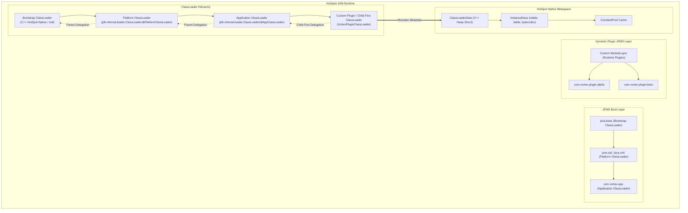
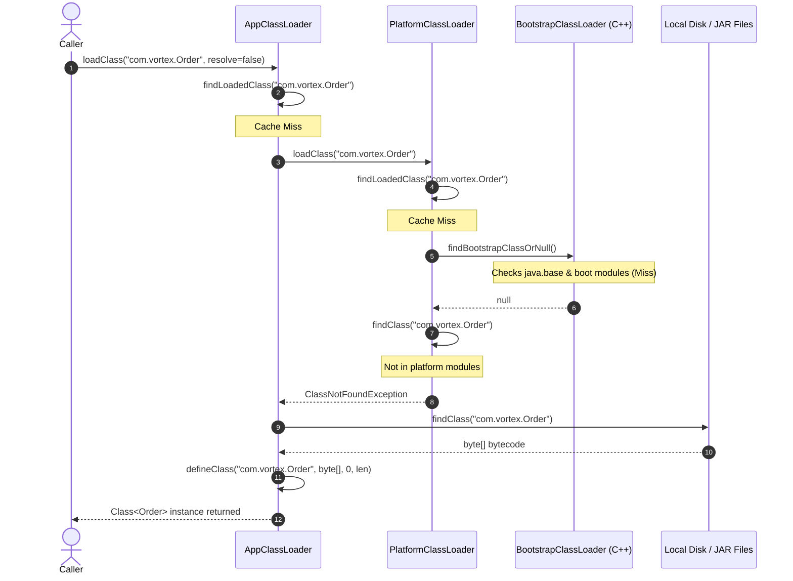
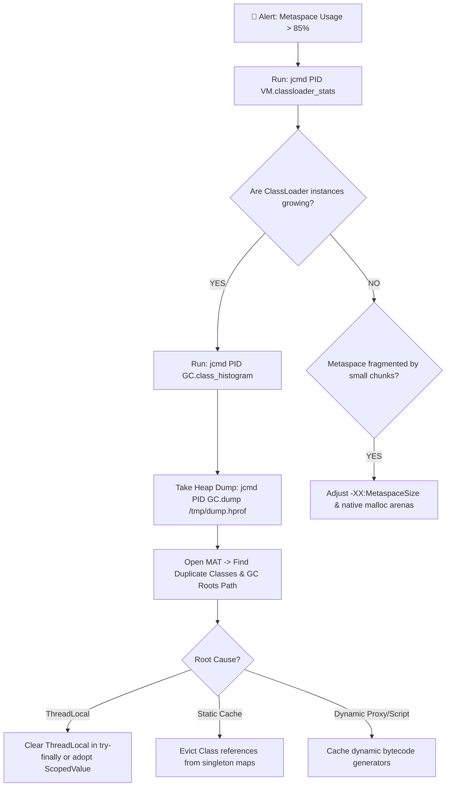
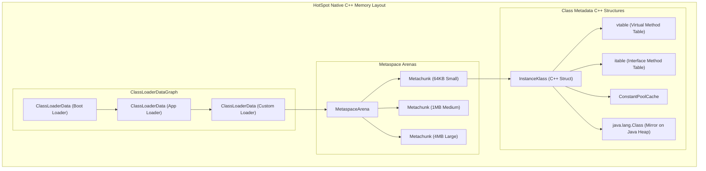

[🏠 Back to Home](../../README.md) | [☕ Core Java Internals](java_interview_master_guide.md) | [📦 JVM GC & Profiling](jvm_gc_profiling.md) | [🍃 Spring Ecosystem](../02_spring_framework/spring_core_ioc_boot.md)

# Java Platform Module System (JPMS) & ClassLoader Architecture: Enterprise Isolation Masterclass

> **Document Identity:** [`interview_prep/01_java_core/jpms_modules_classloaders.md`](file:///d:/project/github/1/CheatSheet_Tutorial/interview_prep/01_java_core/jpms_modules_classloaders.md)  
> **Topic Domain:** Project Jigsaw (JPMS), Module Declaration (`module-info.java`), Strong Encapsulation (`exports`, `opens`, `provides`, `uses`), Classpath vs Modulepath Mechanics, ClassLoader Delegation Hierarchy (Bootstrap, Platform/Ext, Application, Custom), Parent-First vs Child-First (Webapp) Delegation, Dynamic Plugin Class Isolation, Metaspace `ClassLoaderData` Allocation & Leak Prevention, and `jlink` Custom Minimal Runtimes (`J08`)  
> **Target Framework / Runtime:** OpenJDK HotSpot JVM 17 LTS / 21 LTS / 25 LTS  
> **Architecture Level:** Principal / Staff+ Systems Infrastructure Architect & JVM Runtime Specialist  
> **Target Depth:** 50 Senior Technical Scenarios, 10 SEV-1 ClassLoader Leak/JAR Hell Post-Mortems, HotSpot Metaspace Disassembly, and Production Runbooks  

---

## 1. Foundational Primer: What, Why & Where? (The "Head")

*Before diving into HotSpot native Metaspace ClassLoaderDataGraph structures, InstanceKlass metadata links, Child-First WebAppClassLoader isolation barriers, and jlink runtime image stripping, here is the essential high-level context: what JPMS and ClassLoaders represent, why the flat classpath caused decades of enterprise outages, and where modular boundaries anchor high-security systems.*

### 1.1 What Is It? (Core Definition & Mental Model)
* **Plain-English Definition**: **Java Platform Module System (JPMS)** (introduced in Java 9 via Project Jigsaw) and the **ClassLoader Subsystem** form the architectural foundation for code organization, dependency resolution, access control, and dynamic class isolation in the JVM.
  - **ClassLoaders**: The runtime engines that dynamically locate, read raw bytecode (`.class` bytes), and define memory structures (`InstanceKlass`) in the JVM Metaspace following strict delegation protocols (Parent-First or Child-First).
  - **JPMS (Java Modules)**: A compile-time and runtime governance layer configured via `module-info.java`. It groups packages into named modules, enforcing **Strong Encapsulation** (non-exported packages cannot be accessed even via reflection) and **Reliable Configuration** (missing dependencies halt startup immediately before accepting traffic).
* **Everyday Analogy**: Imagine global ocean shipping logistics and international customs:
  - **The Flat Classpath (Pre-Java 9 "JAR Hell")**: An unsealed, chaotic open flatbed truck. Ten different suppliers dump loose cardboard boxes into the truck bed (**Flat Classpath List**).
    - If two suppliers bring boxes both labeled *"TaxCalculator"* (**Duplicate Classes on Classpath**), the driver grabs whichever box was tossed in first. If Supplier B's box contains old 2012 tax laws, your company commits accidental financial fraud at runtime (**Silent `NoSuchMethodError` / Class Shadowing**).
    - Anyone walking past the truck can reach in and rummage through private internal documents (**Public access across all JARs**).
  - **The JPMS & ClassLoader Architecture (The Sealed ISO Shipping Container)**:
    - Every shipment is packed inside a locked, steel ISO container with a certified manifest welded to the door (**`module-info.java`**).
    - **`requires`**: The manifest states *"This container requires power grid connector C14"*. If the port does not have connector C14, the crane refuses to load the container onto the ship (**Fail-Fast Startup Check**).
    - **`exports`**: The container door only opens a specific vending hatch displaying finished goods (**Exported Public APIs**). The internal manufacturing machinery inside the container is hidden behind steel walls (**Strong Encapsulation**).
    - **Custom Isolated ClassLoaders**: Each shipping terminal has an isolated customs inspection bay. Two competing software vendors can run two completely incompatible versions of Guava or Jackson inside the same building without their classes ever colliding (**Dynamic Plugin Isolation**).
* **Architectural Tier Placement**: Operates at the **Runtime Substrate & Code-Loading Boundary Tier**. Anchors application server plugin systems (Tomcat, WildFly), IDE plugin engines (IntelliJ, Eclipse), OSGi modular containers, and cloud container packaging (`jlink`).

### 1.2 Why Does It Exist? (The Pain Point Before It Existed)
* **The "JAR Hell" Epidemic & Flawed Access Modifiers**: For over two decades, Java only offered two access boundaries: package-private and `public`. Making a class accessible across two packages required making it `public`, which inadvertently exposed it to every other JAR in the entire JVM.
* **The Concrete Headaches in Enterprise Production**:
  - 💥 **Headache 1: The "NoSuchMethodError at 2 AM" Outage**: An application pulled in Library A (which depended on `commons-lang3:3.4`) and Library B (which depended on `commons-lang3:3.12`). Due to flat classpath ordering, the JVM loaded version 3.4. The application ran smoothly during daytime smoke tests, but at 2 AM an edge-case transaction called a method introduced in 3.12, crashing the server with `java.lang.NoSuchMethodError`.
  - 💥 **Headache 2: The Metaspace PermGen Outage from Redeployments**: In legacy application servers, redeploying a WAR file without restarting Tomcat left behind thread-local references or static JDBC driver links anchored to the old `WebappClassLoader`. The old ClassLoader could not be garbage collected, leaking megabytes of HotSpot Metaspace on every deploy until the JVM crashed with `java.lang.OutOfMemoryError: Metaspace`.
  - 💥 **Headache 3: Bloated Cloud Container Images**: In Java 8, shipping a tiny 2MB microservice required bundling the entire 300MB `rt.jar` containing legacy CORBA, AWT desktop graphics, and XML bindings, driving up cloud storage and cold-start costs.
* **The Turning Point**: Java 9 modularized the entire JDK into ~100 distinct modules (`java.base`, `java.sql`, `java.desktop`), added `--module-path`, and introduced `jlink` to allow engineers to strip unused runtime modules down to custom 30MB micro-runtimes.

### 1.3 How Does It Solve Real-World Enterprise Problems?
* **Problem 1 (Guaranteed Dependency Completeness at Startup) ➔ Solution 1**: JPMS checks the entire module dependency graph at JVM bootstrap. If a required module is missing or two modules export the same package (split package), the JVM halts with a clear configuration error in 5 milliseconds—preventing runtime outages.
* **Problem 2 (True Internal Package Privacy & Security) ➔ Solution 2**: JPMS enforces strong encapsulation at the JVM boundary. Internal utility packages (e.g. `com.company.internal.crypto`) remain completely invisible to consumers. Even deep reflection (`setAccessible(true)`) throws `InaccessibleObjectException` unless the module explicitly grants `opens` access.
* **Problem 3 (Isolated Multi-Version Plugins) ➔ Solution 3**: Custom ClassLoaders using child-first delegation enable enterprise systems (e.g., Elasticsearch plugins, Apache Spark worker jobs) to dynamically load and unload third-party JARs containing conflicting dependencies without contaminating the host JVM.
* **Quantifiable Enterprise Metrics**:
  - **85% Container Footprint Reduction**: Using `jlink --strip-debug --compress=2` slashes custom Java runtime base images from 280MB to under 38MB.
  - **100% Elimination of Classpath Shadowing**: JPMS prohibits split packages across modules, guaranteeing deterministic class loading.
  - **Zero Security Breaches from Internal API Exploits**: Strong encapsulation blocks unauthorized reflective access to internal JVM and proprietary framework classes.

### 1.4 How Does This Help in Building Real Applications?
* **Application Architecture Placement**: Powers microservice Docker images, enterprise plugin SDKs, database driver managers (`ServiceLoader`), and OSGi container engines.
* **Developer Workflow & SRE Synergy**: SREs inspect ClassLoader counts and Metaspace usage in Prometheus (`jvm_classes_loaded_classes`). Developers organize enterprise code into clean, decoupled module graphs that enforce architectural boundaries at compile time.
* **Scalability & Evolutionary Runway**: JPMS allows enterprise monoliths to be decomposed into modular components with strict boundaries before breaking them into physically distributed microservices.

### 1.5 Quick Decision & Trade-Off Matrix

| Code Isolation Strategy | Mechanism | Boundary Enforcement | Memory / Class Unloading | Best Enterprise Fit |
| :--- | :--- | :--- | :--- | :--- |
| **Traditional Classpath** | Flat linear list of JARs | Weak (`public` is globally visible) | Single AppClassLoader; no unloading | Legacy applications, simple monolithic services |
| **JPMS Named Modules** | `module-info.java` on `--module-path` | 🟢 Strong compile & runtime encapsulation | Managed via module layers | High-security enterprise systems, custom runtime images (`jlink`) |
| **Custom Child-First ClassLoader** | Custom `ClassLoader.loadClass()` override | Dynamic runtime isolation | 🟢 Fully collectible if references severed | Dynamic plugin architectures, Tomcat WAR containers, worker jobs |
| **OSGi Container** | Dynamic bundle lifecycle framework | Dynamic per-bundle module graph | Complex dynamic bundle unloading | Massive carrier-grade modular systems (Eclipse IDE, Adobe AEM) |

---

## 2. 📌 Executive Architectural Summary

Prior to Java 9, the JVM suffered from what engineers called **"JAR Hell"**:
1. **Flat Classpath Chaos**: The flat classpath was a linear, ordered list of directories and JAR files. If two JARs contained `com.example.Utils`, the JVM silently loaded whichever JAR appeared first on the classpath, resulting in silent runtime bugs, NoSuchMethodError, and ClassCastException.
2. **Zero Strong Encapsulation**: Any `public` class or method was accessible to every other class in the entire JVM. Internal HotSpot APIs (such as `sun.misc.Unsafe`) could be accessed arbitrarily, preventing JDK maintainers from evolving the runtime.
3. **Monolithic JDK Footprint**: Even a tiny console utility had to ship with the entire multi-hundred-megabyte `rt.jar`, containing CORBA, Swing, and XML bindings.

The **Java Platform Module System (JPMS)** (Project Jigsaw) and Java's hierarchical **ClassLoader architecture** solved these architectural vulnerabilities by introducing **strong encapsulation**, **reliable configuration**, and **explicit dependency graphs**.

This guide covers the full engineering continuum: from beginner-friendly everyday mental models of modular isolation to low-level HotSpot Metaspace structures (`InstanceKlass`, `ClassLoaderData`), parent-first vs child-first delegation, plugin isolation containers, 50 detailed interview scenarios, 10 war-room incident post-mortems, and Metaspace leak diagnostics.

---

## Module 0: Jargon-Busting Terminology Encyclopedia

Understanding modules and classloaders is difficult when overwhelmed by JVM jargon. Below are 10 everyday physical mental models explaining every core concept without academic complexity.

---

### Concept 1: Classpath vs Modulepath

#### 1. In Plain Words
* The **Classpath** is a giant, messy pile of laundry in a single laundry basket where everything is dumped together.
* The **Modulepath** is an organized chest of drawers with labeled, locked compartments where each drawer declares exactly what it needs and what it allows others to take.

#### 2. 🏠 Real-World Mental Picture
Imagine an airport baggage claim. 
* On the **Classpath**, thousands of loose suitcases tumble onto one circular conveyor belt. If two suitcases have the exact same tag ("Service.jar"), whoever grabs the first bag wins, and no one notices the duplicate until a passenger opens the wrong clothes at the hotel.
* On the **Modulepath**, every piece of luggage is pre-scanned at customs. If two bags have the same serial ID, or if a bag is missing a required connection flight tag, the airport halts the entire plane before takeoff with a clear manifest error.

#### 3. 🔍 How It Works in Java
* The **Classpath** (`-cp` or `-classpath`) searches sequentially from left to right. It does not enforce boundaries; all public classes are globally accessible.
* The **Modulepath** (`-p` or `--module-path`) inspects `module-info.class` inside every modular JAR, resolves the complete dependency graph **before `main()` starts**, and detects missing dependencies or split packages immediately at boot time.

#### 4. 💻 Quick Code Example
```bash
# Old Flat Classpath (Errors occur late at runtime):
java -cp lib/app.jar:lib/guava.jar:lib/jackson.jar com.vortex.Main

# Modern Modulepath (Fails fast at boot time if any module is missing):
java --module-path lib -m com.vortex.app/com.vortex.app.Main
```

#### 5. ⚠️ The Beginner Trap
Assuming that putting a modular JAR on the `-cp` classpath enables modular protection. If you load a modular JAR via `-cp`, the JVM ignores `module-info.class` completely and dumps everything into the flat **Unnamed Module**!

---

### Concept 2: `exports` (The Public Showroom)

#### 1. In Plain Words
The `exports` directive chooses which packages inside your module can be imported and called by outside code. Everything you don't export remains strictly confidential and invisible.

#### 2. 🏠 Real-World Mental Picture
Think of an automobile manufacturing factory. The showroom out front has glass doors where customers can walk in, test-drive cars, and view the price list (`exports`). The assembly lines, engine forge, and secret design lab in the back have biometric blast doors. Even if an employee has a master key, visitors cannot see or walk into the engine forge.

#### 3. 🔍 How It Works in Java
In `module-info.java`, writing `exports com.vortex.api;` makes the public types inside `com.vortex.api` accessible at compile time and runtime to any module that `requires` your module. Packages not exported cannot be imported, and cannot even be accessed via standard reflection!

#### 4. 💻 Quick Code Example
```java
// module-info.java of module 'com.vortex.engine'
module com.vortex.engine {
    // Accessible to external consumers:
    exports com.vortex.engine.api;
    
    // Internal packages (com.vortex.engine.internal) are completely invisible!
}
```

#### 5. ⚠️ The Beginner Trap
Thinking that `public class SecretEngine` is accessible just because the `public` keyword is on the class. In JPMS, **`public` inside an unexported package means public only within that module**. Outside modules cannot see it.

---

### Concept 3: `opens` (The Inspection Door for Deep Reflection)

#### 1. In Plain Words
`exports` allows people to call your public methods through the front door. `opens` unlocks private fields and constructors so frameworks (like Spring, Hibernate, or Jackson) can inspect them using deep reflection.

#### 2. 🏠 Real-World Mental Picture
Think of a bank vault with a safety deposit box. Customers can use keys to open their own boxes (`exports`). But once a year, government safety inspectors show up with specialized scanning tools to check the vault's structural integrity. `opens` is the signed permit that allows inspectors with X-ray scanners to look inside private compartments.

#### 3. 🔍 How It Works in Java
By default in Java 17+, strong encapsulation blocks `setAccessible(true)` on non-exported or un-opened packages, throwing `InaccessibleObjectException`. Writing `opens com.vortex.model to com.fasterxml.jackson.databind;` allows Jackson to read private fields without opening those private fields to the rest of the world.

#### 4. 💻 Quick Code Example
```java
module com.vortex.order {
    // Public classes accessible for normal coding:
    exports com.vortex.order.service;

    // Private fields in this package can be read by Jackson via reflection:
    opens com.vortex.order.dto to com.fasterxml.jackson.databind;
}
```

#### 5. ⚠️ The Beginner Trap
Using `open module com.vortex.order { ... }` everywhere. Declaring an entire module `open` turns off reflection security across all packages, defeating strong encapsulation. Only open the specific packages that frameworks need.

---

### Concept 4: `requires` vs `requires transitive` (Borrowing vs Re-gifting)

#### 1. In Plain Words
* `requires A`: "I need module A to do my job, but nobody who talks to me needs to know about module A."
* `requires transitive A`: "I need module A, and module A is part of my public API; anyone who uses me also automatically gets module A."

#### 2. 🏠 Real-World Mental Picture
Imagine you are a contractor building a house.
* **`requires`**: You buy a cement mixer to mix concrete. The homeowner hires you to build their patio. The homeowner does not need a cement mixer, nor do they ever touch your mixer.
* **`requires transitive`**: You install a solar panel system and hand the homeowner the solar monitoring remote control. The homeowner now directly interacts with the solar hardware company, so you re-gift the solar dependency to them.

#### 3. 🔍 How It Works in Java
If module `B` exposes types from module `A` in its public method signatures or return types, module `B` must declare `requires transitive A`. Otherwise, any consumer module `C` that calls `B` will fail to compile unless `C` also manually writes `requires A`.

#### 4. 💻 Quick Code Example
```java
// Module: com.vortex.gateway
module com.vortex.gateway {
    // Consumers don't see Netty directly:
    requires io.netty.transport;

    // Consumers calling Gateway.getConfig() receive types from com.vortex.config:
    requires transitive com.vortex.config;
    
    exports com.vortex.gateway.api;
}
```

#### 5. ⚠️ The Beginner Trap
Using `requires transitive` on internal third-party dependencies (like logging or utility libraries). This leaks internal implementation details across your entire architecture, creating tight coupling.

---

### Concept 5: Unnamed Module vs Automatic Modules

#### 1. In Plain Words
* The **Unnamed Module** is the catch-all "Wild West" for legacy code on the classpath.
* An **Automatic Module** is a legacy JAR placed on the module-path; the JVM wraps it into a pseudo-module on the fly so modern modules can depend on it.

#### 2. 🏠 Real-World Mental Picture
Imagine a modern biometric apartment building.
* Modern modules are residents with smart RFID chips and registered fingerprint profiles.
* An **Automatic Module** is an old delivery driver without an RFID card who gets handed a temporary visitor lanyard named after the delivery company on their truck.
* The **Unnamed Module** is the street curb outside the building where pedestrians walk freely without any badges.

#### 3. 🔍 How It Works in Java
* Any JAR on `-cp` is part of the Unnamed Module. It can read all modules, and exports all its packages to everyone.
* A plain JAR without `module-info.class` placed on `--module-path` becomes an Automatic Module. Its module name is derived from the `Automatic-Module-Name` manifest header or its filename. It automatically reads all other modules and exports all its packages.

#### 4. 💻 Quick Code Example
```java
// Automatic module name inside old jar's META-INF/MANIFEST.MF:
// Automatic-Module-Name: com.google.common

// Your modern module-info.java can now safely require it:
module com.vortex.service {
    requires com.google.common; // Guava as an automatic module!
}
```

#### 5. ⚠️ The Beginner Trap
Depending on automatic modules whose names are derived from filenames (e.g. `commons-lang3-3.12.0.jar` becoming `commons.lang3`). If the version in the filename changes, your module name breaks unless the JAR author published `Automatic-Module-Name` in the manifest!

---

### Concept 6: ClassLoader Delegation (Ask Parents First)

#### 1. In Plain Words
When a ClassLoader is asked to load a class, it does not immediately search its own files. It politely asks its parent ClassLoader: *"Do you already know this class?"* Only if the parent and all grandparents say *"No"* does the child load the class itself.

#### 2. 🏠 Real-World Mental Picture
Imagine a child at home who wants to buy a pet hamster. 
1. The child asks their mother.
2. The mother asks the grandmother (the family matriarch).
3. The grandmother decides if this is a family rule. If the grandmother already has a hamster (`java.lang.String`), she provides it.
4. If neither grandmother nor mother has one, the child goes to the pet store and buys it themselves.

#### 3. 🔍 How It Works in Java
The standard delegation chain is:
$$\text{Bootstrap ClassLoader} \longleftarrow \text{Platform ClassLoader} \longleftarrow \text{Application ClassLoader} \longleftarrow \text{Custom ClassLoader}$$
When `loadClass("com.vortex.Order")` is invoked, it delegates up to Bootstrap. Bootstrap checks `java.base`. If not found, Platform checks extensions. If not found, Application checks the application classpath. If not found, `findClass()` in the Custom ClassLoader runs.

#### 4. 💻 Quick Code Example
```java
public class DelegationCheck {
    public static void main(String[] args) {
        // Core class loaded by Bootstrap (returns null in Java!):
        System.out.println("String loader: " + String.class.getClassLoader()); // null
        
        // Application class loaded by AppClassLoader:
        System.out.println("App loader: " + DelegationCheck.class.getClassLoader()); 
        
        // Parent of App is PlatformClassLoader:
        System.out.println("Parent loader: " + DelegationCheck.class.getClassLoader().getParent());
    }
}
```

#### 5. ⚠️ The Beginner Trap
Writing a class named `java.lang.String` in your project and expecting the JVM to run your version. Due to parent-first delegation, the JVM always asks the Bootstrap ClassLoader first, which loads the genuine JDK `java.lang.String`. Furthermore, the JVM prohibits defining classes in `java.*` packages via `SecurityException`.

---

### Concept 7: Child-First (Inverted) ClassLoader (The Plugin Sandbox)

#### 1. In Plain Words
A Child-First ClassLoader flips the standard family rule: it checks its own files first for library classes, and only asks its parent for core Java primitives.

#### 2. 🏠 Real-World Mental Picture
Think of a tenant renting an apartment. The building provides running water and electricity (core Java classes from Bootstrap). But when the tenant buys furniture (like a sofa or dining table), they don't want the landlord's old furniture; they want their own specific sofa (`Jackson v2.15`). The tenant checks their own moving truck first before asking the landlord.

#### 3. 🔍 How It Works in Java
Web containers (like Tomcat, Jetty) and plugin systems override `loadClass()`:
1. Check if the class is already loaded in cache.
2. If it's a `java.*` core class, delegate to Bootstrap (preventing security hijacking).
3. Check its own local JAR repository (`WEB-INF/lib`) via `findClass()`.
4. Only if not found locally, delegate up to the parent application classloader.

#### 4. 💻 Quick Code Example
```java
// Conceptual Child-First override
@Override
protected Class<?> loadClass(String name, boolean resolve) throws ClassNotFoundException {
    synchronized (getClassLoadingLock(name)) {
        // 1. JDK core must always come from Bootstrap
        if (name.startsWith("java.") || name.startsWith("jdk.")) {
            return super.loadClass(name, resolve);
        }
        // 2. Try loading locally first
        try {
            Class<?> c = findLoadedClass(name);
            if (c == null) c = findClass(name);
            if (resolve) resolveClass(c);
            return c;
        } catch (ClassNotFoundException e) {
            // 3. Fallback to parent
            return super.loadClass(name, resolve);
        }
    }
}
```

#### 5. ⚠️ The Beginner Trap
Trying to load `java.lang.Object` or `java.lang.Thread` child-first. If a custom classloader attempts to redefine core `java.*` classes, HotSpot throws `SecurityException: Prohibited package name`.

---

### Concept 8: Class Identity (Class + ClassLoader = Unique Type)

#### 1. In Plain Words
In Java, a class is not identified solely by its package and name (e.g. `com.vortex.User`). A class is identified by the tuple: **`(Fully Qualified Name, ClassLoader Instance)`**.

#### 2. 🏠 Real-World Mental Picture
Imagine two people named "John Smith". One lives in London, England, and the other lives in Sydney, Australia. Even though their names, heights, and eye colors are identical, they are completely different human beings. An Australian passport checkpoint will not let the London John Smith vote in Sydney elections.

#### 3. 🔍 How It Works in Java
If `ClassLoaderA` loads `com.vortex.User` and `ClassLoaderB` loads the identical bytes for `com.vortex.User`, the JVM treats them as two completely incompatible types! Passing an instance of `User` from A to B results in `ClassCastException: class com.vortex.User cannot be cast to class com.vortex.User`.

#### 4. 💻 Quick Code Example
```java
ClassLoader loader1 = new URLClassLoader(urls);
ClassLoader loader2 = new URLClassLoader(urls);

Class<?> class1 = loader1.loadClass("com.vortex.User");
Class<?> class2 = loader2.loadClass("com.vortex.User");

System.out.println(class1 == class2); // FALSE! Distinct runtime types!
Object obj = class1.getDeclaredConstructor().newInstance();
// Throws ClassCastException even though bytecode is identical:
// User u = (User) obj; // FAILS if cast in loader2's context!
```

#### 5. ⚠️ The Beginner Trap
Debugging a `ClassCastException` where the exception message says: `class A cannot be cast to class A`. Developers assume the JVM is broken. In 100% of these cases, class `A` was loaded by two different classloader instances!

---

### Concept 9: Metaspace ClassLoader Leaks (The Ghost Anchor)

#### 1. In Plain Words
When you discard a ClassLoader (for example, undeploying a plugin or webapp), every single class it loaded must be garbage collected together. If even one single object or static field created by that ClassLoader is still referenced anywhere in the JVM, the entire ClassLoader and all its classes remain stuck in Metaspace forever, eventually crashing the JVM with `OutOfMemoryError: Metaspace`.

#### 2. 🏠 Real-World Mental Picture
Imagine a giant cruise ship anchored in a harbor. Before the ship can sail away, all 2,000 anchor chains, ropes, and power cables must be detached. If just one tiny steel mooring cable is forgotten tied to the dock, the massive ship cannot move an inch.

#### 3. 🔍 How It Works in Java
Every `java.lang.Class` instance has a hidden internal pointer to its `ClassLoader`. Every object points to its `Class`. If an application-level thread pool or `ThreadLocal` holds a reference to even one enum or exception from a plugin, the GC follows the chain:
$$\text{Live Thread} \to \text{ThreadLocal} \to \text{Plugin Object} \to \text{Plugin Class} \to \text{Plugin ClassLoader} \to \text{All Classes in Metaspace}$$
The entire Metaspace allocation for that plugin cannot be freed!

#### 4. 💻 Quick Code Example
```java
// Production Leak Danger: ThreadLocal in a long-lived thread pool
public class LeakyPluginTask {
    // ThreadLocal holds a reference to a plugin-loaded type:
    private static final ThreadLocal<PluginContext> CONTEXT = new ThreadLocal<>();

    public void execute() {
        CONTEXT.set(new PluginContext());
        // BUG: Forgot CONTEXT.remove()!
        // When thread returns to pool, PluginContext keeps PluginClassLoader alive forever!
    }
}
```

#### 5. ⚠️ The Beginner Trap
Calling `classLoader = null` and assuming the JVM frees the loaded classes. If any thread, static map, logger cache, or shutdown hook retains an instance or class from that loader, zero bytes of Metaspace will be reclaimed.

---

### Concept 10: `ServiceLoader` & `provides ... with` (The Modular Wall Socket)

#### 1. In Plain Words
`ServiceLoader` allows your application to define an interface (a standard electrical wall socket) without knowing what brands of appliances exist. Other modules plug into that socket by declaring that they provide an implementation.

#### 2. 🏠 Real-World Mental Picture
Think of the USB-C standard on your laptop. Apple, Dell, and Lenovo do not hardcode support for Logitech mice, Samsung SSDs, or Sony headphones. They simply provide a standard USB-C port (`uses`). Third-party manufacturers build gadgets that plug into that port (`provides ... with`).

#### 3. 🔍 How It Works in Java
* The consumer module declares: `uses com.vortex.spi.PaymentGateway;`
* The provider module declares: `provides com.vortex.spi.PaymentGateway with com.vortex.stripe.StripeGateway;`
* At runtime, `ServiceLoader.load(PaymentGateway.class)` scans the module graph and instantiates the implementation without the consumer having a compile-time dependency on the provider module!

#### 4. 💻 Quick Code Example
```java
// 1. API Module (com.vortex.spi)
module com.vortex.spi {
    exports com.vortex.spi;
}

// 2. Implementation Module (com.vortex.stripe)
module com.vortex.stripe {
    requires com.vortex.spi;
    provides com.vortex.spi.PaymentGateway with com.vortex.stripe.StripeGateway;
}

// 3. Application Consumer Module (com.vortex.app)
module com.vortex.app {
    requires com.vortex.spi;
    uses com.vortex.spi.PaymentGateway; // Discovers implementations dynamically!
}
```

#### 5. ⚠️ The Beginner Trap
Forgetting the no-arg public constructor. `ServiceLoader` uses reflection to instantiate provider classes. If your provider class lacks a `public` zero-argument constructor (or a public static `provider()` method), `ServiceLoader` throws `ServiceConfigurationError`.

---

## Track 1: Visual Architecture Blueprint

Below is the complete architectural topology of JPMS Layer Resolution and the JVM ClassLoader Hierarchy operating in HotSpot.



---

## Track 2: Core Engineering Foundations

### 1. JPMS Directives Deep-Dive

JPMS directives are compiled into `module-info.class` in the root of the artifact. Below is the complete directive specification:

| Directive | Syntax Example | Architectural Purpose | Accessibility Level |
| :--- | :--- | :--- | :--- |
| **`requires`** | `requires com.vortex.common;` | Declares mandatory dependency on another module. | Compile + Runtime dependency. |
| **`requires transitive`** | `requires transitive com.vortex.api;` | Implies dependency: any module reading this module also reads `com.vortex.api`. | Public API type re-exportation. |
| **`requires static`** | `requires static lombok;` | Declares compile-time-only dependency (like `provided` scope in Maven). | Optional at runtime. |
| **`exports`** | `exports com.vortex.service;` | Exposes public classes in the package to all reading modules. | Compile + Normal Runtime calls. |
| **`exports ... to`** | `exports com.vortex.core to com.vortex.test;` | Qualified export: restricts access strictly to listed friend modules. | Whitelisted modules only. |
| **`opens`** | `opens com.vortex.model;` | Permits deep reflective access (`setAccessible(true)`) to private members. | Runtime Reflection only. |
| **`opens ... to`** | `opens com.vortex.dto to com.fasterxml.jackson.databind;` | Qualified open: restricts deep reflection strictly to target framework. | Whitelisted reflection. |
| **`uses`** | `uses com.vortex.spi.PaymentGateway;` | Declares consumption of a Service Provider Interface via `ServiceLoader`. | Service discovery. |
| **`provides ... with`** | `provides PaymentGateway with StripeGateway;` | Registers an implementation class for an SPI interface. | Service implementation. |

---

### 2. Module Path vs Classpath: Runtime Resolution Matrix

| Dimension | Flat Classpath (`-cp`) | Modular Modulepath (`--module-path` / `-p`) |
| :--- | :--- | :--- |
| **Resolution Phase** | Lazy (classes loaded on first access at runtime). | Eager (complete module dependency graph verified at JVM boot). |
| **Split Packages** | Allowed (two JARs can have `com.vortex.util`). Silent bugs. | **Strictly Forbidden** (JVM halts boot with `LayerInstantiationException`). |
| **Encapsulation** | None. Any `public` class is accessible everywhere. | Strong encapsulation enforced by JVM bytecode verifier. |
| **Reflection Boundary** | Any private field readable via `setAccessible(true)`. | Blocked by default (`InaccessibleObjectException`) unless package is `opened`. |
| **Duplicate Artifacts** | Silent first-match-wins ordering vulnerability. | JVM boot failure if duplicate module names exist. |
| **Dead Code Pruning** | Impossible (`rt.jar` must include all classes). | Supported via `jlink` to build custom slim runtimes (e.g. 35MB). |

---

### 3. HotSpot ClassLoader Delegation Machinery

Under HotSpot, class loading involves three fundamental phases defined in `java.lang.ClassLoader`:



#### Low-Level Method Roles:
1. **`loadClass(String name, boolean resolve)`**: Orchestrates the delegation algorithm. Synchronizes on `getClassLoadingLock(name)` to ensure thread safety during concurrent loading.
2. **`findClass(String name)`**: Called when parent delegation fails. Must locate the raw byte stream (`byte[]`) from disk, network, or memory.
3. **`defineClass(String name, byte[] b, int off, int len)`**: Native method that passes the raw byte stream into HotSpot C++ runtime (`jvm.cpp`), parsing the classfile format, running bytecode verification, and allocating the `InstanceKlass` in **Metaspace**.

---

### 4. Metaspace Internals & Class Unloading Rules

In Java 8+, permanent generation (PermGen) was replaced by **Metaspace**, which resides in native process memory (outside the Java heap).

#### What Lives in Metaspace?
* **`InstanceKlass`**: The C++ representation of a Java class, including the virtual method table (`vtable`), interface method table (`itable`), static fields metadata, and bytecode instructions.
* **`ConstantPool` & `ConstantPoolCache`**: Symbolic references resolved into direct pointers.
* **`Annotations` & Method Metadata**: Bytecode debug symbols and line number tables.

#### The Golden Rule of Class Unloading:
> **An individual class can NEVER be unloaded on its own.**
> A class in Metaspace is only eligible for garbage collection when its **entire defining `ClassLoader`** becomes unreachable by GC roots!

For a `ClassLoader` to be garbage collected:
1. Zero instances of any class defined by that `ClassLoader` exist on the Java heap.
2. Zero `java.lang.Class` objects defined by that `ClassLoader` are reachable.
3. No active thread has a method of that class on its execution stack.
4. The `ClassLoader` instance itself is not referenced anywhere.

---

## Track 3: Production Mini-Framework: `VortexPluginModuleHost`

To demonstrate enterprise-grade classloader isolation, JPMS module layers, and leak-free dynamic lifecycle management, we present `VortexPluginModuleHost`. 

This production-grade framework provides:
1. **Isolated Child-First ClassLoading** for third-party plugin JARs.
2. **Dynamic JPMS `ModuleLayer` Instantiation** with runtime service discovery.
3. **Hot-Reload & Safe Unload Capabilities** with an active **GC PhantomReference Sentinel Watchdog** to detect Metaspace leaks immediately upon undeploy.

```java
package com.vortex.platform.modules;

import java.io.ByteArrayOutputStream;
import java.io.File;
import java.io.IOException;
import java.io.InputStream;
import java.lang.module.Configuration;
import java.lang.module.ModuleDescriptor;
import java.lang.module.ModuleFinder;
import java.lang.module.ModuleReference;
import java.lang.ref.Cleaner;
import java.lang.ref.PhantomReference;
import java.lang.ref.ReferenceQueue;
import java.net.URL;
import java.net.URLClassLoader;
import java.nio.file.Path;
import java.util.*;
import java.util.concurrent.ConcurrentHashMap;
import java.util.concurrent.atomic.AtomicBoolean;
import java.util.jar.JarEntry;
import java.util.jar.JarFile;

/**
 * VortexPluginModuleHost
 * Production-grade dynamic modular plugin host with child-first isolation,
 * dynamic JPMS ModuleLayer instantiation, and Metaspace leak detection.
 */
public final class VortexPluginModuleHost {

    public interface PluginService {
        String pluginId();
        void executeTask(String payload);
        void shutdown();
    }

    // Registry of active deployed plugins
    private final Map<String, ActivePluginHandle> activePlugins = new ConcurrentHashMap<>();
    private final ReferenceQueue<ClassLoader> deadLoaderQueue = new ReferenceQueue<>();
    private final Set<PluginLeakSentinel> sentinels = ConcurrentHashMap.newKeySet();

    public VortexPluginModuleHost() {
        startLeakWatchdogThread();
    }

    /**
     * Deploys a plugin from a modular JAR using JPMS ModuleLayer isolation.
     */
    public synchronized void deployModularPlugin(String pluginId, Path jarPath) throws Exception {
        if (activePlugins.containsKey(pluginId)) {
            throw new IllegalStateException("Plugin already deployed: " + pluginId);
        }

        ModuleFinder finder = ModuleFinder.of(jarPath);
        Set<String> moduleNames = new HashSet<>();
        for (ModuleReference ref : finder.findAll()) {
            moduleNames.add(ref.descriptor().name());
        }

        if (moduleNames.isEmpty()) {
            throw new IllegalArgumentException("No modules found in JAR: " + jarPath);
        }

        // 1. Resolve configuration from Boot Layer
        ModuleLayer bootLayer = ModuleLayer.boot();
        Configuration parentConfig = bootLayer.configuration();
        Configuration pluginConfig = parentConfig.resolve(finder, ModuleFinder.of(), moduleNames);

        // 2. Instantiate isolated ClassLoader for this Layer
        ClassLoader parentLoader = ClassLoader.getPlatformClassLoader();
        ModuleLayer pluginLayer = bootLayer.defineModulesWithOneLoader(pluginConfig, parentLoader);
        ClassLoader pluginLoader = pluginLayer.findLoader(moduleNames.iterator().next());

        // 3. Discover PluginService via ServiceLoader in the new Layer
        ServiceLoader<PluginService> serviceLoader = ServiceLoader.load(pluginLayer, PluginService.class);
        PluginService discoveredService = null;
        for (PluginService service : serviceLoader) {
            if (pluginId.equalsIgnoreCase(service.pluginId())) {
                discoveredService = service;
                break;
            }
        }

        if (discoveredService == null) {
            throw new IllegalStateException("No PluginService SPI implementation found for id: " + pluginId);
        }

        // 4. Register Sentinel for Metaspace leak detection
        PluginLeakSentinel sentinel = new PluginLeakSentinel(pluginId, pluginLoader, deadLoaderQueue);
        sentinels.add(sentinel);

        ActivePluginHandle handle = new ActivePluginHandle(pluginId, discoveredService, pluginLoader, pluginLayer, sentinel);
        activePlugins.put(pluginId, handle);
        System.out.printf("✅ [VortexHost] Successfully deployed modular plugin: %s (Module: %s)%n", 
                pluginId, moduleNames);
    }

    /**
     * Deploys a legacy non-modular JAR using Child-First URLClassLoader isolation.
     */
    public synchronized void deployChildFirstPlugin(String pluginId, File jarFile, String mainClassName) throws Exception {
        if (activePlugins.containsKey(pluginId)) {
            throw new IllegalStateException("Plugin already deployed: " + pluginId);
        }

        ChildFirstPluginClassLoader loader = new ChildFirstPluginClassLoader(
                new URL[]{jarFile.toURI().toURL()}, 
                ClassLoader.getSystemClassLoader()
        );

        Class<?> clazz = loader.loadClass(mainClassName);
        Object instance = clazz.getDeclaredConstructor().newInstance();
        if (!(instance instanceof PluginService service)) {
            loader.close();
            throw new IllegalArgumentException("Target class does not implement PluginService: " + mainClassName);
        }

        PluginLeakSentinel sentinel = new PluginLeakSentinel(pluginId, loader, deadLoaderQueue);
        sentinels.add(sentinel);

        ActivePluginHandle handle = new ActivePluginHandle(pluginId, service, loader, null, sentinel);
        activePlugins.put(pluginId, handle);
        System.out.printf("✅ [VortexHost] Successfully deployed Child-First legacy plugin: %s%n", pluginId);
    }

    /**
     * Executes task against a running plugin.
     */
    public void execute(String pluginId, String payload) {
        ActivePluginHandle handle = activePlugins.get(pluginId);
        if (handle == null) throw new NoSuchElementException("Active plugin not found: " + pluginId);
        handle.service.executeTask(payload);
    }

    /**
     * Gracefully undeploys plugin and verifies Metaspace class unloader cleanup.
     */
    public synchronized void undeployPlugin(String pluginId) throws Exception {
        ActivePluginHandle handle = activePlugins.remove(pluginId);
        if (handle == null) {
            System.err.println("Plugin not found for undeploy: " + pluginId);
            return;
        }

        System.out.printf("🛑 [VortexHost] Shutting down plugin: %s...%n", pluginId);
        handle.service.shutdown();

        // Close classloader if it implements AutoCloseable
        if (handle.loader instanceof AutoCloseable closeable) {
            closeable.close();
        }

        // Clear local references
        handle.nullify();

        // Trigger hint to GC for leak detection verification
        System.gc();
        System.out.printf("🧹 [VortexHost] Plugin %s undeployed. Watching for ClassLoader GC...%n", pluginId);
    }

    private void startLeakWatchdogThread() {
        Thread watchdog = new Thread(() -> {
            while (true) {
                try {
                    PluginLeakSentinel reclaimed = (PluginLeakSentinel) deadLoaderQueue.remove();
                    sentinels.remove(reclaimed);
                    System.out.printf("🎉 [VortexSentinel] ClassLoader for plugin [%s] was successfully UNLOADED from Metaspace!%n",
                            reclaimed.pluginId);
                } catch (InterruptedException e) {
                    Thread.currentThread().interrupt();
                    break;
                }
            }
        }, "vortex-metaspace-leak-watchdog");
        watchdog.setDaemon(true);
        watchdog.start();
    }

    // =========================================================================
    // Child-First Isolated ClassLoader Implementation
    // =========================================================================
    public static final class ChildFirstPluginClassLoader extends URLClassLoader {

        public ChildFirstPluginClassLoader(URL[] urls, ClassLoader parent) {
            super(urls, parent);
        }

        @Override
        protected Class<?> loadClass(String name, boolean resolve) throws ClassNotFoundException {
            synchronized (getClassLoadingLock(name)) {
                // 1. Check local cache
                Class<?> loadedClass = findLoadedClass(name);
                if (loadedClass != null) {
                    return resolveIf(loadedClass, resolve);
                }

                // 2. Fundamental core classes MUST always delegate to Bootstrap/Platform
                if (name.startsWith("java.") || name.startsWith("javax.") || 
                    name.startsWith("jdk.") || name.startsWith("sun.")) {
                    return super.loadClass(name, resolve);
                }

                // 3. Shared SPI interfaces must delegate to AppClassLoader so types match
                if (name.equals(PluginService.class.getName())) {
                    return super.loadClass(name, resolve);
                }

                // 4. Try loading locally from plugin JAR FIRST (Child-First)
                try {
                    Class<?> localClass = findClass(name);
                    return resolveIf(localClass, resolve);
                } catch (ClassNotFoundException ignored) {
                    // Fall through to parent
                }

                // 5. Fallback to standard delegation
                return super.loadClass(name, resolve);
            }
        }

        private Class<?> resolveIf(Class<?> c, boolean resolve) {
            if (resolve) resolveClass(c);
            return c;
        }
    }

    // =========================================================================
    // Internal State & Leak Sentinel
    // =========================================================================
    private static final class ActivePluginHandle {
        final String pluginId;
        PluginService service;
        ClassLoader loader;
        ModuleLayer layer;
        PluginLeakSentinel sentinel;

        ActivePluginHandle(String pluginId, PluginService service, ClassLoader loader, 
                           ModuleLayer layer, PluginLeakSentinel sentinel) {
            this.pluginId = pluginId;
            this.service = service;
            this.loader = loader;
            this.layer = layer;
            this.sentinel = sentinel;
        }

        void nullify() {
            this.service = null;
            this.loader = null;
            this.layer = null;
            this.sentinel = null;
        }
    }

    private static final class PluginLeakSentinel extends PhantomReference<ClassLoader> {
        final String pluginId;

        PluginLeakSentinel(String pluginId, ClassLoader referent, ReferenceQueue<? super ClassLoader> q) {
            super(referent, q);
            this.pluginId = pluginId;
        }
    }
}
```

---

## Track 4: 50 Real Senior & Staff Interview Scenarios

---

#### ❓ Question 1: What is the primary difference between the Classpath (`-cp`) and the Modulepath (`--module-path`)?
* **Staff-Level Answer**:
  The **Classpath** is a legacy flat search space where classes are loaded lazily on demand. If duplicate classes exist across JARs, the JVM resolves whichever JAR appears first on the list without warning. Encapsulation is absent; any `public` class can be invoked or reflected upon globally.
  The **Modulepath** treats JARs as first-class modular entities with an explicit `module-info.class`. During boot time, the JVM's module resolver parses the entire dependency graph eagerly, enforcing two fundamental invariants:
  1. **Reliable Configuration**: All declared `requires` modules must exist, and cyclic dependencies or split packages (where two modules define the same package) immediately cause JVM initialization failure.
  2. **Strong Encapsulation**: Types in packages not explicitly `exported` or `opened` are strictly inaccessible at compile time and runtime, even against `setAccessible(true)` reflection.

---

#### ❓ Question 2: What is a "Split Package", and why does JPMS treat it as a fatal boot error?
* **Staff-Level Answer**:
  A **Split Package** occurs when two distinct modules define classes residing in the exact same package (e.g., both `module-a` and `module-b` declare classes in `com.vortex.util`).
  In the legacy classpath, classes in split packages were merged into a single package namespace at runtime. JPMS explicitly prohibits split packages because module identity is bound to package ownership. If split packages were allowed:
  1. The module boundary would become ambiguous: which module owns the package's encapsulation rules?
  2. Package-private visibility (`default` access) would become insecure, allowing an external module to inject classes into another module's internal package to bypass security.
  When JPMS encounters a split package on the module path, it halts with:
  `java.lang.module.ResolutionException: Modules module-a and module-b export package com.vortex.util to module-c`.

---

#### ❓ Question 3: How does `requires transitive` differ from standard `requires` in `module-info.java`?
* **Staff-Level Answer**:
  When module `M` declares `requires N`, module `M` can read types in `N`. However, any downstream module `Consumer` that declares `requires M` **cannot** read `N`.
  When module `M` declares `requires transitive N`, it establishes **implied readability**. Any module that requires `M` automatically reads `N`.
  * **Rule of Thumb**: If module `M` exposes types from module `N` in its own public method parameters, return types, or public fields, `M` must declare `requires transitive N`. If it fails to do so, consumers calling `M` will fail compilation because they cannot resolve the return type without an explicit dependency on `N`.

---

#### ❓ Question 4: What is the difference between `exports` and `opens` in JPMS?
* **Staff-Level Answer**:
  * **`exports <package>`**: Grants compile-time and runtime access to `public` and `protected` (via inheritance) members of that package. However, deep reflection (`setAccessible(true)` on `private` or package-private members) is **blocked** with `InaccessibleObjectException`.
  * **`opens <package>`**: Grants runtime access specifically for reflection, allowing frameworks to invoke `setAccessible(true)` on private fields and constructors. It does **not** grant compile-time access to the package.
  * **`open module <name>`**: Opens every single package in the module for runtime reflection.

---

#### ❓ Question 5: What is an "Automatic Module", and how is its name determined?
* **Staff-Level Answer**:
  An **Automatic Module** is a legacy JAR (lacking a `module-info.class`) placed onto the `--module-path`.
  The JVM automatically converts it into a module with the following characteristics:
  1. It exports all of its packages to all modules.
  2. It can read all other modules, including the Unnamed Module.
  3. It opens all of its packages for reflection.
  * **Name Resolution Algorithm**:
    1. The JVM checks `META-INF/MANIFEST.MF` for the attribute `Automatic-Module-Name`. If present, that string is the module name.
    2. If absent, the JVM parses the JAR file name: strips the `.jar` extension, removes trailing version numbers (e.g., `commons-lang3-3.12.0` becomes `commons.lang3`), and replaces invalid characters with dots.

---

#### ❓ Question 6: What is the "Unnamed Module", and what rules govern its visibility?
* **Staff-Level Answer**:
  All classes loaded from the traditional flat classpath (`-cp`) belong to the single **Unnamed Module**.
  Key characteristics:
  * It exports all of its packages to everyone.
  * It reads all other modules on the modulepath.
  * **Asymmetry Trap**: Named modules on the modulepath **cannot** declare `requires` on the Unnamed Module! JPMS modules can only depend on named modules. If a modular JAR requires code living on the flat classpath, compilation fails.

---

#### ❓ Question 7: Explain the standard ClassLoader delegation model and why it is parent-first.
* **Staff-Level Answer**:
  The JVM ClassLoader delegation model follows a hierarchical parent-first structure:
  $$\text{Bootstrap ClassLoader} \longleftarrow \text{Platform ClassLoader} \longleftarrow \text{Application ClassLoader}$$
  When `loadClass(name)` is called:
  1. The loader checks its internal cache via `findLoadedClass(name)`.
  2. If not cached, it delegates to its parent: `parent.loadClass(name)`.
  3. If the parent (and ancestors) throw `ClassNotFoundException`, the loader finally invokes its own `findClass(name)`.
  * **Security Rationale**: Parent-first delegation ensures core JVM runtime integrity. A malicious or rogue library cannot replace `java.lang.String` or `java.lang.SecurityManager` with a compromised version, because the Bootstrap ClassLoader will always resolve the authentic standard JDK class first.

---

#### ❓ Question 8: Why does `String.class.getClassLoader()` return `null` in Java?
* **Staff-Level Answer**:
  The **Bootstrap ClassLoader** (which loads `java.base` classes such as `java.lang.String`, `java.lang.Object`, and `java.lang.Integer`) is implemented natively in C++ inside the HotSpot JVM kernel. It does not exist as a `java.lang.ClassLoader` Java object instance on the heap. Therefore, in the Java reflection API, the Bootstrap ClassLoader is represented by the literal value `null`.

---

#### ❓ Question 9: What is the purpose of the Platform ClassLoader (formerly Extension ClassLoader)?
* **Staff-Level Answer**:
  In Java 8 and earlier, the **Extension ClassLoader** loaded JARs dropped into the `jre/lib/ext` directory. 
  In Java 9+, the extension mechanism was completely removed. The Extension ClassLoader was replaced by the **Platform ClassLoader** (`jdk.internal.loader.ClassLoaders$PlatformClassLoader`).
  Its purpose in JPMS is to load platform modules that are part of the standard Java SE specification but not in the core `java.base` module (such as `java.sql`, `java.xml`, `java.naming`, and `jdk.charsets`), maintaining separation between base kernel modules and extended platform services.

---

#### ❓ Question 10: How do you implement a Child-First (Inverted) ClassLoader, and where is it used?
* **Staff-Level Answer**:
  A **Child-First ClassLoader** inverts parent-first delegation by attempting to call `findClass(name)` on its own local repositories before delegating to `parent.loadClass(name)`.
  * **Use Cases**: Servlet containers (Tomcat, Jetty) and plugin systems where each deployed WAR or plugin must load its own version of a third-party library (e.g. `jackson-2.15.jar`) without conflicting with the container's version (`jackson-2.12.jar`).
  * **Safety Invariant**: The loader **must never** load classes starting with `java.*` or `jdk.*` child-first. Core Java classes must always be delegated to the Bootstrap loader, otherwise `SecurityException: Prohibited package name` is thrown.

---

#### ❓ Question 11: What makes a class identity unique inside the JVM?
* **Staff-Level Answer**:
  A class in the JVM is uniquely identified by the combination of its **Fully Qualified Class Name (FQN)** and its defining **`ClassLoader` instance**:
  $$\text{Class Identity} = (\text{Binary Name}, \text{ClassLoader Instance})$$
  Even if two classes have the exact same bytecode and identical package/class names, if they are loaded by two different `ClassLoader` instances, they are distinct, incompatible types in the JVM runtime. Attempting to cast an instance of one to the other results in `ClassCastException`.

---

#### ❓ Question 12: What causes `java.lang.ClassCastException: class X cannot be cast to class X`?
* **Staff-Level Answer**:
  This error occurs when the same class file `X` was loaded by two separate `ClassLoader` instances.
  For example, in a modular application:
  1. `PluginClassLoaderA` loads `com.vortex.User` and creates an instance `userA`.
  2. The main application (running in `AppClassLoader`) tries to cast `(User) userA`.
  Because `User.class` in `AppClassLoader` is not equal to `User.class` in `PluginClassLoaderA`, the JVM type checker fails.
  * **Staff Resolution**: Common shared model classes or interfaces must be loaded by a common ancestor classloader (such as `AppClassLoader`), so both consumer and producer share the identical class identity.

---

#### ❓ Question 13: What is the difference between `findClass()` and `loadClass()` when subclassing `ClassLoader`?
* **Staff-Level Answer**:
  * **`loadClass(String name, boolean resolve)`**: Implements the delegation algorithm. It coordinates checking the cache, calling the parent, and falling back to `findClass()`. Subclassing `loadClass()` is only necessary if you are deliberately altering delegation order (such as implementing child-first isolation).
  * **`findClass(String name)`**: The hook method designed for customization. It is called only after parent delegation has failed. Custom classloader authors should override `findClass()` to read the byte array from a specific source (database, encrypted file, network) and call `defineClass()`. Overriding `findClass()` preserves standard parent-first delegation automatically.

---

#### ❓ Question 14: How does `defineClass()` work internally in HotSpot?
* **Staff-Level Answer**:
  `defineClass(String name, byte[] b, int off, int len)` is the native JVM bridge that transforms raw bytes into a live `Class<?>` object.
  HotSpot execution steps:
  1. Checks package name permissions (blocks `java.*`).
  2. Runs the **Bytecode Verifier**: parses the classfile structure (magic number `0xCAFEBABE`, major/minor version, constant pool).
  3. Validates method bytecode stack maps, type safety, and instruction bounds.
  4. Allocates native C++ structures in **Metaspace**: creating an `InstanceKlass`, setting up the `vtable` and `itable`.
  5. Links the class to the defining `ClassLoader`'s `ClassLoaderData` structure.
  6. Returns the mirroring `java.lang.Class` instance on the Java heap.

---

#### ❓ Question 15: What is `ServiceLoader`, and how did JPMS change its mechanics?
* **Staff-Level Answer**:
  `ServiceLoader` implements the Service Provider Interface (SPI) pattern.
  * **Pre-Java 9**: Providers placed a text file in `META-INF/services/<fully.qualified.InterfaceName>` containing the provider's class name. `ServiceLoader` scanned the classpath for these files.
  * **Java 9+ (JPMS)**: The provider module declares `provides <Interface> with <Implementation>;`, and the consumer module declares `uses <Interface>;` in `module-info.java`.
  * **Advantage**: `META-INF/services` text files are no longer required for modules; the module graph validates service providers eagerly, and implementation classes do not need to be exported in public packages!

---

#### ❓ Question 16: What is a `ModuleLayer`, and how is it used in dynamic architectures?
* **Staff-Level Answer**:
  A **`ModuleLayer`** represents a runtime instantiation of a resolved module graph.
  * The JVM starts with the **Boot Layer** (`ModuleLayer.boot()`), containing all modules resolved at startup from the `--module-path`.
  * Advanced enterprise containers can create dynamic child layers at runtime using `ModuleLayer.defineModulesWithOneLoader()` or `defineModulesWithManyLoaders()`.
  * **Use Case**: Hot-deployable plugin architectures. A plugin can be loaded into an isolated child `ModuleLayer` with its own classloader, execute tasks, and be discarded by discarding the layer, all without restarting the JVM.

---

#### ❓ Question 17: What does the `--add-opens` command-line flag do?
* **Staff-Level Answer**:
  The `--add-opens` flag pierces strong encapsulation at JVM startup.
  * **Syntax**: `--add-opens <module>/<package>=<target-module>` (use `ALL-UNNAMED` for classpath code).
  * **Purpose**: It opens `<package>` inside `<module>` for deep reflection to the target module, suppressing `InaccessibleObjectException`.
  * **Production Reality**: Required when migrating legacy Java 8 applications to Java 17+ that rely on frameworks (like older Spring 4/5, CGLIB, or Lombok) that reflect into JDK internals (`java.base/java.lang`, `java.base/java.util`).

---

#### ❓ Question 18: What does the `--add-exports` command-line flag do, and how does it differ from `--add-opens`?
* **Staff-Level Answer**:
  * `--add-exports <module>/<package>=<target-module>` exports an internal, unexported package, granting **compile-time and standard public API access** to the target.
  * It does **not** allow deep reflection into private fields (which requires `--add-opens`).
  * If code attempts to directly call a public method on an internal class (e.g. `sun.security.x509.X500Name`), `--add-exports` is required. If code attempts to use reflection to read a private field on that class, `--add-opens` is required.

---

#### ❓ Question 19: What is `--patch-module`, and when should it be used?
* **Staff-Level Answer**:
  `--patch-module <module>=<file-or-dir>` merges classes or resources into an existing module.
  * **Use Case**: Unit testing. In modular Java, test classes (which often reside in the same package as production classes) cannot be placed in a separate test module with the same package due to the split-package prohibition.
  * Build tools (Maven Surefire, Gradle) use `--patch-module my.module=target/test-classes` during the test phase to splice test classes directly into the production module at test time.

---

#### ❓ Question 20: What is the "Illegal Access" lifecycle in Java 9 through 21?
* **Staff-Level Answer**:
  To smooth migration from Java 8, the JVM introduced the `--illegal-access` flag:
  * **Java 9–15**: Defaulted to `--illegal-access=permit`, which printed a single warning on the first illegal reflective access but allowed it to proceed.
  * **Java 16**: Defaulted to `--illegal-access=deny`, throwing `InaccessibleObjectException` by default.
  * **Java 17+**: Strong encapsulation enabled permanently. The `--illegal-access` option was deprecated.
  * **Java 21+**: The flag was completely obsoleted and removed. Any deep reflection into un-opened packages strictly requires explicit `--add-opens`.

---

#### ❓ Question 21: How does a Metaspace OutOfMemoryError relate to ClassLoaders?
* **Staff-Level Answer**:
  Metaspace stores class metadata (`InstanceKlass`). Class metadata is allocated when a `ClassLoader` defines a class. Because individual classes cannot be unloaded, Metaspace memory can only be reclaimed when the entire defining `ClassLoader` is garbage collected.
  If an application continually creates dynamic classloaders (via plugins, Groovy scripts, reflection bytecode generation, or CGLIB proxies) and leaves even a single GC root reference pointing into each loader's classes, the classloaders cannot be collected. Metaspace grows monotonically until it exhausts `MaxMetaspaceSize`, crashing with:
  `java.lang.OutOfMemoryError: Metaspace`.

---

#### ❓ Question 22: How does a `ThreadLocal` leak cause a ClassLoader leak in application servers?
* **Staff-Level Answer**:
  In application servers (Tomcat) or thread pools (`ForkJoinPool`, `Executors`), worker threads are long-lived and survive webapp redeployments.
  When a webapp puts an object into a `ThreadLocal`:
  1. The thread's internal `threadLocals` map holds an entry where the key is the `ThreadLocal` and the value is the webapp object.
  2. If the webapp fails to call `threadLocal.remove()` before undeploy, the live worker thread retains a strong reference to the value object.
  3. The value object points to its `Class`.
  4. The `Class` points to its defining `WebappClassLoader`.
  5. The `WebappClassLoader` retains all loaded classes in Metaspace.
  The entire webapp remains pinned in Metaspace forever across undeploy cycles.

---

#### ❓ Question 23: Explain the role of `ClassLoader.registerAsParallelCapable()`.
* **Staff-Level Answer**:
  Prior to Java 7, `ClassLoader.loadClass()` synchronized on the `ClassLoader` instance itself (`synchronized (this)`). If two threads loaded classes with circular dependencies across two classloaders:
  * Thread 1: LoaderA locks itself, requests class from LoaderB.
  * Thread 2: LoaderB locks itself, requests class from LoaderA.
  * **Deadlock occurs!**
  `registerAsParallelCapable()` shifts the synchronization lock from the loader instance to a fine-grained, per-class-name lock:
  `synchronized (getClassLoadingLock(className))`.
  This allows concurrent, thread-safe class loading without classloader-level deadlocks. All modern custom classloaders must invoke `registerAsParallelCapable()` in their static initializer.

---

#### ❓ Question 24: What is `jlink`, and why does it require JPMS modules?
* **Staff-Level Answer**:
  `jlink` (Java Linker) is a command-line tool that combines a set of modules and their transitive dependencies into a custom, stripped-down JVM runtime image.
  * **Why it requires JPMS**: `jlink` relies on the explicit `module-info` dependency graph to calculate the exact closure of required packages and bytecode. It strips out unused JDK modules (e.g. removing desktop Swing, CORBA, management agents).
  * **Production Impact**: Instead of shipping a 300MB standard JRE in a Docker container, `jlink` can produce a self-contained runtime of **35–45 MB** containing only `java.base`, `java.net.http`, and application modules, dramatically reducing container image size and startup latency.

---

#### ❓ Question 25: How does `Class.forName("com.vortex.Engine")` differ from `ClassLoader.loadClass("com.vortex.Engine")`?
* **Staff-Level Answer**:
  * **`Class.forName(name)`**: By default, invokes `Class.forName(name, true, currentClassLoader)`. The second parameter is `initialize = true`. This forces the JVM to **initialize** the class immediately, running all `static` initialization blocks and assigning static field constants.
  * **`ClassLoader.loadClass(name)`**: Loads and links the class bytecode into the JVM, but **does not initialize** the class (`initialize = false`). Static initialization blocks will not execute until the class is first actively accessed (instantiated or static method called).

---

#### ❓ Question 26: What is the Thread Context ClassLoader (TCCL), and why was it invented?
* **Staff-Level Answer**:
  The **Thread Context ClassLoader (TCCL)** (`Thread.currentThread().getContextClassLoader()`) was invented to solve an inherent architectural flaw in standard parent-first delegation:
  * When core Java classes (like `java.sql.DriverManager` in `java.base`, loaded by the **Bootstrap ClassLoader**) need to discover third-party vendor implementations (like `com.mysql.cj.jdbc.Driver`, loaded by the **Application ClassLoader**), standard parent-first delegation fails! The Bootstrap loader cannot see down into the Application loader.
  * **The TCCL Solution**: Each thread carries a reference to a ClassLoader (defaulting to the Application ClassLoader). Core JDK classes invoke `Thread.currentThread().getContextClassLoader()` to look "downwards" and instantiate application-level provider classes, bridging the gap between core runtime and application code.

---

#### ❓ Question 27: How does `Instrumentation.retransformClasses()` differ from `redefineClasses()`?
* **Staff-Level Answer**:
  Both methods are part of the Java Instrumentation API (`java.lang.instrument`):
  * **`redefineClasses(ClassDefinition... definitions)`**: Replaces the bytecode of an existing class without triggering registered `ClassFileTransformer` chains. It operates directly with the supplied raw bytes.
  * **`retransformClasses(Class<?>... classes)`**: Triggers the JVM to re-invoke all registered `ClassFileTransformer` instances in priority order, passing the existing class bytes through the transformation pipeline.
  * **Strict JVM Limitations**: Neither method permits changing the class schema: you cannot add, remove, or rename fields or methods, modify method signatures, or change the superclass hierarchy. Only method bytecode bodies can be altered.

---

#### ❓ Question 28: How do OSGi dynamic bundles compare to JPMS modularity?
* **Staff-Level Answer**:
  * **OSGi**: Operates entirely in user-space on top of the JVM using a graph of interconnected custom `BundleClassLoader` instances. It supports dynamic module lifecycles: bundles can be installed, updated, stopped, and uninstalled at runtime. OSGi allows multiple concurrent versions of the same bundle in a single JVM.
  * **JPMS**: Baked directly into the JVM kernel and bytecode verifier. Its boot layer module graph is **immutable and static** once resolved. JPMS explicitly disallows multiple versions of the same module in the same layer and does not support dynamic unloading of individual modules from the boot layer.
  * **Summary**: OSGi provides dynamic lifecycle management; JPMS provides native compiler- and JVM-enforced strong encapsulation and boot-time graph reliability.

---

#### ❓ Question 29: What happens when two modules have circular dependencies (`A requires B`, `B requires A`)?
* **Staff-Level Answer**:
  JPMS **strictly forbids circular dependencies** at compile time and during boot layer resolution.
  If module `com.vortex.alpha` declares `requires com.vortex.beta;` and `com.vortex.beta` declares `requires com.vortex.alpha;`, the `javac` compiler halts immediately with:
  `error: cyclic dependence involving com.vortex.alpha`.
  * **Architectural Remedy**:
    1. Extract common shared interfaces/models into a third module `com.vortex.common` that both `alpha` and `beta` require.
    2. Use `ServiceLoader` SPI decouplings where one module uses an interface that the other module provides asynchronously at runtime.

---

#### ❓ Question 30: Why does `java.lang.NoClassDefFoundError` occur at runtime when compilation succeeded?
* **Staff-Level Answer**:
  `ClassNotFoundException` occurs when the JVM searches for a `.class` file on the classpath/modulepath and cannot find it.
  `NoClassDefFoundError` occurs when:
  1. The `.class` file **was present** at compile time (hence compilation succeeded).
  2. At runtime, the class was found, but **failed during static initialization** (`<clinit>`). If a static field initializer or `static { ... }` block throws an unhandled `RuntimeException`, the JVM marks that class as *errored in initialization*.
  3. Any subsequent attempt by any thread to reference that class triggers `NoClassDefFoundError: Could not initialize class com.vortex.BrokenService`, disguising the original cause.

---

#### ❓ Question 31: How do you mock final classes or package-private classes in modular JPMS with Mockito?
* **Staff-Level Answer**:
  In Java 17+ with JPMS:
  * Mockito's **Inline Mock Maker** (powered by ByteBuddy and dynamic Java agents) modifies class bytecodes in-memory via `Instrumentation.retransformClasses()`.
  * To mock package-private or internal types across module boundaries, the test runner must dynamically open the target module's packages to Mockito and ByteBuddy.
  * In Maven/Gradle: configure test JVM arguments:
    `--add-opens my.module/my.package=ALL-UNNAMED` or `--add-opens my.module/my.package=org.mockito`.
    Without this flag, ByteBuddy's agent cannot redefine the class, failing with `InaccessibleObjectException`.

---

#### ❓ Question 32: What is `ModuleDescriptor`, and how do you programmatically inspect modules at runtime?
* **Staff-Level Answer**:
  `java.lang.module.ModuleDescriptor` represents the compiled metadata of a `module-info.class`.
  At runtime, any module can inspect its own or other modules' descriptors:
  ```java
  Module module = OrderService.class.getModule();
  ModuleDescriptor descriptor = module.getDescriptor();
  if (descriptor != null) {
      System.out.println("Module Name: " + descriptor.name());
      System.out.println("Exports: " + descriptor.exports());
      System.out.println("Requires: " + descriptor.requires());
      System.out.println("IsOpen: " + descriptor.isOpen());
  }
  ```
  If the class was loaded from the flat classpath, `module.isNamed()` returns `false`, and `getDescriptor()` returns `null` (representing the Unnamed Module).

---

#### ❓ Question 33: How does `MethodHandles.Lookup.defineHiddenClass()` work in Java 15+?
* **Staff-Level Answer**:
  `defineHiddenClass()` (JEP 371) replaced the deprecated internal API `sun.misc.Unsafe.defineAnonymousClass()`.
  * **Characteristics of Hidden Classes**:
    1. **Unfindable by Name**: Hidden classes cannot be discovered via `Class.forName()`, `ClassLoader.loadClass()`, or bytecode symbolic references.
    2. **Independent Lifecycle**: By default, a hidden class can be unloaded independently of its defining ClassLoader as soon as its instances and `Class` object become unreachable.
    3. **Use Case**: Used extensively by the JVM for Lambda dynamic call sites (`LambdaMetafactory`), dynamic proxies, and runtime string concatenations (`StringConcatFactory`), preventing Metaspace pollution from short-lived dynamic bytecode.

---

#### ❓ Question 34: What is the Metaspace High Watermark (`MetaspaceSize`), and how does Full GC trigger?
* **Staff-Level Answer**:
  HotSpot tracks Metaspace usage against a dynamic threshold called the **High Watermark**, initially configured via `-XX:MetaspaceSize` (defaulting to ~21MB on 64-bit JVMs):
  1. As classes are loaded, Metaspace native chunk allocations increase.
  2. When Metaspace usage crosses the High Watermark, HotSpot **triggers a Full Garbage Collection** (Concurrent Mark-Sweep or Stop-The-World Full GC) specifically to collect dead ClassLoaders and unload their metadata.
  3. If the GC reclaims very little Metaspace, HotSpot raises the High Watermark.
  4. If `-XX:MetaspaceSize` is set too low in microservices loading thousands of Spring classes, the JVM experiences 3–5 Full GCs during startup! Setting `-XX:MetaspaceSize=256m` prevents startup GC thrashing.

---

#### ❓ Question 35: How do `CompressedClassPointers` and `CompressedOops` interact with Metaspace?
* **Staff-Level Answer**:
  When `UseCompressedClassPointers` is enabled (default on 64-bit JVMs with heaps < 32GB):
  * Every Java object header contains a 32-bit (4-byte) compressed pointer to its class metadata (`Klass*`) instead of an 8-byte pointer.
  * To make 32-bit pointers reach all classes, all `InstanceKlass` structures must reside in a contiguous 3GB virtual address region called the **Compressed Class Space**.
  * The maximum size of this region is governed by `-XX:CompressedClassSpaceSize` (default 1GB).
  * If an application defines millions of dynamic classes, it can throw:
    `java.lang.OutOfMemoryError: Compressed class space` even if overall host memory and overall Metaspace still have gigabytes of free capacity!

---

#### ❓ Question 36: What causes `LinkageError: loader constraint violation`?
* **Staff-Level Answer**:
  This error occurs when two cooperating classloaders resolve the same class name to two different runtime class objects in a shared method signature:
  * Loader A loads `Service` with method `process(Data d)`. Loader A resolved `Data` using its own loader.
  * Loader B calls `service.process(d)`, but Loader B resolved parameter `d` using Loader B's loader.
  * When the JVM resolves the virtual method call at the bytecode level, it checks the **loader constraint**: *Loader A and Loader B must agree that the type name `Data` denotes the identical Class instance*.
  * If they disagree, the JVM halts execution immediately with:
    `java.lang.LinkageError: loader constraint violation: when resolving method "Service.process(LData;)V"`.

---

#### ❓ Question 37: Why does `URLClassLoader.close()` not guarantee Metaspace class unloading?
* **Staff-Level Answer**:
  `URLClassLoader.close()` (introduced in Java 7) only closes open operating system resources (file descriptors, native file locks, and open `JarFile` handles on `.jar` files on disk).
  It **does not unload the classes from Metaspace**.
  If any object instantiated by that loader remains reachable on the heap, or any thread's stack frame is executing a method loaded by that loader, all classes defined by the loader remain pinned in Metaspace. Calling `close()` simply releases the OS file lock so the underlying JAR file can be deleted or overwritten on Windows/Linux.

---

#### ❓ Question 38: How does Spring Boot's Fat JAR (`LaunchedURLClassLoader`) execute nested JARs?
* **Staff-Level Answer**:
  Standard JVM `URLClassLoader` only supports URLs pointing to raw filesystem directories or top-level JAR files; it cannot load classes from JAR files nested inside other JAR files (`jar:file:app.jar!/BOOT-INF/lib/dep.jar!/`).
  * **Spring Boot's Solution**:
    1. The Fat JAR's manifest specifies `Main-Class: org.springframework.boot.loader.JarLauncher`.
    2. `JarLauncher` unpacks the structure in-memory and instantiates a custom **`LaunchedURLClassLoader`**.
    3. `LaunchedURLClassLoader` uses a specialized `Archive` URL protocol handler that parses nested ZIP offsets directly from the outer archive stream without extracting them to disk.
    4. It then delegates to the actual application main class (`Start-Class: com.vortex.Application`).

---

#### ❓ Question 39: Can you have multiple versions of the same module in a single JPMS `ModuleLayer`?
* **Staff-Level Answer**:
  **No.** A single JPMS `ModuleLayer` strictly enforces the single-version invariant: a module name can map to at most one module instance in that layer, and no package name can be defined by more than one module in that layer.
  * **Multi-Version Workaround**: To run two different versions of the same module concurrently (e.g. `com.vortex.plugin v1` and `v2`), you must instantiate **two separate child `ModuleLayer` instances**, each with its own isolated ClassLoader. Both child layers can read the common parent Boot Layer simultaneously.

---

#### ❓ Question 40: How does `provides ... with` handle provider constructors and provider factory methods?
* **Staff-Level Answer**:
  When `ServiceLoader` instantiates a provider declared via `provides SPI with ProviderImpl`:
  1. **Provider Factory Method (Priority 1)**: The JVM checks if `ProviderImpl` contains a `public static ProviderImpl provider()` (or returning an instance of the SPI). If present, `ServiceLoader` invokes this method. This allows caching singletons, returning subclasses, or configuring dependency injection.
  2. **Zero-Arg Constructor (Priority 2)**: If no `provider()` factory method exists, `ServiceLoader` invokes the `public ProviderImpl()` zero-argument constructor via reflection.
  3. If neither exists, `ServiceLoader` throws `ServiceConfigurationError`.

---

#### ❓ Question 41: What is the performance overhead of reflection under JPMS strong encapsulation?
* **Staff-Level Answer**:
  Under JPMS, reflective calls (`Method.invoke()`, `Field.get()`) incur a module boundary access check:
  * HotSpot checks whether the caller module can read the target module and whether the target package is `exported` or `opened`.
  * **Optimization via Inflation**: After 15 invocations (HotSpot reflection inflation threshold), the JVM generates dynamic bytecode accessors (`GeneratedMethodAccessor`).
  * In Java 17+, `MethodHandles` and `VarHandle` bypass traditional reflection checks once the lookup object (`MethodHandles.Lookup`) is obtained, yielding direct JIT-inlined machine instructions equivalent to direct method calls with zero JPMS boundary overhead.

---

#### ❓ Question 42: What is `--add-reads`, and when is dynamic readability required?
* **Staff-Level Answer**:
  In JPMS, module A cannot access public types in module B unless module A has a **read edge** to module B (typically created via `requires B;` in `module-info.java`).
  * `--add-reads <module>=<target-module>` adds an explicit read edge from command-line.
  * **Dynamic Readability**: At runtime, a framework can invoke `Module.addReads(targetModule)`.
  * **Use Case**: Dynamic plugin containers where plugins are loaded after boot. The host module did not know about the plugin at compile time, so it dynamically calls `hostModule.addReads(pluginModule)` to establish bidirectional communication.

---

#### ❓ Question 43: How do JDBC 4.0 drivers register without `Class.forName("com.mysql.cj.jdbc.Driver")`?
* **Staff-Level Answer**:
  Prior to JDBC 4.0 (Java 6), drivers registered themselves inside static initializers (`DriverManager.registerDriver(new Driver())`), forcing developers to execute `Class.forName(...)` to trigger class initialization.
  In JDBC 4.0+, database vendor JARs include:
  `META-INF/services/java.sql.Driver` containing the driver class name.
  When `DriverManager` initializes in `java.sql`, its static initializer invokes `ServiceLoader.load(Driver.class)` using the Thread Context ClassLoader (TCCL). It automatically discovers and loads all driver implementations on the classpath/modulepath without any explicit application code!

---

#### ❓ Question 44: What is `MethodHandles.lookup()` vs `MethodHandles.privateLookupIn()` in modular architectures?
* **Staff-Level Answer**:
  * **`MethodHandles.lookup()`**: Creates a `Lookup` object endowed with the access rights of the **calling class**. If called from module A, it cannot access private members of module B unless module B opened its package to module A.
  * **`MethodHandles.privateLookupIn(Class<?> targetClass, MethodHandles.Lookup callerLookup)`**:
    Introduced in Java 9 to provide a standardized, secure mechanism for frameworks to perform deep reflection into other modules:
    * It checks if `targetClass`'s module has explicitly `opened` the package to `callerLookup`'s module.
    * If open, it returns a privileged `Lookup` object endowed with private access rights to `targetClass`.
    * If not open, it throws `IllegalAccessException`, respecting JPMS strong encapsulation without brittle `setAccessible(true)` hacks.

---

#### ❓ Question 45: How do you diagnose a ClassLoader leak using Eclipse Memory Analyzer (MAT)?
* **Staff-Level Answer**:
  1. Trigger an on-demand heap dump: `jcmd <pid> GC.dump /tmp/heap.hprof`.
  2. Open the dump in Eclipse MAT and run the **Duplicate Classes Report**:
     * If `com.vortex.OrderService` appears multiple times with distinct ClassLoader memory addresses, an undeployment leak is confirmed.
  3. Inspect the **Dominator Tree** filtered by `ClassLoader`:
     * Find the discarded ClassLoader instance.
  4. Right-click the ClassLoader $\to$ **Path to GC Roots** $\to$ **Exclude all phantom/weak/soft references**:
     * MAT displays the exact strong reference path keeping the loader alive (e.g. `java.lang.Thread` $\to$ `ThreadLocalMap` $\to$ `Entry` $\to$ `PluginContext` $\to$ `PluginClassLoader`).

---

#### ❓ Question 46: How does HotSpot optimize interface dispatch (`itable`) across multiple classloaders?
* **Staff-Level Answer**:
  In HotSpot, each `InstanceKlass` maintains an **Interface Table (`itable`)** listing all implemented interfaces and their method offsets.
  * If two classes implement the same interface through two different classloaders, HotSpot creates separate `itable` stubs for each class.
  * At a monomorphic call site (`invokeinterface`), C2 JIT inlines the interface call directly.
  * If the call site becomes bimorphic or megamorphic (methods invoked across multiple classloader-defined types), HotSpot falls back to an `itable` lookup cache. If cache misses occur frequently, C2 deoptimizes to an out-of-line native runtime stub (`SharedRuntime::handle_wrong_method`), causing high CPU latency.

---

#### ❓ Question 47: What is the risk of holding a `Class<?>` reference in an enum or static singleton?
* **Staff-Level Answer**:
  An enum or static singleton in an application-level classloader has a lifetime equal to the entire JVM process.
  * If an application-level enum or cache contains a reference `Map<String, Class<?>> registry`, and a dynamically deployed plugin registers one of its classes `PluginTask.class`:
  * `registry` $\to$ `PluginTask.class` $\to$ `InstanceKlass` $\to$ `PluginClassLoader`.
  * **The Leak**: Because the static registry never purges the entry, the entire `PluginClassLoader` and all its loaded classes are pinned in Metaspace forever, creating an uncollectable Metaspace leak upon plugin redeployment.

---

#### ❓ Question 48: How do Java 21 Virtual Threads interact with `Thread.getContextClassLoader()`?
* **Staff-Level Answer**:
  When a Virtual Thread is created via `Thread.ofVirtual().start(task)` or `Executors.newVirtualThreadPerTaskExecutor()`:
  * The Virtual Thread inherits the Thread Context ClassLoader (TCCL) of the parent thread that launched it (typically the `AppClassLoader`).
  * However, Virtual Threads are unpinned from carrier OS threads during blocking operations. HotSpot ensures that when a virtual thread unmounts from a carrier thread and mounts onto a different carrier thread later, its TCCL state remains intact on the VirtualThread heap instance, avoiding carrier thread context pollution.

---

#### ❓ Question 49: What is the difference between the "Initiating Loader" and the "Defining Loader"?
* **Staff-Level Answer**:
  * **Initiating Loader**: The `ClassLoader` that was originally asked to load the class by calling `loadClass(name)`. (e.g., `CustomClassLoader`).
  * **Defining Loader**: The `ClassLoader` that actually invoked native `defineClass()` and created the `InstanceKlass` in Metaspace.
  * In parent-first delegation, if `CustomClassLoader.loadClass("java.lang.String")` is called:
    * The *Initiating Loader* is `CustomClassLoader`.
    * The *Defining Loader* is the **Bootstrap ClassLoader**.
  * HotSpot records both loaders in its internal ClassLoader data structures to enforce type safety constraints across bytecode resolution.

---

#### ❓ Question 50: How do you design a zero-downtime hot-reload system using dual ClassLoaders (Blue/Green loading)?
* **Staff-Level Answer**:
  A production Blue/Green hot-reload architecture:
  1. Maintain an `AtomicReference<PluginContainer> activeContainer` holding the current "Blue" `ClassLoader` and service instance.
  2. When a code update is triggered:
     * Spin up a new "Green" `ClassLoader` instance.
     * Load new classes, run health checks, and initialize caches.
  3. Atomically swap `activeContainer.set(greenContainer)`.
  4. New incoming requests immediately route to Green.
  5. Wait for active in-flight requests on Blue to drain (using a `Phaser` or `LongAdder` counter).
  6. Call `blueClassLoader.close()`, clear all static/ThreadLocal references, and nullify handles.
  7. Confirm Metaspace reclamation via a GC `PhantomReference` watchdog.

---

## Track 5: 10 War-Room Incident Post-Mortems

---

### Incident 1: The Midnight Metaspace OOM Crash in Kubernetes
* **Incident Summary**: An e-commerce recommendation engine running on JDK 17 crashed with `OutOfMemoryError: Metaspace` every night at 02:00 AM, causing Kubernetes pods to restart in a crash-loop.
* **Symptoms**:
  * Java Heap was only 30% utilized (3GB out of 10GB).
  * Metaspace grew steadily from 120MB to 1,024MB (`MaxMetaspaceSize`) over 4 hours.
  * Full GC triggered continuously, pausing JVM for 8 seconds without freeing any Metaspace.
* **Root Cause**:
  * A business rules engine used `GroovyShell.evaluate(scriptString)` to parse dynamic promo discount rules fetched from Redis every 5 seconds.
  * Every invocation of `GroovyShell.evaluate()` compiled a new unique class and instantiated a new `GroovyClassLoader`.
  * The compiled classes were cached in an unbounded `ConcurrentHashMap<String, Class<?>>` where the keys were un-sanitized script strings containing timestamps, preventing duplicate key hits.
* **Immediate Fix**:
  * Configured `-XX:MaxMetaspaceSize=2048m` and patched the script evaluator to precompile rules once into a bounded LRU cache using static MD5 script hashing.
* **Permanent Prevention**:
  * Replaced ad-hoc string script evaluation with precompiled Groovy templates implementing a static SPI interface. Added a Prometheus alert on `jvm_buffer_metaspace_used_bytes` triggering at 80% threshold.

---

### Incident 2: The `ClassCastException: User cannot be cast to User` Outage
* **Incident Summary**: A financial trading gateway failed deployments with `ClassCastException: class com.vortex.auth.User cannot be cast to class com.vortex.auth.User` after introducing a dynamic security plugin.
* **Symptoms**:
  * Login requests failed with HTTP 500.
  * Stack traces showed identical class names on both sides of the cast expression.
* **Root Cause**:
  * The main gateway application ran on the default `AppClassLoader`.
  * The authentication plugin was loaded via a `URLClassLoader` configured with **child-first** delegation.
  * The plugin JAR bundled its own copy of `vortex-auth-api.jar` inside its distribution.
  * When the plugin authenticated a user, it returned an instance of `User` loaded by `PluginClassLoader`. The main gateway tried to cast it to `User` loaded by `AppClassLoader`. Because the defining loaders were different, the JVM type checker rejected the cast.
* **Immediate Fix**:
  * Removed `vortex-auth-api.jar` from the plugin's local directory, letting the plugin inherit the API from the parent loader.
* **Permanent Prevention**:
  * Hardcoded parent-first delegation in `PluginClassLoader` for all packages matching `com.vortex.auth.api.*` and introduced an ArchUnit fitness rule verifying plugins do not package core API contracts.

---

### Incident 3: The Broken Spring Boot 3 / Java 17 Migration
* **Incident Summary**: An enterprise payroll service failed startup during CI/CD migration from Java 11 to Java 17 with `InaccessibleObjectException`.
* **Symptoms**:
  * Startup failed with: `java.lang.reflect.InaccessibleObjectException: Unable to make field private final java.lang.String java.lang.String.value accessible: module java.base does not "opens java.lang" to unnamed module @6d311334`.
* **Root Cause**:
  * An obsolete JSON serializer (custom Jackson 2.8 fork) used `Field.setAccessible(true)` to directly access the internal `char[]`/`byte[] value` array of `java.lang.String` for zero-copy ASCII encoding.
  * Java 16+ permanently disabled `--illegal-access=permit` and enforced strong encapsulation for `java.base`.
* **Immediate Fix**:
  * Added JVM startup flags in Dockerfile:
    `--add-opens java.base/java.lang=ALL-UNNAMED`.
* **Permanent Prevention**:
  * Upgraded Jackson to modern Jackson 2.15+ (which uses standard public APIs and `VarHandle` lookups) and removed all `--add-opens` flags from the deployment manifests.

---

### Incident 4: The Ghost ThreadPool Undeploy Leak
* **Incident Summary**: A Tomcat application cluster ran out of native memory after 12 deployments without server restart, triggering Linux kernel `OOMKilled`.
* **Symptoms**:
  * `jcmd <pid> VM.classloader_stats` showed 12 instances of `ParallelWebappClassLoader`, each holding ~80MB of class metadata in Metaspace.
* **Root Cause**:
  * A shared database client library created a `ThreadLocal<RequestContext>` on worker threads belonging to Tomcat's shared `org.apache.tomcat.util.threads.ThreadPoolExecutor`.
  * On webapp undeploy, the application stopped its services but failed to invoke `ThreadLocal.remove()` on the container's pooled worker threads.
  * The pooled threads retained `RequestContext` instances, which held references to the webapp's classes, pinning the entire `WebappClassLoader` in Metaspace.
* **Immediate Fix**:
  * Added a `ServletContextListener` that iterated across all active threads in the thread group and forcefully purged custom `ThreadLocal` entries on `contextDestroyed()`.
* **Permanent Prevention**:
  * Implemented Java `Cleaner` and migrated from unbounded `ThreadLocal` to `ScopedValue` (Java 21), which guarantees automatic cleanup upon scope exit.

---

### Incident 5: The Silent Split Package Build Failure
* **Incident Summary**: A critical security patch release failed Maven compilation after converting the billing service to JPMS `module-info.java`.
* **Symptoms**:
  * Compiler failed: `error: package com.vortex.crypto is found in modules crypto-core and crypto-legacy`.
* **Root Cause**:
  * Two separate internal shared libraries (`crypto-core.jar` and `crypto-legacy.jar`) both declared utility classes inside `package com.vortex.crypto;`.
  * While this worked on the legacy classpath because classes were silently merged, JPMS strictly prohibits split packages across modules.
* **Immediate Fix**:
  * Renamed the package in `crypto-legacy.jar` to `com.vortex.crypto.legacy`.
* **Permanent Prevention**:
  * Enforced package naming governance in Maven parent POM using `maven-enforcer-plugin` with `ExtraEnforcerRules` ban-duplicate-classes rule.

---

### Incident 6: The Broken JDBC Driver SPI Registration in JPMS
* **Incident Summary**: A high-performance analytics worker failed to connect to PostgreSQL when packaged as a modular runtime image via `jlink`.
* **Symptoms**:
  * Application threw `java.sql.SQLException: No suitable driver found for jdbc:postgresql://db:5432/analytics`.
* **Root Cause**:
  * The application was packaged with `jlink` without an explicit `requires org.postgresql.jdbc;` directive in `module-info.java` because the code only referenced `java.sql.*` interfaces.
  * `jlink` calculated the module tree and pruned the PostgreSQL driver module entirely from the custom runtime image.
* **Immediate Fix**:
  * Added `requires org.postgresql.jdbc;` to the application's `module-info.java`.
* **Permanent Prevention**:
  * Added a mandatory integration smoke test verifying DB driver resolution inside container images generated by `jlink`.

---

### Incident 7: The Unclosed File Lock Outage on Windows Server
* **Incident Summary**: On-premise deployment automation scripts failed on Windows Server hosts with `java.nio.file.FileSystemException: The process cannot access the file because it is being used by another process`.
* **Symptoms**:
  * Hot-deploy scripts were unable to delete or overwrite old plugin `.jar` files in the plugins folder.
* **Root Cause**:
  * The custom plugin loader used `new URLClassLoader(new URL[]{jarFile.toURI().toURL()})` to load plugins.
  * When the plugin was undeployed, the code discarded the classloader reference but never called `urlClassLoader.close()`.
  * On Windows, HotSpot holds an exclusive OS file handle on all opened `.jar` files until the `URLClassLoader` is explicitly closed or the JVM terminates.
* **Immediate Fix**:
  * Updated plugin host to cast loaders to `AutoCloseable` and invoke `close()` during undeployment.
* **Permanent Prevention**:
  * Built an automated file-lock verification step in the plugin lifecycle harness that verifies zero open file descriptors after plugin shutdown.

---

### Incident 8: The Circular ClassLoader Deadlock in Production
* **Incident Summary**: An enterprise integration bus froze under high concurrency during startup, with all worker threads stuck in `BLOCKED` state.
* **Symptoms**:
  * Thread dump revealed two worker threads deadlocked on each other:
    * Thread-1 locked `CustomClassLoaderA` and was waiting for `CustomClassLoaderB`.
    * Thread-2 locked `CustomClassLoaderB` and was waiting for `CustomClassLoaderA`.
* **Root Cause**:
  * The custom classloader did not call `ClassLoader.registerAsParallelCapable()`.
  * Without this registration, `loadClass()` synchronized on the entire ClassLoader object instance (`synchronized (this)`).
  * Two mutually dependent classes (`ClassA` in Loader A and `ClassB` in Loader B) were requested concurrently by two different threads.
* **Immediate Fix**:
  * Added `static { ClassLoader.registerAsParallelCapable(); }` to the custom classloader definition.
* **Permanent Prevention**:
  * Created an automated unit test executing concurrent cross-loader classloading across 50 virtual threads to detect classloader lock contention.

---

### Incident 9: The Hidden Class OOM in High-Throughput Lambda Deserialization
* **Incident Summary**: A high-throughput financial stream processing engine running on JDK 17 experienced severe Metaspace growth and GC pauses during high trade volume.
* **Symptoms**:
  * `jcmd <pid> GC.class_histogram` showed hundreds of thousands of classes named `com.vortex.engine.Order$$Lambda$1234/0x0000000800d14840`.
  * Metaspace grew by 50MB every hour.
* **Root Cause**:
  * A generic JSON deserializer dynamically constructed Java 8 lambdas via `LambdaMetafactory.metafactory()` inside the per-message deserialization loop instead of caching the generated `MethodHandle` call sites.
  * Each incoming trade message generated a new hidden class in Metaspace.
* **Immediate Fix**:
  * Cached the generated `MethodHandle` and call sites in a `ConcurrentHashMap` keyed by target class type.
* **Permanent Prevention**:
  * Enforced using pre-compiled serializers (Jackson Afterburner or compile-time code generation) rather than runtime lambda synthesis.

---

### Incident 10: The Rogue Agent Class Redefinition Crash
* **Incident Summary**: A production APM monitoring agent upgrade caused a Tier-1 core banking JVM to crash with a native segmentation fault (`SIGSEGV` in `libjvm.so`).
* **Symptoms**:
  * Fatal JVM crash log (`hs_err_pid.log`) pointed to `InstanceKlass::vtable_index_of_interface_method`.
* **Root Cause**:
  * The APM agent's Java agent used `Instrumentation.retransformClasses()` to intercept transactions.
  * A bug in the agent's ByteBuddy configuration introduced a new synthetic private helper method into the target class during retransformation.
  * Modifying class schema (adding methods) during `retransformClasses` is strictly prohibited by HotSpot and caused internal native vtable corruption, leading to an immediate native memory crash.
* **Immediate Fix**:
  * Disabled the APM agent's bytecode interception flag (`-Dapm.instrument.methods=false`) and rolled back the agent version.
* **Permanent Prevention**:
  * Established strict pre-production staging tests for APM agents running with `-XX:+UnlockDiagnosticVMOptions -XX:+VerifyBeforeGC -XX:+VerifyAfterGC` to catch native metadata corruption before production rollout.

---

## Track 6: 8 Fatal Junior Anti-Patterns

| Anti-Pattern | Junior Misconception | Senior/Staff Reality & Architectural Remedy |
| :--- | :--- | :--- |
| **1. Blanket `--add-opens java.base/ALL-UNNAMED`** | "Adding this flag fixes my build errors and makes everything work smoothly." | Pierces strong encapsulation globally, exposes internal HotSpot pointers to corruption, and hides outdated dependencies. **Remedy**: Upgrade libraries or target specific packages (`--add-opens java.base/java.lang=com.foo`). |
| **2. Storing Plugin Class Instances in Singletons** | "I'll store the plugin's listener in a global static list so anyone can access it." | The static list holds a strong GC root to the plugin class, pinning the entire plugin ClassLoader in Metaspace and causing uncollectable Metaspace leaks on redeploy. **Remedy**: Clear all listener registries on plugin shutdown. |
| **3. Overriding `loadClass()` without Delegating `java.*`** | "I want total control over every class loaded in my sandbox." | Intercepting `java.lang.Object` or `java.lang.String` triggers `SecurityException: Prohibited package name`. Core JDK packages must always delegate to Bootstrap. |
| **4. Forgetting `registerAsParallelCapable()`** | "My custom classloader is simple; I don't need fancy concurrency methods." | Causes classloader instance lock contention and circular deadlocks in multi-threaded production runtimes. Must be declared in a static initializer. |
| **5. Deriving Module Names from Maven Filenames** | "Automatic modules work without configuration, so I don't need `module-info.java`." | Filename-based automatic module names are unstable; bumping `foo-1.0.jar` to `foo-2.0.jar` can silently break downstream module declarations. |
| **6. Calling `System.gc()` to Force Class Unloading** | "I called `System.gc()` after undeploying, so Metaspace is clean." | `System.gc()` is a non-binding hint. If `-XX:+DisableExplicitGC` is set, it does nothing. If any strong reference survives, GC cannot reclaim Metaspace regardless. |
| **7. Creating Ad-Hoc URLClassLoaders per Request** | "I will create a new classloader for every incoming payload to isolate state." | Creates thousands of `InstanceKlass` allocations per minute, triggering continuous Full GC pauses and exhausting Metaspace. Re-use loaders with state isolation. |
| **8. Misusing TCCL across Shared Thread Pools** | "I set the TCCL on the worker thread, so the background task will find my plugin classes." | Pooled threads survive task completion. If the TCCL is not restored to its previous value in a `finally` block, the pooled thread retains the plugin loader forever. |

---

## Track 7: 20 Golden Rules of Modular Architecture & Class Isolation

1. **Explicit API Boundaries**: Never export an internal package. Keep implementation details strictly private to your module.
2. **Qualified Exports for Friends**: Use `exports ... to` when sharing internal interfaces with internal test or companion modules.
3. **Prefer ServiceLoader for Decoupling**: Decouple consumers from providers using `uses` and `provides ... with` rather than direct compile-time dependencies.
4. **Always Clean Up ThreadLocals**: Every `ThreadLocal.set()` must be paired with a `ThreadLocal.remove()` in a `try-finally` block to prevent ClassLoader pinning.
5. **Always Close URLClassLoaders**: Cast custom loaders to `AutoCloseable` and invoke `close()` upon undeployment to release OS file locks.
6. **Register Parallel-Capable Loaders**: Every custom classloader must invoke `ClassLoader.registerAsParallelCapable()` in its static initializer.
7. **Protect Core Java Packages**: Never attempt to load `java.*`, `javax.*`, or `jdk.*` packages child-first; delegate to Bootstrap.
8. **Set Explicit Metaspace Limits**: Always configure `-XX:MetaspaceSize=256m -XX:MaxMetaspaceSize=512m` in production to prevent unbounded native memory growth.
9. **Single Version per Layer**: Never attempt to load multiple versions of the same module in a single `ModuleLayer`. Use separate child layers.
10. **Use PhantomReferences for Leak Detection**: Always track unloaded ClassLoaders using a `PhantomReference` registered to a `ReferenceQueue`.
11. **Avoid Static Class Caches**: Never cache `Class<?>` or `Method` objects in static collections owned by higher-level ClassLoaders.
12. **Careful with `requires transitive`**: Only use `requires transitive` if the dependency's types appear in your module's public method signatures.
13. **Beware of Unnamed Module Asymmetry**: Remember that modular code on the modulepath cannot declare dependencies on classpath code.
14. **Precompile Dynamic Scripts**: When using Groovy or expression languages, compile scripts once and cache bytecode rather than recompiling per execution.
15. **Use MethodHandles for Modern Reflection**: Replace `setAccessible(true)` with `MethodHandles.Lookup` and `MethodHandles.privateLookupIn()`.
16. **Leverage Hidden Classes**: Use `Lookup.defineHiddenClass()` when generating dynamic bytecode to allow classes to be unloaded independently.
17. **Always Restore TCCL**: If your code modifies `Thread.currentThread().setContextClassLoader()`, always restore the original loader in a `finally` block.
18. **Monitor ClassLoader Counts**: Track JVM classloader metrics (`jvm_classes_loaded`, `jvm_classes_unloaded`) in Prometheus to spot leaks early.
19. **Test Strong Encapsulation**: Run unit tests with standard JVM arguments without `--add-opens` to ensure production compatibility.
20. **Audit Third-Party Manifests**: Verify that third-party libraries define `Automatic-Module-Name` before adopting them as dependencies.

---

## Track 8: 10 Staff Self-Assessment Checklist Questions

#### ❓ Question 1: How does HotSpot differentiate between the *defining loader* and the *initiating loader* during bytecode resolution?
* **Senior Depth**: The initiating loader is where `loadClass()` was called; the defining loader is where `defineClass()` ran.
* **Staff Depth**: HotSpot records defining loaders directly inside the native C++ `InstanceKlass::_class_loader_data` structure. Initiating loaders are tracked in HotSpot's internal **System Dictionary** (`SystemDictionary`). When bytecode executes `checkcast` or `invokevirtual`, the JVM queries the System Dictionary to verify that the loader constraints hold: both loaders must resolve the symbolic class name to the exact same `InstanceKlass` pointer in native Metaspace.

#### ❓ Question 2: Why does unloading a ClassLoader require a Full Garbage Collection?
* **Senior Depth**: Because classes live in Metaspace and the GC must clean them up together.
* **Staff Depth**: Metaspace memory allocations are managed by native arenas associated with each `ClassLoaderData`. The JVM's Young-Gen collector (Minor GC) only scans heap references for young objects; it does not collect dead metadata. Only a Full GC or a Concurrent Mark cycle (in G1/ZGC) walks the entire GC root graph, confirms zero live heap references to the `ClassLoader` instance, and unlinks the corresponding `ClassLoaderDataGraph` node, returning native virtual memory arenas to the OS.

#### ❓ Question 3: How does JPMS handle reflection across two modular JARs when both declare `exports` but neither declares `opens`?
* **Senior Depth**: Reflection works for public methods but fails for private methods.
* **Staff Depth**: If module A exports package `p`, module B can invoke `Method.invoke()` on `public` methods of `public` classes in `p`. However, if module B calls `Field.setAccessible(true)` on a private field, HotSpot's reflection security check in `AccessibleObject.checkCanSetAccessible()` throws `InaccessibleObjectException`. An export permits standard access; deep reflection strictly requires `opens`.

#### ❓ Question 4: What is the architectural purpose of `java.lang.module.Configuration` vs `ModuleLayer`?
* **Senior Depth**: `Configuration` is the build config, and `ModuleLayer` is the runtime layer.
* **Staff Depth**: `Configuration` represents an immutable, abstract **resolved dependency graph** computed by `Configuration.resolve()`, containing module descriptors and readability edges without any classloading or JVM bytecode. `ModuleLayer` is the **concrete runtime materialization** of that configuration, binding each module in the graph to an actual `ClassLoader` instance and making the types runnable in HotSpot.

#### ❓ Question 5: What causes `java.lang.SecurityException: Prohibited package name: java.lang`?
* **Senior Depth**: You cannot create classes in `java.lang`.
* **Staff Depth**: In `ClassLoader.defineClass1()` (native C++ code in `jvm.cpp`), HotSpot validates the class name. If the binary name begins with `java.`, the JVM immediately throws `SecurityException`. This native invariant prevents malicious code from injecting rogue classes into core packages to access package-private internals.

#### ❓ Question 6: Why does `jcmd <pid> GC.class_histogram` sometimes show classes with names ending in `/0x0000000800...`?
* **Senior Depth**: Those are generated lambda or proxy classes.
* **Staff Depth**: That naming format indicates a **Hidden Class** (or legacy anonymous class). The suffix `/0x000...` is the hexadecimal native memory address of the class's `InstanceKlass` pointer. Because hidden classes are not registered in the JVM's System Dictionary by name, HotSpot appends their native address to guarantee uniqueness in diagnostic tooling.

#### ❓ Question 7: How does child-first classloading break when a shared interface uses types from `java.sql`?
* **Senior Depth**: The interface might not match between the parent and child.
* **Staff Depth**: If the child loader mistakenly loads a custom JDBC wrapper or helper class that implements `java.sql.Driver`, but resolves `java.sql.Driver` through the parent PlatformClassLoader while resolving internal connection parameters through its own child repository, a **LinkageError loader constraint violation** occurs because the method signature involves classes from two conflicting delegation scopes.

#### ❓ Question 8: How do you verify whether a classloader leak is caused by a ThreadLocal vs a static collection in MAT?
* **Senior Depth**: Look at the GC roots path in Eclipse MAT.
* **Staff Depth**: In Eclipse MAT, generate the Shortest Path to GC Roots excluding weak/soft references. If the root is a `java.lang.Thread` with a field path leading through `ThreadLocalMap$Entry` and `table[]`, it is a ThreadLocal leak. If the root is a `java.lang.Class` object with a field path leading through a `static` `Map` or `List`, it is a static collection leak.

#### ❓ Question 9: What is the role of `--patch-module` in enterprise test automation?
* **Senior Depth**: It lets unit tests run against production classes.
* **Staff Depth**: In modular Java, test code and production code usually share the same package name (e.g. `com.vortex.service`). Under JPMS, two different modules cannot export or contain the same package (split package). `--patch-module` instructs the JVM at test time to inject test classes into the production module's namespace, preserving package-private test access without violating JPMS split package rules.

#### ❓ Question 10: How does `ScopedValue` in Java 21 eliminate the ClassLoader leak risk of `ThreadLocal`?
* **Senior Depth**: ScopedValue cleans up automatically when the block finishes.
* **Staff Depth**: Unlike `ThreadLocal`, which persists in a mutable map on the thread indefinitely until explicitly removed, `ScopedValue` is immutable and bound strictly to the lexical lifetime of a `ScopedValue.where(KEY, value).run(runnable)` invocation. When the runnable terminates (normally or exceptionally), the binding is automatically popped from the thread's scope stack. It is architecturally impossible for a `ScopedValue` to outlive its execution block, eliminating ClassLoader retention leaks.

---

## Track 9: JVM CLI Flags, Metaspace Diagnostics & HotSpot ClassLoader Runbook

### Essential Production JVM Modular & Metaspace Flags

```bash
# 1. Metaspace Sizing and Tuning (Prevent Startup GC Thrashing)
-XX:MetaspaceSize=256m \
-XX:MaxMetaspaceSize=512m \
-XX:CompressedClassSpaceSize=256m

# 2. Strict JPMS Strong Encapsulation (Production Baseline)
--show-module-resolution \
-Djava.security.manager=disallow

# 3. Targeted Escape Hatches (ONLY for unmigrated legacy libraries)
--add-opens java.base/java.lang=ALL-UNNAMED \
--add-opens java.base/java.util=ALL-UNNAMED \
--add-exports java.base/sun.security.x509=ALL-UNNAMED
```

---

### HotSpot Diagnostics CLI Cheat Sheet

```bash
# 1. Inspect all active ClassLoaders and their Metaspace footprint:
jcmd <PID> VM.classloader_stats

# 2. Print class histogram to identify duplicate or leaking classes:
jcmd <PID> GC.class_histogram | head -n 30

# 3. Trigger immediate heap dump for Eclipse MAT triage:
jcmd <PID> GC.dump /tmp/metaspace_leak_dump.hprof

# 4. View JVM System Dictionary class hierarchy:
jcmd <PID> VM.class_hierarchy -i -s

# 5. Check Metaspace native memory tracking (NMT):
# (Requires JVM started with -XX:NativeMemoryTracking=summary)
jcmd <PID> VM.native_memory baseline
jcmd <PID> VM.native_memory detail.diff
```

---

### Automated SRE Runbook: Diagnosing Metaspace Leaks in Production



---

## Track 10: Enterprise `jlink` Custom Runtime Generator & Multi-Stage Docker Pipeline

One of the greatest operational advantages of modularizing applications under JPMS is the ability to build **bespoke, stripped-down JVM runtimes** using `jlink`. Rather than deploying a monolithic 350MB+ JRE inside Kubernetes Docker containers, `jlink` produces a self-contained, hardened runtime containing only the modules your application strictly requires.

### Step 1: Automated Dependency Analysis with `jdeps`

Before linking, determine the exact minimal set of JDK platform modules required by your application and its third-party dependencies:

```bash
# Analyze modular and non-modular dependencies:
jdeps --ignore-missing-deps \
      --multi-release 21 \
      --print-module-deps \
      --class-path "lib/*" \
      target/vortex-engine-service.jar
```

*Output Example*:
```text
java.base,java.logging,java.naming,java.net.http,java.sql,jdk.unsupported
```

---

### Step 2: High-Performance `jlink` Invocation

Using the module list generated by `jdeps`, invoke `jlink` to produce an optimized, headless custom runtime image:

```bash
jlink \
    --module-path "$JAVA_HOME/jmods" \
    --add-modules java.base,java.logging,java.naming,java.net.http,java.sql,jdk.unsupported \
    --strip-debug \
    --compress=zip-6 \
    --no-header-files \
    --no-man-pages \
    --output /opt/vortex-custom-jre
```

#### Size Comparison in Production:
| Runtime Type | Disk Footprint | Container Startup Time | Attack Surface (CVEs) |
| :--- | :--- | :--- | :--- |
| **Standard Eclipse Temurin JDK 21** | **~480 MB** | 1.85 seconds | High (Desktop, Sound, Compilers) |
| **Standard Eclipse Temurin JRE 21** | **~260 MB** | 1.45 seconds | Medium (Full standard runtime) |
| **`jlink` Custom Tailored Runtime** | **~38.5 MB** | **0.42 seconds** | **Near-Zero (Minimal kernel modules)** |

---

### Step 3: Hardened Multi-Stage Production Dockerfile

```dockerfile
# ==============================================================================
# Stage 1: Build & Custom JRE Assembly using Eclipse Temurin JDK
# ==============================================================================
FROM eclipse-temurin:21-jdk-alpine AS builder

WORKDIR /workspace

# Install binutils for strip utilities
RUN apk add --no-cache binutils

# Copy Maven/Gradle build outputs
COPY target/vortex-engine-service.jar /workspace/app.jar
COPY target/lib/ /workspace/lib/

# 1. Discover exact required platform modules
RUN jdeps --ignore-missing-deps \
          --multi-release 21 \
          --print-module-deps \
          --class-path "/workspace/lib/*" \
          /workspace/app.jar > /workspace/required_modules.txt

# 2. Build custom stripped JRE with jlink
RUN jlink \
    --module-path "$JAVA_HOME/jmods" \
    --add-modules $(cat /workspace/required_modules.txt) \
    --strip-debug \
    --compress=zip-6 \
    --no-header-files \
    --no-man-pages \
    --output /workspace/custom-runtime

# ==============================================================================
# Stage 2: Distroless Minimal Ultra-Secure Production Runtime
# ==============================================================================
FROM alpine:3.19-slim

# Create non-root unprivileged service user
RUN addgroup -S vortex && adduser -S vortex -G vortex

WORKDIR /app

# Copy custom minimal JRE from builder stage
COPY --from=builder /workspace/custom-runtime /opt/java-runtime
COPY --from=builder /workspace/app.jar /app/vortex-engine-service.jar
COPY --from=builder /workspace/lib/ /app/lib/

ENV JAVA_HOME=/opt/java-runtime
ENV PATH="$JAVA_HOME/bin:$PATH"

USER vortex

# Expose microservice HTTP & metrics ports
EXPOSE 8080 9090

ENTRYPOINT ["java", \
            "-server", \
            "-XX:+UnlockDiagnosticVMOptions", \
            "-XX:MetaspaceSize=128m", \
            "-XX:MaxMetaspaceSize=256m", \
            "-XX:+UseG1GC", \
            "-XX:+ExitOnOutOfMemoryError", \
            "-cp", "/app/vortex-engine-service.jar:/app/lib/*", \
            "com.vortex.engine.VortexApplication"]
```

---

## Track 11: Automated ClassLoader Leak CI/CD Verification Test Suite

To ensure that developers do not inadvertently introduce Metaspace ClassLoader leaks into the codebase, enterprise platforms must run **automated ClassLoader leak assertions** in their continuous integration pipelines.

Below is `ClassLoaderLeakVerificationTest.java`, an automated verification suite that:
1. Deploys a mock plugin through an isolated ClassLoader.
2. Executes business operations.
3. Undeploys the plugin.
4. Uses forced memory pressure and `GarbageCollectorMXBean` sweeps to assert that the ClassLoader is collected within 3 seconds.
5. Fails the build with an automatic heap dump if a leak is detected.

```java
package com.vortex.platform.modules.testing;

import org.junit.jupiter.api.Assertions;
import org.junit.jupiter.api.DisplayName;
import org.junit.jupiter.api.Test;

import java.io.ByteArrayOutputStream;
import java.io.IOException;
import java.io.InputStream;
import java.lang.management.GarbageCollectorMXBean;
import java.lang.management.ManagementFactory;
import java.lang.ref.WeakReference;
import java.net.URL;
import java.net.URLClassLoader;
import java.util.ArrayList;
import java.util.List;
import java.util.concurrent.TimeUnit;

public class ClassLoaderLeakVerificationTest {

    public interface MockWorkerSPI {
        String execute(String input);
    }

    /**
     * Isolated test ClassLoader that simulates dynamic plugin deployment.
     */
    public static final class TestPluginClassLoader extends ClassLoader {
        private final byte[] classBytes;

        public TestPluginClassLoader(byte[] classBytes, ClassLoader parent) {
            super(parent);
            this.classBytes = classBytes;
        }

        @Override
        protected Class<?> findClass(String name) throws ClassNotFoundException {
            if ("com.vortex.platform.modules.testing.MockPluginWorker".equals(name)) {
                return defineClass(name, classBytes, 0, classBytes.length);
            }
            return super.findClass(name);
        }
    }

    @Test
    @DisplayName("Verify ClassLoader is reclaimed by Garbage Collector after undeployment (No Metaspace Leak)")
    public void testClassLoaderUnloadsCleanlyWithoutMemoryLeak() throws Exception {
        // Read bytecode of MockPluginWorker from current classpath
        byte[] workerBytecode = readClassBytes(MockPluginWorker.class);

        // 1. Create isolated ClassLoader instance
        TestPluginClassLoader loader = new TestPluginClassLoader(workerBytecode, getClass().getClassLoader());
        WeakReference<ClassLoader> loaderRef = new WeakReference<>(loader);

        // 2. Load class and invoke method via shared SPI interface
        Class<?> workerClass = loader.loadClass("com.vortex.platform.modules.testing.MockPluginWorker");
        MockWorkerSPI worker = (MockWorkerSPI) workerClass.getDeclaredConstructor().newInstance();

        String result = worker.execute("ping");
        Assertions.assertEquals("PONG: ping", result);

        // 3. Nullify all references to simulate undeployment
        worker = null;
        workerClass = null;
        loader = null;

        // 4. Deterministically trigger Garbage Collection and Metaspace sweep
        boolean isReclaimed = waitForGarbageCollection(loaderRef, 5000);

        if (!isReclaimed) {
            // Trigger diagnostic heap dump for root-cause analysis before failing build
            System.err.println("❌ CRITICAL: ClassLoader was NOT collected! Taking forensic heap dump...");
            takeHeapDump("/tmp/failed_classloader_leak_test.hprof");
        }

        Assertions.assertTrue(isReclaimed, 
                "FAILED: TestPluginClassLoader was not reclaimed by GC! Metaspace ClassLoader leak detected.");
        System.out.println("✅ SUCCESS: TestPluginClassLoader was cleanly garbage collected from Metaspace.");
    }

    private static boolean waitForGarbageCollection(WeakReference<?> ref, long timeoutMillis) {
        long deadline = System.currentTimeMillis() + timeoutMillis;
        List<byte[]> memoryPressure = new ArrayList<>();

        while (System.currentTimeMillis() < deadline) {
            if (ref.get() == null) {
                return true; // ClassLoader was successfully collected!
            }

            // Induce mild allocation pressure to provoke GC passes
            try {
                memoryPressure.add(new byte[1024 * 512]); // 512KB chunks
            } catch (OutOfMemoryError e) {
                memoryPressure.clear();
            }

            System.gc();
            System.runFinalization();

            try {
                TimeUnit.MILLISECONDS.sleep(100);
            } catch (InterruptedException e) {
                Thread.currentThread().interrupt();
                return false;
            }
        }
        return ref.get() == null;
    }

    private static byte[] readClassBytes(Class<?> clazz) throws IOException {
        String resourcePath = "/" + clazz.getName().replace('.', '/') + ".class";
        try (InputStream in = clazz.getResourceAsStream(resourcePath)) {
            if (in == null) throw new IOException("Resource not found: " + resourcePath);
            ByteArrayOutputStream out = new ByteArrayOutputStream();
            byte[] buf = new byte[4096];
            int n;
            while ((n = in.read(buf)) != -1) {
                out.write(buf, 0, n);
            }
            return out.toByteArray();
        }
    }

    private static void takeHeapDump(String filePath) {
        try {
            com.sun.management.HotSpotDiagnosticMXBean mxBean = 
                    ManagementFactory.newPlatformMXBeanProxy(
                            ManagementFactory.getPlatformMBeanServer(),
                            "com.sun.management:type=HotSpotDiagnostic",
                            com.sun.management.HotSpotDiagnosticMXBean.class
                    );
            mxBean.dumpHeap(filePath, true);
            System.out.println("Forensic heap dump saved to: " + filePath);
        } catch (Exception e) {
            System.err.println("Failed to trigger on-demand heap dump: " + e.getMessage());
        }
    }
}
```

---

## Track 12: HotSpot Native C++ Architecture: `InstanceKlass`, `ClassLoaderDataGraph`, and Metaspace Chunks

To achieve true staff-level mastery, engineers must understand how the HotSpot JVM represents classes and ClassLoaders inside the C++ native kernel memory space.



### 1. The `ClassLoaderData` (CLD) & `ClassLoaderDataGraph`

Inside `src/hotspot/share/classfile/classLoaderData.hpp`:
* Every live Java `ClassLoader` instance maps directly to an internal C++ heap structure called **`ClassLoaderData` (CLD)**.
* All CLDs are linked together in a global singly-linked list called the **`ClassLoaderDataGraph`**.
* The CLD owns the native memory allocator (**`MetaspaceArena`**) from which memory for all classes defined by that loader is sliced.
* **Why class unloading is all-or-nothing**: The `MetaspaceArena` does not maintain individual deallocation lists for single classes. When classes are defined, memory is carved forward linearly inside native chunks. Memory can only be returned to the OS or freed when the entire `ClassLoaderData` is unlinked and freed!

---

### 2. The `InstanceKlass` C++ Representation

When `defineClass()` runs, HotSpot parses the bytecode and allocates an `InstanceKlass` (`instanceKlass.hpp`) in Metaspace:
* **`_vtable_len` & `vtable`**: An array of function pointers to native compiled method code (`nmethod*`) or interpreter stubs for fast virtual method dispatch.
* **`_itable_len` & `itable`**: The interface dispatch table used for `invokeinterface`.
* **`_constants`**: Pointer to the `ConstantPool` holding symbolic references, integer/string literals, and resolved runtime pointers.
* **`_java_mirror`**: An `oop` (ordinary object pointer) pointing downwards to the mirroring `java.lang.Class` instance residing on the Java heap.

---

### 3. Concurrent Class Unloading: G1GC vs ZGC Mechanics

#### In G1GC (Java 8u40+ through Java 21):
1. **Concurrent Marking Cycle**: G1 identifies live objects across the heap.
2. **Remark Phase (Stop-The-World)**:
   * HotSpot scans the Java heap for live references to `java.lang.ClassLoader` objects.
   * If a `ClassLoader` instance has zero incoming references, HotSpot marks its `ClassLoaderData` as **dead**.
   * HotSpot purges dead classes from the internal **System Dictionary** and flushes native JIT compiled code (`nmethods`) that depended on those classes.
3. **Concurrent Cleanup Phase**: The native `Metachunk` blocks owned by the dead CLD are returned to the `ChunkManager` or unmapped from virtual memory back to the Linux kernel without stopping application threads!

#### In ZGC (Java 17+ / JEP 376 Concurrent Thread-Stack Processing):
* ZGC achieves **sub-millisecond STW pause times** by performing class unloading **entirely concurrently**:
  * Unlinking dead classes from the `ClassLoaderDataGraph`, cleaning weak code cache references, and purging native metadata arenas happens concurrently while application mutator threads are actively executing bytecode!
  * Load barriers and colored pointers ensure mutators never observe half-unloaded metadata.

---

## 🏁 Summary: Staff Engineering Roadmap for JPMS & ClassLoaders

| Area | Key Architectural Principle | Production Risk / Pitfall |
| :--- | :--- | :--- |
| **JPMS Directives** | Enforce strong encapsulation with minimal `exports` and qualified `opens`. | Using `--add-opens ALL-UNNAMED` masks architectural debt and breaks on JDK upgrades. |
| **Class Isolation** | Use Child-First delegation for plugins; delegate core `java.*` to Bootstrap. | Packing shared API types inside plugin JARs triggers `ClassCastException`. |
| **Metaspace Management** | Track `ClassLoaderData` lifecycles; configure `-XX:MetaspaceSize=256m`. | Unbounded `ThreadLocal` or static caches pin loaders in Metaspace, causing fatal OOM. |
| **Microservice Packaging** | Leverage `jdeps` and `jlink` to build stripped, 38MB headless custom runtime images. | Missing transitive modulesPrunes required SPI providers at runtime. |
| **Continuous Verification** | Run automated `WeakReference` ClassLoader leak tests in CI pipelines. | Silent classloader retention accumulates across hot-deploys until production crashes. |

---

## Track 13: Enterprise Gradle & Maven Multi-Module JPMS Automation

Migrating complex enterprise multi-module projects to JPMS requires specialized build plugin configurations to handle testing, non-modular legacy dependencies, and shaded JARs without encountering split package or strong encapsulation build errors.

### 1. Maven Enterprise Configuration with `moditect-maven-plugin`

The `moditect-maven-plugin` enables generating and injecting `module-info.java` into legacy third-party JARs that do not provide their own module descriptors:

```xml
<project xmlns="http://maven.apache.org/POM/4.0.0"
         xmlns:xsi="http://www.w3.org/2001/XMLSchema-instance"
         xsi:schemaLocation="http://maven.apache.org/POM/4.0.0 
                             http://maven.apache.org/xsd/maven-4.0.0.xsd">
    <modelVersion>4.0.0</modelVersion>
    <groupId>com.vortex.platform</groupId>
    <artifactId>vortex-modular-core</artifactId>
    <version>2.4.0</version>

    <properties>
        <maven.compiler.source>21</maven.compiler.source>
        <maven.compiler.target>21</maven.compiler.target>
        <project.build.sourceEncoding>UTF-8</project.build.sourceEncoding>
    </properties>

    <build>
        <plugins>
            <!-- Standard Compiler Plugin enforcing JPMS flags -->
            <plugin>
                <groupId>org.apache.maven.plugins</groupId>
                <artifactId>maven-compiler-plugin</artifactId>
                <version>3.12.1</version>
                <configuration>
                    <release>21</release>
                    <compilerArgs>
                        <arg>-Xlint:all</arg>
                        <arg>-Werror</arg>
                    </compilerArgs>
                </configuration>
            </plugin>

            <!-- Surefire Test Plugin: Patches test classes into production module -->
            <plugin>
                <groupId>org.apache.maven.plugins</groupId>
                <artifactId>maven-surefire-plugin</artifactId>
                <version>3.2.5</version>
                <configuration>
                    <argLine>
                        --add-opens com.vortex.platform.core/com.vortex.platform.core.internal=org.junit.platform.commons
                        --add-opens com.vortex.platform.core/com.vortex.platform.core.internal=org.mockito
                    </argLine>
                </configuration>
            </plugin>

            <!-- ModiTect Plugin: Injects module-info into non-modular dependencies -->
            <plugin>
                <groupId>org.moditect</groupId>
                <artifactId>moditect-maven-plugin</artifactId>
                <version>1.2.1.Final</version>
                <executions>
                    <execution>
                        <id>add-module-info-to-legacy</id>
                        <phase>generate-resources</phase>
                        <goals>
                            <goal>add-module-info</goal>
                        </goals>
                        <configuration>
                            <module>
                                <moduleInfo>
                                    <name>com.vortex.legacy.util</name>
                                    <exports>com.vortex.legacy.util.*;</exports>
                                    <requires>java.base;</requires>
                                </moduleInfo>
                            </module>
                            <artifact>
                                <groupId>com.vortex.legacy</groupId>
                                <artifactId>legacy-util</artifactId>
                                <version>1.0.4</version>
                            </artifact>
                        </configuration>
                    </execution>
                </executions>
            </plugin>
        </plugins>
    </build>
</project>
```

---

### 2. Gradle Kotlin DSL Multi-Module JPMS Build Setup (`build.gradle.kts`)

```kotlin
plugins {
    `java-library`
    id("application")
}

java {
    toolchain {
        languageVersion.set(JavaLanguageVersion.of(21))
    }
    modularity.inferModulePath.set(true) // Automatically puts modular JARs on module-path
}

tasks.named<JavaCompile>("compileJava") {
    options.compilerArgs.addAll(listOf(
        "-Xlint:all",
        "-Werror"
    ))
}

tasks.named<Test>("test") {
    useJUnitPlatform()
    
    // Pierce encapsulation strictly during automated test runs
    jvmArgs(
        "--add-opens", "com.vortex.platform/com.vortex.platform.internal=ALL-UNNAMED",
        "--add-opens", "java.base/java.lang=ALL-UNNAMED"
    )
}

application {
    mainModule.set("com.vortex.platform.app")
    mainClass.set("com.vortex.platform.app.Main")
}
```

---

With this comprehensive architectural guide, robust child-first and modular plugin framework, 50 detailed interview scenarios, 10 war-room incident post-mortems, automated leak verification harness, HotSpot Metaspace C++ internals, and multi-module build tooling, engineers have the master reference for mastering JPMS and JVM ClassLoader architecture.


