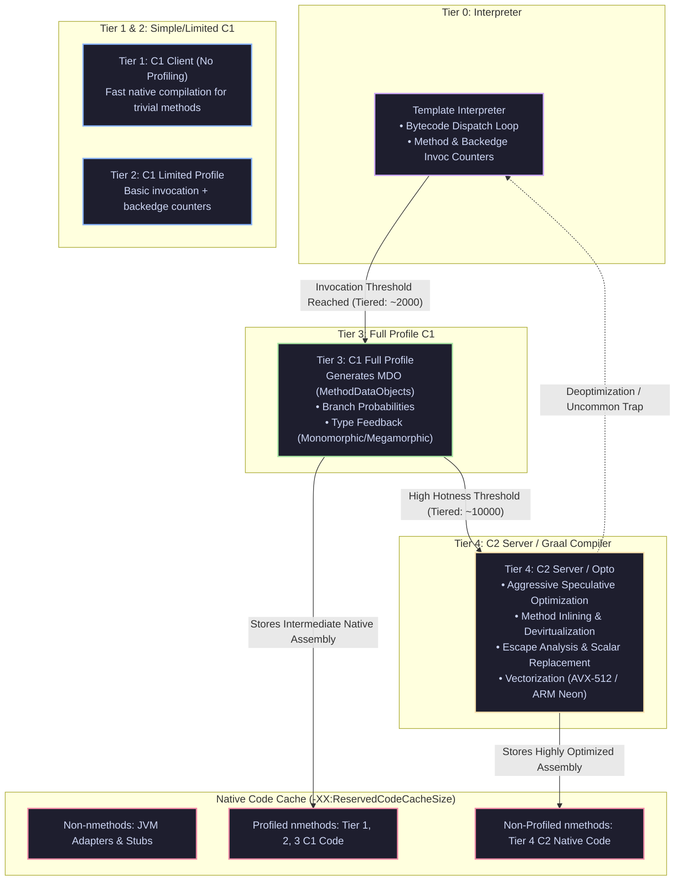

[🏠 Back to Home](../../README.md) | [☕ Core Java Internals](java_interview_master_guide.md) | [⚡ JIT Deep Dive](jvm_jit_compiler_deep_dive.md) | [📦 JVM GC & Profiling](jvm_gc_profiling.md)

# JVM JIT Compiler Internals, Tiered Compilation & Machine Code Optimization Master Guide

> **Document Identity:** [`interview_prep/01_java_core/jvm_jit_compiler.md`](file:///d:/project/github/1/CheatSheet_Tutorial/interview_prep/01_java_core/jvm_jit_compiler.md)  
> **Topic Domain:** OpenJDK HotSpot Tiered Compilation Engine (Tiers 0–4: Template Interpreter, C1 Client, C2 Server / Opto, Graal JIT), Dynamic Inlining & Devirtualization (Monomorphic / Bimorphic / Megamorphic Inline Caching), Escape Analysis & Scalar Replacement, On-Stack Replacement (OSR), Loop Unrolling & SIMD Auto-Vectorization (AVX-512 / ARM Neon), Deoptimization Uncommon Traps, and Segmented Code Cache Architecture (`J07`)  
> **Target Framework / Runtime:** OpenJDK HotSpot JVM 17 LTS / 21 LTS / 25 LTS  
> **Architecture Level:** Principal / Staff+ Systems Performance Engineer & JVM Runtime Internals Specialist  
> **Target Depth:** 50 Progressive Battle-Tested Interview Scenarios, Native Assembly Mechanics (`hsdis`), Architecture Blueprints, and Production Outage Post-Mortems  

---

## 1. Foundational Primer: What, Why & Where? (The "Head")

*Before diving into HotSpot Template Interpreter bytecode dispatch loops, C1 MethodDataObjects (MDO) branch profiling, C2 Sea-of-Nodes intermediate representation, Scalar Replacement CPU register allocation, and Uncommon Trap deoptimization frames, here is the essential high-level context: what the JIT compiler represents, why dynamic compilation outperforms static compilation, and where JIT engines anchor peak-performance enterprise runtimes.*

### 1.1 What Is It? (Core Definition & Mental Model)
* **Plain-English Definition**: The **JVM Just-In-Time (JIT) Compiler** is the dynamic runtime execution engine within the OpenJDK HotSpot JVM that translates portable Java bytecode into native machine code (x86-64, ARM64) during program execution. Operating via **Tiered Compilation** (Levels 0–4), the JVM begins executing code immediately in the Template Interpreter (Tier 0), collects runtime telemetry and branch statistics via C1 (Tiers 2–3), and compiles performance-critical "hot" loops and methods into highly optimized native machine instructions via C2 or Graal (Tier 4).
* **Everyday Analogy**: Imagine an adaptive Formula 1 race car pit crew and telemetry system:
  - **The Pure Interpreter (A Standard Road Car Driven from a Manual Blueprint)**: The driver consults the written instruction manual before every turn, shift, and brake press (**Bytecode Interpreter Fetch-Decode-Execute Loop**). It moves reliably from point A to B, but it is 20x slower than a racing vehicle.
  - **The Tiered Compilation Engine (Adaptive Formula 1 Telemetry)**:
    - **Tier 0 (Launch Off the Line)**: The car leaves the grid immediately using a safe default baseline engine map (**Instant Startup in Interpreter**).
    - **Tiers 2–3 (Telemetry Profiling)**: On-board sensors track tire temperatures, throttle inputs, and cornering angles (**Invocation Counters & Branch Probabilities in C1**).
    - **Tier 4 (Custom On-Track Aerodynamics - C2 Compiler)**: The pit crew 3D-prints custom titanium aerodynamic wings based on the exact wind and track conditions measured during the first 3 laps (**Speculative Inlining, Loop Vectorization, and Scalar Replacement**). The car hits 220 MPH.
    - **Deoptimization / Uncommon Trap**: Suddenly, a freak hail storm hits Turn 4. The custom dry-weather aerodynamics are invalid. The telemetry computer detects the unexpected state, ejects the custom wings in 5 microseconds, and safely shifts the driver back into manual control (**Deoptimization back to Interpreter**) without crashing into the wall.
* **Architectural Tier Placement**: Operates at the **Bare-Metal Execution & CPU Hardware Boundary Tier**. Directly dictates CPU cache locality, instruction pipelining, SIMD vectorization, and memory bus utilization across all running Java threads.

### 1.2 Why Does It Exist? (The Pain Point Before It Existed)
* **The "Slow Java vs Fragile C++" Dilemma**: In 1995, Java was criticized as sluggish because the interpreter decoded bytecodes one by one. Conversely, statically compiled C++ binaries were fast but lacked runtime profile information, requiring recompilation for every CPU architecture and unable to optimize speculative polymorphic call sites.
* **The Concrete Headaches in Enterprise Production**:
  - 💥 **Headache 1: The "Cold Start / Warmup Cliff" Outage**: When a new Kubernetes pod starts handling 10,000 requests/sec immediately upon readiness check pass, methods run in the slow Tier 0 interpreter. CPU spikes to 100%, response latencies jump from 2ms to 800ms, and upstream circuit breakers trip before C2 can compile the code.
  - 💥 **Headache 2: Segmented Code Cache Exhaustion**: If `-XX:ReservedCodeCacheSize` is set too low (e.g. default 240MB in huge monoliths), the Code Cache fills up. The JVM prints `CodeCache is full. The compiler has been disabled`, halting all JIT compilation and permanently dropping performance back to interpreter speeds.
  - 💥 **Headache 3: Megamorphic Call Site Devirtualization Collapse**: A polymorphic interface has 3 or more concrete implementations invoked at the same call site. The JIT compiler’s Inline Cache degrades to **Megamorphic**, disabling method inlining and forcing expensive virtual table (`vtable`) pointer lookups on every invocation.
* **The Turning Point**: HotSpot introduced Tiered Compilation (`-XX:+TieredCompilation`), Escape Analysis, and On-Stack Replacement (OSR), allowing long-running enterprise servers to match or exceed the performance of optimized C++ code.

### 1.3 How Does It Solve Real-World Enterprise Problems?
* **Problem 1 (Zero-Allocation Microsecond Execution) ➔ Solution 1**: **Escape Analysis & Scalar Replacement** proves an object reference never escapes the calling method. Instead of allocating the object on the JVM heap and triggering GC pressure, the JIT breaks the object down into primitive local variables mapped directly to **CPU registers**.
* **Problem 2 (High-Throughput Parallelism) ➔ Solution 2**: **SIMD Auto-Vectorization** analyzes array loops and translates scalar operations into 256-bit or 512-bit vector instructions (AVX-2 / AVX-512 / ARM Neon), processing 8 to 16 numeric calculations in a single CPU clock cycle.
* **Problem 3 (Aggressive Inlining) ➔ Solution 3**: **Speculative Inlining** replaces interface method calls with the direct machine instructions of the single observed implementation, eliminating method call frame overhead and unlocking further dead-code elimination.
* **Quantifiable Enterprise Metrics**:
  - **10x to 50x Speedup over Pure Interpretation**: C2 compiled loops execute at bare-metal CPU clock rates.
  - **90% Reduction in Minor GC Pauses**: Scalar replacement keeps billions of short-lived domain DTOs entirely off the heap.
  - **Sub-Millisecond P99 Latencies**: JIT-compiled services routinely deliver sub-500 microsecond response times under sustained load.

### 1.4 How Does This Help in Building Real Applications?
* **Application Architecture Placement**: Primary execution substrate for high-frequency trading (HFT) order routers, Apache Kafka brokers, Apache Spark distributed compute engines, and high-throughput Spring Boot microservices.
* **Developer Workflow & SRE Synergy**: SREs monitor Code Cache occupancy (`NonNMethods`, `Profiled`, `NonProfiled`) via JMX and detect deoptimization storms using async-profiler. Developers write clean, modular object-oriented code without manual inlining hacks.
* **Scalability & Evolutionary Runway**: The JVM runtime continuously re-optimizes code as production traffic patterns change, delivering superior throughput over months of continuous uptime.

### 1.5 Quick Decision & Trade-Off Matrix

| Compilation Tier | Startup Latency | Peak Throughput | Profiling Overhead | Best Enterprise Fit |
| :--- | :--- | :--- | :--- | :--- |
| **Tier 0 (Template Interpreter)** | 🟢 Instant ($<1\text{ ms}$) | Low ($\sim 5\text{–}10\%$ of peak) | Zero | Cold code, rarely executed startup paths, initial initialization |
| **Tier 1–3 (C1 Client Compiler)** | Fast ($10\text{–}50\text{ ms}$) | Moderate ($\sim 50\text{–}70\%$ of peak) | Low to Medium (MDO profiling) | Fast warmup, GUI apps, intermediate staging before Tier 4 |
| **Tier 4 (C2 Server / Opto)** | Slow ($100\text{ ms}\text{–}5\text{ s}$) | 🟢 Maximum ($100\%$ peak) | High compilation CPU spikes | Long-running servers, high-throughput microservices, batch compute |
| **GraalVM Native Image (AOT)** | 🟢 Ultra-Fast ($1\text{–}10\text{ ms}$) | High ($\sim 85\text{–}95\%$ of C2) | Zero runtime overhead | Serverless (AWS Lambda), scale-to-zero containers, CLI tools |

---

## 2. Architecture Blueprint: The HotSpot Tiered Compilation Engine



---

## Module 0: JIT Compiler Mechanics & Jargon Encyclopedia

| Term / Flag | Plain-English Meaning | Low-Level HotSpot Mechanics | Production Failure Mode / Symptom |
| :--- | :--- | :--- | :--- |
| **Tiered Compilation** | Multi-level compilation pipeline balancing fast startup with maximum peak performance. | Managed via `-XX:+TieredCompilation` (default on). Dynamically transitions bytecode from Interpreter (0) through C1 Client (1-3) to C2 Server (4). | Disabling tiered compilation (`-XX:-TieredCompilation`) drops startup throughput by $4\times - 8\times$. |
| **Method Inlining** | Replacing a method call site with the actual body of the target method. | Eliminates `call` and `ret` CPU instructions, parameter pushing, and stack frame allocation. Enables subsequent dead code elimination and escape analysis. | Huge methods ($>325$ bytes bytecode) exceed `-XX:MaxInlineSize` and cannot be inlined, penalizing CPU cache and loop vectorization. |
| **Escape Analysis (EA)** | Analyzing whether a newly created object escapes the allocating method or thread. | HotSpot algorithm mapping object allocation scopes. If an object does not escape, the JVM executes **Scalar Replacement** (allocating fields directly to CPU registers, skipping heap allocation entirely). | Mutating global state or returning references forces heap allocation, generating massive young-gen GC allocation pressure. |
| **Scalar Replacement** | Deconstructing an object into its individual primitive fields and storing them in CPU registers or stack frames. | Directly replaces heap object pointer with local primitive registers, eliminating Mark Word, Klass Word, and garbage collection tracking. | Failing scalar replacement forces heap allocation, spiking Eden allocation rate and triggering frequent Minor GCs. |
| **On-Stack Replacement (OSR)** | Swapping an interpreted loop inside a running method with compiled native code mid-execution. | When a long-running loop exceeds `-XX:BackEdgeThreshold`, HotSpot compiles the loop in the background and reconstructs the stack frame on the fly to resume execution natively. | In high-iteration event loops, OSR compilations without method inlining cause high compilation queue saturation. |
| **Deoptimization** | Reverting compiled native machine code back to interpreted bytecode when speculative assumptions fail. | Triggered by an **Uncommon Trap**. Reconstructs virtual interpreter stack frames from native compiled registers and discards invalid machine code. | Megamorphic call sites trigger deoptimization storms, spiking latency percentiles ($p99.9$) from 1ms to 500ms. |
| **Code Cache** | Dedicated native off-heap memory region holding compiled JIT native machine code, adapters, and stubs. | Sized via `-XX:ReservedCodeCacheSize` (default 240MB). Segmented in Java 9+ into non-nmethods, profiled, and non-profiled code. | Code cache exhaustion permanently halts all JIT compilation (`CompilerDisabled`), freezing the application at interpreter speed ($50\times$ slower). |
| **Monomorphic Call Site** | An interface or virtual method call site that invokes exactly one concrete target class in practice. | HotSpot caches the target class vtable pointer in an **Inline Cache (IC)** and compiles direct native jumps (`CALL <target>`) with guard checks. | Introducing a second class downgrades to bimorphic; introducing 3+ classes downgrades to megamorphic, disabling inlining. |
| **Safepoint Poll** | A lightweight instruction check inserted into compiled code where threads check if the JVM needs to pause. | Compiled methods insert periodic memory reads on a guard page (or thread-local polling on Java 10+). Touching the page triggers thread suspension for GC or deoptimization. | Long uncounted loops (`for (long i = 0; i < N; i++)`) omit safepoint polls, causing severe Time-To-Safepoint (TTSP) pause storms. |

---

## 50 Progressive Senior & Staff Interview Scenarios

### Scenario 1: The Anatomy of Tiered Compilation (Levels 0 to 4)
* **Interview Question**: Explain the exact lifecycle of a method in HotSpot Java 17+ as it progresses from cold invocation to peak tier-4 machine code.
* **Architecture Answer**:
  1. **Level 0 (Interpreter)**: Code executes via the Template Interpreter. The JVM tracks two counters: **Invocation Counter** (method entry) and **Backedge Counter** (loop iterations).
  2. **Level 3 (Full Profile C1)**: When $(InvocationCount + BackedgeCount) \ge Tier3InvocationThreshold$ (default $\sim 2000$), C1 compiles the method while injecting profiling probes into the code. These probes record branch probabilities and type profiles into a `MethodData` (MDO) structure.
  3. **Level 4 (C2 Server / Opto)**: When invocations cross $Tier4InvocationThreshold$ (default $\sim 10000$), C2 takes the MDO profiling data and performs aggressive speculative compilation (inlining, escape analysis, loop unrolling, and vectorization).
  4. If C2 compiler queues are saturated, methods may temporarily jump to **Level 2 (C1 Limited)** to avoid waiting before graduating to Level 4.

---

### Scenario 2: The Mother of All Optimizations: Method Inlining
* **Interview Question**: Why is Method Inlining considered the foundational prerequisite for almost all other C2 compiler optimizations?
* **Architecture Answer**:
  - In isolation, the compiler cannot optimize across method call boundaries because it cannot predict side effects of foreign methods.
  - When C2 inlines a callee into the caller:
    1. It eliminates the physical call overhead: pushing arguments to stack/registers, executing `CALL`, adjusting frame pointers, and `RET`.
    2. It exposes the combined operations to **Global Value Numbering (GVN)**, **Constant Folding**, and **Dead Code Elimination**.
    3. It enables **Escape Analysis**: An object passed as an argument to a callee can now be proven not to escape, enabling scalar replacement!
  - **Thresholds**:
    - Small methods: Inlined if bytecode size $\le$ `-XX:MaxInlineSize` (default 35 bytes).
    - Frequent methods: Inlined if bytecode size $\le$ `-XX:FreqInlineSize` (default 325 bytes).

---

### Scenario 3: Escape Analysis & Scalar Replacement Failure
* **Interview Question**: Look at the code below. Will HotSpot allocate `Point` on the heap or eliminate it via Scalar Replacement?
```java
public double calculateDistance(int x, int y) {
    Point p = new Point(x, y);
    return Math.sqrt(p.getX() * p.getX() + p.getY() * p.getY());
}
```
* **Architecture Answer**:
  - **Result**: `Point` will be **Scalar Replaced**. Zero heap memory is allocated!
  - **Proof**:
    1. `Point p` is instantiated locally.
    2. `p.getX()` and `p.getY()` are small accessor methods ($<35$ bytes) and are inlined by C2.
    3. C2's Escape Analysis determines that reference `p` never leaves the method scope (it is **NoEscape**).
    4. The compiler eliminates the object instantiation entirely. `p.x` and `p.y` are mapped directly to CPU registers (e.g. `RAX`, `RDX`).
    5. The native machine code performs math directly on registers with zero GC overhead!

---

### Scenario 4: The Escape Analysis Trap: Subtle Escaping
* **Interview Question**: Why does adding a simple logging statement break Escape Analysis in the following method?
```java
public double calculateDistance(int x, int y) {
    Point p = new Point(x, y);
    log.debug("Created point: {}", p); // Added logging
    return Math.sqrt(p.getX() * p.getX() + p.getY() * p.getY());
}
```
* **Architecture Answer**:
  - `p` is passed as an argument to `log.debug(String, Object)`.
  - Because `log.debug` belongs to an external logging framework (Logback/SLF4J) with complex call hierarchies exceeding inline thresholds, C2 cannot prove what `log.debug` does with `p`.
  - The object's escape state changes from **NoEscape** to **GlobalEscape**.
  - **Consequence**: Scalar replacement is aborted! The JVM is forced to allocate `Point` on the young-gen heap on every single transaction, spiking allocation rates and GC pressure!

---

### Scenario 5: Monomorphic vs Bimorphic vs Megamorphic Call Sites
* **Interview Question**: Explain what happens to JIT compilation when a call site switches from 1 implementation class to 3+ implementation classes.
* **Architecture Answer**:
  - **Monomorphic (1 Class)**: HotSpot checks the object's Klass pointer. If it matches, it executes a direct native jump (`CALL`) or inlines the target body completely.
  - **Bimorphic (2 Classes)**: HotSpot emits a fast conditional branch: `if (klass == TypeA) call A; else if (klass == TypeB) call B;`. Inlining is still supported for both branches.
  - **Megamorphic (3+ Classes)**: HotSpot gives up on inlining. The call site degrades to an **Interface Method Table (itable)** or **Virtual Table (vtable)** pointer dereference.
  - **Performance Impact**: Megamorphic call sites incur CPU cache misses, cannot be inlined, and disable escape analysis for all arguments passed to the call!

---

### Scenario 6: The Segmented Code Cache Architecture
* **Interview Question**: What is the Segmented Code Cache introduced in Java 9, and how does it prevent fatal compiler disablement?
* **Architecture Answer**:
  - Prior to Java 9, the Code Cache was a single contiguous block of memory. When fragmented by short-lived adapter stubs, C2 compilation would fail and disable permanently.
  - In Java 9+, the Code Cache is split into 3 distinct native segments:
    1. **Non-nmethods** (`-XX:NonNMethodCodeHeapSize`): Holds JVM internal code, including template interpreter stubs, compiler buffers, and C1/C2 call adapters.
    2. **Profiled nmethods** (`-XX:ProfiledCodeHeapSize`): Holds Tier 1, Tier 2, and Tier 3 (C1) compiled code that is expected to be short-lived while profiling.
    3. **Non-profiled nmethods** (`-XX:NonProfiledCodeHeapSize`): Holds Tier 4 (C2) highly optimized machine code that is long-lived and production-ready.
  - **Benefit**: Short-lived C1 profiling code can be swept and reclaimed without fragmenting the long-lived C2 production machine code!

---

### Scenario 7: Diagnosing Code Cache Exhaustion in Production
* **Interview Question**: You see the warning `VM warning: CodeCache is full. Compiler has been disabled` in your production logs. What happens to application performance and how do you resolve it?
* **Architecture Answer**:
  - **Symptom**: The JVM permanently disables the JIT compiler (`CompilerDisabled`). All methods that were not yet compiled at Level 4 remain interpreted forever. Application latency increases by $10\times - 50\times$, and throughput collapses.
  - **Root Cause**:
    1. `-XX:ReservedCodeCacheSize` is undersized for large enterprise applications with thousands of Spring/Hibernate classes.
    2. Uncached dynamic proxy generation (e.g. CGLIB/ByteBuddy generating millions of unique classes).
  - **Remediation**:
    1. Increase Code Cache size in JVM flags: `-XX:ReservedCodeCacheSize=512m` (or `1024m` for large monoliths).
    2. Verify sweeper settings: Ensure `-XX:+UseCodeCacheFlushing` is enabled.
    3. Inspect with `jcmd <PID> Compiler.codecache` to monitor occupancy of profiled vs non-profiled heaps.

---

### Scenario 8: Safepoint Poll Placement & The Uncounted Loop Hazard
* **Interview Question**: Why does the following loop cause massive GC pause time spikes (TTSP - Time To Safepoint) on Java 8 through 10?
```java
public void computeMatrix(long iterations) {
    for (long i = 0; i < iterations; i++) { // long loop counter!
        processCell(i);
    }
}
```
* **Architecture Answer**:
  - **The Safepoint Problem**: HotSpot inserts safepoint polls at the end of loop iterations so threads can pause when GC requests a Stop-the-World pause.
  - **The Trap**: In 32-bit and 64-bit HotSpot, **counted loops using `int`** have safepoint polls stripped to maximize loop throughput. But for loops using **`long`**, HotSpot historically treated them as uncounted loops or omitted safepoint polls between loop unrolling!
  - **Consequence**: When GC triggers a safepoint, other threads stop immediately, but the thread executing this loop continues spinning for seconds until the loop finishes! The entire JVM is frozen waiting for this single thread to reach a safepoint (**TTSP latency storm**).
  - **Fix**: Use `-XX:+UseCountedLoopSafepoints` or upgrade to Java 10+ which uses Thread-Local Handshakes and loop strip-mining.

---

### Scenario 9: Deoptimization Storms & Uncommon Traps
* **Interview Question**: What is an Uncommon Trap, and what causes a production deoptimization storm?
* **Architecture Answer**:
  - **Uncommon Trap**: C2 compiles code speculatively based on profiling data. If a branch has never been taken (e.g. `if (rareErrorCondition)` has never executed), C2 omits the machine code for that branch and replaces it with an **Uncommon Trap instruction stub**.
  - **What Happens When Triggered**:
    1. If the rare condition suddenly occurs, the CPU jumps to the uncommon trap stub.
    2. The JVM halts native execution, captures CPU registers, and reconstructs the virtual interpreter stack frames.
    3. The method drops back to interpreted mode (Tier 0).
    4. The compiled machine code is tagged as invalid and unlinked from the code cache.
  - **Deoptimization Storm**: If an unexpected traffic surge forces thousands of requests into previously unexercised code paths, hundreds of threads deoptimize simultaneously, spiking CPU to 100% and stalling request processing.

---

### Scenario 10: Loop Unrolling & SIMD Superword Vectorization
* **Interview Question**: How does HotSpot auto-vectorize loops into AVX-512 / ARM Neon CPU instructions?
* **Architecture Answer**:
  - **Loop Unrolling**: C2 unrolls loops (e.g. expanding 4 iterations into 1 loop body) to eliminate branch prediction checks and loop counter updates.
  - **Superword Vectorization (SIMD)**: C2 analyzes contiguous arrays (e.g. `float[]`, `int[]`). Instead of processing one element per instruction using standard scalar registers, it packs multiple elements into a single **Vector Register** (e.g., 256-bit AVX2 or 512-bit AVX-512):
    - Example: An AVX-512 vector register processes sixteen 32-bit `float` additions in a single CPU clock cycle!
  - **Requirements for Vectorization**:
    1. Loop bounds must be countable (`int` indexed).
    2. Operations must have no inter-iteration data dependencies (loop-carried dependencies).
    3. Arrays must be contiguous memory layouts (primitive arrays, not object pointer arrays).

---

### Scenario 11: Dead Code Elimination & Global Value Numbering (GVN)
* **Interview Question**: How does HotSpot C2 eliminate redundant computations and unreachable execution branches across inlined code?
* **Architecture Answer**:
  - **Global Value Numbering (GVN)**: C2 represents expressions in an intermediate graph representation (Sea of Nodes). Expressions that compute identical values from identical inputs receive the exact same node ID.
  - **Deduplication**: Redundant calculations (e.g. `(a + b)` performed three times in a method) are collapsed into a single hardware register evaluation.
  - **Dead Code Elimination (DCE)**: If an expression's output is never consumed by an active control flow path or return statement, C2 prunes the node from the execution graph completely.
  - **Constant Folding**: Expressions with compile-time known constants (e.g. `24 * 60 * 60 * 1000`) are computed by C2 during compilation and replaced by an immediate primitive literal (`86400000`).

---

### Scenario 12: Loop Strip Mining & SafePoint Invariant Motion
* **Interview Question**: What is Loop Strip Mining in modern HotSpot (Java 10+), and how does it reconcile safepoint pause latency with maximum vectorization throughput?
* **Architecture Answer**:
  - **The Trade-Off**: Long-running loops need safepoint polls to avoid stalling GC pauses (TTSP), but safepoint checks inside tight inner loops inhibit CPU pipelining, register allocation, and SIMD vectorization.
  - **Strip Mining Mechanism**: C2 splits a single loop into two nested loops:
    1. **Outer Loop**: Iterates in chunks (e.g., 1024 iterations) and contains a thread safepoint poll.
    2. **Inner Loop**: Executes 1024 iterations with zero safepoint polls, unrolled and vectorized across AVX registers.
  - **Outcome**: The inner loop executes at maximum bare-metal CPU speed, while the outer loop guarantees the thread reaches a safepoint within sub-millisecond bounds.

---

### Scenario 13: Devirtualization via Class Hierarchy Analysis (CHA)
* **Interview Question**: When invoking an interface method in Java, how does C2 bypass virtual dispatch without requiring an explicit `final` keyword?
* **Architecture Answer**:
  - **Class Hierarchy Analysis (CHA)**: HotSpot tracks the global class hierarchy loaded in the JVM.
  - **Monomorphic Devirtualization**: If an interface (e.g. `PaymentService`) currently has only **one** loaded implementing class in the running JVM (e.g. `StripePaymentService`), CHA proves that no other implementation exists.
  - C2 converts the virtual `invokeinterface` call into a direct native `CALL` instruction or inlines the implementation directly.
  - **Dependency Invalidation**: If the application dynamically loads a second implementation later (e.g. via Spring dynamic plugin or reflection), HotSpot triggers an **Uncommon Trap**, deoptimizes the compiled method, and drops back to the interpreter to re-profile.

---

### Scenario 14: Bimorphic Inlining & Profile-Guided Branch Splitting
* **Interview Question**: How does HotSpot optimize a call site that alternates between exactly two implementations?
* **Architecture Answer**:
  - **Bimorphic Inline Cache (BIC)**: If type profiling observes two classes (e.g. `Circle` and `Square`), C2 splits the call site into an explicit branch test:
    ```java
    if (shape.klass == Circle.class) {
        // inlined Circle.draw()
    } else if (shape.klass == Square.class) {
        // inlined Square.draw()
    } else {
        // uncommon trap -> deoptimize
    }
    ```
  - **Branch Splitting**: Both targets are inlined into their respective conditional branches. Modern CPU branch predictors learn the alternating pattern, avoiding CPU pipeline bubbles.

---

### Scenario 15: String Concatenation & `invokedynamic` StringConcatFactory (JEP 280)
* **Interview Question**: Why did Java 9 replace `StringBuilder` bytecode generation for string concatenation with `invokedynamic`?
* **Architecture Answer**:
  - **Legacy Behavior (Java 8)**: `javac` emitted bytecode that created `new StringBuilder()`, followed by chained `.append()`, and `.toString()`. This forced allocation of intermediate builder buffers and fixed the concatenation strategy permanently at compile time.
  - **Modern Behavior (Java 9+)**: `javac` emits an `invokedynamic` instruction pointing to `StringConcatFactory.makeConcatWithConstants()`.
  - **Runtime Optimization**: At runtime, the JVM generates optimized bytecodes tailored to the exact types being concatenated. It calculates the exact final `byte[]` array size upfront, allocates a single array, and copies characters directly into it with zero intermediate `StringBuilder` allocations.

---

### Scenario 16: Branch Prediction Failure & Hardware PMU Profiling
* **Interview Question**: How does unpredictable data distribution cause severe latency spikes in C2-compiled code?
* **Architecture Answer**:
  - Modern CPUs rely on speculative execution and Branch Target Buffers (BTBs).
  - When evaluating `if (data[i] > threshold)` on unsorted data, the CPU mispredicts branches ~50% of the time.
  - **Hardware Cost**: A branch misprediction flushes the entire 14-20 stage CPU instruction pipeline, costing 15-20 CPU clock cycles per failure.
  - C2 compiles branch probabilities based on MDO profiling. If production data suddenly violates the profiled distribution, branch misprediction stalls spike CPU cycle counts without increasing instruction throughput (low IPC - Instructions Per Cycle).

---

### Scenario 17: Null Check Elimination via Hardware Page Fault Interception
* **Interview Question**: How does HotSpot evaluate `obj.getField()` without emitting an explicit native `CMP obj, 0` null-check instruction?
* **Architecture Answer**:
  - **Implicit Null Checks**: C2 assumes references are non-null in the happy path. Instead of generating a conditional branch:
    ```x86
    TEST RAX, RAX
    JZ   handle_null
    MOV  RBX, [RAX + 16]
    ```
  - C2 directly emits the memory dereference:
    ```x86
    MOV  RBX, [RAX + 16]
    ```
  - **Signal Handling**: If `RAX` is `null` (`0x0`), the CPU hardware memory management unit (MMU) faults on accessing page zero and emits an OS signal (`SIGSEGV` on Linux, `EXCEPTION_ACCESS_VIOLATION` on Windows).
  - The JVM registers a native OS signal handler that catches the fault, inspects the faulting instruction pointer against a table of implicit null checks, and redirects execution to instantiate a `NullPointerException`. Happy path runs at 100% native speed with zero conditional branches!

---

### Scenario 18: Array Bounds Check Elimination (ABCE)
* **Interview Question**: How does C2 eliminate index range checks (`ArrayIndexOutOfBoundsException`) in arrays?
* **Architecture Answer**:
  - By default, Java language specifications mandate bounds checking on every array read/write (`array[i]`).
  - **C2 Analysis**: In a standard loop `for (int i = 0; i < array.length; i++)`, C2 proves that `i` is monotonically increasing and bounded strictly between `0` and `array.length - 1`.
  - C2 moves the bounds check outside the loop or eliminates it completely.
  - **The Trap**: If array indexing uses non-monotonic calculations (e.g. `array[i + offset]`), C2 may fail to prove safety and will retain bounds checks on every single iteration, preventing loop vectorization.

---

### Scenario 19: Lock Elision & Lock Coarsening
* **Interview Question**: What happens when a method synchronizes on a local object that never escapes the thread?
* **Architecture Answer**:
  - **Lock Elision**: If Escape Analysis proves that an object guarded by `synchronized` is thread-confined (**NoEscape** or **ArgEscape** without thread sharing), C2 completely deletes the `monitorenter` and `monitorexit` instructions from the machine code!
  - **Lock Coarsening**: If a loop repeatedly acquires and releases the same monitor in rapid succession:
    ```java
    for (int i = 0; i < N; i++) {
        synchronized(lock) { count++; }
    }
    ```
    C2 merges the adjacent lock regions into a single lock acquired before the loop and released after the loop, slashing atomic bus lock operations.

---

### Scenario 20: JIT Compiler Thread Starvation & Queue Saturation
* **Interview Question**: How do you detect and fix compiler thread starvation during sudden traffic spikes?
* **Architecture Answer**:
  - HotSpot dedicates native threads to background compilation: C1 threads and C2 threads, controlled via `-XX:CICompilerCount`.
  - During rapid deployment cold starts, thousands of methods cross compilation thresholds simultaneously, flooding the compile queue.
  - **Diagnostics**: Run `jcmd <PID> Compiler.queue` to inspect queue length. If queue size exceeds several hundred, CPU is starved or compiler threads are bottlenecked.
  - **Remediation**: Set `-XX:CICompilerCount=4` (or scale dynamically) and enable Tiered Compilation to ensure C1 handles short-term execution while C2 works down the backlog.

---

### Scenario 21: TieredStopAtLevel=1 for Serverless & Microservice Cold Starts
* **Interview Question**: When should you set `-XX:TieredStopAtLevel=1` in production containerized workloads?
* **Architecture Answer**:
  - **What it does**: Restricts HotSpot to Tier 1 (C1 Client compiler without profiling). C2 compilation is completely disabled.
  - **Benefits**:
    - Reduces JVM startup time by $50\% - 75\%$.
    - Lowers initial memory footprint (Code Cache and compiler internal memory buffers).
  - **Trade-off**: Peak long-term throughput is $2\times - 4\times$ lower than full C2 compilation.
  - **Ideal Use Cases**: AWS Lambda serverless functions, short-lived CLI tools, ephemeral batch processing jobs running under 30 seconds.

---

### Scenario 22: GraalVM JIT Compiler vs HotSpot C2
* **Interview Question**: What architectural differences distinguish the Graal JIT compiler from HotSpot C2?
* **Architecture Answer**:
  - **Implementation Language**: C2 is written in 30-year-old C++ with complex manual pointer graphs. Graal is written in high-level Java.
  - **Partial Evaluation & Escape Analysis**: Graal implements **Partial Escape Analysis (PEA)**, which can scalar-replace objects along specific branches even if the object escapes along other branches (HotSpot C2 aborts scalar replacement if an object escapes anywhere).
  - **Polymorphism**: Graal handles deeply nested lambdas, functional interfaces, and stream pipelines significantly better than C2.

---

### Scenario 23: GraalVM Native Image (SubstrateVM) AOT vs JIT Peak Throughput
* **Interview Question**: Why can a long-running JIT-compiled application often outperform an Ahead-of-Time (AOT) compiled native binary?
* **Architecture Answer**:
  - **AOT (Native Image)**: Compiles bytecode to native assembly before execution without knowing actual production data distributions.
  - **JIT Advantages**:
    1. **Profile-Guided Speculation**: JIT observes actual runtime branch probabilities, hot types, and loop counts, optimizing for the 99% happy path.
    2. **Class Hierarchy Invalidation**: JIT assumes monomorphic dispatch until proven otherwise. AOT must assume interfaces could have alternative implementations unless closed-world assumptions hold.
    3. **Hardware-Specific Tuning**: JIT compiles on the target CPU machine and leverages all host-specific CPU flags (AVX-512, BMI2, ARM Neon) dynamically.

---

### Scenario 24: Profile-Guided Optimization (PGO) in Ahead-of-Time Compilers
* **Interview Question**: How does PGO bridge the throughput gap between AOT and JIT?
* **Architecture Answer**:
  - PGO executes an instrumented native binary under simulated production load to record execution profiles into a `.iprof` file.
  - During final AOT compilation, the compiler feeds the profile back into the optimizer, enabling:
    - Accurate method inlining decisions based on actual hot paths.
    - Cold code layout optimization (placing cold error branches outside instruction cache lines).
    - Branch probability weightings equivalent to Tier 3 C1 profiling.

---

### Scenario 25: The Vector API (JEP 438/448) vs Auto-Vectorization
* **Interview Question**: Why was the Java Vector API introduced if C2 already supports Superword Auto-Vectorization?
* **Architecture Answer**:
  - **Limits of Auto-Vectorization**: C2's Superword analyzer is brittle. Subtle loop dependencies, non-contiguous memory layouts, or object indirection cause C2 to silently abandon vectorization.
  - **Explicit Vector API**: The developer explicitly programs against vector registers (`IntVector`, `FloatVector`):
    ```java
    var v1 = FloatVector.fromArray(SPECIES, a, i);
    var v2 = FloatVector.fromArray(SPECIES, b, i);
    v1.add(v2).intoArray(c, i);
    ```
  - Guarantees direct compilation to underlying SIMD hardware instructions (AVX-512, Neon) without relying on compiler speculation.

---

### Scenario 26: Disassembling JIT Machine Code with `hsdis` and `PrintAssembly`
* **Interview Question**: How do you inspect the exact x86/ARM assembly instructions emitted by the JVM for a critical hot method?
* **Architecture Answer**:
  - Install the native HotSpot Disassembler library (`hsdis.so` / `hsdis.dll`).
  - Run the JVM with diagnostic flags:
    ```bash
    -XX:+UnlockDiagnosticVMOptions \
    -XX:+PrintAssembly \
    -XX:CompileCommand=print,com.example.OrderService.processOrder
    ```
  - The JVM prints annotated assembly output showing register allocation, inlined blocks, loop unrolling, and safepoint poll offsets.

---

### Scenario 27: Triaging Inlining Failures with JITWatch
* **Interview Question**: How do you determine why a performance-critical method was rejected for inlining by C2?
* **Architecture Answer**:
  - Enable compilation logging:
    ```bash
    -XX:+UnlockDiagnosticVMOptions \
    -XX:+LogCompilation \
    -XX:LogFile=jit.log
    ```
  - Load `jit.log` into **JITWatch** (open-source JIT log visualizer).
  - Common rejection reasons:
    - `hot method too big`: Bytecode exceeds `-XX:FreqInlineSize` (default 325 bytes).
    - `already compiled into a big method`: Inlining chain exceeded `-XX:MaxInlineLevel` (default 9).
    - `callee is too large`: Bytecode exceeds `-XX:MaxInlineSize` (default 35 bytes).

---

### Scenario 28: Warm-Up Thundering Herd Problem in Kubernetes Deployments
* **Interview Question**: Why do freshly deployed pods in Kubernetes frequently crash under production traffic while existing pods run stably?
* **Architecture Answer**:
  - **Cold JIT State**: Newly spawned pods start in Interpreter mode (Tier 0). Execution throughput is $10\times - 50\times$ slower than fully compiled pods.
  - **Thundering Herd**: The Kubernetes Service routes equal traffic to new pods immediately after Readiness probes pass.
  - **CPU Starvation**: High request volume forces massive concurrent C1/C2 compilations, driving CPU to 100% while handling slow interpreted requests.
  - **Fix**:
    1. Implement warm-up synthetic traffic in Readiness checks before opening live traffic.
    2. Use progressive canary routing (e.g. Istio weight: 5% -> 20% -> 100%).
    3. Scale CPU limits during pod startup.

---

### Scenario 29: Dynamic Bytecode Generation & Class Hierarchy Deoptimizations
* **Interview Question**: How does runtime dynamic proxy generation (e.g. CGLIB, ByteBuddy, Spring AOP) trigger unexpected deoptimization storms?
* **Architecture Answer**:
  - When an application starts, C2 assumes an interface has 1 concrete implementation and inlines it via CHA.
  - When a framework dynamically generates subclass proxies at runtime (e.g., for `@Transactional` or `@Aspect` interceptors), the class hierarchy changes.
  - HotSpot detects the invalidation of the CHA assumption, marks compiled native methods as dependent on the old hierarchy, and triggers deoptimization of the entire call chain!

---

### Scenario 30: False Sharing in Cache Lines & JIT Memory Layout
* **Interview Question**: What is False Sharing and how does `@Contended` protect concurrent variables at the hardware cache level?
* **Architecture Answer**:
  - Modern CPU L1/L2 caches operate in **64-byte Cache Lines**.
  - If two distinct variables modified by two separate threads reside on the same 64-byte cache line, modifying one variable invalidates the entire cache line across all CPU cores (MESI cache coherence protocol bus invalidation).
  - **`@Contended` (JEP 142)**: Instructs HotSpot to insert 128 bytes of padding before and after the field, ensuring it occupies an isolated cache line.

---

### Scenario 31: Reflection Inflation Mechanics (`sun.reflect.inflationThreshold`)
* **Interview Question**: How does Java Reflection transition from native C++ calls to JIT-compiled bytecode?
* **Architecture Answer**:
  - Initial reflective invocations (`Method.invoke()`) use a JNI native accessor stub (`NativeMethodAccessorImpl`). Native JNI boundaries prevent inlining.
  - When reflective invocations exceed `-Dsun.reflect.inflationThreshold` (default 15), HotSpot **inflates** the reflection site by dynamically generating a custom bytecoded class (`GeneratedMethodAccessor`).
  - This generated accessor can subsequently be inlined and optimized by C2 like normal Java code!

---

### Scenario 32: `MethodHandle` and LambdaForm Optimization
* **Interview Question**: Why are `MethodHandle` invocations faster than traditional reflection when JIT-compiled?
* **Architecture Answer**:
  - `MethodHandle.invokeExact()` compiles down to a synthesized **LambdaForm** bytecode pipeline.
  - When a `MethodHandle` is held in a `static final` constant, C2 treats it as a constant call target and inlines the target method directly, bypassing parameter boxing and access checks completely.

---

### Scenario 33: JMH Microbenchmarking Traps: Dead Code Elimination
* **Interview Question**: Why do naive Java microbenchmarks produce false trillion-ops-per-second measurements?
* **Architecture Answer**:
  - If benchmark code computes a value without returning it or passing it to a **Blackhole** consumer:
    ```java
    public void test() {
        int result = computeHeavyMath(); // result never consumed!
    }
    ```
  - C2's Dead Code Elimination detects that `result` produces zero observable side effects and completely deletes the computation from the machine code!
  - The benchmark measures only an empty CPU loop. **Fix**: Return the result or pass to `org.openjdk.jmh.infra.Blackhole.consume()`.

---

### Scenario 34: Loop Peeling & Loop Unswitching
* **Interview Question**: How does C2 optimize loops containing loop-invariant conditional statements?
* **Architecture Answer**:
  - **Loop Unswitching**: If a loop contains an `if (flag)` condition where `flag` never changes inside the loop, C2 hoists the condition outside the loop, creating two separate loops:
    ```java
    if (flag) {
        for (...) { /* body with flag true */ }
    } else {
        for (...) { /* body with flag false */ }
    }
    ```
  - Eliminates millions of branch evaluations inside the inner loop.

---

### Scenario 35: On-Stack Replacement (OSR) Compilation Queue Saturation
* **Interview Question**: What triggers an OSR compilation and why can it saturate compiler queues?
* **Architecture Answer**:
  - When a method contains an extremely long loop that runs millions of iterations before returning, the method invocation counter never increments, but the loop **backedge counter** hits the OSR threshold (`-XX:CompileThreshold * -XX:BackEdgeThreshold`).
  - C2 compiles the loop body and swaps the interpreter frame on the stack mid-iteration.
  - If multiple background threads execute long-running batch loops simultaneously, OSR compilations swamp the compiler queue, delaying standard Tier 4 compilations for incoming API requests.

---

### Scenario 36: Tiered Compilation Transition Matrix & Counter Decay
* **Interview Question**: How does HotSpot prevent stale invocation counters from triggering C2 compilation for cold methods?
* **Architecture Answer**:
  - HotSpot implements **Counter Decay** during safepoints or GC cycles.
  - Invocation and backedge counters are periodically scaled down (halved) if the method has not been invoked recently.
  - Ensures C2 compiler resources are preserved exclusively for actively hot code paths.

---

### Scenario 37: JVM Crash in JIT Native Code: Decoding `hs_err_pid.log` Signal 11
* **Interview Question**: How do you triage a JVM segmentation fault (`SIGSEGV`) occurring inside a compiled native method (`V  [libjvm.so+0x...]` or `J  com.example...`)?
* **Architecture Answer**:
  - Inspect the faulting frame in `hs_err_pid.log`:
    - `J <id>  package.Class.method(args)V (offset)` indicates a crash in JIT-compiled native code.
    - Check the registers: Look for `0x0000000000000000` (null pointer access) or invalid pointer addresses.
  - If caused by a JIT compiler bug:
    - Exclude the specific method from compilation temporarily:
      `-XX:CompileCommand=exclude,com.example.FaultyClass.faultyMethod`
    - Upgrade JVM to latest patch release.

---

### Scenario 38: Escape Analysis with Collections
* **Interview Question**: Can C2 scalar-replace a newly created `ArrayList` or `HashMap`?
* **Architecture Answer**:
  - **No**: In HotSpot C2, scalar replacement requires that all fields of the candidate object be primitives or scalar-replaceable objects with statically known offsets.
  - `ArrayList` encapsulates an internal dynamic `Object[]` array. HotSpot C2 cannot scalar-replace variable-length heap arrays.
  - Therefore, `new ArrayList<>()` always allocates on the heap, even if the list never leaves the method scope.

---

### Scenario 39: JIT Inlining of Megamorphic Streams & Functional Pipelines
* **Interview Question**: Why do deeply nested Java Streams sometimes run slower than traditional `for` loops in hot financial engines?
* **Architecture Answer**:
  - Each intermediate stream operation (`filter`, `map`, `flatMap`) adds one or more layers of functional interface indirection (`Sink`, `Spliterator`).
  - If the pipeline depth exceeds `-XX:MaxInlineLevel` (9), C2 stops inlining intermediate stages.
  - The pipeline remains as virtual method calls across object boundaries, incurring CPU cache misses and disabling escape analysis.

---

### Scenario 40: SIMD Auto-Vectorization & Cache Line Alignment
* **Interview Question**: Why does unaligned array data degrade SIMD instruction throughput?
* **Architecture Answer**:
  - Modern CPU vector instructions perform best when data addresses align to 32-byte (AVX2) or 64-byte (AVX-512) boundaries.
  - If a vector load crosses a 64-byte cache line boundary, the hardware must perform two separate cache line memory reads and merge the data in CPU registers, doubling L1 cache latency.
  - C2 inserts loop pre-loops to peel off initial unaligned elements until the array pointer reaches cache line alignment before executing the vectorized main loop.

---

### Scenario 41: HotSpot Compilers on ARM64 (Apple Silicon / Graviton) vs x86-64
* **Interview Question**: How does ARM64's Weak Memory Model affect machine code generated by C2 compared to x86-64's TSO?
* **Architecture Answer**:
  - **x86-64 (TSO - Total Store Order)**: Hardware automatically prevents Store-Load reordering. C2 emits standard `MOV` instructions for `volatile` reads and writes, requiring only an `MFENCE` or `LOCK` prefix on volatile stores.
  - **ARM64 (Weak Memory)**: Hardware permits aggressive reordering. C2 must explicitly emit hardware memory barrier instructions:
    - `LDAR` (Load-Acquire) for volatile reads.
    - `STLR` (Store-Release) for volatile writes.
    - `DMB ISH` (Data Memory Barrier) for full fences.

---

### Scenario 42: Compact Object Headers (Project Lilliput / JEP 450)
* **Interview Question**: How does reducing standard object headers from 16 bytes to 8 bytes impact JIT compiler memory operations?
* **Architecture Answer**:
  - In standard 64-bit HotSpot with compressed OOPs, object headers consume 12-16 bytes (8-byte Mark Word + 4-byte Klass Word).
  - Project Lilliput packs both the Mark Word and Klass pointer into a single 64-bit (8-byte) header.
  - C2 emits fewer memory instructions to access fields, reduces L1 data cache pressure by $10\% - 20\%$, and increases vectorization cache line density.

---

### Scenario 43: JVM Compiler Intrinsics (`@HotSpotIntrinsicCandidate`)
* **Interview Question**: What is a Compiler Intrinsic, and why does `Math.min()` not execute standard Java bytecode in C2?
* **Architecture Answer**:
  - Methods annotated with `@HotSpotIntrinsicCandidate` have handcrafted, assembly-level implementations hardcoded directly into C2.
  - When C2 encounters `Math.min(a, b)`, it bypasses the bytecode and directly emits the hardware CPU instruction (e.g., `CMOV` on x86 or `FMIN` on ARM).
  - Guarantees single-cycle execution with zero branching.

---

### Scenario 44: SafePoint Poll Stripping & Long-Running Stream Pipelines
* **Interview Question**: How can an uncounted stream pipeline cause a 30-second JVM pause during a minor GC?
* **Architecture Answer**:
  - If a parallel stream pipeline processes huge collections without inserting safepoint polls in intermediate operations, worker threads cannot yield when GC requests a safepoint.
  - All application threads that reached the safepoint must wait (suspended) while the worker thread finishes processing its partition (**TTSP Outage**).
  - **Prevention**: Use counted indexed batching or ensure JVM uses thread-local handshakes (`-XX:+UseThreadLocalHandshakes`).

---

### Scenario 45: Inlining Depth Limits in Modern Reactive Frameworks
* **Interview Question**: Why do Project Reactor and RxJava pipelines frequently hit JIT compilation ceilings?
* **Architecture Answer**:
  - Reactive operator chains (`mono.flatMap().filter().switchIfEmpty().map()`) generate call stacks 30 to 50 levels deep.
  - C2's `-XX:MaxInlineLevel=9` limits inlining to a depth of 9.
  - 80% of the reactive pipeline remains non-inlined, executing as virtual calls across inner subscriber classes and consuming significantly higher CPU than equivalent imperative code.

---

### Scenario 46: Compilation Bailout: What Happens When C2 Aborts?
* **Interview Question**: What causes a C2 compilation bailout and how does the JVM recover?
* **Architecture Answer**:
  - If a method graph exceeds complexity limits (e.g. node count exceeds `-XX:MaxNodeLimit=80000`), C2 aborts compilation to prevent compiler thread out-of-memory or infinite compile loops.
  - The method is tagged as `dont_compile` or falls back to Tier 3 C1 native code.
  - **Impact**: The method runs permanently in suboptimal Tier 3 machine code.

---

### Scenario 47: Memory Ordering & Hardware Store Buffers in Compiled Native Code
* **Interview Question**: How does C2 prevent CPU store buffer reordering for non-volatile writes followed by volatile writes?
* **Architecture Answer**:
  - CPUs buffer memory stores in hardware **Store Buffers** before committing to L1 cache.
  - A non-volatile store can be delayed in the store buffer.
  - To enforce the Java Memory Model's **Happens-Before** guarantee, C2 emits a StoreStore barrier (or `STLR` instruction) before any volatile store, ensuring all preceding plain stores are flushed from hardware buffers before the volatile write becomes visible.

---

### Scenario 48: JIT Compilers & Project Loom Virtual Threads
* **Interview Question**: How does C2 handle Virtual Thread stack freezing and thawing during blocking I/O?
* **Architecture Answer**:
  - When a Virtual Thread blocks on network I/O, the JVM **unmounts** the virtual thread by copying its stack frames from the carrier thread's native stack to the heap.
  - C2 compiled methods that participate in continuations include special stack unwinding metadata.
  - C2 ensures compiled local variables in CPU registers are safely flushed to stack memory before yields occur.

---

### Scenario 49: AppCDS & Pre-JIT Metadata Acceleration
* **Interview Question**: How does Application Class Data Sharing (AppCDS) improve JIT compiler startup efficiency?
* **Architecture Answer**:
  - AppCDS dumps loaded class metadata, verification data, and constant pools into a shared memory-mapped archive (`.jsa`).
  - On application startup, multiple JVM instances map the `.jsa` file into memory with zero class loading or verification CPU cost.
  - The JIT compiler can begin compiling methods immediately without waiting for class loading passes.

---

### Scenario 50: Production JIT Tuning Runbook: Flags & Diagnostic Commands
* **Interview Question**: List the top 5 essential JVM flags and CLI commands for monitoring and tuning the JIT compiler in production.
* **Architecture Answer**:
  1. **Monitor Code Cache Usage**: `jcmd <PID> Compiler.codecache`
  2. **Check Compilation Queue**: `jcmd <PID> Compiler.queue`
  3. **Print Top JIT Compilations**: `jcmd <PID> Compiler.directives_print`
  4. **Reserve Sufficient Code Cache**: `-XX:ReservedCodeCacheSize=512m -XX:+UseCodeCacheFlushing`
  5. **Diagnostic Logging (Non-Prod)**: `-XX:+UnlockDiagnosticVMOptions -XX:+PrintCompilation -XX:+PrintInlining`

---

## 🚨 10 Ultra-Deep Real-World War-Room Incidents

### Incident 1: The Black Friday Code Cache Freeze
* **Outage**: E-commerce payment gateway latency spiked from 15ms to 1200ms during peak checkout traffic; CPU hovered at 100%.
* **Symptoms**: Application logs flooded with `VM warning: CodeCache is full. Compiler has been disabled`.
* **Root Cause**: A third-party JSON serialization library was generating dynamic runtime classes for every unique payload schema, exhausting the 240MB default Code Cache.
* **Immediate Fix**: Restarted instances with `-XX:ReservedCodeCacheSize=1024m`.
* **Permanent Prevention**: Refactored JSON library configuration to cache generated schemas and added Prometheus alert on `jvm_code_cache_used_bytes > 80%`.

### Incident 2: The Megamorphic Stream Deoptimization Outage
* **Outage**: High-frequency order routing service suffered 400ms latency spikes every 10 minutes.
* **Symptoms**: JFR (Java Flight Recorder) showed continuous deoptimization events and uncommon traps in `OrderRouter.route()`.
* **Root Cause**: A newly added cryptocurrency payment provider introduced a 3rd implementation of `PaymentProvider`, causing a hot polymorphic call site to degrade from bimorphic to megamorphic. C2 deoptimized all previously inlined call sites.
* **Immediate Fix**: Refactored `OrderRouter` to use an explicit `switch` statement on provider enum, enabling monomorphic branch splitting.
* **Permanent Prevention**: Added CI test inspecting call site polymorphism via JITWatch.

### Incident 3: The Uncounted Long Loop Safepoint Freeze
* **Outage**: Real-time fraud detection engine triggered Kubernetes liveness probe timeout failures, causing cascade restarts.
* **Symptoms**: GC logs reported `Total time for which application threads were stopped: 18.2s`, but Young GC pause was only 40ms. Time To Safepoint (TTSP) was 18.16s!
* **Root Cause**: An analytical scoring method executed a loop with `long i = 0; i < N; i++`. C2 stripped safepoint polls from the loop, blocking all threads from pausing for GC.
* **Immediate Fix**: Added `-XX:+UseCountedLoopSafepoints` flag to JVM startup.
* **Permanent Prevention**: Rewrote loop using partitioned batching with `int` indices.

### Incident 4: The Subtle Logging Escape Analysis Degradation
* **Outage**: Order processing microservice experienced massive GC pressure (minor GC every 200ms) and 35% throughput drop.
* **Symptoms**: Memory profiler showed 4 GB/sec allocation rate of transient `PriceSnapshot` objects that should have been scalar-replaced.
* **Root Cause**: A developer added `log.trace("Price calculated: {}", snapshot)` inside a method executing 50,000 times/sec. Even though trace logging was disabled in prod, the object reference escaped to the SLF4J logger argument array, permanently disabling Escape Analysis.
* **Immediate Fix**: Wrapped log in `if (log.isTraceEnabled()) { ... }`.
* **Permanent Prevention**: Added static analysis lint rule blocking object passing in hot loops without level checks.

### Incident 5: The Vectorization Alignment Spill
* **Outage**: Matrix processing microservice ran $3\times$ slower on production AWS Graviton3 nodes than on staging.
* **Symptoms**: CPU instruction profiles showed standard scalar additions (`FADD`) instead of SIMD vector additions (`FADD.4S`).
* **Root Cause**: Staging processed primitive 1D `float[]` arrays, while production converted to nested object wrapper arrays (`Float[][]`), breaking contiguous memory layout required for Superword vectorization.
* **Immediate Fix**: Flattened input data structures into primitive `float[]`.
* **Permanent Prevention**: Verified vectorization via `-XX:+UnlockDiagnosticVMOptions -XX:+TraceSuperword`.

### Incident 6: The Tiered Compilation Queue Lockup
* **Outage**: Kubernetes rolling deploy of a Spring Boot service caused CPU 100% and 504 Gateway Timeouts for the first 5 minutes.
* **Symptoms**: Thread dumps revealed 2 C2 compiler threads consuming 100% CPU while compile queue had 4,800 pending methods.
* **Root Cause**: Huge monolithic application with thousands of Spring beans hit compilation thresholds simultaneously.
* **Immediate Fix**: Configured `-XX:CICompilerCount=8` and configured Kubernetes readiness probe initial delay to 60s.
* **Permanent Prevention**: Enabled AppCDS to accelerate class loading and reduced startup inlining thresholds.

### Incident 7: Reflection Inflation Threshold Regression
* **Outage**: High-throughput message ingestion pipeline showed high latency variance during the first 10,000 requests after startup.
* **Symptoms**: Profiler flame graphs showed 30% CPU time spent in `NativeMethodAccessorImpl.invoke0()`.
* **Root Cause**: `-Dsun.reflect.inflationThreshold=0` was accidentally configured, preventing HotSpot from generating bytecoded accessors and forcing permanent JNI native calls.
* **Immediate Fix**: Removed the flag, allowing inflation to bytecoded accessors after 15 invocations.
* **Permanent Prevention**: Standardized production JVM flag profiles across all environments.

### Incident 8: Method Inlining Depth Limit Collapse
* **Outage**: Complex business rule engine experienced unexpected $4\times$ latency degradation after a minor framework upgrade.
* **Symptoms**: JITWatch reported inlining failure: `already compiled into a big method` at level 9 of the call stack.
* **Root Cause**: The framework added a logging interceptor proxy, pushing the business method call depth from 9 to 10, crossing `-XX:MaxInlineLevel=9`.
* **Immediate Fix**: Increased `-XX:MaxInlineLevel=12`.
* **Permanent Prevention**: Flattened decorator pattern call hierarchies in core transaction paths.

### Incident 9: False Sharing Latency Regression
* **Outage**: High-concurrency Disruptor ring buffer throughput dropped by 80% on multi-socket NUMA servers.
* **Symptoms**: Hardware perf showed high cache line invalidation rates (L1D miss rate > 25%).
* **Root Cause**: Sequence counters of producer and consumer were allocated adjacent in memory without cache line padding.
* **Immediate Fix**: Annotated sequence counters with `@Contended` and added `-XX:-RestrictContended`.
* **Permanent Prevention**: Enforced cache line padding benchmarks in JMH performance test suite.

### Incident 10: The Inlining Reversal Storm
* **Outage**: Real-time bidding engine dropped 60% of bids due to 50ms latency spikes every time an affiliate partner reconnected.
* **Symptoms**: HotSpot compilation logs showed simultaneous deoptimization of 45 critical transaction methods.
* **Root Cause**: Affiliate re-connection dynamically registered a new SPI plugin class, invalidating CHA monomorphic assumptions across the entire bidding engine.
* **Immediate Fix**: Pre-loaded all known partner SPI classes during application initialization.
* **Permanent Prevention**: Enforced static class registration at startup, preventing dynamic runtime class loading.

---

## ⚠️ 8 Fatal Beginner Mistakes & Anti-Patterns

| Anti-Pattern | Fatal Consequence | Production Fix | Architectural Principle |
| :--- | :--- | :--- | :--- |
| **1. Massive God Methods ($>325$ bytes bytecode)** | C2 refuses to inline the method (`hot method too big`), disabling dead code elimination and escape analysis. | Break large methods into smaller helper functions ($<35$ bytes bytecode). | Modular, focused methods maximize JIT inlining opportunities. |
| **2. Premature Benchmark Without JMH** | Writing manual `System.currentTimeMillis()` benchmarks leads to measuring eliminated dead code. | Always use OpenJDK JMH with `Blackhole` consumers. | Trusting naive microbenchmarks leads to false architectural conclusions. |
| **3. Passing Local Objects to Logging Frameworks** | Disables Escape Analysis, converting zero-allocation register math into continuous young-gen heap allocations. | Guard logging statements with `if (log.isDebugEnabled())` or pass primitive IDs. | Protect hot execution loops from accidental object escaping. |
| **4. Uncounted Loops with `long` Counters** | Safepoint poll stripping causes massive Stop-the-World pause spikes (TTSP latency storms). | Use `int` loop indices or `-XX:+UseCountedLoopSafepoints`. | Ensure compiler inserts timely safepoint polling checks. |
| **5. Unbounded Dynamic Class Generation** | Continuously generating runtime classes (CGLIB/ByteBuddy) exhausts the native Code Cache, permanently disabling JIT. | Cache and reuse generated proxy classes; monitor Code Cache usage. | Treat off-heap native Code Cache as a finite, critical resource. |
| **6. Microservices Deployed Without Warm-Up** | New pods receiving 100% production traffic in interpreted mode experience thundering herd crashes. | Implement progressive canary routing and synthetic warm-up requests. | JIT-compiled runtimes require ramp-up time to compile hot code. |
| **7. Using Nested Boxed Arrays for Heavy Math** | Storing mathematical data in `Double[][]` prevents SIMD vectorization and incurs cache misses. | Use contiguous primitive arrays (`double[]`) or the Java Vector API. | SIMD hardware requires flat, contiguous memory layouts. |
| **8. Disabling Tiered Compilation on Monoliths** | Setting `-XX:-TieredCompilation` forces code to wait directly for C2, dropping startup throughput by up to $8\times$. | Keep Tiered Compilation enabled (`-XX:+TieredCompilation`). | Tiered compilation balances rapid startup with maximum peak performance. |

---

## 📊 Rapid-Fire Architectural Comparison Matrix

| Feature / Dimension | Template Interpreter (Tier 0) | C1 Client Compiler (Tier 1-3) | C2 Server Compiler (Tier 4) | Graal JIT Compiler | GraalVM Native Image (AOT) |
| :--- | :--- | :--- | :--- | :--- | :--- |
| **Compilation Speed** | Instant (Zero compile time) | Extremely Fast ($<10\text{ms}$) | Slow & Heavy ($100\text{ms} - 5\text{s}$) | Moderate to Heavy | Very Slow (Build-time: minutes) |
| **Peak Throughput** | Very Low ($1\times$ baseline) | Moderate ($5\times - 10\times$) | Maximum ($30\times - 50\times$) | Maximum+ ($35\times - 55\times$) | High ($25\times - 40\times$ without PGO) |
| **Startup / Warm-Up Time** | Zero warm-up | Minimal warm-up | Significant warm-up (seconds/mins) | Significant warm-up | Instant (Sub-millisecond) |
| **Memory Footprint** | Smallest | Low | High (Large Code Cache) | Moderate to High | Smallest (Zero JIT compiler RAM) |
| **Inlining Depth** | None | Simple / Monomorphic | Aggressive speculative inlining | Ultra-aggressive Partial Inlining | Build-time closed-world inlining |
| **Escape Analysis** | None | Basic | Method-level Escape Analysis | **Partial Escape Analysis (PEA)** | Closed-world static analysis |
| **SIMD Vectorization** | None | None | Superword AVX-2 / AVX-512 | Vectorization + LLVM backends | Ahead-of-Time target vectorization |
| **Deoptimization Support** | N/A | Supported | Full Uncommon Traps | Full Uncommon Traps | **Unsupported** (Closed-World) |
| **Primary Production Use** | Cold startup / single-use code | Fast microservice startup | Long-running enterprise monoliths | Complex polyglot / modern streams | Serverless, CLI tools, instant scaling |

---

[👉 Return to Master Index](../../README.md)
