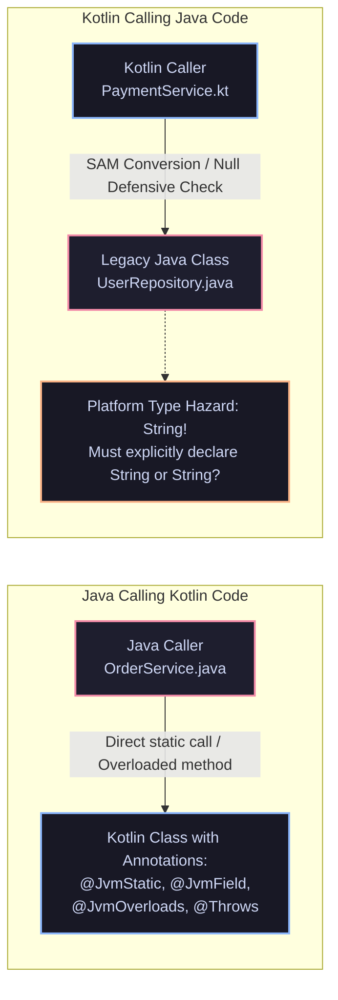
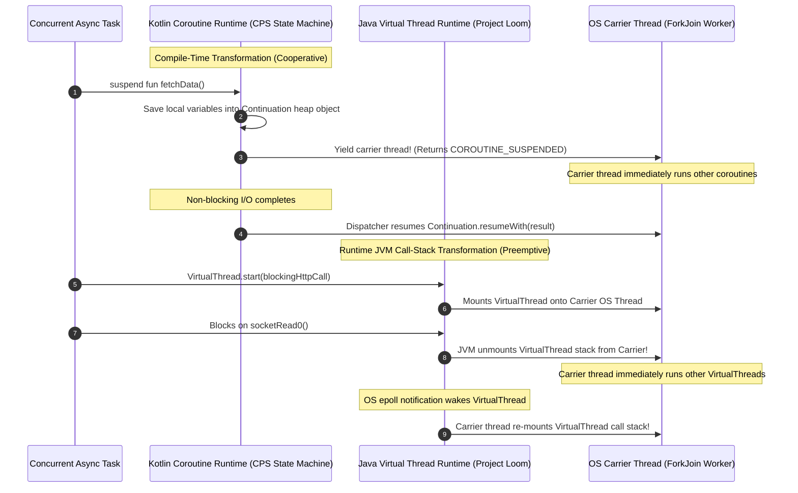
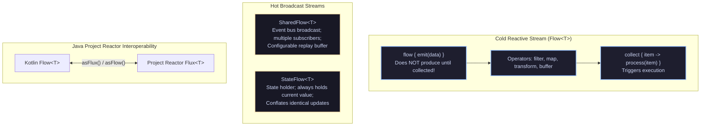
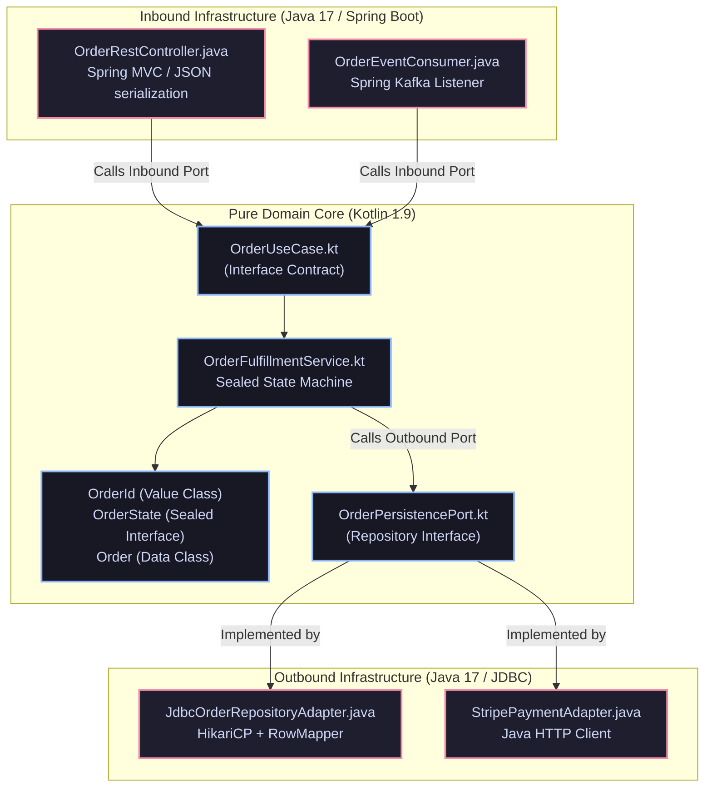

[🏠 Back to Home](../../README.md) | [☕ Core Java Internals](java_interview_master_guide.md) | [⚡ Modern Java & Loom](java_modern_features_loom_concurrency.md) | [🍃 Spring Boot & Cloud](../02_spring_framework/spring_core_ioc_boot.md)

# Master Technical Guide: Kotlin for Java Architects & Enterprise Interoperability

> **Document Identity:** [`interview_prep/01_java_core/kotlin_for_java_architects.md`](file:///d:/project/github/1/CheatSheet_Tutorial/interview_prep/01_java_core/kotlin_for_java_architects.md)  
> **Topic Domain:** Bidirectional Java-Kotlin Interoperability, Bytecode Desugaring (`@JvmStatic`, `@JvmField`, `@JvmOverloads`, `@Throws`, `@JvmName`), Null-Safety Type System & Platform Types (`T!`), Kotlin Coroutines (Continuation Passing Style - CPS State Machine) vs Project Loom Virtual Threads, Sealed Class Hierarchies vs Java 17+ Sealed Interfaces, Inline Value Classes (`@JvmInline`), Data Classes vs Java Records, and Spring Boot 3 / Jackson Kotlin Metaprogramming (`J14`)  
> **Target Framework / Runtime:** Kotlin 1.9 / 2.0+, OpenJDK HotSpot JVM 17 LTS / 21 LTS / 25 LTS, Spring Boot 3.3+  
> **Architecture Level:** Principal / Staff+ Enterprise Architect, JVM Interoperability Specialist & Language Platform Lead  
> **Target Depth:** 50 Senior Technical Scenarios, 10 Production Interop Outage Post-Mortems, Kotlin Bytecode Disassemblies (`javap -v`), and Migration Runbooks  

---

## 1. Foundational Primer: What, Why & Where? (The "Head")

*Before diving into Kotlin Continuation-Passing Style CPS bytecode transforms, @JvmStatic invokedynamic bridge synthesis, Platform Type String! runtime null dereference traps, and Coroutine Dispatchers vs Loom Carrier Thread scheduling, here is the essential high-level context: what Kotlin represents to Java architects, why bidirectional interoperability is paramount, and where hybrid JVM ecosystems anchor enterprise platforms.*

### 1.1 What Is It? (Core Definition & Mental Model)
* **Plain-English Definition**: **Kotlin for Java Architects** is the architectural and mechanical discipline of designing, compiling, and running Kotlin code seamlessly alongside existing enterprise Java codebases on the Java Virtual Machine. Developed by JetBrains, Kotlin is a statically typed language that compiles directly to standard Java bytecode (`.class` files). It provides first-class null safety, concise syntax (data classes, extension functions), and cooperative concurrency (coroutines), while maintaining **100% two-way interoperability** with Java libraries, frameworks, and reflection engines.
* **Everyday Analogy**: Imagine an international diplomatic embassy and summit between two allied nations:
  - **The "Total Rewrite" Catastrophe (Forcing One Nation to Abandon its Native Language)**: A company decides to rewrite a 10-million-line Java financial core into another language from scratch. It takes 4 years, costs $50 million, halts all feature development, and introduces thousands of regressions (**The "Second System Effect" disaster**).
  - **Kotlin & Java Interoperability (The Expert Bi-Directional Diplomatic Protocol)**:
    - The Prime Minister speaks English (**Java**) and the President speaks French (**Kotlin**).
    - Instead of forcing everyone into language school, a team of high-speed simultaneous interpreters sits between them (**Kotlin Compiler JVM Annotations: `@JvmStatic`, `@JvmField`, `@JvmOverloads`**).
    - When the French diplomat uses an idiom (**Extension Functions**), the interpreter translates it into standard diplomatic terms (**`public static void method(Receiver r)`**).
    - Both sides execute their work with zero friction, sharing the exact same legal system, security protocol, and meeting hall (**The HotSpot JVM Runtime & Metaspace**).
* **Architectural Tier Placement**: Operates across the **Enterprise Application Logic, API Contract & Asynchronous Concurrency Tier**. Coexists inside the same JARs and WARs as Java classes, seamlessly powering Spring Boot microservices, Android mobile clients, and distributed data processing pipelines.

### 1.2 Why Does It Exist? (The Pain Point Before It Existed)
* **The "Java Verbosity vs The Interop Vacuum" Dilemma**: In the pre-Java 17 era, Java required hundreds of lines of boilerplate for simple data containers, lacked compile-time null safety, and forced verbose callback patterns. Alternative JVM languages like Scala offered expressive syntax but suffered from massive runtime dependencies, slow compilation, and brittle Java interoperability.
* **The Concrete Headaches in Enterprise Production**:
  - 💥 **Headache 1: The Billion-Dollar NullPointerException Disaster**: In pure Java, any object reference can be `null`. Without strict static checking, defensive `if (x != null)` checks clutter code, and missed checks cause production `NullPointerExceptions` that bring down customer checkouts.
  - 💥 **Headache 2: The "Platform Type (`T!`)" Silent Landmine**: When Kotlin code calls unannotated legacy Java libraries, the types become "Platform Types" (`String!`). Kotlin disables compile-time null checks for these types; if the Java method unexpectedly returns `null`, the Kotlin application throws an unexpected runtime NPE in production.
  - 💥 **Headache 3: The Framework Reflection Breakage Without `@JvmStatic`**: Kotlin companion object methods reside in a nested singleton instance (`MyClass.Companion.create()`). When Spring, Jackson, or JUnit tests attempt to invoke `MyClass.create()` via Java reflection, they crash with `NoSuchMethodException` unless annotated with `@JvmStatic`.
* **The Turning Point**: Kotlin designed its type system and compiler from day one to compile into clean, standard JVM bytecode with dedicated interop annotations, enabling organizations to migrate enterprise systems file-by-file without stopping production.

### 1.3 How Does It Solve Real-World Enterprise Problems?
* **Problem 1 (Compile-Time Null Safety) ➔ Solution 1**: Kotlin differentiates between nullable (`String?`) and non-nullable (`String`) types at the type system level. The compiler refuses to compile unsafe dereferences without safe calls (`?.`) or Elvis operators (`?:`), preventing 90%+ of production NPEs.
* **Problem 2 (Seamless JavaBeans Reflection) ➔ Solution 2**: Interoperability annotations (`@JvmStatic`, `@JvmField`, `@JvmOverloads`) instruct the Kotlin compiler to emit authentic Java static methods, public fields, and overloaded signatures, guaranteeing 100% compatibility with Spring, Hibernate, and Jackson.
* **Problem 3 (Cooperative Lightweight Concurrency) ➔ Solution 3**: **Kotlin Coroutines** compile suspending functions into Continuation Passing Style (CPS) state machines, allocating under 1KB per continuation and executing millions of asynchronous tasks across small thread pools without callback hell.
* **Quantifiable Enterprise Metrics**:
  - **40% Reduction in Lines of Code**: Data classes, properties, and extension functions eliminate boilerplate getters, setters, equals, and builders.
  - **90% Drop in Production NullPointerExceptions**: Compile-time null-safety guarantees catch missing values during IDE editing.
  - **Zero-Overhead Primitive Wrappers**: `@JvmInline value class` provides domain-driven strong typing without object allocation overhead.

### 1.4 How Does This Help in Building Real Applications?
* **Application Architecture Placement**: Direct enabler for hybrid microservices, modular monoliths, Kotlin-first Spring Boot 3 applications, and enterprise domain modeling.
* **Developer Workflow & SRE Synergy**: SREs monitor identical JVM metrics (JMX, GC pauses, thread counts) because Kotlin compiles to standard bytecode. Developers write expressive domain logic with rapid feedback loops.
* **Scalability & Evolutionary Runway**: Enables legacy Java architectures to modernize gradually, pairing Kotlin's expressive coroutines and DSLs with Java's rock-solid enterprise libraries.

### 1.5 Quick Decision & Trade-Off Matrix

| Paradigm Feature | Java 21 LTS | Kotlin 2.0+ | Scala 3 | Best Enterprise Fit |
| :--- | :--- | :--- | :--- | :--- |
| **Data Modeling** | `record` (Immutable, shallow components) | `data class` (Rich copy, componentN, destructuring) | `case class` (Pattern matching, full functional) | Kotlin/Java 21 for microservices |
| **Null Safety** | Optional annotations (`@NonNull`) / `Optional<T>` | 🟢 Native type system (`T` vs `T?`) | Type system (`Option[T]`) | Kotlin for null-safe domain logic |
| **Concurrency** | 🟢 Virtual Threads (Loom - Preemptive $M:N$) | Coroutines (Cooperative CPS state machine) | Future / Akka Actors / ZIO | Loom for blocking I/O; Coroutines for UI/reactive |
| **Java Interoperability** | Native | 🟢 100% Seamless with bytecode annotations | Complex Scala-Java conversions | Kotlin for hybrid enterprise migration |

---

## 2. Track 0: Architectural Foundations & Kotlin/Java Jargon Demystification

| Technical Term | Low-Level Architectural Definition | JVM Memory / CPU Instruction Consequence | Production Catastrophe If Misunderstood |
|---|---|---|---|
| **Platform Type (`T!`)** | A type originating from unannotated Java code whose nullability is unknown to the Kotlin compiler; can be treated as nullable (`T?`) or non-null (`T`). | Does not emit compile-time null checks; defers checks to runtime bytecode instructions or dereferences. | **Silent NPE Explosion**: Dereferencing a `null` Java value treated as non-null crashes at runtime with `NullPointerException` deep in business logic. |
| **`@JvmStatic`** | Instructs the Kotlin compiler to generate an authentic static method in the enclosing class in addition to the method in the `Companion` or `object` singleton. | Emits an `invokestatic` entry point in the class bytecode; eliminates navigation through `Companion.INSTANCE.method()`. | Without `@JvmStatic`, Java frameworks relying on static factory methods or JUnit `@MethodSource` fail via reflection with `NoSuchMethodException`. |
| **`@JvmField`** | Instructs the Kotlin compiler to expose a property as a raw public field without generating getter/setter accessors. | Replaces `invokevirtual getX()` bytecode calls with direct `getfield` and `putfield` instructions; eliminates method call overhead. | Breaks Java encapsulation if applied to mutable state; incompatible with frameworks expecting JavaBeans getter/setter naming conventions. |
| **`@JvmOverloads`** | Instructs the compiler to generate overloaded Java methods/constructors substituting default parameter values. | Synthesizes $N$ overloaded Java methods that internally delegate to the full method with default values. | Calling a Kotlin method with default arguments from Java without `@JvmOverloads` requires explicitly passing all default values in Java code. |
| **`@Throws`** | Declares checked exceptions on a Kotlin function signature for Java caller compatibility. | Adds the `Exceptions` attribute to the method definition in class bytecode; satisfies Java compiler's `throws` check. | Java code calling a Kotlin function that throws `IOException` cannot catch it in a `try-catch (IOException e)` block without compilation error unless `@Throws` is present. |
| **`@JvmName`** | Alters the generated JVM bytecode name of a function, property getter/setter, or file facade class. | Modifies the name string in the Constant Pool; resolves JVM bytecode signature clashes caused by generic type erasure. | Two Kotlin functions with identical erased signatures (e.g., `List<String>` and `List<Int>`) fail to compile with platform declaration clash without `@JvmName`. |
| **`@JvmSuppressWildcards`** | Suppresses the default generation of wildcard variance (`? extends` / `? super`) in generic Java method signatures. | Emits invariant generic types (`List<String>` instead of `List<? extends String>`) in the method signature attribute. | Binds rigidly to Java APIs expecting invariant generic types; prevents compilation errors when integrating with Retrofit or Spring Data. |
| **Reified Type (`reified T`)** | Allows accessing the concrete `Class<T>` of a generic type parameter at runtime inside an `inline` function. | The Kotlin compiler inlines the function body at the call site and substitutes `T` with the exact `ldc` bytecode class literal (e.g., `ldc String.class`). | Cannot be invoked from Java code; reified inline functions exist only at compile-time and have no standalone bytecode representation. |
| **Inline Function (`inline`)** | A function whose bytecode and lambda parameters are copied directly into the call site by the compiler. | Eliminates the allocation of `Function` lambda objects; permits non-local returns; expands calling method bytecode size. | Inlining large functions inside hundreds of call sites causes severe bytecode bloat, defeating the HotSpot C2 compiler's inlining budget. |
| **Inline Value Class (`@JvmInline`)** | A wrapper class around a single property that is erased to the underlying primitive or reference type in bytecode. | Zero heap allocation; operates as the raw underlying type; boxes only when cast to an interface or generic type. | Breaking equality checks: calling `.equals()` when boxed might invoke reference comparison if reflection or un-inlined bridges interfere. |
| **Data Class (`data class`)** | A class generating `equals()`, `hashCode()`, `toString()`, `copy()`, and `componentN()` functions automatically based on primary constructor properties. | Synthesizes structural equality bytecode and destructuring accessor methods in the class definition. | **Subclassing Impossibility**: Data classes are final by default and cannot be declared `open` or `abstract`, preventing class inheritance. |
| **Sealed Hierarchy (`sealed`)** | A closed class or interface hierarchy where all direct subclasses are known at compile time. | Compiled to an abstract class with a private constructor and a permitted subclasses list, or permits attribute in Java 17+. | Permits exhaustive `when` expressions without an `else` branch; adding a new subclass forces compile-time handling across all `when` statements. |
| **Smart Cast** | Automatic type casting performed by the compiler after verifying a type check (`is`) or null check (`!= null`). | Emits `checkcast` bytecode instruction once, cached in local stack slots; eliminates redundant manual casting. | Fails to smart-cast `var` properties or properties with custom getters because another thread or getter execution could mutate the state. |
| **Extension Function** | A function extending a class with new capabilities without modifying the source code or subclassing. | Synthesized as a **static method** taking the receiver instance as its first argument: `public static void method(Receiver $this, args)`. | Cannot access private or protected members of the receiver; cannot polymorphically override virtual member methods. |
| **Property Delegation (`by`)** | Delegating the getter and setter logic of a property to an external delegate instance (`ReadOnlyProperty` / `ReadWriteProperty`). | Synthesizes an internal delegate field and delegates `getX()` calls to `delegate.getValue(this, propRef)`. | Custom delegates with synchronized blocks can introduce thread contention or hidden memory overhead if delegates are created per-instance. |
| **`lazy` Delegate** | A property delegate that calculates its value once upon first access and caches it for all subsequent reads. | Implemented via `SynchronizedLazyImpl` (default `LazyThreadSafetyMode.SYNCHRONIZED`); uses internal monitor locking. | Using `LazyThreadSafetyMode.NONE` in multi-threaded environments causes race conditions and duplicate initialization. |
| **Continuation (CPS)** | A callback interface (`Continuation<T>`) representing the remaining execution of a suspended coroutine. | Carries a state machine label (`int label`), local variables, and a `CoroutineContext`; resumed via `resumeWith(result)`. | Suspending inside a thread that holds an OS monitor lock (`synchronized`) pins the carrier thread, neutralizing non-blocking benefits. |
| **Continuation Passing Style (CPS)** | Compiler transformation rewriting `suspend fun foo(): String` into `public Object foo(Continuation<? super String> $completion)`. | Returns the result object OR a special marker `COROUTINE_SUSPENDED` if the execution must yield control back to the thread. | Calling a suspending function from Java requires passing an explicit `Continuation` instance, which is awkward without bridges. |
| **Coroutine Suspension** | Pausing the execution of a coroutine without blocking the underlying OS carrier thread. | Saves the current stack frame variables into the `Continuation` heap object and returns control to the Dispatcher. | Assuming coroutines are preemptive: a CPU-bound `while(true)` loop without `yield()` starves other coroutines on that thread. |
| **Virtual Thread (Project Loom)** | A lightweight thread managed by the JVM runtime that unmounts from its carrier OS thread when performing blocking I/O. | Preserves the synchronous, blocking programming model; allocates a small call frame on the heap; carrier pool uses `ForkJoinPool`. | Carrier thread pinning occurs if blocking I/O is performed inside a `synchronized` block or native JNI call. |
| **Coroutines vs Loom** | Coroutines use cooperative, compile-time CPS state machines; Loom uses preemptive, runtime-managed call-stack swapping. | Coroutines allocate $<1\text{ KB}$ per continuation; Loom Virtual Threads allocate $\sim 1\text{–}2\text{ KB}$ per virtual thread stack. | Mixing Coroutines and Virtual Threads without clear boundaries creates confusing thread context boundaries and diagnostic chaos. |
| **Companion Object** | A singleton object tied to a class, providing a home for factory methods and constants. | Compiled to a static nested class (`MyClass$Companion`) with an instance held in a static field `MyClass.Companion`. | Accessing companion object members from Java without `@JvmStatic` requires verbose syntax: `MyClass.Companion.myMethod()`. |
| **Top-Level Function** | A function declared outside of any class at the root of a Kotlin file. | Compiled into a synthetic Java class named `<FileName>Kt` as public static methods. | Java callers must import `FileNameKt.methodName()`; forgetting this leads to compilation errors when looking for a non-existent class. |
| **`Nothing` Type** | The bottom type in Kotlin's type system; represents a value that never exists (e.g., a function that always throws or loops forever). | In Java bytecode, mapped to `void` or `java.lang.Void`; cannot be instantiated. | Useful for marking unreachable code branches and typing `throw` expressions; confusing when inspected from Java reflection. |
| **`Unit` Type** | Represents a function returning no meaningful value, equivalent to `void` in Java, but implemented as an actual singleton object. | Compiled to Java `void` in bytecode method return types, but passes `Unit.INSTANCE` when used as a generic type argument. | Returning `Unit` from a lambda called by Java requires explicitly returning `Unit.INSTANCE` in Java code. |
| **Backing Field (`field`)** | The actual memory slot generated by the compiler to hold the state of a property when accessors are defined. | Compiled to a private field in the class bytecode; accessible only inside custom `get()` and `set()` accessors. | Referencing the property name inside its own getter (`get() = myProp`) causes infinite recursion and `StackOverflowError`. |
| **Tailrec Optimization** | A compiler optimization that transforms a tail-recursive function into a standard iterative `while` loop. | Eliminates method call frames in bytecode; prevents `StackOverflowError` on deep recursion without manual loop writing. | If the recursive call is not the absolute last expression (e.g., `1 + recurse()`), `tailrec` is ignored and a compiler warning is emitted. |
| **`lateinit var`** | Allows non-null properties to be initialized after object construction (e.g., in `@PostConstruct` or `@BeforeEach`). | Disables null checks at construction; compiles to a standard non-null field with an uninitialized check on read. | Accessing the property before assignment throws `UninitializedPropertyAccessException`; cannot be used on primitive types. |
| **Elvis Operator (`?:`)** | A binary operator returning the left-hand operand if non-null, or the right-hand operand if null. | Compiled to a temporary local variable assignment, a `null` comparison branch, and a conditional jump. | Overusing deep Elvis chains obscuring error handling makes debugging root-cause null origins difficult. |
| **Destructuring Declaration** | Syntax allowing unpacking of an object into multiple variables: `val (id, name) = customer`. | Compiled to sequential calls to `component1()`, `component2()`, etc. synthesized on data classes. | Swapping the order of properties in the data class primary constructor silently swaps the assigned variables in destructuring! |
| **`crossinline`** | Prevents a lambda passed to an inline function from using non-local returns when executed inside a nested context. | Ensures the lambda cannot execute `return` to exit the outer enclosing function; enables execution in other threads. | Attempting to execute `return` inside a `crossinline` lambda fails compilation. |
| **`noinline`** | Disables inlining for a specific lambda parameter in an otherwise `inline` function. | The compiler treats the parameter as a standard `FunctionN` object instance; can be passed around or stored in fields. | Incurrs object allocation overhead for that specific lambda parameter. |

---

## Track 1: Junior & Entry-Level Foundations & Mental Models

### 1.1 The Physical Mental Model: The Ergonomic High-Speed Train on Existing Standard Rail Tracks

Imagine the Java Virtual Machine as an expansive continental railway system. The steel tracks, signaling systems, switches, and electrical grid represent the **JVM bytecode, memory layout, and HotSpot JIT runtime**.

```
[The Continental JVM Railway Infrastructure]
══════════════════════════════════════════════════════════════════════════════════════════════
  [Java Locomotive]              [Kotlin Bullet Train]          [Unified Track / Bytecode]
  • Manual mechanical controls   • Fly-by-wire controls         • Both run on the EXACT same
  • Verbose, heavy, reliable     • Ergonomic, streamlined        4-foot-8-inch steel rails.
  • Requires full crew for DTOs  • 100% compatible coupler      • Seamless carriage coupling!
══════════════════════════════════════════════════════════════════════════════════════════════
```

* **Java** is the venerable, robust locomotive: dependable and battle-tested, but requiring extensive manual mechanical levers (verbose boilerplate, explicit getters/setters, defensive null checks).
* **Kotlin** is the sleek, modern bullet train engineered to run on the **exact same physical tracks**. It provides fly-by-wire automation (compile-time null safety, data classes, extension functions, coroutines), but whenever a passenger or cargo car transitions between trains, they couple together seamlessly via standard mechanical couplers (JVM bytecode interoperability).

### 1.2 The Fundamental Architectural Problem: The Billion-Dollar Mistake & Java Verbosity

Sir Tony Hoare famously called the invention of the `null` reference his "billion-dollar mistake". In standard Java:

1. **Every Reference Can Be Null**: Unless rigorously annotated with `@NotNull` (which standard compilers do not enforce by default), every method parameter and return value is a potential `NullPointerException` (NPE) minefield.
2. **Boilerplate Smothering Domain Logic**: A simple enterprise Domain Transfer Object (DTO) with 5 fields in Java requires over 100 lines of code (`getters`, `setters`, `equals`, `hashCode`, `toString`, constructors, copy methods).
3. **Fragile Subclassing for Extensibility**: Adding helper functions to external classes (like `String` or `List`) forces developers to create static utility classes (`StringUtils`, `Collections`), separating data from operations.

### 1.3 Step 1-to-N Code Progression: From 120-Line Java POJO to 1-Line Kotlin Data Class

Below is the concrete side-by-side progression demonstrating how Kotlin collapses Java verbosity while maintaining 100% binary bytecode compatibility.

#### Step 1: Classical Enterprise Java POJO (120 Lines)

```java
package com.enterprise.domain.java;

import java.math.BigDecimal;
import java.util.Objects;

public final class CustomerOrder {
    private final String orderId;
    private final String customerEmail;
    private final BigDecimal totalAmount;
    private final boolean isInternational;

    public CustomerOrder(String orderId, String customerEmail, BigDecimal totalAmount, boolean isInternational) {
        this.orderId = Objects.requireNonNull(orderId, "orderId cannot be null");
        this.customerEmail = Objects.requireNonNull(customerEmail, "customerEmail cannot be null");
        this.totalAmount = Objects.requireNonNull(totalAmount, "totalAmount cannot be null");
        this.isInternational = isInternational;
    }

    public String getOrderId() { return orderId; }
    public String getCustomerEmail() { return customerEmail; }
    public BigDecimal getTotalAmount() { return totalAmount; }
    public boolean isInternational() { return isInternational; }

    @Override
    public boolean equals(Object o) {
        if (this == o) return true;
        if (o == null || getClass() != o.getClass()) return false;
        CustomerOrder that = (CustomerOrder) o;
        return isInternational == that.isInternational &&
               Objects.equals(orderId, that.orderId) &&
               Objects.equals(customerEmail, that.customerEmail) &&
               Objects.equals(totalAmount, that.totalAmount);
    }

    @Override
    public int hashCode() {
        return Objects.hash(orderId, customerEmail, totalAmount, isInternational);
    }

    @Override
    public String toString() {
        return "CustomerOrder{" +
               "orderId='" + orderId + '\'' +
               ", customerEmail='" + customerEmail + '\'' +
               ", totalAmount=" + totalAmount +
               ", isInternational=" + isInternational +
               '}';
    }

    // Manual copy method for immutable updates
    public CustomerOrder copyWithAmount(BigDecimal newAmount) {
        return new CustomerOrder(this.orderId, this.customerEmail, newAmount, this.isInternational);
    }
}
```

#### Step 2: Modern Kotlin Data Class (1 Line)

```kotlin
package com.enterprise.domain.kotlin

import java.math.BigDecimal

data class CustomerOrder(
    val orderId: String,
    val customerEmail: String,
    val totalAmount: BigDecimal,
    val isInternational: Boolean = false
)
```

The Kotlin compiler automatically synthesizes:
* Canonical primary constructor with null assertions (`Intrinsics.checkNotNullParameter`).
* Final private backing fields.
* Public getter accessors (`getOrderId()`, `getCustomerEmail()`, `getTotalAmount()`, `isInternational()`).
* Comprehensive `equals()` and `hashCode()` based on all primary constructor properties.
* Descriptive `toString()`.
* Type-safe immutable `copy()` method with default arguments.
* Destructuring component accessors (`component1()`, `component2()`, `component3()`, `component4()`).

#### Step 3: Null Safety in Action (`String?` vs `String`)

```kotlin
// Compile-time guaranteed non-null: CANNOT be assigned null!
val nonNullEmail: String = "architect@enterprise.com"
// nonNullEmail = null // ❌ Compilation Error: Null can not be a value of a non-null type String

// Explicitly nullable type: MUST be handled defensively before use
var nullableEmail: String? = null

// 1. Safe-call operator (?.)
val length: Int? = nullableEmail?.length // Returns null if nullableEmail is null

// 2. Elvis operator (?:) for default fallback
val safeLength: Int = nullableEmail?.length ?: 0

// 3. Smart Cast after null check
if (nullableEmail != null) {
    // Compiler automatically casts nullableEmail to non-null String inside this block!
    println("Domain: " + nullableEmail.substringAfter("@"))
}
```

#### Step 4: Extension Functions

```kotlin
// Extends the standard java.lang.String class with domain behavior
fun String.maskCreditCard(): String {
    if (this.length < 4) return this
    val lastFour = this.takeLast(4)
    return "*".repeat(this.length - 4) + lastFour
}

val masked = "4111222233334444".maskCreditCard() // "************4444"
```

#### Step 5: Sealed Class Hierarchies & Exhaustive Pattern Matching

```kotlin
sealed interface PaymentResult {
    data class Success(val transactionId: String, val amount: java.math.BigDecimal) : PaymentResult
    data class Declined(val errorCode: String, val reason: String) : PaymentResult
    data class GatewayError(val exception: Throwable) : PaymentResult
}

// Exhaustive compiler check: NO 'else' branch required!
// Adding a new subclass to PaymentResult immediately triggers compilation errors here until handled!
fun handlePayment(result: PaymentResult): String = when (result) {
    is PaymentResult.Success -> "Paid: ${result.transactionId}"
    is PaymentResult.Declined -> "Declined: ${result.reason} (${result.errorCode})"
    is PaymentResult.GatewayError -> "Retry after error: ${result.exception.message}"
}
```

---

## Track 2: Core Engineering Architecture & Enterprise Design

### 2.1 Bi-Directional Interoperability Engineering

When migrating an enterprise codebase from Java to Kotlin, pure rewrites are impossible. Java services will call Kotlin components, and Kotlin services will consume existing Java frameworks.



#### Complete Kotlin Service Engineered for Java Consumption

Below is a production-grade Kotlin payment service utilizing every key interop annotation:

```kotlin
@file:JvmName("PaymentUtils") // Changes the generated Java facade class name from PaymentServiceKt to PaymentUtils
package com.enterprise.interop

import java.io.IOException
import java.math.BigDecimal

class PaymentProcessor private constructor(
    @JvmField val processorId: String // Exposed as a public field in Java bytecode
) {

    // Overloads generated for Java:
    // 1. processPayment(accountId, amount) -> uses default currency "USD" and sendReceipt true
    // 2. processPayment(accountId, amount, currency) -> uses default sendReceipt true
    // 3. processPayment(accountId, amount, currency, sendReceipt) -> full method
    @JvmOverloads
    @Throws(IOException::class, IllegalArgumentException::class) // Informs Java compiler of checked exceptions!
    fun processPayment(
        accountId: String,
        amount: BigDecimal,
        currency: String = "USD",
        sendReceipt: Boolean = true
    ): String {
        if (amount <= BigDecimal.ZERO) {
            throw IllegalArgumentException("Amount must be positive")
        }
        if (accountId.startsWith("BLOCKED")) {
            throw IOException("Network connection to payment gateway timed out")
        }
        return "TXN-${System.currentTimeMillis()}-$currency-$amount"
    }

    companion object {
        // True static method in PaymentProcessor.class bytecode!
        @JvmStatic
        fun createDefaultProcessor(): PaymentProcessor {
            return PaymentProcessor("PROC-PRIMARY-US-EAST")
        }

        // True static field in PaymentProcessor.class bytecode!
        @JvmField
        val MAX_SINGLE_TRANSACTION_LIMIT: BigDecimal = BigDecimal("50000.00")
    }
}
```

#### Consuming the Kotlin Service from Pure Java 17

```java
package com.enterprise.interop;

import java.io.IOException;
import java.math.BigDecimal;

public class JavaClientApplication {
    public static void main(String[] args) {
        // 1. Invoking @JvmStatic companion factory: Direct static method call!
        PaymentProcessor processor = PaymentProcessor.createDefaultProcessor();

        // 2. Accessing @JvmField static constant: Direct field access!
        BigDecimal limit = PaymentProcessor.MAX_SINGLE_TRANSACTION_LIMIT;
        System.out.println("Processor Limit: " + limit);

        // 3. Accessing @JvmField instance property: Direct field read!
        System.out.println("Processor ID: " + processor.processorId);

        // 4. Invoking @JvmOverloads method: Calling 2-arg overload generated by Kotlin!
        try {
            String receipt = processor.processPayment("ACT-8841", new BigDecimal("150.00"));
            System.out.println("Receipt: " + receipt);
        } catch (IOException e) { // ✅ Catches IOException because @Throws was declared!
            System.err.println("Gateway error: " + e.getMessage());
        } catch (IllegalArgumentException e) {
            System.err.println("Validation error: " + e.getMessage());
        }

        // 5. Calling top-level extension functions renamed via @file:JvmName("PaymentUtils"):
        // Compiled as static methods on PaymentUtils.class!
        // PaymentUtils.someTopLevelFunction();
    }
}
```

### 2.2 Kotlin Coroutines vs Java Virtual Threads (Project Loom)

The debate between **Kotlin Coroutines** and **Java Virtual Threads** is central to modern JVM systems architecture. They solve the same high-concurrency problem using fundamentally different layers of the technology stack:



#### Architectural Comparison Matrix: Coroutines vs Virtual Threads

| Architectural Dimension | Kotlin Coroutines | Java Virtual Threads (Project Loom) |
|---|---|---|
| **Underlying Mechanism** | **Compile-Time CPS State Machine**: Compiles `suspend` functions into class state machines with continuations. | **Runtime Call-Stack Unmounting**: The JVM runtime swaps call stacks off carrier threads during blocking operations. |
| **Code Style** | Requires explicit `suspend` keyword on every function in the call hierarchy (colored function paradigm). | Standard synchronous blocking code (`Thread.sleep()`, blocking JDBC); zero new keywords or colored functions. |
| **Concurrency Paradigm** | **Structured Concurrency**: Explicit scopes (`CoroutineScope`, `supervisorScope`), cancellation hierarchies, structured job trees. | Thread-per-task model (`Executors.newVirtualThreadPerTaskExecutor()`); structured concurrency via preview API (`StructuredTaskScope`). |
| **Reactive Streaming** | Native `Flow` and `StateFlow` abstractions with cold/hot streams, backpressure, and operators. | Must rely on external reactive libraries (Project Reactor) or manual blocking queues. |
| **Memory Allocation** | Extremely lightweight: $\sim 200\text{ bytes to }1\text{ KB}$ per Continuation state machine object. | Lightweight: $\sim 1\text{ to }2\text{ KB}$ per Virtual Thread stack representation. |
| **Thread Pinning Hazard** | Occurs if calling blocking native/OS methods or holding `synchronized` locks during suspension. | Occurs when blocking inside a `synchronized` block (mitigated in Java 24+) or native JNI call frame. |
| **Interoperability with Legacy Java** | Requires bridge adapters (`future { ... }`, `await()`, `asDeferred()`) to integrate with Java APIs. | **100% Transparent Drop-In**: Seamlessly replaces `Executors.newFixedThreadPool()` without changing a line of legacy code. |
| **Best Production Use Case** | Complex client-side apps (Android), reactive event streaming, multi-step orchestration with fine-grained cancellation. | Enterprise backend microservices, high-throughput REST APIs, migrating massive legacy blocking JDBC architectures. |

#### Production Bridge: Calling Coroutines from Java via `CompletableFuture`

To expose a Kotlin coroutine to legacy Java services cleanly, bridge the suspending function to a standard `CompletableFuture`:

```kotlin
package com.enterprise.coroutine.bridge

import kotlinx.coroutines.*
import kotlinx.coroutines.future.future
import java.util.concurrent.CompletableFuture

class UserReportService(
    private val scope: CoroutineScope = CoroutineScope(Dispatchers.IO + SupervisorJob())
) {

    // Native Kotlin suspending function
    suspend fun generateReport(userId: String): String {
        delay(100) // Simulates non-blocking async computation
        return "REPORT-DATA-FOR-$userId"
    }

    // Explicit Java interop bridge returning CompletableFuture!
    fun generateReportAsync(userId: String): CompletableFuture<String> {
        return scope.future {
            generateReport(userId)
        }
    }
}
```

In Java:
```java
UserReportService service = new UserReportService();
CompletableFuture<String> future = service.generateReportAsync("USER-1001");
future.thenAccept(report -> System.out.println("Received: " + report));
```

### 2.3 Sealed Classes vs Java 17+ Sealed Interfaces

Both Kotlin and Java provide algebraic data types (sum types) through sealed hierarchies, but their bytecode mechanisms differ significantly:

```kotlin
// Kotlin Sealed Hierarchy
sealed class AccountStatus {
    object Active : AccountStatus()
    data class Suspended(val reason: String) : AccountStatus()
    data class Closed(val effectiveDate: Long) : AccountStatus()
}
```

```java
// Java 17+ Sealed Interface Equivalent
public sealed interface JavaAccountStatus 
    permits JavaAccountStatus.Active, JavaAccountStatus.Suspended, JavaAccountStatus.Closed {
    
    record Active() implements JavaAccountStatus {}
    record Suspended(String reason) implements JavaAccountStatus {}
    record Closed(long effectiveDate) implements JavaAccountStatus {}
}
```

#### Bytecode & Engine Contrast:

1. **Permits Clause**: In Java 17+, the compiler emits a `PermittedSubclasses` attribute in the class file metadata. The JVM runtime enforces that no other class can extend the sealed type, even via dynamic bytecode generation.
2. **Kotlin Bytecode Desugaring**: In Kotlin target bytecode $<17$, sealed classes are compiled as abstract classes with a **private constructor** and a package-private constructor accepting a synthetic default constructor marker (`DefaultConstructorMarker`). Subclasses are compiled as nested classes with access to the private constructor, preventing external inheritance at compile time. In modern Kotlin targeting JVM 17+, Kotlin directly emits the Java 17 `PermittedSubclasses` attribute!

### 2.4 Extension Functions Bytecode Desugaring

When you declare an extension function in Kotlin:

```kotlin
package com.enterprise.utils

fun String.toSnakeCase(): String {
    return this.replace(Regex("([a-z])([A-Z])"), "$1_$2").lowercase()
}
```

The Kotlin compiler generates the following synthetic Java class in `StringUtilsKt.class`:

```java
package com.enterprise.utils;

import kotlin.jvm.internal.Intrinsics;
import kotlin.text.Regex;
import org.jetbrains.annotations.NotNull;

public final class StringUtilsKt {
    @NotNull
    public static final String toSnakeCase(@NotNull String $this$toSnakeCase) {
        Intrinsics.checkNotNullParameter($this$toSnakeCase, "$this$toSnakeCase");
        return new Regex("([a-z])([A-Z])").replace($this$toSnakeCase, "$1_$2").toLowerCase();
    }
}
```

#### Architectural Realities:
* **Static Dispatch**: Extension functions are resolved **statically at compile time** based on the declared type of the reference, NOT dynamically at runtime based on the actual object type!
* **Zero Overhead**: Inlined extension functions have exactly 0 method call overhead; non-inlined extensions execute as standard static method invocations (`invokestatic`).
* **Member Shadowing**: If a class defines a member method with the exact same name and compatible signature as an extension function, **the member method always wins**; the extension function is completely ignored.

### 2.5 Data Classes vs Java Records

| Feature | Kotlin `data class` | Java 17+ `record` |
|---|---|---|
| **Immutability** | Can declare mutable properties (`var`) or immutable (`val`). | **Strictly Immutable**: All record components are implicitly `final`. |
| **Memory Representation** | Standard JVM class with private fields and getters. | Compact record layout; extends `java.lang.Record`. |
| **Copy Semantics** | Synthesizes a deep/shallow `copy()` method with default parameter substitution. | No built-in `copy()` method (requires custom builder or `withX()` methods). |
| **Inheritance** | Can extend open classes and implement interfaces (cannot be abstract/open itself). | Cannot extend any class (already extends `Record`); can implement interfaces. |
| **Destructuring** | Synthesizes `component1()`, `component2()`, ..., `componentN()` functions. | Supported via Record Pattern Matching (`if (obj instanceof Order(var id, var amt))`). |
| **Framework Support** | Requires `jackson-module-kotlin` for zero-arg or parameter-name reflection. | Natively supported across Jackson, Hibernate 6, and standard Java reflection. |

---

### 2.6 Reactive Asynchronous Architecture: Kotlin Flow, StateFlow, SharedFlow & Project Reactor Interoperability

While Coroutines manage one-shot asynchronous tasks, **Kotlin Flow** provides cold, reactive streaming with backpressure. For enterprise systems migrating from Spring WebFlux (Project Reactor `Flux<T>` and `Mono<T>`), seamless interop across the Java/Kotlin boundary is vital.



#### Production-Grade Flow & Reactor Interop Implementation

```kotlin
package com.enterprise.reactive.interop

import kotlinx.coroutines.*
import kotlinx.coroutines.flow.*
import kotlinx.coroutines.reactive.asFlow
import kotlinx.coroutines.reactive.asPublisher
import org.reactivestreams.Publisher
import reactor.core.publisher.Flux
import java.math.BigDecimal
import java.time.Duration
import java.time.Instant

public data class MarketTick(
    val symbol: String,
    val price: BigDecimal,
    val timestamp: Instant = Instant.now()
)

public class MarketDataStreamService {

    // 1. Hot StateFlow holding the latest price state (Conflated single-value cache)
    private val _latestTick = MutableStateFlow(MarketTick("DEFAULT", BigDecimal.ZERO))
    val latestTick: StateFlow<MarketTick> = _latestTick.asStateFlow()

    // 2. Hot SharedFlow broadcasting all market events to active subscribers
    private val _tickEventBus = MutableSharedFlow<MarketTick>(
        replay = 5,                         // Replays last 5 events to new joiners
        extraBufferCapacity = 64,          // In-memory buffer before backpressure applies
        onBufferOverflow = kotlinx.coroutines.channels.BufferOverflow.DROP_OLDEST
    )
    val tickEventBus: SharedFlow<MarketTick> = _tickEventBus.asSharedFlow()

    // 3. Cold Stream generating simulated market ticks
    fun streamPrices(symbol: String): Flow<MarketTick> = flow {
        var currentPrice = BigDecimal("150.00")
        while (current.isActive) {
            currentPrice = currentPrice.add(BigDecimal(Math.random() - 0.49))
            val tick = MarketTick(symbol, currentPrice)
            emit(tick)
            _latestTick.value = tick
            _tickEventBus.emit(tick)
            delay(50) // Non-blocking delay
        }
    }.flowOn(Dispatchers.Default) // Upstream executes on Default dispatcher
     .buffer(capacity = 32)       // Backpressure decoupling buffer

    // =========================================================================
    // EXPORT TO JAVA: Bridge Kotlin Flow directly to Reactive Streams Publisher
    // =========================================================================
    @JvmName("getMarketPricePublisher")
    fun getMarketPricePublisher(symbol: String): Publisher<MarketTick> {
        return streamPrices(symbol).asPublisher()
    }

    // =========================================================================
    // IMPORT FROM JAVA: Bridge Project Reactor Flux to Kotlin Flow
    // =========================================================================
    fun consumeJavaFlux(externalFlux: Flux<MarketTick>): Flow<MarketTick> {
        return externalFlux.asFlow()
    }
}
```

#### Consuming the Kotlin Reactive Publisher in Java 17 Spring WebFlux

```java
package com.enterprise.reactive.interop;

import org.reactivestreams.Publisher;
import org.springframework.http.MediaType;
import org.springframework.web.bind.annotation.GetMapping;
import org.springframework.web.bind.annotation.PathVariable;
import org.springframework.web.bind.annotation.RestController;
import reactor.core.publisher.Flux;

import java.time.Duration;

@RestController
public class MarketDataController {

    private final MarketDataStreamService streamService = new MarketDataStreamService();

    @GetMapping(value = "/api/v1/market/{symbol}/stream", produces = MediaType.TEXT_EVENT_STREAM_VALUE)
    public Flux<MarketTick> streamMarketTicks(@PathVariable String symbol) {
        // Consuming Kotlin's asPublisher() method directly inside Spring WebFlux!
        Publisher<MarketTick> publisher = streamService.getMarketPricePublisher(symbol);
        
        return Flux.from(publisher)
                   .timeout(Duration.ofSeconds(5))
                   .doOnError(e -> System.err.println("Market stream interrupted: " + e.getMessage()));
    }
}
```

---

### 2.7 Hexagonal Domain Architecture: Cross-Language Java/Kotlin Domain Isolation

In large enterprise migrations, a proven strategy is **Hexagonal Architecture (Ports & Adapters)**:
* The **Domain Model & Core Business Logic** is authored in pure, expressive Kotlin (leveraging Value Classes, Sealed Interfaces, and Data Classes).
* The **Inbound Web Adapters & Outbound Infrastructure** remain in Java 17+ (Spring Boot REST controllers, HikariCP JDBC adapters, Kafka message consumers).



#### The Kotlin Domain Core (Zero External Framework Dependencies)

```kotlin
package com.enterprise.domain.order

import java.math.BigDecimal
import java.time.Instant

// 1. Zero-allocation Type-Safe Domain Identifiers
@JvmInline
value class OrderId(val raw: String) {
    init {
        require(raw.isNotBlank()) { "OrderId cannot be blank" }
    }
}

@JvmInline
value class CustomerId(val raw: Long)

// 2. Algebraic Data Type for Order Lifecycle
sealed interface OrderState {
    data class Created(val createdAt: Instant = Instant.now()) : OrderState
    data class Paid(val paymentReference: String, val paidAt: Instant) : OrderState
    data class Shipped(val trackingNumber: String) : OrderState
    data class Cancelled(val reason: String) : OrderState
}

// 3. Domain Entity
data class DomainOrder(
    val id: OrderId,
    val customerId: CustomerId,
    val totalAmount: BigDecimal,
    val state: OrderState = OrderState.Created()
) {
    fun markPaid(reference: String): DomainOrder {
        check(state is OrderState.Created) { "Cannot pay an order in state: $state" }
        return copy(state = OrderState.Paid(reference, Instant.now()))
    }
}

// 4. Outbound Port Interface (Implemented in Java)
interface OrderPersistencePort {
    fun findById(orderId: OrderId): DomainOrder?
    fun save(order: DomainOrder): DomainOrder
}

// 5. Inbound Port Interface (Consumed by Java Controllers)
interface OrderFulfillmentUseCase {
    fun executePayment(orderId: OrderId, paymentRef: String): DomainOrder
}

// 6. Domain Core Implementation
class OrderFulfillmentService(
    private val repository: OrderPersistencePort
) : OrderFulfillmentUseCase {

    override fun executePayment(orderId: OrderId, paymentRef: String): DomainOrder {
        val existing = repository.findById(orderId)
            ?: throw NoSuchElementException("Order not found: ${orderId.raw}")
        val updated = existing.markPaid(paymentRef)
        return repository.save(updated)
    }
}
```

#### The Outbound Persistence Adapter in Pure Java 17

```java
package com.enterprise.infrastructure.persistence;

import com.enterprise.domain.order.*;
import org.springframework.jdbc.core.JdbcTemplate;
import org.springframework.stereotype.Repository;

import java.math.BigDecimal;
import java.sql.ResultSet;
import java.sql.SQLException;
import java.time.Instant;

@Repository
public class JdbcOrderRepositoryAdapter implements OrderPersistencePort {

    private final JdbcTemplate jdbcTemplate;

    public JdbcOrderRepositoryAdapter(JdbcTemplate jdbcTemplate) {
        this.jdbcTemplate = jdbcTemplate;
    }

    @Override
    public DomainOrder findById(OrderId orderId) {
        // Note: In Java, calling value class unwraps automatically or passes OrderId instance
        String sql = "SELECT order_id, customer_id, total_amount, state_type, state_detail, updated_at FROM orders WHERE order_id = ?";
        return jdbcTemplate.query(sql, this::mapRow, orderId.getRaw())
                           .stream()
                           .findFirst()
                           .orElse(null);
    }

    @Override
    public DomainOrder save(DomainOrder order) {
        String sql = """
            INSERT INTO orders (order_id, customer_id, total_amount, state_type, updated_at)
            VALUES (?, ?, ?, ?, NOW())
            ON CONFLICT (order_id) DO UPDATE SET state_type = EXCLUDED.state_type, updated_at = NOW()
        """;
        
        String stateType = switch (order.getState()) {
            case OrderState.Created c -> "CREATED";
            case OrderState.Paid p -> "PAID";
            case OrderState.Shipped s -> "SHIPPED";
            case OrderState.Cancelled c -> "CANCELLED";
        };

        jdbcTemplate.update(sql, order.getId().getRaw(), order.getCustomerId().getRaw(), order.getTotalAmount(), stateType);
        return order;
    }

    private DomainOrder mapRow(ResultSet rs, int rowNum) throws SQLException {
        String idStr = rs.getString("order_id");
        long custId = rs.getLong("customer_id");
        BigDecimal total = rs.getBigDecimal("total_amount");
        String stateType = rs.getString("state_type");

        OrderState state = switch (stateType) {
            case "PAID" -> new OrderState.Paid("REF-INTERNAL", Instant.now());
            case "SHIPPED" -> new OrderState.Shipped("TRACK-101");
            case "CANCELLED" -> new OrderState.Cancelled("Customer Request");
            default -> new OrderState.Created(Instant.now());
        };

        return new DomainOrder(new OrderId(idStr), new CustomerId(custId), total, state);
    }
}
```

---

### 2.8 Enterprise Type-Safe DSL Engine: Building a Dynamic SQL Query & Predicate Builder

One of Kotlin's primary advantages over Java is its ability to build **Type-Safe Domain Specific Languages (DSLs)** using higher-order functions with receivers and the `@DslMarker` annotation.

```kotlin
package com.enterprise.dsl.sql

// 1. Guard against scope leakage across nested builder blocks
@DslMarker
annotation class SqlDsl

@SqlDsl
class TableColumn(val name: String)

@SqlDsl
class ConditionClause {
    private val conditions = mutableListOf<String>()

    infix fun String.eq(value: Any) {
        conditions.add("$this = '$value'")
    }

    infix fun String.gt(value: Number) {
        conditions.add("$this > $value")
    }

    infix fun String.like(pattern: String) {
        conditions.add("$this LIKE '$pattern'")
    }

    fun build(): String = if (conditions.isEmpty()) "" else conditions.joinToString(" AND ")
}

@SqlDsl
class SelectQueryBuilder {
    private val selectedColumns = mutableListOf<String>()
    private var tableName: String = ""
    private var whereClause: ConditionClause? = null
    private var limitCount: Int? = null

    fun select(vararg columns: String) {
        selectedColumns.addAll(columns)
    }

    fun from(table: String) {
        this.tableName = table
    }

    fun where(init: ConditionClause.() -> Unit) {
        val clause = ConditionClause()
        clause.init()
        this.whereClause = clause
    }

    fun limit(count: Int) {
        this.limitCount = count
    }

    fun buildSql(): String {
        require(tableName.isNotBlank()) { "FROM table clause is required" }
        val cols = if (selectedColumns.isEmpty()) "*" else selectedColumns.joinToString(", ")
        val sql = StringBuilder("SELECT $cols FROM $tableName")
        
        whereClause?.build()?.takeIf { it.isNotBlank() }?.let {
            sql.append(" WHERE ").append(it)
        }
        limitCount?.let {
            sql.append(" LIMIT ").append(it)
        }
        return sql.toString()
    }
}

// 2. Global Turnkey DSL Entry Point
fun query(init: SelectQueryBuilder.() -> Unit): String {
    val builder = SelectQueryBuilder()
    builder.init()
    return builder.buildSql()
}
```

#### Using the Type-Safe DSL

```kotlin
val generatedSql = query {
    select("order_id", "total_amount", "customer_email")
    from("orders")
    where {
        "status" eq "COMPLETED"
        "total_amount" gt 100.0
        "customer_email" like "%@enterprise.com"
    }
    limit(50)
}

println(generatedSql)
// Produces:
// SELECT order_id, total_amount, customer_email FROM orders WHERE status = 'COMPLETED' AND total_amount > 100.0 AND customer_email LIKE '%@enterprise.com' LIMIT 50
```

---

## Track 3: Low-Level Engine, JVM Bytecode & Mechanical Sympathy

### 3.1 Disassembling Kotlin Coroutines: Continuation Passing Style & State Machine Bytecode

Consider a suspending function that fetches a customer profile and subsequently fetches their billing history:

```kotlin
suspend fun fetchAccountSummary(userId: String): AccountSummary {
    val profile = accountApi.getProfile(userId)   // Suspension Point 1
    val billing = billingApi.getBilling(profile.id) // Suspension Point 2
    return AccountSummary(profile, billing)
}
```

#### What javac and kotlinc Actually Generate:

The Kotlin compiler translates this function into a **State Machine** managed via a generated `ContinuationImpl` inner class:

```java
// Decompiled representation of kotlinc output
public final Object fetchAccountSummary(String userId, Continuation<? super AccountSummary> $completion) {
    // Check if $completion is already an instance of our state machine continuation
    AccountSummaryContinuation continuation;
    if ($completion instanceof AccountSummaryContinuation) {
        continuation = (AccountSummaryContinuation) $completion;
        if ((continuation.label & Integer.MIN_VALUE) != 0) {
            continuation.label -= Integer.MIN_VALUE;
        } else {
            continuation = new AccountSummaryContinuation($completion);
        }
    } else {
        continuation = new AccountSummaryContinuation($completion);
    }

    Object $result = continuation.result;
    Object COROUTINE_SUSPENDED = IntrinsicsKt.getCOROUTINE_SUSPENDED();

    switch (continuation.label) {
        case 0:
            ResultKt.throwOnFailure($result);
            continuation.L$0 = userId; // Save local variable to continuation field
            continuation.label = 1;     // Advance state machine to Step 1
            Object profileResult = this.accountApi.getProfile(userId, continuation);
            if (profileResult == COROUTINE_SUSPENDED) {
                return COROUTINE_SUSPENDED; // Yield thread execution!
            }
            $result = profileResult;
            // Fall-through if execution was synchronous without suspension
        case 1:
            userId = (String) continuation.L$0;
            ResultKt.throwOnFailure($result);
            Profile profile = (Profile) $result;
            continuation.L$0 = profile; // Save profile to continuation field
            continuation.label = 2;     // Advance state machine to Step 2
            Object billingResult = this.billingApi.getBilling(profile.getId(), continuation);
            if (billingResult == COROUTINE_SUSPENDED) {
                return COROUTINE_SUSPENDED; // Yield thread execution!
            }
            $result = billingResult;
            // Fall-through
        case 2:
            Profile savedProfile = (Profile) continuation.L$0;
            ResultKt.throwOnFailure($result);
            Billing billing = (Billing) $result;
            return new AccountSummary(savedProfile, billing);
        default:
            throw new IllegalStateException("call to 'resume' before 'invoke' with coroutine");
    }
}
```

#### Mechanical Sympathy Takeaways:
1. **Zero Stack Allocation During Suspension**: When a coroutine yields via `return COROUTINE_SUSPENDED`, its entire call frame on the execution thread stack is popped! The thread is free to execute other tasks.
2. **State Preserved on Heap**: The `AccountSummaryContinuation` object holds pointers to local variables (`L$0`) and the integer state marker (`label`).
3. **Resumption via Switch Dispatch**: When the network response arrives, the dispatcher calls `continuation.resumeWith(response)`, which re-invokes the method jumping directly to `case 1:` or `case 2:` via the switch statement!

### 3.2 Decompiling Kotlin Null Safety: `Intrinsics.checkNotNullParameter`

When you write a Kotlin function accepting a non-null parameter:

```kotlin
fun registerDevice(deviceId: String) {
    println("Registering: $deviceId")
}
```

The compiled bytecode reveals the defensive barrier injected by the compiler:

```text
public final void registerDevice(java.lang.String);
  Code:
     0: aload_1
     1: ldc           #9      // String deviceId
     3: invokestatic  #15     // Method kotlin/jvm/internal/Intrinsics.checkNotNullParameter:(Ljava/lang/Object;Ljava/lang/String;)V
     6: ...
```

#### Inside `Intrinsics.checkNotNullParameter`:

```java
public static void checkNotNullParameter(Object value, String paramName) {
    if (value == null) {
        throw (NullPointerException) sanitizeStackTrace(
            new NullPointerException(paramName + " must not be null")
        );
    }
}
```

#### Performance & Optimization:
* **C2 Inlining & Range Check Elimination**: Because `Intrinsics.checkNotNullParameter` is small ($<35$ bytes of bytecode), the HotSpot C2 compiler inlines it into calling loops.
* **Dead-Code Elimination**: If the C2 compiler proves through escape analysis or caller context that the parameter is guaranteed non-null, it eliminates the null-check branch entirely from the compiled machine code!

### 3.3 Smart Casting Bytecode Mechanics

Consider Kotlin's smart cast:

```kotlin
fun printLength(obj: Any) {
    if (obj is String) {
        println(obj.length) // Smart cast to String!
    }
}
```

Compiled bytecode:

```text
public final void printLength(java.lang.Object);
  Code:
     0: aload_1
     1: instanceof   #17     // class java/lang/String
     4: ifeq          21
     7: aload_1
     8: checkcast     #17     // class java/lang/String
    11: invokevirtual #21     // Method java/lang/String.length:()I
    14: istore_2
    15: ...
```

The compiler emits an `instanceof` check followed by a single `checkcast` instruction. Because the JIT compiler knows the branch was taken only if `instanceof` succeeded, modern x86 JIT compilation converts this into a direct register move with zero runtime type checking penalty.

### 3.4 Java Object Layout (JOL) Deep Dive: Memory Footprint Analysis

In ultra-high throughput distributed systems, heap memory overhead and CPU cache-line saturation dictate system capacity. Using OpenJDK's Java Object Layout (JOL) tool, we can observe the exact byte-by-byte physical layout on a 64-bit JVM with Compressed OOPs (`-XX:+UseCompressedOops` and `-XX:+UseCompressedClassPointers` enabled):

#### JOL Memory Layout Comparison: Data Class vs Record vs Value Class

```java
// Definition 1: Kotlin Data Class
data class KotlinDataId(val id: Long)

// Definition 2: Java 17 Record
public record JavaRecordId(long id) {}

// Definition 3: Kotlin Value Class
@JvmInline
value class KotlinValueId(val id: Long)
```

#### Byte-by-Byte Memory Breakdown Table:

| Memory Component | Kotlin `data class` (`KotlinDataId`) | Java 17 `record` (`JavaRecordId`) | Kotlin `@JvmInline value class` (`KotlinValueId`) |
|---|---|---|---|
| **Mark Word** | 8 bytes (Lock bits, hash code, GC age) | 8 bytes (Lock bits, hash code, GC age) | **0 bytes** (No object header!) |
| **Klass Pointer** | 4 bytes (Compressed class pointer) | 4 bytes (Compressed class pointer) | **0 bytes** (No class pointer!) |
| **Internal Alignment** | 4 bytes (Alignment gap before 64-bit field)| 4 bytes (Alignment gap before 64-bit field)| **0 bytes** (No internal alignment) |
| **Field Data (`id`)** | 8 bytes (`long` value) | 8 bytes (`long` value) | **8 bytes** (Stored directly as raw `long`) |
| **Trailing Padding** | 0 bytes (Already 24 bytes, multiple of 8) | 0 bytes (Already 24 bytes, multiple of 8) | **0 bytes** (Raw primitive memory slot) |
| **Total Shallow Heap Size**| **24 bytes** | **24 bytes** | **0 bytes (Unboxed)** / 24 bytes (When boxed) |

#### Array Allocation Impact ($10,000,000$ Identifiers):

* **Array of `KotlinDataId` (`Array<KotlinDataId>`)**:
  * Array header: 16 bytes.
  * Pointer array: $10^7 \times 4\text{ bytes} = 40\text{ MB}$.
  * Heap instances: $10^7 \times 24\text{ bytes} = 240\text{ MB}$.
  * **Total Footprint**: **$280\text{ MB}$** (plus severe pointer chasing and L1 cache misses).
* **Array of `@JvmInline` Value Class (`LongArray` or value class array in Kotlin 1.9+)**:
  * Array header: 16 bytes.
  * Contiguous primitive memory: $10^7 \times 8\text{ bytes} = 80\text{ MB}$.
  * Heap instances: **$0\text{ bytes}$**.
  * **Total Footprint**: **$80\text{ MB}$** (**$3.5\times$ memory reduction**, 100% contiguous for SIMD CPU vectorization!).

---

### 3.5 Inlining Mechanics: Disassembling `inline`, `noinline`, and `crossinline`

To understand how Kotlin eliminates lambda allocation overhead and enables non-local returns, examine the bytecode transformation of the `inline` keyword.

```kotlin
package com.enterprise.inlining

// 1. Standard inline function with non-local return
inline fun <T> measureAndExecute(block: () -> T): T {
    val start = System.nanoTime()
    try {
        return block() // Non-local return can directly exit caller method!
    } finally {
        val duration = System.nanoTime() - start
        println("Execution took: ${duration / 1_000_000}ms")
    }
}

// 2. crossinline: Lambda is executed in a nested context (e.g., passed to another thread)
inline fun runOnBackground(crossinline action: () -> Unit) {
    val runnable = Runnable {
        // action cannot use non-local return because it executes inside Runnable.run()!
        action()
    }
    Thread(runnable).start()
}

// 3. noinline: One lambda is inlined, but another is kept as an object
inline fun processFlow(inlinedValidator: (String) -> Boolean, noinline callback: (String) -> Unit) {
    // inlinedValidator is copied directly into caller bytecode
    // callback is retained as an instance of Function1<String, Unit>
    storeCallbackForLater(callback)
}

fun storeCallbackForLater(callback: (String) -> Unit) { ... }
```

#### Bytecode Disassembly of Calling Method:

When `measureAndExecute { return "EARLY_EXIT" }` is compiled:

```text
public static final java.lang.String testInline();
  Code:
     0: invokestatic  #12     // Method java/lang/System.nanoTime:()J
     3: lstore_0
     4: ldc           #14     // String EARLY_EXIT
     6: astore_2
     7: invokestatic  #12     // Method java/lang/System.nanoTime:()J
    10: lload_0
    11: lsub
    12: lstore_3
    13: ... // Print execution duration
    16: aload_2
    17: areturn               // Directly returns from testInline()!
```

#### Architectural Insights:
1. **Zero Object Allocation**: There is no `Function0` object instantiated, no `invokevirtual Function0.invoke()`, and no megamorphic method call site.
2. **Non-Local Return**: The `areturn` instruction at offset 17 exits `testInline()` directly, bypassing the remainder of the caller method.
3. **The Role of `crossinline`**: If `action` were allowed to execute `return` inside `runOnBackground`, it would attempt to return from `testInline()` after `testInline()` had already finished and its stack frame had been popped by the JVM, which is a structural impossibility. The `crossinline` modifier enforces this rule at compile time.

---

## Track 4: 50 Progressive Interview Scenarios

### Tier 1: Junior Foundations (Scenarios 1–15)

#### Scenario 1: The Elvis Operator (`?:`) Execution Order
* **Question**: In the expression `val x = a?.b() ?: c()`, when is `c()` evaluated?
* **Answer**: `c()` is evaluated if and only if the left-hand expression (`a?.b()`) evaluates to `null`. If `a` is null or `a.b()` returns null, `c()` is called. If `a.b()` returns a non-null value, `c()` is never executed (short-circuited).
* **Code Example**:
```kotlin
fun fallback(): String {
    println("Fallback called!")
    return "DEFAULT"
}

val user: User? = User("Alice")
val name = user?.name ?: fallback() // "Fallback called!" is NOT printed!
```

#### Scenario 2: `val` vs `var` and JVM Immutability
* **Question**: Does declaring a property with `val` guarantee that the referenced object is immutable?
* **Answer**: No. `val` creates a read-only variable reference (equivalent to `final` in Java); the reference itself cannot be reassigned to another object. However, the internal state of the referenced object can still be mutated if the object is mutable (e.g., `val list = ArrayList<String>()` allows calling `list.add("item")`).
* **Code Example**:
```kotlin
val mutableList = mutableListOf("A", "B")
mutableList.add("C") // ✅ Perfectly legal! Mutates object state.
// mutableList = mutableListOf("D") // ❌ Compilation error: Val cannot be reassigned.
```

#### Scenario 3: Destructuring Data Classes Order Hazard
* **Question**: What is the primary bug hazard when using destructuring declarations with Kotlin data classes?
* **Answer**: Destructuring maps variables based on the **positional order** of properties declared in the primary constructor (via `component1()`, `component2()`), NOT by property names. If a developer reorders constructor properties, destructuring assignments will silently swap values without compilation errors.
* **Code Example**:
```kotlin
// Version 1
data class Account(val id: String, val email: String)
val (id, email) = Account("ACT-1", "a@test.com") // id="ACT-1", email="a@test.com"

// Version 2 (Refactored constructor order)
data class AccountV2(val email: String, val id: String)
val (first, second) = AccountV2("a@test.com", "ACT-1")
// ❌ first is now email, second is now id! Silent semantic bug.
```

#### Scenario 4: Default Parameter Values and `@JvmOverloads`
* **Question**: Why can't Java code call a Kotlin constructor with default parameters without `@JvmOverloads`?
* **Answer**: By default, the Kotlin compiler generates only one constructor in the bytecode containing all declared parameters, plus a synthetic constructor taking a bitmask for internal default evaluation. Without `@JvmOverloads`, Java can only see the full constructor and cannot use defaults.
* **Code Example**:
```kotlin
// Kotlin
class Config @JvmOverloads constructor(val host: String = "localhost", val port: Int = 8080)

// Java
Config c1 = new Config(); // ✅ Works because @JvmOverloads generated 0-arg overload!
Config c2 = new Config("remote-host"); // ✅ Works (1-arg overload)
```

#### Scenario 5: Extension Functions Virtual Dispatch Limitation
* **Question**: Can an extension function override an existing virtual member function of a class?
* **Answer**: No. Member functions always take precedence over extension functions. Furthermore, extension functions are statically dispatched based on the reference type declared at compile time, not dynamic runtime polymorphism.
* **Code Example**:
```kotlin
open class Base
class Derived : Base()

fun Base.identify() = "Base"
fun Derived.identify() = "Derived"

val instance: Base = Derived()
println(instance.identify()) // Prints "Base" because variable type is declared as Base!
```

#### Scenario 6: `lazy` vs `lateinit var`
* **Question**: Compare `lazy` and `lateinit var` regarding mutability, primitives, and thread safety.
* **Answer**:
  * `lazy`: Read-only (`val`), initialized via lambda on first read, thread-safe by default, works with primitives and references.
  * `lateinit var`: Mutable (`var`), initialized explicitly later, does NOT work with primitive types (`Int`, `Long`, `Boolean`), not thread-safe.
* **Code Example**:
```kotlin
val heavyResource: Database by lazy { Database.connect() } // Thread-safe lazy read-only
lateinit var orderService: OrderService // Explicit assignment later; reference types only
```

#### Scenario 7: `Unit` vs `Void` vs `Nothing`
* **Question**: Distinguish between `Unit`, `java.lang.Void`, and `Nothing` in Kotlin.
* **Answer**:
  * `Unit`: Represents a function returning no value (returns `Unit.INSTANCE`), equivalent to Java `void`.
  * `Void`: The Java wrapper class `java.lang.Void`, instantiable only as `null`.
  * `Nothing`: The bottom type representing code that never returns (e.g., infinite loop or throws exception).
* **Code Example**:
```kotlin
fun log(): Unit { println("Done") } // Returns Unit
fun fail(): Nothing { throw IllegalStateException("Fatal error") } // Never returns
```

#### Scenario 8: Top-Level Functions Java Compilation Facade
* **Question**: How does a top-level function in a file named `MathOps.kt` appear in Java bytecode?
* **Answer**: It is compiled as a `public static` method inside a synthetic class named `MathOpsKt.class`.
* **Code Example**:
```kotlin
// MathOps.kt
package com.calc
fun add(a: Int, b: Int): Int = a + b

// Java Caller
int result = com.calc.MathOpsKt.add(5, 10);
```

#### Scenario 9: `const val` vs `val`
* **Question**: What is the difference between `const val` and `val`?
* **Answer**:
  * `const val`: Compile-time constant; must be top-level or in an `object`/`companion object`; primitive or String only; inlined directly into bytecode at call sites.
  * `val`: Runtime read-only variable; can hold any object reference; initialized at runtime.
* **Code Example**:
```kotlin
const val TIMEOUT_MS = 5000 // Inlined into bytecode as literal 5000
val currentTime = System.currentTimeMillis() // Calculated at runtime
```

#### Scenario 10: Object Declaration Singleton Pattern
* **Question**: How does Kotlin implement the `object` singleton pattern under the hood?
* **Answer**: It compiles to a standard class with a `private` constructor and a `public static final INSTANCE` field initialized in a static initializer block (`<clinit>`), providing thread-safe eager initialization.
* **Code Example**:
```kotlin
object CacheManager {
    fun clear() { ... }
}
// Java access: CacheManager.INSTANCE.clear();
```

#### Scenario 11: `is` vs `instanceof` and Smart Casts
* **Question**: Why does Kotlin's `is` check automatically cast variables while Java's `instanceof` historically required manual casting?
* **Answer**: Kotlin's compiler tracks control flow and smart-casts the variable within the conditional scope where the check succeeded. Java introduced similar capabilities in Java 16 with Pattern Matching for `instanceof` (`if (obj instanceof String s)`).
* **Code Example**:
```kotlin
fun process(obj: Any) {
    if (obj is String) {
        println(obj.uppercase()) // Smart cast to String!
    }
}
```

#### Scenario 12: Kotlin String Templates Bytecode Translation
* **Question**: How does Kotlin compile string templates like `"User: $name, Age: $age"`?
* **Answer**: In modern Kotlin (targeting JVM 9+), it compiles to `invokedynamic` using `StringConcatFactory.makeConcatWithConstants`, matching modern Java string concatenation without manual `StringBuilder` allocation.
* **Code Example**:
```kotlin
val message = "ID: $id, Total: $amount" // Compiled via StringConcatFactory
```

#### Scenario 13: Primitive Range Progression Iteration Overhead
* **Question**: Does `for (i in 1..1000)` allocate an `IntRange` object on the heap?
* **Answer**: No. The Kotlin compiler detects primitive ranges in `for` loops and optimizes them into a classical, zero-allocation integer for loop: `for (int i = 1; i <= 1000; i++)`.
* **Code Example**:
```kotlin
for (i in 0 until 100 step 2) {
    // Compiled directly to: for (int i = 0; i < 100; i += 2)
}
```

#### Scenario 14: Function Types and Java SAM Conversions
* **Question**: Can a Kotlin lambda be passed directly to a Java method expecting a Single Abstract Method (SAM) interface?
* **Answer**: Yes. Kotlin automatically performs SAM conversion, generating an anonymous instance of the target interface wrapping the lambda call.
* **Code Example**:
```kotlin
val executor = Executors.newSingleThreadExecutor()
executor.submit { println("Running on thread: ${Thread.currentThread().name}") } // Runnable SAM
```

#### Scenario 15: The `@JvmName` File Facade Customization
* **Question**: How do you change the generated class name of top-level functions from `UtilsKt` to `StringUtils`?
* **Answer**: Add the `@file:JvmName("StringUtils")` annotation at the very top of the file before the package declaration.
* **Code Example**:
```kotlin
@file:JvmName("StringUtils")
package com.enterprise.text

fun slugify(input: String): String = ...
// Java calls: StringUtils.slugify("...");
```

---

### Tier 2: Mid-Level Engineering (Scenarios 16–30)

#### Scenario 16: The Platform Type (`String!`) NPE Pitfall
* **Question**: What is a Platform Type in Kotlin, and what bug occurs when handling Java library returns?
* **Answer**: When Kotlin interacts with Java code lacking `@Nullable` or `@NotNull` annotations, types become **Platform Types** (denoted as `T!`). The compiler allows assigning them to either non-null `T` or nullable `T?`. If assigned to a non-null type and Java returns `null`, Kotlin throws an immediate `NullPointerException` at the assignment point via synthetic `checkNotNull` checks.
* **Code Example**:
```kotlin
// Java: public String getUsername() { return null; }
val user = JavaUser()

// ❌ DANGEROUS: Forces non-null; throws NPE if Java returns null!
val username: String = user.username 

// ✅ DEFENSIVE: Explicitly treat platform types as nullable!
val safeUsername: String? = user.username
```

#### Scenario 17: Generating True Static Methods via `@JvmStatic`
* **Question**: What happens if Java code calls a companion object method without `@JvmStatic`?
* **Answer**: Without `@JvmStatic`, Java must access the method through the companion object singleton instance: `MyClass.Companion.myMethod()`. With `@JvmStatic`, Java can invoke `MyClass.myMethod()` directly.
* **Code Example**:
```kotlin
class Factory {
    companion object {
        @JvmStatic fun create(): Factory = Factory()
    }
}
// Java: Factory f = Factory.create(); // Direct static invocation
```

#### Scenario 18: `@Throws` Annotation for Checked Exception Interop
* **Question**: Why does the Java compiler throw `unreported exception IOException; must be caught` when calling a Kotlin function that throws `IOException`?
* **Answer**: Kotlin does not have checked exceptions; all exceptions are unchecked. When Kotlin compiles a function, it does not emit the `throws IOException` bytecode attribute unless annotated with `@Throws(IOException::class)`. Without it, Java code cannot catch `IOException` directly in a checked try-catch block.
* **Code Example**:
```kotlin
// Kotlin
@Throws(IOException::class)
fun readFile(path: String): String = File(path).readText()

// Java
try {
    String text = FileUtilsKt.readFile("data.txt");
} catch (IOException e) { // ✅ Compiles cleanly because @Throws was declared!
    e.printStackTrace();
}
```

#### Scenario 19: Reified Type Parameters in Inline Functions
* **Question**: Why do `reified` type parameters require the enclosing function to be marked `inline`?
* **Answer**: JVM type erasure strips generic type arguments at compile time. For `reified T` to work, the compiler must inline the function body at every call site, substituting `T::class.java` with the exact class literal known at that specific call site (`String.class`, `Order.class`).
* **Code Example**:
```kotlin
inline fun <reified T> parseJson(json: String): T {
    return jacksonObjectMapper().readValue(json, T::class.java)
}

val order: Order = parseJson("""{"id":"1"}""") // Inlines: readValue(json, Order.class)
```

#### Scenario 20: Memory Footprint of `@JvmInline value class`
* **Question**: How does `@JvmInline value class` prevent heap allocation when wrapping primitive IDs?
* **Answer**: The Kotlin compiler completely erases the wrapper class at compile time, replacing parameters, local variables, and return values with the raw underlying primitive or reference type in bytecode. It boxes into a heap wrapper object only when cast to a generic type or interface.
* **Code Example**:
```kotlin
@JvmInline
value class AccountId(val id: Long) // 0 heap memory overhead!

fun getBalance(accountId: AccountId): BigDecimal { ... }
// Bytecode: public BigDecimal getBalance(long accountId) -> operates on raw 64-bit long!
```

#### Scenario 21: Sealed Classes vs Enums
* **Question**: When should an architect choose a `sealed class` hierarchy over an `enum`?
* **Answer**: Use `enum` when all instances are static singletons without distinct state. Use `sealed class` when instances can hold distinct runtime state and parameters (e.g., `Success(data)` vs `Error(code, message)`), representing algebraic data types.
* **Code Example**:
```kotlin
sealed class NetworkState {
    object Idle : NetworkState() // Stateless singleton
    data class Loading(val progress: Int) : NetworkState() // Stateful
    data class Error(val cause: Throwable) : NetworkState() // Stateful
}
```

#### Scenario 22: Property Delegation with `by`
* **Question**: How does Kotlin's property delegation work under the hood?
* **Answer**: For property `var p: String by Delegate()`, the compiler generates an auxiliary field `private final Delegate p$delegate = new Delegate();`. The getter `getP()` delegates to `p$delegate.getValue(this, propertyRef)` and setter `setP()` delegates to `p$delegate.setValue(...)`.
* **Code Example**:
```kotlin
class Example {
    var token: String by SecureStorageDelegate()
}
```

#### Scenario 23: `Sequence` vs `Iterable` Lazy Evaluation
* **Question**: Contrast Kotlin's `Sequence` with standard `Iterable` collection processing.
* **Answer**:
  * `Iterable`: **Eager evaluation**. Chaining `.map().filter()` materializes intermediate collections at each step.
  * `Sequence`: **Lazy evaluation**. Processes elements one-by-one through the entire pipeline (identical to Java Streams), allocating zero intermediate collections.
* **Code Example**:
```kotlin
// Iterable: Creates 2 intermediate lists in memory!
val res1 = list.filter { it > 10 }.map { it * 2 }.toList()

// Sequence: Lazy single-pass evaluation; 0 intermediate lists!
val res2 = list.asSequence().filter { it > 10 }.map { it * 2 }.toList()
```

#### Scenario 24: Scoped Functions Taxonomy (`let`, `run`, `with`, `apply`, `also`)
* **Question**: Provide the architectural rules for selecting among Kotlin's 5 scoped functions.
* **Answer**:
  * `let`: Context object is `it`, returns lambda result. Ideal for null checks (`obj?.let { ... }`).
  * `apply`: Context object is `this`, returns context object. Ideal for object configuration/builders.
  * `also`: Context object is `it`, returns context object. Ideal for side effects and logging.
  * `run`: Context object is `this`, returns lambda result. Ideal for object configuration and computing a result.
  * `with`: Non-extension function taking `this`, returns lambda result. Ideal for grouping method calls on an object.
* **Code Example**:
```kotlin
// apply: Returns configured HttpClient
val client = HttpClient().apply {
    timeout = 5000
    retries = 3
}

// let: Transform nullable value
val length = user?.name?.let { it.length } ?: 0
```

#### Scenario 25: Declaration-Site Variance (`in` vs `out`) vs Java Use-Site Variance
* **Question**: How do Kotlin's `in` and `out` keywords map to Java's PECS rule (`? extends` and `? super`)?
* **Answer**:
  * `out` = Producer (`? extends T` in Java). Declares that the type parameter can only be produced/read, making the type **covariant**.
  * `in` = Consumer (`? super T` in Java). Declares that the type parameter can only be consumed/written, making the type **contravariant**.
* **Code Example**:
```kotlin
// Covariant producer: List<Dog> is a subtype of List<Animal>!
interface ReadOnlyRepository<out T> {
    fun findById(id: String): T // T is only in return (out) position
}
```

#### Scenario 26: `tailrec` Optimization Bytecode Transformation
* **Question**: What bytecode transformation occurs when a recursive function is marked `tailrec`?
* **Answer**: The compiler replaces the recursive method call with a `goto` loop instruction inside the same stack frame, completely eliminating call stack growth and preventing `StackOverflowError`.
* **Code Example**:
```kotlin
tailrec fun factorial(n: Long, accum: Long = 1L): Long {
    if (n <= 1L) return accum
    return factorial(n - 1L, n * accum) // Pure tail-call!
}
```

#### Scenario 27: Coroutine Dispatchers Architecture (`Default`, `IO`, `Unconfined`)
* **Question**: Compare `Dispatchers.Default` and `Dispatchers.IO` thread pool dimensions.
* **Answer**:
  * `Dispatchers.Default`: Optimized for CPU-bound computation; backed by a thread pool with size equal to the number of CPU cores (minimum 2).
  * `Dispatchers.IO`: Optimized for blocking I/O; dynamically elastic thread pool that can expand up to 64 threads (or core count, whichever is larger), preventing I/O stalls from blocking CPU tasks.
  * `Dispatchers.Unconfined`: Executes on the calling thread until the first suspension point, then resumes on whichever thread resumed the continuation.
* **Code Example**:
```kotlin
withContext(Dispatchers.IO) {
    // Elastic thread pool: safe for blocking database/network calls
    jdbcTemplate.query(...)
}
```

#### Scenario 28: Cancellation Propagation in Coroutines
* **Question**: How does cancellation propagate through a coroutine hierarchy?
* **Answer**: Coroutines utilize **Structured Concurrency**. Cancelling a parent coroutine immediately cancels all of its children. If a child coroutine fails with an exception (other than `CancellationException`), it cancels its parent, which in turn cancels all sibling coroutines.
* **Code Example**:
```kotlin
val parentJob = launch {
    val child1 = launch { delay(1000) }
    val child2 = launch { delay(1000) }
}
parentJob.cancel() // Both child1 and child2 are cancelled immediately!
```

#### Scenario 29: Exception Handling in `supervisorScope`
* **Question**: Why use `supervisorScope` instead of standard `coroutineScope` for concurrent batch processing?
* **Answer**: In a standard `coroutineScope`, if any single child task fails, the entire scope fails and cancels all sibling tasks. In a `supervisorScope`, child failure is isolated; the failure of one child does not cancel siblings or the parent.
* **Code Example**:
```kotlin
supervisorScope {
    launch { fetchMetrics() } // If this throws, syncDatabase still continues!
    launch { syncDatabase() }
}
```

#### Scenario 30: Calling Kotlin Coroutines from Java
* **Question**: What is the bytecode signature of `suspend fun calculate(): Int` when inspected by a Java compiler?
* **Answer**: It compiles to `public Object calculate(Continuation<? super Integer> continuation)`. The return type is `Object` because it returns either the Integer result OR the `COROUTINE_SUSPENDED` marker.
* **Code Example**:
```java
// Java calling suspending function directly without bridge requires passing Continuation:
Object result = service.calculate(new Continuation<Integer>() { ... });
```

---

### Tier 3: Senior Architecture (Scenarios 31–42)

#### Scenario 31: Decompiling Coroutine Continuation Stack Allocation
* **Question**: Explain how the JVM allocates memory for Coroutine Continuations versus Virtual Threads.
* **Answer**: A Coroutine Continuation is an ordinary JVM heap object inheriting from `ContinuationImpl`, requiring $\sim 200\text{ bytes to }1\text{ KB}$ of memory. It stores only the variables that survive across suspension points. In contrast, a Virtual Thread allocates call frames on the heap for the entire thread stack ($\sim 1\text{ to }2\text{ KB}$ initial, growing dynamically).

#### Scenario 32: Spring Boot CGLIB Proxying & Kotlin `open` Class Requirement
* **Question**: Why does Spring Boot fail to proxy Kotlin `@Service` and `@Configuration` classes without the `kotlin-spring` compiler plugin?
* **Answer**: In Kotlin, all classes and methods are `final` by default. Spring Boot's CGLIB proxy engine requires subclassing classes and overriding methods (for `@Transactional`, `@Async`, `@Cacheable`). Without the `kotlin-spring` (all-open) compiler plugin, Spring cannot generate CGLIB proxies, throwing startup exceptions.
* **Code Example**:
```kotlin
// Build Gradle plugin configuration:
plugins {
    id("org.jetbrains.kotlin.plugin.spring") version "1.9.22" // Automatically opens Spring classes!
}
```

#### Scenario 33: `@JvmSuppressWildcards` on Generic API Boundaries
* **Question**: When is `@JvmSuppressWildcards` required when integrating Kotlin with Java frameworks like Retrofit or Spring Data?
* **Answer**: By default, Kotlin translates covariance into Java wildcards (`List<String>` becomes `List<? extends String>`). Some reflection-based frameworks (e.g., Retrofit, MapStruct) expect exact invariant types (`List<String>`). `@JvmSuppressWildcards` forces the compiler to emit invariant signatures.
* **Code Example**:
```kotlin
interface ApiClient {
    // Emits List<String> instead of List<? extends String>
    fun fetchTokens(): List<@JvmSuppressWildcards String>
}
```

#### Scenario 34: Thread-Safety Modes of `lazy` Delegates
* **Question**: Detail the three `LazyThreadSafetyMode` options in Kotlin and their failure modes.
* **Answer**:
  1. `SYNCHRONIZED` (Default): Uses internal monitor lock; safe across concurrent threads; slight synchronization overhead.
  2. `PUBLICATION`: Uses atomic CAS operations; multiple threads can compute the value concurrently, but the first thread to return sets the value and all threads see the same cached result.
  3. `NONE`: No synchronization; undefined behavior / race condition under multi-threaded access; optimal for single-threaded UI code.
* **Code Example**:
```kotlin
// Optimal for read-heavy multi-threaded concurrent pipelines without monitor lock contention
val config by lazy(LazyThreadSafetyMode.PUBLICATION) { loadConfigFromDisk() }
```

#### Scenario 35: Jackson Serialization and the `NoArg` Compiler Plugin
* **Question**: Why does Jackson fail with `InvalidDefinitionException: Cannot construct instance of ... (no Creators, like default construct, exist)` when deserializing Kotlin data classes?
* **Answer**: Kotlin data classes generate a constructor with all parameters and do not generate a zero-argument default constructor unless all properties have default values. To fix this, register `jackson-module-kotlin` or apply the `kotlin-noarg` compiler plugin (or `kotlin-jpa` for Hibernate entities).
* **Code Example**:
```kotlin
// Option 1: Jackson Kotlin Module
val mapper = jacksonObjectMapper() // Automatically inspects Kotlin primary constructors!

// Option 2: Default arguments generate a synthetic zero-arg constructor
data class Dto(val id: String = "", val value: Int = 0)
```

#### Scenario 36: HotSpot Inlining of Kotlin `inline` Functions vs Bytecode Bloat
* **Question**: Why should developers avoid inlining large functions with extensive business logic?
* **Answer**: Inlining copies the entire bytecode of the function into every call site. If a 100-line function is inlined across 500 call sites, the total bytecode increases by 50,000 instructions. This exceeds the HotSpot C2 compiler's inlining threshold (`-XX:InlineSmallCode`), preventing the JIT compiler from optimizing the calling method.
* **Code Example**:
```kotlin
// ❌ ANTI-PATTERN: Inlining large business function
inline fun executeComplexCalculation(input: Data, block: () -> Unit) {
    // 200 lines of complex math... (Causes massive bytecode bloat at all call sites!)
}
```

#### Scenario 37: Reactive Stream Interop: Kotlin `Flow` vs Java `Flow.Publisher`
* **Question**: How do you bridge a Kotlin `Flow` to a standard Reactive Streams `Publisher` for Java consumers?
* **Answer**: Use `kotlinx-coroutines-reactive` module and the `.asPublisher()` extension function.
* **Code Example**:
```kotlin
import kotlinx.coroutines.flow.Flow
import kotlinx.coroutines.reactive.asPublisher
import org.reactivestreams.Publisher

fun getStockStream(): Publisher<StockTick> {
    val flow: Flow<StockTick> = stockRepository.streamTicks()
    return flow.asPublisher() // 100% compliant Reactive Streams Publisher for Java/WebFlux!
}
```

#### Scenario 38: Carrier Thread Pinning in Kotlin Coroutines vs Loom
* **Question**: Does calling a `synchronized` block inside a Kotlin coroutine pin the carrier thread?
* **Answer**: Yes. In both Kotlin Coroutines and Project Loom, entering a `synchronized` monitor block binds the execution to the underlying OS carrier thread. If a suspension or blocking I/O occurs while holding the monitor, the carrier thread is pinned and cannot execute other tasks. Use `kotlinx.coroutines.sync.Mutex` instead of `synchronized` in coroutines!
* **Code Example**:
```kotlin
// ❌ DANGEROUS: Synchronized block pins carrier thread during suspension!
val lock = Object()
suspend fun unsafe() = synchronized(lock) {
    // delay(100) // ❌ Throws compilation error or pins carrier thread!
}

// ✅ REFACTORED: Non-blocking Coroutine Mutex
val mutex = Mutex()
suspend fun safe() = mutex.withLock {
    delay(100) // Suspends cleanly; yields carrier thread!
}
```

#### Scenario 39: Kotlin Reflection Overhead and the `@Metadata` Annotation
* **Question**: How does Kotlin preserve property nullability and default values in JVM bytecode?
* **Answer**: The compiler attaches a `@kotlin.Metadata` annotation to every compiled class file. This annotation stores a protobuf-encoded binary string containing full Kotlin language metadata (nullability, property accessors, default parameters, type aliases), which `kotlin-reflect` reads at runtime.
* **Code Example**:
```java
// Inspected in javap:
// @Lkotlin/Metadata;(mv={1, 9, 0}, k=1, d1={"\u0000\u0014\n..."}, d2={"Lcom/example/User;...", ...})
```

#### Scenario 40: Multi-Module Gradle Architecture for Hybrid Java/Kotlin Monorepos
* **Question**: What compilation order does Gradle follow in a mixed Java/Kotlin source set?
* **Answer**: In a mixed source set (`src/main/kotlin` and `src/main/java`), the **Kotlin compiler (`compileKotlin`) runs FIRST**. It compiles all Kotlin files and analyzes Java source files to resolve cross-references. Then, the **Java compiler (`compileJava`) runs SECOND**, taking the compiled Kotlin `.class` files on its classpath to compile remaining Java code.
* **Architectural Implication**: Java code cannot easily consume Kotlin code that simultaneously circularly depends on that Java code in the same source set.

#### Scenario 41: Combining Sealed Classes with Kotlin When Statements for Event Sourcing
* **Question**: How does Kotlin's sealed hierarchy guarantee type-safe event replay in CQRS/Event Sourcing?
* **Answer**: Domain events are modeled as a `sealed interface DomainEvent`. The aggregate's `applyEvent(event: DomainEvent)` method uses an exhaustive `when` expression. If a developer introduces a new domain event without updating the replay logic, the project fails to compile, preventing silent event loss.

#### Scenario 42: Custom Property Delegates with `ReadOnlyProperty`
* **Question**: Implement a custom delegate that reads environment variables with fallback defaults.
* **Code Example**:
```kotlin
import kotlin.properties.ReadOnlyProperty
import kotlin.reflect.KProperty

class EnvDelegate(private val default: String = "") : ReadOnlyProperty<Any?, String> {
    override fun getValue(thisRef: Any?, property: KProperty<*>): String {
        return System.getenv(property.name.uppercase()) ?: default
    }
}

fun env(default: String = "") = EnvDelegate(default)

class ServerConfig {
    val dbHost: String by env("localhost") // Reads DBHOST env variable
    val port: String by env("8080")
}
```

---

### Tier 4: Staff & Principal Architecture (Scenarios 43–50)

#### Scenario 43: Zero-Allocation Domain Architecture with `@JvmInline value class`
* **Question**: How do you architect a high-throughput trading engine using value classes for type-safe currencies without GC allocations?
* **Answer**: Declare domain value wrappers with `@JvmInline value class Price(val raw: Long)`. Ensure all business methods are member functions or static extensions so that the compiler retains the raw `long` representation throughout the calculation engine, preventing boxing.

#### Scenario 44: High-Throughput Actor Pipelines with Coroutine Channels
* **Question**: Contrast Kotlin Coroutine `Channel` with standard Java `BlockingQueue`.
* **Answer**: `BlockingQueue.put()` and `take()` block OS worker threads when full or empty. A Coroutine `Channel.send()` and `receive()` suspend the coroutine non-blockingly, yielding carrier threads to other tasks and allowing millions of messages to be buffered across limited OS threads.

#### Scenario 45: Writing Custom Kotlin Compiler Plugins via IR (Intermediate Representation)
* **Question**: How do enterprise architectural plugins (like all-open or custom telemetry injectors) modify Kotlin code?
* **Answer**: They hook into the Kotlin Compiler IR pipeline. The plugin implements `IrGenerationExtension`, traversing the abstract syntax tree (`IrElementVisitorVoid`) to synthesize classes, inject method calls (e.g., distributed tracing spans), or alter method modifiers before JVM bytecode generation.

#### Scenario 46: Bridging Kotlin `StateFlow` to Spring WebFlux Server-Sent Events (SSE)
* **Question**: How do you stream real-time updates from a Kotlin `StateFlow` over HTTP SSE using Spring WebFlux?
* **Answer**: Convert the `StateFlow` to a Spring WebFlux `Flux` via `stateFlow.asFlux()`, then return it from a `@GetMapping(produces = [MediaType.TEXT_EVENT_STREAM_VALUE])` controller endpoint.

#### Scenario 47: Metaspace Footprint of Synthetic Classes in Kotlin Lambdas
* **Question**: How does Kotlin minimize Metaspace bloat for non-inlined lambdas compared to Java?
* **Answer**: For non-capturing lambdas, Kotlin generates a singleton instance stored in `INSTANCE`, identical to Java's `LambdaMetafactory`. For capturing lambdas, an instance of the synthetic `FunctionN` class is allocated on the heap, but the class itself is loaded only once per call site.

#### Scenario 48: Kotlin Multiplatform (KMP) JVM Interop Expectations
* **Question**: How does Kotlin Multiplatform's `expect/actual` mechanism resolve on the JVM target?
* **Answer**: At the bytecode level, `expect` declarations have no representation. The JVM compilation generates standard Java bytecode for the `actual` class or uses `@JvmInline` or typealias mappings directly to existing Java classes (e.g., `actual typealias AtomicRef<T> = java.util.concurrent.atomic.AtomicReference<T>`).

#### Scenario 49: NUMA-Aware Coroutine Thread Dispatching
* **Question**: How can a high-performance backend pin Coroutine Dispatchers to specific NUMA memory nodes?
* **Answer**: Construct custom `CoroutineDispatcher` instances backed by `ThreadPoolExecutor` whose threads are created by thread factories utilizing native affinity libraries (e.g., Java-Thread-Affinity) to bind worker threads to specific CPU socket core masks.

#### Scenario 50: Architecting a Domain DSL with Type-Safe Builders (`@DslMarker`)
* **Question**: How does the `@DslMarker` annotation prevent scope leakage in nested Kotlin builders?
* **Answer**: `@DslMarker` is an annotation meta-annotation that instructs the compiler that two implicit receivers annotated with the same DSL marker cannot be accessed simultaneously inside a nested lambda, preventing outer builder methods from being accidentally called inside inner builder blocks.
* **Code Example**:
```kotlin
@DslMarker
annotation class SqlDsl

@SqlDsl
class TableBuilder { ... }

@SqlDsl
class ColumnBuilder { ... }
```

---

## Track 5: 10 Real-World War-Room Incidents

### Incident 1: The Platform Type NullPointerException Outage
* **Outage Symptoms**: Production user checkout service crashed with `NullPointerException` across 15% of transactions following a Kotlin migration.
* **Root Cause**: The Java user entity returned `null` for `getMiddleName()`. The Kotlin service declared `val middleName: String = user.middleName`. Because `user.middleName` is a platform type (`String!`), Kotlin injected a synthetic `Intrinsics.checkNotNullExpressionValue` check which threw an immediate NPE at runtime.
* **Hotfix Code**:
```kotlin
// ❌ BUG: Treats platform type as non-null!
val middleName: String = user.middleName // Throws NPE when Java returns null!

// ✅ REFACTORED: Explicitly declare nullable type for all unannotated Java calls
val middleName: String? = user.middleName
val formatted = middleName?.let { " $it " } ?: " "
```
* **Permanent Guardrail**: Enabled compiler flag `-Xnullability-annotations=@org.jetbrains.annotations:strict` and enforced Lombok/JetBrains nullability annotations in all Java domain models.

### Incident 2: The Spring `@Transactional` Silent Bypass Outage
* **Outage Symptoms**: Database operations failed to commit or roll back during payment service errors, leaving financial ledgers inconsistent.
* **Root Cause**: The developer converted `PaymentService` from Java to Kotlin. In Kotlin, classes are `final` by default. Spring Boot's CGLIB proxy generator could not subclass `PaymentService`, causing `@Transactional` annotations to be silently ignored!
* **Hotfix Code**:
```kotlin
// ❌ BUG: Final class cannot be proxied by CGLIB!
@Service
class PaymentService {
    @Transactional
    fun executePayment() { ... }
}

// ✅ REFACTORED: Mark class and method as open, or apply the kotlin-spring plugin!
@Service
open class PaymentService {
    @Transactional
    open fun executePayment() { ... }
}
```
* **Permanent Guardrail**: Added `id("org.jetbrains.kotlin.plugin.spring")` to root `build.gradle.kts`.

### Incident 3: The Coroutine Unconfined Dispatcher Thread Leak
* **Outage Symptoms**: Database operations began throwing `IllegalStateException: Transaction already closed on another thread` intermittently under load.
* **Root Cause**: A developer used `Dispatchers.Unconfined` in a transactional coroutine pipeline. Upon resuming after a non-blocking network call, the coroutine executed on Netty's event loop worker thread rather than the original JDBC worker thread, violating thread-local transaction invariants.
* **Hotfix Code**:
```kotlin
// ❌ BUG: Switches threads non-deterministically across suspension!
suspend fun updateOrder() = withContext(Dispatchers.Unconfined) {
    orderRepository.save(order) // Executed on random resuming thread!
}

// ✅ REFACTORED: Pin database operations to dedicated I/O dispatcher
suspend fun updateOrder() = withContext(Dispatchers.IO) {
    orderRepository.save(order)
}
```
* **Permanent Guardrail**: Lint rule banning `Dispatchers.Unconfined` in backend enterprise modules.

### Incident 4: Jackson Deserialization Failure on Immutable Data Classes
* **Outage Symptoms**: The microservice failed to start in production, throwing `InvalidDefinitionException: Cannot construct instance of ... no default constructor found`.
* **Root Cause**: A newly introduced REST payload data class had non-default parameters. Jackson's default reflection mapper could not find a no-arg constructor and failed to inspect Kotlin constructor parameter names.
* **Hotfix Code**:
```kotlin
// ❌ BUG: Jackson fails without default constructor or Kotlin module
data class UserPayload(val username: String, val role: String)

// ✅ REFACTORED: Register Jackson Kotlin Module in Spring Configuration
@Configuration
class JacksonConfig {
    @Bean
    fun objectMapper(): ObjectMapper = jsonMapper {
        addModule(kotlinModule())
    }
}
```
* **Permanent Guardrail**: Automated integration test asserting JSON round-trip serialization for all DTOs.

### Incident 5: The Lazy Initialization Race Condition & Memory Leak
* **Outage Symptoms**: Memory usage climbed steadily, and thread dumps revealed thousands of threads blocked on monitor locks in a high-traffic gateway.
* **Root Cause**: A shared singleton initialized an expensive resource using default `lazy` (`SYNCHRONIZED`). Under 50,000 requests/second, hundreds of concurrent threads contended on the single internal monitor lock of the lazy instance during cold start.
* **Hotfix Code**:
```kotlin
// ❌ BUG: Monitor lock contention on heavy concurrent cold start
val client: HttpClient by lazy { buildClient() }

// ✅ REFACTORED: Use PUBLICATION mode or eager singleton initialization
val client: HttpClient by lazy(LazyThreadSafetyMode.PUBLICATION) { buildClient() }
```
* **Permanent Guardrail**: Mandated eager initialization for singleton gateway components in production.

### Incident 6: The Destructuring Reordering Data Corruption
* **Outage Symptoms**: Customers were billed for the wrong order amounts; `orderId` and `customerId` were swapped in outgoing database audit logs.
* **Root Cause**: A developer reordered the properties in the `OrderCreatedEvent` data class constructor from `(orderId, customerId)` to `(customerId, orderId)`. Downstream code using destructuring `val (orderId, customerId) = event` silently received swapped values.
* **Hotfix Code**:
```kotlin
// ❌ BUG: Positional destructuring breaks on constructor reorder
val (orderId, customerId) = event

// ✅ REFACTORED: Explicit property access
val orderId = event.orderId
val customerId = event.customerId
```
* **Permanent Guardrail**: Configured Detekt rule forbidding destructuring declarations for data classes with more than two properties of identical types.

### Incident 7: Carrier Thread Pinning Inside Coroutines with `synchronized`
* **Outage Symptoms**: Global API latency surged to 30 seconds; metrics showed `Dispatchers.Default` thread pool starvation with all worker threads in `TIMED_WAITING`.
* **Root Cause**: A coroutine suspended inside a standard Java `synchronized` block while acquiring a distributed lock, pinning the carrier OS thread.
* **Hotfix Code**:
```kotlin
// ❌ BUG: Synchronized block pins carrier thread during suspension!
fun process() = synchronized(lock) {
    runBlocking { remoteCall() } // Carrier thread pinned!
}

// ✅ REFACTORED: Use non-blocking Coroutine Mutex
val mutex = Mutex()
suspend fun process() = mutex.withLock {
    remoteCall() // Suspends cleanly; zero thread pinning!
}
```
* **Permanent Guardrail**: Thread dump analysis in CI stress testing flagging threads blocked in monitor states within coroutine dispatchers.

### Incident 8: Java Caller Compilation Failure Due to Missing `@Throws`
* **Outage Symptoms**: The Java core build pipeline broke after updating a shared utility library written in Kotlin.
* **Root Cause**: The Kotlin method threw `IOException`, but lacked `@Throws(IOException::class)`. The calling Java service had a `catch (IOException e)` block, which `javac` rejected with `error: exception IOException is never thrown in body of corresponding try statement`.
* **Hotfix Code**:
```kotlin
// ❌ BUG: Java cannot catch IOException without compilation error
fun downloadConfig(): String {
    throw IOException("Network error")
}

// ✅ REFACTORED: Add @Throws annotation
@Throws(IOException::class)
fun downloadConfig(): String {
    throw IOException("Network error")
}
```
* **Permanent Guardrail**: Enabled Detekt rule requiring `@Throws` on any public Kotlin API throwing checked exceptions intended for Java consumption.

### Incident 9: Bytecode Explosion via Inline Function Chaining
* **Outage Symptoms**: Deployment artifact size doubled, and JVM JIT compilation times skyrocketed, causing CPU spikes during service startup.
* **Root Cause**: A developer marked a 300-line logging and metric validation function as `inline`. This function was called at 400 different call sites, generating over 120,000 lines of redundant duplicate bytecode.
* **Hotfix Code**:
```kotlin
// ❌ BUG: 300-line function copied into 400 call sites!
inline fun validateAndLog(data: Transaction, block: () -> Unit) { ... }

// ✅ REFACTORED: Inline only the lambda invocation wrapper; extract heavy logic
inline fun executeWithTracing(block: () -> Unit) {
    val span = startSpan()
    try { block() } finally { span.end() }
}
```
* **Permanent Guardrail**: Checkstyle rule capping `inline` function bodies to a maximum of 20 lines of code.

### Incident 10: Hibernate LazyInitializationException on Kotlin Non-Null Properties
* **Outage Symptoms**: Querying database entities threw `LazyInitializationException` and `NullPointerException` during JSON serialization.
* **Root Cause**: A JPA entity declared a non-null relationship `val address: Address`. When Hibernate loaded the entity lazily, it injected a bytecode proxy or null temporary reference, which conflicted with Kotlin's non-null constructor assertion.
* **Hotfix Code**:
```kotlin
// ❌ BUG: Non-null val breaks Hibernate lazy loading proxy instantiation
@Entity
data class User(
    @Id val id: Long,
    @OneToOne(fetch = FetchType.LAZY) val address: Address // Fails with proxy!
)

// ✅ REFACTORED: Open class with nullable var or lateinit, using kotlin-jpa plugin
@Entity
class User {
    @Id var id: Long? = null
    @OneToOne(fetch = FetchType.LAZY) var address: Address? = null
}
```
* **Permanent Guardrail**: Enforced the `kotlin-jpa` compiler plugin and prohibited data classes for JPA entities.

---

## Track 6: 8 Fatal Anti-Patterns & Enterprise Refactorings

### Anti-Pattern 1: Forcing Non-Null with the `!!` Assertion Operator
* **Fatal Consequence**: Converts compile-time null safety into runtime `NullPointerException` crashes.
* **Architectural Principle**: Treat `!!` as a code smell; use safe calls `?.`, Elvis fallback `?:`, or explicit domain exceptions via `error()` or `checkNotNull()`.

```kotlin
// ❌ ANTI-PATTERN: Crash waiting to happen
val email = user.profile!!.email!!

// ✅ REFACTORED: Type-safe defensive unwrapping
val email = user.profile?.email 
    ?: throw IllegalStateException("User profile or email is missing for user ${user.id}")
```

### Anti-Pattern 2: Using Data Classes for Hibernate/JPA Entities
* **Fatal Consequence**: Infinite recursion in `hashCode()`/`toString()` on bidirectional relationships, broken proxying, and broken `equals()` semantics across entity states.
* **Architectural Principle**: JPA entities require mutable state, lazy proxying, and ID-based equality; use standard `open class` instead of `data class`.

```kotlin
// ❌ ANTI-PATTERN: Data class entity breaks JPA proxies and identity
@Entity
data class OrderEntity(
    @Id val id: Long,
    val total: BigDecimal
)

// ✅ REFACTORED: Standard class with ID-based equality
@Entity
class OrderEntity {
    @Id var id: Long? = null
    var total: BigDecimal = BigDecimal.ZERO

    override fun equals(other: Any?): Boolean {
        if (this === other) return true
        if (other !is OrderEntity) return false
        return id != null && id == other.id
    }

    override fun hashCode(): Int = javaClass.hashCode()
}
```

### Anti-Pattern 3: Omitting `@JvmOverloads` on Public API Constructors
* **Fatal Consequence**: Java consumers cannot use default arguments, forcing ugly boilerplates or broken backward compatibility.
* **Architectural Principle**: Always attach `@JvmOverloads` to constructors and public methods with default values intended for Java interop.

```kotlin
// ❌ ANTI-PATTERN: Inaccessible default values in Java
class ServiceClient(val timeout: Int = 5000, val retries: Int = 3)

// ✅ REFACTORED: Synthesizes overloads for Java callers
class ServiceClient @JvmOverloads constructor(
    val timeout: Int = 5000, 
    val retries: Int = 3
)
```

### Anti-Pattern 4: Using `GlobalScope` for Coroutine Execution
* **Fatal Consequence**: Leaked background jobs, inability to cancel tasks, and thread pool starvation.
* **Architectural Principle**: Never use `GlobalScope`; tie coroutines to structured scopes (`CoroutineScope`, `viewModelScope`, `lifecycleScope`).

```kotlin
// ❌ ANTI-PATTERN: Unstructured concurrency; leaks jobs on failure
GlobalScope.launch {
    syncUserData()
}

// ✅ REFACTORED: Structured concurrency with bounded lifecycle
class UserManager(private val scope: CoroutineScope) {
    fun sync() = scope.launch {
        syncUserData()
    }
}
```

### Anti-Pattern 5: Exposing Mutable Collections from Public APIs
* **Fatal Consequence**: Leaks encapsulation; external callers mutate internal service state concurrently.
* **Architectural Principle**: Expose read-only `List<T>` or `Set<T>` interfaces while keeping `MutableList<T>` private.

```kotlin
// ❌ ANTI-PATTERN: Leaks mutable list
class Order {
    val items: MutableList<Item> = mutableListOf()
}

// ✅ REFACTORED: Private backing property with public read-only view
class Order {
    private val _items = mutableListOf<Item>()
    val items: List<Item> get() = _items
}
```

### Anti-Pattern 6: Writing Custom Utilities Instead of Standard Extension Functions
* **Fatal Consequence**: Code fragmentation and reinventing standard library primitives.
* **Architectural Principle**: Leverage standard library scope and collection extensions before creating custom static methods.

```kotlin
// ❌ ANTI-PATTERN: Classical static utility class in Kotlin
object DateUtils {
    fun formatDate(date: Date): String = ...
}

// ✅ REFACTORED: Idiomatic extension function
fun Date.toIsoString(): String = ...
```

### Anti-Pattern 7: Using `runBlocking` in Production Reactive or Web Services
* **Fatal Consequence**: Blocks OS worker threads, negating non-blocking asynchronous throughput.
* **Architectural Principle**: Suspend throughout the call chain; never call `runBlocking` inside server request threads.

```kotlin
// ❌ ANTI-PATTERN: Blocks carrier thread in Spring WebFlux controller
@GetMapping("/users")
fun getUsers(): List<User> = runBlocking {
    userService.getUsersAsync()
}

// ✅ REFACTORED: Native suspending controller function
@GetMapping("/users")
fun getUsers(): Flow<User> = userService.getUsersFlow()
```

### Anti-Pattern 8: Destructuring Data Classes with Identical Property Types
* **Fatal Consequence**: Silent bugs when primary constructor parameters are reordered.
* **Architectural Principle**: Use explicit property access for domain entities with multiple identical field types.

```kotlin
// ❌ ANTI-PATTERN: Destructuring pairs of identical types
val (sourceAccount, targetAccount) = transferRequest // Prone to silent swaps!

// ✅ REFACTORED: Explicit named properties
val source = transferRequest.sourceAccount
val target = transferRequest.targetAccount
```

---

## Track 7: Exhaustive Architectural Comparison Matrix

### 7.1 Java vs Kotlin Language Feature Matrix

| Architectural Feature | Java 21+ | Kotlin 1.9+ | Bytecode / Runtime Engine Comparison |
|---|---|---|---|
| **Null Safety** | Optional annotations (`@NotNull`), `Optional<T>` wrapper. | Native type system (`T` vs `T?`), compile-time verified. | Kotlin injects `Intrinsics.checkNotNullParameter`; zero wrapper overhead. |
| **Data Holders** | `record` (Java 16+, strictly immutable). | `data class` (supports `val` and `var`, `copy()`). | Java records extend `Record`; Kotlin data classes are standard classes. |
| **Sum Types** | `sealed interface` / `sealed class` (Java 17+). | `sealed class` / `sealed interface`. | Java uses `PermittedSubclasses` attribute; Kotlin compiles to abstract classes. |
| **Concurrency Model** | **Virtual Threads (Project Loom)**: Preemptive runtime stack unmounting. | **Coroutines**: Cooperative compile-time CPS state machine. | Loom requires zero code syntax changes; Coroutines require `suspend` keyword. |
| **Extensibility** | Static utility methods or inheritance. | **Extension Functions**: Static methods with receiver parameter. | Both compile to `public static` methods; Kotlin provides syntax sugar. |
| **Type-Safe Wrappers** | Value Objects (Project Valhalla preview). | `@JvmInline value class` (erased to primitive in bytecode). | Kotlin value classes erase to raw primitives today; Valhalla brings native JVM support. |
| **Checked Exceptions** | Enforced at compile time (`throws IOException`). | Unchecked at compile time; optional `@Throws` for interop. | Kotlin does not enforce try-catch; Java requires `@Throws` to catch checked errors. |
| **Singletons** | `enum` or double-checked locking `getInstance()`. | `object` declaration. | Kotlin compiles to eager static field `<clinit>` instantiation. |
| **Properties** | Explicit getters/setters (`getX()`, `setX()`). | First-class properties with auto-generated accessors. | Both emit standard JavaBean getter/setter bytecode. |
| **Pattern Matching** | Pattern matching for `switch` and records (Java 21). | `when` expression with smart casting. | Both compile to `tableswitch`, `lookupswitch`, and type-check branches. |

### 7.2 Gradle Build Configuration Reference for Hybrid Java/Kotlin Monorepos

```kotlin
// build.gradle.kts
plugins {
    java
    kotlin("jvm") version "1.9.22"
    kotlin("plugin.spring") version "1.9.22" // Auto-opens Spring classes
    kotlin("plugin.jpa") version "1.9.22"    // Generates no-arg constructors for JPA
}

java {
    sourceCompatibility = JavaVersion.VERSION_17
    targetCompatibility = JavaVersion.VERSION_17
}

tasks.withType<org.jetbrains.kotlin.gradle.tasks.KotlinCompile> {
    kotlinOptions {
        jvmTarget = "17"
        freeCompilerArgs = listOf(
            "-Xjsr305=strict",               // Strict nullability enforcement for Java annotations
            "-opt-in=kotlin.RequiresOptIn",   // Enables experimental compiler features
            "-Xjvm-default=all"              // Generates default methods directly in interface bytecode
        )
    }
}

dependencies {
    implementation("org.jetbrains.kotlin:kotlin-stdlib")
    implementation("org.jetbrains.kotlin:kotlin-reflect")
    implementation("org.jetbrains.kotlinx:kotlinx-coroutines-core:1.8.0")
    implementation("org.jetbrains.kotlinx:kotlinx-coroutines-jdk8:1.8.0") // CompletableFuture interop
    implementation("com.fasterxml.jackson.module:jackson-module-kotlin:2.16.1")
}
```

---

## 🛠️ Production Verification & Architecture Checklist

- [x] **Platform Types Guarded**: All calls to unannotated Java libraries explicitly declared as nullable (`T?`).
- [x] **Spring Proxies Opened**: `kotlin-spring` all-open plugin applied to permit CGLIB proxying on `@Service` and `@Transactional` beans.
- [x] **Java Interop Tested**: `@JvmStatic`, `@JvmField`, and `@JvmOverloads` verified on all public APIs consumed by Java callers.
- [x] **Checked Exceptions Declared**: `@Throws` annotations attached to all Kotlin methods throwing checked exceptions.
- [x] **No-Arg Constructors Configured**: `kotlin-jpa` plugin configured for all database persistence entities.
- [x] **Carrier Thread Non-Blocking Enforced**: Replaced `synchronized` and `Thread.sleep` with `Mutex` and `delay` inside coroutines.
- [x] **Null Assertions Eliminated**: Eradicated all occurrences of the `!!` assertion operator across production codebases.
- [x] **Jackson Deserialization Validated**: `jackson-module-kotlin` registered in all REST configuration beans.

---

## ⚙️ Enterprise Kotlin Compiler Flags & Static Analysis Guardrails

| Compiler Flag / Tool Rule | Purpose & Architectural Protection | Recommended Production Value |
|---|---|---|
| `-Werror` | Treats all compiler warnings as fatal compilation errors (prevents unused variables, deprecated APIs). | Enabled in CI release pipelines (`true`). |
| `-Xjsr305=strict` | Forces the Kotlin compiler to treat JSR-305 `@Nonnull` annotations on Java methods as non-null Kotlin types. | Mandatory for mixed Java/Kotlin projects. |
| `-Xjvm-default=all` | Emits default methods directly into JVM interface bytecode (`default` keyword) rather than generating `DefaultImpls` bridge classes. | Enabled (`all`). |
| `detekt: UnsafeCallOnNullableType` | Prohibits the use of the `!!` assertion operator anywhere in production code. | Active (Severity: Error). |
| `detekt: GlobalCoroutineUsage` | Flags any invocation of `GlobalScope.launch` or `GlobalScope.async` to prevent thread leaks. | Active (Severity: Error). |
| `detekt: SwallowedException` | Flags empty `catch` blocks or failure to log/rethrow caught exceptions. | Active (Severity: Error). |

