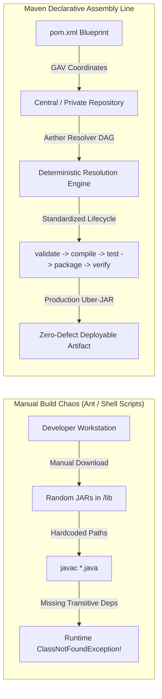
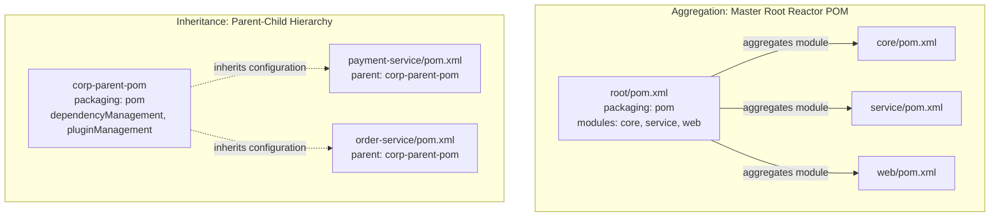
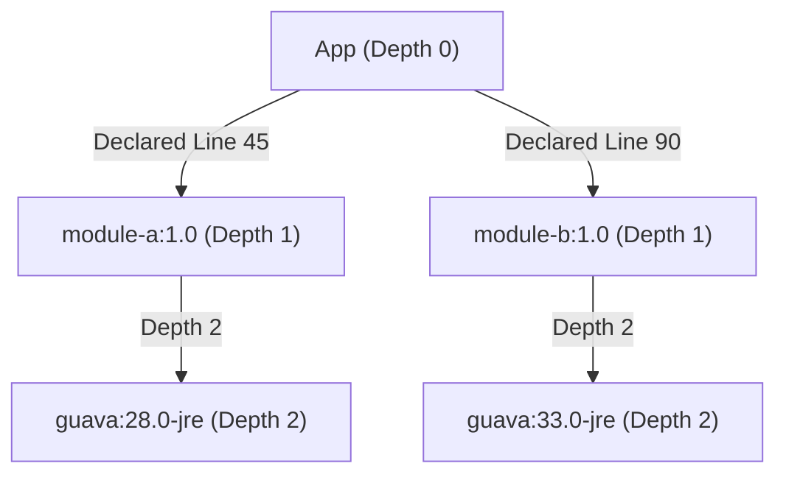
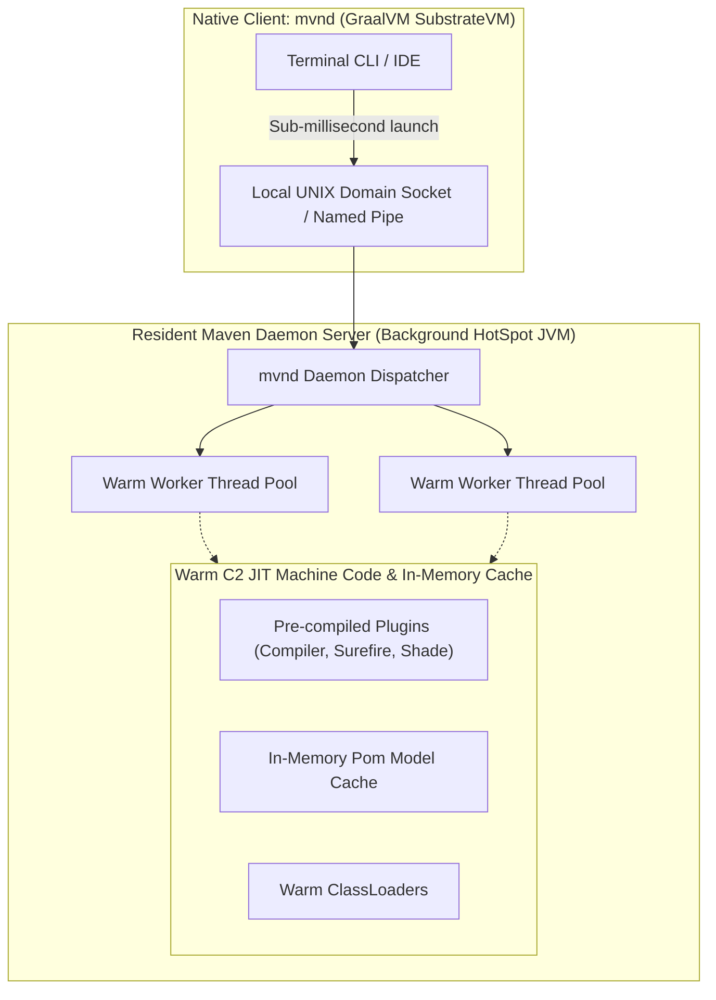
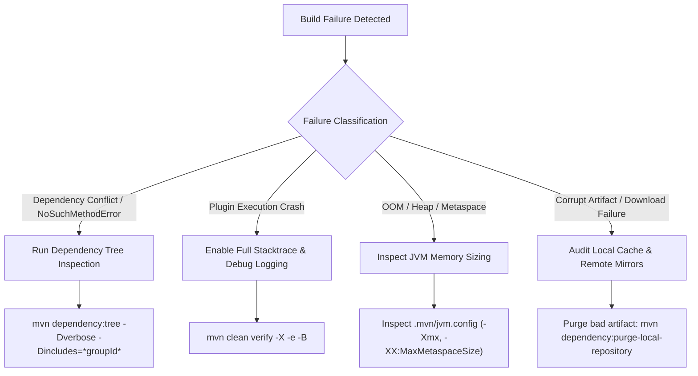

# Master Guide: Apache Maven Build Automation, Dependency Engine & Reactor Architecture (J15 / GAP-15)

> **Document ID:** `J15` | `GAP-15`  
> **Status:** Production-Grade Reference  
> **Focus:** Maven 3/4 Lifecycles, 23 Build Phases, Super POM, Aether / Maven Resolver Directed Acyclic Graph (DAG), "Nearest-Definition Wins" Dependency Mediation, Bill of Materials (BOM) & `<dependencyManagement>`, Dependency Scopes & Transitivity Matrix, Plugin Goal Bindings, Maven Shade Bytecode Relocation, Maven Enforcer Guardrails, Multi-Module Reactor Optimization (`-pl`, `-am`, `-T`), 55 Real-World Scenarios, 10 War-Room Incident Post-Mortems  
> **Target Audience:** Senior Java Backend Engineers, Build & Release Engineers, Platform Engineers, Principal Architects  

---

## Executive Summary & Architecture Overview

Apache Maven is the bedrock build automation and software comprehension tool for enterprise Java ecosystems. Beyond simple script execution, Maven enforces a declarative **Project Object Model (POM)** and a standardized **build lifecycle convention** that allows hundreds of developers and distributed CI/CD pipelines to build, test, package, and release complex multi-module systems deterministically.

However, modern enterprise systems frequently suffer from severe build and dependency pathology:
1. **Dependency Hell & Classpath Collisions**: Runtime `java.lang.NoSuchMethodError`, `ClassNotFoundException`, and `AbstractMethodError` caused by diamond dependency divergence, where transitive libraries resolve to incompatible versions.
2. **Deterministic Build Failures**: Non-reproducible builds caused by dynamic version ranges, unpinned plugin goals, snapshot pollution, and local cache (`~/.m2`) corruption.
3. **Multi-Module Reactor Bloat**: Massive monoliths whose build times exceed 45 minutes because of sequential execution, improper reactor graph dependencies, and redundant phase executions.
4. **Security Vulnerabilities in Transitive Trees**: Unnoticed introduction of compromised libraries (e.g., Log4Shell CVE-2021-44228) pulling malicious classes into production fat JARs through deep transitive edges.

To conquer these challenges, Staff Engineers must understand the low-level mechanics of Maven: how the **Aether / Eclipse Sisu dependency resolution engine** constructs dependency trees, the exact mathematical algorithm behind **Nearest Definition Wins**, how the **Reactor** topologically sorts multi-module dependency graphs into execution sequences, how **bytecode relocation in Maven Shade** prevents constant-pool class namespace collisions, and how **Maven Daemon (`mvnd`)** utilizes GraalVM native execution and persistent worker pools to achieve sub-second incremental builds.

---

## Track 0: Enterprise Jargon-Buster & Terminology Matrix

| Term | Technical Definition | Common Misconception | Production & Architectural Impact |
| :--- | :--- | :--- | :--- |
| **`Project Object Model (POM)`** | The fundamental declarative XML configuration file (`pom.xml`) describing project coordinates, dependencies, build plugins, and profiles. | Thinking it is just an execution script like Ant or Bash. | Immutable blueprint evaluated into the in-memory `MavenProject` model during build initialization. |
| **`Super POM`** | The root POM embedded inside Maven's `maven-model-builder.jar` from which all POMs inherit default configurations, repositories, and plugins. | Believing an empty `pom.xml` has no default repositories or phase plugins. | Defines default directory structures (`src/main/java`), default plugins (Compiler, Surefire, Jar), and Maven Central URL. |
| **`Effective POM`** | The fully interpolated, in-memory composite model produced by merging the Super POM, parent POMs, BOMs, active profiles, and current `pom.xml`. | Assuming what is written in `pom.xml` is all that Maven executes. | Inspectable via `mvn help:effective-pom`; essential for debugging mystery plugin versions and inherited repositories. |
| **`GAV Coordinates`** | The unique three-part tuple (`groupId:artifactId:version`) identifying an artifact in the global Maven coordinate space. | Believing `groupId` must match the Java package name exactly. | Used by Maven Resolver to generate storage paths inside local `~/.m2` and remote artifact repositories. |
| **`Lifecycle`** | A high-level, independent sequence of phases defining a build workflow. Maven has 3 built-in lifecycles: `clean`, `default`, and `site`. | Confusing lifecycles with build phases. | Executing a phase triggers all preceding phases in that specific lifecycle, but never phases in other lifecycles. |
| **`Build Phase`** | A named stage in a lifecycle representing an execution milestone (e.g., `validate`, `compile`, `test`, `package`, `verify`, `install`, `deploy`). | Assuming phases directly execute Java code themselves. | Phases contain zero execution code; they act as hooks to which plugin goals are bound. |
| **`Plugin`** | An artifact containing one or more Mojos (Maven plain Old Java Objects) that provide the actual execution logic for build phases. | Believing Maven core performs compilation and testing. | Maven core is just an execution harness; plugins (`maven-compiler-plugin`, `maven-surefire-plugin`) do the work. |
| **`Plugin Goal (Mojo)`** | A specific unit of work within a plugin (e.g., `compiler:compile`, `surefire:test`, `shade:shade`). | Thinking a plugin only does one task. | Can be bound to lifecycle phases or invoked directly via the CLI (`mvn clean compile`). |
| **`Aether / Maven Resolver`** | The underlying graph engine (originally Eclipse Aether, now Apache Maven Artifact Resolver) responsible for fetching, caching, and mediating dependencies. | Believing Maven downloads JARs by simple URL string concatenation. | Constructs directed graphs, computes checksums, manages parallel downloads, and resolves version conflicts. |
| **`Nearest Definition Wins`** | The deterministic conflict resolution algorithm selecting the dependency version closest to the root project in the dependency tree. | Assuming Maven selects the newest or highest semantic version. | If `App -> A -> Lib 1.0` (depth 2) and `App -> B -> C -> Lib 2.0` (depth 3), Maven chooses `Lib 1.0`, even if older! |
| **`First Declaration Wins`** | The tie-breaking rule when conflicting dependency definitions exist at the exact same depth in the tree. | Believing order in `pom.xml` does not matter. | The dependency declared earlier in the `<dependencies>` block of `pom.xml` wins, leading to order-dependent bugs. |
| **`Bill of Materials (BOM)`** | A specialized packaging POM (`<packaging>pom</packaging>`) defining a curated set of compatible library versions in `<dependencyManagement>`. | Assuming importing a BOM automatically downloads all listed JARs. | Only establishes default version constraints; JARs are only downloaded if explicitly declared in child POMs. |
| **`<dependencyManagement>`** | Configuration mechanism centralizing dependency version, scope, and exclusions without adding them to the immediate compile classpath. | Thinking it adds dependencies directly to the project classpath. | Enforces unified versions across multi-module projects; child modules declare dependencies without `<version>`. |
| **`Compile Scope`** | Default dependency scope; library is available on all classpaths (compile, test, runtime) and is transitively exported. | Believing all dependencies should use compile scope. | Causes severe JAR bloat in distributions when internal APIs or testing libraries are transitively exported. |
| **`Provided Scope`** | Dependency is required to compile project sources but is expected to be provided by the runtime environment (JDK, Servlet container). | Believing provided dependencies are bundled into the resulting JAR/WAR. | Excluded from the final packaged artifact; missing container runtime causes `NoClassDefFoundError`. |
| **`Runtime Scope`** | Dependency is not required for source code compilation but is mandatory during execution (e.g., JDBC drivers, SLF4J binding). | Marking JDBC drivers as `compile` scope. | Prevents application code from accidentally importing implementation classes instead of interfaces. |
| **`Test Scope`** | Dependency is only available on the test compilation and execution classpaths (e.g., JUnit 5, Mockito, AssertJ). | Marking libraries as compile scope because tests need them. | Never bundled into production distribution artifacts and never exported transitively. |
| **`System Scope`** | Dependency explicitly points to a local file on disk via `<systemPath>`. Marked for deprecation in Maven 4. | Using system scope for proprietary or unreleased in-house JARs. | Fatal to CI/CD and cross-platform reproducibility; breaks when paths differ across Windows/Linux. |
| **`Import Scope`** | Special scope used exclusively within `<dependencyManagement>` with `<type>pom</type>` to import another project's dependency management rules. | Using import scope inside standard `<dependencies>`. | Enables Spring Boot, Jackson, and AWS SDK BOM integration without single-inheritance POM restrictions. |
| **`Reactor`** | Maven core engine that parses all submodules in a multi-module project, resolves inter-module dependencies, and computes the build DAG. | Believing Maven builds modules in folder alphabetical order. | Sorts modules topologically; detects circular module dependencies and halts immediately if cycles exist. |
| **`Reactor Flags (-pl, -am, -amd)`** | Advanced CLI switches to target specific projects (`-pl`), also make dependencies (`-am`), and make dependents (`-amd`). | Building the entire multi-module repository for a one-line change. | Speeds up local developer iterations from 20 minutes to 15 seconds by building only the modified slice. |
| **`Parallel Builds (-T)`** | Multi-threaded build switch (`-T 1C` = 1 thread per CPU core; `-T 4` = 4 threads) executing independent reactor modules concurrently. | Assuming parallel builds make single-module builds faster. | Parallels occur across independent modules in the reactor DAG, requiring thread-safe plugins. |
| **`Maven Shade Plugin`** | Packaging plugin that unpacks all dependency JARs into a single "Uber-JAR" (fat JAR) and applies bytecode package relocation. | Confusing with standard `maven-jar-plugin` or `maven-assembly-plugin`. | Prevents classpath collisions by rewriting bytecode package names (e.g., `com.google.common` $\to$ `my.shaded.guava`). |
| **`Maven Enforcer Plugin`** | Governance plugin asserting strict architectural and build rules (e.g., banned dependencies, JDK version, duplicate classes). | Assuming code linters (Checkstyle) verify build configuration integrity. | Prevents corrupt or insecure configurations from reaching CI; breaks build on dependency drift. |
| **`Surefire vs Failsafe`** | `maven-surefire-plugin` runs unit tests during `test` phase; `maven-failsafe-plugin` runs integration tests during `integration-test`/`verify`. | Running integration tests with Surefire. | Surefire halts the build immediately on test failure, preventing cleanup/teardown in post-integration phases. |
| **`Maven Daemon (mvnd)`** | A tool built on GraalVM providing a background resident JVM process and client CLI to avoid JVM warmup latency. | Believing it changes POM syntax or plugin compatibility. | Reuses JIT-compiled plugin bytecode and in-memory caches, accelerating multi-module builds by $3\times$ to $10\times$. |
| **`SNAPSHOT`** | A dynamic, mutable version identifier indicating an active development build that can be refreshed automatically from remotes. | Using SNAPSHOT dependencies in production releases. | Destroys build reproducibility; two builds with the exact same commit hash can pull different snapshot binaries. |
| **`Local Repository Cache`** | Disk directory (default `~/.m2/repository`) caching downloaded artifacts, metadata, and locally installed modules. | Assuming wiping `~/.m2` fixes deep pom configuration bugs. | Speeds up builds by avoiding repeated network fetches; vulnerable to corrupt partial downloads and metadata locks. |
| **`Google Jib`** | Build plugin creating optimized OCI/Docker container images directly from Java projects without requiring a Docker daemon. | Believing building containers requires a local `Dockerfile` and root Docker permissions. | Splits application into reproducible, cached layers (dependencies, resources, classes) for lightning-fast container builds. |

---

## Track 1: Beginner Foundations & ELI5 Mental Models

### 1.1 The Physical Mental Model: The Industrial Automated Assembly Line

Imagine a modern aircraft assembly factory. To build a commercial jet, you do not hire 500 mechanics who wander around local hardware stores buying random bolts, sheet metal, and avionics computers. If you did:
- Mechanic A might buy a $10\text{mm}$ titanium bolt while Mechanic B installs an $11\text{mm}$ steel bolt into the same wing spar.
- When the aircraft attempts flight, structural resonance fractures the mismatched bolts, causing catastrophic failure.
- If someone asks "What exact blueprints and components went into building tail number N742AX?", nobody knows.



**Apache Maven is the automated industrial assembly line with a master materials catalog:**
1. **The Blueprint (`pom.xml`)**: Every part is specified by universal coordinates (`groupId`, `artifactId`, `version`). No loose files are scattered on developer hard drives.
2. **The Assembly Protocol (Standard Lifecycles)**: Every aircraft must go through strictly ordered checkpoints: Validate blueprint $\to$ Mill titanium $\to$ Fasten rivets $\to$ Stress-test components $\to$ Paint $\to$ Pre-flight inspection $\to$ Deploy to hangar. You cannot paint the plane before fastening the rivets.
3. **The Standardized Parts Depot (Maven Central & Mirrors)**: Components are downloaded once, verified by cryptographic SHA-256 / SHA-512 checksums, and stored in a standardized local warehouse (`~/.m2/repository`).
4. **The Convention-over-Configuration Standard**: Every factory floor layout is identical. Source code is *always* in `src/main/java`. Unit tests are *always* in `src/test/java`. Compiled binaries *always* land in `target/classes`. Any Java engineer in the world can step onto the factory floor, type `mvn clean verify`, and produce a tested artifact without reading a manual.

---

### 1.2 The Fundamental Problem: Why Maven Was Created

Before Maven, Java projects relied on **Apache Ant** and custom shell scripts. Ant was purely procedural:
- Developers wrote XML files describing *how* to execute tasks (`<javac srcdir="src" destdir="build" />`, `<mkdir dir="dist" />`).
- Projects had no standard directory structure. One project put code in `/source`, another in `/src/java`, a third in `/app/code`.
- **The JAR Hell Disaster**: Third-party libraries were checked directly into source control inside a `/lib` directory. If Library A needed `commons-logging-1.1.jar` and Library B needed `commons-logging-1.2.jar`, developers manually pasted JARs over each other. When a library failed with `NoSuchMethodError`, nobody knew which transitive dependency dragged in the conflicting JAR.
- **Transitive Dependency Blindness**: If you needed Spring Framework, you had to manually research all 14 libraries that Spring depended on, locate their websites, download their ZIP files, unpack them, and add them to `/lib`. If any of those 14 libraries updated, the process had to be repeated manually.

Maven solved this by introducing:
1. **Declarative POM**: You specify *what* your project is and *what* it needs, not *how* to compile it.
2. **Automated Transitive Dependency Management**: When you declare a dependency on `org.springframework:spring-webmvc:6.1.4`, Maven reads Spring's POM, discovers its dependencies (`spring-aop`, `spring-beans`, `spring-context`), downloads them automatically, and places them onto your compilation and runtime classpaths.
3. **Convention over Configuration**: Standard directory layouts eliminate hundreds of lines of boilerplate build scripts.

---

### 1.3 Step 1-to-N Code Runway: The Minimal Production POM

Let us examine the anatomy of a real, production-ready single-module Maven POM for Java 21:

```xml
<?xml version="1.0" encoding="UTF-8"?>
<project xmlns="http://maven.apache.org/POM/4.0.0"
         xmlns:xsi="http://www.w3.org/2001/XMLSchema-instance"
         xsi:schemaLocation="http://maven.apache.org/POM/4.0.0 
                             https://maven.apache.org/xsd/maven-4.0.0.xsd">
    <modelVersion>4.0.0</modelVersion>

    <!-- 1. GAV Coordinates: The Identity of this Artifact -->
    <groupId>com.enterprise.payment</groupId>
    <artifactId>payment-settlement-engine</artifactId>
    <version>2.4.0-SNAPSHOT</version>
    <packaging>jar</packaging>

    <name>Payment Settlement Engine</name>
    <description>High-throughput financial transaction settlement engine</description>

    <!-- 2. Centralized Properties: Encoding, Toolchains, Versions -->
    <properties>
        <maven.compiler.source>21</maven.compiler.source>
        <maven.compiler.target>21</maven.compiler.target>
        <maven.compiler.release>21</maven.compiler.release>
        <project.build.sourceEncoding>UTF-8</project.build.sourceEncoding>
        <project.reporting.outputEncoding>UTF-8</project.reporting.outputEncoding>
        
        <!-- Pinned Dependency Versions -->
        <slf4j.version>2.0.12</slf4j.version>
        <logback.version>1.5.3</logback.version>
        <junit.jupiter.version>5.10.2</junit.jupiter.version>
        <assertj.version>3.25.3</assertj.version>
        <mockito.version>5.11.0</mockito.version>
        
        <!-- Pinned Plugin Versions (Banning Unpinned Defaults) -->
        <maven-compiler-plugin.version>3.12.1</maven-compiler-plugin.version>
        <maven-surefire-plugin.version>3.2.5</maven-surefire-plugin.version>
        <maven-failsafe-plugin.version>3.2.5</maven-failsafe-plugin.version>
        <maven-enforcer-plugin.version>3.4.1</maven-enforcer-plugin.version>
    </properties>

    <!-- 3. Explicit Dependencies: Scoped Declarations -->
    <dependencies>
        <!-- Compile Scope (Default): Core logging API -->
        <dependency>
            <groupId>org.slf4j</groupId>
            <artifactId>slf4j-api</artifactId>
            <version>${slf4j.version}</version>
            <scope>compile</scope>
        </dependency>

        <!-- Runtime Scope: Logging implementation (not needed at compile time) -->
        <dependency>
            <groupId>ch.qos.logback</groupId>
            <artifactId>logback-classic</artifactId>
            <version>${logback.version}</version>
            <scope>runtime</scope>
        </dependency>

        <!-- Test Scope: Unit test harnesses (excluded from packaging) -->
        <dependency>
            <groupId>org.junit.jupiter</groupId>
            <artifactId>junit-jupiter</artifactId>
            <version>${junit.jupiter.version}</version>
            <scope>test</scope>
        </dependency>
        <dependency>
            <groupId>org.assertj</groupId>
            <artifactId>assertj-core</artifactId>
            <version>${assertj.version}</version>
            <scope>test</scope>
        </dependency>
        <dependency>
            <groupId>org.mockito</groupId>
            <artifactId>mockito-junit-jupiter</artifactId>
            <version>${mockito.version}</version>
            <scope>test</scope>
        </dependency>
    </dependencies>

    <!-- 4. Build Configuration: Pinned Plugins with Strict Flags -->
    <build>
        <pluginManagement>
            <!-- Centralized plugin version and configuration management -->
            <plugins>
                <plugin>
                    <groupId>org.apache.maven.plugins</groupId>
                    <artifactId>maven-compiler-plugin</artifactId>
                    <version>${maven-compiler-plugin.version}</version>
                    <configuration>
                        <parameters>true</parameters> <!-- Preserves reflection method parameter names -->
                        <compilerArgs>
                            <arg>-Xlint:all</arg>
                            <arg>-Xlint:-processing</arg>
                        </compilerArgs>
                    </configuration>
                </plugin>
                <plugin>
                    <groupId>org.apache.maven.plugins</groupId>
                    <artifactId>maven-surefire-plugin</artifactId>
                    <version>${maven-surefire-plugin.version}</version>
                    <configuration>
                        <includes>
                            <include>**/*Test.java</include>
                            <include>**/*Tests.java</include>
                        </includes>
                    </configuration>
                </plugin>
            </plugins>
        </pluginManagement>

        <plugins>
            <!-- Active Plugins for this Project -->
            <plugin>
                <groupId>org.apache.maven.plugins</groupId>
                <artifactId>maven-compiler-plugin</artifactId>
            </plugin>
            <plugin>
                <groupId>org.apache.maven.plugins</groupId>
                <artifactId>maven-surefire-plugin</artifactId>
            </plugin>
            
            <!-- Architectural Guardrail: Maven Enforcer Plugin -->
            <plugin>
                <groupId>org.apache.maven.plugins</groupId>
                <artifactId>maven-enforcer-plugin</artifactId>
                <version>${maven-enforcer-plugin.version}</version>
                <executions>
                    <execution>
                        <id>enforce-environment-rules</id>
                        <goals>
                            <goal>enforce</goal>
                        </goals>
                        <configuration>
                            <rules>
                                <!-- Require JDK 21+ -->
                                <requireJavaVersion>
                                    <version>[21,)</version>
                                    <message>FATAL: This project requires Java 21 or higher!</message>
                                </requireJavaVersion>
                                <!-- Require Maven 3.8.8+ -->
                                <requireMavenVersion>
                                    <version>[3.8.8,)</version>
                                    <message>FATAL: Maven 3.8.8 or higher is required!</message>
                                </requireMavenVersion>
                                <!-- Ban duplicate classes on classpath -->
                                <banDuplicateClasses>
                                    <findAllDuplicates>true</findAllDuplicates>
                                </banDuplicateClasses>
                            </rules>
                            <fail>true</fail>
                        </configuration>
                    </execution>
                </executions>
            </plugin>
        </plugins>
    </build>
</project>
```

---

## Track 2: Core Engineering & Architecture

### 2.1 The 3 Independent Lifecycles and 23 Phases Blueprint

A Maven lifecycle is a deterministic state machine. Calling a phase invokes every single preceding phase in that specific lifecycle in strict sequential order. However, phases in different lifecycles are completely decoupled.


#### Detailed Phase Execution Table

| Lifecycle | Phase Name | Default Bound Plugin Goal (for packaging `jar`) | Operational Description |
| :--- | :--- | :--- | :--- |
| **`clean`** | `pre-clean` | None | Executes tasks required before actual cleaning occurs. |
| | `clean` | `maven-clean-plugin:clean` | Deletes the project output directory (default: `target/`). |
| | `post-clean` | None | Executes tasks required immediately after cleaning. |
| **`default`** | `validate` | None | Validates project structure and verifies that all required information is available. |
| | `initialize` | None | Initializes build state (e.g., setting properties, creating directories). |
| | `generate-sources` | None | Generates source code included in compilation (e.g., Avro, Protobuf, OpenAPI). |
| | `process-sources` | None | Processes source code (e.g., filtering values, applying formatters). |
| | `generate-resources`| None | Generates resources to be included in the artifact. |
| | `process-resources`| `maven-resources-plugin:resources` | Copies and filters resource files from `src/main/resources` to `target/classes`. |
| | `compile` | `maven-compiler-plugin:compile` | Compiles main Java source code from `src/main/java` into `target/classes`. |
| | `process-classes` | None | Post-processes compiled bytecode (e.g., bytecode enhancement, AspectJ weaving). |
| | `generate-test-sources` | None | Generates test source files. |
| | `process-test-sources` | None | Processes test source files. |
| | `test-compile` | `maven-compiler-plugin:testCompile` | Compiles test source code from `src/test/java` into `target/test-classes`. |
| | `process-test-classes` | None | Post-processes compiled test bytecode. |
| | `test` | `maven-surefire-plugin:test` | Executes unit tests using a configured test framework (JUnit 5, TestNG). |
| | `prepare-package` | None | Performs operations necessary to prepare for packaging before actual creation. |
| | `package` | `maven-jar-plugin:jar` | Bundles compiled bytecode into the distributable format (`jar`, `war`, `ear`). |
| | `pre-integration-test` | None | Sets up integration test environments (e.g., launching Testcontainers, mocking servers). |
| | `integration-test`| `maven-failsafe-plugin:integration-test` | Executes integration tests against the packaged application artifact. |
| | `post-integration-test` | None | Tears down integration test environments (e.g., stopping servers, dumping logs). |
| | `verify` | `maven-failsafe-plugin:verify` | Checks integration test results; fails the build if tests failed during execution. |
| | `install` | `maven-install-plugin:install` | Copies the packaged artifact into the local repository (`~/.m2/repository`). |
| | `deploy` | `maven-deploy-plugin:deploy` | Copies the final artifact to remote artifact repository (Nexus, Artifactory). |
| **`site`** | `pre-site` | None | Prepares site generation. |
| | `site` | `maven-site-plugin:site` | Generates project documentation and reports. |
| | `post-site` | None | Post-processes generated site files. |
| | `site-deploy` | `maven-site-plugin:deploy` | Deploys the generated site documentation to a remote web server. |

---

### 2.2 Transitive Dependency Scopes & Resolution Matrix

When Module A depends on Module B, and Module B depends on Library C, what is the resulting scope of Library C in Module A? This **Transitivity Matrix** governs classpath composition:

| Declared Scope in Module B $\to$<br/>Target Scope in Module A $\downarrow$ | `compile` | `provided` | `runtime` | `test` |
| :--- | :---: | :---: | :---: | :---: |
| **`compile`** | **`compile`** | *None (Not exported)* | **`runtime`** | *None (Not exported)* |
| **`provided`** | **`provided`** | *None (Not exported)* | **`provided`** | *None (Not exported)* |
| **`runtime`** | **`runtime`** | *None (Not exported)* | **`runtime`** | *None (Not exported)* |
| **`test`** | **`test`** | *None (Not exported)* | **`test`** | *None (Not exported)* |

#### Key Architectural Rules:
1. **`provided` and `test` dependencies are NEVER transitive**: If library `B` has `<scope>test</scope>` on Mockito or `<scope>provided</scope>` on `servlet-api`, module `A` will **never** see Mockito or `servlet-api` on its classpath.
2. **`compile` + `runtime` $\implies$ `runtime`**: If `A` needs `B` for compile, but `B` only needs `C` at runtime, `C` is demoted to `runtime` in `A`. It is available when running the application, but application `A` cannot compile code directly referencing classes in `C`.

---

### 2.3 Multi-Module Architecture: Inheritance vs Aggregation

A common enterprise design mistake is confusing **POM Inheritance** with **POM Aggregation (Multi-Module)**.



| Dimension | Aggregator POM (`<modules>`) | Parent POM (`<parent>`) | Combined Enterprise Pattern |
| :--- | :--- | :--- | :--- |
| **Primary Goal** | **Batch Build Orchestration**: Tells Maven to build multiple subdirectories in a single command. | **Configuration Sharing**: Shares dependency management, plugin configs, properties, and licenses. | The root project POM acts as **both** the aggregator (`<modules>`) and parent (`<parent>`). |
| **XML Declaration** | `<modules><module>submodule-a</module></modules>` | `<parent><groupId>...</groupId><artifactId>...</artifactId></parent>` | Submodules point to `../pom.xml` via `<relativePath>`. |
| **Directory Coupling** | Must physically reside on the file system relative to the aggregator path. | Can be resolved from the local `~/.m2` or remote repository without existing locally. | Enables standalone submodule builds without cloning the entire monorepo. |
| **Artifact Packaging** | Must always be `<packaging>pom</packaging>`. | Must always be `<packaging>pom</packaging>`. | Clean separation between library modules (`jar`) and coordinators (`pom`). |

---

## Track 3: Low-Level Engine & Mechanical Sympathy

### 3.1 The Aether Dependency Mediation Algorithm: Nearest-Definition Wins

When building the dependency graph, Maven's resolver engine traverses the tree using a Breadth-First-Search (BFS) hybrid traversal. When it encounters multiple versions of the exact same `groupId:artifactId`, it applies **Nearest Definition Wins**.

#### Mathematical Proof of Nearest Definition

Consider the following dependency tree for an application `PaymentService`:

```mermaid
graph TD
    Root["PaymentService (Depth 0)"]
    
    Root -->|"1. depends on"| LibA["library-auth:1.0 (Depth 1)"]
    Root -->|"2. depends on"| LibB["library-billing:2.0 (Depth 1)"]
    
    LibA -->|"transitive"| Jackson1["jackson-databind:2.14.0 (Depth 2)"]
    
    LibB -->|"transitive"| LibC["library-common:1.5 (Depth 2)"]
    LibC -->|"transitive"| Jackson2["jackson-databind:2.16.1 (Depth 3)"]

    style Jackson1 fill:#2d1e2f,stroke:#ff79c6,stroke-width:2px;
    style Jackson2 fill:#3d3419,stroke:#f1c40f,stroke-width:2px;
```



#### Evaluation Rules:
1. `jackson-databind:2.14.0` is located at **Depth 2** (`PaymentService` $\to$ `library-auth` $\to$ `jackson-databind`).
2. `jackson-databind:2.16.1` is located at **Depth 3** (`PaymentService` $\to$ `library-billing` $\to$ `library-common` $\to$ `jackson-databind`).
3. **Outcome**: Maven selects `jackson-databind:2.14.0` because $\text{Depth}(2) < \text{Depth}(3)$.
4. **The Critical Production Flaw**: `library-common:1.5` was compiled against Jackson `2.16.1`. When `library-common` calls a method introduced in Jackson 2.16 (e.g., `JsonMapper.builder()`), the JVM crashes at runtime:
```
java.lang.NoSuchMethodError: 'com.fasterxml.jackson.databind.json.JsonMapper$Builder 
com.fasterxml.jackson.databind.json.JsonMapper.builder()'
```

#### Tie-Breaking: First Declaration Wins
If both dependencies reside at the exact same depth:

Because both Guava versions reside at Depth 2, Maven evaluates the lexical order in `pom.xml`. Since `module-a` is declared on Line 45, **`guava:28.0-jre` wins**, silently discarding `guava:33.0-jre`!

#### How Staff Engineers Fix It:
Force the depth to **0** by explicitly declaring the required version directly in the root POM's `<dependencies>` or `<dependencyManagement>`:
```xml
<dependencies>
    <!-- Overrides transitive resolution because Depth 0 < Depth 2 -->
    <dependency>
        <groupId>com.fasterxml.jackson.databind</groupId>
        <artifactId>jackson-databind</artifactId>
        <version>2.16.1</version>
    </dependency>
</dependencies>
```

---

### 3.2 Maven Shade Plugin: Bytecode Relocation Mechanics

When authoring shared SDKs or distributed worker agents (e.g., Flink, Spark, custom Spring starters), bundling dependencies like Guava, Netty, or Jackson directly into a fat JAR causes classpath collisions if the host application uses a different version.

The **Maven Shade Plugin** solves this via **bytecode relocation**: it parses compiled `.class` files, updates the constant pool, and rewrites bytecode opcodes to reference a newly namespaced package.

```mermaid
sequenceDiagram
    autonumber
    participant Dev as Maven Compiler
    participant Shade as Maven Shade Plugin
    participant ASM as ASM Bytecode Engine
    participant Jar as Shaded Fat JAR

    Dev->>Shade: Passes compiled classes + extracted dependency classes
    Note over Shade: Discovers com.google.common.base.Preconditions.checkNotNull()
    Shade->>ASM: Instructs ClassRemapper: pattern com.google.common.** -> com.enterprise.shaded.guava.**
    ASM->>ASM: Scans ClassFile Constant Pool (Utf8, Class, Methodref entries)
    ASM->>ASM: Rewrites Lcom/google/common/base/Preconditions; to Lcom/enterprise/shaded/guava/base/Preconditions;
    ASM->>Shade: Emits modified bytecode
    Shade->>Jar: Repackages classes into com/enterprise/shaded/guava/
```

#### Production Configuration:
```xml
<plugin>
    <groupId>org.apache.maven.plugins</groupId>
    <artifactId>maven-shade-plugin</artifactId>
    <version>3.5.2</version>
    <executions>
        <execution>
            <phase>package</phase>
            <goals>
                <goal>shade</goal>
            </goals>
            <configuration>
                <createDependencyReducedPom>true</createDependencyReducedPom>
                <relocations>
                    <relocation>
                        <pattern>com.google.common</pattern>
                        <shadedPattern>com.enterprise.internal.shaded.guava</shadedPattern>
                    </relocation>
                    <relocation>
                        <pattern>org.apache.commons.lang3</pattern>
                        <shadedPattern>com.enterprise.internal.shaded.commons</shadedPattern>
                    </relocation>
                </relocations>
                <transformers>
                    <!-- Merges SPI META-INF/services files rather than overwriting -->
                    <transformer implementation="org.apache.maven.plugins.shade.resource.ServicesResourceTransformer"/>
                    <!-- Merges spring.handlers and spring.schemas for Spring XML support -->
                    <transformer implementation="org.apache.maven.plugins.shade.resource.AppendingTransformer">
                        <resource>META-INF/spring.handlers</resource>
                    </transformer>
                    <transformer implementation="org.apache.maven.plugins.shade.resource.AppendingTransformer">
                        <resource>META-INF/spring.schemas</resource>
                    </transformer>
                    <transformer implementation="org.apache.maven.plugins.shade.resource.ManifestResourceTransformer">
                        <mainClass>com.enterprise.payment.SettlementEngineMain</mainClass>
                    </transformer>
                </transformers>
                <filters>
                    <filter>
                        <!-- Strip cryptographic signing signatures from upstream JARs -->
                        <artifact>*:*</artifact>
                        <excludes>
                            <exclude>META-INF/*.SF</exclude>
                            <exclude>META-INF/*.DSA</exclude>
                            <exclude>META-INF/*.RSA</exclude>
                        </excludes>
                    </filter>
                </filters>
            </configuration>
        </execution>
    </executions>
</plugin>
```

---

### 3.3 Maven Daemon (`mvnd`): Architecture & Acceleration Mechanics

Traditional `mvn` execution suffers from substantial performance overhead:
1. **JVM Cold Startup**: Every invocation spawns a brand new JVM (`java -classpath ... org.codehaus.plexus.classworlds.launcher.Launcher`), incurring ClassLoader scanning and Metaspace initialization.
2. **JIT Compilation Loss**: The HotSpot C1 and C2 JIT compilers recompile plugin bytecode (e.g., Maven Compiler, Surefire, Resources) from scratch on every run, throwing away optimized native machine code upon process exit.
3. **Repeated Model Parsing**: Multi-module POM resolution reparses thousands of XML files from disk into memory.



#### Why `mvnd` Outperforms Standard `mvn`:
- **GraalVM Native Binary**: The client executable `mvnd` is compiled ahead-of-time (AOT) to a native binary using GraalVM SubstrateVM. It starts in $< 10\text{ms}$.
- **Persistent Resident JVM**: The client connects over a local socket to a background daemon JVM that remains alive across builds.
- **Warm JIT Code**: Core plugins run at peak C2 compiled speeds immediately.
- **Built-in Parallelism**: Defaults to multi-threaded module building based on available CPU cores (`-T 1C`).

---

## Track 4: 55 Progressive Real-World Scenarios

### Tier 1: Junior Foundations (Scenarios 1–15)

#### Scenario 1: GAV Coordinates & Enterprise Naming Conventions
* **Question:** What are Maven GAV coordinates, and why must `groupId` strictly adhere to reverse-DNS notation in enterprise environments?
* **Answer:** GAV stands for `groupId`, `artifactId`, and `version`.
  - `groupId`: Uniquely identifies the owning organization or business unit (e.g., `com.mycompany.payments`). Under the hood, Maven Resolver translates the dots into directory paths inside repositories: `com/mycompany/payments`. Adhering to reverse-DNS prevents namespace squatting in public and private repositories (e.g., Maven Central enforces domain ownership verification via DNS TXT records before granting publishing rights).
  - `artifactId`: The unique name of the specific project or submodule (e.g., `settlement-core`).
  - `version`: The release or milestone identifier (e.g., `1.0.0` or `1.0.0-SNAPSHOT`).
  Together with packaging type (`jar`, `pom`, `war`), GAV creates a globally unique coordinate string: `com.mycompany.payments:settlement-core:jar:1.0.0`.

#### Scenario 2: `mvn package` vs `mvn install` vs `mvn deploy`
* **Question:** What is the critical mechanical difference between `mvn package`, `mvn install`, and `mvn deploy`?
* **Answer:**
  - `mvn package`: Compiles source code, runs unit tests, and packages the compiled bytecode into the target archive (`target/my-app-1.0.0.jar`). It **never** touches `~/.m2/repository` or remote servers.
  - `mvn install`: Executes all phases up to `package`, and then invokes `maven-install-plugin:install`, copying the packaged artifact and its POM into the developer's **local repository cache** (`~/.m2/repository/com/mycompany/...`). This makes the artifact available to *other local projects* built on the same workstation.
  - `mvn deploy`: Executes all phases up to `install`, and then invokes `maven-deploy-plugin:deploy`, transmitting the artifact, POM, and metadata over HTTP/HTTPS to the enterprise's **remote artifact repository** (Nexus, JFrog Artifactory, or AWS CodeArtifact) defined in `<distributionManagement>`.

#### Scenario 3: Decoupled Lifecycles: Why `mvn compile` Does Not Clean
* **Question:** If you modify code and run `mvn compile`, why might deleted classes still cause errors in downstream builds?
* **Answer:** Maven's `clean` and `default` (build) lifecycles are completely independent. Running `mvn compile` triggers the phases `validate` $\to$ `initialize` $\to$ `generate-sources` $\to$ `process-sources` $\to$ `generate-resources` $\to$ `process-resources` $\to$ `compile`. It **never** invokes the `clean` lifecycle. Therefore, `.class` files from previously compiled, renamed, or deleted Java classes remain inside `target/classes/`. If other code or packaging steps scan `target/classes`, stale classes get bundled into the distribution. To guarantee a clean slate, you must explicitly invoke both lifecycles: `mvn clean compile`.

#### Scenario 4: The Role and Mechanics of `<packaging>pom</packaging>`
* **Question:** What does `<packaging>pom</packaging>` signify in a Maven project, and what happens if you forget it on a parent project?
* **Answer:** By default, Maven assumes `<packaging>jar</packaging>`. When packaging is set to `pom`, Maven's default lifecycle skips compilation, testing, and JAR creation. Instead, the project serves as an **Aggregator** (orchestrating `<modules>`), a **Parent POM** (sharing dependency and plugin management), or a **Bill of Materials (BOM)**. If you forget `<packaging>pom</packaging>` on a multi-module root project, `maven-compiler-plugin` attempts to find source files in `src/main/java`. Failing to find them, it generates an empty `root-1.0.0.jar` and fails when attempting to attach child module artifacts.

#### Scenario 5: What Happens Under the Hood During `mvn validate`?
* **Question:** What does the `validate` phase actually check, and why is it the very first phase of the default lifecycle?
* **Answer:** The `validate` phase verifies that the project model is structurally sound and all prerequisites for a successful build are met:
  1. Validates XML syntax and POM schema compliance against `maven-4.0.0.xsd`.
  2. Ensures mandatory coordinates (`groupId`, `artifactId`, `version`) are present.
  3. Verifies that all declared parent POMs can be located locally or downloaded.
  4. Checks that all custom properties resolve and no circular variable interpolation loops exist.
  5. Plugins bound to `validate` (e.g., `maven-enforcer-plugin`) execute their rules (such as checking JDK version or banning snapshot dependencies). If validation fails, Maven halts immediately, saving minutes of wasted compilation time.

#### Scenario 6: Resource Filtering Mechanics: `src/main/resources`
* **Question:** How does Maven resource filtering work, and how can it accidentally corrupt binary assets like SSL keystores or images?
* **Answer:** `maven-resources-plugin` copies files from `src/main/resources` to `target/classes`. When `<filtering>true</filtering>` is enabled, Maven parses text files and replaces `${property.name}` tokens with values from the POM or CLI.
  * **The Disaster:** If filtering is applied globally across all resources, Maven attempts to parse binary files (e.g., `.p12`, `.jks`, `.png`, `.zip`) as UTF-8 text. As it encounters binary bytes that match delimiter sequences or cannot be parsed as UTF-8 characters, it replaces them with Unicode replacement characters (`\uFFFD`), corrupting the binary files!
  * **The Fix:** Separate resource directories or explicitly configure `<nonFilteredExtensions>`:
```xml
<configuration>
    <nonFilteredFileExtensions>
        <nonFilteredFileExtension>p12</nonFilteredFileExtension>
        <nonFilteredFileExtension>jks</nonFilteredFileExtension>
        <nonFilteredFileExtension>png</nonFilteredFileExtension>
    </nonFilteredFileExtensions>
</configuration>
```

#### Scenario 7: Forcing Snapshot Updates via `mvn -U`
* **Question:** Why doesn't Maven check remote repositories for new `SNAPSHOT` dependencies on every build, and what does the `-U` flag do?
* **Answer:** To prevent crippling network latency and rate-limiting on remote repositories, Maven caches repository metadata locally and applies an update policy (default: `daily`). If a team member deploys an updated `2.1.0-SNAPSHOT` to Artifactory at 10:00 AM, Maven will not check for updates again until 24 hours have elapsed.
  * The `-U` (or `--update-snapshots`) flag forces Maven to bypass the local cache's `updatePolicy` timestamp check. It queries all remote repositories declared in the POM or `settings.xml`, downloads the latest `maven-metadata.xml`, compares timestamp identifiers, and pulls down the newest snapshot binaries.

#### Scenario 8: `dependency:tree` vs `dependency:analyze`
* **Question:** How do `mvn dependency:tree` and `mvn dependency:analyze` differ, and why should both be used in CI?
* **Answer:**
  - `mvn dependency:tree`: Visualizes the complete hierarchical Directed Acyclic Graph (DAG) of all direct and transitive dependencies. It reveals which transitive dependency pulls in conflicting versions and shows scope transitions.
  - `mvn dependency:analyze`: Performs bytecode inspection of compiled `.class` files in `target/classes` and compares them against dependencies declared in `pom.xml`. It emits two critical warnings:
    1. *Used undeclared dependencies found*: Code directly references classes from a library that is only pulled in transitively! If the upstream library drops that dependency, your build breaks.
    2. *Unused declared dependencies found*: A library is declared in `pom.xml`, but no compiled class references it. It creates unnecessary classpath bloat.

#### Scenario 9: `provided` Scope vs `compile` Scope
* **Question:** When should an enterprise dependency be marked as `provided`, and what happens if you mark it as `compile`?
* **Answer:** A dependency should be marked `provided` when it is strictly required to compile Java code (interfaces, annotations), but the executing container or JDK is guaranteed to supply the implementation at runtime. Classic examples: `jakarta.servlet-api`, `lombok`, or cloud runtime SDKs (AWS Lambda runtime).
  * If marked `compile`: The library is bundled into the distribution archive (WAR or fat JAR). If a WAR bundles its own `servlet-api.jar` into `WEB-INF/lib`, and the hosting Tomcat container loads its own `servlet-api.jar`, the JVM's ClassLoader hierarchy detects duplicate classes with different ClassLoader identities, throwing `ClassCastException` or `LinkageError`.

#### Scenario 10: Why `test` Scope is Never Transitively Exported
* **Question:** If Module A depends on Module B (compile scope), and Module B depends on JUnit 5 (test scope), why can't Module A's tests use JUnit 5 without declaring it?
* **Answer:** By architectural design, Maven's transitivity matrix sets the transitive scope of any `test` dependency to **None** (unreachable). If test dependencies were exported transitively:
  1. A multi-module project with 50 submodules would accumulate dozens of incompatible test runners (JUnit 4, JUnit 5, TestNG, Spock) across its classpaths.
  2. Test libraries would leak into production runtime classpaths, vastly increasing attack surfaces and JAR sizes. Each module must explicitly declare the test libraries it uses.

#### Scenario 11: Targeted Unit Testing with `mvn test -Dtest=...`
* **Question:** How do you execute a single unit test method or a subset of test classes using Maven Surefire CLI flags?
* **Answer:** Maven Surefire provides the `-Dtest` property:
  - Run a single test class: `mvn test -Dtest=PaymentServiceTest`
  - Run a single test method: `mvn test -Dtest=PaymentServiceTest#testProcessPaymentSuccess`
  - Run multiple methods: `mvn test -Dtest=PaymentServiceTest#testSuccess+testFailure`
  - Pattern matching: `mvn test -Dtest=*ControllerTest`
  - Run tests in a specific submodule: `mvn test -pl :payment-service -Dtest=PaymentServiceTest`

#### Scenario 12: Why Child Modules Should Never Hardcode Dependency Versions
* **Question:** Why is hardcoding `<version>` tags in child submodule `<dependencies>` considered a severe architectural defect?
* **Answer:** In multi-module enterprise systems, hardcoding versions in child POMs bypasses centralized governance:
  1. **Version Drift**: Submodule A might use `jackson-databind:2.14.0` while Submodule B uses `2.16.1`. When packaged into an application, diamond dependency resolution selects one arbitrarily, causing runtime crashes.
  2. **Maintenance Overhead**: Upgrading a library requires modifying 50 individual POM files instead of 1 central definition.
  3. **Best Practice**: The root parent POM defines the canonical version in `<dependencyManagement>`. Child submodules declare only `<groupId>` and `<artifactId>`, inheriting the centrally managed version automatically.

#### Scenario 13: `settings.xml` vs `pom.xml`: Separation of Concerns
* **Question:** What configuration belongs in `~/.m2/settings.xml` versus project `pom.xml`?
* **Answer:**
  - `pom.xml` is **project-specific, version-controlled, and public**: It defines project coordinates, build plugins, dependencies, and public repository layouts. It must contain zero environment-specific, machine-specific, or secret data.
  - `settings.xml` is **user-specific, environment-specific, and private**: It resides on the developer's workstation or CI runner (`~/.m2/settings.xml`). It stores private credentials (Nexus/Artifactory passwords, server API tokens in `<servers>`), internal enterprise mirrors (`<mirrors>`), and local directory overrides (`<localRepository>`). Committing credentials into `pom.xml` is a critical security vulnerability.

#### Scenario 14: The Purpose of the Maven Wrapper (`mvnw`)
* **Question:** What is the Maven Wrapper (`mvnw`), and why should every enterprise repository check it into Git?
* **Answer:** The Maven Wrapper guarantees that all developers and CI/CD pipelines build the project using the **exact same Maven version**, eliminating "works on my machine" defects caused by differences between Maven 3.6, 3.8, and 3.9.
  * It consists of `mvnw` (Linux/macOS shell script), `mvnw.cmd` (Windows script), and `.mvn/wrapper/maven-wrapper.properties`.
  * When invoked (`./mvnw clean package`), the script checks if the specified Maven distribution exists in `~/.m2/wrapper/dists/`. If absent, it downloads and unpacks it automatically before delegating the build.

#### Scenario 15: Understanding `mvn clean` and File Locking on Windows
* **Question:** Why does `mvn clean` frequently fail with `Failed to delete target/...` on Windows developer machines, and how is it resolved?
* **Answer:** On Windows, the operating system places mandatory file locks on any file or directory opened by an active process. If an IDE (IntelliJ, Eclipse), background terminal, virus scanner, or rogue background JVM process (e.g., an unkilled Gradle daemon or running Java app) holds an open file handle inside `target/`, `maven-clean-plugin` cannot delete the directory and fails with `IOException: Unable to delete file`.
  * **Resolution:** Close running application instances, terminate background Java processes via Task Manager / PowerShell (`Get-Process java | Stop-Process`), or configure `maven-clean-plugin` with `<failOnError>false</failOnError>` (though fixing the lock is strongly preferred).

---

### Tier 2: Mid-Level Engineering (Scenarios 16–30)

#### Scenario 16: `<dependencyManagement>` vs `<dependencies>` Internals
* **Question:** Explain the exact mechanical difference between placing a dependency inside `<dependencyManagement>` versus `<dependencies>` in a parent POM.
* **Answer:**
  - `<dependencies>`: **Eager Classpath Inclusion**. Any dependency declared here is immediately added to the classpath of the parent project AND inherited onto the classpath of *every single child submodule*, whether the submodule needs it or not.
  - `<dependencyManagement>`: **Lazy Version & Scope Lookup Table**. Placing a dependency here does **not** add it to any classpath. It acts as a configuration dictionary. When a child submodule declares that dependency in its own `<dependencies>` block *without* a `<version>`, Maven looks up the parent's `<dependencyManagement>` table to resolve the version, scope, and exclusions. This ensures unified versioning without polluting child classpaths with unused libraries.

#### Scenario 17: Bill of Materials (BOM) Import Mechanics via `<scope>import</scope>`
* **Question:** How does Maven allow importing external dependency configurations (e.g., Spring Boot BOM, AWS SDK BOM) without inheriting from their POM via `<parent>`?
* **Answer:** Java and Maven both enforce **single inheritance**: a `pom.xml` can only have one `<parent>`. If a corporate project must inherit from an internal `corp-parent-pom`, it cannot inherit from `spring-boot-starter-parent`.
  * To solve this, Maven introduced the BOM pattern using `<scope>import</scope>` and `<type>pom</type>` inside `<dependencyManagement>`:
```xml
<dependencyManagement>
    <dependencies>
        <dependency>
            <groupId>org.springframework.boot</groupId>
            <artifactId>spring-boot-dependencies</artifactId>
            <version>3.2.3</version>
            <type>pom</type>
            <scope>import</scope>
        </dependency>
    </dependencies>
</dependencyManagement>
```
  During effective POM calculation, Maven downloads `spring-boot-dependencies.pom`, extracts all dependency definitions inside its `<dependencyManagement>` block, and inlines them directly into the current project's dependency management dictionary. A project can import multiple BOMs (e.g., Spring Boot, AWS SDK, Testcontainers) simultaneously.

#### Scenario 18: Diamond Dependency Collision: Nearest Definition Wins
* **Question:** Given the dependency tree below, which version of `commons-codec` will Maven select, and what is the exact failure mode?
  ```
  App -> LibA:1.0 -> commons-codec:1.15
  App -> LibB:1.0 -> LibC:1.0 -> commons-codec:1.16
  ```
* **Answer:**
  - `commons-codec:1.15` is at **Depth 2** (`App` $\to$ `LibA` $\to$ `commons-codec`).
  - `commons-codec:1.16` is at **Depth 3** (`App` $\to$ `LibB` $\to$ `LibC` $\to$ `commons-codec`).
  - **Outcome:** Maven chooses `commons-codec:1.15` because depth 2 is nearer to the root than depth 3.
  - **The Failure Mode:** If `LibC:1.0` requires a method or constructor added in `commons-codec:1.16` (e.g., `MurmurHash3.hash32x86()`), the application compiles without error because the compiler checked `LibC` against `1.16`. But at runtime, the JVM loads `1.15` from the classpath, and calling that method crashes with `java.lang.NoSuchMethodError`.

#### Scenario 19: Depth Tie-Breaking: First Declaration Wins
* **Question:** In the scenario below where both libraries are at depth 2, which version wins, and how can changing the order of dependencies in `pom.xml` break a production release?
  ```xml
  <dependencies>
      <dependency>
          <groupId>com.enterprise</groupId>
          <artifactId>module-payment</artifactId> <!-- pulls guava:30.0 -->
      </dependency>
      <dependency>
          <groupId>com.enterprise</groupId>
          <artifactId>module-analytics</artifactId> <!-- pulls guava:32.1 -->
      </dependency>
  </dependencies>
  ```
* **Answer:** Because both `guava:30.0` and `guava:32.1` are at Depth 2, Maven evaluates lexical order in `pom.xml`. Since `module-payment` is declared first, **`guava:30.0` wins**.
  * If a developer re-orders the XML dependencies (or an automated IDE formatting tool sorts dependencies alphabetically), `module-analytics` comes first, and suddenly `guava:32.1` wins. This subtle shift can change runtime behavior across environments. To prevent this, Staff Engineers declare Guava directly in the project's root `<dependencyManagement>` to force a deterministic version at Depth 0.

#### Scenario 20: `-DskipTests` vs `-Dmaven.test.skip=true`
* **Question:** Why should `-Dmaven.test.skip=true` be strictly banned in CI pipelines, while `-DskipTests` is acceptable?
* **Answer:**
  - `-DskipTests`: Configures `maven-surefire-plugin` and `maven-failsafe-plugin` to skip the *execution* of test cases. However, `test-compile` still executes! All test classes in `src/test/java` are compiled against project classes. If a developer breaks an API contract, the build fails during `test-compile`, preventing broken code from advancing.
  - `-Dmaven.test.skip=true`: Tells Maven core to completely skip compiling test sources (`test-compile`) AND skip executing tests.
  * **The Fatal Risk:** If a developer renames a method in `src/main/java`, runs `mvn install -Dmaven.test.skip=true`, and pushes to Git, broken test code is committed. Downstream developers and nightly builds that run tests immediately fail. Furthermore, any test-jar artifacts required by downstream modules are never generated.

#### Scenario 21: Surefire vs Failsafe: Why Integration Tests Belong in Failsafe
* **Question:** Why is running integration tests using `maven-surefire-plugin` during the `test` phase an anti-pattern?
* **Answer:**
  1. **Phase Purpose**: The `test` phase is designed for fast, isolated unit tests. Integration tests require packaged artifacts, external databases, or network mocks.
  2. **Halting on Failure vs Cleanup**: If an integration test fails under `maven-surefire-plugin`, Surefire halts the build immediately. If the test spun up an external database, Redis container, or mock server during `pre-integration-test`, the shutdown steps bound to `post-integration-test` are **never executed**, leaking resources in CI.
  3. **The Failsafe Contract**: `maven-failsafe-plugin` runs tests during `integration-test`. If tests fail, it records the failure, allows the lifecycle to continue through `post-integration-test` (guaranteeing teardown), and only breaks the build when `failsafe:verify` executes during the `verify` phase.

#### Scenario 22: Targeted Reactor Builds: `-pl`, `-am`, and `-amd`
* **Question:** In a 50-module monorepo, how do you rebuild only `order-service` and all internal libraries it depends on, without rebuilding the rest of the monorepo?
* **Answer:** Use the Maven Reactor project list flags:
  ```bash
  mvn clean install -pl :order-service -am
  ```
  - `-pl` (`--projects`): Specifies target module(s) by artifactId (`:order-service`) or relative directory path (`services/order-service`).
  - `-am` (`--also-make`): Instructs the Reactor to calculate the dependency graph of `:order-service` and build all upstream modules that `:order-service` depends on.
  - `-amd` (`--also-make-dependents`): Rebuilds `:order-service` AND all downstream modules that depend on `:order-service`.

#### Scenario 23: Parallel Reactor Build Mechanics (`-T`)
* **Question:** How does `mvn clean install -T 1C` work, and why must plugins be thread-safe?
* **Answer:**
  - `-T 1C` instructs Maven to spawn a thread pool sizing 1 worker thread per available CPU core (`-T 4` sets a fixed 4 threads).
  - The Reactor engine analyzes the multi-module DAG. Modules that have no inter-dependencies are scheduled concurrently on separate worker threads. As dependencies complete, dependent modules are unlocked and executed.
  - **Thread-Safety Requirement:** All plugins running in the build must be annotated with `@Mojo(threadSafe = true)`. If a non-thread-safe plugin writes to shared static variables, mutates global Maven session state, or modifies shared files without synchronization, parallel builds produce corrupted artifacts or crash with `ConcurrentModificationException`.

#### Scenario 24: Pruning Transitive Bloat via `<exclusions>`
* **Question:** How do you completely remove a vulnerable or conflicting transitive library from a third-party dependency?
* **Answer:** Use the `<exclusions>` block inside the `<dependency>` declaration:
```xml
<dependency>
    <groupId>org.apache.activemq</groupId>
    <artifactId>activemq-broker</artifactId>
    <version>5.18.3</version>
    <exclusions>
        <!-- Exclude vulnerable legacy logging implementation -->
        <exclusion>
            <groupId>log4j</groupId>
            <artifactId>log4j</artifactId>
        </exclusion>
        <!-- In Maven 3, wildcard exclusion of all artifacts in a group is supported: -->
        <exclusion>
            <groupId>commons-logging</groupId>
            <artifactId>*</artifactId>
        </exclusion>
    </exclusions>
</dependency>
```

#### Scenario 25: Optional Dependencies (`<optional>true</optional>`)
* **Question:** What does `<optional>true</optional>` do, and when should you declare it on a library?
* **Answer:** When an artifact marks a dependency as `<optional>true</optional>`, that dependency is used to compile the library, but is **not transitively inherited** by projects that consume the library.
  * **Use Case:** A shared caching library (`my-cache-core`) supports both Redis and Hazelcast. It declares both `redisson` and `hazelcast` as `<optional>true</optional>`. When Client Application imports `my-cache-core`, it does not automatically pull down 50MB of Redis and Hazelcast JARs. The client explicitly declares only the driver it actually intends to use.

#### Scenario 26: Dynamic Version Ranges & Why They Break CI Determinism
* **Question:** Why are dynamic version ranges like `[1.0.0, 2.0.0)` or `1.0.+` considered an enterprise anti-pattern?
* **Answer:** Dynamic version ranges instruct Maven to query remote repositories on every build and select the highest matching version available:
  1. **Non-Reproducible Builds:** Build #142 at 10:00 AM compiles against `1.2.0`. An upstream vendor releases `1.3.0` with a regression at 10:15 AM. Build #143 with the exact same Git commit hash pulls `1.3.0` and fails in production.
  2. **Severe Network Latency:** Maven must query repository metadata XML files across all configured remote repositories on every build to resolve the latest version.
  3. **Industry Standard:** Pin versions explicitly (e.g., `1.2.0`) and automate upgrades using Dependabot or Renovate with pull request validation.

#### Scenario 27: Environment Profiles (`<profiles>`) & Dynamic Activation
* **Question:** How do Maven profiles work, and how can they be activated dynamically based on environment conditions?
* **Answer:** Profiles allow conditionally modifying dependencies, plugins, properties, and resources based on environment triggers:
```xml
<profiles>
    <profile>
        <id>coverage</id>
        <activation>
            <!-- Activated when CI environment variable is present -->
            <property>
                <name>env.CI</name>
                <value>true</value>
            </property>
        </activation>
        <build>
            <plugins>
                <plugin>
                    <groupId>org.jacoco</groupId>
                    <artifactId>jacoco-maven-plugin</artifactId>
                    <version>0.8.11</version>
                </plugin>
            </plugins>
        </build>
    </profile>
</profiles>
```
  Profiles can also be activated via CLI (`mvn clean package -Pcoverage,prod`), JDK version (`<jdk>21</jdk>`), or file existence (`<file><exists>src/main/native</exists></file>`).

#### Scenario 28: Reproducible Builds via `project.build.outputTimestamp`
* **Question:** How does Maven achieve bit-for-bit identical byte output across different build machines and timestamps?
* **Answer:** Traditionally, JAR files generated from the same source code produced different SHA-256 hashes because ZIP file entries contain file creation timestamps and filesystem ordering.
  * Maven introduced **Reproducible Builds** governed by the `project.build.outputTimestamp` property:
```xml
<properties>
    <!-- ISO-8601 timestamp or Git commit Unix epoch -->
    <project.build.outputTimestamp>2026-01-01T00:00:00Z</project.build.outputTimestamp>
</properties>
```
  Plugins like `maven-jar-plugin` and `maven-source-plugin` use this fixed timestamp for all archive entries, sort entries alphabetically, and set standard file permissions, guaranteeing bit-for-bit identical binary output regardless of who runs the build.

#### Scenario 29: Automated Dependency Auditing with `versions-maven-plugin`
* **Question:** How do you detect and update outdated dependencies and plugins across a 50-module project programmatically?
* **Answer:** Use the `versions-maven-plugin`:
  - Display all dependencies with newer releases:
    ```bash
    mvn versions:display-dependency-updates
    ```
  - Display all plugins with newer releases:
    ```bash
    mvn versions:display-plugin-updates
    ```
  - Update all properties to the latest minor/patch versions:
    ```bash
    mvn versions:update-properties -DallowMajorUpdates=false
    ```

#### Scenario 30: Configuring Enterprise Repository Mirrors in `settings.xml`
* **Question:** How do you configure Maven to route ALL remote repository requests through a secure internal corporate Artifactory instance?
* **Answer:** In `~/.m2/settings.xml`, declare a **mirror** matching `*`:
```xml
<settings>
    <mirrors>
        <mirror>
            <id>internal-artifactory</id>
            <name>Corporate Artifactory Mirror</name>
            <url>https://artifactory.corp.internal/artifactory/maven-virtual</url>
            <mirrorOf>*</mirrorOf> <!-- Intercepts all requests, including Maven Central -->
        </mirror>
    </mirrors>
    <servers>
        <server>
            <id>internal-artifactory</id>
            <username>${env.ARTIFACTORY_USER}</username>
            <password>${env.ARTIFACTORY_TOKEN}</password>
        </server>
    </servers>
</settings>
```
  Setting `<mirrorOf>*</mirrorOf>` blocks Maven from making outbound connections to public internet repositories, routing all traffic through the corporate cache.

---

### Tier 3: Senior Systems & Architecture (Scenarios 31–45)

#### Scenario 31: Maven Shade Plugin: Bytecode Relocation
* **Question:** When developing a shared logging agent or Spark job, why is bytecode relocation mandatory, and how does the Shade plugin execute it?
* **Answer:** If an SDK bundles `guava:32.0` and is loaded into an application running `guava:21.0`, whichever version the JVM ClassLoader finds first wins. If the application loads the SDK's Guava, application code calling deprecated methods crashes.
  * **Relocation Solution:** The Shade plugin uses ASM to rewrite the bytecode:
    1. It renames the package directory: `com/google/common` $\to$ `com/corp/shaded/guava`.
    2. It rewrites constant pool entries in all classes to reference `com.corp.shaded.guava.base.Preconditions`.
    3. The SDK now uses its private copy of Guava completely isolated from the host application's Guava.

#### Scenario 32: Shading SPI `META-INF/services` Collisions
* **Question:** When merging multiple JARs into an Uber-JAR with Shade, why do `java.util.ServiceLoader` SPI registrations fail, and how do you fix it?
* **Answer:** Many Java frameworks (SLF4J, JDBC drivers, Jackson modules) register plugins via `META-INF/services/com.example.ServiceProvider`. By default, when Shade unzips dependencies into the uber-jar directory, each successive JAR **overwrites** identical files in `META-INF/services/`, wiping out all service registrations except the last one!
  * **The Fix:** Attach `ServicesResourceTransformer`:
```xml
<transformer implementation="org.apache.maven.plugins.shade.resource.ServicesResourceTransformer"/>
```
  This transformer parses text files in `META-INF/services/` and concatenates provider class names together, preserving all SPI registrations.

#### Scenario 33: Stripping Cryptographic Signatures in Fat JARs
* **Question:** Why does executing a shaded fat JAR throw `SecurityException: Invalid signature file digest for Manifest main attributes`, and how is it prevented?
* **Answer:** Some upstream JARs (e.g., BouncyCastle) are cryptographically signed. Their JARs contain signature files in `META-INF/*.SF`, `META-INF/*.DSA`, and `META-INF/*.RSA`.
  * When Shade unzips all classes and repackages them into a single JAR, the digests in those signature files no longer match the altered archive. When the JVM loads the fat JAR, `JarVerifier` verifies the signature and throws `SecurityException`.
  * **The Fix:** Add an artifact filter stripping all signature files:
```xml
<filters>
    <filter>
        <artifact>*:*</artifact>
        <excludes>
            <exclude>META-INF/*.SF</exclude>
            <exclude>META-INF/*.DSA</exclude>
            <exclude>META-INF/*.RSA</exclude>
        </excludes>
    </filter>
</filters>
```

#### Scenario 34: Maven Enforcer Plugin: Banning Duplicate Classes
* **Question:** How do you configure `maven-enforcer-plugin` to break CI builds if two dependencies supply the exact same fully qualified class name?
* **Answer:** Use the `extra-enforcer-rules` extension with `banDuplicateClasses`:
```xml
<plugin>
    <groupId>org.apache.maven.plugins</groupId>
    <artifactId>maven-enforcer-plugin</artifactId>
    <version>3.4.1</version>
    <dependencies>
        <dependency>
            <groupId>org.codehaus.mojo</groupId>
            <artifactId>extra-enforcer-rules</artifactId>
            <version>1.7.0</version>
        </dependency>
    </dependencies>
    <executions>
        <execution>
            <id>ban-duplicate-classes</id>
            <goals><goal>enforce</goal></goals>
            <configuration>
                <rules>
                    <banDuplicateClasses>
                        <findAllDuplicates>true</findAllDuplicates>
                        <ignoreWhenIdentical>false</ignoreWhenIdentical>
                    </banDuplicateClasses>
                </rules>
                <fail>true</fail>
            </configuration>
        </execution>
    </executions>
</plugin>
```
  This immediately catches duplicate libraries (e.g., both `javax.servlet:servlet-api` and `jakarta.servlet:jakarta.servlet-api` present on the classpath).

#### Scenario 35: Enforcing Dependency Convergence
* **Question:** What is dependency convergence (`<dependencyConvergence>`), and why do enterprise architects mandate it?
* **Answer:** In standard Maven builds, "Nearest Definition Wins" silently chooses one version when transitive dependencies conflict, discarding the other.
  * `<dependencyConvergence>` instructs the Enforcer plugin to verify that **every single path** in the dependency graph leads to the exact same version of every artifact. If Module A pulls `jackson-databind:2.14.0` and Module B pulls `2.16.1`, the build **fails immediately**.
  * **Architectural Rationale:** Forces engineers to explicitly resolve conflicts in `<dependencyManagement>`, eliminating hidden diamond dependency bugs.

#### Scenario 36: Container Image Building with Google Jib
* **Question:** How does Google Jib build Docker container images without a Docker daemon, and why is it faster than standard `docker build`?
* **Answer:** Traditional `docker build` requires a local Docker daemon with root privileges and executes a `Dockerfile` sequentially.
  * Jib (`jib-maven-plugin`) parses Maven build output directly and writes OCI/Docker image manifests and tarballs directly to remote registries using the Docker Registry HTTP API:
    1. **Layer Separation**: It splits the application into distinct, immutable layers: Dependencies (rarely change), Resources (infrequently change), Application Classes (change constantly).
    2. **Zero Docker Daemon**: Runs in unprivileged CI environments (Kubernetes pods, GitHub Actions) without Docker-in-Docker (`dind`) security risks.
    3. **Speed**: Because only the classes layer changes between commits, container builds and pushes complete in sub-seconds.

#### Scenario 37: Multi-Phase JaCoCo Code Coverage Pipeline
* **Question:** How do you configure JaCoCo to capture combined test coverage across both unit tests (Surefire) and integration tests (Failsafe)?
* **Answer:** Bind JaCoCo goals across the build lifecycle:
```xml
<plugin>
    <groupId>org.jacoco</groupId>
    <artifactId>jacoco-maven-plugin</artifactId>
    <version>0.8.11</version>
    <executions>
        <!-- 1. Attach javaagent before unit tests -->
        <execution>
            <id>prepare-unit-tests</id>
            <goals><goal>prepare-agent</goal></goals>
        </execution>
        <!-- 2. Attach javaagent before integration tests (appending data) -->
        <execution>
            <id>prepare-it-tests</id>
            <phase>pre-integration-test</phase>
            <goals><goal>prepare-agent-integration</goal></goals>
        </execution>
        <!-- 3. Generate unified report during verify phase -->
        <execution>
            <id>generate-coverage-report</id>
            <phase>verify</phase>
            <goals><goal>report</goal></goals>
        </execution>
    </executions>
</plugin>
```

#### Scenario 38: Circular Dependencies in the Reactor DAG
* **Question:** What happens when Submodule A depends on Submodule B, and Submodule B depends on Submodule A?
* **Answer:** Maven's Reactor engine constructs a Directed Acyclic Graph (DAG) of all modules to compute the topological sort execution order.
  * If a circular dependency exists ($A \to B \to A$), topological sorting algorithm encounters a cycle. Maven **halts immediately during the validation phase** before compiling any code:
```
[ERROR] The projects in the reactor contain a cyclic reference: 
The following loop was detected: submodule-a -> submodule-b -> submodule-a
```
  * **Architectural Fix:** Extract shared interfaces or domain models into a new neutral submodule: `submodule-common`. Both $A$ and $B$ depend on `submodule-common`, breaking the cycle.

#### Scenario 39: Custom Mojo Architecture & Execution Lifecycle
* **Question:** How do you author a custom Maven plugin, and how does Maven pass project state to a Mojo?
* **Answer:**
  1. Create a project with `<packaging>maven-plugin</packaging>` and depend on `maven-plugin-api` and `maven-plugin-annotations`.
  2. Implement `org.apache.maven.plugin.AbstractMojo`.
  3. Annotate class with `@Mojo(name = "audit-licenses", defaultPhase = LifecyclePhase.VERIFY)`.
  4. Inject Maven state using `@Parameter`:
```java
@Mojo(name = "audit-licenses", defaultPhase = LifecyclePhase.VERIFY)
public class LicenseAuditMojo extends AbstractMojo {

    @Parameter(defaultValue = "${project}", readonly = true, required = true)
    private MavenProject project;

    @Parameter(property = "strictMode", defaultValue = "false")
    private boolean strictMode;

    @Override
    public void execute() throws MojoExecutionException {
        getLog().info("Auditing dependencies for: " + project.getArtifactId());
        for (Artifact artifact : project.getArtifacts()) {
            // Audit logic...
        }
    }
}
```

#### Scenario 40: In-Memory Reactor Artifact Resolution
* **Question:** In a multi-module build, how does Module B compile against Module A if Module A has not yet been installed to `~/.m2`?
* **Answer:** Maven's Reactor maintains an in-memory repository of all active modules in the current session.
  * When Module A finishes the `compile` phase, Maven attaches its output directory (`target/classes`) to Module A's `MavenProject` model in memory.
  * When Module B resolves its dependencies, the Reactor intercepts the lookup. Before querying `~/.m2` or remote repositories, it checks if `Module A` is present in the reactor. It finds Module A and injects its local `target/classes` directly onto Module B's compile classpath.
  * This is why running `mvn compile` on a multi-module root project succeeds without running `mvn install`!

#### Scenario 41: Resolving `NoSuchMethodError` via Dependency Mediation
* **Question:** Walk through the triage process when a production service fails with `NoSuchMethodError` inside a third-party library after a Maven build.
* **Answer:**
  1. Identify the missing method and the class owning it from the stack trace (e.g., `StringUtils.isNotBlank(CharSequence)` in `commons-lang3`).
  2. Run `mvn dependency:tree -Dincludes=*commons-lang3*` to locate all versions present in the graph.
  3. Notice that `library-old` pulls `commons-lang3:3.1` (depth 2), while `library-new` pulls `commons-lang3:3.12.0` (depth 3).
  4. Recognize that Maven's Nearest Definition Wins chose `3.1`, which lacks the method introduced in `3.12.0`.
  5. **Hotfix:** Add `commons-lang3:3.12.0` explicitly to the root POM's `<dependencyManagement>` or root `<dependencies>` to force Depth 0 resolution.

#### Scenario 42: Maven Daemon (`mvnd`) Build Acceleration in CI
* **Question:** How do you safely configure `mvnd` in CI/CD container environments without running out of container memory?
* **Answer:** By default, `mvnd` spawns persistent daemon processes. In ephemeral CI containers (e.g., GitLab Runner, GitHub Actions):
  - Daemon processes can leak memory if containers are reused without process teardown.
  - Configure `~/.m2/mvnd.properties` or CLI flags:
    ```properties
    mvnd.idleTimeout=10s
    mvnd.maxHeapSize=4G
    mvnd.threads=1C
    ```
  - In CI scripts, invoke `mvnd --stop` in cleanup traps to guarantee daemon termination upon pipeline exit.

#### Scenario 43: Encrypting Passwords in `settings.xml`
* **Question:** How do you prevent plaintext database and repository passwords from being stored in `~/.m2/settings.xml`?
* **Answer:** Use Maven's built-in password encryption mechanism:
  1. Generate a master password: `mvn --create-master-password <MasterPassword>`
  2. Store the encrypted master password in `~/.m2/settings-security.xml`.
  3. Encrypt the individual server password: `mvn --encrypt-password <ArtifactoryPassword>`
  4. Paste the encrypted hash (`{CO92k...}`) into `~/.m2/settings.xml` inside `<server><password>`.

#### Scenario 44: Multi-Release JARs (`mrjar`) & Toolchains
* **Question:** What is a Multi-Release JAR (MRJAR), and how does Maven compile code across multiple JDK versions in a single build?
* **Answer:** An MRJAR allows a single JAR archive to contain different versions of class files optimized for different Java runtimes (e.g., standard classes for Java 17 under `/`, and vectorized classes for Java 21 under `/META-INF/versions/21/`).
  * Maven uses `maven-toolchains-plugin` combined with multiple executions of `maven-compiler-plugin`:
    - Execution 1 (default `compile`): Uses JDK 17 toolchain to compile base classes into `target/classes`.
    - Execution 2 (`compile-java21`): Uses JDK 21 toolchain with `<multiReleaseOutput>true</multiReleaseOutput>` to compile specialized classes into `target/classes/META-INF/versions/21`.
    - `maven-jar-plugin` sets `Multi-Release: true` in `MANIFEST.MF`.

#### Scenario 45: Maven 4 Architecture: Consumer POM vs Build POM
* **Question:** What architectural transformation does Maven 4 introduce with the separation of Build POM and Consumer POM?
* **Answer:** In Maven 3, the exact same `pom.xml` used to build the project is published to remote repositories. This causes major problems: downstream consumers must download build-specific plugins, profiles, and relative path parent references that are completely irrelevant to consuming the library.
  * **Maven 4 Separation:**
    - **Build POM**: The developer's rich XML file containing plugins, profiles, reactor modules, and build-time properties.
    - **Consumer POM**: A clean, stripped-down POM generated during `deploy`. It contains *only* GAV coordinates, resolved dependencies, and licenses. Downstream projects resolve dependencies $40\%$ faster with zero build plugin overhead.

---

### Tier 4: Staff / Principal Systems Engineering (Scenarios 46–55)

#### Scenario 46: Enterprise Master Parent POM & BOM Governance Architecture
* **Question:** Design the architectural layout of an enterprise-grade Maven governance model for an engineering organization with 500+ microservices.
* **Answer:**
  1. **`enterprise-corporate-parent` (POM)**:
     - Defines organizational metadata, licensing, developer info.
     - Centralizes `pluginManagement` with pinned plugin versions and strict compiler flags (`-parameters`, `-Xlint:all`).
     - Mandates `maven-enforcer-plugin` guardrails (JDK version, duplicate class bans, banned dependencies).
     - Configures distribution management pointing to corporate Artifactory repositories.
  2. **`enterprise-platform-bom` (BOM POM)**:
     - Defines canonical, security-audited versions for all shared third-party libraries (Spring Boot, Jackson, SLF4J, Kafka, AWS SDK).
     - Decoupled from the parent POM so library version bumps do not require rebuilding parent POM pipelines.
  3. **Microservice Projects**:
     - Inherit from `enterprise-corporate-parent`.
     - Import `enterprise-platform-bom` via `<scope>import</scope>` in `<dependencyManagement>`.
     - Microservice developers declare zero `<version>` tags on standard libraries.

#### Scenario 47: Generating CycloneDX / SPDX Software Bill of Materials (SBOM)
* **Question:** How do you automate the generation of cryptographically verifiable Software Bill of Materials (SBOM) in Maven CI pipelines?
* **Answer:** Bind `cyclonedx-maven-plugin` to the `package` phase:
```xml
<plugin>
    <groupId>org.cyclonedx</groupId>
    <artifactId>cyclonedx-maven-plugin</artifactId>
    <version>2.7.14</version>
    <executions>
        <execution>
            <phase>package</phase>
            <goals><goal>makeAggregateBom</goal></goals>
            <configuration>
                <projectType>application</projectType>
                <schemaVersion>1.5</schemaVersion>
                <includeBomSerialNumber>true</includeBomSerialNumber>
                <outputFormat>json</outputFormat>
            </configuration>
        </execution>
    </executions>
</plugin>
```
  Produces `target/bom.json` containing cryptographic SHA-256 hashes, licenses, and full transitive dependency provenance for every deployed artifact.

#### Scenario 48: Verifying Artifact Signatures with Sigstore Cosign in Maven
* **Question:** How do you integrate Sigstore keyless artifact signing and verification into Maven release automation?
* **Answer:** During the `deploy` phase in GitHub Actions / GitLab CI:
  1. The build produces the artifact JAR.
  2. The CI workflow generates an OpenID Connect (OIDC) identity token issued by the CI provider.
  3. Cosign (`cosign sign-blob`) signs the artifact hash using the short-lived OIDC token against the Fulcio CA and records the signature in the Rekor public transparency log.
  4. The `.sig` signature and `.pem` certificate are deployed alongside the `.jar` to Artifactory. Downstream deployment pipelines verify signatures before deploying to production Kubernetes clusters.

#### Scenario 49: Optimizing Monorepo Build Performance: The Git Diff Reactor Pattern
* **Question:** In a monorepo with 300 modules where full builds take 40 minutes, how do you execute CI builds in under 2 minutes for pull requests?
* **Answer:** Use Git commit analysis combined with Maven Reactor flags:
  1. Execute a lightweight shell step in CI:
     ```bash
     CHANGED_MODULES=$(git diff --name-only origin/main...HEAD | xargs -n1 dirname | sort -u)
     # Map modified directories to Maven module paths
     TARGET_PROJECTS=$(python3 tools/map_to_modules.py $CHANGED_MODULES)
     ```
  2. Execute Maven only on modified modules and their downstream dependents:
     ```bash
     mvn clean verify -pl "$TARGET_PROJECTS" -amd -T 1C
     ```
  3. Dependencies upstream of the changes are resolved from the remote CI artifact cache, avoiding redundant compilation of 250 unaffected modules.

#### Scenario 50: Artifactory Pull-Through Remote Cache Architecture
* **Question:** What caching topology should platform engineers deploy to protect internal Maven builds from public internet outages and rate limiting?
* **Answer:**
  1. **Virtual Repository (`maven-virtual`)**: Single unified URL exposed to developers.
  2. **Local Cache Repository (`maven-local-releases`, `maven-local-snapshots`)**: Stores internal proprietary builds.
  3. **Remote Proxy Repositories (`maven-central-remote`, `spring-remote`)**: Configured with local disk caching, automated malware scanning (Xray), and connection retry backoff.
  4. If Maven Central suffers an outage, Artifactory serves cached JARs from its local storage without interrupting developer builds or CI pipelines.

#### Scenario 51: Debugging Metaspace OOM During Multi-Threaded Builds (`-T 1C`)
* **Question:** Why do large parallel builds (`mvn -T 1C`) frequently fail with `java.lang.OutOfMemoryError: Metaspace`, and how do you tune the build JVM?
* **Answer:**
  - In a parallel build with 16 threads, multiple plugins and classloaders load thousands of unique class definitions concurrently into Metaspace.
  - By default, Maven inherits the host system's small default Metaspace limit.
  - **The Fix:** Configure `.mvn/jvm.config` in the root repository:
    ```
    -Xms2g
    -Xmx8g
    -XX:MetaspaceSize=512m
    -XX:MaxMetaspaceSize=2g
    -XX:+UseG1GC
    -Djava.awt.headless=true
    ```
  Placing these flags in `.mvn/jvm.config` ensures all team members and CI runners automatically inherit identical JVM heap and Metaspace sizing.

#### Scenario 52: Automated Breaking API Detection with Revapi
* **Question:** How do you automatically prevent developers from merging binary-incompatible changes into shared enterprise libraries?
* **Answer:** Integrate `revapi-maven-plugin` into the `verify` phase:
```xml
<plugin>
    <groupId>org.revapi</groupId>
    <artifactId>revapi-maven-plugin</artifactId>
    <version>0.15.0</version>
    <dependencies>
        <dependency>
            <groupId>org.revapi</groupId>
            <artifactId>revapi-java</artifactId>
            <version>0.28.1</version>
        </dependency>
    </dependencies>
    <executions>
        <execution>
            <goals><goal>check</goal></goals>
            <configuration>
                <failOnSeverity>breaking</failOnSeverity>
            </configuration>
        </execution>
    </executions>
</plugin>
```
  Revapi downloads the previous release from the repository, disassembles the bytecode, compares method signatures, return types, and class hierarchies, and breaks the build if a public method was removed or altered without a major version bump.

#### Scenario 53: Distributed Remote Build Caching for Maven
* **Question:** How does distributed remote build caching work in modern Maven enterprise environments?
* **Answer:** Tools like the **Develocity (formerly Gradle Enterprise) Maven Extension** transform Maven into a cache-aware build engine:
  1. Every plugin goal computes a cryptographic hash of its inputs: source files, JDK version, compiler flags, and dependency hashes.
  2. Before executing a task (e.g., `compiler:compile` or `surefire:test`), Maven queries a distributed remote cache server with the input hash.
  3. If another CI runner or developer previously built those exact inputs, the cache server streams the compiled `.class` files or test results back over HTTP. The task completes in $5\text{ms}$ with `FROM-CACHE`.

#### Scenario 54: Ephemeral Rootless Container CI Runner Hygiene
* **Question:** How should Maven build caching be structured in Kubernetes-based ephemeral CI runners (e.g., Tekton, Argo Workflows)?
* **Answer:**
  1. Mount a persistent volume claim (PVC) to `/root/.m2/repository` with `ReadWriteMany` (NFS) or cache-bucket sync (AWS S3 via MinIO).
  2. Configure rootless container execution (`USER 10001`) with explicit permissions on the cache directory.
  3. Clean up partial files and snapshot locks before caching:
     ```bash
     find ~/.m2/repository -name "*.lock" -delete
     find ~/.m2/repository -name "_remote.repositories" -delete
     ```
  4. Limit concurrent write contention by using individual per-executor cache slices or read-only base caches.

#### Scenario 55: Migrating Legacy Procedural Builds to Declarative Maven
* **Question:** What is the step-by-step strategy for migrating a monolithic 20-year-old Ant build with custom procedural scripts into an idiomatic multi-module Maven architecture?
* **Answer:**
  1. **Source Restructuring**: Move source files to standard layout (`src/main/java`, `src/test/java`).
  2. **Dependency Cataloging**: Audit all JARs inside `/lib`, extract their SHA-1/SHA-256 checksums, and query the Maven Central search API to map legacy JARs to canonical GAV coordinates.
  3. **Module Decomposition**: Split the monolith into cohesive submodules based on dependency graphs.
  4. **Custom Script Replacement**: Replace procedural Ant tasks with standard Maven plugins:
     - Ant `javac` $\to$ `maven-compiler-plugin`
     - Ant `junit` $\to$ `maven-surefire-plugin`
     - Ant file copying $\to$ `maven-resources-plugin`
     - Custom packaging scripts $\to$ `maven-shade-plugin` or `jib-maven-plugin`.
  5. **CI Automation**: Introduce Maven Wrapper (`mvnw`) and enforce architectural rules with `maven-enforcer-plugin`.

---

## Track 5: 10 War-Room Production Incidents & Post-Mortems

### Incident 1: Log4Shell CVE-2021-44228 Transitive Leak into Production Fat JAR

* **Production Outage Impact:** Critical security breach vulnerability detected in production container images. An outdated transitive dependency dragged `log4j-core:2.14.1` into the production fat JAR despite the project declaring SLF4J and Logback as direct logging frameworks.
* **Symptoms:** Static container vulnerability scanners (Trivy, Snyk) flagged CRITICAL CVE-2021-44228 in the deployed Kubernetes deployment. SecOps mandated immediate cluster teardown.
* **Root Cause:** A legacy third-party report generation library (`report-generator:1.2.0`) had a compile-scope transitive dependency on `org.apache.logging.log4j:log4j-core:2.14.1`. Because Maven uses "Nearest Definition Wins", and the project did not manage `log4j-core` in `<dependencyManagement>`, the vulnerable JAR was packaged into the production artifact by `maven-shade-plugin`.

```xml
<!-- ❌ FLAWED POM: Transitive dependency leaks vulnerable Log4j core -->
<dependencies>
    <dependency>
        <groupId>com.vendor.reporting</groupId>
        <artifactId>report-generator</artifactId>
        <version>1.2.0</version> <!-- Transitively drags in log4j-core 2.14.1! -->
    </dependency>
    <dependency>
        <groupId>ch.qos.logback</groupId>
        <artifactId>logback-classic</artifactId>
        <version>1.4.14</version>
    </dependency>
</dependencies>
```

```xml
<!-- ✅ REFACTORED / PRODUCTION HOTFIX: Banning and overriding transitive vulnerable versions -->
<dependencyManagement>
    <dependencies>
        <!-- Enforce safe patched version across all transitive paths -->
        <dependency>
            <groupId>org.apache.logging.log4j</groupId>
            <artifactId>log4j-core</artifactId>
            <version>2.22.1</version>
        </dependency>
    </dependencies>
</dependencyManagement>

<dependencies>
    <dependency>
        <groupId>com.vendor.reporting</groupId>
        <artifactId>report-generator</artifactId>
        <version>1.2.0</version>
        <exclusions>
            <!-- Completely eradicate log4j-core from report generator -->
            <exclusion>
                <groupId>org.apache.logging.log4j</groupId>
                <artifactId>log4j-core</artifactId>
            </exclusion>
        </exclusions>
    </dependency>
</dependencies>
```
* **Preventative CI Guardrail:** Add `bannedDependencies` rule to `maven-enforcer-plugin` to fail any build attempting to compile or package `org.apache.logging.log4j:log4j-core` below `2.17.1`.

---

### Incident 2: Diamond Dependency `NoSuchMethodError` Crashing Payment Gateway

* **Production Outage Impact:** 100% of credit card transactions failed immediately upon deploying `payment-service-v3.1.0`. Error logs showed `java.lang.NoSuchMethodError: com.google.common.base.Preconditions.checkNotNull(Ljava/lang/Object;Ljava/lang/Object;)Ljava/lang/Object;`.
* **Symptoms:** Local developer unit tests passed cleanly, but in production, the service crashed on the first incoming HTTPS request with uncaught LinkageErrors.
* **Root Cause:**
  - `payment-service` depended directly on `aws-java-sdk-s3:1.12.500` (which pulled `guava:31.1-jre` at Depth 2).
  - It also depended on an internal legacy library `corp-auth-client:2.0` (which pulled `guava:19.0` at Depth 2).
  - Because `corp-auth-client` was declared *first* in `pom.xml`, Maven's "First Declaration Wins" tie-breaker chose `guava:19.0`.
  - At runtime, `aws-java-sdk-s3` called a two-argument overload of `Preconditions.checkNotNull()` introduced in Guava 20.0. The JVM ClassLoader loaded Guava 19.0, which lacked that method, throwing `NoSuchMethodError`.

```xml
<!-- ❌ FLAWED POM: First declaration wins picks ancient Guava 19.0 -->
<dependencies>
    <dependency>
        <groupId>com.enterprise.security</groupId>
        <artifactId>corp-auth-client</artifactId>
        <version>2.0</version> <!-- Line 34: Pulls Guava 19.0 at Depth 2 -->
    </dependency>
    <dependency>
        <groupId>com.amazonaws</groupId>
        <artifactId>aws-java-sdk-s3</artifactId>
        <version>1.12.500</version> <!-- Line 45: Pulls Guava 31.1 at Depth 2 -->
    </dependency>
</dependencies>
```

```xml
<!-- ✅ REFACTORED / PRODUCTION HOTFIX: Force Depth 0 resolution via dependencyManagement -->
<dependencyManagement>
    <dependencies>
        <dependency>
            <groupId>com.google.guava</groupId>
            <artifactId>guava</artifactId>
            <version>32.1.3-jre</version> <!-- Depth 0: Overrules both transitive paths -->
        </dependency>
    </dependencies>
</dependencyManagement>
```
* **Preventative CI Guardrail:** Enable `<dependencyConvergence>` in `maven-enforcer-plugin`. Any mismatch between transitive dependencies immediately fails the pull request build.

---

### Incident 3: SNAPSHOT Build Pollution in Production Release Pipeline

* **Production Outage Impact:** A critical hotfix build deployed to production contained unreviewed, breaking experimental code written by another developer 10 minutes prior.
* **Symptoms:** Canary nodes showed syntax errors and failed database queries. The Git commit SHA matched the approved hotfix PR, but the compiled JAR contained uncommitted alien methods.
* **Root Cause:**
  - The project's `pom.xml` depended on an internal shared library: `<version>4.2.0-SNAPSHOT</version>`.
  - While Developer A was preparing the hotfix release, Developer B ran `mvn deploy` on their experimental branch, publishing a new `4.2.0-SNAPSHOT` artifact to Artifactory.
  - The CI production release pipeline ran `mvn clean package -U`. The `-U` flag forced Maven to download Developer B's experimental snapshot JAR, baking unverified code into the production artifact.

```xml
<!-- ❌ FLAWED POM: Production project referencing mutable SNAPSHOT -->
<dependencies>
    <dependency>
        <groupId>com.enterprise.platform</groupId>
        <artifactId>platform-common</artifactId>
        <version>4.2.0-SNAPSHOT</version> <!-- FATAL: Mutable, non-reproducible -->
    </dependency>
</dependencies>
```

```xml
<!-- ✅ REFACTORED / PRODUCTION HOTFIX: Strict immutable semantic versioning -->
<dependencies>
    <dependency>
        <groupId>com.enterprise.platform</groupId>
        <artifactId>platform-common</artifactId>
        <version>4.1.9</version> <!-- Immutable release artifact -->
    </dependency>
</dependencies>

<!-- Maven Enforcer rule banning any SNAPSHOT in release builds -->
<plugin>
    <groupId>org.apache.maven.plugins</groupId>
    <artifactId>maven-enforcer-plugin</artifactId>
    <version>3.4.1</version>
    <executions>
        <execution>
            <id>enforce-no-snapshots</id>
            <goals><goal>enforce</goal></goals>
            <configuration>
                <rules>
                    <requireReleaseDeps>
                        <onlyWhenRelease>true</onlyWhenRelease>
                        <message>FATAL: Release builds cannot contain SNAPSHOT dependencies!</message>
                    </requireReleaseDeps>
                </rules>
                <fail>true</fail>
            </configuration>
        </execution>
    </executions>
</plugin>
```
* **Preventative CI Guardrail:** Enforce `<requireReleaseDeps>` rule in Enforcer plugin for all release pipelines.

---

### Incident 4: Failsafe vs Surefire Silent Integration Test Bypass

* **Production Outage Impact:** A breaking Flyway database migration script dropped a critical customer table column in production.
* **Symptoms:** The CI build green-lighted and passed with zero test errors. The production deployment instantly failed with `PSQLException: column "account_tier" does not exist`.
* **Root Cause:**
  - The repository's integration tests were named `CustomerRepositoryIT.java`.
  - The POM used `maven-surefire-plugin` with default settings (`**/*Test.java`). Surefire completely ignored `*IT.java` files.
  - The build was configured with `mvn clean package`. Because `verify` was never executed and `maven-failsafe-plugin` was not bound, the integration tests **never executed at all**. The pull request merged with zero database validation.

```xml
<!-- ❌ FLAWED POM: Integration tests never bound to lifecycle -->
<build>
    <plugins>
        <plugin>
            <groupId>org.apache.maven.plugins</groupId>
            <artifactId>maven-surefire-plugin</artifactId>
            <version>3.2.5</version> <!-- Only runs *Test.java during 'test' phase -->
        </plugin>
    </plugins>
</build>
```

```xml
<!-- ✅ REFACTORED / PRODUCTION HOTFIX: Binding Failsafe to integration-test and verify -->
<build>
    <plugins>
        <plugin>
            <groupId>org.apache.maven.plugins</groupId>
            <artifactId>maven-surefire-plugin</artifactId>
            <version>3.2.5</version>
            <configuration>
                <includes>
                    <include>**/*Test.java</include>
                </includes>
            </configuration>
        </plugin>
        <plugin>
            <groupId>org.apache.maven.plugins</groupId>
            <artifactId>maven-failsafe-plugin</artifactId>
            <version>3.2.5</version>
            <executions>
                <execution>
                    <goals>
                        <goal>integration-test</goal>
                        <goal>verify</goal> <!-- Verifies test results and fails build -->
                    </goals>
                </execution>
            </executions>
            <configuration>
                <includes>
                    <include>**/*IT.java</include>
                    <include>**/*IntegrationTest.java</include>
                </includes>
            </configuration>
        </plugin>
    </plugins>
</build>
```
* **Preventative CI Guardrail:** Standardize all CI pipeline command lines to `mvn clean verify` instead of `mvn clean package`.

---

### Incident 5: Maven Shade Duplicate `META-INF/services` Overwrite Crashing Database SPI

* **Production Outage Impact:** A newly deployed microservice failed to connect to PostgreSQL on startup, throwing `java.sql.SQLException: No suitable driver found for jdbc:postgresql://...`.
* **Symptoms:** `postgresql-42.7.2.jar` was verified to be present inside the fat JAR. However, `DriverManager.getConnection()` could not locate the driver.
* **Root Cause:**
  - The application packaged multiple database drivers (H2 for integration tests, PostgreSQL for production) into a single shaded fat JAR.
  - Both JARs declared their SPI drivers via `META-INF/services/java.sql.Driver`.
  - When `maven-shade-plugin` unpacked dependencies, H2's `java.sql.Driver` file was processed last, **overwriting** PostgreSQL's registration file. The fat JAR's `META-INF/services/java.sql.Driver` contained only `org.h2.Driver`!

```xml
<!-- ❌ FLAWED POM: Default Shade execution overwrites SPI service descriptors -->
<plugin>
    <groupId>org.apache.maven.plugins</groupId>
    <artifactId>maven-shade-plugin</artifactId>
    <version>3.5.2</version>
    <executions>
        <execution>
            <phase>package</phase>
            <goals><goal>shade</goal></goals>
        </execution>
    </executions>
</plugin>
```

```xml
<!-- ✅ REFACTORED / PRODUCTION HOTFIX: Appending transformer merges all SPI files -->
<plugin>
    <groupId>org.apache.maven.plugins</groupId>
    <artifactId>maven-shade-plugin</artifactId>
    <version>3.5.2</version>
    <executions>
        <execution>
            <phase>package</phase>
            <goals><goal>shade</goal></goals>
            <configuration>
                <transformers>
                    <!-- Merges all duplicate META-INF/services/ files by line concatenation -->
                    <transformer implementation="org.apache.maven.plugins.shade.resource.ServicesResourceTransformer"/>
                </transformers>
            </configuration>
        </execution>
    </executions>
</plugin>
```
* **Preventative CI Guardrail:** Implement an integration test verifying that `DriverManager.getDriver("jdbc:postgresql://localhost/test")` successfully loads the expected driver class from the packaged fat JAR.

---

### Incident 6: Metaspace Exhaustion & JVM Crash During Parallel Reactor Build (`-T 1C`)

* **Production Outage Impact:** CI builds failed abruptly on large 64-core build agents with `java.lang.OutOfMemoryError: Metaspace` and JVM crash dumps. Developer pull request queues backed up for 8 hours.
* **Symptoms:** `mvn clean install -T 1C` failed after building ~40 out of 180 modules.
* **Root Cause:**
  - On a 64-core machine, `-T 1C` spawned 64 concurrent worker threads.
  - Each worker thread loaded dozens of Maven plugins and annotation processors into memory.
  - Maven's default `MAVEN_OPTS` allocated only 128MB of Metaspace. With 64 threads loading class metadata simultaneously, Metaspace was exhausted instantly, triggering fatal JVM GC thrashing and OOM.

```properties
# ❌ FLAWED CONFIGURATION: Unset or default JVM options on 64-core runner
# MAVEN_OPTS was empty, leaving default JVM ergonomics
```

```properties
# ✅ REFACTORED / PRODUCTION HOTFIX: .mvn/jvm.config checked into repository root
-Xms4g
-Xmx16g
-XX:MetaspaceSize=1g
-XX:MaxMetaspaceSize=4g
-XX:+UseG1GC
-XX:InitiatingHeapOccupancyPercent=45
-XX:G1ReservePercent=15
-Djava.awt.headless=true
```
* **Preventative CI Guardrail:** Cap the maximum parallel thread count to `-T 8` or `-T 16` in CI configuration scripts, rather than unbound `-T 1C` on ultra-wide core instances.

---

### Incident 7: Corrupted Local Repository Cache Lockup Halting CI Fleet

* **Production Outage Impact:** 100% of CI pipelines across all microservices began failing with `AetherTransferException: Checksum validation failed` or `ArtifactResolutionException: Failure to find ... in cache`.
* **Symptoms:** Re-running the pipeline produced the exact same error immediately without attempting network downloads.
* **Root Cause:**
  - A shared CI caching layer mounted an NFS volume to `~/.m2/repository`.
  - A prior CI build was killed mid-download (SIGKILL timeout) while writing `spring-boot-starter-web-3.2.2.jar`.
  - Maven left behind a partial 0-byte file and a `_remote.repositories` entry marking the artifact as resolved.
  - Subsequent builds saw the local file, attempted checksum verification, failed, and threw resolution errors because the cache entry was permanently corrupt.

```bash
# ❌ FLAWED CI CACHING: Unsanitized caching of internal lock and state files
# Docker runner simply mapped host ~/.m2 without pre-clearing locks
```

```bash
# ✅ REFACTORED / PRODUCTION HOTFIX: CI sanitization pre-build script
# 1. Clean up stale lock and resolver tracking files before starting build
find ~/.m2/repository -name "*.lock" -type f -delete
find ~/.m2/repository -name "_remote.repositories" -type f -delete
find ~/.m2/repository -name "*.part" -type f -delete
find ~/.m2/repository -name "*.lastUpdated" -type f -delete

# 2. Force update on CI validation
mvn clean verify -U --batch-mode
```
* **Preventative CI Guardrail:** Transition CI runners to isolated, ephemeral cache volumes with automated integrity checks before mounting.

---

### Incident 8: System Scope Hardcoded Path Breaking Linux Production Deployment

* **Production Outage Impact:** Production release failed with `FATAL: Could not resolve dependencies: System path not found: D:\libs\vendor-crypto-1.0.jar`.
* **Symptoms:** The build succeeded 100% of the time on the developer's Windows laptop, but crashed instantly in the Linux CI/CD Docker build agent.
* **Root Cause:**
  - A developer imported an unreleased proprietary encryption library using `<scope>system</scope>` with a hardcoded Windows file path `<systemPath>D:\libs\vendor-crypto-1.0.jar</systemPath>`.
  - The developer tested locally on Windows, where the file existed. When pushed to GitLab CI running Alpine Linux, the path was invalid.

```xml
<!-- ❌ FLAWED POM: Hardcoded Windows system path in pom.xml -->
<dependency>
    <groupId>com.vendor.crypto</groupId>
    <artifactId>vendor-crypto</artifactId>
    <version>1.0</version>
    <scope>system</scope>
    <systemPath>D:\libs\vendor-crypto-1.0.jar</systemPath>
</dependency>
```

```xml
<!-- ✅ REFACTORED / PRODUCTION HOTFIX: Install to internal repository and use standard GAV -->
<!-- Step 1: Deploy library to internal Artifactory via CLI:
     mvn deploy:deploy-file -Dfile=vendor-crypto-1.0.jar \
       -DgroupId=com.vendor.crypto -DartifactId=vendor-crypto \
       -Dversion=1.0 -Dpackaging=jar -DrepositoryId=internal-artifactory \
       -Durl=https://artifactory.corp/artifactory/libs-release-local
-->

<!-- Step 2: Reference as standard compile dependency in pom.xml: -->
<dependency>
    <groupId>com.vendor.crypto</groupId>
    <artifactId>vendor-crypto</artifactId>
    <version>1.0</version>
    <scope>compile</scope>
</dependency>

<!-- Enforce rule: Ban system scope completely -->
<rule implementation="org.apache.maven.enforcer.rules.BannedDependencies">
    <searchTransitive>true</searchTransitive>
    <message>System scope is banned in this enterprise!</message>
</rule>
```
* **Preventative CI Guardrail:** Add `bannedDependencies` rule banning all dependencies with `<scope>system</scope>`.

---

### Incident 9: Maven Enforcer Rule Failure Halting Emergency P0 Security Hotfix

* **Production Outage Impact:** A P0 zero-day patch could not be merged because a secondary documentation plugin failed an over-zealous Enforcer rule in CI.
* **Symptoms:** The security patch compiled and passed all unit and integration tests, but the build failed at the final step with `[ERROR] Rule 2: org.apache.maven.plugins.enforcer.RequirePluginVersions failed`.
* **Root Cause:**
  - An enterprise parent POM enforced `<requirePluginVersions>` with zero tolerance.
  - A transient code-coverage reporting plugin (`jacoco-maven-plugin`) was configured without an explicit version in a reporting profile.
  - During the emergency hotfix, the CI build halted, delaying the rollout by 90 minutes while developers debugged unrelated plugin versions.

```xml
<!-- ❌ FLAWED POM: Missing explicit plugin version in reporting profile -->
<reporting>
    <plugins>
        <plugin>
            <groupId>org.jacoco</groupId>
            <artifactId>jacoco-maven-plugin</artifactId> <!-- Missing version triggers enforcer failure! -->
        </plugin>
    </plugins>
</reporting>
```

```xml
<!-- ✅ REFACTORED / PRODUCTION HOTFIX: Pin all plugin versions in pluginManagement -->
<build>
    <pluginManagement>
        <plugins>
            <plugin>
                <groupId>org.jacoco</groupId>
                <artifactId>jacoco-maven-plugin</artifactId>
                <version>0.8.11</version>
            </plugin>
        </plugins>
    </pluginManagement>
</build>
```
* **Preventative CI Guardrail:** Centralize all plugin versions strictly within the root parent POM's `<pluginManagement>` block.

---

### Incident 10: Enterprise Artifactory Mirror Outage Paralyzing Zero-Day Deployment

* **Production Outage Impact:** A production payment vulnerability could not be patched because the internal corporate Artifactory proxy suffered a catastrophic database outage.
* **Symptoms:** `mvn clean verify` failed on all machines with `Could not transfer artifact ... 502 Bad Gateway`.
* **Root Cause:**
  - Developer machines and CI pipelines had `~/.m2/settings.xml` configured with `<mirrorOf>*</mirrorOf>` pointing exclusively to the internal Artifactory.
  - Because `<mirrorOf>*</mirrorOf>` intercepted all requests (even public dependencies like `org.springframework:spring-core`), when Artifactory went down, no developer could build any service, even if they already had internet access to Maven Central.

```xml
<!-- ❌ FLAWED SETTINGS.XML: Single point of failure mirror without fallback -->
<mirror>
    <id>corp-artifactory</id>
    <url>https://artifactory.corp/artifactory/all</url>
    <mirrorOf>*</mirrorOf>
</mirror>
```

```xml
<!-- ✅ REFACTORED / PRODUCTION HOTFIX: High-availability fallback & offline build capability -->
<!-- 1. Enable Maven Offline mode for emergency local compilation: -->
<!-- mvn clean package -o (uses existing ~/.m2/repository cache without network) -->

<!-- 2. Multi-region mirror configuration in settings.xml: -->
<mirrors>
    <mirror>
        <id>corp-artifactory-primary</id>
        <url>https://artifactory-us-east.corp/artifactory/all</url>
        <mirrorOf>external:*</mirrorOf>
    </mirror>
</mirrors>
```
* **Preventative CI Guardrail:** Pre-bake common base Maven dependencies into the CI Docker runner base images, allowing builds to proceed even during intermittent repository gateway outages.

---

## Track 6: 8 Fatal Anti-Patterns & Engineering Traps

### 6.1 The `-Dmaven.test.skip=true` CI Sabotage
* **Anti-Pattern:** Developers configuring CI build steps with `-Dmaven.test.skip=true` to "speed up deployment".
* **Fatal Consequence:** Maven skips compiling test sources (`test-compile`). When breaking changes are introduced to internal classes, no compiler errors are caught. Downstream integration test JARs are missing. Broken code is deployed to staging and production.
* **Production Fix:** Use `-DskipTests` if test execution must be skipped temporarily. Better yet, run tests with parallel forks (`-T 1C -DforkCount=4`) rather than skipping them.
* **Architectural Rule:** CI release pipelines must always execute full compilation and verification: `mvn clean verify`.

---

### 6.2 Unpinned Plugin Versions: The Ticking Bomb
* **Anti-Pattern:** Omitting `<version>` tags on build plugins inside `pom.xml`.
* **Fatal Consequence:** Maven resolves plugins using `RELEASE` or `LATEST`. When an upstream plugin author publishes a breaking major version (e.g., `maven-compiler-plugin:4.0`), your build automatically downloads it on Monday morning and fails across all environments.
* **Production Fix:** Pin every plugin explicitly inside `<pluginManagement>` in the root parent POM.
* **Architectural Rule:** Enforce `requirePluginVersions` in `maven-enforcer-plugin`.

---

### 6.3 Dynamic Version Ranges (`[1.0.0, 2.0.0)`)
* **Anti-Pattern:** Using open-ended version ranges in enterprise dependencies.
* **Fatal Consequence:** Destroys build reproducibility. Two builds running on the exact same Git commit hash will resolve different library binaries if a new patch is published upstream.
* **Production Fix:** Pin exact static versions. Automate upgrades using Renovate or Dependabot with automated regression testing.
* **Architectural Rule:** All library coordinates in production POMs must be static literals.

---

### 6.4 Circular Module Dependencies in Multi-Module Projects
* **Anti-Pattern:** Submodule A calling classes in Submodule B, and Submodule B calling classes in Submodule A.
* **Fatal Consequence:** The Reactor's topological sort detects a cycle and halts the build immediately with a cyclic reference error.
* **Production Fix:** Refactor shared models, interfaces, or DTOs into a new neutral submodule: `submodule-api` or `submodule-common`.
* **Architectural Rule:** Multi-module dependency graphs must remain strictly directed and acyclic (DAG).

---

### 6.5 Inconsistent `<dependencyManagement>` Overrides in Child POMs
* **Anti-Pattern:** A child POM declaring `<version>1.2.3</version>` on a dependency already governed by the parent's `<dependencyManagement>`.
* **Fatal Consequence:** Bypasses centralized architectural governance. If the parent updates the library for a critical security patch, the child remains pinned to the vulnerable version.
* **Production Fix:** Remove all `<version>` tags from child module `<dependencies>`. If a child requires a different version, it must be explicitly approved and managed via profile or property overrides.
* **Architectural Rule:** Zero `<version>` tags in child submodule `<dependencies>`.

---

### 6.6 Committing Credentials into `pom.xml`
* **Anti-Pattern:** Hardcoding Nexus/Artifactory passwords or database credentials inside `pom.xml` distribution management or plugin configurations.
* **Fatal Consequence:** Credentials are leaked to Git history, third-party code review tools, and exported consumer POMs.
* **Production Fix:** Store credentials in `~/.m2/settings.xml` or inject them via environment variables: `${env.ARTIFACTORY_TOKEN}`.
* **Architectural Rule:** `pom.xml` files must be completely secret-free.

---

### 6.7 Abusing `<scope>system</scope>` with `<systemPath>`
* **Anti-Pattern:** Pointing to local filesystem JARs via `<systemPath>${project.basedir}/libs/my-lib.jar</systemPath>`.
* **Fatal Consequence:** Destroys portability across developer operating systems and headless CI containers. Marked for deprecation in Maven 4.
* **Production Fix:** Deploy third-party JARs to an internal corporate artifact repository (Artifactory, Nexus) or a project-local repository via `maven-install-plugin`.
* **Architectural Rule:** Zero usage of `<scope>system</scope>` in enterprise codebases.

---

### 6.8 Over-Shading Without Minimization (Fat JAR Bloat)
* **Anti-Pattern:** Using `maven-shade-plugin` to pack 200 dependencies into a fat JAR without filtering or minimization.
* **Fatal Consequence:** Deployment artifacts swell to 400MB+. Container image pushes and pulls slow down Kubernetes pod autoscaling during traffic spikes. Classpath scanning during Spring Boot startup takes 45 seconds.
* **Production Fix:** Enable `<minimizeJar>true</minimizeJar>` in Shade plugin, exclude unnecessary transitive testing and documentation libraries, or migrate to Google Jib with layered container caching.
* **Architectural Rule:** Keep production runtime fat JARs under 80MB.

---

## Track 7: Technology Comparison Matrix & Production Readiness Checklist

### 7.1 Build Systems Technology Comparison Matrix

```
+-----------------------------------------------------------------------------------------------------------------------+
| CRITERIA                  | APACHE MAVEN             | GRADLE                   | BAZEL                | APACHE ANT   |
+---------------------------+--------------------------+--------------------------+----------------------+--------------+
| Paradigm                  | Declarative XML (POM)    | Programmatic DSL (Kotlin)| Hermetic Decl. (Starlark)| Procedural XML|
| Lifecycle Model           | 3 Fixed Lifecycles (23 Ph)| Task Graph (Custom DAG) | Target Action Graph  | Target Tasks |
| Dependency Mediation      | Nearest Definition Wins  | Highest Version Wins     | Explicit Exact Pin   | Manual / Ivy |
| Build Caching             | Limited (via mvnd/ext)   | Local & Remote Task Cache| Hermetic Distributed | None         |
| Execution Speed (Cold)    | Moderate (JVM startup)   | Slow (Daemon warmup)     | Extremely Fast (C++) | Fast         |
| Execution Speed (Warm)    | Fast (with mvnd)         | Ultra-Fast (Cache hits)  | Sub-second           | Slow         |
| Convention over Config    | Extremely High (Standard)| Moderate (Flexible)      | High (Strict rules)  | None (Zero)  |
| Learning Curve            | Low to Moderate          | Steep (Groovy/Kotlin DSL)| Extremely Steep      | Low          |
| Multi-Language Support    | Primarily JVM            | Polyglot (JVM, C++, etc) | True Polyglot Monorepo| Scripts      |
| Enterprise Adoption       | Universal (Standard)     | Very High (Android/Spring)| Tech Giants (Google) | Legacy Only  |
+-----------------------------------------------------------------------------------------------------------------------+
```

---

### 7.2 Dependency Scopes Matrix & Classpath Availability

```
+---------------------------------------------------------------------------------------------+
| SCOPE       | COMPILE CLASSPATH | TEST CLASSPATH | RUNTIME CLASSPATH | PACKAGED INTO ARTIFACT | TRANSITIVE? |
+-------------+-------------------+----------------+-------------------+------------------------+-------------+
| `compile`   | YES               | YES            | YES               | YES                    | YES         |
| `provided`  | YES               | YES            | NO                | NO                     | NO          |
| `runtime`   | NO                | YES            | YES               | YES                    | YES         |
| `test`      | NO                | YES            | NO                | NO                     | NO          |
| `system`    | YES               | YES            | NO                | NO                     | NO (Deprecated)|
| `import`    | N/A (BOM Only)    | N/A            | N/A               | NO                     | N/A         |
+---------------------------------------------------------------------------------------------+
```

---

### 7.3 Diagnostic Runbook: Triage & Profiling Maven Build Failures

When a build fails in local development or CI, follow this structured diagnostic protocol:



#### Step 1: Detailed Dependency Conflict Investigation
To reveal which hidden transitive dependency causes a collision:
```bash
mvn dependency:tree -Dverbose -Dincludes=com.fasterxml.jackson.core:*
```
The `-Dverbose` flag shows versions that were omitted because of conflict or duplicate definitions.

#### Step 2: Debugging Plugin Mojo Execution
Run with debug output and full exception stack traces in non-interactive batch mode:
```bash
mvn clean compile -X -e --batch-mode > build-debug.log
```

#### Step 3: Purging Corrupted Local Artifacts
If an artifact download was interrupted, purge and re-fetch it cleanly:
```bash
mvn dependency:purge-local-repository -DmanualIncludes=org.springframework:spring-core
```

---

### 7.4 Staff Engineer Technical Deep-Dives & Interview Mastery

#### Q1: Exactly how does Maven's `Aether / Maven Resolver` handle concurrent downloads, and what prevents partial corrupted writes?
**Engineering Deep-Dive:**
When Maven Resolver downloads an artifact (e.g., `guava-32.1.3-jre.jar`), it does not write directly to the final destination path.
1. It downloads the stream into a temporary lock file: `guava-32.1.3-jre.jar.part`.
2. Concurrently, it fetches the accompanying checksum file: `guava-32.1.3-jre.jar.sha1` or `.sha512`.
3. It computes the cryptographic digest of the downloaded `.part` file.
4. If the computed hash matches the server's checksum, Maven atomically renames the `.part` file to `.jar` using operating system filesystem primitives (`Files.move()` with atomic replace).
5. It writes `_remote.repositories` recording which mirror URL supplied the artifact. If the checksum verification fails, Maven deletes the `.part` file and retries with configured fallback mirrors.

#### Q2: How does Maven's Reactor guarantee deterministic module build ordering in complex multi-module monorepos?
**Engineering Deep-Dive:**
During the initialization phase, the Reactor parses all `pom.xml` files in the aggregated tree. It constructs a directed graph where:
- Each node represents a `MavenProject`.
- A directed edge $A \to B$ exists if Module $B$ declares a dependency on Module $A$, or if Module $B$ uses a plugin produced by Module $A$, or if Module $B$ declares Module $A$ as its `<parent>`.
The Reactor applies Kahn's algorithm or Depth-First-Search topological sorting to compute the execution order. If the graph contains cycles ($A \to B \to A$), the algorithm halts with a `CycleDetectedException`. For parallel builds (`-T`), the scheduler tracks incoming edge indegrees: any node with an in-degree of 0 is eligible for execution on an available worker thread.

#### Q3: Why is Maven Shade's `createDependencyReducedPom` property critical when publishing libraries, and what disaster happens if it is disabled?
**Engineering Deep-Dive:**
When `maven-shade-plugin` shades and relocates dependencies into a fat JAR, those shaded dependencies are physically embedded inside the generated JAR.
- If `createDependencyReducedPom` is `false`, the published `pom.xml` still lists those shaded libraries as standard `<dependencies>`.
- When an external downstream client imports your library, the client's Maven resolver reads your POM and downloads those shaded libraries *again*! The client now has both your shaded classes AND the original third-party classes on its classpath, nullifying the entire benefit of shading.
- When `createDependencyReducedPom` is `true`, Shade writes a modified `dependency-reduced-pom.xml` where all bundled dependencies have been stripped out, ensuring downstream clients only download what was not bundled.

#### Q4: How does Maven 4's consumer POM architecture eliminate build-time XML bloat from published artifacts?
**Engineering Deep-Dive:**
In Maven 3, the `pom.xml` is a monolithic descriptor combining:
1. Build-time instructions (plugins, profiles, execution phases, compiler flags).
2. Consumption metadata (GAV coordinates, compile/runtime dependencies, licenses).
Publishing build instructions to remote repositories forces every downstream build to download and parse megabytes of irrelevant XML metadata.
In Maven 4, the build engine splits the model:
- **Build POM**: Contains local plugins, developer profiles, and reactor module links.
- **Consumer POM**: Generated during the `deploy` phase. It strips all plugins, profiles, and parent relative paths, flattening property expressions into literal values. Downstream resolvers download a clean, minimal XML file, reducing dependency tree computation time by up to $40\%$.

#### Q5: What is the optimal CI/CD pipeline architecture for achieving sub-minute Maven builds in enterprise monorepos?
**Engineering Deep-Dive:**
1. **Maven Daemon (`mvnd`)**: Adopt `mvnd` with resident daemon workers and warm C2 JIT caches.
2. **Git Diff Reactor Execution**: Execute Maven only on modified modules using `-pl $(tools/detect-changed-modules) -amd -T 1C`.
3. **Develocity Remote Build Cache**: Enable distributed remote task caching. Tasks whose inputs have not changed return in $< 10\text{ms}$ with `FROM-CACHE`.
4. **Daemonless Layered Containers with Jib**: Replace Docker daemon image builds with `jib-maven-plugin`, updating only the lightweight application classes layer.
5. **Strict Enforcer Discipline**: Ban unpinned plugin versions, enforce dependency convergence, and ban SNAPSHOT dependencies to ensure deterministic, zero-flakiness pipeline execution.

---

### 7.5 Enterprise Production Readiness Checklist

#### 1. Dependency Hygiene & Version Governance
- [ ] Root parent POM defines all library versions in `<dependencyManagement>`.
- [ ] Child module POMs declare zero hardcoded `<version>` tags in `<dependencies>`.
- [ ] No open-ended dynamic version ranges (`[1.0, 2.0)`) or `LATEST`/`RELEASE` tags.
- [ ] Zero usage of deprecated `<scope>system</scope>` with `<systemPath>`.
- [ ] All SNAPSHOT dependencies banned from release builds via `maven-enforcer-plugin`.

#### 2. Build Reproducibility & Security
- [ ] `project.build.outputTimestamp` configured for bit-for-bit reproducible builds.
- [ ] Maven Wrapper (`mvnw` and `.mvn/wrapper/`) committed to version control.
- [ ] All build plugins pinned explicitly in `<pluginManagement>`.
- [ ] Duplicate classes banned via `extra-enforcer-rules:banDuplicateClasses`.
- [ ] Dependency convergence enforced via `<dependencyConvergence>`.
- [ ] Automated SBOM generation enabled using `cyclonedx-maven-plugin`.

#### 3. Testing & Packaging Discipline
- [ ] Unit tests bound to `maven-surefire-plugin` (`test` phase).
- [ ] Integration tests bound to `maven-failsafe-plugin` (`integration-test` and `verify` phases).
- [ ] CI execution commands standardized to `mvn clean verify` instead of `mvn package`.
- [ ] Shade plugin configured with `ServicesResourceTransformer` for SPI descriptor merging.
- [ ] Cryptographic signatures (`*.SF`, `*.DSA`, `*.RSA`) stripped from shaded fat JARs.

#### 4. Performance & Infrastructure Tuning
- [ ] `.mvn/jvm.config` checked in with tuned Heap, Metaspace, and G1GC parameters.
- [ ] Multi-module builds accelerated using parallel worker threads (`-T 1C`).
- [ ] Targeted submodule builds utilized during local development (`-pl`, `-am`).
- [ ] Maven Daemon (`mvnd`) adopted for sub-second local developer iterations.
- [ ] Corporate repository mirrors configured in `settings.xml` with encrypted credentials.

---

### 7.6 Enterprise CLI Quick-Reference & Operational Command Cheat Sheet

The table below catalogs the most critical Maven CLI execution patterns utilized by build engineers and platform architects.

| Command Pattern | Operational Description | Enterprise Use Case |
| :--- | :--- | :--- |
| `mvn clean verify -B` | Runs full clean build with verification in batch mode (disabling ANSI color and progress bars). | Standard headless CI/CD pipeline execution. |
| `mvn -T 1C clean install` | Spawns 1 worker thread per CPU core for parallel multi-module execution. | Accelerates multi-module compilation on multi-core servers. |
| `mvn clean test -pl :service-api -am` | Builds only `:service-api` and all of its upstream dependencies. | Targeted local developer workflow when modifying a single module. |
| `mvn clean test -pl :service-api -amd` | Builds `:service-api` and all downstream modules that depend on it. | Validates if changes in an API module break consuming downstream services. |
| `mvn clean install -rf :failing-module` | Resumes build from the failed module (`-rf` = `--resume-from`). | Avoids re-compiling the first 30 modules after fixing a compiler error in module 31. |
| `mvn dependency:tree -Dverbose` | Outputs complete dependency tree including omitted/conflicting versions. | Diagnoses diamond dependency collisions and version mediation bugs. |
| `mvn dependency:analyze` | Inspects bytecode for used-undeclared and unused-declared dependencies. | Prunes classpath bloat and eliminates brittle transitive dependencies. |
| `mvn dependency:purge-local-repository` | Purges and re-downloads dependencies from remote repositories. | Resolves corrupted `.part` downloads or missing snapshot metadata. |
| `mvn help:effective-pom` | Evaluates Super POM, parent POMs, and profiles into a single flattened POM. | Inspects inherited plugin versions, repository URLs, and property interpolation. |
| `mvn help:effective-settings` | Evaluates and prints the active composite `settings.xml` with resolved values. | Verifies active proxies, mirrors, and server configurations on CI workers. |
| `mvn clean verify -Pprod,docker -DskipTests` | Activates `prod` and `docker` profiles while skipping test execution. | Fast Docker image assembly in staging environments. |
| `mvn versions:display-dependency-updates` | Scans remote repositories and lists all dependencies with newer releases. | Monthly dependency audit and security update planning. |
| `mvn -o clean compile` | Runs in offline mode (`-o`), utilizing strictly local `~/.m2` cache. | Air-gapped development and emergency builds during internet outages. |
| `mvn -U clean compile` | Forces snapshot updates from remote repositories. | Pulls newly deployed snapshots published by team members. |
| `mvn --encrypt-master-password <pass>` | Encrypts master security password for `settings-security.xml`. | Secure credentials management for enterprise Nexus/Artifactory servers. |

---

### 7.7 Production Reference Blueprint: Master Enterprise Parent POM

Below is an authoritative, complete, production-grade root parent POM XML template illustrating centralized `dependencyManagement`, `pluginManagement`, `maven-enforcer-plugin` guardrails, reproducible builds, and multi-module aggregation:

```xml
<?xml version="1.0" encoding="UTF-8"?>
<project xmlns="http://maven.apache.org/POM/4.0.0"
         xmlns:xsi="http://www.w3.org/2001/XMLSchema-instance"
         xsi:schemaLocation="http://maven.apache.org/POM/4.0.0 
                             https://maven.apache.org/xsd/maven-4.0.0.xsd">
    <modelVersion>4.0.0</modelVersion>

    <groupId>com.enterprise.platform</groupId>
    <artifactId>enterprise-parent</artifactId>
    <version>1.0.0</version>
    <packaging>pom</packaging>

    <name>Enterprise Platform Master Parent POM</name>
    <description>Centralized governance, dependency management, and build pipeline standards</description>

    <!-- 1. Centralized Build & Dependency Properties -->
    <properties>
        <!-- Java & Source Encoding Standards -->
        <java.version>21</java.version>
        <maven.compiler.source>21</maven.compiler.source>
        <maven.compiler.target>21</maven.compiler.target>
        <maven.compiler.release>21</maven.compiler.release>
        <project.build.sourceEncoding>UTF-8</project.build.sourceEncoding>
        <project.reporting.outputEncoding>UTF-8</project.reporting.outputEncoding>
        
        <!-- Reproducible Builds Output Timestamp -->
        <project.build.outputTimestamp>2026-01-01T00:00:00Z</project.build.outputTimestamp>

        <!-- Managed Third-Party Library Versions -->
        <spring-boot.version>3.2.3</spring-boot.version>
        <slf4j.version>2.0.12</slf4j.version>
        <logback.version>1.5.3</logback.version>
        <jackson.version>2.16.1</jackson.version>
        <guava.version>33.0.0-jre</guava.version>
        <commons-lang3.version>3.14.0</commons-lang3.version>
        <junit.jupiter.version>5.10.2</junit.jupiter.version>
        <assertj.version>3.25.3</assertj.version>
        <mockito.version>5.11.0</mockito.version>
        <testcontainers.version>1.19.7</testcontainers.version>

        <!-- Pinned Core Build Plugin Versions -->
        <maven-clean-plugin.version>3.3.2</maven-clean-plugin.version>
        <maven-resources-plugin.version>3.3.1</maven-resources-plugin.version>
        <maven-compiler-plugin.version>3.12.1</maven-compiler-plugin.version>
        <maven-surefire-plugin.version>3.2.5</maven-surefire-plugin.version>
        <maven-failsafe-plugin.version>3.2.5</maven-failsafe-plugin.version>
        <maven-jar-plugin.version>3.3.0</maven-jar-plugin.version>
        <maven-install-plugin.version>3.1.1</maven-install-plugin.version>
        <maven-deploy-plugin.version>3.1.1</maven-deploy-plugin.version>
        <maven-shade-plugin.version>3.5.2</maven-shade-plugin.version>
        <maven-enforcer-plugin.version>3.4.1</maven-enforcer-plugin.version>
        <extra-enforcer-rules.version>1.7.0</extra-enforcer-rules.version>
        <jacoco-maven-plugin.version>0.8.11</jacoco-maven-plugin.version>
        <cyclonedx-maven-plugin.version>2.7.14</cyclonedx-maven-plugin.version>
        <jib-maven-plugin.version>3.4.1</jib-maven-plugin.version>
    </properties>

    <!-- 2. Centralized Dependency Management (Zero Classpath Leakage) -->
    <dependencyManagement>
        <dependencies>
            <!-- Spring Boot Dependencies BOM Import -->
            <dependency>
                <groupId>org.springframework.boot</groupId>
                <artifactId>spring-boot-dependencies</artifactId>
                <version>${spring-boot.version}</version>
                <type>pom</type>
                <scope>import</scope>
            </dependency>

            <!-- Testcontainers BOM Import -->
            <dependency>
                <groupId>org.testcontainers</groupId>
                <artifactId>testcontainers-bom</artifactId>
                <version>${testcontainers.version}</version>
                <type>pom</type>
                <scope>import</scope>
            </dependency>

            <!-- Utility Libraries -->
            <dependency>
                <groupId>com.google.guava</groupId>
                <artifactId>guava</artifactId>
                <version>${guava.version}</version>
            </dependency>
            <dependency>
                <groupId>org.apache.commons</groupId>
                <artifactId>commons-lang3</artifactId>
                <version>${commons-lang3.version}</version>
            </dependency>

            <!-- Logging API -->
            <dependency>
                <groupId>org.slf4j</groupId>
                <artifactId>slf4j-api</artifactId>
                <version>${slf4j.version}</version>
            </dependency>
            <dependency>
                <groupId>ch.qos.logback</groupId>
                <artifactId>logback-classic</artifactId>
                <version>${logback.version}</version>
            </dependency>

            <!-- Test Scope Libraries -->
            <dependency>
                <groupId>org.junit.jupiter</groupId>
                <artifactId>junit-jupiter</artifactId>
                <version>${junit.jupiter.version}</version>
                <scope>test</scope>
            </dependency>
            <dependency>
                <groupId>org.assertj</groupId>
                <artifactId>assertj-core</artifactId>
                <version>${assertj.version}</version>
                <scope>test</scope>
            </dependency>
            <dependency>
                <groupId>org.mockito</groupId>
                <artifactId>mockito-junit-jupiter</artifactId>
                <version>${mockito.version}</version>
                <scope>test</scope>
            </dependency>
        </dependencies>
    </dependencyManagement>

    <!-- 3. Plugin Management: Pinned Plugins and Canonical Configurations -->
    <build>
        <pluginManagement>
            <plugins>
                <plugin>
                    <groupId>org.apache.maven.plugins</groupId>
                    <artifactId>maven-compiler-plugin</artifactId>
                    <version>${maven-compiler-plugin.version}</version>
                    <configuration>
                        <parameters>true</parameters>
                        <compilerArgs>
                            <arg>-Xlint:all</arg>
                            <arg>-Xlint:-processing</arg>
                            <arg>-Werror</arg>
                        </compilerArgs>
                    </configuration>
                </plugin>

                <plugin>
                    <groupId>org.apache.maven.plugins</groupId>
                    <artifactId>maven-surefire-plugin</artifactId>
                    <version>${maven-surefire-plugin.version}</version>
                    <configuration>
                        <forkCount>1C</forkCount>
                        <reuseForks>true</reuseForks>
                        <includes>
                            <include>**/*Test.java</include>
                        </includes>
                    </configuration>
                </plugin>

                <plugin>
                    <groupId>org.apache.maven.plugins</groupId>
                    <artifactId>maven-failsafe-plugin</artifactId>
                    <version>${maven-failsafe-plugin.version}</version>
                    <executions>
                        <execution>
                            <goals>
                                <goal>integration-test</goal>
                                <goal>verify</goal>
                            </goals>
                        </execution>
                    </executions>
                    <configuration>
                        <includes>
                            <include>**/*IT.java</include>
                            <include>**/*IntegrationTest.java</include>
                        </includes>
                    </configuration>
                </plugin>

                <plugin>
                    <groupId>org.jacoco</groupId>
                    <artifactId>jacoco-maven-plugin</artifactId>
                    <version>${jacoco-maven-plugin.version}</version>
                    <executions>
                        <execution>
                            <id>prepare-agent</id>
                            <goals><goal>prepare-agent</goal></goals>
                        </execution>
                        <execution>
                            <id>report</id>
                            <phase>verify</phase>
                            <goals><goal>report</goal></goals>
                        </execution>
                    </executions>
                </plugin>
            </plugins>
        </pluginManagement>

        <!-- Active Plugins Enforced on All Child Modules -->
        <plugins>
            <!-- Enforcer Guardrail -->
            <plugin>
                <groupId>org.apache.maven.plugins</groupId>
                <artifactId>maven-enforcer-plugin</artifactId>
                <version>${maven-enforcer-plugin.version}</version>
                <dependencies>
                    <dependency>
                        <groupId>org.codehaus.mojo</groupId>
                        <artifactId>extra-enforcer-rules</artifactId>
                        <version>${extra-enforcer-rules.version}</version>
                    </dependency>
                </dependencies>
                <executions>
                    <execution>
                        <id>enforce-enterprise-rules</id>
                        <goals><goal>enforce</goal></goals>
                        <configuration>
                            <rules>
                                <requireJavaVersion>
                                    <version>[21,)</version>
                                    <message>FATAL: Java 21 or higher is required!</message>
                                </requireJavaVersion>
                                <requireMavenVersion>
                                    <version>[3.8.8,)</version>
                                    <message>FATAL: Maven 3.8.8 or higher is required!</message>
                                </requireMavenVersion>
                                <banDuplicateClasses>
                                    <findAllDuplicates>true</findAllDuplicates>
                                    <ignoreWhenIdentical>false</ignoreWhenIdentical>
                                </banDuplicateClasses>
                                <bannedDependencies>
                                    <excludes>
                                        <exclude>log4j:log4j</exclude>
                                        <exclude>org.apache.logging.log4j:log4j-core:[2.0,2.17.1)</exclude>
                                        <exclude>commons-logging:commons-logging</exclude>
                                    </excludes>
                                    <message>FATAL: Banned legacy or vulnerable logging library detected!</message>
                                </bannedDependencies>
                            </rules>
                            <fail>true</fail>
                        </configuration>
                    </execution>
                </executions>
            </plugin>
        </plugins>
    </build>

    <!-- 4. Distribution Management for Internal Corporate Repositories -->
    <distributionManagement>
        <repository>
            <id>corporate-releases</id>
            <name>Corporate Release Repository</name>
            <url>https://artifactory.corp.internal/artifactory/libs-release-local</url>
        </repository>
        <snapshotRepository>
            <id>corporate-snapshots</id>
            <name>Corporate Snapshot Repository</name>
            <url>https://artifactory.corp.internal/artifactory/libs-snapshot-local</url>
        </snapshotRepository>
    </distributionManagement>
</project>
```
