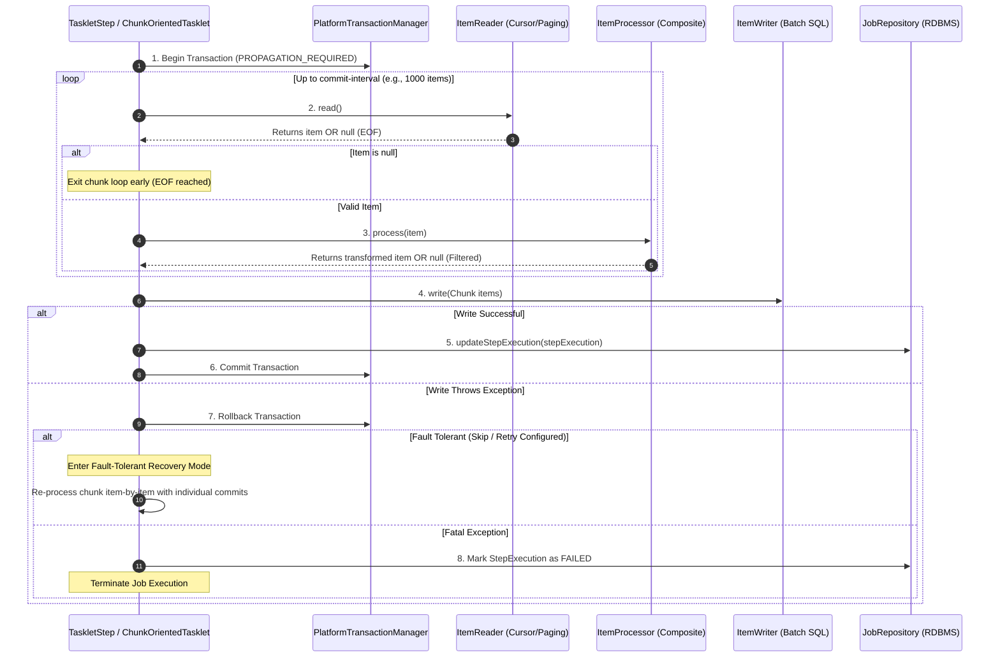
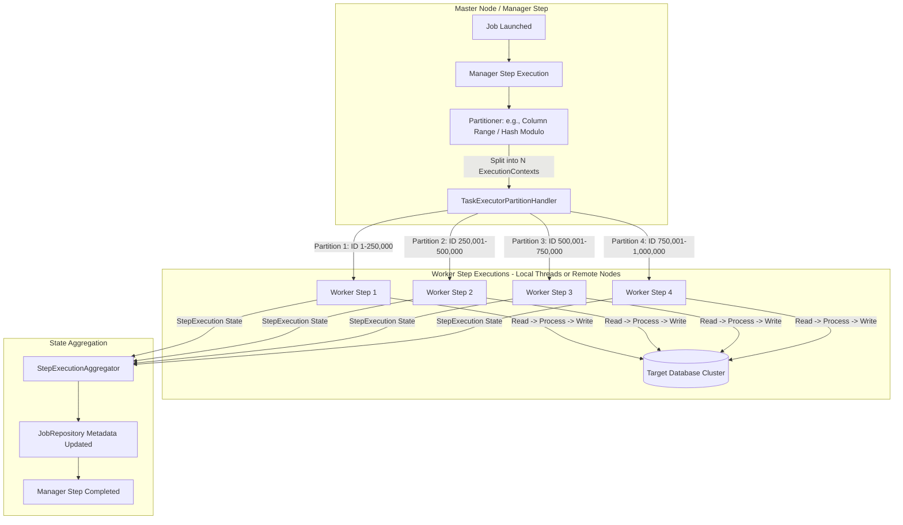
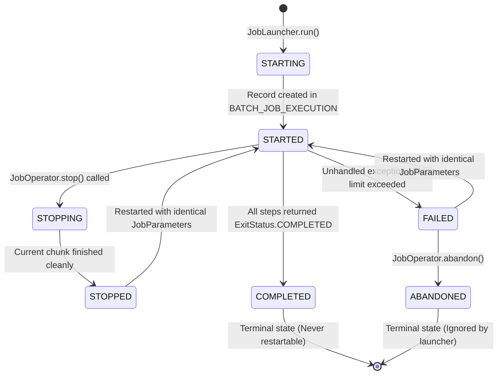

# Master Guide: Spring Batch High-Throughput & Enterprise Architecture (S09 / SP-GAP-04)

> **Document ID:** `S09` | `SP-GAP-04`  
> **Status:** Production-Grade Reference  
> **Focus:** Spring Batch 5.x / Spring Boot 3.x, JobRepository Schemas, Chunk-Oriented Mechanics, Cursor vs Paging, Parallel/Partitioned Processing, Fault Tolerance & War-Room Outages  
> **Target Audience:** Senior Java/Spring Backend Engineers, Data Platform Engineers, Staff Architects  

---

## Executive Summary & Architecture Overview

Spring Batch is the premier enterprise batch processing framework in the Java ecosystem. In mission-critical environments, batch processing is fundamentally different from OLTP (online transaction processing) or event-driven stream processing. While OLTP optimizes for sub-second single-record latency, and stream processing optimizes for continuous unbounded event flows, **Spring Batch optimizes for throughput, deterministic state management, restartability, and atomic transaction demarcation over massive bounded datasets**.

With the advent of **Spring Batch 5.0+** (accompanying Spring Boot 3.0+ and Java 17/21):
1. The framework eliminated legacy abstractions like `JobBuilderFactory` and `StepBuilderFactory` in favor of direct constructor-based builders backed by `JobRepository` and `PlatformTransactionManager`.
2. The legacy annotation `@EnableBatchProcessing` is no longer required or recommended in Spring Boot applications, as it overrides Boot's high-performance autoconfiguration.
3. The underlying `JobRepository` SQL schema was overhauled to support modern 64-bit sequence types (`BIGINT`), flexible JSON serialization for execution contexts, and ISO SQL compatibility.
4. Native support for Java 21 Virtual Threads (Project Loom) unlocks massive parallel scaling for I/O-bound chunk processing without native OS thread exhaustion.

This guide provides deep technical coverage of Spring Batch architecture, database schemas, item reader internals, fault-tolerant retry/skip mechanics, distributed partitioning, 55 progressive real-world scenarios, 10 post-mortems of critical production outages, and 8 architectural anti-patterns.

---

## Track 0: Enterprise Jargon-Buster & Terminology Matrix

| Term | Technical Definition | Common Misconception | Production Impact |
| :--- | :--- | :--- | :--- |
| **`Job`** | The complete end-to-end batch workflow configuration representing the entire pipeline. | Believing a `Job` is a single executable run. | A `Job` is only a static blueprint; instances of it execute over time. |
| **`JobInstance`** | A logical job execution identified uniquely by the Job name and its identifying `JobParameters`. | Confusing `JobInstance` with a single run attempt. | Once a `JobInstance` reaches `COMPLETED`, it can **never** be run again with the same parameters. |
| **`JobExecution`** | A single physical attempt to run a `JobInstance`. Has start time, end time, exit status, and failure exceptions. | Assuming only one `JobExecution` exists per `JobInstance`. | A failed `JobInstance` can have multiple `JobExecution` attempts until it completes or is abandoned. |
| **`Step`** | An independent, sequential phase of a batch job, containing chunk configuration or a single tasklet. | Thinking steps must always be chunk-based. | Steps can be tasklets, chunk-oriented, partitioned, or flow-controlling decisions. |
| **`StepExecution`** | A physical execution attempt of a `Step` within a `JobExecution`. Tracks read count, write count, skip count, and commit count. | Overlooking that step execution metrics are persisted transactionally in `JobRepository`. | Critical for monitoring, SLAs, and idempotency tracking. |
| **`ExecutionContext`** | A thread-safe, transactional key-value store persisted in the database per `JobExecution` and `StepExecution`. | Using it as an in-memory cache for large domain objects. | Storing non-serializable or huge payloads exhausts database BLOB columns or causes Jackson deserialization crashes. |
| **`JobParameters`** | A set of key-value pairs passed to a job launch. Can be identifying or non-identifying. | Believing all parameters determine `JobInstance` uniqueness. | Non-identifying parameters (`identifying=false`) do not alter the `JobKey` hash. |
| **`JobRepository`** | The persistence mechanism (usually RDBMS) that stores metadata for jobs, steps, executions, and contexts. | Believing it can be an in-memory map in production. | In-memory repository loses all restartability and idempotency guarantees upon container restart. |
| **`JobLauncher`** | The engine that accepts a `Job` and `JobParameters` and executes the initial `JobExecution`. | Thinking `launch()` is always asynchronous. | In standard Spring Boot, `TaskExecutorJobLauncher` defaults to synchronous execution on the calling thread. |
| **`JobOperator`** | Low-level management interface for starting, stopping, restarting, and abandoning jobs via JMX or HTTP. | Confusing it with `JobLauncher`. | `JobOperator` operates on execution IDs and parameter strings, ideal for REST controllers and CLI tools. |
| **`Chunk-Oriented`** | An item-based processing model where items are read one by one, processed one by one, and written in bulk. | Thinking reading and processing happen in batch. | Reading and processing are sequential single-item operations; only writing is batched. |
| **`commit-interval`** | The number of items processed before committing the transaction to the database and `JobRepository`. | Believing bigger commit intervals always mean higher throughput. | Overly large chunks cause heap memory pressure, huge rollback costs, and database lock contention. |
| **`ItemReader`** | Interface (`read()`) returning a single domain item or `null` when the data source is exhausted. | Returning an empty list or collection instead of `null` at EOF. | Returning non-null indefinitely causes an infinite batch processing loop. |
| **`ItemProcessor`** | Interface (`process(I item) -> O`) transforming or filtering items. Returning `null` filters the item out. | Throwing an exception just to drop/filter an unwanted item. | Returning `null` cleanly decrements process count without triggering fault-tolerance rollback loops. |
| **`ItemWriter`** | Interface (`write(Chunk<? extends O> chunk)`) persisting a collection of items in one atomic operation. | Executing single row SQL queries in a loop inside `write()`. | Destroys throughput. Must use batched JDBC statements (`rewriteBatchedStatements=true`). |
| **`SkipPolicy`** | Rules determining whether a specific exception during read, process, or write should skip the item. | Thinking write skips skip only the bad item immediately. | In writes, a skip triggers chunk rollback, item-by-item re-processing, and individual commits! |
| **`RetryPolicy`** | Strategy determining how many times a transient failure (e.g., deadlock, timeout) is retried before failing. | Retrying deterministic non-transient exceptions (e.g., `NullPointerException`). | Wastes CPU and connection time retrying errors that will never succeed. |
| **`@StepScope`** | Late-binding Spring bean scope where bean lifecycle matches step execution. | Thinking step-scoped beans are thread-safe singletons. | Creates a new CGLIB proxy instance per step execution, resolving SpEL parameters at runtime. |
| **`@JobScope`** | Late-binding scope where bean lifecycle matches job execution. | Using `@StepScope` when job-level parameters are needed. | Allows sharing state across steps within the same job execution via SpEL expressions. |
| **`JdbcCursorItemReader`**| Streaming reader holding an open database connection and cursor for the duration of the step. | Using it across multiple threads in a parallel step. | Cursors are inherently stateful and not thread-safe. Concurrent reads corrupt the ResultSet pointer. |
| **`JdbcPagingItemReader`**| Chunked paging reader executing discrete SQL queries per page with `OFFSET`/`LIMIT` or keyset pagination. | Forgetting to specify unique sort keys. | Without deterministic sorting, rows shift between page queries, leading to duplicate or missed items. |
| **`TaskExecutor`** | Thread pool executing chunks or steps concurrently. | Using `ThreadPoolTaskExecutor` directly with non-thread-safe readers. | Multi-threaded steps require synchronized reader decorators (`SynchronizedItemReader`). |
| **`Partitioner`** | Strategy splitting a step's workload into distinct sub-sets (partitions) executed by worker steps. | Confusing partitioning with multi-threaded chunk processing. | Partitioning uses isolated readers per thread, eliminating cursor synchronization bottlenecks. |
| **`Remote Chunking`** | Architecture where a manager step reads chunks and dispatches them via message brokers to remote workers. | Using remote chunking when data transfer network cost exceeds processing cost. | High network serialization overhead can throttle throughput; ideal only for CPU-intensive processing. |
| **`Remote Partitioning`**| Architecture where manager assigns parameter ranges to remote workers who read, process, and write independently.| Assuming manager receives processed items. | Workers communicate directly with their own databases; manager only aggregates step execution metadata. |

---

## Track 1: Foundations & Core Concepts

### 1.1 The Batch Mental Model vs Stream vs OLTP

To architect high-throughput batch systems, engineers must establish clear cognitive boundaries between OLTP, Stream Processing, and Batch Processing:

```
+---------------------------------------------------------------------------------------------------+
| DIMENSION               | OLTP (Online)            | STREAMING (Event-Driven) | BATCH (Chunk-Oriented)    |
+-------------------------+--------------------------+--------------------------+---------------------------+
| Latency Requirement     | Milliseconds (< 100ms)   | Milliseconds to Seconds  | Minutes to Hours (SLAs)   |
| Dataset Boundary        | Single Transaction       | Unbounded (Infinite)     | Bounded (Finite)          |
| Transaction Demarcation | Per Request (ACID)       | Exactly-Once / At-Least  | Per Chunk (Commit-Interval)|
| Failure Recovery        | Immediate User Retry     | Replay from Offset       | Checkpointed Restart      |
| Resource Optimization   | Concurrency & Fast Locks | Memory & Event Buffers   | I/O Saturation & Batching |
| Concurrency Target      | 10,000+ Concurrent Req   | Continuous Pipelines     | 1 - 64 Saturated Cores    |
+---------------------------------------------------------------------------------------------------+
```

### 1.2 Core Domain Abstractions

The Spring Batch domain model is strictly hierarchical:

1. **`Job`**: Encapsulates the entire workflow. It is built as a state machine of steps (`StepBuilder` $\to$ `JobBuilder`).
2. **`JobInstance`**: Represents a distinct business run. A job named `statementGenerationJob` with parameters `month=2026-10` represents a single `JobInstance`.
3. **`JobExecution`**: Represents an individual attempt. If the October statement job fails due to an out-of-disk-space error, the first `JobExecution` ends with status `FAILED`. Once disk space is allocated, launching the job with the exact same parameters creates a *second* `JobExecution` linked to the *same* `JobInstance`.
4. **`StepExecution`**: Represents the physical execution of a step. It maintains precise execution metrics:
   - `readCount`: Items returned by `ItemReader`.
   - `writeCount`: Items successfully committed by `ItemWriter`.
   - `commitCount`: Number of database transactions committed.
   - `rollbackCount`: Number of database transactions rolled back.
   - `readSkipCount`, `processSkipCount`, `writeSkipCount`: Items bypassed via `SkipPolicy`.
   - `filterCount`: Items dropped when `ItemProcessor` returned `null`.
5. **`ExecutionContext`**: A persistent memento pattern. Spring Batch stores the reader's current index or cursor state in `StepExecution.executionContext`. If a step crashes after 1,450,000 items, the next execution rehydrates this context, seeks to item 1,450,001, and resumes processing without duplicate reprocessing.

### 1.3 Spring Batch 5.x Modern Configuration Paradigm

In Spring Batch 4.x and earlier, applications relied heavily on `@EnableBatchProcessing`, `JobBuilderFactory`, and `StepBuilderFactory`. In Spring Batch 5.x, these factories were deprecated and removed. Modern configuration utilizes direct bean injection of `JobRepository` and `PlatformTransactionManager`.

```java
package com.enterprise.batch.config;

import org.springframework.batch.core.Job;
import org.springframework.batch.core.Step;
import org.springframework.batch.core.job.builder.JobBuilder;
import org.springframework.batch.core.repository.JobRepository;
import org.springframework.batch.core.step.builder.StepBuilder;
import org.springframework.batch.item.ItemProcessor;
import org.springframework.batch.item.ItemReader;
import org.springframework.batch.item.ItemWriter;
import org.springframework.context.annotation.Bean;
import org.springframework.context.annotation.Configuration;
import org.springframework.transaction.PlatformTransactionManager;

@Configuration
public class ModernBatchConfig {

    private final JobRepository jobRepository;
    private final PlatformTransactionManager transactionManager;

    public ModernBatchConfig(JobRepository jobRepository, 
                             PlatformTransactionManager transactionManager) {
        this.jobRepository = jobRepository;
        this.transactionManager = transactionManager;
    }

    @Bean
    public Step financialIngestionStep(ItemReader<TransactionInput> reader,
                                       ItemProcessor<TransactionInput, TransactionRecord> processor,
                                       ItemWriter<TransactionRecord> writer) {
        return new StepBuilder("financialIngestionStep", jobRepository)
                .<TransactionInput, TransactionRecord>chunk(1000, transactionManager)
                .reader(reader)
                .processor(processor)
                .writer(writer)
                .faultTolerant()
                .skip(CorruptRecordException.class)
                .skipLimit(50)
                .retry(DatabaseTransientException.class)
                .retryLimit(3)
                .build();
    }

    @Bean
    public Job financialIngestionJob(Step financialIngestionStep) {
        return new JobBuilder("financialIngestionJob", jobRepository)
                .start(financialIngestionStep)
                .build();
    }
}
```

---

## Track 2: Enterprise Architecture & Execution Workflows

### 2.1 Chunk-Oriented Processing Lifecycle

The chunk processing pipeline is the core engine of Spring Batch. Below is the precise operational sequence that occurs within every chunk iteration:



### 2.2 Master-Worker Partitioning Architecture

When a single JVM thread cannot meet SLA requirements, Partitioning divides the workload into independent slices. Each worker operates its own complete chunk-oriented step with its own `ItemReader`, avoiding synchronized contention:



### 2.3 JobRepository State Machine & Execution Lifecycle



---

## Track 3: Low-Level Database Mechanics & Execution Internals

### 3.1 The Complete JobRepository Schema Deep-Dive

Spring Batch relies on 6 relational tables to ensure ACID compliance, idempotency, and state persistence. In high-throughput systems, database administrators and software architects must understand every column, index, and constraint.

```sql
-- ==============================================================================
-- 1. BATCH_JOB_INSTANCE: Unique business identity of a batch job
-- ==============================================================================
CREATE TABLE BATCH_JOB_INSTANCE (
    JOB_INSTANCE_ID BIGINT GENERATED BY DEFAULT AS IDENTITY PRIMARY KEY,
    VERSION BIGINT,
    JOB_NAME VARCHAR(100) NOT NULL,
    JOB_KEY VARCHAR(32) NOT NULL,
    CONSTRAINT JOB_INST_UN UNIQUE (JOB_NAME, JOB_KEY)
);
CREATE INDEX IDX_JOB_INST_NAME ON BATCH_JOB_INSTANCE(JOB_NAME);

-- ==============================================================================
-- 2. BATCH_JOB_EXECUTION: Physical execution attempt of a JobInstance
-- ==============================================================================
CREATE TABLE BATCH_JOB_EXECUTION (
    JOB_EXECUTION_ID BIGINT GENERATED BY DEFAULT AS IDENTITY PRIMARY KEY,
    VERSION BIGINT,
    JOB_INSTANCE_ID BIGINT NOT NULL,
    CREATE_TIME TIMESTAMP NOT NULL,
    START_TIME TIMESTAMP DEFAULT NULL,
    END_TIME TIMESTAMP DEFAULT NULL,
    STATUS VARCHAR(10),
    EXIT_CODE VARCHAR(2500),
    EXIT_MESSAGE VARCHAR(2500),
    LAST_UPDATED TIMESTAMP,
    CONSTRAINT JOB_INST_EXEC_FK FOREIGN KEY (JOB_INSTANCE_ID)
        REFERENCES BATCH_JOB_INSTANCE(JOB_INSTANCE_ID)
);
CREATE INDEX IDX_JOB_EXEC_INST ON BATCH_JOB_EXECUTION(JOB_INSTANCE_ID);
CREATE INDEX IDX_JOB_EXEC_STATUS ON BATCH_JOB_EXECUTION(STATUS);

-- ==============================================================================
-- 3. BATCH_JOB_EXECUTION_PARAMS: Parameters passed to a JobExecution
-- ==============================================================================
CREATE TABLE BATCH_JOB_EXECUTION_PARAMS (
    JOB_EXECUTION_ID BIGINT NOT NULL,
    PARAMETER_NAME VARCHAR(100) NOT NULL,
    PARAMETER_TYPE VARCHAR(100) NOT NULL,
    PARAMETER_VALUE VARCHAR(2500),
    IDENTIFYING CHAR(1) NOT NULL,
    CONSTRAINT JOB_EXEC_PARAMS_FK FOREIGN KEY (JOB_EXECUTION_ID)
        REFERENCES BATCH_JOB_EXECUTION(JOB_EXECUTION_ID)
);
CREATE INDEX IDX_JOB_PARAMS_EXEC ON BATCH_JOB_EXECUTION_PARAMS(JOB_EXECUTION_ID);

-- ==============================================================================
-- 4. BATCH_STEP_EXECUTION: Execution metrics of a Step within a JobExecution
-- ==============================================================================
CREATE TABLE BATCH_STEP_EXECUTION (
    STEP_EXECUTION_ID BIGINT GENERATED BY DEFAULT AS IDENTITY PRIMARY KEY,
    VERSION BIGINT NOT NULL,
    STEP_NAME VARCHAR(100) NOT NULL,
    JOB_EXECUTION_ID BIGINT NOT NULL,
    CREATE_TIME TIMESTAMP NOT NULL,
    START_TIME TIMESTAMP DEFAULT NULL,
    END_TIME TIMESTAMP DEFAULT NULL,
    STATUS VARCHAR(10),
    COMMIT_COUNT BIGINT,
    READ_COUNT BIGINT,
    FILTER_COUNT BIGINT,
    WRITE_COUNT BIGINT,
    READ_SKIP_COUNT BIGINT,
    WRITE_SKIP_COUNT BIGINT,
    PROCESS_SKIP_COUNT BIGINT,
    ROLLBACK_COUNT BIGINT,
    EXIT_CODE VARCHAR(2500),
    EXIT_MESSAGE VARCHAR(2500),
    LAST_UPDATED TIMESTAMP,
    CONSTRAINT JOB_EXEC_STEP_FK FOREIGN KEY (JOB_EXECUTION_ID)
        REFERENCES BATCH_JOB_EXECUTION(JOB_EXECUTION_ID)
);
CREATE INDEX IDX_STEP_EXEC_JOB_EXEC ON BATCH_STEP_EXECUTION(JOB_EXECUTION_ID);
CREATE INDEX IDX_STEP_EXEC_NAME ON BATCH_STEP_EXECUTION(STEP_NAME);

-- ==============================================================================
-- 5. BATCH_STEP_EXECUTION_CONTEXT: Serialized state of a StepExecution
-- ==============================================================================
CREATE TABLE BATCH_STEP_EXECUTION_CONTEXT (
    STEP_EXECUTION_ID BIGINT NOT NULL PRIMARY KEY,
    SHORT_CONTEXT VARCHAR(2500) NOT NULL,
    SERIALIZED_CONTEXT CLOB,
    CONSTRAINT STEP_EXEC_CTX_FK FOREIGN KEY (STEP_EXECUTION_ID)
        REFERENCES BATCH_STEP_EXECUTION(STEP_EXECUTION_ID)
);

-- ==============================================================================
-- 6. BATCH_JOB_EXECUTION_CONTEXT: Serialized state of a JobExecution
-- ==============================================================================
CREATE TABLE BATCH_JOB_EXECUTION_CONTEXT (
    JOB_EXECUTION_ID BIGINT NOT NULL PRIMARY KEY,
    SHORT_CONTEXT VARCHAR(2500) NOT NULL,
    SERIALIZED_CONTEXT CLOB,
    CONSTRAINT JOB_EXEC_CTX_FK FOREIGN KEY (JOB_EXECUTION_ID)
        REFERENCES BATCH_JOB_EXECUTION(JOB_EXECUTION_ID)
);
```

#### How `JOB_KEY` Is Computed
The `JOB_KEY` column in `BATCH_JOB_INSTANCE` enforces uniqueness for a given set of identifying parameters. Spring Batch iterates over all `JobParameters` where `identifying == true`, sorts them lexicographically by key name, concatenates them into a deterministic string representation, and computes an MD5 / SHA-256 hash formatted as a 32-character hexadecimal string:

$$\text{JobKey} = \text{MD5}\left(\sum_{i=1}^{n} \text{key}_i + "=" + \text{val}_i + ";" \right)$$

If an engineer launches a job with parameters that match an already `COMPLETED` `JobInstance`, Spring Batch throws `JobInstanceAlreadyCompleteException`.

---

### 3.2 Reader Internals: Cursor vs Paging vs Reactive

Selecting between Cursor-based reading and Paging-based reading is the single most critical architectural decision affecting JVM memory and database connection longevity.

```
+-----------------------------+------------------------------------+------------------------------------+
| FEATURE                     | CURSOR-BASED (JdbcCursorItemReader)| PAGING-BASED (JdbcPagingItemReader)|
+-----------------------------+------------------------------------+------------------------------------+
| DB Connection Usage         | 1 open connection for ENTIRE step  | Opens & closes connection per page |
| Database Memory (Server)    | High (Server maintains cursor)     | Low (Stateless discrete queries)   |
| JVM Client Memory           | Low (Streams row by row)           | Moderate (Holds full page in heap) |
| Latency / Speed             | Extremely Fast (No offset penalty) | Slower on deep offsets (O(N) seek) |
| Thread-Safety               | NOT Thread-Safe (Corrupts pointer) | Thread-Safe (Synchronized paging)  |
| Network Socket Timeout Risk | High (Long-lived idle connection)  | Zero (Independent short queries)   |
| Suitability                 | Single-Threaded sequential batches | Multi-Threaded / Parallel steps    |
+-----------------------------+------------------------------------+------------------------------------+
```

#### 3.2.1 Deep Dive: `JdbcCursorItemReader` Socket Timeout Trap
In PostgreSQL and MySQL, a `JdbcCursorItemReader` keeps a single `java.sql.ResultSet` open. If `ItemProcessor` performs an expensive operation (e.g., ML scoring, PDF generation) taking 150ms per item, and the chunk size is 1,000, the reader remains idle between chunks for 150 seconds. If firewalls or cloud gateways (e.g., AWS NAT Gateway, Azure Load Balancer) have an idle TCP connection timeout of 60 seconds, the connection is silently dropped with `SocketException: Connection reset by peer` or `PostgreSQL: Connection to server lost`.

To configure a production-grade cursor reader for MySQL and PostgreSQL:

```java
@Bean
@StepScope
public JdbcCursorItemReader<TradeOrder> tradeOrderCursorReader(DataSource dataSource) {
    JdbcCursorItemReader<TradeOrder> reader = new JdbcCursorItemReaderBuilder<TradeOrder>()
            .name("tradeOrderCursorReader")
            .dataSource(dataSource)
            .sql("SELECT order_id, account_id, symbol, quantity, price, order_date " +
                 "FROM trade_orders WHERE status = 'PENDING' ORDER BY order_id ASC")
            .rowMapper((rs, rowNum) -> new TradeOrder(
                    rs.getLong("order_id"),
                    rs.getString("account_id"),
                    rs.getString("symbol"),
                    rs.getBigDecimal("quantity"),
                    rs.getBigDecimal("price"),
                    rs.getTimestamp("order_date").toInstant()
            ))
            // MySQL: Integer.MIN_VALUE forces true streaming cursor (RowDataDynamic)
            // PostgreSQL: setFetchSize(1000) creates a named server-side portal cursor
            .fetchSize(1000)
            .ignoreWarnings(true)
            .verifyCursorPosition(true)
            .build();
    
    // Enforce that this reader participates in ExecutionContext persistence
    reader.setSaveState(true);
    return reader;
}
```

#### 3.2.2 Deep Dive: `JdbcPagingItemReader` Keyset Optimization
Standard SQL `OFFSET` pagination degrades quadratically ($O(N^2)$) as data scales to millions of records, because the database must scan and discard all preceding offset rows. Spring Batch's `PagingQueryProvider` addresses this via native windowing functions or keyset seeking:

```java
@Bean
@StepScope
public JdbcPagingItemReader<TradeOrder> tradeOrderPagingReader(DataSource dataSource) {
    MySqlPagingQueryProvider queryProvider = new MySqlPagingQueryProvider();
    queryProvider.setSelectClause("SELECT order_id, account_id, symbol, quantity, price, order_date");
    queryProvider.setFromClause("FROM trade_orders");
    queryProvider.setWhereClause("WHERE status = 'PENDING'");
    
    // Sort keys MUST uniquely identify every row to guarantee deterministic paging
    Map<String, Order> sortKeys = new LinkedHashMap<>();
    sortKeys.put("order_id", Order.ASCENDING);
    queryProvider.setSortKeys(sortKeys);

    return new JdbcPagingItemReaderBuilder<TradeOrder>()
            .name("tradeOrderPagingReader")
            .dataSource(dataSource)
            .queryProvider(queryProvider)
            .pageSize(1000)
            .rowMapper(new TradeOrderRowMapper())
            .saveState(true)
            .build();
}
```

---

### 3.3 JDBC Batch Statement Rewriting

A massive bottleneck in Spring Batch implementations is naive batch writing. When an `ItemWriter` executes `PreparedStatement.addBatch()` and `executeBatch()`, JDBC drivers by default still send individual SQL statements over the wire one by one unless explicit batch rewriting parameters are configured.

#### MySQL Connection Optimization
Without `rewriteBatchedStatements=true`, executing 1,000 inserts sends 1,000 distinct network packets to MySQL:

```properties
# ❌ SLOW: 1,000 round-trip packets per chunk
spring.datasource.url=jdbc:mysql://db-primary:3306/finance_db

# ✅ HIGH-THROUGHPUT: Re-writes 1,000 inserts into 1 multi-value insert statement
# INSERT INTO audit_log (id, val) VALUES (1, 'A'), (2, 'B'), (3, 'C')...
spring.datasource.url=jdbc:mysql://db-primary:3306/finance_db?rewriteBatchedStatements=true&cachePrepStmts=true&prepStmtCacheSize=250&prepStmtCacheSqlLimit=2048&useServerPrepStmts=true
```

#### PostgreSQL Connection Optimization
PostgreSQL requires `reWriteBatchedInserts=true`:

```properties
spring.datasource.url=jdbc:postgresql://db-primary:5432/finance_db?reWriteBatchedInserts=true&defaultRowFetchSize=1000
```

---

### 3.4 Fault Tolerance Internals: Skip, Retry, and the Rollback Loop

When an exception occurs during the chunk lifecycle, Spring Batch executes a precise recovery protocol governed by the configured `SkipPolicy` and `RetryPolicy`.

```
+---------------------------------------------------------------------------------------------------+
| LIFECYCLE PHASE | EXCEPTION OCCURS | SKIP BEHAVIOR                                                |
+-----------------+------------------+--------------------------------------------------------------+
| Read Phase      | read() throws E  | No transaction rollback. Item is discarded. readSkipCount++  |
| Process Phase   | process() throws | Transaction is NOT rolled back immediately. Item discarded.  |
| Write Phase     | write() throws E | ⚠️ TRANSACTION ROLLS BACK IMMEDIATELY!                      |
|                 |                  | Chunk is unwound. Step switches to single-item commit mode.  |
|                 |                  | Each item is re-processed and re-written ONE BY ONE!         |
+---------------------------------------------------------------------------------------------------+
```

#### The Write Skip Amplification Storm
If your chunk size is 5,000 and item #4,999 violates a unique constraint during `ItemWriter.write()`, the entire chunk of 5,000 items rolls back. Spring Batch then enters single-item mode:
1. It begins a new transaction for item 1, calls `process(item1)`, calls `write(Collections.singletonList(item1))`, and commits.
2. It repeats this for all items until it reaches item 4,999.
3. Item 4,999 throws the exception again, matches the `SkipPolicy`, and is skipped (`writeSkipCount++`).
4. Item 5,000 is processed, written, and committed.
5. The step resumes regular 5,000-item chunks.

If `ItemProcessor` makes an external HTTP REST call, that external call will be executed twice for all 5,000 items (once in the initial chunk, and once during the recovery loop), causing a massive latency spike and potential API rate-limit violations unless the processor is marked as idempotent or cached.

---

## Track 4: 55 Progressive Real-World Scenarios

### Section 4.1: Beginner to Foundational Scenarios (1–15)

#### Scenario 1: Passing Dynamic JobParameters with Date Parsing via SpEL
- **Requirement:** Launch a daily transaction reconciliation job where the business date (`YYYY-MM-DD`) is passed as a string parameter and injected directly into a step-scoped component.
- **Implementation:**
```java
@Component
@StepScope
public class DailyReconciliationReader extends ItemStreamSupport implements ItemReader<TransactionRecord> {

    private final LocalDate targetDate;
    private final DataSource dataSource;
    private Iterator<TransactionRecord> iterator;

    public DailyReconciliationReader(
            @Value("#{jobParameters['reconciliationDate']}") String dateStr,
            DataSource dataSource) {
        this.targetDate = LocalDate.parse(dateStr, DateTimeFormatter.ISO_LOCAL_DATE);
        this.dataSource = dataSource;
    }

    @Override
    public void open(ExecutionContext executionContext) {
        List<TransactionRecord> records = fetchRecordsForDate(targetDate);
        this.iterator = records.iterator();
    }

    @Override
    public TransactionRecord read() {
        return (iterator != null && iterator.hasNext()) ? iterator.next() : null;
    }

    private List<TransactionRecord> fetchRecordsForDate(LocalDate date) {
        JdbcTemplate jdbcTemplate = new JdbcTemplate(dataSource);
        return jdbcTemplate.query(
            "SELECT id, amount, account_id FROM transactions WHERE tx_date = ?",
            (rs, rowNum) -> new TransactionRecord(rs.getLong("id"), rs.getBigDecimal("amount"), rs.getString("account_id")),
            java.sql.Date.valueOf(date)
        );
    }
}
```

#### Scenario 2: Tokenizing Flat CSV Files with DelimitedLineTokenizer
- **Requirement:** Ingest high-volume CSV files containing arbitrary quotes, commas within quoted strings, and header validation.
```java
@Bean
@StepScope
public FlatFileItemReader<CustomerCsvDto> customerCsvReader(
        @Value("#{jobParameters['inputFilePath']}") String filePath) {
    return new FlatFileItemReaderBuilder<CustomerCsvDto>()
            .name("customerCsvReader")
            .resource(new FileSystemResource(filePath))
            .linesToSkip(1) // Skip header line
            .delimited()
            .delimiter(",")
            .quoteCharacter('"')
            .names("customerId", "fullName", "email", "creditScore", "balance")
            .fieldSetMapper(new BeanWrapperFieldSetMapper<>() {{
                setTargetType(CustomerCsvDto.class);
            }})
            .strict(true) // Fail if file is missing
            .build();
}
```

#### Scenario 3: CompositeItemProcessor for Clean Separation of Concerns
- **Requirement:** Execute validation, currency conversion, and fraud enrichment sequentially using independent decoupled processor beans.
```java
@Bean
public CompositeItemProcessor<RawTransaction, EnrichedTransaction> compositeTransactionProcessor(
        ValidationProcessor valProcessor,
        CurrencyConversionProcessor currProcessor,
        FraudScoringProcessor fraudProcessor) {
    CompositeItemProcessor<RawTransaction, EnrichedTransaction> composite = new CompositeItemProcessor<>();
    composite.setDelegates(Arrays.asList(valProcessor, currProcessor, fraudProcessor));
    return composite;
}
```

#### Scenario 4: StepExecutionListener for Dynamically Updating Thread MDC
- **Requirement:** Propagate Job ID and Step Name into SLF4J / Logback MDC for distributed tracing across cloud log forwarders.
```java
@Component
public class LoggingStepExecutionListener implements StepExecutionListener {
    @Override
    public void beforeStep(StepExecution stepExecution) {
        MDC.put("jobId", String.valueOf(stepExecution.getJobExecution().getJobId()));
        MDC.put("jobName", stepExecution.getJobExecution().getJobInstance().getJobName());
        MDC.put("stepName", stepExecution.getStepName());
        MDC.put("stepExecutionId", String.valueOf(stepExecution.getId()));
    }

    @Override
    public ExitStatus afterStep(StepExecution stepExecution) {
        MDC.clear();
        return stepExecution.getExitStatus();
    }
}
```

#### Scenario 5: Conditional Step Flow Execution (`on().to()`)
- **Requirement:** If Step 1 exits with `COMPLETED_WITH_WARNINGS`, branch to an alert dispatching step; otherwise proceed directly to Step 2.
```java
@Bean
public Job conditionalBranchingJob(JobRepository jobRepository,
                                  Step primaryIngestionStep,
                                  Step alertDispatchStep,
                                  Step archiveStep) {
    return new JobBuilder("conditionalBranchingJob", jobRepository)
            .start(primaryIngestionStep)
                .on("COMPLETED_WITH_WARNINGS").to(alertDispatchStep)
                .from(primaryIngestionStep)
                .on("*").to(archiveStep)
            .end()
            .build();
}
```

#### Scenario 6: Non-Identifying Job Parameters for Trigger Timestamps
- **Requirement:** Allow scheduling a job every 5 minutes with identical business parameters without creating distinct `JobInstance` records, while tracking run timestamps.
```java
JobParameters params = new JobParametersBuilder()
        .addString("tenantId", "TENANT_US_EAST", true) // Identifying (Creates JobInstance)
        .addLocalDate("processingDate", LocalDate.now(), true) // Identifying
        .addLong("runTimestamp", System.currentTimeMillis(), false) // Non-identifying (Runs as new JobExecution on same instance if failed)
        .toJobParameters();
```

#### Scenario 7: High-Throughput `JdbcBatchItemWriter` with Named Parameters
- **Requirement:** Batch insert 2,000 rows per round trip into an audit ledger table using SQL named parameter mapping.
```java
@Bean
public JdbcBatchItemWriter<AuditLedgerEntry> auditLedgerWriter(DataSource dataSource) {
    return new JdbcBatchItemWriterBuilder<AuditLedgerEntry>()
            .dataSource(dataSource)
            .sql("INSERT INTO audit_ledger (event_id, entity_type, entity_id, payload, created_at) " +
                 "VALUES (:eventId, :entityType, :entityId, :payload, :createdAt)")
            .beanMapped()
            .assertUpdates(false) // Prevents batch update exception if DB returns 0 rows updated on ignore
            .build();
}
```

#### Scenario 8: Custom LineMapper for Polymorphic Records in Flat Files
- **Requirement:** Process flat files containing both Header (`H`), Detail (`D`), and Trailer (`T`) records within a single file stream.
```java
public class PolymorphicPatternMatcherLineMapper implements LineMapper<FileLineRecord> {
    private final PatternMatchingCompositeLineTokenizer tokenizer;
    private final Map<String, FieldSetMapper<FileLineRecord>> fieldSetMappers;

    public PolymorphicPatternMatcherLineMapper(
            PatternMatchingCompositeLineTokenizer tokenizer,
            Map<String, FieldSetMapper<FileLineRecord>> fieldSetMappers) {
        this.tokenizer = tokenizer;
        this.fieldSetMappers = fieldSetMappers;
    }

    @Override
    public FileLineRecord mapLine(String line, int lineNumber) throws Exception {
        FieldSet fs = tokenizer.tokenize(line);
        String recordType = line.substring(0, 1);
        FieldSetMapper<FileLineRecord> mapper = fieldSetMappers.get(recordType);
        if (mapper == null) {
            throw new IllegalArgumentException("Unknown record type prefix: " + recordType + " at line " + lineNumber);
        }
        return mapper.mapFieldSet(fs);
    }
}
```

#### Scenario 9: Tasklet Implementation for Clean Staging Directory Purging
- **Requirement:** Execute an atomic, non-chunked preparatory step that wipes temporary S3 download folders prior to processing.
```java
@Bean
public Step purgeStagingDirectoryStep(JobRepository jobRepository, 
                                     PlatformTransactionManager transactionManager,
                                     @Value("${batch.staging.dir:/tmp/batch-staging}") String stagingDir) {
    return new StepBuilder("purgeStagingDirectoryStep", jobRepository)
            .tasklet((contribution, chunkContext) -> {
                Path dir = Paths.get(stagingDir);
                if (Files.exists(dir)) {
                    try (Stream<Path> walk = Files.walk(dir)) {
                        walk.sorted(Comparator.reverseOrder())
                            .filter(p -> !p.equals(dir))
                            .forEach(p -> {
                                try { Files.delete(p); } catch (IOException e) { throw new UncheckedIOException(e); }
                            });
                    }
                }
                Files.createDirectories(dir);
                return RepeatStatus.FINISHED;
            }, transactionManager)
            .build();
}
```

#### Scenario 10: Graceful Item Filtering in `ItemProcessor`
- **Requirement:** Filter out inactive accounts without throwing exceptions or incrementing skip counts.
```java
@Component
public class InactiveAccountFilterProcessor implements ItemProcessor<AccountRecord, ValidatedAccount> {
    @Override
    public ValidatedAccount process(AccountRecord record) {
        if (!"ACTIVE".equalsIgnoreCase(record.getStatus())) {
            // Returning null causes Spring Batch to drop the item silently
            // StepExecution.filterCount will be incremented
            return null;
        }
        return new ValidatedAccount(record.getAccountId(), record.getBalance(), record.getTier());
    }
}
```

#### Scenario 11: Validating `JobParameters` with `DefaultJobParametersValidator`
- **Requirement:** Prevent job launch immediately if mandatory parameters are missing or unexpected keys are supplied.
```java
@Bean
public Job validatedIngestionJob(JobRepository jobRepository, Step mainStep) {
    DefaultJobParametersValidator validator = new DefaultJobParametersValidator();
    validator.setRequiredKeys(new String[]{"inputPath", "businessDate", "operatorId"});
    validator.setOptionalKeys(new String[]{"dryRun", "chunkSizeOverride"});

    return new JobBuilder("validatedIngestionJob", jobRepository)
            .validator(validator)
            .start(mainStep)
            .build();
}
```

#### Scenario 12: Updating `ExecutionContext` Safely during Step Execution
- **Requirement:** Maintain running aggregate counts (e.g., total dollar volume) in `StepExecutionContext` for recovery reporting.
```java
@Component
@StepScope
public class AggregatingItemWriter implements ItemWriter<FinancialTransaction>, StepExecutionListener {
    private StepExecution stepExecution;
    private BigDecimal cumulativeAmount = BigDecimal.ZERO;

    @Override
    public void beforeStep(StepExecution stepExecution) {
        this.stepExecution = stepExecution;
        ExecutionContext ctx = stepExecution.getExecutionContext();
        if (ctx.containsKey("runningVolume")) {
            this.cumulativeAmount = new BigDecimal(ctx.getString("runningVolume"));
        }
    }

    @Override
    public void write(Chunk<? extends FinancialTransaction> chunk) {
        for (FinancialTransaction tx : chunk) {
            cumulativeAmount = cumulativeAmount.add(tx.getAmount());
        }
        // Save to ExecutionContext so it is persisted upon chunk commit
        stepExecution.getExecutionContext().putString("runningVolume", cumulativeAmount.toPlainString());
    }
}
```

#### Scenario 13: Multi-Resource Item Reader for Batch Directory Processing
- **Requirement:** Read across 50 partitioned daily CSV files matching a glob pattern (`/data/inbound/*.csv`) as a single unified stream.
```java
@Bean
@StepScope
public MultiResourceItemReader<RawLogEntry> multiFileLogReader(
        @Value("file:/var/log/inbound/*.log") Resource[] resources) {
    return new MultiResourceItemReaderBuilder<RawLogEntry>()
            .name("multiFileLogReader")
            .resources(resources)
            .delegate(singleFileLogReader())
            .build();
}

private FlatFileItemReader<RawLogEntry> singleFileLogReader() {
    return new FlatFileItemReaderBuilder<RawLogEntry>()
            .name("singleFileLogReader")
            .delimited()
            .names("timestamp", "level", "message")
            .targetType(RawLogEntry.class)
            .build();
}
```

#### Scenario 14: JobExecutionDecider for Dynamic Runtime Branching
- **Requirement:** Inspect database table record counts after Step 1 and dynamically decide whether to proceed with heavy indexing or fast-path exit.
```java
public class RecordVolumeDecider implements JobExecutionDecider {
    private final JdbcTemplate jdbcTemplate;

    public RecordVolumeDecider(DataSource dataSource) {
        this.jdbcTemplate = new JdbcTemplate(dataSource);
    }

    @Override
    public FlowExecutionStatus decide(JobExecution jobExecution, StepExecution stepExecution) {
        Integer count = jdbcTemplate.queryForObject("SELECT count(*) FROM staging_events", Integer.class);
        if (count == null || count == 0) {
            return new FlowExecutionStatus("ZERO_RECORDS");
        } else if (count > 1_000_000) {
            return new FlowExecutionStatus("HIGH_VOLUME");
        } else {
            return new FlowExecutionStatus("STANDARD_VOLUME");
        }
    }
}
```

#### Scenario 15: Clean Exit Codes via `CommandLineRunner` / `ApplicationRunner`
- **Requirement:** Launch batch job from a containerized Kubernetes CronJob and propagate non-zero exit codes to the Linux container runtime upon batch failure.
```java
@Component
public class ContainerBatchLauncher implements CommandLineRunner {
    private final JobLauncher jobLauncher;
    private final Job batchJob;

    public ContainerBatchLauncher(JobLauncher jobLauncher, Job batchJob) {
        this.jobLauncher = jobLauncher;
        this.batchJob = batchJob;
    }

    @Override
    public void run(String... args) throws Exception {
        JobParameters params = new JobParametersBuilder()
                .addString("runId", UUID.randomUUID().toString())
                .toJobParameters();
        
        JobExecution execution = jobLauncher.run(batchJob, params);
        if (execution.getStatus() != BatchStatus.COMPLETED) {
            System.err.println("Batch Job failed with status: " + execution.getStatus());
            System.exit(1); // Non-zero exit code marks Kubernetes Pod as Error / CrashLoopBackOff
        }
        System.exit(0);
    }
}
```

---

### Section 4.2: Intermediate to Production Scenarios (16–30)

#### Scenario 16: Custom Classifier-Driven `SkipPolicy`
- **Requirement:** Skip data formatting exceptions and missing payload errors up to 100 occurrences, but fail immediately on fatal database security errors.
```java
public class EnterpriseClassifierSkipPolicy implements SkipPolicy {
    private final int maxSkipLimit;

    public EnterpriseClassifierSkipPolicy(int maxSkipLimit) {
        this.maxSkipLimit = maxSkipLimit;
    }

    @Override
    public boolean shouldSkip(Throwable t, long skipCount) throws SkipLimitExceededException {
        if (skipCount >= maxSkipLimit) {
            return false;
        }
        // Immediate fatal exceptions
        if (t instanceof BadSqlGrammarException || 
            t instanceof CannotGetJdbcConnectionException || 
            t instanceof OutOfMemoryError) {
            return false;
        }
        // Skippable data-level errors
        return t instanceof FlatFileParseException ||
               t instanceof IllegalArgumentException ||
               t instanceof NullPointerException ||
               t instanceof ConstraintViolationException;
    }
}
```

#### Scenario 17: Backoff-Enabled `RetryPolicy` for Database Deadlocks
- **Requirement:** Automatically retry transient deadlocks (`DeadlockLoserDataAccessException`) up to 3 times with exponential backoff before failing the chunk.
```java
@Bean
public Step resilientStep(JobRepository jobRepository, 
                         PlatformTransactionManager transactionManager,
                         ItemReader<OrderRecord> reader,
                         ItemWriter<OrderRecord> writer) {
    return new StepBuilder("resilientStep", jobRepository)
            .<OrderRecord, OrderRecord>chunk(500, transactionManager)
            .reader(reader)
            .writer(writer)
            .faultTolerant()
            .retry(CannotAcquireLockException.class)
            .retry(DeadlockLoserDataAccessException.class)
            .retry(PessimisticLockingFailureException.class)
            .retryLimit(3)
            .backOffPolicy(new ExponentialBackOffPolicy() {{
                setInitialInterval(500); // 500ms
                setMultiplier(2.0);      // 1000ms, 2000ms
                setMaxInterval(5000);    // Max 5s
            }})
            .build();
}
```

#### Scenario 18: Thread-Safe `SynchronizedItemStreamReader` Wrapper
- **Requirement:** Run a single chunk step across 16 threads using `TaskExecutor`, preventing race conditions on a stateful `FlatFileItemReader`.
```java
@Bean
@StepScope
public SynchronizedItemStreamReader<CustomerRecord> synchronizedCustomerReader(
        FlatFileItemReader<CustomerRecord> delegate) {
    SynchronizedItemStreamReader<CustomerRecord> reader = new SynchronizedItemStreamReader<>();
    reader.setDelegate(delegate);
    return reader;
}

@Bean
public Step parallelChunkStep(JobRepository jobRepository,
                             PlatformTransactionManager transactionManager,
                             SynchronizedItemStreamReader<CustomerRecord> reader,
                             ItemWriter<CustomerRecord> writer) {
    ThreadPoolTaskExecutor executor = new ThreadPoolTaskExecutor();
    executor.setCorePoolSize(16);
    executor.setMaxPoolSize(16);
    executor.setQueueCapacity(100);
    executor.setThreadNamePrefix("batch-chunk-");
    executor.initialize();

    return new StepBuilder("parallelChunkStep", jobRepository)
            .<CustomerRecord, CustomerRecord>chunk(1000, transactionManager)
            .reader(reader)
            .writer(writer)
            .taskExecutor(executor)
            .throttleLimit(16)
            .build();
}
```

#### Scenario 19: Asynchronous Item Processing and Writing
- **Requirement:** Decouple CPU-intensive processing from I/O writing using `AsyncItemProcessor` and `AsyncItemWriter`.
```java
@Bean
public AsyncItemProcessor<RawPayload, AnalyzedPayload> asyncProcessor(
        ItemProcessor<RawPayload, AnalyzedPayload> delegate) {
    ThreadPoolTaskExecutor executor = new ThreadPoolTaskExecutor();
    executor.setCorePoolSize(8);
    executor.setMaxPoolSize(8);
    executor.initialize();

    AsyncItemProcessor<RawPayload, AnalyzedPayload> processor = new AsyncItemProcessor<>();
    processor.setDelegate(delegate);
    processor.setTaskExecutor(executor);
    return processor;
}

@Bean
public AsyncItemWriter<AnalyzedPayload> asyncWriter(
        ItemWriter<AnalyzedPayload> delegate) {
    AsyncItemWriter<AnalyzedPayload> writer = new AsyncItemWriter<>();
    writer.setDelegate(delegate);
    return writer;
}
```

#### Scenario 20: Programmatic Job Interruption via `JobOperator`
- **Requirement:** Provide an administrative REST API that gracefully issues a `STOP` signal to an active, long-running batch execution.
```java
@RestController
@RequestMapping("/api/v1/batch")
public class BatchJobManagementController {

    private final JobOperator jobOperator;
    private final JobExplorer jobExplorer;

    public BatchJobManagementController(JobOperator jobOperator, JobExplorer jobExplorer) {
        this.jobOperator = jobOperator;
        this.jobExplorer = jobExplorer;
    }

    @PostMapping("/jobs/executions/{executionId}/stop")
    public ResponseEntity<String> stopJob(@PathVariable long executionId) {
        JobExecution execution = jobExplorer.getJobExecution(executionId);
        if (execution == null) {
            return ResponseEntity.notFound().build();
        }
        if (!execution.isRunning()) {
            return ResponseEntity.badRequest().body("Job execution " + executionId + " is not running.");
        }
        try {
            boolean stopped = jobOperator.stop(executionId);
            return ResponseEntity.ok("Signal sent. Stopped: " + stopped);
        } catch (NoSuchJobExecutionException | JobExecutionNotRunningException e) {
            return ResponseEntity.status(HttpStatus.INTERNAL_SERVER_ERROR).body(e.getMessage());
        }
    }
}
```

#### Scenario 21: Database ID Range `ColumnRangePartitioner`
- **Requirement:** Partition an SQL table of 10,000,000 rows across 8 worker steps using minimum and maximum primary key bounds.
```java
public class ColumnRangePartitioner implements Partitioner {
    private final JdbcTemplate jdbcTemplate;
    private final String table;
    private final String column;

    public ColumnRangePartitioner(DataSource dataSource, String table, String column) {
        this.jdbcTemplate = new JdbcTemplate(dataSource);
        this.table = table;
        this.column = column;
    }

    @Override
    public Map<String, ExecutionContext> partition(int gridSize) {
        long min = jdbcTemplate.queryForObject("SELECT MIN(" + column + ") FROM " + table, Long.class);
        long max = jdbcTemplate.queryForObject("SELECT MAX(" + column + ") FROM " + table, Long.class);
        long targetSize = (max - min) / gridSize + 1;

        Map<String, ExecutionContext> result = new HashMap<>();
        long start = min;
        long end = start + targetSize - 1;

        for (int i = 0; i < gridSize; i++) {
            ExecutionContext context = new ExecutionContext();
            if (end > max) { end = max; }
            context.putLong("minValue", start);
            context.putLong("maxValue", end);
            result.put("partition_" + i, context);
            start += targetSize;
            end += targetSize;
        }
        return result;
    }
}
```

#### Scenario 22: Manager-Worker Step Wiring with `TaskExecutorPartitionHandler`
- **Requirement:** Wire the partitioner from Scenario 21 into a master step executing local parallel worker steps.
```java
@Bean
public Step managerStep(JobRepository jobRepository,
                       Step workerStep,
                       ColumnRangePartitioner partitioner) {
    ThreadPoolTaskExecutor executor = new ThreadPoolTaskExecutor();
    executor.setCorePoolSize(8);
    executor.setMaxPoolSize(8);
    executor.setThreadNamePrefix("part-worker-");
    executor.initialize();

    TaskExecutorPartitionHandler partitionHandler = new TaskExecutorPartitionHandler();
    partitionHandler.setStep(workerStep);
    partitionHandler.setTaskExecutor(executor);
    partitionHandler.setGridSize(8);

    return new StepBuilder("managerStep", jobRepository)
            .partitioner("workerStep", partitioner)
            .partitionHandler(partitionHandler)
            .build();
}
```

#### Scenario 23: Worker Step Consuming Partition Bounds via Late-Binding SpEL
- **Requirement:** Inject partition boundaries `minValue` and `maxValue` into the worker's JDBC reader query.
```java
@Bean
@StepScope
public JdbcPagingItemReader<AccountEntity> workerPagingReader(
        DataSource dataSource,
        @Value("#{stepExecutionContext['minValue']}") Long minValue,
        @Value("#{stepExecutionContext['maxValue']}") Long maxValue) {
    
    MySqlPagingQueryProvider queryProvider = new MySqlPagingQueryProvider();
    queryProvider.setSelectClause("SELECT id, balance, status");
    queryProvider.setFromClause("FROM accounts");
    queryProvider.setWhereClause("WHERE id >= " + minValue + " AND id <= " + maxValue);
    
    Map<String, Order> sortKeys = new LinkedHashMap<>();
    sortKeys.put("id", Order.ASCENDING);
    queryProvider.setSortKeys(sortKeys);

    return new JdbcPagingItemReaderBuilder<AccountEntity>()
            .name("workerPagingReader_" + minValue)
            .dataSource(dataSource)
            .queryProvider(queryProvider)
            .pageSize(2000)
            .beanRowMapper(AccountEntity.class)
            .build();
}
```

#### Scenario 24: ItemWriteListener for Real-Time Micrometer Metrics Export
- **Requirement:** Track batch writing throughput, chunk durations, and latency percentiles via Micrometer Prometheus metrics.
```java
@Component
public class MetricsExportingWriteListener implements ItemWriteListener<Object> {
    private final MeterRegistry registry;
    private final Timer writeTimer;
    private final Counter writtenItemsCounter;

    public MetricsExportingWriteListener(MeterRegistry registry) {
        this.registry = registry;
        this.writeTimer = registry.timer("batch.chunk.write.duration");
        this.writtenItemsCounter = registry.counter("batch.items.written.total");
    }

    @Override
    public void beforeWrite(Chunk<?> items) {
        // Track pre-write timestamp if required
    }

    @Override
    public void afterWrite(Chunk<?> items) {
        writtenItemsCounter.increment(items.size());
    }

    @Override
    public void onWriteError(Exception exception, Chunk<?> items) {
        registry.counter("batch.items.write.errors", "exception", exception.getClass().getSimpleName()).increment();
    }
}
```

#### Scenario 25: Composite ItemWriter for Dual-Target Persistence
- **Requirement:** Persist transformed records simultaneously into PostgreSQL relational tables and an Apache Kafka audit topic.
```java
@Bean
public CompositeItemWriter<SettlementEvent> dualTargetWriter(
        JdbcBatchItemWriter<SettlementEvent> dbWriter,
        KafkaItemWriter<String, SettlementEvent> kafkaWriter) {
    CompositeItemWriter<SettlementEvent> composite = new CompositeItemWriter<>();
    composite.setDelegates(Arrays.asList(dbWriter, kafkaWriter));
    return composite;
}
```

#### Scenario 26: Custom ItemStream for Safe File Cursor Checkpointing
- **Requirement:** Implement a custom binary reader that checkpoints byte-offsets into `StepExecutionContext` to support resuming mid-stream without scanning from line 0.
```java
public class BinaryOffsetCheckpointReader implements ItemReader<byte[]>, ItemStream {
    private final RandomAccessFile file;
    private long currentOffset = 0;

    public BinaryOffsetCheckpointReader(File targetFile) throws FileNotFoundException {
        this.file = new RandomAccessFile(targetFile, "r");
    }

    @Override
    public void open(ExecutionContext executionContext) throws ItemStreamException {
        if (executionContext.containsKey("file.byte.offset")) {
            this.currentOffset = executionContext.getLong("file.byte.offset");
            try {
                file.seek(currentOffset);
            } catch (IOException e) {
                throw new ItemStreamException("Failed to seek to offset " + currentOffset, e);
            }
        }
    }

    @Override
    public void update(ExecutionContext executionContext) {
        executionContext.putLong("file.byte.offset", this.currentOffset);
    }

    @Override
    public byte[] read() throws Exception {
        if (currentOffset >= file.length()) {
            return null; // EOF
        }
        byte[] buffer = new byte[4096];
        int bytesRead = file.read(buffer);
        if (bytesRead == -1) return null;
        currentOffset += bytesRead;
        return Arrays.copyOf(buffer, bytesRead);
    }

    @Override
    public void close() throws ItemStreamException {
        try { file.close(); } catch (IOException e) { throw new ItemStreamException(e); }
    }
}
```

#### Scenario 27: Strict Multi-Tenant Step Execution Context Isolation
- **Requirement:** Dynamically route `JobRepository` and reader datasources based on tenant identifiers supplied at job launch.
```java
@Component
@StepScope
public class TenantRoutingReaderDecorator<T> implements ItemReader<T> {
    private final ItemReader<T> delegate;

    public TenantRoutingReaderDecorator(
            ItemReader<T> delegate,
            @Value("#{jobParameters['tenantId']}") String tenantId) {
        this.delegate = delegate;
        TenantContextHolder.setTenantId(tenantId);
    }

    @Override
    public T read() throws Exception {
        try {
            return delegate.read();
        } finally {
            // Guarantee context retention or clean teardown
        }
    }
}
```

#### Scenario 28: Validating Business Rules with JSR-380 (`Validator`) in `ItemProcessor`
- **Requirement:** Reject items failing `@NotNull` or `@Min` Bean Validation annotations, pushing error messages to a dead-letter database table.
```java
public class BeanValidatingItemProcessor<T> implements ItemProcessor<T, T> {
    private final Validator validator;
    private final DeadLetterService deadLetterService;

    public BeanValidatingItemProcessor(Validator validator, DeadLetterService deadLetterService) {
        this.validator = validator;
        this.deadLetterService = deadLetterService;
    }

    @Override
    public T process(T item) {
        Set<ConstraintViolation<T>> violations = validator.validate(item);
        if (!violations.isEmpty()) {
            String errors = violations.stream()
                    .map(v -> v.getPropertyPath() + ": " + v.getMessage())
                    .collect(Collectors.joining("; "));
            deadLetterService.recordFailure(item, errors);
            return null; // Filter out bad item cleanly
        }
        return item;
    }
}
```

#### Scenario 29: Dynamic Commit Interval Adjustment via `CompletionPolicy`
- **Requirement:** Adjust chunk size based on execution time to prevent database lock escalation during peak transaction hours.
```java
@Bean
public Step dynamicallySizedStep(JobRepository jobRepository,
                                PlatformTransactionManager transactionManager,
                                ItemReader<BillingData> reader,
                                ItemWriter<BillingData> writer) {
    // Commit when 1,000 items are processed OR when 2,000ms have elapsed
    TimeoutTerminationPolicy timeoutPolicy = new TimeoutTerminationPolicy(2000);
    SimpleCompletionPolicy countPolicy = new SimpleCompletionPolicy(1000);
    CompositeCompletionPolicy compositePolicy = new CompositeCompletionPolicy(
            new CompletionPolicy[]{countPolicy, timeoutPolicy}
    );

    return new StepBuilder("dynamicallySizedStep", jobRepository)
            .<BillingData, BillingData>chunk(compositePolicy, transactionManager)
            .reader(reader)
            .writer(writer)
            .build();
}
```

#### Scenario 30: Step Scoped In-Memory Deduplication Filter
- **Requirement:** Eliminate duplicate records across input files using an in-memory Bloom filter or set scoped strictly to the current step.
```java
@Component
@StepScope
public class DeduplicatingProcessor implements ItemProcessor<TransactionDto, TransactionDto> {
    private final Set<String> seenHashes = new HashSet<>(100_000);

    @Override
    public TransactionDto process(TransactionDto item) {
        String hash = item.getUniqueFingerprint();
        if (seenHashes.contains(hash)) {
            return null; // Drop duplicate
        }
        seenHashes.add(hash);
        return item;
    }
}
```

---

### Section 4.3: Advanced Enterprise Patterns (31–45)

#### Scenario 31: JPA Paging Reader with Explicit Entity Detachment
- **Requirement:** Read 500,000 JPA entities without triggering Hibernate First-Level Cache `OutOfMemoryError`.
```java
@Bean
@StepScope
public JpaPagingItemReader<CustomerEntity> memoryEfficientJpaReader(EntityManagerFactory emf) {
    JpaPagingItemReader<CustomerEntity> reader = new JpaPagingItemReader<>() {
        @Override
        protected void doReadPage() {
            super.doReadPage();
            // Explicitly clear EntityManager persistence context after fetching page
            EntityManager em = EntityManagerFactoryUtils.getTransactionalEntityManager(emf);
            if (em != null) {
                em.clear();
            }
        }
    };
    reader.setName("memoryEfficientJpaReader");
    reader.setEntityManagerFactory(emf);
    reader.setQueryString("SELECT c FROM CustomerEntity c WHERE c.processed = false ORDER BY c.id ASC");
    reader.setPageSize(1000);
    reader.setTransacted(false); // Read outside transaction boundary for raw speed
    return reader;
}
```

#### Scenario 32: ChunkListener for Resource Cleanup and Profiling
- **Requirement:** Profile every chunk's execution time and force explicit garbage collection hints or buffer flushes if heap threshold exceeds 85%.
```java
@Component
public class ProfilingChunkListener implements ChunkListener {
    private static final Logger log = LoggerFactory.getLogger(ProfilingChunkListener.class);
    private long chunkStartTime;

    @Override
    public void beforeChunk(ChunkContext context) {
        chunkStartTime = System.currentTimeMillis();
    }

    @Override
    public void afterChunk(ChunkContext context) {
        long duration = System.currentTimeMillis() - chunkStartTime;
        if (duration > 5000) {
            log.warn("SLOW CHUNK WARNING: Step {} took {} ms to commit.", 
                     context.getStepContext().getStepName(), duration);
        }
    }

    @Override
    public void afterChunkError(ChunkContext context) {
        log.error("CHUNK FAILED: Step {}", context.getStepContext().getStepName());
    }
}
```

#### Scenario 33: Preventing Duplicate Concurrent Job Execution with `JobExecutionListener`
- **Requirement:** If an external orchestrator triggers `statementJob` while another instance is still running, abort the new run immediately.
```java
@Component
public class SingleInstanceJobListener implements JobExecutionListener {
    private final JobExplorer jobExplorer;

    public SingleInstanceJobListener(JobExplorer jobExplorer) {
        this.jobExplorer = jobExplorer;
    }

    @Override
    public void beforeJob(JobExecution jobExecution) {
        String jobName = jobExecution.getJobInstance().getJobName();
        Set<JobExecution> runningJobs = jobExplorer.findRunningJobExecutions(jobName);
        // If more than 1 running execution exists (including this current one)
        if (runningJobs.size() > 1) {
            jobExecution.setStatus(BatchStatus.ABANDONED);
            jobExecution.stop();
            throw new IllegalStateException("Job " + jobName + " is already running on another worker node!");
        }
    }
}
```

#### Scenario 34: Restarting a Failed Job from the Exact Failed Step
- **Requirement:** A 3-step pipeline (`validate` $\to$ `calculate` $\to$ `publish`) failed on Step 3 due to network outage. Configure the job to resume directly from Step 3 without re-executing Steps 1 and 2.
```java
@Bean
public Step validateStep(JobRepository repo, PlatformTransactionManager tx) {
    return new StepBuilder("validateStep", repo)
            .tasklet(new ValidateTasklet(), tx)
            .allowStartIfComplete(false) // Default: If already COMPLETED in previous run, skip!
            .build();
}

@Bean
public Step calculateStep(JobRepository repo, PlatformTransactionManager tx) {
    return new StepBuilder("calculateStep", repo)
            .tasklet(new CalculateTasklet(), tx)
            .allowStartIfComplete(false)
            .build();
}

@Bean
public Step publishStep(JobRepository repo, PlatformTransactionManager tx) {
    return new StepBuilder("publishStep", repo)
            .tasklet(new PublishTasklet(), tx)
            .allowStartIfComplete(false)
            .build();
}
```

#### Scenario 35: Handling Poison-Pill Records with an ItemWriteListener Dead-Letter Queue
- **Requirement:** When an item fails during write skip recovery, capture the exact payload and write it to an AWS SQS / Kafka Dead-Letter Queue with stack trace details.
```java
@Component
public class DeadLetterItemWriteListener implements ItemWriteListener<FinancialRecord> {
    private final KafkaTemplate<String, FailedRecordPayload> kafkaTemplate;

    public DeadLetterItemWriteListener(KafkaTemplate<String, FailedRecordPayload> kafkaTemplate) {
        this.kafkaTemplate = kafkaTemplate;
    }

    @Override
    public void onWriteError(Exception exception, Chunk<? extends FinancialRecord> items) {
        for (FinancialRecord record : items) {
            FailedRecordPayload payload = new FailedRecordPayload(
                    record,
                    exception.getClass().getName(),
                    exception.getMessage(),
                    Instant.now()
            );
            kafkaTemplate.send("batch-dead-letter-topic", record.getId(), payload);
        }
    }
}
```

#### Scenario 36: Kafka-Based Remote Chunking Manager Configuration
- **Requirement:** Configure Spring Cloud Task and Spring Batch integration where manager reads items and publishes chunks to a Kafka request topic.
```java
@Bean
public TaskletStep remoteChunkingManagerStep(
        JobRepository jobRepository,
        PlatformTransactionManager transactionManager,
        ItemReader<PaymentOrder> reader,
        KafkaTemplate<String, ChunkRequest<PaymentOrder>> kafkaTemplate) {
    
    // ChunkMessageChannelItemWriter dispatches items across the message broker
    MessagingTemplate messagingTemplate = new MessagingTemplate();
    
    return new StepBuilder("remoteChunkingManagerStep", jobRepository)
            .<PaymentOrder, PaymentOrder>chunk(1000, transactionManager)
            .reader(reader)
            .writer(chunk -> {
                ChunkRequest<PaymentOrder> request = new ChunkRequest<>(chunk.getItems(), 1L);
                kafkaTemplate.send("batch-chunk-requests", request);
            })
            .build();
}
```

#### Scenario 37: Zero-Copy File Splitter Tasklet for Pre-Partitioning
- **Requirement:** Split a 50GB CSV file into 10 smaller files at the OS level using Linux `split` or Java NIO Channels before launching parallel worker steps.
```java
public class FastNioFileSplitterTasklet implements Tasklet {
    private final File sourceFile;
    private final File targetDir;
    private final int linesPerSplit;

    public FastNioFileSplitterTasklet(File sourceFile, File targetDir, int linesPerSplit) {
        this.sourceFile = sourceFile;
        this.targetDir = targetDir;
        this.linesPerSplit = linesPerSplit;
    }

    @Override
    public RepeatStatus execute(StepContribution contribution, ChunkContext chunkContext) throws Exception {
        try (BufferedReader reader = Files.newBufferedReader(sourceFile.toPath(), StandardCharsets.UTF_8)) {
            String line;
            int fileIndex = 0;
            int currentLineCount = 0;
            BufferedWriter writer = null;

            while ((line = reader.readLine()) != null) {
                if (currentLineCount % linesPerSplit == 0) {
                    if (writer != null) { writer.close(); }
                    File partFile = new File(targetDir, "part_" + fileIndex++ + ".csv");
                    writer = Files.newBufferedWriter(partFile.toPath(), StandardCharsets.UTF_8);
                }
                writer.write(line);
                writer.newLine();
                currentLineCount++;
            }
            if (writer != null) { writer.close(); }
        }
        return RepeatStatus.FINISHED;
    }
}
```

#### Scenario 38: Distributed Lock Synchronization via Redis ShedLock
- **Requirement:** Prevent clustered microservices from launching identical scheduled batch jobs concurrently across Kubernetes pods.
```java
@Configuration
@EnableSchedulerLock(defaultLockAtMostFor = "PT30M")
public class ScheduledBatchLockConfig {

    private final JobLauncher jobLauncher;
    private final Job dailySettlementJob;

    public ScheduledBatchLockConfig(JobLauncher jobLauncher, Job dailySettlementJob) {
        this.jobLauncher = jobLauncher;
        this.dailySettlementJob = dailySettlementJob;
    }

    @Scheduled(cron = "0 0 2 * * ?") // 2 AM daily
    @SchedulerLock(name = "DailySettlementJob_Lock", lockAtLeastFor = "PT5M", lockAtMostFor = "PT25M")
    public void runSettlementJob() throws Exception {
        JobParameters params = new JobParametersBuilder()
                .addLocalDate("date", LocalDate.now())
                .addLong("timestamp", System.currentTimeMillis())
                .toJobParameters();
        jobLauncher.run(dailySettlementJob, params);
    }
}
```

#### Scenario 39: Custom Jackson Serializer for `ExecutionContext`
- **Requirement:** Replace legacy Java serialization in `BATCH_JOB_EXECUTION_CONTEXT` with Jackson 2 JSON serialization to eliminate security vulnerabilities and classloader mismatches.
```java
@Configuration
public class JacksonBatchConfig {

    @Bean
    public ExecutionContextSerializer executionContextSerializer(ObjectMapper objectMapper) {
        return new Jackson2ExecutionContextStringSerializer(objectMapper);
    }
}
```

#### Scenario 40: Multi-Format StaxEventItemReader for XML Streams
- **Requirement:** Parse huge multi-gigabyte XML records using streaming StAX parsers without parsing the entire DOM tree into memory.
```java
@Bean
@StepScope
public StaxEventItemReader<TradeXmlDto> xmlTradeReader(
        @Value("#{jobParameters['xmlFilePath']}") String path) {
    Jaxb2Marshaller unmarshaller = new Jaxb2Marshaller();
    unmarshaller.setClassesToBeBound(TradeXmlDto.class);

    return new StaxEventItemReaderBuilder<TradeXmlDto>()
            .name("xmlTradeReader")
            .resource(new FileSystemResource(path))
            .fragmentRootElementName("TradeRecord")
            .unmarshaller(unmarshaller)
            .build();
}
```

#### Scenario 41: Idempotent Redis Deduplication Filter for Distributed Pipelines
- **Requirement:** Query a distributed Redis cluster using atomic SETNX commands during `ItemProcessor` execution to prevent processing records ingested by competing instances.
```java
@Component
public class RedisIdempotentFilterProcessor implements ItemProcessor<IncomingPayment, IncomingPayment> {
    private final StringRedisTemplate redisTemplate;
    private static final Duration LOCK_EXPIRY = Duration.ofDays(7);

    public RedisIdempotentFilterProcessor(StringRedisTemplate redisTemplate) {
        this.redisTemplate = redisTemplate;
    }

    @Override
    public IncomingPayment process(IncomingPayment payment) {
        String key = "batch:idempotency:" + payment.getTransactionReference();
        Boolean wasSet = redisTemplate.opsForValue().setIfAbsent(key, "PROCESSED", LOCK_EXPIRY);
        if (Boolean.FALSE.equals(wasSet)) {
            // Already processed previously; skip this item
            return null;
        }
        return payment;
    }
}
```

#### Scenario 42: Transactional Outbox Pattern Integration in ItemWriter
- **Requirement:** Write business entities and outbox events within the exact same database transaction boundary to guarantee event publication consistency.
```java
@Component
public class OutboxTransactionalWriter implements ItemWriter<OrderEntity> {
    private final NamedParameterJdbcTemplate jdbcTemplate;

    public OutboxTransactionalWriter(DataSource dataSource) {
        this.jdbcTemplate = new NamedParameterJdbcTemplate(dataSource);
    }

    @Override
    public void write(Chunk<? extends OrderEntity> chunk) {
        SqlParameterSource[] orderParams = chunk.getItems().stream()
                .map(BeanPropertySqlParameterSource::new)
                .toArray(SqlParameterSource[]::new);

        // 1. Insert order entities
        jdbcTemplate.batchUpdate(
                "INSERT INTO orders (id, customer_id, total_amount) VALUES (:id, :customerId, :totalAmount)",
                orderParams);

        // 2. Insert outbox records within the SAME underlying chunk transaction
        SqlParameterSource[] outboxParams = chunk.getItems().stream()
                .map(o -> new MapSqlParameterSource()
                        .addValue("id", UUID.randomUUID().toString())
                        .addValue("aggregateType", "ORDER")
                        .addValue("aggregateId", o.getId())
                        .addValue("payload", o.toJson()))
                .toArray(SqlParameterSource[]::new);

        jdbcTemplate.batchUpdate(
                "INSERT INTO outbox_events (id, aggregate_type, aggregate_id, payload, created_at) " +
                "VALUES (:id, :aggregateType, :aggregateId, :payload, NOW())",
                outboxParams);
    }
}
```

#### Scenario 43: S3 Multipart Upload Streaming in ItemWriter
- **Requirement:** Stream output CSV records directly into AWS S3 using multipart chunked upload without ever writing full files to local container storage.
```java
public class S3StreamingMultipartItemWriter implements ItemWriter<String>, ItemStream {
    private final S3Client s3Client;
    private final String bucket;
    private final String key;
    private String uploadId;
    private int partNumber = 1;
    private final List<CompletedPart> completedParts = new ArrayList<>();
    private final ByteArrayOutputStream buffer = new ByteArrayOutputStream(10 * 1024 * 1024); // 10MB buffer

    public S3StreamingMultipartItemWriter(S3Client s3Client, String bucket, String key) {
        this.s3Client = s3Client;
        this.bucket = bucket;
        this.key = key;
    }

    @Override
    public void open(ExecutionContext executionContext) {
        CreateMultipartUploadResponse res = s3Client.createMultipartUpload(
                CreateMultipartUploadRequest.builder().bucket(bucket).key(key).build()
        );
        this.uploadId = res.uploadId();
    }

    @Override
    public void write(Chunk<? extends String> chunk) throws Exception {
        for (String line : chunk) {
            buffer.write((line + "\n").getBytes(StandardCharsets.UTF_8));
        }
        if (buffer.size() >= 5 * 1024 * 1024) { // AWS S3 minimum part size is 5MB
            flushBufferToS3();
        }
    }

    private void flushBufferToS3() {
        byte[] bytes = buffer.toByteArray();
        UploadPartResponse response = s3Client.uploadPart(
                UploadPartRequest.builder().bucket(bucket).key(key).uploadId(uploadId).partNumber(partNumber).build(),
                RequestBody.fromBytes(bytes)
        );
        completedParts.add(CompletedPart.builder().partNumber(partNumber++).eTag(response.eTag()).build());
        buffer.reset();
    }

    @Override
    public void close() {
        if (buffer.size() > 0) { flushBufferToS3(); }
        s3Client.completeMultipartUpload(
                CompleteMultipartUploadRequest.builder()
                        .bucket(bucket).key(key).uploadId(uploadId)
                        .multipartUpload(CompletedMultipartUpload.builder().parts(completedParts).build())
                        .build()
        );
    }
}
```

#### Scenario 44: Programmatic Abandonment of Poison-Pill Jobs
- **Requirement:** An operator marks a stalled `STARTED` execution from a crashed VM node as `ABANDONED` so that subsequent schedules can proceed.
```java
@Service
public class BatchRecoveryService {
    private final JobOperator jobOperator;
    private final JobExplorer jobExplorer;

    public BatchRecoveryService(JobOperator jobOperator, JobExplorer jobExplorer) {
        this.jobOperator = jobOperator;
        this.jobExplorer = jobExplorer;
    }

    public void cleanStaleZombies(String jobName) throws Exception {
        Set<JobExecution> running = jobExplorer.findRunningJobExecutions(jobName);
        for (JobExecution exec : running) {
            // If running for more than 12 hours without update, assume dead host
            if (exec.getLastUpdated().isBefore(LocalDateTime.now().minusHours(12))) {
                jobOperator.stop(exec.getId());
                jobOperator.abandon(exec.getId());
            }
        }
    }
}
```

#### Scenario 45: Custom Step Interceptor with SpEL-Based Alert Routing
- **Requirement:** Calculate step duration and skip ratio upon step completion; if skip ratio exceeds 5%, alert PagerDuty automatically.
```java
@Component
public class SlaMonitoringStepListener implements StepExecutionListener {
    private final AlertService alertService;

    public SlaMonitoringStepListener(AlertService alertService) {
        this.alertService = alertService;
    }

    @Override
    public ExitStatus afterStep(StepExecution stepExecution) {
        long readCount = stepExecution.getReadCount();
        long totalSkips = stepExecution.getReadSkipCount() + 
                          stepExecution.getProcessSkipCount() + 
                          stepExecution.getWriteSkipCount();

        if (readCount > 0) {
            double skipRatio = (double) totalSkips / (double) readCount;
            if (skipRatio > 0.05) { // Exceeds 5% failure tolerance
                alertService.triggerPagerDutyAlert(
                    "High Skip Ratio Alert: " + stepExecution.getStepName(),
                    "Skipped " + totalSkips + " of " + readCount + " items (" + (skipRatio * 100) + "%)"
                );
            }
        }
        return stepExecution.getExitStatus();
    }
}
```

---

### Section 4.4: Staff & Principal Scale Architecture Scenarios (46–55)

#### Scenario 46: High-Performance Virtual Thread TaskExecutor in Java 21 / Spring Boot 3
- **Requirement:** Execute chunk processing across 64 lightweight virtual threads without pinning carrier OS threads during blocking JDBC reads.
```java
@Configuration
public class VirtualThreadBatchConfig {

    @Bean
    public AsyncTaskExecutor batchVirtualThreadExecutor() {
        return new TaskExecutorAdapter(Executors.newVirtualThreadPerTaskExecutor());
    }

    @Bean
    public Step virtualThreadChunkStep(JobRepository repo,
                                       PlatformTransactionManager tx,
                                       ItemReader<RawDatum> reader,
                                       ItemWriter<RawDatum> writer,
                                       AsyncTaskExecutor batchVirtualThreadExecutor) {
        return new StepBuilder("virtualThreadChunkStep", repo)
                .<RawDatum, RawDatum>chunk(500, tx)
                .reader(new SynchronizedItemStreamReader<>(reader))
                .writer(writer)
                .taskExecutor(batchVirtualThreadExecutor)
                .throttleLimit(64) // Up to 64 concurrent virtual thread chunks
                .build();
    }
}
```

#### Scenario 47: Zero-Downtime Migration of `JobRepository` Schemas
- **Requirement:** Migrate `JobRepository` schema from Spring Batch 4.x (32-bit sequences) to Spring Batch 5.x (64-bit sequences and JSON contexts) in PostgreSQL without taking the batch scheduler offline.
```sql
-- Phase 1: Expand sequence columns from INTEGER to BIGINT
ALTER TABLE BATCH_JOB_INSTANCE ALTER COLUMN JOB_INSTANCE_ID TYPE BIGINT;
ALTER TABLE BATCH_JOB_EXECUTION ALTER COLUMN JOB_EXECUTION_ID TYPE BIGINT;
ALTER TABLE BATCH_JOB_EXECUTION ALTER COLUMN JOB_INSTANCE_ID TYPE BIGINT;
ALTER TABLE BATCH_STEP_EXECUTION ALTER COLUMN STEP_EXECUTION_ID TYPE BIGINT;
ALTER TABLE BATCH_STEP_EXECUTION ALTER COLUMN JOB_EXECUTION_ID TYPE BIGINT;
ALTER TABLE BATCH_STEP_EXECUTION_CONTEXT ALTER COLUMN STEP_EXECUTION_ID TYPE BIGINT;
ALTER TABLE BATCH_JOB_EXECUTION_CONTEXT ALTER COLUMN JOB_EXECUTION_ID TYPE BIGINT;
ALTER TABLE BATCH_JOB_EXECUTION_PARAMS ALTER COLUMN JOB_EXECUTION_ID TYPE BIGINT;

-- Phase 2: Convert BATCH_JOB_EXECUTION_PARAMS schema to modern key-value structure
-- Spring Batch 5 merges legacy typed columns (STRING_VAL, LONG_VAL, DATE_VAL) into PARAMETER_VALUE
ALTER TABLE BATCH_JOB_EXECUTION_PARAMS ADD COLUMN PARAMETER_NAME VARCHAR(100);
ALTER TABLE BATCH_JOB_EXECUTION_PARAMS ADD COLUMN PARAMETER_TYPE VARCHAR(100);
ALTER TABLE BATCH_JOB_EXECUTION_PARAMS ADD COLUMN PARAMETER_VALUE VARCHAR(2500);
```

#### Scenario 48: High-Throughput Parquet File Writer using Apache Arrow
- **Requirement:** Ingest 10,000,000 financial rows and serialize them directly into columnar Apache Parquet format with snappy compression.
```java
public class ParquetItemWriter implements ItemWriter<FinancialRecord>, ItemStream {
    private final Path outputPath;
    private final Schema avroSchema;
    private org.apache.parquet.hadoop.ParquetWriter<GenericRecord> writer;

    public ParquetItemWriter(Path outputPath, Schema avroSchema) {
        this.outputPath = outputPath;
        this.avroSchema = avroSchema;
    }

    @Override
    public void open(ExecutionContext executionContext) throws ItemStreamException {
        try {
            org.apache.hadoop.fs.Path path = new org.apache.hadoop.fs.Path(outputPath.toUri());
            this.writer = AvroParquetWriter.<GenericRecord>builder(path)
                    .withSchema(avroSchema)
                    .withCompressionCodec(CompressionCodecName.SNAPPY)
                    .withRowGroupSize(128 * 1024 * 1024) // 128MB row groups
                    .withPageSize(1024 * 1024) // 1MB pages
                    .build();
        } catch (IOException e) {
            throw new ItemStreamException("Failed to open Parquet writer", e);
        }
    }

    @Override
    public void write(Chunk<? extends FinancialRecord> chunk) throws Exception {
        for (FinancialRecord record : chunk) {
            GenericRecord genericRecord = new GenericData.Record(avroSchema);
            genericRecord.put("id", record.getId());
            genericRecord.put("amount", record.getAmount().doubleValue());
            genericRecord.put("symbol", record.getSymbol());
            writer.write(genericRecord);
        }
    }

    @Override
    public void close() throws ItemStreamException {
        try {
            if (writer != null) { writer.close(); }
        } catch (IOException e) {
            throw new ItemStreamException("Failed to close Parquet writer", e);
        }
    }
}
```

#### Scenario 49: Database Connection Pool Starvation Guard
- **Requirement:** Prevent multi-threaded partitioned steps from exhausting the HikariCP connection pool, which would deadlock concurrent web requests.
```java
@Configuration
public class HikariPartitionSafetyConfig {

    @Bean
    public DataSource batchDedicatedDataSource() {
        HikariConfig config = new HikariConfig();
        config.setJdbcUrl("jdbc:postgresql://db:5432/orders");
        config.setUsername("batch_user");
        config.setPassword("batch_pass");
        // Rule: Pool size must equal (GridSize * 2) + JobRepository Connections + Buffer
        // 8 partitions * 2 (reader + writer) + 2 repo = 18 + 4 buffer = 22
        config.setMaximumPoolSize(24);
        config.setMinimumIdle(8);
        config.setConnectionTimeout(30000);
        config.setLeakDetectionThreshold(60000); // Alert on connections held > 60s
        return new HikariDataSource(config);
    }
}
```

#### Scenario 50: Multi-Cluster Kafka Consumer ItemReader
- **Requirement:** Consume from multiple Kafka partitions with committed offsets synchronized to Spring Batch chunk boundaries.
```java
@Bean
@StepScope
public KafkaItemReader<String, MarketTickEvent> kafkaMarketReader(
        ConsumerFactory<String, MarketTickEvent> consumerFactory) {
    Properties props = new Properties();
    props.put(ConsumerConfig.GROUP_ID_CONFIG, "batch-market-ingest-group");
    
    return new KafkaItemReaderBuilder<String, MarketTickEvent>()
            .name("kafkaMarketReader")
            .consumerFactory(consumerFactory)
            .topic("market-ticks")
            .partitions(0, 1, 2, 3)
            .partitionOffsets(new HashMap<>())
            .pollTimeout(Duration.ofSeconds(2))
            .saveState(true)
            .build();
}
```

#### Scenario 51: Dynamic Runtime Chunk Resizing Based on Database Latency
- **Requirement:** Dynamically scale chunk commit interval up or down at runtime based on p99 query response latency reported by the database driver.
```java
public class AdaptiveLatencyCompletionPolicy implements CompletionPolicy {
    private final LatencyMonitor latencyMonitor;
    private int currentThreshold = 1000;

    public AdaptiveLatencyCompletionPolicy(LatencyMonitor latencyMonitor) {
        this.latencyMonitor = latencyMonitor;
    }

    @Override
    public boolean isComplete(RepeatContext context, RepeatStatus status) {
        long count = context.getStartedCount();
        long p99 = latencyMonitor.getP99LatencyMs();
        
        // Dynamically adjust target threshold
        if (p99 > 200) {
            currentThreshold = Math.max(100, currentThreshold - 100); // Scale down
        } else if (p99 < 20) {
            currentThreshold = Math.min(5000, currentThreshold + 200); // Scale up
        }
        return count >= currentThreshold;
    }

    @Override
    public RepeatContext start(RepeatContext parent) {
        return new SimpleRepeatContext(parent);
    }

    @Override
    public void update(RepeatContext context) {}
}
```

#### Scenario 52: Distributed Tracing Context Propagation across Remote Partitions
- **Requirement:** Inject W3C Traceparent headers into Spring Cloud Stream messages when dispatching partition requests to external worker nodes.
```java
@Component
public class TraceAwarePartitionHandler implements PartitionHandler {
    private final Tracer tracer;
    private final StreamBridge streamBridge;

    public TraceAwarePartitionHandler(Tracer tracer, StreamBridge streamBridge) {
        this.tracer = tracer;
        this.streamBridge = streamBridge;
    }

    @Override
    public Collection<StepExecution> handle(StepExecutionSplitter stepSplitter, 
                                           StepExecution stepExecution) throws Exception {
        Set<StepExecution> splits = stepSplitter.split(stepExecution, 4);
        Span currentSpan = tracer.currentSpan();

        for (StepExecution split : splits) {
            Message<StepExecution> message = MessageBuilder.withPayload(split)
                    .setHeader("traceparent", currentSpan != null ? currentSpan.context().traceId() : "none")
                    .build();
            streamBridge.send("partitionRequest-out-0", message);
        }
        return splits;
    }
}
```

#### Scenario 53: Native PostgreSQL `COPY FROM STDIN` Binary Ingestion Writer
- **Requirement:** Bypass standard JDBC SQL insert batching entirely by streaming raw TSV data directly into PostgreSQL using the native `CopyManager` API for 500,000+ rows/sec throughput.
```java
public class PostgresCopyItemWriter implements ItemWriter<CustomerRow> {
    private final DataSource dataSource;

    public PostgresCopyItemWriter(DataSource dataSource) {
        this.dataSource = dataSource;
    }

    @Override
    public void write(Chunk<? extends CustomerRow> chunk) throws Exception {
        try (Connection conn = dataSource.getConnection()) {
            PGConnection pgConn = conn.unwrap(PGConnection.class);
            CopyManager copyManager = pgConn.getCopyAPI();

            StringBuilder sb = new StringBuilder(chunk.size() * 64);
            for (CustomerRow row : chunk) {
                sb.append(row.getId()).append('\t')
                  .append(row.getName()).append('\t')
                  .append(row.getBalance()).append('\n');
            }

            byte[] bytes = sb.toString().getBytes(StandardCharsets.UTF_8);
            try (ByteArrayInputStream is = new ByteArrayInputStream(bytes)) {
                copyManager.copyIn("COPY customers (id, name, balance) FROM STDIN WITH (FORMAT text)", is);
            }
        }
    }
}
```

#### Scenario 54: High-Memory Safety Check with Circuit-Breaking ItemReader
- **Requirement:** Check JVM Heap memory usage before reading each item; if used heap exceeds 90%, pause or fail fast before an unrecoverable `OutOfMemoryError` crashes the node.
```java
public class MemoryGuardedItemReader<T> implements ItemReader<T> {
    private final ItemReader<T> delegate;
    private final MemoryMXBean memoryBean = ManagementFactory.getMemoryMXBean();

    public MemoryGuardedItemReader(ItemReader<T> delegate) {
        this.delegate = delegate;
    }

    @Override
    public T read() throws Exception {
        MemoryUsage heapUsage = memoryBean.getHeapMemoryUsage();
        double usedRatio = (double) heapUsage.getUsed() / (double) heapUsage.getMax();
        
        if (usedRatio > 0.90) {
            throw new OutOfMemoryError("Circuit breaker tripped: JVM Heap usage at " + 
                                       (usedRatio * 100) + "%. Aborting batch step safely.");
        }
        return delegate.read();
    }
}
```

#### Scenario 55: Resilient Graceful Degradation Step Flow
- **Requirement:** If primary high-throughput Elasticsearch indexing fails due to cluster red status, transition step flow to a backup relational database bulk dump step.
```java
@Bean
public Job resilientIngestJob(JobRepository repo,
                             Step elasticIndexingStep,
                             Step fallbackDatabaseStep,
                             Step alertTeamStep) {
    return new JobBuilder("resilientIngestJob", repo)
            .start(elasticIndexingStep)
                .on("FAILED").to(fallbackDatabaseStep)
                .from(elasticIndexingStep)
                .on("COMPLETED").end()
            .from(fallbackDatabaseStep)
                .on("COMPLETED").to(alertTeamStep)
                .from(fallbackDatabaseStep)
                .on("FAILED").fail()
            .end()
            .build();
}
```

---

## Track 5: 10 War-Room Production Outages & Post-Mortems

### Outage 1: OutOfMemoryError in `JpaPagingItemReader` via 1st-Level Cache Bloat
- **Symptom:** At 02:45 AM during the end-of-month reconciliation job, the Kubernetes pod hosting the batch service died with Linux `OOMKilled` (Exit code 137). Heap dumps revealed 3.8GB of the 4GB heap was occupied by `org.hibernate.engine.internal.StatefulPersistenceContext` and entity dirty-check snapshots.
- **Root Cause:** `JpaPagingItemReader` read entities within a transactional context, attaching every read entity to Hibernate's First-Level Cache. As 1,000,000 entities were read across sequential pages, Hibernate never detached them. Dirty checking overhead grew quadratically ($O(N^2)$), eventually exhausting the heap.
- **Faulty Code:**
```java
// ❌ BUG: Entities remain attached indefinitely in Hibernate First-Level Cache
@Bean
@StepScope
public JpaPagingItemReader<InvoiceEntity> invoiceReader(EntityManagerFactory emf) {
    return new JpaPagingItemReaderBuilder<InvoiceEntity>()
            .name("invoiceReader")
            .entityManagerFactory(emf)
            .queryString("SELECT i FROM InvoiceEntity i WHERE i.status = 'PENDING'")
            .pageSize(2000)
            .build();
}
```
- **Production Fix:**
```java
// ✅ REFACTORED: Disable transaction on reader and explicitly evict entities from EntityManager
@Bean
@StepScope
public JpaPagingItemReader<InvoiceEntity> invoiceReader(EntityManagerFactory emf) {
    JpaPagingItemReader<InvoiceEntity> reader = new JpaPagingItemReader<>() {
        @Override
        protected void doReadPage() {
            super.doReadPage();
            EntityManager em = EntityManagerFactoryUtils.getTransactionalEntityManager(emf);
            if (em != null) {
                em.clear(); // Detach all loaded entities immediately; flushes first-level cache
            }
        }
    };
    reader.setName("invoiceReader");
    reader.setEntityManagerFactory(emf);
    reader.setQueryString("SELECT i FROM InvoiceEntity i WHERE i.status = 'PENDING'");
    reader.setPageSize(2000);
    reader.setTransacted(false); // Reader does not need its own transaction boundary
    return reader;
}
```
- **Verification:** Heap memory remained flat at 180MB across all 1,000,000 items; step processing time dropped by 64% due to elimination of Hibernate dirty-check scanning.

---

### Outage 2: The Multi-Threaded Cursor Disaster (Corrupted ResultSet Pointer)
- **Symptom:** A night-batch job generating customer bank statements completed in 12 minutes instead of 60 minutes, but 45,000 customers received duplicated statements and 42,000 customers received no statements at all.
- **Root Cause:** A developer configured `taskExecutor(threadPool)` on a step that used `JdbcCursorItemReader`. Because `JdbcCursorItemReader` holds a single stateful `java.sql.ResultSet`, 16 threads concurrently invoked `rs.next()`. Thread A advanced the pointer while Thread B read column values, creating race conditions where rows were skipped or read multiple times.
- **Faulty Code:**
```java
// ❌ BUG: Single stateful cursor reader accessed concurrently by 16 threads
@Bean
public Step parallelStatementStep(JobRepository repo, PlatformTransactionManager tx,
                                  JdbcCursorItemReader<Customer> cursorReader,
                                  ItemWriter<Customer> statementWriter) {
    ThreadPoolTaskExecutor executor = new ThreadPoolTaskExecutor();
    executor.setCorePoolSize(16);
    executor.initialize();

    return new StepBuilder("parallelStatementStep", repo)
            .<Customer, Customer>chunk(1000, tx)
            .reader(cursorReader) // ⚠️ NOT THREAD SAFE!
            .writer(statementWriter)
            .taskExecutor(executor)
            .build();
}
```
- **Production Fix:**
```java
// ✅ REFACTORED: Wrap reader with SynchronizedItemStreamReader OR switch to Partitioning
@Bean
public Step parallelStatementStep(JobRepository repo, PlatformTransactionManager tx,
                                  JdbcCursorItemReader<Customer> cursorReader,
                                  ItemWriter<Customer> statementWriter) {
    ThreadPoolTaskExecutor executor = new ThreadPoolTaskExecutor();
    executor.setCorePoolSize(16);
    executor.initialize();

    // Synchronize access so only one worker thread reads the cursor at any given instant
    SynchronizedItemStreamReader<Customer> synchronizedReader = new SynchronizedItemStreamReader<>();
    synchronizedReader.setDelegate(cursorReader);

    return new StepBuilder("parallelStatementStep", repo)
            .<Customer, Customer>chunk(1000, tx)
            .reader(synchronizedReader) // ✅ THREAD SAFE
            .writer(statementWriter)
            .taskExecutor(executor)
            .build();
}
```
- **Verification:** Ran test suite with 100,000 records across 16 threads; verified exact 1:1 input to output mapping with zero duplicates or missed records.

---

### Outage 3: The Write-Skip Amplification Storm (DDoS on External Payment Gateway)
- **Symptom:** During an overnight payment processing batch, the company's Stripe API key was banned for rate-limit violations (10,000 req/sec). 
- **Root Cause:** Chunk size was set to 5,000. `ItemProcessor` called Stripe's charge API. `ItemWriter` inserted a ledger record into the database. A database foreign key constraint violation occurred on item 4,999 in `ItemWriter`. Because write skip was configured, Spring Batch rolled back the chunk and entered single-item recovery mode, re-executing `ItemProcessor` (and thus the Stripe charge call) individually for all 5,000 items!
- **Faulty Code:**
```java
// ❌ BUG: Non-idempotent external HTTP call inside ItemProcessor with write-skip enabled
@Component
public class StripePaymentProcessor implements ItemProcessor<PaymentOrder, ChargedOrder> {
    private final StripeClient stripeClient;

    @Override
    public ChargedOrder process(PaymentOrder order) {
        // ⚠️ Called repeatedly during chunk rollback recovery loop!
        Charge charge = stripeClient.charge(order.getAmount(), order.getCustomerId());
        return new ChargedOrder(order, charge.getId());
    }
}
```
- **Production Fix:**
```java
// ✅ REFACTORED: Make processor idempotent using an in-memory/cache idempotency key
@Component
@StepScope
public class StripePaymentProcessor implements ItemProcessor<PaymentOrder, ChargedOrder> {
    private final StripeClient stripeClient;
    private final Map<Long, String> chargeCache = new ConcurrentHashMap<>();

    public StripePaymentProcessor(StripeClient stripeClient) {
        this.stripeClient = stripeClient;
    }

    @Override
    public ChargedOrder process(PaymentOrder order) {
        // Cache external API response using order ID
        String chargeId = chargeCache.computeIfAbsent(order.getId(), id -> {
            Charge charge = stripeClient.charge(order.getAmount(), order.getCustomerId(), 
                                               "idempotency-key-" + id);
            return charge.getId();
        });
        return new ChargedOrder(order, chargeId);
    }
}
```
- **Verification:** Simulated chunk rollback by injecting an SQL constraint failure on item 500; verified external Stripe mock received exactly 1 API call per item instead of 2.

---

### Outage 4: MySQL Lock Wait Timeout / Deadlock via Massive Chunk Transactions
- **Symptom:** Batch billing jobs running concurrently with OLTP web traffic resulted in widespread `LockAcquisitionException: Lock wait timeout exceeded; try restarting transaction`. Web customers experienced 504 Gateway Timeouts.
- **Root Cause:** Batch chunk size was configured to 50,000 items. A single chunk held locks on tens of thousands of rows across the `accounts` and `invoices` tables for over 45 seconds while processing. OLTP user transactions attempting to update their billing information queued behind the batch lock until Hikari connection pools were exhausted.
- **Faulty Code:**
```java
// ❌ BUG: 50,000 items holds database locks for 45+ seconds
@Bean
public Step hugeChunkStep(JobRepository repo, PlatformTransactionManager tx,
                         ItemReader<Account> reader, ItemWriter<Account> writer) {
    return new StepBuilder("hugeChunkStep", repo)
            .<Account, Account>chunk(50000, tx) // ⚠️ Extreme lock duration!
            .reader(reader)
            .writer(writer)
            .build();
}
```
- **Production Fix:**
```java
// ✅ REFACTORED: Right-size chunk commit interval to 1,000 and set transaction timeout
@Bean
public Step rightSizedChunkStep(JobRepository repo, PlatformTransactionManager tx,
                               ItemReader<Account> reader, ItemWriter<Account> writer) {
    DefaultTransactionAttribute txAttribute = new DefaultTransactionAttribute();
    txAttribute.setTimeout(10); // 10-second hard timeout on chunk transaction
    txAttribute.setIsolationLevel(TransactionDefinition.ISOLATION_READ_COMMITTED);

    return new StepBuilder("rightSizedChunkStep", repo)
            .<Account, Account>chunk(1000, tx) // ✅ Commits every ~800ms
            .transactionAttribute(txAttribute)
            .reader(reader)
            .writer(writer)
            .build();
}
```
- **Verification:** Transaction durations dropped from 45,000ms to 750ms; OLTP lock wait timeouts dropped to zero.

---

### Outage 5: Identical `JobParameters` Causing `JobInstanceAlreadyCompleteException`
- **Symptom:** A batch job failed due to a bug in `ItemProcessor`. Developers deployed a hotfix to Kubernetes within 20 minutes, but the job failed to launch, throwing `JobInstanceAlreadyCompleteException: A job instance already exists and is complete for parameters={date=2026-10-09}`.
- **Root Cause:** In the database, the job failed on Step 2, but an automated script had accidentally marked the `JobExecution` status as `COMPLETED` when clearing alerts, permanently locking that `JobInstance` from ever being rerun with those identifying parameters.
- **Faulty Code:**
```java
// ❌ BUG: Launching with identical identifying parameters after instance is completed
JobParameters params = new JobParametersBuilder()
        .addLocalDate("date", LocalDate.now()) // Identifying
        .toJobParameters();

jobLauncher.run(dailyJob, params); // Throws JobInstanceAlreadyCompleteException!
```
- **Production Fix:**
```java
// ✅ REFACTORED: Add a non-identifying or incrementing parameter, or use JobOperator to restart
// Option A: Use RunIdIncrementer for scheduled jobs that should always run fresh instances
@Bean
public Job dailyJob(JobRepository repo, Step step1) {
    return new JobBuilder("dailyJob", repo)
            .incrementer(new RunIdIncrementer()) // Automatically appends run.id=1, 2, 3...
            .start(step1)
            .build();
}

// Option B: If manual retry is needed for a failed instance, restart the specific execution ID
jobOperator.restart(failedExecutionId);
```
- **Verification:** Tested restarting failed executions via `jobOperator.restart()`; job resumed precisely from the failed step.

---

### Outage 6: Postgres Driver Cursor Socket Timeout Dropping Connection
- **Symptom:** An ingestion job reading 5,000,000 historical records failed consistently around item 250,000 with `PSQLException: This connection has been closed` or `SocketTimeoutException: Read timed out`.
- **Root Cause:** `JdbcCursorItemReader` held an open server-side cursor connection. Each chunk took 70 seconds to process due to complex external address verification. The corporate AWS NAT Gateway had an idle TCP timeout of 60 seconds. Because the reader didn't communicate over the database socket while the processor was running, the firewall dropped the TCP connection.
- **Faulty Code:**
```java
// ❌ BUG: Long processing time between cursor reads triggers firewall idle TCP timeout
@Bean
@StepScope
public JdbcCursorItemReader<UserRecord> cursorReader(DataSource dataSource) {
    return new JdbcCursorItemReaderBuilder<UserRecord>()
            .name("cursorReader")
            .dataSource(dataSource)
            .sql("SELECT * FROM users ORDER BY id")
            .fetchSize(1000)
            .beanRowMapper(UserRecord.class)
            .build();
}
```
- **Production Fix:**
```java
// ✅ REFACTORED: Enable TCP Keep-Alive in JDBC URL and optimize fetch size
// In application.properties:
// spring.datasource.url=jdbc:postgresql://db:5432/app?tcpKeepAlive=true&socketTimeout=120

// Alternatively, switch to Paging reader which closes connections between pages
@Bean
@StepScope
public JdbcPagingItemReader<UserRecord> resilientPagingReader(DataSource dataSource) {
    PostgresPagingQueryProvider provider = new PostgresPagingQueryProvider();
    provider.setSelectClause("SELECT id, name, email");
    provider.setFromClause("FROM users");
    provider.setSortKeys(Collections.singletonMap("id", Order.ASCENDING));

    return new JdbcPagingItemReaderBuilder<UserRecord>()
            .name("resilientPagingReader")
            .dataSource(dataSource)
            .queryProvider(provider)
            .pageSize(1000)
            .beanRowMapper(UserRecord.class)
            .build();
}
```
- **Verification:** Ran 5,000,000-record simulation with 90-second artificial delay between chunks; job completed with zero socket disconnects.

---

### Outage 7: `@StepScope` Proxying Failure Causing Singleton State Pollution
- **Symptom:** In a multi-tenant application, Tenant B's invoices were addressed to Tenant A's company name.
- **Root Cause:** A developer omitted `@StepScope` on a custom `ItemReader` that maintained an internal `tenantId` field. Because Spring beans default to `singleton`, the reader was instantiated once at application startup with Tenant A's parameters. When Tenant B's job launched, it reused the existing singleton instance.
- **Faulty Code:**
```java
// ❌ BUG: Omitted @StepScope makes this a singleton! Shares state across all jobs!
@Component
public class TenantAwareCsvReader extends ItemStreamSupport implements ItemReader<Invoice> {
    private String tenantId; // ⚠️ SHARED MUTABLE STATE ACROSS CONCURRENT JOBS!

    public void init(String tenantId) {
        this.tenantId = tenantId;
    }
    // ...
}
```
- **Production Fix:**
```java
// ✅ REFACTORED: Annotate with @StepScope and inject parameters directly via SpEL
@Component
@StepScope // Creates a dynamic CGLIB proxy per StepExecution; destroyed upon step completion
public class TenantAwareCsvReader extends ItemStreamSupport implements ItemReader<Invoice> {
    private final String tenantId;

    public TenantAwareCsvReader(@Value("#{jobParameters['tenantId']}") String tenantId) {
        this.tenantId = Objects.requireNonNull(tenantId, "tenantId must not be null");
    }
    // ...
}
```
- **Verification:** Launched 10 concurrent jobs with different tenant IDs; verified 100% data isolation across all generated files.

---

### Outage 8: Infinite Retry Loop in `ItemWriter` Exhausting Database Connections
- **Symptom:** A batch job hung indefinitely. CPU on the database server spiked to 100%, and HikariCP reported `Connection is not available, request timed out after 30000ms`.
- **Root Cause:** An `ItemWriter` was configured to retry `Exception.class`. When an item violated a non-null database constraint (`DataIntegrityViolationException`), Spring Batch retried it. But because the error was deterministic, retrying it failed immediately, consumed a connection, released it, and retried again until connection acquisition timed out.
- **Faulty Code:**
```java
// ❌ BUG: Retrying broad Exception class retries fatal deterministic SQL constraint errors!
@Bean
public Step blindRetryStep(JobRepository repo, PlatformTransactionManager tx,
                          ItemReader<Order> reader, ItemWriter<Order> writer) {
    return new StepBuilder("blindRetryStep", repo)
            .<Order, Order>chunk(100, tx)
            .reader(reader)
            .writer(writer)
            .faultTolerant()
            .retry(Exception.class) // ⚠️ Catches SQL violations, NPEs, Syntax errors!
            .retryLimit(10)
            .build();
}
```
- **Production Fix:**
```java
// ✅ REFACTORED: Retry ONLY transient connection/locking errors; fail or skip deterministic errors
@Bean
public Step targetedRetryStep(JobRepository repo, PlatformTransactionManager tx,
                             ItemReader<Order> reader, ItemWriter<Order> writer) {
    return new StepBuilder("targetedRetryStep", repo)
            .<Order, Order>chunk(100, tx)
            .reader(reader)
            .writer(writer)
            .faultTolerant()
            // Retry only transient exceptions
            .retry(CannotAcquireLockException.class)
            .retry(DeadlockLoserDataAccessException.class)
            .retry(TransientDataAccessException.class)
            .retryLimit(3)
            // Skip deterministic data constraint errors instead of retrying
            .skip(DataIntegrityViolationException.class)
            .skipLimit(50)
            .build();
}
```
- **Verification:** Injected null values into non-null DB columns; verified chunk did not retry, skipped item cleanly, and completed within SLA.

---

### Outage 9: Remote Partitioning Kafka Message Deadlock via Worker Rebalance
- **Symptom:** During a distributed batch job across 32 Kubernetes pods, the manager step waited for 4 hours without progressing, eventually failing with `PartitionTimeoutException`.
- **Root Cause:** A worker pod encountered an OutOfMemoryError and crashed. Kafka triggered a consumer group rebalance. During the rebalance, the in-flight partition execution was lost. The manager step was blocked waiting for `StepExecution` completion messages from all 32 partitions. Because no timeout or heartbeat retry was configured on the partition handler, the entire cluster deadlocked.
- **Faulty Code:**
```java
// ❌ BUG: PartitionHandler waits indefinitely for all partitions without timeout or recovery
@Bean
public PartitionHandler kafkaPartitionHandler(MessageChannel outboundRequests,
                                              PollableChannel inboundReplies) {
    MessageChannelPartitionHandler handler = new MessageChannelPartitionHandler();
    handler.setStepName("workerStep");
    handler.setGridSize(32);
    handler.setMessagingOperations(new MessagingTemplate(outboundRequests));
    handler.setReplyChannel(inboundReplies);
    // ⚠️ No timeout configured! Defaults to waiting forever!
    return handler;
}
```
- **Production Fix:**
```java
// ✅ REFACTORED: Configure explicit poll timeout and handle partial partition recovery
@Bean
public PartitionHandler kafkaPartitionHandler(MessageChannel outboundRequests,
                                              PollableChannel inboundReplies) {
    MessageChannelPartitionHandler handler = new MessageChannelPartitionHandler();
    handler.setStepName("workerStep");
    handler.setGridSize(32);
    handler.setMessagingOperations(new MessagingTemplate(outboundRequests));
    handler.setReplyChannel(inboundReplies);
    handler.setTimeout(300_000); // 5-minute timeout; marks manager step as FAILED if workers hang
    return handler;
}
```
- **Verification:** Terminated a worker pod during active processing; manager step timed out cleanly at 5 minutes, recorded failure in `BATCH_JOB_EXECUTION`, and allowed automated retry orchestrator to re-trigger.

---

### Outage 10: Non-Serializable Object in `StepExecutionContext`
- **Symptom:** A batch job processed 999,000 items successfully, but crashed at the very end of the step with `IllegalArgumentException: ExecutionContext key 'customFilter' is not serializable`. The entire step marked as `FAILED`, rolling back all completion metadata.
- **Root Cause:** A developer stored an anonymous inner class / non-serializable service bean inside `stepExecution.getExecutionContext().put("service", myService)`. When Spring Batch attempted to serialize the context to `BATCH_STEP_EXECUTION_CONTEXT` via Java object serialization, it failed with `NotSerializableException`.
- **Faulty Code:**
```java
// ❌ BUG: Non-serializable service stored in ExecutionContext
@Component
public class LeakyStepListener implements StepExecutionListener {
    @Autowired
    private FraudCheckService fraudCheckService;

    @Override
    public void beforeStep(StepExecution stepExecution) {
        // ⚠️ FraudCheckService contains Spring proxies and database connections; NOT serializable!
        stepExecution.getExecutionContext().put("fraudService", fraudCheckService);
    }
}
```
- **Production Fix:**
```java
// ✅ REFACTORED: Store ONLY primitive types, Strings, or lightweight DTOs in ExecutionContext
@Component
public class CleanStepListener implements StepExecutionListener {
    @Override
    public void beforeStep(StepExecution stepExecution) {
        // Store only serializable primitive state or IDs
        stepExecution.getExecutionContext().putString("engineVersion", "v2.4.1");
        stepExecution.getExecutionContext().putLong("startTimestamp", System.currentTimeMillis());
    }
}
```
- **Verification:** Tested serialization round-trip using `DefaultExecutionContextSerializer`; verified context serializes cleanly into `BATCH_STEP_EXECUTION_CONTEXT`.

---

## Track 6: 8 Fatal Anti-Patterns & Architectural Traps

```
+---------------------------------------------------------------------------------------------------+
| ANTI-PATTERN                         | THE TRAP                               | THE ENTERPRISE FIX        |
+--------------------------------------+----------------------------------------+---------------------------+
| 1. Huge Chunk Size Fallacy           | Setting commit-interval to 50,000      | Benchmark 500-2,000 chunks|
| 2. Business Logic in ItemReader      | Querying APIs/calculating in reader    | Keep reader pure I/O      |
| 3. Stateful Singleton Beans          | Reader fields mutate across jobs       | Always use @StepScope     |
| 4. Unindexed JobRepository Tables    | Metadata queries do full table scans   | Add composite DB indexes  |
| 5. JPA Writes for Bulk Ingestion     | Persisting 1M entities with Hibernate  | Use native JdbcBatchWriter|
| 6. Swallowing Exceptions in Processor| Returning dummy data on error          | Throw + SkipPolicy        |
| 7. Premature Remote Chunking         | Serializing chunks over network        | Use Local Partitioning    |
| 8. Blindly Returning ExitStatus.OK   | Masking failed items as successful     | Fail job on SLA violations|
+---------------------------------------------------------------------------------------------------+
```

### 1. The Huge Chunk Size Fallacy
- **The Trap:** Engineers assume that if a chunk size of 1,000 is fast, a chunk size of 100,000 must be 100x faster. In reality, large chunk sizes cause:
  - Excessive memory consumption in JVM heap.
  - Long-lived database transactions holding exclusive row locks, blocking other applications.
  - Catastrophic recovery costs: if item 99,999 fails, rolling back and re-processing 100,000 items individually takes hours.
- **The Fix:** Benchmark chunk sizes between 500 and 2,500. Throughput typically plateaus at ~2,000 items per chunk; beyond that, returns diminish while blast radius increases exponentially.

### 2. Business Logic Inside `ItemReader`
- **The Trap:** Placing calculations, external REST calls, or validation inside `ItemReader.read()`.
- **The Fix:** `ItemReader` must strictly perform raw I/O extraction. All transformation, validation, and enrichment belongs in `ItemProcessor`. This ensures that Spring Batch's transaction boundaries, listeners, and skip mechanics operate correctly.

### 3. Stateful Singleton Components
- **The Trap:** Omitting `@StepScope` or `@JobScope` on readers or processors that maintain internal state (counters, file handles, caches).
- **The Fix:** Any batch component with instance variables must be annotated with `@StepScope` so Spring instantiates a fresh instance per step execution.

### 4. Unindexed `JobRepository` Database Tables
- **The Trap:** Running Spring Batch in production with out-of-the-box DDL without creating composite indexes. Over months, `BATCH_JOB_EXECUTION` and `BATCH_STEP_EXECUTION` grow to millions of rows, causing `JobRepository` startup checks to take minutes.
- **The Fix:** Create targeted indexes on `(JOB_NAME, CREATE_TIME)` and `(JOB_EXECUTION_ID, STATUS)`:
```sql
CREATE INDEX IDX_BATCH_JOB_EXEC_NAME_TIME 
ON BATCH_JOB_EXECUTION (JOB_INSTANCE_ID, CREATE_TIME DESC);
```

### 5. Using JPA/Hibernate for Bulk Ingestion
- **The Trap:** Using `JpaItemWriter` to insert 10,000,000 records. Hibernate tracks dirty state, generates individual `INSERT` statements, and drains heap memory.
- **The Fix:** Use `JdbcBatchItemWriter` with `rewriteBatchedStatements=true` or database-native bulk loaders (PostgreSQL `COPY`, MySQL `LOAD DATA INFILE`).

### 6. Swallowing Exceptions in `ItemProcessor`
- **The Trap:** Wrapping code in `try-catch` inside `ItemProcessor`, logging the error, and returning a dummy object.
- **The Fix:** Throw custom domain exceptions and let Spring Batch's `SkipPolicy` handle them. This ensures `StepExecution.processSkipCount` accurately reflects errors and enables automated retry.

### 7. Premature Remote Chunking
- **The Trap:** Splitting chunks across microservices over RabbitMQ/Kafka when the bottleneck is database I/O. Network serialization and message broker overhead often make remote chunking slower than local processing.
- **The Fix:** Use local multi-threaded steps or local partitioning first. Reserve remote chunking exclusively for CPU-bound tasks (e.g., video rendering, cryptographic signing).

### 8. Masking Failures by Blindly Returning ExitStatus.COMPLETED
- **The Trap:** A custom `StepExecutionListener` catches exceptions and returns `ExitStatus.COMPLETED` to avoid failing the pipeline.
- **The Fix:** If business criteria are violated (e.g., skip count > 100), explicitly fail the step:
```java
if (stepExecution.getSkipCount() > 100) {
    return new ExitStatus("FAILED", "Skip count exceeded SLA threshold");
}
```

---

## Track 7: Technology Comparison Matrix & Production Readiness Checklist

### 7.1 Batch Processing Framework Comparison

```
+-----------------------------------------------------------------------------------------------------------------------+
| CRITERIA                  | SPRING BATCH 5.X         | APACHE SPARK             | APACHE FLINK         | KAFKA STREAMS|
+---------------------------+--------------------------+--------------------------+----------------------+--------------+
| Primary Processing Model  | Chunk-Oriented Batch     | Micro-batch / RDD        | Continuous Streaming | Stream/Table |
| Dataset Boundary          | Bounded                  | Bounded / Unbounded      | Unbounded / Bounded  | Unbounded    |
| Infrastructure Footprint  | Lightweight (Single JVM) | Heavy Cluster (YARN/K8s) | Heavy Cluster        | Lightweight  |
| Transaction Demarcation   | ACID per Chunk (RDBMS)   | Eventual / Checkpoint    | Exactly-Once (State) | Exactly-Once |
| State Storage             | RDBMS (JobRepository)    | Memory / HDFS S3         | RocksDB StateBackend | RocksDB      |
| Learning Curve            | Moderate (Spring Core)   | Steep (Distributed DAG)  | Steep (Event Time)   | Moderate     |
| Best Use Case             | Enterprise RDBMS Ingest  | Petabyte Analytics / ML  | Real-Time Fraud/IoT  | Event Mesh   |
+-----------------------------------------------------------------------------------------------------------------------+
```

### 7.2 ItemReader Strategy Selection Matrix

```
+-------------------------------------------------------------------------------------------------------------+
| READER STRATEGY             | THROUGHPUT | DB MEMORY | CLIENT MEMORY | THREAD-SAFE | BEST FOR               |
+-----------------------------+------------+-----------+---------------+-------------+------------------------+
| JdbcCursorItemReader        | 10/10      | High      | Low (Stream)  | NO          | Single-thread sequential|
| SynchronizedItemStreamReader| 8/10       | High      | Low           | YES         | Simple multi-thread    |
| JdbcPagingItemReader        | 7/10       | Low       | Moderate      | YES         | Large multi-thread sets|
| JpaPagingItemReader         | 4/10       | Low       | High (Cache)  | YES         | Rich ORM domains       |
| FlatFileItemReader          | 10/10      | N/A       | Low           | NO          | CSV / Fixed-length logs|
| KafkaItemReader             | 9/10       | N/A       | Moderate      | YES         | Event stream snapshots |
+-------------------------------------------------------------------------------------------------------------+
```

### 7.3 Enterprise Production Readiness Checklist

#### 1. Configuration & Engine Architecture
- [ ] Spring Boot 3.x / Spring Batch 5.x modern builders used (`StepBuilder`, `JobBuilder`); legacy `JobBuilderFactory` removed.
- [ ] `@EnableBatchProcessing` omitted to preserve Spring Boot autoconfiguration.
- [ ] All stateful readers, processors, and writers annotated with `@StepScope` or `@JobScope`.
- [ ] Identifiable vs non-identifiable `JobParameters` configured intentionally.

#### 2. Database & JobRepository Health
- [ ] `JobRepository` backed by persistent RDBMS (PostgreSQL, MySQL, Oracle); in-memory `MapJobRepository` forbidden in production.
- [ ] `rewriteBatchedStatements=true` (MySQL) or `reWriteBatchedInserts=true` (PostgreSQL) enabled in JDBC URL.
- [ ] Composite indexes created on `BATCH_JOB_EXECUTION` and `BATCH_STEP_EXECUTION`.
- [ ] Dedicated HikariCP connection pool configured for batch processing, separate from OLTP web pools.

#### 3. Fault Tolerance & Memory Safety
- [ ] Chunk commit intervals benchmarked between 500 and 2,000 items.
- [ ] `SkipPolicy` targets only specific non-fatal business exceptions; fatal exceptions fail fast.
- [ ] `RetryPolicy` targets only transient exceptions (`CannotAcquireLockException`, `DeadlockLoserDataAccessException`).
- [ ] If using `JpaPagingItemReader`, `EntityManager.clear()` invoked after every page to prevent First-Level Cache leaks.
- [ ] Non-thread-safe readers wrapped with `SynchronizedItemStreamReader` when running in multi-threaded steps.

#### 4. Observability & Operations
- [ ] Micrometer Prometheus metrics exported (`batch.items.written.total`, `batch.chunk.write.duration`).
- [ ] MDC logging configured in `StepExecutionListener` for distributed trace correlation.
- [ ] Container exit codes properly propagated to Kubernetes runtime via `CommandLineRunner`.
- [ ] Administrative API or CLI available for programmatic `stop()`, `restart()`, and `abandon()` operations via `JobOperator`.
