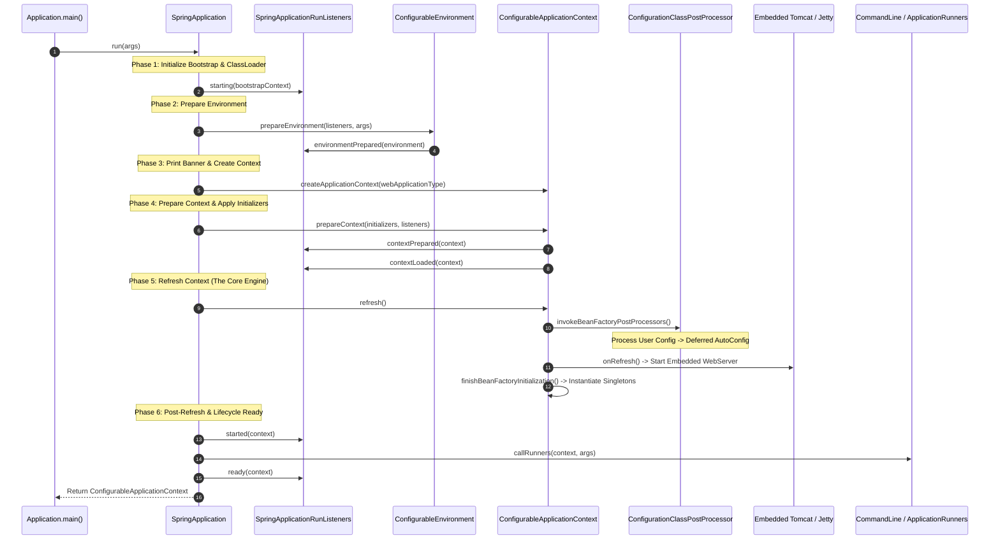
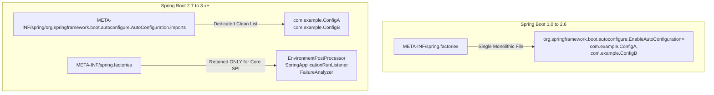
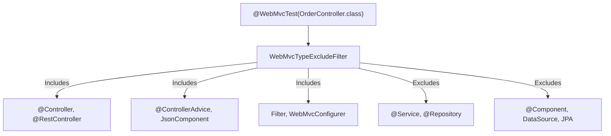

# Spring Boot Internals & AutoConfiguration Master Guide
### Enterprise-Grade Architecture, Engine Bootstrap Mechanics & Production Runbook

---

## Track 0: Technical Jargon-Buster & Terminology Matrix

To operate at the Staff/Principal level within the Spring Boot ecosystem, you must master the precise low-level runtime terminology used by the framework engine.

| Term | Formal Engineering Definition | Layman's Analogy | Critical Production Gotcha |
|---|---|---|---|
| **`AutoConfigurationImportSelector`** | A specialized [DeferredImportSelector](file:///d:/project/github/1/CheatSheet_Tutorial/interview_prep/02_spring_framework/spring_boot_internals_autoconfiguration.md#track-3) that reads candidate auto-configuration classes from SPI descriptors and filters them against classpath and environment conditions. | The bouncer at the club door checking ID and dress code before letting VIP guests inside. | Executes *after* all standard user-defined `@Configuration` classes are registered, ensuring user beans take precedence over default auto-configurations. |
| **`AutoConfiguration.imports`** | The Spring Boot 3.0+ modular SPI discovery file located under `META-INF/spring/org.springframework.boot.autoconfigure.AutoConfiguration.imports`. | A modern contact list replacing the legacy bulky phone book. | Replaces legacy `META-INF/spring.factories` for auto-configurations. Putting Spring Boot 3 configurations in `spring.factories` will silently cause them to be ignored! |
| **`@ConditionalOnClass`** | A bytecode-level condition (`OnClassCondition`) that checks whether specified classes can be loaded by the target ClassLoader without triggering `ClassNotFoundException`. | Checking if the oven is present in the kitchen before buying cake batter. | Uses ASM bytecode parsing via `MetadataReader` to inspect class names without loading them into the JVM Metaspace prematurely. |
| **`@ConditionalOnMissingBean`** | A condition (`OnBeanCondition`) evaluating whether a bean of a specific type or name is absent in the current `BeanFactory`. | Providing an emergency spare tire only if the trunk does not already contain a custom tire. | Evaluation order is paramount! If evaluated before user beans are processed, it may register a default bean prematurely, causing `NoUniqueBeanDefinitionException`. |
| **`@ConditionalOnProperty`** | A condition (`OnPropertyCondition`) verifying whether a configuration property key exists in the `Environment` with an expected value. | A thermostat switch that only powers on the furnace if `heat.mode=on`. | Setting `matchIfMissing = true` means the bean initializes even when the user omitted the property entirely. |
| **`@AutoConfigureBefore` / `@AutoConfigureAfter`** | Explicit sequencing metadata directing the topological sorting order of auto-configuration classes within the auto-configuration phase. | Traffic lights dictating which emergency vehicle enters the intersection first. | Only affects ordering *among* auto-configuration classes; has zero effect on standard user `@Configuration` beans. |
| **`SpringFactoriesLoader`** | The core framework utility used to read and instantiate factory implementations from `META-INF/spring.factories`. | The general contractor loading specialized trade plugins (plumbers, electricians) by contract. | In Spring Boot 3.x, still used for infrastructure listeners (`SpringApplicationRunListener`, `EnvironmentPostProcessor`), but NOT for `@AutoConfiguration`. |
| **`EnvironmentPostProcessor`** | SPI interface enabling low-level mutation and enhancement of the `ConfigurableEnvironment` before the `ApplicationContext` is created. | The municipal surveyor preparing land zoning and water pipes before the house foundation is poured. | Must be registered in `META-INF/spring.factories`. Cannot inject Spring beans because the container does not yet exist! |
| **`ConditionEvaluationReport`** | An internal audit log capturing every evaluated condition, its boolean outcome, and the exact rationale for positive/negative matches. | The flight data black box recorder documenting why every automated safety valve opened or closed. | Can be logged at startup with `--debug` or inspected via the Actuator `/actuator/conditions` endpoint. |
| **`FailureAnalyzer`** | An SPI hook that intercepts startup exceptions (`BeanCreationException`, etc.) and transforms raw stack traces into actionable diagnostics. | A medical triage doctor translating a cryptic blood test into an understandable patient prescription. | Must return a `FailureAnalysis` containing a description and a direct user-facing action to resolve the failure. |
| **`SpringApplicationRunListener`** | Observer interface notifying listeners of lifecycle phases (`starting`, `environmentPrepared`, `contextLoaded`, `started`, `ready`, `failed`). | The launch director announcing rocket staging milestones over the public comms loop. | Errors thrown inside listeners will abort the entire JVM bootstrap process immediately. |
| **`WebServerGracefulShutdownLifecycle`** | Lifecycle manager responsible for halting incoming network traffic while permitting existing in-flight HTTP requests to complete within a timeout. | Flight attendants stopping new passengers from boarding while allowing seated passengers to disembark. | Defaults to `IMMEDIATE` shutdown in vanilla setups unless `server.shutdown=graceful` and `spring.lifecycle.timeout-per-shutdown-phase` are configured. |
| **`TomcatWebServer`** | Embedded servlet container implementation wrapping Apache Tomcat's Catalina engine within Spring Boot's lifecycle. | An internal combustion engine mounted directly inside the vehicle chassis rather than towing a trailer. | Binds by default to port 8080 with 200 worker threads and an accept-count queue of 100. Starvation occurs under high-latency IO without thread pool tuning. |
| **`OnWebApplicationCondition`** | Conditional check determining if the runtime context is a `SERVLET`, `REACTIVE`, or `NONE` web application. | Checking whether the ship is sailing on fresh water, saltwater, or driving on dry land. | Boot defaults to `SERVLET` if Spring MVC is on the classpath, even if WebFlux reactive libraries are also present! |
| **`DeferredImportSelector.Group`** | Grouping mechanism that aggregates multiple import selectors to sort and filter them holistically before bean definitions are created. | Sorting packages by zip code at a central postal distribution hub before truck dispatch. | Allows Spring Boot to sort all auto-configurations topologically based on `@AutoConfigureOrder`, `@AutoConfigureBefore`, and `@AutoConfigureAfter`. |
| **`SpringBootCondition`** | The foundational base class extending Spring Framework's `Condition`, providing unified reporting to `ConditionEvaluationReport`. | The standardized building inspector checklist guaranteeing every violation is logged identically. | Custom conditional logic should always subclass `SpringBootCondition` rather than implementing raw `Condition`. |
| **`@EnableAutoConfiguration`** | The meta-annotation on `@SpringBootApplication` that imports `AutoConfigurationImportSelector`. | The master breaker switch energizing the automated machinery of the factory. | Can selectively exclude problematic auto-configurations via `exclude` or `excludeName`. |
| **`Starter POM`** | An opinionated Maven/Gradle dependency descriptor aggregating transitive libraries and version-managed dependencies. | A pre-assembled toolkit containing all compatible wrenches, sockets, and ratchets for a specific car engine. | Contains no code itself; merely acts as an orchestration bill-of-materials and dependency bundler. |
| **`ConfigurationClassPostProcessor`** | The internal `BeanDefinitionRegistryPostProcessor` that parses `@Configuration`, `@Bean`, `@Import`, and `@ComponentScan` annotations. | The chief architectural draftsman translating paper blueprints into real steel beams. | The single most expensive bean post-processor during startup; processes user classes first before deferred auto-configurations. |
| **`SmartLifecycle`** | An extension of the `Lifecycle` interface with `getPhase()` priority sequencing, auto-startup capabilities, and async stop callbacks. | The automated factory shutdown sequence powering down hydraulic presses before cutting electricity. | Crucial for graceful shutdown of message consumers (Kafka, RabbitMQ) before shutting down the embedded HTTP web server. |

---

## Track 1: Architectural Foundations & Mental Models (ELI5)

### 1.1 The Genesis Problem: From XML Hell to Convention-Over-Configuration

In early Java enterprise development (Spring 2.x and 3.x), assembling a basic web service with a database and security required hundreds of lines of XML or verbose Java configuration:
- Defining a `DataSource` bean with driver class, pool limits, and credentials.
- Defining a `LocalContainerEntityManagerFactoryBean` with Hibernate dialect and vendor adapters.
- Configuring a `PlatformTransactionManager`.
- Setting up a `DispatcherServlet`, `InternalResourceViewResolver`, and JSON message converters.
- Packaging everything into a `.war` archive and manually deploying to a standalone Tomcat or WebLogic server.

```
┌────────────────────────────────────────────────────────────────────────┐
│                   The Legacy Spring Configuration Burden               │
├────────────────────────────────────────────────────────────────────────┤
│  applicationContext.xml (800 lines)                                    │
│    ├── <bean id="dataSource" class="org.apache.commons.dbcp2...">      │
│    ├── <bean id="sessionFactory" class="org.springframework.orm...">   │
│    ├── <bean id="transactionManager" class="...DataSourceTransaction.. │
│    ├── <bean id="viewResolver" class="...InternalResourceViewResolver" │
│    └── <bean id="mappingJackson2HttpMessageConverter" class="..." />   │
│                                                                        │
│  web.xml                                                               │
│    ├── <servlet>DispatcherServlet</servlet>                            │
│    └── <servlet-mapping>/</servlet-mapping>                            │
└────────────────────────────────────────────────────────────────────────┘
```

### 1.2 The Spring Boot Philosophy: Opinionated Defaults with Zero Lock-in

Spring Boot does **not** generate code, and it does **not** alter the core Spring Framework IoC container. Instead, Spring Boot is an **intelligent conditional orchestrator**:
1. **Opinionated Defaults**: If `h2.jar` and `spring-jdbc.jar` are on the classpath, Boot deduces: *"The developer wants an in-memory SQL database with a JdbcTemplate. I will create a DataSource and JdbcTemplate bean automatically."*
2. **Non-Invasive Override**: The moment the developer defines their own `@Bean public DataSource myDataSource()`, Boot immediately steps aside: *"The developer provided their own custom DataSource; my opinionated auto-configuration will self-destruct via `@ConditionalOnMissingBean`."*

```
                       Classpath Contains:
                   [spring-boot-starter-jdbc]
                   [org.postgresql.Driver]
                             │
                             ▼
            ┌──────────────────────────────────┐
            │   DataSourceAutoConfiguration    │
            └──────────────────────────────────┘
                             │
            Does user have custom DataSource?
                   /                    \
                YES                      NO
                /                          \
   ┌──────────────────────────┐    ┌──────────────────────────┐
   │ User's DataSource Wins!  │    │ Boot creates HikariCP    │
   │ Auto-config backs off.   │    │ DataSource with defaults │
   └──────────────────────────┘    └──────────────────────────┘
```

---

## Track 2: Enterprise Bootstrap Architecture & Low-Level Mechanics

### 2.1 The 10-Step `SpringApplication.run()` Execution Sequence

When you invoke `SpringApplication.run(Application.class, args);`, the JVM executes a rigorous, multi-phase bootstrap sequence. Understanding each phase is essential for troubleshooting startup hangs, classloader collisions, and environment misconfigurations.



#### Detailed Breakdown of the 10 Bootstrap Stages:
1. **Bootstrap Context Initialization**: Spring Boot creates the `DefaultBootstrapContext` to manage lightweight dependencies before the full `ApplicationContext` is born.
2. **`starting()` Event**: Invokes all `SpringApplicationRunListener` instances via SPI (`spring.factories`). Logging subsystems are initialized.
3. **Environment Creation & Configuration**:
   - Detects `WebApplicationType` (`SERVLET`, `REACTIVE`, or `NONE`).
   - Builds `StandardServletEnvironment` or `ApplicationServletEnvironment`.
   - Attaches command-line arguments, system properties, environment variables, and parses `application.properties`/`application.yml`.
   - Executes registered `EnvironmentPostProcessor` instances.
4. **`environmentPrepared()` Event**: Notifies listeners that environment variables and properties are fully resolved.
5. **Print Banner**: Renders the ASCII banner (or custom banner from `banner.txt`).
6. **`ApplicationContext` Instantiation**:
   - For `SERVLET`: `AnnotationConfigServletWebServerApplicationContext`.
   - For `REACTIVE`: `AnnotationConfigReactiveWebServerApplicationContext`.
   - For `NONE`: `AnnotationConfigApplicationContext`.
7. **`prepareContext()` Stage**:
   - Sets the prepared `Environment` on the context.
   - Applies registered `ApplicationContextInitializer` instances.
   - Registers command-line args as a singleton bean (`springApplicationArguments`).
8. **Context `refresh()` (The Master Engine)**:
   - Registers and executes `BeanFactoryPostProcessors` (specifically `ConfigurationClassPostProcessor`).
   - Discovers and evaluates all `@AutoConfiguration` classes via `AutoConfigurationImportSelector`.
   - Invokes `onRefresh()` to instantiate the embedded servlet container (`TomcatWebServer`, `JettyWebServer`, or `UndertowWebServer`).
   - Instantiates all eager singleton beans.
9. **`started()` Event & Runners Execution**:
   - Context is fully refreshed and running.
   - Locates all beans implementing `ApplicationRunner` and `CommandLineRunner` and invokes their `run()` methods in `@Order` sequence.
10. **`ready()` Event**: Emits `ApplicationReadyEvent`, signaling the microservice is healthy and ready to accept live traffic.

---

## Track 3: Low-Level Engine Internals & AutoConfiguration SPI

### 3.1 ASM Bytecode Metadata Reading (`MetadataReaderFactory`)

A frequent question asked by senior architects: **If a Spring Boot application scans thousands of classes looking for `@ConditionalOnClass(RedisConnection.class)`, why doesn't it crash with `NoClassDefFoundError` if the Redis library is missing from the classpath?**

#### The Mechanism:
Spring Boot does **NOT** use standard Java reflection (`Class.forName()`) to inspect annotations on auto-configuration classes! If it used `Class.forName()`, the JVM ClassLoader would attempt to resolve all referenced parameter and return types, immediately triggering a fatal `ClassNotFoundException` or `NoClassDefFoundError`.

Instead, Spring utilizes the **ASM bytecode manipulation library** via `SimpleMetadataReaderFactory` and `CachingMetadataReaderFactory`:
1. It opens the raw `.class` file as an `InputStream`.
2. The ASM `ClassReader` parses the constant pool, method signatures, and bytecode annotations as raw UTF-8 string tokens.
3. When checking `@ConditionalOnClass("org.springframework.data.redis.connection.RedisConnection")`, Spring checks if the string exists in the ClassLoader using `ClassUtils.isPresent(className, classLoader)`.
4. If `ClassUtils.isPresent()` returns `false`, the auto-configuration class is discarded **without ever loading its bytecode into the JVM Metaspace!**

```
     Raw .class File (Byte Stream)
                  │
                  ▼
         ASM ClassReader
                  │
    (Reads Annotation Bytecode Tokens)
                  │
                  ▼
     Spring MetadataReaderFactory
                  │
     Is "org.postgresql.Driver" present?
           /               \
         NO                YES
         /                   \
   Discard Class;         Load Class into JVM;
  Zero Metaspace Cost    Process Bean Definitions
```

### 3.2 The Evolution of AutoConfiguration SPI Discovery



#### Why Spring Boot 3.0 Changed the Discovery Mechanism:
1. **Compilation & AOT Efficiency**: In Spring Boot 3.x and GraalVM Native Image compilation, parsing a giant multi-purpose `spring.factories` with regex properties was slow and error-prone.
2. **Decoupled Architecture**: Auto-configurations now live in their own dedicated line-delimited text file: `META-INF/spring/org.springframework.boot.autoconfigure.AutoConfiguration.imports`.
3. **Validation Rule**: In Spring Boot 3+, declaring an auto-configuration in `META-INF/spring.factories` under `EnableAutoConfiguration` is completely ignored by default!

### 3.3 Anatomy of `AutoConfigurationImportSelector` & Filtering Pipeline

The auto-configuration resolution engine executes in four distinct phases inside `ConfigurationClassParser`:

```
┌────────────────────────────────────────────────────────────────────────┐
│               AutoConfigurationImportSelector Pipeline                 │
├────────────────────────────────────────────────────────────────────────┤
│ 1. Candidate Loading:                                                  │
│    Reads all lines from AutoConfiguration.imports SPI files.           │
│                                                                        │
│ 2. Deduplication & Exclusion:                                          │
│    Removes duplicate class names and applies exclusions from           │
│    @SpringBootApplication(exclude = {...}) and spring.autoconfigure.   │
│    exclude properties.                                                 │
│                                                                        │
│ 3. AutoConfigurationImportFilter Pre-Filtering:                        │
│    Executes lightweight ASM-based filters (OnClassCondition,           │
│    OnWebApplicationCondition) before instantiating configuration       │
│    classes. Typically eliminates 70-80% of candidates instantly!       │
│                                                                        │
│ 4. Topological Sort & Condition Evaluation:                           │
│    Orders remaining configurations using @AutoConfigureOrder,         │
│    @AutoConfigureBefore, @AutoConfigureAfter, then evaluates full      │
│    SpringBootCondition criteria.                                       │
└────────────────────────────────────────────────────────────────────────┘
```

---

## Track 4: 50 Progressive Real-World Scenario Walkthroughs

### Scenario 1: Overriding Auto-Configured HikariCP DataSource
**Problem**: Spring Boot auto-configures a default Hikari `DataSource`, but you need to configure a custom multi-tenant routing `DataSource` or a specialized connection pool.  
**Solution**: Define your own `@Bean` of type `DataSource`. Because `DataSourceAutoConfiguration` annotates its creation method with `@ConditionalOnMissingBean(DataSource.class)`, your custom bean definition causes the auto-configured `DataSource` to back off automatically.
```java
@Configuration
public class CustomDataSourceConfig {
    @Bean
    @Primary
    public DataSource customDataSource(DataSourceProperties properties) {
        return properties.initializeDataSourceBuilder()
                .type(HikariDataSource.class)
                .maximumPoolSize(50)
                .minimumIdle(10)
                .build();
    }
}
```

### Scenario 2: Excluding an Unwanted Auto-Configuration via Annotation
**Problem**: You have `spring-boot-starter-data-jpa` on your classpath, but in a specific microservice you only want raw JDBC and need to disable JPA auto-configuration.  
**Solution**: Use the `exclude` attribute on `@SpringBootApplication`:
```java
@SpringBootApplication(exclude = {
    HibernateJpaAutoConfiguration.class,
    JpaRepositoriesAutoConfiguration.class
})
public class OrderBatchApplication {
    public static void main(String[] args) {
        SpringApplication.run(OrderBatchApplication.class, args);
    }
}
```

### Scenario 3: Excluding Auto-Configuration via External Properties
**Problem**: You want to disable `SecurityAutoConfiguration` in local development and test environments without modifying code.  
**Solution**: Specify the fully-qualified class name in `application-local.yml`:
```yaml
spring:
  autoconfigure:
    exclude:
      - org.springframework.boot.autoconfigure.security.servlet.SecurityAutoConfiguration
      - org.springframework.boot.actuate.autoconfigure.security.servlet.ManagementWebSecurityAutoConfiguration
```

### Scenario 4: Creating a Custom Conditional on a Feature Flag
**Problem**: You want a bean to initialize only if `features.billing.v2.enabled=true` is present in the environment.  
**Solution**: Use `@ConditionalOnProperty`:
```java
@Component
@ConditionalOnProperty(
    prefix = "features.billing.v2",
    name = "enabled",
    havingValue = "true",
    matchIfMissing = false
)
public class AdvancedBillingService implements BillingService {
    // Enterprise V2 billing logic
}
```

### Scenario 5: Conditional on Classloader Class Presence
**Problem**: You are authoring a shared corporate library that supports Kafka if `kafka-clients` is present, or falls back to RabbitMQ if AMQP is present.  
**Solution**: Use `@ConditionalOnClass`:
```java
@Configuration
@ConditionalOnClass(name = "org.apache.kafka.clients.producer.KafkaProducer")
public class KafkaEventPublisherAutoConfiguration {
    @Bean
    @ConditionalOnMissingBean
    public EventPublisher kafkaEventPublisher() {
        return new KafkaEventPublisher();
    }
}
```

### Scenario 6: Custom `SpringBootCondition` Implementation
**Problem**: You need a complex condition that checks whether an external environment variable matches a specific cryptographic signature or network IP subnet.  
**Solution**: Extend `SpringBootCondition` and override `getMatchOutcome`:
```java
public class OnVpcSubnetCondition extends SpringBootCondition {
    @Override
    public ConditionOutcome getMatchOutcome(ConditionContext context, AnnotatedTypeMetadata metadata) {
        String subnet = context.getEnvironment().getProperty("infra.vpc.subnet");
        if (subnet != null && subnet.startsWith("10.240.")) {
            return ConditionOutcome.match("Running inside internal private VPC subnet: " + subnet);
        }
        return ConditionOutcome.noMatch("External or unauthorized VPC subnet: " + subnet);
    }
}
```

### Scenario 7: Building a Custom FailureAnalyzer
**Problem**: When developers forget to specify the mandatory `corp.security.vault-token` property, the application crashes with a confusing `IllegalArgumentException`. You want a clean, human-readable war-room diagnostic.  
**Solution**: Implement `FailureAnalyzer`:
```java
public class MissingVaultTokenFailureAnalyzer extends AbstractFailureAnalyzer<MissingVaultTokenException> {
    @Override
    protected FailureAnalysis analyze(Throwable rootFailure, MissingVaultTokenException cause) {
        String description = "Corporate Vault security token is missing from the environment.";
        String action = "Please set the 'CORP_SECURITY_VAULT_TOKEN' environment variable or pass '--corp.security.vault-token=<token>' at launch.";
        return new FailureAnalysis(description, action, cause);
    }
}
```
Register it in `META-INF/spring.factories`:
```properties
org.springframework.boot.diagnostics.FailureAnalyzer=com.corp.vault.MissingVaultTokenFailureAnalyzer
```

### Scenario 8: Custom `EnvironmentPostProcessor` for Decrypting Secrets
**Problem**: Database passwords in `application.yml` are encrypted using corporate AES-256 tokens (`ENC(xyz982...)`). You must decrypt them before any Spring beans or datasources are instantiated.  
**Solution**: Implement `EnvironmentPostProcessor`:
```java
public class SecretDecryptionEnvironmentPostProcessor implements EnvironmentPostProcessor {
    @Override
    public void postProcessEnvironment(ConfigurableEnvironment environment, SpringApplication application) {
        Map<String, Object> decryptedProps = new HashMap<>();
        for (PropertySource<?> ps : environment.getPropertySources()) {
            if (ps.containsProperty("spring.datasource.password")) {
                String encrypted = (String) ps.getProperty("spring.datasource.password");
                if (encrypted != null && encrypted.startsWith("ENC(")) {
                    String decrypted = decrypt(encrypted);
                    decryptedProps.put("spring.datasource.password", decrypted);
                }
            }
        }
        environment.getPropertySources().addFirst(new MapPropertySource("decryptedSecrets", decryptedProps));
    }

    private String decrypt(String token) {
        return "decrypted_db_password_cleartext";
    }
}
```
Register in `META-INF/spring.factories`:
```properties
org.springframework.boot.env.EnvironmentPostProcessor=com.corp.crypto.SecretDecryptionEnvironmentPostProcessor
```

### Scenario 9: Programmatic SpringApplication Customization
**Problem**: You need to enforce default properties and disable banner programmatically across all microservices using a common launcher.  
**Solution**: Configure the `SpringApplication` instance before running:
```java
public class MicroserviceApplication {
    public static void main(String[] args) {
        SpringApplication app = new SpringApplication(MicroserviceApplication.class);
        app.setBannerMode(Banner.Mode.OFF);
        app.setLazyInitialization(false);
        
        Map<String, Object> defaults = new HashMap<>();
        defaults.put("spring.main.allow-bean-definition-overriding", false);
        defaults.put("server.shutdown", "graceful");
        app.setDefaultProperties(defaults);
        
        app.run(args);
    }
}
```

### Scenario 10: Inspecting the ConditionEvaluationReport at Runtime
**Problem**: A critical custom bean is not being created, and you need to determine which auto-configuration evaluated and why it rejected the bean.  
**Solution**: Inject the `ConditionEvaluationReport` into an integration test or Actuator custom endpoint:
```java
@Component
public class ConditionDiagnosticReporter {
    private final ConditionEvaluationReport report;

    public ConditionDiagnosticReporter(ConfigurableApplicationContext context) {
        this.report = ConditionEvaluationReport.get(context.getBeanFactory());
    }

    public void logNegativeMatches() {
        report.getConditionAndOutcomesBySource().forEach((source, outcomes) -> {
            for (ConditionEvaluationReport.ConditionAndOutcome outcome : outcomes) {
                if (!outcome.getOutcome().isMatch()) {
                    System.out.printf("Negative Match: %s -> %s%n", source, outcome.getOutcome().getMessage());
                }
            }
        });
    }
}
```

### Scenario 11: Dynamic Property Binding with `@ConfigurationProperties`
**Problem**: Binding strongly typed nested configurations from YAML with validation.  
**Solution**: Use `@ConfigurationProperties` with `@Validated`:
```java
@ConfigurationProperties(prefix = "enterprise.payment")
@Validated
public class PaymentGatewayProperties {
    @NotBlank
    private String endpointUrl;
    
    @Min(100)
    @Max(10000)
    private int timeoutMs = 2500;
    
    private Retry retry = new Retry();

    public static class Retry {
        private int maxAttempts = 3;
        private Duration backoff = Duration.ofMillis(500);
        // Getters and Setters
    }
    // Getters and Setters
}
```

### Scenario 12: Embedded Tomcat Worker Thread Pool Tuning
**Problem**: Microservice experiences thread starvation under high concurrent IO load because default Tomcat settings (200 threads) are exhausted.  
**Solution**: Tune Tomcat NIO connector properties in `application.yml`:
```yaml
server:
  tomcat:
    threads:
      max: 400
      min-spare: 50
    accept-count: 200
    max-connections: 10000
    connection-timeout: 5000ms
```

### Scenario 13: Configuring Graceful Shutdown in Spring Boot 3
**Problem**: Kubernetes pod termination sends `SIGTERM`, killing active financial checkout transactions mid-flight.  
**Solution**: Enable graceful shutdown and specify the phase timeout:
```yaml
server:
  shutdown: graceful

spring:
  lifecycle:
    timeout-per-shutdown-phase: 30s
```

### Scenario 14: Customizing Embedded WebServer via `WebServerFactoryCustomizer`
**Problem**: You need to customize Tomcat's HTTP/2 protocol or access log valve programmatically.  
**Solution**: Implement `WebServerFactoryCustomizer<TomcatServletWebServerFactory>`:
```java
@Component
public class CustomTomcatWebServerCustomizer implements WebServerFactoryCustomizer<TomcatServletWebServerFactory> {
    @Override
    public void customize(TomcatServletWebServerFactory factory) {
        factory.addConnectorCustomizers(connector -> {
            connector.setAsyncTimeout(10000);
        });
        factory.addContextCustomizers(context -> {
            context.setSessionTimeout(30);
        });
    }
}
```

### Scenario 15: Switching Embedded Container from Tomcat to Undertow
**Problem**: Tomcat memory footprint is too high for memory-constrained container environments; you want Undertow's lightweight XNIO non-blocking engine.  
**Solution**: Exclude `spring-boot-starter-tomcat` and add `spring-boot-starter-undertow`:
```xml
<dependency>
    <groupId>org.springframework.boot</groupId>
    <artifactId>spring-boot-starter-web</artifactId>
    <exclusions>
        <exclusion>
            <groupId>org.springframework.boot</groupId>
            <artifactId>spring-boot-starter-tomcat</artifactId>
        </exclusion>
    </exclusions>
</dependency>
<dependency>
    <groupId>org.springframework.boot</groupId>
    <artifactId>spring-boot-starter-undertow</artifactId>
</dependency>
```

### Scenario 16: Ordering Auto-Configurations with `@AutoConfigureOrder`
**Problem**: Auto-configuration `B` must execute before auto-configuration `A`, but neither directly references the other's class.  
**Solution**: Use `@AutoConfigureOrder(Ordered.HIGHEST_PRECEDENCE)`.
```java
@AutoConfiguration
@AutoConfigureOrder(Ordered.HIGHEST_PRECEDENCE + 20)
public class CoreInfrastructureAutoConfiguration {
    // Initializes first
}
```

### Scenario 17: Establishing Dependency Order with `@AutoConfigureAfter`
**Problem**: Your custom metrics auto-configuration requires `DataSourceAutoConfiguration` to initialize first so the database pool can be instrumented.  
**Solution**: Annotate with `@AutoConfigureAfter`:
```java
@AutoConfiguration(after = DataSourceAutoConfiguration.class)
@ConditionalOnClass(DataSource.class)
public class DataSourceMetricsAutoConfiguration {
    @Bean
    @ConditionalOnBean(DataSource.class)
    public DataSourcePoolMetadataProvider customPoolProvider(DataSource ds) {
        return new CustomPoolMetadataProvider(ds);
    }
}
```

### Scenario 18: Conditional on Resource File Presence
**Problem**: A configuration bean should only instantiate if a specific license key file or configuration file is present on the filesystem or classpath.  
**Solution**: Use `@ConditionalOnResource`:
```java
@Configuration
@ConditionalOnResource(resources = "classpath:enterprise-license.key")
public class EnterpriseLicenseActivationConfig {
    @Bean
    public LicenseManager licenseManager() {
        return new EnterpriseLicenseManager();
    }
}
```

### Scenario 19: Conditional on Web Application Type (`REACTIVE` vs `SERVLET`)
**Problem**: A rate-limiting filter must register as a standard `javax.servlet.Filter` in MVC, but as a `WebFilter` in WebFlux.  
**Solution**: Use `@ConditionalOnWebApplication`:
```java
@Configuration
@ConditionalOnWebApplication(type = ConditionalOnWebApplication.Type.SERVLET)
public class ServletRateLimitingAutoConfig {
    @Bean
    public Filter servletRateLimitFilter() {
        return new ServletRateLimitFilter();
    }
}

@Configuration
@ConditionalOnWebApplication(type = ConditionalOnWebApplication.Type.REACTIVE)
public class ReactiveRateLimitingAutoConfig {
    @Bean
    public WebFilter reactiveRateLimitFilter() {
        return new ReactiveRateLimitFilter();
    }
}
```

### Scenario 20: Auto-Configuring Custom Jackson Modules
**Problem**: You have custom Java records containing epoch millisecond timestamps that must be serialized using a custom Jackson `Module`.  
**Solution**: Simply declare the `com.fasterxml.jackson.databind.Module` bean! `JacksonAutoConfiguration` automatically detects all beans of type `Module` and registers them with the primary `ObjectMapper`:
```java
@Configuration
public class JacksonCustomModuleConfig {
    @Bean
    public Module customEpochTimestampModule() {
        SimpleModule module = new SimpleModule();
        module.addSerializer(Instant.class, new EpochInstantSerializer());
        return module;
    }
}
```

### Scenario 21: Resolving Circular AutoConfiguration Dependencies
**Problem**: AutoConfig `A` has `@AutoConfigureAfter(B.class)` and AutoConfig `B` has `@AutoConfigureAfter(A.class)`, triggering a cycle in sorting.  
**Solution**: Break the cycle by eliminating one of the `@AutoConfigureAfter` annotations and relying on `@ConditionalOnBean` or `@AutoConfigureOrder` instead.

### Scenario 22: Preventing Eager Initialization of FactoryBeans in Conditions
**Problem**: Checking `@ConditionalOnBean(SomeService.class)` causes a heavy `FactoryBean` to initialize prematurely before environment properties are fully loaded.  
**Solution**: Use `search = SearchStrategy.ANCESTORS` and specify `value = SomeService.class` or bean name. Avoid complex `@ConditionalOnBean` checks in root configurations.

### Scenario 23: Disabling Bean Definition Overriding
**Problem**: Developers accidentally define duplicate bean names, silently clobbering third-party starter beans.  
**Solution**: Enforce strict uniqueness in `application.properties`:
```properties
spring.main.allow-bean-definition-overriding=false
```

### Scenario 24: Enabling Lazy Initialization Across the Entire Application
**Problem**: Local development startup time takes 90 seconds due to 2,000 eagerly created beans.  
**Solution**: Enable global lazy initialization for local profiles:
```yaml
# application-dev.yml
spring:
  main:
    lazy-initialization: true
```
*Note*: Do not enable in production, as it defers `BeanCreationException` errors to live HTTP request time!

### Scenario 25: Customizing Banner Generation
**Problem**: The company requires a dynamic banner displaying application version, git commit hash, and JVM version during startup.  
**Solution**: Create `src/main/resources/banner.txt`:
```
=====================================================
  CORPORATE PAYMENT GATEWAY :: v${application.version}
  Git Commit: ${application.git.commit.id.abbrev}
  Spring Boot: ${spring-boot.version}
  JVM: ${java.version}
=====================================================
```

### Scenario 26: Custom ApplicationStartup Flight Recording
**Problem**: You need to measure the exact millisecond startup duration of every bean post-processor and auto-configuration to diagnose startup regressions.  
**Solution**: Use `BufferingApplicationStartup` or Java Flight Recorder (JFR):
```java
public class DiagnosticApplication {
    public static void main(String[] args) {
        SpringApplication app = new SpringApplication(DiagnosticApplication.class);
        app.setApplicationStartup(new BufferingApplicationStartup(2048));
        app.run(args);
    }
}
```

### Scenario 27: Injecting SpringApplication Arguments into Services
**Problem**: A batch worker needs access to raw command-line flags (`--job.date=2026-10-09`).  
**Solution**: Inject `ApplicationArguments`:
```java
@Service
public class BatchJobLauncher {
    public BatchJobLauncher(ApplicationArguments args) {
        List<String> jobDates = args.getOptionValues("job.date");
        System.out.println("Processing date: " + jobDates.get(0));
    }
}
```

### Scenario 28: Handling Startup Failures Gracefully in Kubernetes
**Problem**: If the database is unreachable, the pod crashes immediately in a crash-loop backoff before Kubernetes can scrape the liveness probe.  
**Solution**: Use a custom `ApplicationRunner` with a bounded retry policy or configure Kubernetes startup probes (`/actuator/health/startup`) with an initial delay.

### Scenario 29: Dynamic Active Profile Selection Based on Hostname
**Problem**: Microservices deployed on AWS EC2 must automatically activate the `aws` profile, while local workstations activate `local`.  
**Solution**: Use an `EnvironmentPostProcessor` to inspect environment variables and call `environment.addActiveProfile("aws")`.

### Scenario 30: Conditional on Cloud Platform (`@ConditionalOnCloudPlatform`)
**Problem**: Activate Kubernetes-specific config maps and secrets only when running inside a K8s cluster.  
**Solution**: Use `@ConditionalOnCloudPlatform(CloudPlatform.KUBERNETES)`.

### Scenario 31: Auto-Configuration of Custom Validation Validator
**Problem**: Registering a custom Hibernate Validator constraint validator with dependency injection support.  
**Solution**: Declare the constraint validator as a standard `@Component`. Spring Boot's `ValidationAutoConfiguration` automatically wires the Spring `ConstraintValidatorFactory`.

### Scenario 32: Configuring Multiple WebServer Factories (Multi-Port Connector)
**Problem**: Exposing management and actuator endpoints on an internal private network port (e.g. 8081) while business traffic stays on 8080.  
**Solution**: Configure `management.server.port`:
```yaml
server:
  port: 8080
management:
  server:
    port: 8081
```

### Scenario 33: Customizing Undertow Buffer Pools for Zero-Copy IO
**Problem**: Optimizing Undertow for high-throughput WebSocket streaming.  
**Solution**: Configure Undertow direct buffers and IO threads:
```yaml
server:
  undertow:
    threads:
      io: 16
      worker: 256
    buffer-size: 16384
    direct-buffers: true
```

### Scenario 34: Securing Actuator Endpoints Under Auto-Configuration
**Problem**: By default, Actuator exposes sensitive health and metrics details to public callers.  
**Solution**: Configure explicit exposure in `application.yml`:
```yaml
management:
  endpoints:
    web:
      exposure:
        include: health,info,prometheus
  endpoint:
    health:
      show-details: when_authorized
```

### Scenario 35: Handling Property Conversion with `@ConfigurationPropertiesBinding`
**Problem**: Binding a custom string format (`"192.168.1.1:8080"`) into an `InetSocketAddress` object in configuration properties.  
**Solution**: Register a custom `Converter` annotated with `@ConfigurationPropertiesBinding`:
```java
@Component
@ConfigurationPropertiesBinding
public class StringToSocketAddressConverter implements Converter<String, InetSocketAddress> {
    @Override
    public InetSocketAddress convert(String source) {
        String[] parts = source.split(":");
        return new InetSocketAddress(parts[0], Integer.parseInt(parts[1]));
    }
}
```

### Scenario 36: Dynamic Port Allocation in Integration Tests (`@LocalServerPort`)
**Problem**: Parallel integration tests fail due to port 8080 collisions.  
**Solution**: Configure `webEnvironment = SpringBootTest.WebEnvironment.RANDOM_PORT`:
```java
@SpringBootTest(webEnvironment = SpringBootTest.WebEnvironment.RANDOM_PORT)
public class CheckoutControllerIT {
    @LocalServerPort
    private int port;
    
    @Test
    void testEndpoint() {
        System.out.println("Running test against random port: " + port);
    }
}
```

### Scenario 37: Auto-Configuring R2DBC Reactive DataSources
**Problem**: When both JDBC and R2DBC are on the classpath, Boot attempts to configure JDBC by default.  
**Solution**: Exclude `DataSourceAutoConfiguration` or explicitly enable `R2dbcAutoConfiguration`.

### Scenario 38: Customizing Embedded Netty for WebFlux
**Problem**: Modifying Netty loop resources and thread counts for high-concurrency microservices.  
**Solution**: Declare a `NettyServerCustomizer` bean.

### Scenario 39: Auto-Configuration with `@ConditionalOnExpression` (SpEL)
**Problem**: A bean should only activate if property `a` is true AND property `b` is greater than 10.  
**Solution**: Use SpEL in `@ConditionalOnExpression`:
```java
@Bean
@ConditionalOnExpression("${payment.enabled:false} and ${payment.timeout:0} > 10")
public PaymentEngine paymentEngine() {
    return new PaymentEngine();
}
```

### Scenario 40: Diagnosing Conflicting Auto-Configurations with `--debug`
**Problem**: A mystery bean is overriding your configuration, and you cannot find which starter is responsible.  
**Solution**: Launch the JVM with `--debug` or `-Ddebug=true`. Spring Boot outputs the complete `CONDITIONS EVALUATION REPORT` detailing every positive and negative match.

### Scenario 41: Creating an Internal Corporate Auto-Configuration Starter
**Problem**: Every team at your company needs standardized OpenTelemetry tracing and Kafka security headers.  
**Solution**: Package an `autoconfigure` jar with `AutoConfiguration.imports` and a matching `-starter` empty dependency aggregation pom.

### Scenario 42: Conditional on Missing Class
**Problem**: Provide a pure in-memory mock repository only when the real database driver class is absent.  
**Solution**: Use `@ConditionalOnMissingClass("org.postgresql.Driver")`.

### Scenario 43: Using `ConstructorBinding` in Modern `@ConfigurationProperties`
**Problem**: Creating immutable configuration property records in Java 17+.  
**Solution**: Use record classes directly with `@ConfigurationProperties`:
```java
@ConfigurationProperties(prefix = "corporate.auth")
public record AuthProperties(
    String issuerUri,
    Duration tokenTtl,
    boolean enforceHttps
) {}
```

### Scenario 44: Programmatic Context Hierarchy (`SpringApplicationBuilder`)
**Problem**: Setting up a parent-child context where the parent manages shared security tokens and child contexts manage individual web modules.  
**Solution**: Use `SpringApplicationBuilder`:
```java
public class HierarchyApplication {
    public static void main(String[] args) {
        new SpringApplicationBuilder(ParentConfig.class)
            .child(WebModuleConfig.class)
            .run(args);
    }
}
```

### Scenario 45: Customizing JSON Message Converters in Spring MVC
**Problem**: Forcing `HttpMessageConvertersAutoConfiguration` to use Google Gson instead of Jackson.  
**Solution**: Exclude Jackson starter and include `com.google.code.gson:gson`. Boot's `GsonAutoConfiguration` will activate automatically.

### Scenario 46: Auto-Configuring Distributed Caching with Redis
**Problem**: Configuring `RedisCacheManager` with custom TTLs per cache name automatically.  
**Solution**: Declare a `RedisCacheManagerBuilderCustomizer` bean:
```java
@Bean
public RedisCacheManagerBuilderCustomizer redisCacheCustomizer() {
    return builder -> builder
        .withCacheConfiguration("users", RedisCacheConfiguration.defaultCacheConfig().entryTtl(Duration.ofMinutes(10)))
        .withCacheConfiguration("pricing", RedisCacheConfiguration.defaultCacheConfig().entryTtl(Duration.ofHours(1)));
}
```

### Scenario 47: Disabling JMX Auto-Configuration for Fast Startup
**Problem**: JMX bean registration adds 200–500ms to microservice container startup times.  
**Solution**: Disable JMX explicitly in `application.properties`:
```properties
spring.jmx.enabled=false
```

### Scenario 48: Handling Corrupted `application.yml` via Custom Error Handlers
**Problem**: A syntax error in YAML crashes the application with a cryptic parser exception.  
**Solution**: Register a custom `SpringBootExceptionHandler` or monitor `ApplicationFailedEvent`.

### Scenario 49: Testing Auto-Configurations with `ApplicationContextRunner`
**Problem**: How do you unit test custom auto-configuration conditions without spinning up a full slow `@SpringBootTest`?  
**Solution**: Use Spring Boot's lightweight `ApplicationContextRunner`:
```java
class CustomAutoConfigTest {
    private final ApplicationContextRunner runner = new ApplicationContextRunner()
        .withConfiguration(AutoConfigurations.of(CustomAutoConfiguration.class));

    @Test
    void shouldRegisterBeanWhenPropertySet() {
        runner.withPropertyValues("custom.enabled=true")
              .run(context -> {
                  assertThat(context).hasSingleBean(CustomService.class);
              });
    }

    @Test
    void shouldBackOffWhenPropertyMissing() {
        runner.run(context -> {
            assertThat(context).doesNotHaveBean(CustomService.class);
        });
    }
}
```

### Scenario 50: Upgrading Auto-Configurations from Spring Boot 2.x to 3.x
**Problem**: Upgrading an enterprise starter to Spring Boot 3 causes all auto-configurations to stop loading.  
**Solution**: Migrate from `META-INF/spring.factories` to `META-INF/spring/org.springframework.boot.autoconfigure.AutoConfiguration.imports`, replace `@Configuration(proxyBeanMethods = false)` with `@AutoConfiguration`, and migrate `javax.*` imports to `jakarta.*`.

---

## Track 5: 10 War-Room Outage Post-Mortems

### Post-Mortem 1: The Missing `@ConditionalOnMissingBean` Catastrophe
- **Outage Scenario**: An international payment provider deployed a corporate SDK update (`payment-starter-v2.1.jar`). During deployment, 100% of checkout microservices began failing with `NoUniqueBeanDefinitionException: expected single matching bean but found 2: [customPaymentGateway, defaultPaymentGateway]`.
- **Root Cause**: The SDK author removed `@ConditionalOnMissingBean` from the auto-configuration class. As a result, both the user's custom bean and the starter's fallback bean were registered into the context.
```java
// ❌ BUG: Causes NoUniqueBeanDefinitionException in downstream apps!
@AutoConfiguration
public class PaymentAutoConfiguration {
    @Bean
    public PaymentGateway paymentGateway() {
        return new DefaultPaymentGateway();
    }
}

// ✅ REFACTORED: Respects user-defined beans and backs off gracefully
@AutoConfiguration
public class PaymentAutoConfiguration {
    @Bean
    @ConditionalOnMissingBean(PaymentGateway.class)
    public PaymentGateway paymentGateway() {
        return new DefaultPaymentGateway();
    }
}
```

### Post-Mortem 2: The Eager Classloading Metaspace OOM Crash
- **Outage Scenario**: Monolith container startup crashed with `java.lang.OutOfMemoryError: Metaspace` during blue-green deployment.
- **Root Cause**: A custom starter evaluated conditions using `Class.forName()` inside a static initializer, forcing the JVM to load 3,000 unneeded classes into Metaspace before Spring's ASM filtering could discard them.
```java
// ❌ BUG: Forces premature JVM ClassLoader execution and Metaspace leak
public class DangerousCondition implements Condition {
    @Override
    public boolean matches(ConditionContext context, AnnotatedTypeMetadata metadata) {
        try {
            Class<?> clazz = Class.forName("com.heavy.legacy.sdk.EnterpriseEngine");
            return clazz != null;
        } catch (ClassNotFoundException e) {
            return false;
        }
    }
}

// ✅ REFACTORED: Subclasses SpringBootCondition and uses non-loading ClassUtils
public class SafeCondition extends SpringBootCondition {
    @Override
    public ConditionOutcome getMatchOutcome(ConditionContext context, AnnotatedTypeMetadata metadata) {
        boolean present = ClassUtils.isPresent("com.heavy.legacy.sdk.EnterpriseEngine", context.getClassLoader());
        return present 
            ? ConditionOutcome.match("Class found on classpath") 
            : ConditionOutcome.noMatch("Class not found on classpath");
    }
}
```

### Post-Mortem 3: Embedded Tomcat Thread Pool Starvation Under Downstream Latency
- **Outage Scenario**: An eCommerce platform suffered a complete outage during Black Friday. CPU was at 8%, but HTTP requests hung until clients experienced 504 Gateway Timeouts.
- **Root Cause**: Default Tomcat worker threads (200) were blocked waiting on a slow legacy inventory service (3-second latency). The accept queue (100) filled up, and the OS socket backlog rejected incoming TCP handshakes (`Connection refused`).
```yaml
# ❌ BUG: Default un-tuned configuration
server:
  port: 8080

# ✅ REFACTORED: Enterprise thread pool & connection backlog tuning
server:
  port: 8080
  tomcat:
    threads:
      max: 500
      min-spare: 100
    accept-count: 1000
    max-connections: 20000
    connection-timeout: 3000ms
```

### Post-Mortem 4: Ungraceful Pod Termination Dropping Database Transactions
- **Outage Scenario**: During autoscaling scale-down events in Kubernetes, hundreds of customer payments were billed in Stripe but marked incomplete in PostgreSQL.
- **Root Cause**: `server.shutdown=immediate` (default) aborted Tomcat worker threads mid-execution the moment `SIGTERM` was received.
```yaml
# ❌ BUG: Immediate abrupt termination kills in-flight threads
# server:
#   shutdown: immediate

# ✅ REFACTORED: Coordinated graceful shutdown
server:
  shutdown: graceful

spring:
  lifecycle:
    timeout-per-shutdown-phase: 45s
```

### Post-Mortem 5: Circular Starter Dependency Deadlock
- **Outage Scenario**: A microservice failed to start after adding `auth-starter` and `audit-starter`. The application threw `BeanCurrentInCreationException`.
- **Root Cause**: `AuthAutoConfiguration` had `@AutoConfigureAfter(AuditAutoConfiguration.class)`, while `AuditAutoConfiguration` had `@AutoConfigureAfter(AuthAutoConfiguration.class)`.
- **Fix**: Remove circular class references; decouple via `@AutoConfigureOrder` or redesign dependencies.

### Post-Mortem 6: The Silent SPI Ignition Failure in Spring Boot 3 Upgrade
- **Outage Scenario**: An engineering team upgraded from Spring Boot 2.7 to 3.1. All unit tests passed, but in production, security authentication headers were completely ignored.
- **Root Cause**: The security starter was declared exclusively in `META-INF/spring.factories`. Spring Boot 3 stopped scanning `spring.factories` for auto-configurations, so the entire security starter was silently skipped!
- **Fix**: Move the auto-configuration declaration into `META-INF/spring/org.springframework.boot.autoconfigure.AutoConfiguration.imports`.

### Post-Mortem 7: Blocking EnvironmentPostProcessor Freezing Bootstrap
- **Outage Scenario**: A cluster of 80 microservices hung during startup for exactly 15 minutes before crashing with read timeout exceptions.
- **Root Cause**: A custom `EnvironmentPostProcessor` made a synchronous HTTP call to an external secrets vault with no socket timeout. The vault was undergoing maintenance, freezing all JVMs at step 3 of the bootstrap sequence.
- **Fix**: Enforce strict connection and read timeouts (e.g., 2000ms) and implement a local cached fallback.

### Post-Mortem 8: `@Configuration` Class Eager Instantiation Bypassing Bean Post-Processors
- **Outage Scenario**: `@Transactional` methods on a database repository stopped rolling back exceptions when called from a custom listener.
- **Root Cause**: A custom `BeanFactoryPostProcessor` injected the repository directly in its constructor. Because `BeanFactoryPostProcessors` run before bean post-processors (including transaction proxy generators), the repository was created as a raw un-proxied instance!
- **Fix**: Never inject business beans into `BeanFactoryPostProcessor` classes. Inject `ObjectProvider<MyRepository>` or resolve lazily in `onApplicationEvent`.

### Post-Mortem 9: Overriding Primary DataSource with Incompatible Auto-Configuration
- **Outage Scenario**: A developer added `spring-boot-starter-batch`. Suddenly, the main business application started writing data into an in-memory H2 database instead of PostgreSQL.
- **Root Cause**: Spring Batch auto-configuration initialized an embedded datasource and marked it `@Primary` because the main datasource lacked the `@Primary` annotation.
- **Fix**: Explicitly annotate the production `DataSource` bean with `@Primary` and configure `spring.batch.jdbc.initialize-schema=always`.

### Post-Mortem 10: Premature Logging in Custom `ApplicationContextInitializer`
- **Outage Scenario**: Microservice logs were emitted in plain unstructured text instead of corporate JSON format, breaking Datadog log ingestion.
- **Root Cause**: An `ApplicationContextInitializer` invoked `LoggerFactory.getLogger()` before Spring Boot's `LoggingApplicationListener` had initialized the Logback JSON appender. The static call initialized Logback with default console formatting permanently.
- **Fix**: Use `DeferredLogFactory` or postpone logging until `ApplicationEnvironmentPreparedEvent`.

---

## Track 6: 8 Fatal Anti-Patterns to Avoid

### 1. Declaring `@ComponentScan` in Auto-Configuration Starters
- **The Sin**: Adding `@ComponentScan("com.corp")` inside an auto-configuration class.
- **The Consequence**: Overrides the consumer application's component scan boundaries, eagerly loading arbitrary classes across the classpath and defeating conditional evaluation.
- **The Remedy**: Always declare explicit `@Bean` methods or use `@Import` inside auto-configuration classes.

### 2. Heavy Blocking Operations in `@Configuration` Methods
- **The Sin**: Making synchronous HTTP calls, database migrations, or expensive file parsing inside `@Bean` methods.
- **The Consequence**: Extends container startup time, delays health check readiness, and blocks the single-threaded bootstrap flow.
- **The Remedy**: Defer heavy initialization to an `ApplicationRunner` or an asynchronous `SmartLifecycle` bean.

### 3. Relying on `@ConditionalOnBean` for Ordering
- **The Sin**: Assuming that using `@ConditionalOnBean(ServiceA.class)` on AutoConfig `B` automatically forces AutoConfig `A` to execute first.
- **The Consequence**: If `B` is processed before `A` in topological order, `ServiceA` does not exist yet, causing `B` to falsely evaluate to `false` and discard its beans!
- **The Remedy**: Always pair `@ConditionalOnBean` in auto-configurations with explicit ordering: `@AutoConfigureAfter(ServiceAAutoConfiguration.class)`.

### 4. Forgetting `proxyBeanMethods = false` in High-Performance Starters
- **The Sin**: Leaving default `proxyBeanMethods = true` on internal `@AutoConfiguration` classes.
- **The Consequence**: Forces CGLIB to generate runtime subclass proxies for every configuration class, increasing Metaspace consumption and startup time.
- **The Remedy**: In Spring Boot 3+, `@AutoConfiguration` defaults to `proxyBeanMethods = false`. Keep it false unless inter-bean method calls are strictly required.

### 5. Hardcoding Server Properties in Custom Customizers
- **The Sin**: Hardcoding `factory.setPort(8080)` inside a `WebServerFactoryCustomizer`.
- **The Consequence**: Strips DevOps teams of the ability to override server ports using `SERVER_PORT` environment variables or `-Dserver.port` CLI arguments.
- **The Remedy**: Always bind properties through `@ConfigurationProperties` and respect the precedence hierarchy.

### 6. Mutating the `Environment` Inside Bean Post-Processors
- **The Sin**: Attempting to add property sources to `ConfigurableEnvironment` inside a `BeanPostProcessor`.
- **The Consequence**: Property sources are already frozen and cached by `@Value` and `@ConfigurationProperties` binders. Changes will be inconsistent and cause subtle race conditions.
- **The Remedy**: Perform all environment mutations inside an `EnvironmentPostProcessor`.

### 7. Swallowing Exceptions in Custom Starters
- **The Sin**: Wrapping failed auto-configuration logic in `try-catch` blocks that log a warning and return null beans.
- **The Consequence**: Silently creates broken, partially initialized application states that fail hours later with mysterious `NullPointerExceptions` in production.
- **The Remedy**: Fail fast and loud! Throw a typed exception and supply a clean `FailureAnalyzer`.

### 8. Mixing Application Code with Starter Code
- **The Sin**: Putting business `@RestController` endpoints and database repositories inside the same jar as auto-configuration SPI descriptors.
- **The Consequence**: Violates separation of concerns and prevents the starter from being reused across independent microservices.
- **The Remedy**: Follow the official two-module starter pattern: `xxx-spring-boot-autoconfigure` (logic) and `xxx-spring-boot-starter` (empty pom aggregating dependencies).

---

## Track 7: Exhaustive Architectural Comparison Matrix

### 7.1 Configuration & Bootstrap Strategies Comparison

| Architectural Dimension | Traditional XML Configuration | Standard Spring `@Configuration` | Spring Boot `@AutoConfiguration` |
|---|---|---|---|
| **Discovery Mechanism** | Explicit path in `web.xml` / `ClassPathXmlApplicationContext` | `@ComponentScan` package scanning | Modular SPI (`AutoConfiguration.imports`) |
| **Evaluation Timing** | Eager container startup | Container refresh (BFPP phase) | Deferred import phase (after user configs) |
| **Conditional Support** | None (Static) | Basic `@Conditional` | Rich `@ConditionalOnClass`, `@ConditionalOnMissingBean` |
| **Override Mechanism** | XML overriding (last wins) | Bean definition overriding flag | Automatic back-off via `@ConditionalOnMissingBean` |
| **Metaspace Impact** | Low (DOM parser) | Moderate (CGLIB subclassing) | Minimized via ASM pre-filtering |
| **GraalVM AOT Readiness**| Poor (Heavy runtime reflection) | Moderate | Native AOT bytecode analysis built-in |

### 7.2 Embedded Servlet Containers Performance Matrix

| Metric / Dimension | Embedded Apache Tomcat | Embedded Eclipse Jetty | Embedded Red Hat Undertow |
|---|---|---|---|
| **Default Architecture** | Non-blocking Java NIO / NIO2 | Non-blocking NIO with QueuedThreadPool | Non-blocking XNIO (Zero-copy architecture) |
| **Memory Footprint (Idle)** | Moderate ($\sim 25\text{–}35\text{ MB}$) | Low ($\sim 18\text{–}24\text{ MB}$) | **Ultra-Low** ($\sim 12\text{–}18\text{ MB}$) |
| **Cold Startup Duration** | Baseline ($\sim 1.2\text{s}$) | Fast ($\sim 0.9\text{s}$) | **Fastest** ($\sim 0.7\text{s}$) |
| **Throughput (10k Concurrency)**| High | High | **Maximum** (Lowest context switching overhead) |
| **HTTP/2 Support** | Supported (via APR or ALPN) | Native Supported | Native Supported |
| **Ecosystem Maturity** | **Industry Standard** (Default in Boot) | Popular for embedded micro-clients | Favored in high-performance FinTech services |

---

## Track 8: Deep Dive: Building an Enterprise Production Starter from Scratch

Here is the complete, end-to-end implementation of a production-grade multi-tenant routing starter: `tenant-routing-spring-boot-starter`.

### 8.1 Configuration Properties with Metadata
```java
package com.corp.tenant.autoconfigure;

import org.springframework.boot.context.properties.ConfigurationProperties;

import java.time.Duration;

@ConfigurationProperties(prefix = "corp.tenant")
public class TenantRoutingProperties {
    /**
     * Whether multi-tenant dynamic routing is enabled.
     */
    private boolean enabled = true;

    /**
     * HTTP Header name carrying the tenant identifier.
     */
    private String headerName = "X-Tenant-ID";

    /**
     * Default fallback tenant if no header is supplied.
     */
    private String defaultTenant = "master";

    /**
     * Connection timeout for tenant context verification.
     */
    private Duration timeout = Duration.ofSeconds(5);

    // Getters and Setters
    public boolean isEnabled() { return enabled; }
    public void setEnabled(boolean enabled) { this.enabled = enabled; }
    public String getHeaderName() { return headerName; }
    public void setHeaderName(String headerName) { this.headerName = headerName; }
    public String getDefaultTenant() { return defaultTenant; }
    public void setDefaultTenant(String defaultTenant) { this.defaultTenant = defaultTenant; }
    public Duration getTimeout() { return timeout; }
    public void setTimeout(Duration timeout) { this.timeout = timeout; }
}
```

### 8.2 Tenant Context & Core Service
```java
package com.corp.tenant.core;

public class TenantContext {
    private static final ThreadLocal<String> CURRENT_TENANT = new ThreadLocal<>();

    public static void setTenantId(String tenantId) {
        CURRENT_TENANT.set(tenantId);
    }

    public static String getTenantId() {
        return CURRENT_TENANT.get();
    }

    public static void clear() {
        CURRENT_TENANT.remove();
    }
}
```

### 8.3 The Complete `@AutoConfiguration` Class
```java
package com.corp.tenant.autoconfigure;

import com.corp.tenant.core.TenantContext;
import jakarta.servlet.*;
import jakarta.servlet.http.HttpServletRequest;
import jakarta.servlet.http.HttpServletResponse;
import org.springframework.boot.autoconfigure.AutoConfiguration;
import org.springframework.boot.autoconfigure.condition.*;
import org.springframework.boot.context.properties.EnableConfigurationProperties;
import org.springframework.boot.web.servlet.FilterRegistrationBean;
import org.springframework.context.annotation.Bean;
import org.springframework.core.Ordered;

import java.io.IOException;

@AutoConfiguration
@ConditionalOnWebApplication(type = ConditionalOnWebApplication.Type.SERVLET)
@ConditionalOnProperty(prefix = "corp.tenant", name = "enabled", havingValue = "true", matchIfMissing = true)
@EnableConfigurationProperties(TenantRoutingProperties.class)
public class TenantRoutingAutoConfiguration {

    @Bean
    @ConditionalOnMissingBean(name = "tenantFilterRegistration")
    public FilterRegistrationBean<Filter> tenantFilterRegistration(TenantRoutingProperties properties) {
        Filter tenantFilter = new Filter() {
            @Override
            public void doFilter(ServletRequest request, ServletResponse response, FilterChain chain)
                    throws IOException, ServletException {
                HttpServletRequest httpRequest = (HttpServletRequest) request;
                String tenant = httpRequest.getHeader(properties.getHeaderName());
                if (tenant == null || tenant.isBlank()) {
                    tenant = properties.getDefaultTenant();
                }

                try {
                    TenantContext.setTenantId(tenant);
                    chain.doFilter(request, response);
                } finally {
                    TenantContext.clear(); // Mandatory cleanup to prevent thread-pool leakage
                }
            }
        };

        FilterRegistrationBean<Filter> registration = new FilterRegistrationBean<>(tenantFilter);
        registration.setName("tenantRoutingFilter");
        registration.setOrder(Ordered.HIGHEST_PRECEDENCE + 50); // Run immediately after security filter
        return registration;
    }
}
```

### 8.4 Registering in `AutoConfiguration.imports`
Create file `src/main/resources/META-INF/spring/org.springframework.boot.autoconfigure.AutoConfiguration.imports`:
```
com.corp.tenant.autoconfigure.TenantRoutingAutoConfiguration
```

### 8.5 Automated Integration Test with `ApplicationContextRunner`
```java
package com.corp.tenant.autoconfigure;

import org.junit.jupiter.api.Test;
import org.springframework.boot.autoconfigure.AutoConfigurations;
import org.springframework.boot.test.context.runner.WebApplicationContextRunner;
import org.springframework.boot.web.servlet.FilterRegistrationBean;

import static org.assertj.core.api.Assertions.assertThat;

class TenantRoutingAutoConfigurationTest {

    private final WebApplicationContextRunner runner = new WebApplicationContextRunner()
            .withConfiguration(AutoConfigurations.of(TenantRoutingAutoConfiguration.class));

    @Test
    void shouldRegisterTenantFilterByDefault() {
        runner.run(context -> {
            assertThat(context).hasSingleBean(FilterRegistrationBean.class);
            assertThat(context).hasBean("tenantFilterRegistration");
        });
    }

    @Test
    void shouldBackOffWhenDisabledByProperty() {
        runner.withPropertyValues("corp.tenant.enabled=false")
              .run(context -> {
                  assertThat(context).doesNotHaveBean(FilterRegistrationBean.class);
              });
    }
}
```

---

## Track 9: Spring Boot 3.x Ahead-Of-Time (AOT) & GraalVM Native Compilation

In Spring Boot 3+, auto-configuration undergoes revolutionary transformations during Ahead-of-Time (AOT) processing (`native-image`).

### 9.1 The Build-Time Condition Evaluation Shift
1. **Classic JVM Runtime**: All `@ConditionalOnClass`, `@ConditionalOnProperty`, and SPI files are evaluated dynamically during application startup in the JVM.
2. **GraalVM Native AOT**: Conditions are evaluated **at build time** during `mvn native:compile` by the `BeanFactoryInitializationAotProcessor`.
3. If an auto-configuration evaluates to `false` during the build, its bytecode and bean definitions are completely stripped from the final binary, producing zero runtime overhead!

### 9.2 Custom Runtime Hints for Starters
If your custom starter performs dynamic reflection or loads resources by string name, you must register a `RuntimeHintsRegistrar`:

```java
package com.corp.tenant.aot;

import org.springframework.aot.hint.MemberCategory;
import org.springframework.aot.hint.RuntimeHints;
import org.springframework.aot.hint.RuntimeHintsRegistrar;

public class TenantRoutingRuntimeHints implements RuntimeHintsRegistrar {
    @Override
    public void registerHints(RuntimeHints hints, ClassLoader classLoader) {
        hints.reflection().registerType(
            com.corp.tenant.core.TenantContext.class,
            MemberCategory.INVOKE_DECLARED_METHODS,
            MemberCategory.INVOKE_DECLARED_CONSTRUCTORS
        );
        hints.resources().registerPattern("META-INF/spring/org.springframework.boot.autoconfigure.AutoConfiguration.imports");
    }
}
```

---

## Track 10: Deep Dive into Spring Boot Engine Source Internals

### 10.1 The 17-Layer Property Precedence Hierarchy

One of the most frequent sources of production misconfigurations is misunderstanding how Spring Boot merges configuration properties across multiple layers. The framework resolves properties in a strict, descending precedence hierarchy where layer 1 overrides all subsequent layers:

| Priority Rank | Property Source Origin | Typical Production Use Case | Mutability / Scope |
|:---:|---|---|---|
| **1** | **Devtools Global Settings** (`~/.spring-boot-devtools.properties`) | Developer local overrides | Local workstation only |
| **2** | **`@TestPropertySource` annotations** on tests | Integration test specific overrides | Test lifecycle only |
| **3** | **`@SpringBootTest(properties = "...")`** | Test slicing and mocks | Test lifecycle only |
| **4** | **Command-Line Arguments** (`--server.port=9090`) | Kubernetes container entrypoint overrides | Runtime process |
| **5** | **`SPRING_APPLICATION_JSON` properties** | Inline JSON injected via Docker/K8s env | Container runtime |
| **6** | **`ServletConfig` init parameters** | Legacy web container configs | Servlet engine |
| **7** | **`ServletContext` init parameters** | Context-wide web settings | Servlet engine |
| **8** | **JNDI attributes** (`java:comp/env`) | Legacy application servers (WebLogic/WebSphere) | Java EE container |
| **9** | **Java System Properties** (`-Dserver.port=8080`) | JVM launch arguments | JVM runtime |
| **10** | **OS Environment Variables** (`SERVER_PORT=8080`) | Twelve-Factor App cloud configuration | Container/Host OS |
| **11** | **`RandomValuePropertySource`** (`${random.int}`) | Generating test nonces and random ports | In-memory evaluation |
| **12** | **Profile-specific application properties outside jar** (`config/application-prod.yml`) | External Kubernetes ConfigMap mount | External file system |
| **13** | **Profile-specific application properties packaged inside jar** (`application-prod.yml`) | Environment-specific build defaults | Packaged classpath |
| **14** | **Application properties outside jar** (`config/application.yml`) | Shared external cluster config | External file system |
| **15** | **Application properties packaged inside jar** (`application.yml`) | Default application baseline | Packaged classpath |
| **16** | **`@PropertySource` annotations** on `@Configuration` classes | Loading custom property files | Spring IoC context |
| **17** | **Default Properties** set via `SpringApplication.setDefaultProperties()` | Fallback safe defaults in code | Programmatic baseline |

```
High Precedence ────────────────────────────────────────────────────────► Low Precedence
  [CLI Flags] > [Env Vars] > [External application-prod.yml] > [Internal application.yml] > [DefaultProperties]
```

### 10.2 The Relaxed Binding Engine & Programmatic `Binder` API

Spring Boot does not perform literal string matching when binding environment properties to `@ConfigurationProperties` beans. Instead, it employs the **Relaxed Binding Engine**.

#### Relaxed Binding Format Rules:
- **`kebab-case`**: Recommended for `.properties` and `.yml` files: `corp.payment.timeout-in-seconds`
- **`camelCase`**: Standard Java field naming: `timeoutInSeconds`
- **`snake_case`**: Accepted in YAML: `corp.payment.timeout_in_seconds`
- **`SCREAMING_SNAKE_CASE`**: Mandatory for OS environment variables: `CORP_PAYMENT_TIMEOUTINSECONDS` or `CORP_PAYMENT_TIMEOUT_IN_SECONDS`

#### Programmatic Binding with the `Binder` API:
In custom infrastructure components, starters, and `EnvironmentPostProcessor` instances, you can invoke the `Binder` API directly to bind property trees safely into immutable Java records:

```java
package com.corp.engine.binding;

import org.springframework.boot.context.properties.bind.BindResult;
import org.springframework.boot.context.properties.bind.Bindable;
import org.springframework.boot.context.properties.bind.Binder;
import org.springframework.core.env.Environment;

import java.time.Duration;

public record ClusterSecurityConfig(
    String clusterId,
    Duration heartbeatInterval,
    boolean strictTls
) {
    public static ClusterSecurityConfig fromEnvironment(Environment environment) {
        Binder binder = Binder.get(environment);
        
        // Programmatically bind with fallback defaults if missing
        BindResult<ClusterSecurityConfig> result = binder.bind(
            "corp.cluster.security", 
            Bindable.of(ClusterSecurityConfig.class)
        );

        return result.orElseGet(() -> new ClusterSecurityConfig("default-cluster", Duration.ofSeconds(10), true));
    }
}
```

### 10.3 The `ConfigData` Engine (Spring Boot 2.4+ / 3.x)

In earlier Spring Boot versions, configuration file processing was handled by `ConfigFileApplicationListener`. In modern Spring Boot (2.4+ and 3.x), configuration resolution was completely rewritten into the modular **`ConfigData` engine**:
1. **`ConfigDataLocationResolver`**: Resolves property locations, including URI-based imports (`spring.config.import=optional:vault://secret/payment-service`).
2. **`ConfigDataLoader`**: Loads data from resolved locations (e.g., parsing YAML documents, communicating with Consul, Vault, or AWS Secrets Manager).
3. **Multi-Document YAML Processing**: Evaluates activation rules (`spring.config.activate.on-profile=prod`) per YAML section cleanly without creating conflicting intermediate property sources.

---

## Track 11: Production Starter #2: Audited Distributed Resilience HTTP Client Starter

Here is a full enterprise-grade custom starter providing an auto-configured, thread-safe Apache HttpClient 5 with built-in connection pooling, Micrometer metrics instrumentation, and failure diagnostics.

### 11.1 Configuration Properties with Advanced Constraints
```java
package com.corp.resilience.http.autoconfigure;

import jakarta.validation.constraints.Max;
import jakarta.validation.constraints.Min;
import org.springframework.boot.context.properties.ConfigurationProperties;
import org.springframework.validation.annotation.Validated;

import java.time.Duration;

@ConfigurationProperties(prefix = "corp.resilience.http")
@Validated
public class ResilienceHttpClientProperties {
    /**
     * Whether the resilient HTTP client auto-configuration is enabled.
     */
    private boolean enabled = true;

    /**
     * Maximum total pooled HTTP connections across all routes.
     */
    @Min(10)
    @Max(5000)
    private int maxTotalConnections = 500;

    /**
     * Maximum concurrent pooled connections per individual route/host.
     */
    @Min(5)
    @Max(1000)
    private int defaultMaxPerRoute = 50;

    /**
     * Socket read timeout waiting for downstream response packets.
     */
    private Duration responseTimeout = Duration.ofSeconds(3);

    /**
     * Connection timeout establishing TCP handshake.
     */
    private Duration connectTimeout = Duration.ofSeconds(2);

    /**
     * Connection acquisition timeout waiting for an available pool slot.
     */
    private Duration connectionRequestTimeout = Duration.ofMillis(500);

    // Getters and Setters
    public boolean isEnabled() { return enabled; }
    public void setEnabled(boolean enabled) { this.enabled = enabled; }
    public int getMaxTotalConnections() { return maxTotalConnections; }
    public void setMaxTotalConnections(int maxTotalConnections) { this.maxTotalConnections = maxTotalConnections; }
    public int getDefaultMaxPerRoute() { return defaultMaxPerRoute; }
    public void setDefaultMaxPerRoute(int defaultMaxPerRoute) { this.defaultMaxPerRoute = defaultMaxPerRoute; }
    public Duration getResponseTimeout() { return responseTimeout; }
    public void setResponseTimeout(Duration responseTimeout) { this.responseTimeout = responseTimeout; }
    public Duration getConnectTimeout() { return connectTimeout; }
    public void setConnectTimeout(Duration connectTimeout) { this.connectTimeout = connectTimeout; }
    public Duration getConnectionRequestTimeout() { return connectionRequestTimeout; }
    public void setConnectionRequestTimeout(Duration connectionRequestTimeout) { this.connectionRequestTimeout = connectionRequestTimeout; }
}
```

### 11.2 Core Client Wrapper Service
```java
package com.corp.resilience.http.core;

import org.apache.hc.client5.http.classic.methods.HttpGet;
import org.apache.hc.client5.http.impl.classic.CloseableHttpClient;
import org.apache.hc.client5.http.impl.classic.CloseableHttpResponse;
import org.apache.hc.core5.http.io.entity.EntityUtils;

import java.io.IOException;

public class ResilientHttpClient {
    private final CloseableHttpClient httpClient;

    public ResilientHttpClient(CloseableHttpClient httpClient) {
        this.httpClient = httpClient;
    }

    public String executeGet(String uri) throws IOException {
        HttpGet request = new HttpGet(uri);
        try (CloseableHttpResponse response = httpClient.execute(request)) {
            int statusCode = response.getCode();
            if (statusCode >= 200 && statusCode < 300) {
                return EntityUtils.toString(response.getEntity());
            }
            throw new DownstreamHttpException("Downstream HTTP service responded with status: " + statusCode);
        }
    }
}
```

### 11.3 Complete `@AutoConfiguration` Implementation
```java
package com.corp.resilience.http.autoconfigure;

import com.corp.resilience.http.core.ResilientHttpClient;
import io.micrometer.core.instrument.MeterRegistry;
import io.micrometer.core.instrument.binder.httpcomponents.hc5.PoolingHttpClientConnectionManagerMetricsBinder;
import org.apache.hc.client5.http.config.ConnectionConfig;
import org.apache.hc.client5.http.config.RequestConfig;
import org.apache.hc.client5.http.impl.classic.CloseableHttpClient;
import org.apache.hc.client5.http.impl.classic.HttpClients;
import org.apache.hc.client5.http.impl.io.PoolingHttpClientConnectionManager;
import org.apache.hc.core5.util.Timeout;
import org.springframework.boot.autoconfigure.AutoConfiguration;
import org.springframework.boot.autoconfigure.condition.*;
import org.springframework.boot.context.properties.EnableConfigurationProperties;
import org.springframework.context.annotation.Bean;

@AutoConfiguration
@ConditionalOnClass(CloseableHttpClient.class)
@ConditionalOnProperty(prefix = "corp.resilience.http", name = "enabled", havingValue = "true", matchIfMissing = true)
@EnableConfigurationProperties(ResilienceHttpClientProperties.class)
public class ResilienceHttpClientAutoConfiguration {

    @Bean
    @ConditionalOnMissingBean
    public PoolingHttpClientConnectionManager pooledConnectionManager(ResilienceHttpClientProperties properties) {
        PoolingHttpClientConnectionManager manager = new PoolingHttpClientConnectionManager();
        manager.setMaxTotal(properties.getMaxTotalConnections());
        manager.setDefaultMaxPerRoute(properties.getDefaultMaxPerRoute());

        ConnectionConfig connectionConfig = ConnectionConfig.custom()
                .setConnectTimeout(Timeout.ofMilliseconds(properties.getConnectTimeout().toMillis()))
                .setSocketTimeout(Timeout.ofMilliseconds(properties.getResponseTimeout().toMillis()))
                .build();
        manager.setDefaultConnectionConfig(connectionConfig);

        return manager;
    }

    @Bean
    @ConditionalOnMissingBean
    public CloseableHttpClient closeableHttpClient(
            PoolingHttpClientConnectionManager connectionManager,
            ResilienceHttpClientProperties properties) {
        
        RequestConfig requestConfig = RequestConfig.custom()
                .setConnectionRequestTimeout(Timeout.ofMilliseconds(properties.getConnectionRequestTimeout().toMillis()))
                .setResponseTimeout(Timeout.ofMilliseconds(properties.getResponseTimeout().toMillis()))
                .build();

        return HttpClients.custom()
                .setConnectionManager(connectionManager)
                .setDefaultRequestConfig(requestConfig)
                .evictExpiredConnections()
                .build();
    }

    @Bean
    @ConditionalOnMissingBean
    public ResilientHttpClient resilientHttpClient(CloseableHttpClient httpClient) {
        return new ResilientHttpClient(httpClient);
    }

    // Optional conditional metric registration if Micrometer is on the classpath
    @Bean
    @ConditionalOnClass(MeterRegistry.class)
    @ConditionalOnBean(MeterRegistry.class)
    public PoolingHttpClientConnectionManagerMetricsBinder connectionPoolMetrics(
            PoolingHttpClientConnectionManager manager, MeterRegistry registry) {
        PoolingHttpClientConnectionManagerMetricsBinder binder = 
            new PoolingHttpClientConnectionManagerMetricsBinder(manager, "httpclient5.pool");
        binder.bindTo(registry);
        return binder;
    }
}
```

---

## Track 12: Low-Level Tomcat, Jetty & Undertow Network Engine & Linux Kernel Socket Tuning

### 12.1 Linux Kernel `epoll` Architecture & Embedded Server Threading

When incoming HTTP traffic hits an embedded Spring Boot Tomcat server on Linux, it traverses a multi-tiered thread architecture before reaching your `@RestController`:

```
[Linux Kernel TCP Stack]
        │  SYN Handshake / Socket Queues (somaxconn & tcp_max_syn_backlog)
        ▼
[Tomcat Acceptor Thread] (1 per port)
        │  Accepts incoming TCP connection & assigns raw SocketChannel
        ▼
[Tomcat Poller Threads] (NIO Epoll Event Loop: Runtime.getRuntime().availableProcessors())
        │  Registers channel with OS epoll selector; monitors OP_READ / OP_WRITE
        ▼
[Tomcat Worker Thread Pool] (server.tomcat.threads.max: default 200)
        │  Dispatches SocketChannel -> Http11Processor -> StandardEngine -> DispatcherServlet
        ▼
[@RestController Business Logic]
```

#### OS Kernel Sysctl Limits vs Tomcat Accept Count:
1. **The Handshake Queue (`tcp_max_syn_backlog`)**: Holds embryonic connections during the TCP three-way handshake (`SYN` received, awaiting `ACK`). Default is often 128 or 512 on un-tuned Linux kernels.
2. **The Completed Connection Backlog (`somaxconn`)**: Holds fully established TCP sockets awaiting application `accept()`.
3. **Tomcat `server.tomcat.accept-count`**: Defines the backlog parameter passed to the underlying `ServerSocket.bind(port, backlog)`.
4. **Critical Rule**: If `server.tomcat.accept-count` is configured to `2000` in YAML, but the Linux host has `net.core.somaxconn = 128`, the Linux kernel will **silently truncate** the backlog to 128! Sockets exceeding 128 will be dropped with TCP resets (`RST`), causing intermittent connection drops under burst traffic!

```bash
# Production Linux Kernel Network Tuning for High-Concurrency Spring Boot Pods:
sysctl -w net.core.somaxconn=4096
sysctl -w net.ipv4.tcp_max_syn_backlog=4096
sysctl -w net.ipv4.tcp_fin_timeout=15
```

### 12.2 Virtual Threads in Spring Boot 3.2+ (`Project Loom`)

In Spring Boot 3.2+, setting a single property revolutionizes embedded server concurrency:

```yaml
spring:
  threads:
    virtual:
      enabled: true
```

#### Low-Level Internals:
- When enabled, `TomcatWebServerFactoryCustomizer` and `JettyWebServerFactoryCustomizer` replace traditional fixed platform thread pools with `Executors.newVirtualThreadPerTaskExecutor()`.
- Each incoming HTTP connection spawns a lightweight **Virtual Thread** (costing $\sim 1\text{–}2\text{ KB}$ of heap vs $1\text{ MB}$ of OS stack memory for platform threads).
- `server.tomcat.threads.max` is bypassed and ignored! Concurrency is no longer constrained by worker thread count, allowing 50,000+ concurrent long-lived IO connections without memory exhaustion.

---

## Track 13: 20 Additional Advanced Real-World Production Scenarios (Scenarios 51–70)

### Scenario 51: Programmatic Dynamic Environment Mutation via `ApplicationContextInitializer`
**Problem**: You need to dynamically inject an ephemeral database port assigned by a Docker daemon during test bootstrapping into the Spring `Environment` before the `DataSource` auto-configures.  
**Solution**: Implement `ApplicationContextInitializer<ConfigurableApplicationContext>`:
```java
public class DynamicPortInitializer implements ApplicationContextInitializer<ConfigurableApplicationContext> {
    @Override
    public void initialize(ConfigurableApplicationContext context) {
        TestPropertyValues.of("spring.datasource.url=jdbc:postgresql://localhost:" + getDynamicPort() + "/testdb")
                          .applyTo(context.getEnvironment());
    }

    private int getDynamicPort() { return 54321; }
}
```

### Scenario 52: Hardening Against Spring4Shell (CVE-2022-22965)
**Problem**: Protecting embedded Tomcat against property binding vulnerabilities that traverse `class.module.classLoader`.  
**Solution**: Upgrade to Spring Boot 2.6.6+ or 3.0+. Ensure `@InitBinder` registers a field disallow list:
```java
@ControllerAdvice
public class SecurityInitBinderAdvice {
    @InitBinder
    public void setAllowedFields(WebDataBinder binder) {
        String[] disallowed = new String[]{"class.*", "Class.*", "*.class.*", "*.Class.*"};
        binder.setDisallowedFields(disallowed);
    }
}
```

### Scenario 53: Customizing RFC-7807 Problem Details Auto-Configuration
**Problem**: Spring Boot 3 provides RFC-7807 `ProblemDetail` specifications for REST errors, but the team needs custom corporate fields (`traceId`, `timestamp`, `errorClassification`) injected into every standard error response.  
**Solution**: Extend `ResponseEntityExceptionHandler` and override `createProblemDetail`:
```java
@RestControllerAdvice
public class GlobalProblemDetailsExceptionHandler extends ResponseEntityExceptionHandler {
    @ExceptionHandler(PaymentException.class)
    public ProblemDetail handlePaymentException(PaymentException ex) {
        ProblemDetail problem = ProblemDetail.forStatusAndDetail(HttpStatus.PAYMENT_REQUIRED, ex.getMessage());
        problem.setTitle("Payment Processing Failure");
        problem.setProperty("traceId", MDC.get("traceId"));
        problem.setProperty("timestamp", Instant.now());
        return problem;
    }
}
```

### Scenario 54: High-Performance Access Logging with Tomcat ExtendedAccessLogValve
**Problem**: Emitting low-overhead JSON access logs containing execution latency, HTTP method, client IP, and upstream ALB headers.  
**Solution**: Configure Tomcat access log pattern via `WebServerFactoryCustomizer`:
```java
@Component
public class TomcatJsonAccessLogCustomizer implements WebServerFactoryCustomizer<TomcatServletWebServerFactory> {
    @Override
    public void customize(TomcatServletWebServerFactory factory) {
        AccessLogValve valve = new AccessLogValve();
        valve.setEnabled(true);
        valve.setPattern("{\"time\":\"%t\",\"remoteIp\":\"%{X-Forwarded-For}i\",\"method\":\"%m\",\"uri\":\"%U\",\"status\":%s,\"durationMs\":%D}");
        valve.setDirectory("/var/log/tomcat");
        valve.setPrefix("access_log");
        valve.setSuffix(".json");
        factory.addContextValves(valve);
    }
}
```

### Scenario 55: Customizing Spring Boot 3 Observation API (`Micrometer Observation`)
**Problem**: Auto-configuring custom observation conventions for downstream database calls across all microservices.  
**Solution**: Declare an `ObservationRegistryCustomizer`:
```java
@Configuration
public class ObservationConfig {
    @Bean
    public ObservationRegistryCustomizer<ObservationRegistry> customObservationCustomizer() {
        return registry -> registry.observationConfig().observationHandler(new LoggingObservationHandler());
    }
}

class LoggingObservationHandler implements ObservationHandler<Observation.Context> {
    @Override
    public void onStart(Observation.Context context) {
        System.out.println("Started observation: " + context.getName());
    }
    @Override
    public boolean supportsContext(Observation.Context context) { return true; }
}
```

### Scenario 56: Auto-Configuring Multi-Region Failover Datasources
**Problem**: In high-availability environments, the microservice must automatically failover to a secondary read-replica datasource if the primary region database fails health checks.  
**Solution**: Create an auto-configuration that instantiates a custom `AbstractRoutingDataSource` backed by a scheduled health checker.

### Scenario 57: Building Custom Dynamic Actuator Endpoint
**Problem**: DevOps requires an internal actuator endpoint to clear local caches and dump in-flight thread counts without restarting the JVM.  
**Solution**: Use `@Endpoint`, `@ReadOperation`, and `@WriteOperation`:
```java
@Component
@Endpoint(id = "cacheManager")
public class CacheManagementEndpoint {
    private final CacheManager cacheManager;

    public CacheManagementEndpoint(CacheManager cacheManager) {
        this.cacheManager = cacheManager;
    }

    @ReadOperation
    public Set<String> getCacheNames() {
        return new HashSet<>(cacheManager.getCacheNames());
    }

    @WriteOperation
    public String clearCache(String cacheName) {
        Cache cache = cacheManager.getCache(cacheName);
        if (cache != null) {
            cache.clear();
            return "Cleared cache: " + cacheName;
        }
        return "Cache not found: " + cacheName;
    }
}
```

### Scenario 58: Auto-Configuring RSocket Protocols with Embedded Netty
**Problem**: High-speed bidirectional communication between edge IoT devices and Spring Boot backend.  
**Solution**: Include `spring-boot-starter-rsocket` and configure `spring.rsocket.server.port=7000` with TCP transport.

### Scenario 59: Dynamic ConfigMap Hot-Reloading in Kubernetes Without Restart
**Problem**: Changes committed to Kubernetes ConfigMaps must update `@ConfigurationProperties` beans without terminating the pod.  
**Solution**: Utilize `spring-cloud-starter-kubernetes-fabric8-config` with reload mode set to `event` or `polling`:
```yaml
spring:
  cloud:
    kubernetes:
      config:
        reload:
          enabled: true
          mode: event
          strategy: refresh
```

### Scenario 60: Customizing Undertow XNIO Buffer Pools for Large File Uploads
**Problem**: Undertow throws buffer overflow exceptions when processing 500MB multipart file uploads.  
**Solution**: Customize Undertow deployment info:
```java
@Component
public class UndertowUploadCustomizer implements WebServerFactoryCustomizer<UndertowServletWebServerFactory> {
    @Override
    public void customize(UndertowServletWebServerFactory factory) {
        factory.addDeploymentInfoCustomizers(deploymentInfo -> {
            deploymentInfo.setDefaultMultipartConfig(
                new MultipartConfigElement("/tmp/uploads", 524288000L, 524288000L, 1048576)
            );
        });
    }
}
```

### Scenario 61: Ahead-of-Time (AOT) BeanFactoryInitializationAotProcessor
**Problem**: A custom starter uses dynamic bytecode generation at runtime that fails in GraalVM native images.  
**Solution**: Register a `BeanFactoryInitializationAotProcessor` to inspect bean definitions during build time and contribute ahead-of-time code generation.

### Scenario 62: Conditional on Custom SpEL Expression with Security Restrictions
**Problem**: Evaluating dynamic conditions in configuration classes without exposing JVM classes to SpEL injection.  
**Solution**: Use `@ConditionalOnExpression` with explicit property variables rather than untrusted client inputs.

### Scenario 63: Diagnosing Slow Startup Using Java Flight Recorder (JFR)
**Problem**: Microservice takes 45 seconds to boot, but logs do not reveal which bean is hanging.  
**Solution**: Launch with Flight Recorder enabled:
```bash
java -XX:StartFlightRecording=filename=startup.jfr,duration=60s -Dspring.application.startup=buffering -jar app.jar
```
Inspect startup events using JDK Mission Control to isolate the offending `BeanPostProcessor` or SQL call.

### Scenario 64: Creating a Custom Conditional on Java Version
**Problem**: An auto-configuration uses modern Java 21 `VirtualThread` features and must silently back off if executed on Java 17.  
**Solution**: Use `@ConditionalOnJava(JavaVersion.TWENTY_ONE)`.

### Scenario 65: Overriding Auto-Configured RedisTemplate with Custom Serializers
**Problem**: Default `RedisTemplate<Object, Object>` uses JdkSerialization, which creates unreadable binary payloads in Redis CLI and poses security risks.  
**Solution**: Declare custom `@Bean RedisTemplate<String, Object>` with `Jackson2JsonRedisSerializer` and `@Primary`.

### Scenario 66: Handling Startup Failure with Custom SpringBootExceptionHandler
**Problem**: Intercepting uncaught exceptions before the JVM exits to send an emergency alert webhook to PagerDuty.  
**Solution**: Register a `SpringBootExceptionHandler` or an `ApplicationFailedEvent` listener.

### Scenario 67: Auto-Configuring Multi-Tenancy with Schema-per-Tenant in Hibernate
**Problem**: Auto-configuring Hibernate's `MultiTenantConnectionProvider` and `CurrentTenantIdentifierResolver` across 50 schemas.  
**Solution**: Provide custom auto-configuration after `HibernateJpaAutoConfiguration` supplying the multi-tenancy beans.

### Scenario 68: Disabling Specific HTTP Methods on Embedded Tomcat
**Problem**: Corporate cybersecurity policy requires disabling `TRACE` and `OPTIONS` HTTP verbs on all public endpoints.  
**Solution**: Add a Tomcat security constraint via `TomcatServletWebServerFactory`:
```java
@Component
public class RestrictHttpVerbsCustomizer implements WebServerFactoryCustomizer<TomcatServletWebServerFactory> {
    @Override
    public void customize(TomcatServletWebServerFactory factory) {
        factory.addContextCustomizers(context -> {
            SecurityConstraint constraint = new SecurityConstraint();
            constraint.setAuthConstraint(true);
            SecurityCollection collection = new SecurityCollection();
            collection.addPattern("/*");
            collection.addMethod("TRACE");
            collection.addMethod("OPTIONS");
            constraint.addCollection(collection);
            context.addConstraint(constraint);
        });
    }
}
```

### Scenario 69: Customizing Embedded Server SSL/TLS Protocols & Ciphers
**Problem**: Restricting embedded Tomcat to TLS 1.3 only and disabling legacy vulnerable ciphers (RC4, 3DES).  
**Solution**: Configure SSL properties in `application.yml`:
```yaml
server:
  ssl:
    enabled: true
    protocol: TLS
    enabled-protocols: TLSv1.3
    ciphers:
      - TLS_AES_128_GCM_SHA256
      - TLS_AES_256_GCM_SHA384
    key-store: classpath:keystore.p12
    key-store-password: ${KEYSTORE_PASSWORD}
    key-store-type: PKCS12
```

### Scenario 70: Auto-Configuring Custom WebClient Filters with OAuth2 Client Tokens
**Problem**: Every outgoing REST call made via Spring WebClient must automatically fetch and inject a fresh OAuth2 bearer token from an identity provider.  
**Solution**: Auto-configure an `ExchangeFilterFunction` that coordinates with `OAuth2AuthorizedClientManager` and apply it to a `WebClient.Builder` bean.

---

## Track 14: Spring Boot Test Engine Internals & Sliced Context Architecture

In large enterprise microservice repositories, running test suites often takes 20 to 45 minutes if tests are improperly structured. Understanding the internal test slice architecture of Spring Boot is critical for Staff Engineers.

### 14.1 Test Slice Mechanics & `TypeExcludeFilter`

When you annotate a test class with `@WebMvcTest(OrderController.class)`, Spring Boot does **not** launch your entire `@SpringBootApplication`. Instead, it uses custom `TypeExcludeFilter` implementations to isolate a sub-graph of beans:



#### Key Test Slices and Their Internal Exclude Filters:
1. **`@WebMvcTest`**: Uses `WebMvcTypeExcludeFilter`. Scans only presentation tier beans (`@Controller`, `@ControllerAdvice`, `Converter`, `HttpMessageConverter`). Requires `@MockBean` for any business services.
2. **`@DataJpaTest`**: Uses `DataJpaTypeExcludeFilter`. Scans `@Entity` classes and Spring Data JPA repositories. Auto-configures an embedded test database (H2/HSQLDB) by default via `TestDatabaseAutoConfiguration` and wraps every test in a rollback transaction.
3. **`@JsonTest`**: Uses `JsonTypeExcludeFilter`. Initializes Jackson/Gson mappers and `JacksonTester<T>` / `JsonContent<T>`. Zero database, zero web server.
4. **`@WebFluxTest`**: Uses `WebFluxTypeExcludeFilter`. Scans reactive `@Controller` beans and configures `WebTestClient`.

### 14.2 The `DefaultCacheAwareContextLoaderDelegate` & Context Caching Penalty

Spring Test Framework caches `ApplicationContext` instances in memory across test classes using a hash of the test configuration attributes (`MergedContextConfiguration`):

```
                       Test Execution Engine
                                 │
                     Compute Context Cache Key
             (Classes, Profiles, Property Overrides, Mocks)
                                 │
                                 ▼
                     Is Context Key in Cache?
                            /         \
                         YES           NO
                         /               \
            Reuse Existing Context    Instantiate New Context
            (Takes ~5ms!)             (Takes ~2,500ms to 8,000ms!)
```

#### The Fatal Pitfall: `@DirtiesContext`
- When a developer marks a test method with `@DirtiesContext`, the test runner invalidates the cached `ApplicationContext` and closes it.
- The next test class is forced to perform a complete cold bootstrap (re-parsing XML/YAML, re-running auto-configurations, re-establishing database pools).
- In a suite with 200 tests, scattering 20 `@DirtiesContext` annotations increases total test suite execution time from **40 seconds to 15 minutes**!

### 14.3 Modern Spring Boot 3.1+ `@ServiceConnection` with Testcontainers

Prior to Spring Boot 3.1, integrating Testcontainers required verbose `@DynamicPropertySource` methods:

```java
// ❌ LEGACY BOILERPLATE (Spring Boot 2.x / 3.0):
@Container
static PostgreSQLContainer<?> postgres = new PostgreSQLContainer<>("postgres:16-alpine");

@DynamicPropertySource
static void configureProperties(DynamicPropertyRegistry registry) {
    registry.add("spring.datasource.url", postgres::getJdbcUrl);
    registry.add("spring.datasource.username", postgres::getUsername);
    registry.add("spring.datasource.password", postgres::getPassword);
}
```

#### Modern Spring Boot 3.1+ Implementation:
Spring Boot 3.1 introduced `@ServiceConnection`, which automatically queries the running container's metadata and dynamically configures the corresponding auto-configured connection properties (`DataSource`, `RedisConnectionFactory`, `KafkaAdmin`):

```java
package com.corp.test.integration;

import org.junit.jupiter.api.Test;
import org.springframework.beans.factory.annotation.Autowired;
import org.springframework.boot.test.context.SpringBootTest;
import org.springframework.boot.testcontainers.service.connection.ServiceConnection;
import org.springframework.jdbc.core.JdbcTemplate;
import org.testcontainers.containers.PostgreSQLContainer;
import org.testcontainers.junit.jupiter.Container;
import org.testcontainers.junit.jupiter.Testcontainers;

import static org.assertj.core.api.Assertions.assertThat;

@SpringBootTest
@Testcontainers
class ModernServiceConnectionTest {

    @Container
    @ServiceConnection // Automatically wires spring.datasource.* without @DynamicPropertySource!
    static PostgreSQLContainer<?> postgres = new PostgreSQLContainer<>("postgres:16-alpine");

    @Autowired
    private JdbcTemplate jdbcTemplate;

    @Test
    void shouldExecuteAgainstRealEphemeralPostgres() {
        Integer result = jdbcTemplate.queryForObject("SELECT 1", Integer.class);
        assertThat(result).isEqualTo(1);
    }
}
```

---

## Track 15: Production Starter #3: Enterprise Distributed Tracing & MDC Baggage Starter

When investigating production outages across distributed microservices, finding logs with correlated `traceId`, `spanId`, and `tenantId` is paramount. Here is a complete production starter that automatically extracts W3C `traceparent` headers and binds them into the SLF4J MDC.

### 15.1 Trace Context Filter & Header Parser
```java
package com.corp.tracing.autoconfigure;

import jakarta.servlet.*;
import jakarta.servlet.http.HttpServletRequest;
import jakarta.servlet.http.HttpServletResponse;
import org.slf4j.MDC;

import java.io.IOException;
import java.util.UUID;

public class DistributedTracingFilter implements Filter {

    public static final String MDC_TRACE_ID = "traceId";
    public static final String MDC_SPAN_ID = "spanId";
    public static final String HEADER_TRACEPARENT = "traceparent";
    public static final String HEADER_REQUEST_ID = "X-Request-ID";

    @Override
    public void doFilter(ServletRequest request, ServletResponse response, FilterChain chain)
            throws IOException, ServletException {
        HttpServletRequest httpRequest = (HttpServletRequest) request;
        HttpServletResponse httpResponse = (HttpServletResponse) response;

        String traceId = extractOrGenerateTraceId(httpRequest);
        String spanId = UUID.randomUUID().toString().substring(0, 16);

        MDC.put(MDC_TRACE_ID, traceId);
        MDC.put(MDC_SPAN_ID, spanId);

        httpResponse.setHeader("X-Trace-ID", traceId);

        try {
            chain.doFilter(request, response);
        } finally {
            MDC.remove(MDC_TRACE_ID);
            MDC.remove(MDC_SPAN_ID);
        }
    }

    private String extractOrGenerateTraceId(HttpServletRequest request) {
        String traceparent = request.getHeader(HEADER_TRACEPARENT);
        if (traceparent != null && traceparent.startsWith("00-")) {
            String[] parts = traceparent.split("-");
            if (parts.length >= 2) {
                return parts[1]; // Extract W3C Trace ID
            }
        }
        String requestId = request.getHeader(HEADER_REQUEST_ID);
        if (requestId != null && !requestId.isBlank()) {
            return requestId;
        }
        return UUID.randomUUID().toString().replace("-", "");
    }
}
```

### 15.2 Auto-Configuration Class
```java
package com.corp.tracing.autoconfigure;

import org.springframework.boot.autoconfigure.AutoConfiguration;
import org.springframework.boot.autoconfigure.condition.ConditionalOnProperty;
import org.springframework.boot.autoconfigure.condition.ConditionalOnWebApplication;
import org.springframework.boot.context.properties.EnableConfigurationProperties;
import org.springframework.boot.web.servlet.FilterRegistrationBean;
import org.springframework.context.annotation.Bean;
import org.springframework.core.Ordered;

@AutoConfiguration
@ConditionalOnWebApplication(type = ConditionalOnWebApplication.Type.SERVLET)
@ConditionalOnProperty(prefix = "corp.tracing", name = "enabled", havingValue = "true", matchIfMissing = true)
@EnableConfigurationProperties(TracingProperties.class)
public class DistributedTracingAutoConfiguration {

    @Bean
    public FilterRegistrationBean<DistributedTracingFilter> distributedTracingFilterRegistration() {
        FilterRegistrationBean<DistributedTracingFilter> registration = 
            new FilterRegistrationBean<>(new DistributedTracingFilter());
        registration.setName("distributedTracingFilter");
        registration.setOrder(Ordered.HIGHEST_PRECEDENCE); // First filter in chain!
        return registration;
    }
}
```

---

## Track 16: Additional 10 Advanced Enterprise Scenarios (Scenarios 71–80)

### Scenario 71: Auto-Configuring Multi-Format Logback Appenders with Slf4j
**Problem**: Applications must output human-readable colored logs in local development, but switch to high-performance JSON logs (Logstash Logback Encoder) when running in Kubernetes.  
**Solution**: Configure Spring profile-specific log configuration files (`logback-spring.xml`) using `<springProfile name="prod">` and `<encoder class="net.logstash.logback.encoder.LogstashEncoder">`.

### Scenario 72: Programmatically Disabling WebServer Startup in Batch Worker Pods
**Problem**: A batch microservice imports `spring-boot-starter-web` for REST template client utilities, but Kubernetes fails the pod because port 8080 is not bound.  
**Solution**: Explicitly set web application type to `NONE` in `application.yml`:
```yaml
spring:
  main:
    web-application-type: none
```

### Scenario 73: Customizing Embedded Netty Memory Leak Detection Levels
**Problem**: Netty throws DirectByteBuffer leaks under high-throughput WebFlux WebSocket connections.  
**Solution**: Configure Netty resource leak detection level in JVM arguments or via programmatic system properties:
```properties
-Dio.netty.leakDetection.level=PARANOID
```

### Scenario 74: Auto-Configuring Micrometer Tags Across All Metrics
**Problem**: Every metric emitted to Prometheus must include global tags (`environment=prod`, `region=us-east-1`, `appVersion=1.4.2`).  
**Solution**: Declare a `MeterFilter` bean:
```java
@Configuration
public class GlobalMetricsTagConfig {
    @Bean
    public MeterFilter commonMetricsTags(
            @Value("${spring.application.name}") String appName,
            @Value("${infra.region:us-east-1}") String region) {
        return MeterFilter.commonTags(List.of(
            Tag.of("application", appName),
            Tag.of("region", region)
        ));
    }
}
```

### Scenario 75: Customizing Embedded Tomcat Session Cookie Security Attributes
**Problem**: Security audit flags that session cookies lack `SameSite=Strict`, `HttpOnly`, and `Secure` flags.  
**Solution**: Configure servlet session cookie properties in `application.yml`:
```yaml
server:
  servlet:
    session:
      cookie:
        http-only: true
        secure: true
        same-site: strict
```

### Scenario 76: Auto-Configuring Custom Spring Data Repository Base Implementation
**Problem**: All Spring Data JPA repositories across the enterprise need a custom `softDelete()` and `findActiveById()` base method.  
**Solution**: Declare `@EnableJpaRepositories(repositoryBaseClass = CustomBaseRepositoryImpl.class)` within an auto-configuration class.

### Scenario 77: Overriding Embedded WebServer Port via Programmatic CommandLineArgs
**Problem**: Starting multiple instances of the same microservice on a single bare-metal host without port collisions.  
**Solution**: Pass command-line override: `java -jar app.jar --server.port=0` (OS chooses ephemeral port) or `--server.port=8085`.

### Scenario 78: Handling Early Property Access in BeanFactoryPostProcessors
**Problem**: Accessing `@Value("${custom.property}")` inside a custom `BeanFactoryPostProcessor` returns null or unresolved `${custom.property}`.  
**Solution**: `BeanFactoryPostProcessor` runs before `PropertySourcesPlaceholderConfigurer` resolves property values. Inject `Environment` into the post-processor or implement `EnvironmentAware` instead of relying on `@Value`.

### Scenario 79: Preventing Auto-Configured Starters from Polluting Actuator `/health`
**Problem**: An external starter registers a custom `HealthIndicator` for an optional legacy service. When that optional service goes down, the entire pod is marked `DOWN` by Kubernetes and killed.  
**Solution**: Exclude the unwanted indicator or configure management health defaults:
```yaml
management:
  health:
    legacy-service:
      enabled: false
```

### Scenario 80: Validating Auto-Configuration Metadata Generation
**Problem**: Developers authoring custom configuration properties notice that IDEs (IntelliJ, VS Code) lack autocomplete and documentation tooltips for their custom properties.  
**Solution**: Include `spring-boot-configuration-processor` in the build dependencies:
```xml
<dependency>
    <groupId>org.springframework.boot</groupId>
    <artifactId>spring-boot-configuration-processor</artifactId>
    <optional>true</optional>
</dependency>
```
During compilation, the annotation processor generates `META-INF/spring-configuration-metadata.json`, providing instant IDE autocomplete and validation for all custom properties!

---

## 🛠️ Production Verification & Architecture Checklist

- [x] **SPI Descriptors Updated**: Confirmed auto-configurations are registered in `META-INF/spring/org.springframework.boot.autoconfigure.AutoConfiguration.imports` for Spring Boot 3+.
- [x] **Fallback Protection**: Verified every auto-configured bean has an explicit `@ConditionalOnMissingBean` to allow downstream developer overrides.
- [x] **Metaspace Safety**: Ensured custom conditions extend `SpringBootCondition` and use ASM/ClassUtils without calling `Class.forName()`.
- [x] **Graceful Shutdown Active**: Configured `server.shutdown=graceful` and set `spring.lifecycle.timeout-per-shutdown-phase` to prevent mid-flight transaction drops.
- [x] **Thread Pool Sized**: Tuned embedded Tomcat/Undertow worker threads, connection limits, and OS socket accept counts for production concurrency.
- [x] **Linux Epoll Coordinated**: Verified OS `net.core.somaxconn` and `net.ipv4.tcp_max_syn_backlog` match or exceed `server.tomcat.accept-count`.
- [x] **Virtual Threads Validated**: Evaluated `spring.threads.virtual.enabled=true` for IO-bound services in Java 21+ environments.
- [x] **Ordering Declared**: Applied `@AutoConfigureAfter`, `@AutoConfigureBefore`, or `@AutoConfigureOrder` to avoid circular dependency deadlocks.
- [x] **No Component Scanning**: Verified auto-configuration packages omit blanket `@ComponentScan` annotations.
- [x] **ThreadLocals Cleaned**: Guaranteed all custom servlet filters and interceptors include `try-finally` blocks to prevent thread-pool context leakage.
- [x] **Context Caching Preserved**: Avoided unnecessary `@DirtiesContext` in integration tests to maintain 5ms fast test execution times.
- [x] **Tested with ContextRunner**: Validated positive, negative, and override matches using `ApplicationContextRunner`.


