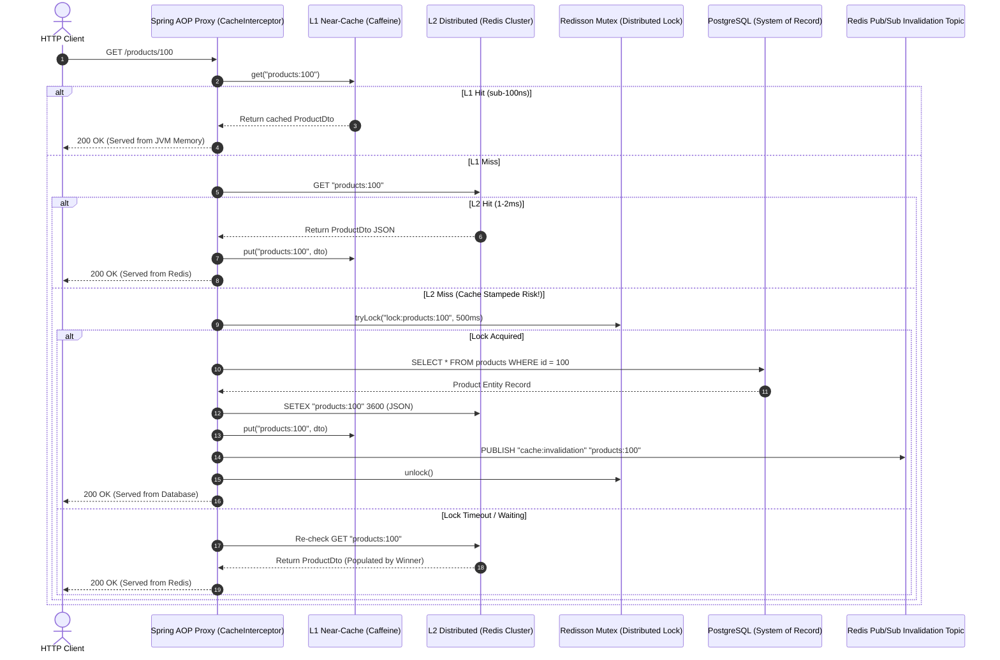

# Spring Distributed Caching & Redis Mastery: The Definitive Enterprise Architecture Guide

> **Scope**: High-Scale Distributed Caching, Spring Cache Abstraction (`@Cacheable`, `@CachePut`, `@CacheEvict`, `@Caching`, `@CacheConfig`), Proxy Interception Mechanics (`CacheInterceptor`, `CacheAspectSupport`), Mutex Lock Striping (`sync = true`), In-Memory Caching (Caffeine W-TinyLFU), Distributed Caching (Redis Standalone, Sentinel, Cluster with 16,384 Hash Slots & Key Hash Tags `{...}`), Lettuce Connection Pooling & Netty Event Loops, Redisson Distributed Locks (`RLock`, Watchdog Auto-Renewal, FairLock), Two-Tier Multi-Level Near-Caching (L1 Caffeine + L2 Redis with Redis Pub/Sub Invalidation Bus), Resiliency Algorithms (Probabilistic Early Expiration / XFetch, Bloom Filters for Anti-Penetration, Jittered TTLs for Anti-Avalanche), Redis Serialization (Polymorphic Jackson 2, ProtoBuf, Kryo), Lua Scripting Atomicity, and Hardcore War-Room Post-Mortems.

---

## Universal Architecture & Progressive Road Map

```
┌──────────────────────────────────────────────────────────────────────────────────────────────────┐
│                      SPRING ENTERPRISE DISTRIBUTED CACHING TOPOLOGY                              │
└──────────────────────────────────────────────────────────────────────────────────────────────────┘
                                        │
             ┌──────────────────────────┴──────────────────────────┐
             ▼                                                     ▼
┌─────────────────────────┐                               ┌─────────────────────────┐
│ L1 In-Memory Layer      │                               │ L2 Distributed Layer    │
│ Caffeine (W-TinyLFU)    │                               │ Redis Cluster (16,384)  │
│ Latency: < 100 ns       │                               │ Latency: 0.5 - 2.0 ms   │
│ Scope: Local JVM Node   │                               │ Scope: Shared Cluster   │
└────────────┬────────────┘                               └────────────┬────────────┘
             │                                                         │
             │           ┌───────────────────────────────────┐         │
             └──────────►│ Cache Stampede & Penetration Gate │◄────────┘
                         │   • Single-Flight Mutex (sync)    │
                         │   • Probabilistic XFetch Engine   │
                         │   • Redisson Distributed Lock     │
                         │   • Redis Bloom Filter Sentinel   │
                         └─────────────────┬─────────────────┘
                                           │
                                           ▼
                         ┌───────────────────────────────────┐
                         │ System of Record (PostgreSQL/JPA) │
                         │ Latency: 10 - 250 ms              │
                         └───────────────────────────────────┘
```

---

# Track 0: Jargon-Buster Encyclopedia (32 High-Frequency Core Concepts)

Distributed caching encompasses software design patterns, concurrent memory models, network framing protocols, and operating system mechanics. The following 32 concepts form the conceptual substrate for high-scale enterprise engineering.

---

### Cluster A: Spring Cache Core & Annotation Abstractions

#### 1. CacheManager Abstraction
* **ELI5**: The universal remote control for caching. Your business code only presses the "store" or "retrieve" button, while the `CacheManager` decides whether that button operates an in-memory box (Caffeine) or a remote warehouse (Redis).
* **Low-Level Mechanics**: The central SPI `org.springframework.cache.CacheManager` manages named collections of `org.springframework.cache.Cache` instances. Implementations include `ConcurrentMapCacheManager`, `CaffeineCacheManager`, `RedisCacheManager`, and composite decorators like `CompositeCacheManager`. Each `Cache` implementation delegates read/write mutations (`get(Object)`, `put(Object, Object)`, `evict(Object)`) to native driver primitives.
* **Failure Mode**: When unconfigured or misconfigured, Spring falls back to `NoOpCacheManager`, silently running queries directly against the database on every invocation while returning HTTP 200s, masking total cache bypass until database thread pools exhaust.
* **Micro-Code Proof**:
```java
@Bean
public CacheManager cacheManager(RedisConnectionFactory connectionFactory) {
    return RedisCacheManager.builder(connectionFactory)
        .cacheDefaults(RedisCacheConfiguration.defaultCacheConfig())
        .build();
}
```

#### 2. CacheInterceptor & CacheAspectSupport
* **ELI5**: The invisible security guard standing before your service method. When someone calls the method, the guard checks if the answer is already written on the whiteboard before letting anyone enter the office.
* **Low-Level Mechanics**: `CacheInterceptor` extends `CacheAspectSupport` and implements AOP Alliance's `MethodInterceptor`. When a method annotated with `@Cacheable` is intercepted by a CGLIB or JDK Dynamic Proxy, `CacheInterceptor.invoke()` executes `execute(CacheOperationInvoker, Object, Method, Object[])`. It inspects the method signature, resolves cache instances via `CacheResolver`, evaluates keys via `KeyGenerator`, and coordinates cache lookup and fallback execution.
* **Failure Mode**: If a cached method is called internally from within the same Spring bean (`this.myMethod()`), the call bypasses the Spring AOP proxy wrapper completely. `CacheInterceptor` is never invoked, resulting in silent cache misses on 100% of internal calls.
* **Micro-Code Proof**:
```java
// Spring internals (simplified trace)
public class CacheInterceptor extends CacheAspectSupport implements MethodInterceptor {
    @Override
    public Object invoke(MethodInvocation invocation) throws Throwable {
        return execute(invocation::proceed, invocation.getThis(), invocation.getMethod(), invocation.getArguments());
    }
}
```

#### 3. `@Cacheable` (`condition` vs `unless`)
* **ELI5**: `@Cacheable` says: "Check the cache first; if missing, run the method and save the answer." The `condition` flag decides whether to look in the cache *before* running, while `unless` decides whether to save the answer *after* seeing the result.
* **Low-Level Mechanics**: `condition` is evaluated *prior* to cache lookup using method arguments (`#arg`). If false, caching is bypassed entirely. `unless` is evaluated *after* method execution and has access to the returned object via `#result`. If `unless` evaluates to true, the return value is not committed to the cache.
* **Failure Mode**: Using `#result` inside `condition` throws `VariableNotAvailableException` at runtime because the method has not executed yet when `condition` is evaluated.
* **Micro-Code Proof**:
```java
@Cacheable(
    cacheNames = "users",
    key = "#userId",
    condition = "#userId > 0",             // Checked BEFORE method execution
    unless = "#result == null || #result.inactive" // Checked AFTER method execution
)
public UserDto findUser(long userId) { return userRepo.findById(userId); }
```

#### 4. `@CachePut`
* **ELI5**: "Always run this method, do the work, and forcibly overwrite whatever is currently sitting in the cache with the fresh result."
* **Low-Level Mechanics**: Unlike `@Cacheable`, `@CachePut` never bypasses method invocation. The target method is unconditionally executed. Upon successful completion, `CacheAspectSupport` extracts the return value and invokes `cache.put(evaluatedKey, result)`.
* **Failure Mode**: Declaring `void` as the return type on a `@CachePut` method writes `null` into the cache key, corrupting subsequent `@Cacheable` reads with empty values or triggering deserialization errors.
* **Micro-Code Proof**:
```java
@CachePut(cacheNames = "users", key = "#user.id")
public UserDto updateUser(UserDto user) {
    return userRepo.save(user); // Return value MUST be the object to cache
}
```

#### 5. `@CacheEvict` (`allEntries`, `beforeInvocation`)
* **ELI5**: The eraser. It removes the stale answer from the whiteboard so future callers are forced to fetch the new truth.
* **Low-Level Mechanics**: Triggers `cache.evict(key)` or `cache.clear()` (if `allEntries = true`). By default, `beforeInvocation = false`, meaning eviction occurs *after* the method returns without throwing an exception. Setting `beforeInvocation = true` executes eviction in a `finally` block before the method body runs.
* **Failure Mode**: If `beforeInvocation = false` and the method throws an unhandled database `DataIntegrityViolationException`, eviction is skipped, leaving corrupted, out-of-sync stale data in Redis indefinitely.
* **Micro-Code Proof**:
```java
@CacheEvict(cacheNames = "users", key = "#userId", beforeInvocation = true)
public void deleteUser(long userId) {
    userRepo.deleteById(userId);
}
```

#### 6. `@Caching` & `@CacheConfig`
* **ELI5**: `@CacheConfig` sets class-level defaults (like the cache name) so you don't repeat yourself. `@Caching` lets you group multiple conflicting caching rules (e.g., evicting a list while putting an item) onto a single method.
* **Low-Level Mechanics**: `@CacheConfig` provides class-level metadata defaults (`cacheNames`, `keyGenerator`, `cacheManager`, `cacheResolver`). `@Caching` allows aggregate declarations of multiple `@Cacheable`, `@CachePut`, or `@CacheEvict` annotations processed sequentially by `CacheAspectSupport`.
* **Failure Mode**: Placing contradictory operations in `@Caching` (such as `@CacheEvict(key = "#id")` and `@CachePut(key = "#id")`) can result in race conditions depending on annotation processing ordering inside Spring's aspect advisor.
* **Micro-Code Proof**:
```java
@Caching(
    put = { @CachePut(cacheNames = "userById", key = "#user.id") },
    evict = { @CacheEvict(cacheNames = "allUsers", allEntries = true) }
)
public UserDto saveAndRefresh(UserDto user) { return userRepo.save(user); }
```

#### 7. SpEL Key Generators & Root Context
* **ELI5**: The formula that builds the unique label tag pasted onto each cached answer. If two different customers get the same label, customer A sees customer B's bank account.
* **Low-Level Mechanics**: Spring evaluates cache keys using Spring Expression Language (SpEL) within a `CacheEvaluationContext`. Available root variables include `#root.method`, `#root.target`, `#root.caches`, `#root.args[0]`, and named parameter bindings `#paramName`. If no key is declared, `SimpleKeyGenerator` generates keys based on hash codes of all method parameters.
* **Failure Mode**: Using `SimpleKeyGenerator` with multi-argument methods where arguments lack well-defined `equals()` and `hashCode()` contracts results in duplicate cache entries or key collisions across unrelated methods.
* **Micro-Code Proof**:
```java
@Component("customKeyGenerator")
public class SafeTenantKeyGenerator implements KeyGenerator {
    @Override
    public Object generate(Object target, Method method, Object... params) {
        String tenant = TenantContext.getTenantId();
        return tenant + ":" + method.getName() + ":" + Arrays.deepHashCode(params);
    }
}
```

#### 8. `sync = true` (In-JVM Mutex Lock Striping)
* **ELI5**: A bouncer outside the conference room. When 10,000 people arrive at the exact moment the coffee pot is empty, the bouncer lets only *one* person enter the kitchen to brew coffee while everyone else waits in line.
* **Low-Level Mechanics**: Declaring `@Cacheable(..., sync = true)` switches execution from `CacheAspectSupport.execute()` to `cache.get(key, Callable)`. For Caffeine or ConcurrentMap, this uses internal bucket locks (`ConcurrentHashMap.computeIfAbsent`). Only one thread invokes the underlying database query; all other threads on that specific JVM block until the value is populated.
* **Failure Mode**: `sync = true` is strictly local to the running JVM instance! In a Kubernetes cluster with 50 replicas, 50 simultaneous database queries still execute concurrently. Furthermore, `sync = true` cannot be combined with `unless` clauses.
* **Micro-Code Proof**:
```java
@Cacheable(cacheNames = "marketRates", key = "#symbol", sync = true)
public BigDecimal getLiveRate(String symbol) {
    return forexService.queryExternalBloombergApi(symbol); // Only 1 thread per JVM executes
}
```

---

### Cluster B: Caching Failure Topologies & Resiliency Algorithms

#### 9. Cache Stampede (Thundering Herd)
* **ELI5**: A stampede of 10,000 thirsty marathon runners reaching a single water fountain the exact second the tank runs dry, crushing the plumbing.
* **Low-Level Mechanics**: Occurs when a high-cardinality hot key expires or is evicted from a distributed cache while receiving thousands of requests per second. Every concurrent request observes a cache miss simultaneously and issues an identical expensive SQL query to the database, resulting in connection pool exhaustion, thread starvation, and catastrophic cascading failure.
* **Failure Mode**: Thread pool saturation in Tomcat/HikariCP leading to cascading 504 Gateway Timeouts across the entire microservice mesh.
* **Micro-Code Proof**:
```
Time T0: Key "hot:item" expires in Redis (TTL=0)
Time T0 + 1ms: 5,000 threads miss in Redis ──► 5,000 concurrent SQL queries hit PostgreSQL
Result: Database CPU hits 100%, HikariCP pool connection timeout after 30,000ms.
```

#### 10. Probabilistic Early Expiration (XFetch Algorithm)
* **ELI5**: A smart runner who doesn't wait for the water bottle to be completely empty before heading to the faucet. Instead, as the water level drops, the runner rolls a die: the emptier the bottle and the longer it takes to walk to the well, the higher the chance they leave early to refill it in the background before anyone notices.
* **Low-Level Mechanics**: Devised by Vattani et al., the XFetch algorithm computes an early expiration trigger:
  $$-\beta \times \delta \times \ln(\text{random}()) > \text{remaining\_ttl}$$
  where $\beta > 0$ is aggressiveness, $\delta$ is computation time to recompute the value, $\text{random}() \in (0, 1]$, and $\text{remaining\_ttl} = \text{expiry} - \text{now}$. As $\text{remaining\_ttl} \to 0$, probability of trigger approaches 1.0. A single asynchronous worker refreshes the cache before hard expiration occurs.
* **Failure Mode**: If computation duration $\delta$ is grossly underestimated, early expiration triggers too late, resulting in traditional stampedes.
* **Micro-Code Proof**:
```java
public boolean shouldEarlyRefresh(long remainingTtlMs, long computeTimeMs, double beta) {
    if (remainingTtlMs <= 0) return true;
    double random = ThreadLocalRandom.current().nextDouble(0.0001, 1.0);
    return (-beta * computeTimeMs * Math.log(random)) > remainingTtlMs;
}
```

#### 11. Single-Flight / Mutex Concurrency
* **ELI5**: A flight booking counter where only one pilot is dispatched to fly to an island; all passengers wait at the terminal and board the exact same plane when it lands.
* **Low-Level Mechanics**: An application pattern where concurrent requests for the exact same missing cache key register into a shared future map (`ConcurrentHashMap<Key, CompletableFuture<Value>>`). The first thread initiates the remote fetch and publishes the future; subsequent callers attach `thenApply()` to the in-flight future without issuing duplicate network calls.
* **Failure Mode**: If the primary fetch thread encounters an unhandled deadlock or hangs indefinitely without a timeout, all attached waiting threads hang indefinitely, exhausting JVM worker threads.
* **Micro-Code Proof**:
```java
private final ConcurrentHashMap<String, CompletableFuture<Product>> flightMap = new ConcurrentHashMap<>();

public CompletableFuture<Product> getSingleFlight(String id) {
    return flightMap.computeIfAbsent(id, k -> 
        CompletableFuture.supplyAsync(() -> db.find(k))
            .whenComplete((res, ex) -> flightMap.remove(k))
    );
}
```

#### 12. Cache Avalanche (Jittered TTLs)
* **ELI5**: Setting every alarm clock in a 5,000-room hotel to ring at exactly 8:00 AM. Every guest tries to use the elevator at the same second. Jittering means setting each clock randomly between 7:45 AM and 8:15 AM.
* **Low-Level Mechanics**: Occurs when hundreds of thousands of distinct cache keys are inserted with the exact same Time-To-Live (e.g., exactly 3,600 seconds). When the TTL expires, millions of keys evaporate from memory simultaneously, dumping a massive wall of traffic directly onto backend databases.
* **Failure Mode**: Database CPU spikes from 5% to 100% in a 200ms window, triggering replica lag spikes, connection drops, and service health-check failures.
* **Micro-Code Proof**:
```java
public Duration calculateJitteredTtl(Duration baseTtl, double jitterPercent) {
    long baseMs = baseTtl.toMillis();
    long jitterRange = (long) (baseMs * jitterPercent);
    long randomOffset = ThreadLocalRandom.current().nextLong(-jitterRange, jitterRange + 1);
    return Duration.ofMillis(baseMs + randomOffset);
}
```

#### 13. Cache Penetration (Bloom Filters & Null Sentinels)
* **ELI5**: A prankster repeatedly calling a restaurant asking for "unicorn steak." Instead of the chef searching the freezer every single time, the host checks a chalkboard of impossible items and immediately hangs up.
* **Low-Level Mechanics**: Occurs when clients continuously request keys that *never exist* in the database (e.g., negative IDs, random UUIDs). Since the database finds nothing, no value is cached, meaning every subsequent request penetrates directly to the database. Mitigated by: (1) Caching empty/null sentinel values with short TTLs (e.g., 60 seconds), or (2) Placing a probabilistic Bloom Filter in front of the cache.
* **Failure Mode**: Attacker issues 50,000 queries per second for non-existent IDs, bypassing Redis completely and knocking offline the primary PostgreSQL database.
* **Micro-Code Proof**:
```java
// Null Sentinel Caching Pattern
public Product getWithPenetrationProtection(String id) {
    Product cached = redis.get(id);
    if (cached != null) return cached.isNullSentinel() ? null : cached;
    Product dbResult = db.find(id);
    if (dbResult == null) {
        redis.set(id, Product.NULL_SENTINEL, Duration.ofSeconds(60));
        return null;
    }
    redis.set(id, dbResult, Duration.ofHours(1));
    return dbResult;
}
```

#### 14. Cache Breakdown (Hotspot Invalidation)
* **ELI5**: The breaking of the dam at a single specific point. 99% of your cache is fine, but the one key containing "Taylor Swift Concert Tickets" expires, causing a flood that overwhelms the system.
* **Low-Level Mechanics**: Distinct from Cache Avalanche (where *many* keys expire at once), Cache Breakdown occurs when a *single, ultra-high-throughput* key expires under massive concurrency. Mitigated by mutual exclusion locks (Redisson `RLock`), asynchronous pre-warming, or never-expiring keys refreshed by scheduled background workers.
* **Failure Mode**: Redis instance CPU is healthy, but the database thread pool handling that single record's query maxes out, starving other unrelated transactional queries.
* **Micro-Code Proof**:
```java
// Double-Checked Distributed Locking for Breakdown Prevention
RLock lock = redisson.getLock("lock:" + hotKey);
if (redis.get(hotKey) == null) {
    if (lock.tryLock(100, 5000, TimeUnit.MILLISECONDS)) {
        try {
            if (redis.get(hotKey) == null) { // Double-check inside lock
                redis.set(hotKey, db.fetchHotData(), Duration.ofHours(1));
            }
        } finally { lock.unlock(); }
    }
}
```

#### 15. Hot Key & Big Key Skew
* **ELI5**: Hot Key = one celebrity key receiving 90% of all phone calls. Big Key = one key containing a 500MB video file that clogs the pipe whenever anyone downloads it.
* **Low-Level Mechanics**: In a Redis Cluster with 16,384 hash slots, a single key maps to exactly one master node. If that key receives 100,000 QPS, that single Redis master experiences 100% CPU while other nodes idle. A Big Key (e.g., a Redis Hash with 1,000,000 fields or a String $> 10\text{MB}$) causes multi-millisecond network serialization pauses on Redis's single-threaded event loop, blocking all other commands.
* **Failure Mode**: Redis cluster latency degrades across all clients sharing that master node; `DEL bigkey` blocks Redis for 5 seconds, triggering cluster node failover alarms.
* **Micro-Code Proof**:
```
# Redis Big Key Scan CLI Diagnostic
redis-cli -p 6379 --bigkeys
# Redis Hot Key Sample CLI Diagnostic (requires maxmemory-policy LFU)
redis-cli -p 6379 --hotkeys
```

#### 16. Dual-Write Inconsistency & Delayed Double Deletion
* **ELI5**: Updating your notebook and the whiteboard at the same time. If someone reads the whiteboard between your two writes, they read outdated information.
* **Low-Level Mechanics**: In a Cache-Aside pattern, application updates write to DB and evict from Cache. If Thread A updates DB, then Thread B reads stale cache before eviction, consistency breaks. Delayed Double Deletion pattern: (1) Evict cache, (2) Update DB, (3) Sleep $N$ milliseconds (longer than DB replica lag + read query duration), (4) Evict cache a second time asynchronously.
* **Failure Mode**: Race condition where a slow concurrent read populates Redis with pre-update database snapshot data *after* the update thread's eviction has completed, causing permanent data staleness until TTL expires.
* **Micro-Code Proof**:
```java
public void updateWithDelayedDoubleDeletion(User user) {
    redis.delete(user.getId()); // 1. First Eviction
    db.update(user);            // 2. Database Write
    asyncExecutor.schedule(() -> {
        redis.delete(user.getId()); // 3. Delayed Second Eviction
    }, 500, TimeUnit.MILLISECONDS);
}
```

---

### Cluster C: Redis Architecture & Distributed Primitives

#### 17. Redis Single-Threaded Event Loop (`aeEventLoop`)
* **ELI5**: A master chef working alone in a tiny kitchen, cooking orders one ticket at a time at lightning speed without ever having to coordinate or argue with another chef.
* **Low-Level Mechanics**: Redis executes commands using a single-threaded event loop based on OS I/O multiplexing primitives (`epoll` on Linux, `kqueue` on macOS). Because all data commands run sequentially on this single thread, operations like `INCR`, `HSET`, and Lua scripts are strictly atomic without requiring mutexes. (Note: Redis 6.0+ introduced multi-threaded network I/O for socket read/write, but command execution remains strictly single-threaded).
* **Failure Mode**: Any $O(N)$ command executed on a large dataset (e.g., `KEYS *`, `SMEMBERS large_set`, `HGETALL big_hash`) blocks the single event loop, halting all heartbeats and client requests across the entire server.
* **Micro-Code Proof**:
```c
// Redis ae.c event loop dispatch cycle (conceptual C)
void aeMain(aeEventLoop *eventLoop) {
    eventLoop->stop = 0;
    while (!eventLoop->stop) {
        aeProcessEvents(eventLoop, AE_ALL_EVENTS|AE_CALL_BEFORE_SLEEP);
    }
}
```

#### 18. RESP Protocol (REdis Serialization Protocol)
* **ELI5**: The simple, human-readable language Redis uses over the network wire. It uses symbols like `+` for simple strings, `-` for errors, `:` for integers, `$` for bulk strings, and `*` for arrays.
* **Low-Level Mechanics**: RESP is a binary-safe, text-based request-response protocol designed for low parsing overhead. In RESP2:
  - Simple String: `+OK\r\n`
  - Error: `-ERR unknown command\r\n`
  - Integer: `:1000\r\n`
  - Bulk String: `$6\r\nfoobar\r\n`
  - Array: `*2\r\n$3\r\nfoo\r\n$3\r\nbar\r\n`
  RESP3 expands this with maps (`%`), sets (`~`), and booleans (`#`).
* **Failure Mode**: Packet fragmentation or unescaped carriage returns in raw socket communication can cause protocol desynchronization, triggering `ERR Protocol error: invalid multibulk length`.
* **Micro-Code Proof**:
```
Client sends: *3\r\n$3\r\nSET\r\n$4\r\nuser\r\n$4\r\njohn\r\n
Redis server replies: +OK\r\n
```

#### 19. Redis Cluster 16,384 Hash Slots & Hash Tags (`{...}`)
* **ELI5**: A postal system with 16,384 mail sorting bins distributed across a fleet of delivery trucks. A Hash Tag lets you staple two letters together with curly braces so they are guaranteed to end up in the exact same truck.
* **Low-Level Mechanics**: Redis Cluster partitions its keyspace into exactly 16,384 logical hash slots. Slot is calculated via:
  $$\text{slot} = \text{CRC16}(\text{key}) \pmod{16384}$$
  If the key contains `{...}`, only the text inside the curly braces is hashed. Multi-key operations (`MGET`, `MSET`, transactions, Lua scripts) require all keys to hash to the *exact same slot*, otherwise Redis returns a `CROSSSLOT Keys in request don't hash to the same slot` error.
* **Failure Mode**: Executing multi-key Spring Data Redis commands without Hash Tags across a clustered environment fails with `RedisSystemException: CROSSSLOT`.
* **Micro-Code Proof**:
```java
// Keys that will cause CROSSSLOT error:
redisTemplate.opsForValue().multiGet(List.of("user:101:profile", "user:101:orders")); // ❌ Different slots!

// Safe multi-key operation using Hash Tags:
redisTemplate.opsForValue().multiGet(List.of("{user:101}:profile", "{user:101}:orders")); // ✅ Same slot!
```

#### 20. Redisson Distributed Lock (`RLock`) & Watchdog Timer
* **ELI5**: A rented hotel room key with an automatic lease extension. As long as your phone is detected inside the room, the hotel automatically renews your reservation every 10 seconds so the door doesn't unlock while you're sleeping.
* **Low-Level Mechanics**: Redisson acquires distributed locks via an atomic Lua script running `HSET` with a thread identifier and a 30-second TTL. If acquired without an explicit `leaseTime`, Redisson starts an internal Netty `Timeout` task—the **Lock Watchdog**—which runs every 10 seconds ($\text{lockWatchdogTimeout} / 3$) and executes an atomic Lua script to reset the lock TTL back to 30 seconds.
* **Failure Mode**: If an engineer passes an explicit lease time: `lock.lock(10, TimeUnit.SECONDS)`, the Watchdog is **completely disabled**. If the business transaction takes 11 seconds, the lock silently releases, allowing a concurrent worker to enter the critical section.
* **Micro-Code Proof**:
```java
RLock lock = redissonClient.getLock("order:lock:" + orderId);
// ✅ Watchdog ACTIVE: Renews lock every 10s until unlock() is called
lock.lock(); 
try {
    processLongPayment();
} finally {
    lock.unlock();
}
```

#### 21. Multi-Tier L1/L2 Near-Cache & Pub/Sub Invalidation
* **ELI5**: Keeping a pocket notebook (L1 Caffeine) for instant answers without reaching for your phone. When someone updates the group chat (L2 Redis), they send a broadcast notification that tells everyone to scratch out that page in their notebook.
* **Low-Level Mechanics**: Application reads L1 (local JVM in-memory Caffeine) in $< 100\text{ns}$. On L1 miss, reads L2 (remote Redis) in $1\text{ms}$ and populates L1. When any node updates or evicts a record, it writes to L2 and publishes an invalidation event over a Redis Pub/Sub topic. All cluster instances subscribed to the topic receive the message and evict the corresponding key from their local L1 Caffeine cache.
* **Failure Mode**: Redis Pub/Sub offers "at-most-once" delivery with zero persistence. If a network blip disconnects Node C during an invalidation broadcast, Node C's L1 cache will serve stale data until its local TTL expires.
* **Micro-Code Proof**:
```java
// Publisher node
redisTemplate.convertAndSend("cache:invalidate:topic", "users:" + userId);

// Subscriber node
@Component
public class CacheInvalidationListener implements MessageListener {
    @Autowired private CacheManager caffeineCacheManager;
    @Override
    public void onMessage(Message msg, byte[] pattern) {
        String key = new String(msg.getBody());
        caffeineCacheManager.getCache("users").evict(key);
    }
}
```

#### 22. Redis Memory Allocator (`jemalloc`) & RSS Fragmentation
* **ELI5**: Packing items into fixed-size cardboard shipping boxes. If you pack a 1.1kg item into a 2kg box, the wasted 0.9kg space cannot be used by anyone else, making your truck appear full even when it contains mostly air.
* **Low-Level Mechanics**: Redis delegates dynamic memory allocation to `jemalloc`, which allocates memory in predefined bucket sizes (e.g., 8, 16, 32, 64, 128 bytes). Residual memory fragmentation occurs when keys are created and deleted with varying payload sizes. The metric `mem_fragmentation_ratio` equals:
  $$\text{mem\_fragmentation\_ratio} = \frac{\text{used\_memory\_rss}}{\text{used\_memory}}$$
  A ratio $> 1.5$ indicates significant memory waste; a ratio $< 1.0$ indicates the OS is swapping Redis pages to disk.
* **Failure Mode**: The OS Out-Of-Memory (OOM) Killer terminates the Redis process when RSS exceeds machine RAM, even if Redis's reported `used_memory` is far below `maxmemory`.
* **Micro-Code Proof**:
```
# Redis INFO memory output
used_memory:1073741824          # 1.0 GB actual data
used_memory_rss:1932735283      # 1.8 GB allocated by OS
mem_fragmentation_ratio:1.80    # Severe fragmentation! Run 'CONFIG SET activedefrag yes'
```

#### 23. Persistence Fsync Latency: RDB CoW vs AOF `everysec`
* **ELI5**: RDB takes a photograph of the entire chalkboard once an hour by making a photocopy first. AOF writes down every single stroke of chalk in a diary. If the diary writer presses the pen too hard (`fsync`), everything pauses.
* **Low-Level Mechanics**:
  - **RDB**: Redis calls `fork()` to create a child process. The child uses Linux Copy-On-Write (CoW) page tables to dump memory to disk. If write traffic is high during snapshotting, memory usage doubles as modified pages are duplicated.
  - **AOF**: Appends commands to an append-only log. Under `appendfsync everysec`, a background thread flushes to disk every second. If disk I/O bottlenecks, the main event loop blocks on `write()` for more than 2 seconds to prevent buffer bloat.
* **Failure Mode**: Heavy disk I/O freezes the Redis main thread for multiple seconds, triggering client read timeouts and cluster failovers.
* **Micro-Code Proof**:
```properties
# Optimal enterprise latency config in redis.conf
save 900 1
appendonly yes
appendfsync everysec
no-appendfsync-on-rewrite yes
auto-aof-rewrite-percentage 100
```

#### 24. Reactive Lettuce Netty Channel Pipeline
* **ELI5**: An ultra-fast conveyor belt that packs hundreds of customer requests into a single continuous stream through one persistent fiber-optic pipe, instead of opening and closing a separate phone call for every single question.
* **Low-Level Mechanics**: Lettuce is built on Netty and is fully non-blocking and reactive. Unlike Jedis (which requires a thread-per-connection pool), Lettuce shares a single multiplexed TCP connection across hundreds of concurrent application threads via Netty's `ChannelPipeline` using event loops. Requests are pipelined asynchronously and matched to responses using an internal FIFO command queue.
* **Failure Mode**: Executing blocking code (e.g., `Thread.sleep()` or synchronous JDBC queries) inside a Lettuce reactive callback or Netty event loop thread freezes all Redis communication across the entire application.
* **Micro-Code Proof**:
```java
@Bean
public ReactiveRedisTemplate<String, Product> reactiveRedisTemplate(ReactiveRedisConnectionFactory factory) {
    RedisSerializationContext<String, Product> context = RedisSerializationContext
        .<String, Product>newSerializationContext(new StringRedisSerializer())
        .value(new GenericJackson2JsonRedisSerializer())
        .build();
    return new ReactiveRedisTemplate<>(factory, context);
}
```

---

### Cluster D: Serialization, Encoding & Data Structures

#### 25. `GenericJackson2JsonRedisSerializer` vs Polymorphic Type Handling
* **ELI5**: Storing a toy in a clear plastic container with a label that specifies the exact brand and model, so when you open it tomorrow, you know whether it's an action figure or a puzzle.
* **Low-Level Mechanics**: `GenericJackson2JsonRedisSerializer` embeds full Java class metadata into the JSON payload via `@class` property (e.g., `"@class": "com.corp.dto.UserDto"`). This enables polymorphic deserialization back into concrete Java types without needing explicit type parameters.
* **Failure Mode**: (1) Major payload bloat from fully qualified class names. (2) Remote Code Execution (RCE) vulnerabilities if malicious JSON injects gadget chains into unvalidated polymorphic deserializers. (3) Refactoring a Java package breaks deserialization of all existing cached keys, throwing `ClassNotFoundException`.
* **Micro-Code Proof**:
```java
// JSON stored in Redis:
{
  "@class": "com.corp.dto.UserDto",
  "id": 101,
  "username": "alice"
}
```

#### 26. JDK Serialization Vulnerability & Payload Bloat
* **ELI5**: Packing an item along with the entire history and blueprints of the factory that built it, encoded in a secret binary format that hackers can manipulate to run arbitrary commands on your computer.
* **Low-Level Mechanics**: Spring's legacy `JdkSerializationRedisSerializer` uses standard Java Object Serialization (`ObjectInputStream` / `ObjectOutputStream`). Objects must implement `java.io.Serializable`. It writes magic headers (`AC ED 00 05`), class signatures, and field descriptors.
* **Failure Mode**: Notorious for Java Deserialization Gadget Chain vulnerabilities (e.g., Apache Commons Collections RCE). Furthermore, payloads are typically 4x–8x larger than compressed JSON or Protocol Buffers, consuming massive Redis RAM and network bandwidth.
* **Micro-Code Proof**:
```
# Raw hex representation of a JDK serialized String "hello":
\xac\xed\x00\x05t\x00\x05hello (9 bytes overhead for a 5-byte string!)
```

#### 27. Redis Hashes (`HGETALL` vs `HMGET` & ZipList Encoding)
* **ELI5**: A sub-folder containing labeled index cards. If the sub-folder has few items, Redis packs them tightly into a tiny, compressed envelope (`ziplist`/`listpack`). If you dump out 100,000 cards at once (`HGETALL`), you block the entire office.
* **Low-Level Mechanics**: Redis Hashes store field-value mappings under a single top-level key. Small hashes ($< 512$ entries and $< 64$ bytes per value) are encoded in memory as a contiguous `listpack` (or legacy `ziplist`), saving substantial RAM by eliminating pointer overhead. When limits are exceeded, Redis converts the hash into an internal hash table (`dict`).
* **Failure Mode**: Calling `HGETALL` on a hash with 50,000 fields blocks the Redis main thread for 100ms+. Always use `HMGET` with specific fields or iterate using `HSCAN`.
* **Micro-Code Proof**:
```java
// Optimal memory access for entity fields:
redisTemplate.opsForHash().put("user:100", "email", "user@corp.com");
Object email = redisTemplate.opsForHash().get("user:100", "email"); // O(1) time
```

#### 28. Redis Sorted Sets (ZSET & SkipList)
* **ELI5**: A high-score leaderboard that instantly reorders players every time someone scores points, while also allowing you to ask "who are the top 10 players right now?" in a millisecond.
* **Low-Level Mechanics**: A ZSET maps unique members to floating-point numeric scores. Internally, Redis represents large ZSETs using two data structures simultaneously: a hash table (`dict`) for $O(1)$ member lookups and a SkipList for $O(\log N)$ score-range queries (`ZRANGEBYSCORE`, `ZREVRANGE`).
* **Failure Mode**: Storing unbounded time-series data without pruning causes memory exhaustion; running `ZRANGE 0 -1` on a 10-million-element ZSET triggers out-of-memory errors on both Redis and the client.
* **Micro-Code Proof**:
```java
// High-performance sliding window rate limiter tracking
long now = System.currentTimeMillis();
redisTemplate.opsForZSet().add("rate:user:100", String.valueOf(now), now);
redisTemplate.opsForZSet().removeRangeByScore("rate:user:100", 0, now - 60000);
Long count = redisTemplate.opsForZSet().zCard("rate:user:100");
```

#### 29. Redis HyperLogLog (Cardinality Estimation)
* **ELI5**: A magical counter that can count 100 million unique visitors to your website using less memory than a single tweet (fixed 12 KB of RAM), with a tiny 0.81% margin of error.
* **Low-Level Mechanics**: HyperLogLog approximates the cardinality of distinct elements based on the observation that the maximum number of leading zeros in the binary hash of elements follows a predictable probability distribution. Redis HyperLogLog uses exactly 16,384 registers (6 bits each), consuming a fixed $16384 \times 6 / 8 = 12,288\text{ bytes}$ (12 KB).
* **Failure Mode**: Attempting to retrieve individual member identities from HyperLogLog is mathematically impossible; it provides *only* cardinality estimation via `PFCOUNT`.
* **Micro-Code Proof**:
```java
redisTemplate.opsForHyperLogLog().add("uv:2026-10-10", userId);
Long uniqueVisitors = redisTemplate.opsForHyperLogLog().size("uv:2026-10-10");
```

#### 30. Redis Bitmaps & Bitfields
* **ELI5**: A giant grid of millions of light switches where switch #101 represents whether User 101 logged in today. 10 million users take only 1.2 megabytes of space.
* **Low-Level Mechanics**: Bitmaps are not a distinct data type; they operate directly on Redis Strings using bit-level operations (`SETBIT`, `GETBIT`, `BITCOUNT`, `BITOP`). Strings can grow up to 512 MB ($2^{32}$ bits). `BITOP AND/OR/XOR` runs hardware-accelerated bitwise operations across millions of users in microseconds.
* **Failure Mode**: Calling `SETBIT mykey 4000000000 1` on an uninitialized key forces Redis to allocate a contiguous 500 MB string in a single blocking memory allocation, causing latency spikes.
* **Micro-Code Proof**:
```java
// Mark user logged in on day 15
redisTemplate.opsForValue().setBit("login:active:user:500", 15, true);
Boolean active = redisTemplate.opsForValue().getBit("login:active:user:500", 15);
```

#### 31. Redis Bloom Filter Module (`BF.ADD` / `BF.EXISTS`)
* **ELI5**: A bouncer with an ink pad who checks if you're on the VIP guest list. If he says "no", you are 100% definitely NOT on the list. If he says "yes", there is a 1% chance he made a mistake, but you still check the clipboard.
* **Low-Level Mechanics**: Bloom filters use an array of $M$ bits and $K$ independent cryptographic hash functions. Adding an item sets $K$ bits to 1. Querying verifies if all $K$ bits are 1. False negatives are mathematically impossible ($P(\text{false negative}) = 0$). False positives occur with probability $P \approx (1 - e^{-kn/m})^k$.
* **Failure Mode**: Standard Bloom filters cannot delete elements. Setting the error rate too low or exceeding anticipated element capacity causes the bit array to saturate with 1s, resulting in a false-positive rate approaching 100%.
* **Micro-Code Proof**:
```java
// Using Redisson RBloomFilter
RBloomFilter<String> bloom = redissonClient.getBloomFilter("user:exists:bloom");
bloom.tryInit(10_000_000L, 0.01); // 10M elements, 1% false positive probability
bloom.add("user-999");
boolean mightExist = bloom.contains("user-999"); // true
boolean definitelyAbsent = !bloom.contains("user-fake"); // 100% absent
```

#### 32. Client-Side Caching (RESP3 Tracking `BCAST`)
* **ELI5**: Redis sends a message to your application whenever data changes, telling you: "Hey, someone edited product #42, throw away your local copy."
* **Low-Level Mechanics**: Introduced in Redis 6 under RESP3. The client enables server-assisted tracking (`CLIENT TRACKING on bcast`). When a client reads a key, it caches the value in JVM memory. When any client modifies that key in Redis, the Redis server sends an invalidation push message (`invalidate [key]`) to all clients that cached that key, providing near-cache speed with distributed consistency.
* **Failure Mode**: Broadcast tracking (`BCAST`) on high-write systems can flood clients with invalidation messages, consuming substantial network bandwidth and CPU cycles processing invalidations.
* **Micro-Code Proof**:
```
# Redis RESP3 Client Tracking Handshake
CLIENT TRACKING ON BCAST PREFIX product:
# When another client runs SET product:10 "new"
# Redis pushes: -> message "invalidate" ["product:10"]
```

---

# Track 1: Beginner Foundations & ELI5

---

### Physical Analogy: The Executive Secretary, The Sticky Notes, and The Remote Salt Mines

Imagine an Executive (the CPU/Application) making high-stakes decisions. 

1. **The System of Record (PostgreSQL/Database)**: The remote salt mines 50 miles away. Every time the executive needs a document, a courier must get on a horse, ride 50 miles through muddy roads, unlock a vault, copy the document by hand, and ride 50 miles back. **Round trip time: 50 milliseconds**.
2. **The L2 Distributed Cache (Redis Cluster)**: The filing cabinet in the hallway. It's shared by all 50 executives on the floor. A courier walks down the hall, opens the drawer, and grabs the sheet. **Round trip time: 1 millisecond**.
3. **The L1 In-Memory Cache (Caffeine)**: The sticky note stuck directly to the executive's computer monitor. The executive glances over without moving their hands from the keyboard. **Round trip time: 50 nanoseconds**.
4. **The Disaster (Cache Drift)**: Executive A changes the document in the salt mines and updates the hallway cabinet, but forgets to tell Executive B. Executive B keeps reading the stale sticky note on their monitor and makes catastrophic business decisions based on yesterday's numbers.

---

### Why Distributed Caching Exists: The "Bad Old Way" vs. Modern Enterprise Caching

#### The Bad Old Way: The Naive Static `ConcurrentHashMap`
In early Java architectures, engineers cached objects using a static map:
```java
public class NaiveUserService {
    // ❌ FATAL ANTI-PATTERN: Heap OOM & Cluster Drift
    private static final Map<String, User> CACHE = new ConcurrentHashMap<>();

    public User getUser(String id) {
        return CACHE.computeIfAbsent(id, key -> database.findUser(key));
    }
}
```
**Why This Catastrophically Fails in Production**:
1. **Unbounded Heap Growth & OOM**: No eviction policy, no max-size bound, and no TTL. As user traffic grows, the JVM heap fills with millions of dead objects, triggering prolonged Stop-The-World (STW) Garbage Collection pauses and eventual `java.lang.OutOfMemoryError: Java heap space`.
2. **Cluster Inconsistency (Drift)**: In a horizontal cluster of 20 Spring Boot instances, each instance holds its own private `CACHE`. When Node 1 updates a user's password, Nodes 2 through 20 still hold the old password in their local memory.
3. **Cold Starts & Deployment Amnesia**: Every time a pod restarts or deploys a new release, its entire cache vanishes, hammering the database with a sudden tsunami of queries.

#### The Modern Way: Coordinated Multi-Tier Distributed Caching
Modern architectures decouple memory storage from application compute nodes using Redis Cluster while maintaining sub-microsecond local reads via Caffeine near-caches, coordinated through reactive invalidation buses.

---

### Step 1-to-N Code Runway: From Zero to Production-Ready Caching

#### Step 1: Enable Caching and Basic Annotation
```java
package com.enterprise.cache.config;

import org.springframework.cache.annotation.EnableCaching;
import org.springframework.context.annotation.Configuration;

@Configuration
@EnableCaching
public class CacheBootstrapConfig {
    // Enables Spring AOP proxy interception for @Cacheable, @CachePut, @CacheEvict
}
```

#### Step 2: Service-Layer `@Cacheable` with Safe SpEL Keys and Null Protection
```java
package com.enterprise.cache.service;

import com.enterprise.cache.dto.ProductDto;
import com.enterprise.cache.repository.ProductRepository;
import org.springframework.cache.annotation.CacheConfig;
import org.springframework.cache.annotation.CacheEvict;
import org.springframework.cache.annotation.CachePut;
import org.springframework.cache.annotation.Cacheable;
import org.springframework.stereotype.Service;

@Service
@CacheConfig(cacheNames = "products")
public class ProductCatalogService {

    private final ProductRepository productRepository;

    public ProductCatalogService(ProductRepository productRepository) {
        this.productRepository = productRepository;
    }

    // Step 2: Cache lookup with defensive key and null-handling
    @Cacheable(
        key = "'prod:' + #productId", 
        unless = "#result == null",
        sync = true // Local mutex to prevent stampede per JVM
    )
    public ProductDto getProductById(Long productId) {
        return productRepository.findById(productId)
            .map(ProductDto::fromEntity)
            .orElse(null);
    }

    // Step 3: Atomic cache update on write
    @CachePut(key = "'prod:' + #dto.id", unless = "#result == null")
    public ProductDto updateProduct(ProductDto dto) {
        return ProductDto.fromEntity(productRepository.save(dto.toEntity()));
    }

    // Step 4: Cache eviction on delete
    @CacheEvict(key = "'prod:' + #productId", beforeInvocation = true)
    public void deleteProduct(Long productId) {
        productRepository.deleteById(productId);
    }
}
```

#### Step 5: Production Redis Configuration with Non-Vulnerable Polymorphic Jackson Serializer
```java
package com.enterprise.cache.config;

import com.fasterxml.jackson.annotation.JsonTypeInfo;
import com.fasterxml.jackson.databind.ObjectMapper;
import com.fasterxml.jackson.databind.jsontype.BasicPolymorphicTypeValidator;
import com.fasterxml.jackson.datatype.jsr310.JavaTimeModule;
import org.springframework.context.annotation.Bean;
import org.springframework.context.annotation.Configuration;
import org.springframework.data.redis.cache.RedisCacheConfiguration;
import org.springframework.data.redis.cache.RedisCacheManager;
import org.springframework.data.redis.connection.RedisConnectionFactory;
import org.springframework.data.redis.serializer.GenericJackson2JsonRedisSerializer;
import org.springframework.data.redis.serializer.RedisSerializationContext;
import org.springframework.data.redis.serializer.StringRedisSerializer;

import java.time.Duration;

@Configuration
public class EnterpriseRedisCacheConfig {

    @Bean
    public RedisCacheManager redisCacheManager(RedisConnectionFactory connectionFactory) {
        // Secure Polymorphic Type Validator preventing RCE Deserialization attacks
        BasicPolymorphicTypeValidator ptv = BasicPolymorphicTypeValidator.builder()
            .allowIfBaseType("com.enterprise.")
            .allowIfBaseType("java.util.")
            .build();

        ObjectMapper mapper = new ObjectMapper();
        mapper.registerModule(new JavaTimeModule());
        mapper.activateDefaultTyping(ptv, ObjectMapper.DefaultTyping.NON_FINAL, JsonTypeInfo.As.PROPERTY);

        GenericJackson2JsonRedisSerializer jsonSerializer = new GenericJackson2JsonRedisSerializer(mapper);

        RedisCacheConfiguration defaultConfig = RedisCacheConfiguration.defaultCacheConfig()
            .entryTtl(Duration.ofMinutes(30))
            .disableCachingNullValues()
            .serializeKeysWith(RedisSerializationContext.SerializationPair.fromSerializer(new StringRedisSerializer()))
            .serializeValuesWith(RedisSerializationContext.SerializationPair.fromSerializer(jsonSerializer));

        return RedisCacheManager.builder(connectionFactory)
            .cacheDefaults(defaultConfig)
            // Custom TTL per cache domain
            .withCacheConfiguration("products", defaultConfig.entryTtl(Duration.ofHours(2)))
            .withCacheConfiguration("rates", defaultConfig.entryTtl(Duration.ofSeconds(60)))
            .build();
    }
}
```

---

# Track 2: Core Architecture & 8 Production Engines

---

### Architectural Blueprint: Two-Tier Reactive Caching Flow



---

### Engine 1: `TieredL1L2HybridCacheEngine`
**Purpose**: High-throughput two-tier cache combining local JVM sub-microsecond latency (Caffeine) with cluster-wide durability (Redis), keeping all nodes synchronized via a Redis Pub/Sub invalidation bus.

```java
package com.enterprise.cache.engine;

import com.github.benmanes.caffeine.cache.Caffeine;
import org.slf4j.Logger;
import org.slf4j.LoggerFactory;
import org.springframework.cache.Cache;
import org.springframework.cache.support.AbstractValueAdaptingCache;
import org.springframework.data.redis.core.RedisTemplate;

import java.time.Duration;
import java.util.concurrent.Callable;
import java.util.concurrent.TimeUnit;

public class TieredL1L2HybridCacheEngine extends AbstractValueAdaptingCache {

    private static final Logger log = LoggerFactory.getLogger(TieredL1L2HybridCacheEngine.class);

    private final String name;
    private final com.github.benmanes.caffeine.cache.Cache<Object, Object> l1Caffeine;
    private final RedisTemplate<String, Object> l2RedisTemplate;
    private final Duration l2Ttl;
    private final String invalidationTopic;

    public TieredL1L2HybridCacheEngine(
            String name,
            long l1MaxEntries,
            Duration l1Ttl,
            Duration l2Ttl,
            RedisTemplate<String, Object> l2RedisTemplate,
            String invalidationTopic) {
        super(true);
        this.name = name;
        this.l2RedisTemplate = l2RedisTemplate;
        this.l2Ttl = l2Ttl;
        this.invalidationTopic = invalidationTopic;
        this.l1Caffeine = Caffeine.newBuilder()
                .maximumSize(l1MaxEntries)
                .expireAfterWrite(l1Ttl.toMillis(), TimeUnit.MILLISECONDS)
                .recordStats()
                .build();
    }

    @Override
    public String getName() {
        return this.name;
    }

    @Override
    public Object getNativeCache() {
        return this;
    }

    @Override
    protected Object lookup(Object key) {
        String redisKey = buildKey(key);
        // 1. Try L1 Caffeine (sub-microsecond)
        Object value = l1Caffeine.getIfPresent(key);
        if (value != null) {
            log.trace("L1 Hit for key: {}", key);
            return value;
        }

        // 2. Try L2 Redis (network round-trip)
        try {
            value = l2RedisTemplate.opsForValue().get(redisKey);
            if (value != null) {
                log.trace("L2 Hit for key: {}, backfilling L1", key);
                l1Caffeine.put(key, value);
                return value;
            }
        } catch (Exception ex) {
            log.error("L2 Redis read failure for key: {}. Falling back to miss.", redisKey, ex);
        }

        log.trace("L1 and L2 Miss for key: {}", key);
        return null;
    }

    @Override
    @SuppressWarnings("unchecked")
    public <T> T get(Object key, Callable<T> valueLoader) {
        Object val = lookup(key);
        if (val != null) {
            return (T) fromStoreValue(val);
        }

        // Synchronize on key to avoid multiple loaders
        synchronized (key.toString().intern()) {
            val = lookup(key);
            if (val != null) {
                return (T) fromStoreValue(val);
            }
            try {
                T loaded = valueLoader.call();
                put(key, loaded);
                return loaded;
            } catch (Exception ex) {
                throw new ValueRetrievalException(key, valueLoader, ex);
            }
        }
    }

    @Override
    public void put(Object key, Object value) {
        String redisKey = buildKey(key);
        Object storeVal = toStoreValue(value);

        // Populate L2 first
        try {
            l2RedisTemplate.opsForValue().set(redisKey, storeVal, l2Ttl);
            // Broadcast invalidation to all peer JVMs
            l2RedisTemplate.convertAndSend(invalidationTopic, this.name + ":" + key.toString());
        } catch (Exception ex) {
            log.error("Failed to commit value to L2 Redis for key: {}", redisKey, ex);
        }

        // Populate local L1
        l1Caffeine.put(key, storeVal);
    }

    @Override
    public ValueWrapper putIfAbsent(Object key, Object value) {
        synchronized (key.toString().intern()) {
            Object existing = lookup(key);
            if (existing == null) {
                put(key, value);
                return null;
            }
            return toValueWrapper(existing);
        }
    }

    @Override
    public void evict(Object key) {
        String redisKey = buildKey(key);
        try {
            l2RedisTemplate.delete(redisKey);
            l2RedisTemplate.convertAndSend(invalidationTopic, this.name + ":" + key.toString());
        } catch (Exception ex) {
            log.error("Failed to evict L2 key: {}", redisKey, ex);
        }
        l1Caffeine.invalidate(key);
    }

    @Override
    public void clear() {
        try {
            l2RedisTemplate.convertAndSend(invalidationTopic, this.name + ":*CLEAR*");
        } catch (Exception ex) {
            log.error("Failed to broadcast clear topic", ex);
        }
        l1Caffeine.invalidateAll();
    }

    public void evictLocalL1(Object key) {
        l1Caffeine.invalidate(key);
    }

    public void clearLocalL1() {
        l1Caffeine.invalidateAll();
    }

    private String buildKey(Object key) {
        return this.name + ":" + key.toString();
    }
}
```

---

### Engine 2: `ProbabilisticEarlyExpirationXFetchEngine`
**Purpose**: Production implementation of the Vattani/XFetch algorithm. Calculates dynamic probabilistic triggers to asynchronously refresh hot items before hard TTL expires, completely neutralizing cache stampedes.

```java
package com.enterprise.cache.engine;

import org.slf4j.Logger;
import org.slf4j.LoggerFactory;
import org.springframework.data.redis.core.RedisTemplate;

import java.io.Serializable;
import java.time.Duration;
import java.util.concurrent.*;
import java.util.function.Supplier;

public class ProbabilisticEarlyExpirationXFetchEngine {

    private static final Logger log = LoggerFactory.getLogger(ProbabilisticEarlyExpirationXFetchEngine.class);

    private final RedisTemplate<String, Object> redisTemplate;
    private final ExecutorService backgroundRefresher;
    private final ConcurrentHashMap<String, Boolean> activeRefreshes = new ConcurrentHashMap<>();
    private final double beta; // Aggressiveness parameter (typically 1.0)

    public ProbabilisticEarlyExpirationXFetchEngine(RedisTemplate<String, Object> redisTemplate, double beta) {
        this.redisTemplate = redisTemplate;
        this.beta = beta;
        this.backgroundRefresher = Executors.newVirtualThreadPerTaskExecutor();
    }

    public static class CachedPayload<T> implements Serializable {
        private final T data;
        private final long expirationEpochMs;
        private final long computeDurationMs;

        public CachedPayload(T data, long expirationEpochMs, long computeDurationMs) {
            this.data = data;
            this.expirationEpochMs = expirationEpochMs;
            this.computeDurationMs = computeDurationMs;
        }

        public T getData() { return data; }
        public long getExpirationEpochMs() { return expirationEpochMs; }
        public long getComputeDurationMs() { return computeDurationMs; }
    }

    @SuppressWarnings("unchecked")
    public <T> T getOrCompute(String key, Duration ttl, Supplier<T> dbLoader) {
        CachedPayload<T> payload = (CachedPayload<T>) redisTemplate.opsForValue().get(key);
        long now = System.currentTimeMillis();

        if (payload != null) {
            long remainingTtlMs = payload.getExpirationEpochMs() - now;

            // XFetch probabilistic condition: -beta * delta * ln(random()) > remaining_ttl
            if (shouldTriggerEarlyRefresh(remainingTtlMs, payload.getComputeDurationMs())) {
                triggerAsyncRefresh(key, ttl, dbLoader);
            }
            return payload.getData();
        }

        // Hard Cache Miss: Synchronous computation
        return executeSynchronousCompute(key, ttl, dbLoader);
    }

    private boolean shouldTriggerEarlyRefresh(long remainingTtlMs, long deltaMs) {
        if (remainingTtlMs <= 0) return true;
        double rand = ThreadLocalRandom.current().nextDouble(0.00001, 1.0);
        double xFetchValue = -1.0 * this.beta * deltaMs * Math.log(rand);
        return xFetchValue > remainingTtlMs;
    }

    private <T> void triggerAsyncRefresh(String key, Duration ttl, Supplier<T> dbLoader) {
        if (activeRefreshes.putIfAbsent(key, Boolean.TRUE) == null) {
            backgroundRefresher.submit(() -> {
                try {
                    log.info("Probabilistic early refresh triggered for hot key: {}", key);
                    long start = System.currentTimeMillis();
                    T freshValue = dbLoader.get();
                    long computeTime = System.currentTimeMillis() - start;

                    long newExpiryEpoch = System.currentTimeMillis() + ttl.toMillis();
                    CachedPayload<T> newPayload = new CachedPayload<>(freshValue, newExpiryEpoch, computeTime);
                    redisTemplate.opsForValue().set(key, newPayload, ttl);
                } catch (Exception ex) {
                    log.error("Failed to asynchronously refresh key: {}", key, ex);
                } finally {
                    activeRefreshes.remove(key);
                }
            });
        }
    }

    private <T> T executeSynchronousCompute(String key, Duration ttl, Supplier<T> dbLoader) {
        long start = System.currentTimeMillis();
        T freshValue = dbLoader.get();
        long computeTime = System.currentTimeMillis() - start;

        long newExpiryEpoch = System.currentTimeMillis() + ttl.toMillis();
        CachedPayload<T> newPayload = new CachedPayload<>(freshValue, newExpiryEpoch, computeTime);
        redisTemplate.opsForValue().set(key, newPayload, ttl);
        return freshValue;
    }
}
```

---

### Engine 3: `RedissonDistributedLockWatchdogEngine`
**Purpose**: Production distributed locking engine utilizing Redisson's atomic Lua scripts, Netty Watchdog renewal, circuit-breaking, and graceful degradation under Redis split-brain.

```java
package com.enterprise.cache.engine;

import org.redisson.api.RLock;
import org.redisson.api.RedissonClient;
import org.slf4j.Logger;
import org.slf4j.LoggerFactory;

import java.time.Duration;
import java.util.concurrent.TimeUnit;
import java.util.function.Supplier;

public class RedissonDistributedLockWatchdogEngine {

    private static final Logger log = LoggerFactory.getLogger(RedissonDistributedLockWatchdogEngine.class);

    private final RedissonClient redissonClient;
    private final Duration defaultWaitTime;

    public RedissonDistributedLockWatchdogEngine(RedissonClient redissonClient, Duration defaultWaitTime) {
        this.redissonClient = redissonClient;
        this.defaultWaitTime = defaultWaitTime;
    }

    /**
     * Executes the supplier within a distributed lock with automatic watchdog renewal.
     * CRITICAL: Do NOT specify leaseTime if you want the Lock Watchdog to extend lock!
     */
    public <T> T executeWithLock(String lockKey, Supplier<T> action, Supplier<T> fallback) {
        RLock lock = redissonClient.getLock("distlock:" + lockKey);
        boolean acquired = false;

        try {
            // tryLock(waitTime, unit) activates Watchdog auto-renewal (30s default)
            acquired = lock.tryLock(defaultWaitTime.toMillis(), TimeUnit.MILLISECONDS);
            if (acquired) {
                log.debug("Distributed lock acquired for key: {}", lockKey);
                return action.get();
            } else {
                log.warn("Lock acquisition timeout after {} ms for key: {}. Triggering fallback.", 
                    defaultWaitTime.toMillis(), lockKey);
                return fallback.get();
            }
        } catch (InterruptedException ie) {
            Thread.currentThread().interrupt();
            log.error("Thread interrupted while awaiting lock for key: {}", lockKey, ie);
            return fallback.get();
        } catch (Exception ex) {
            log.error("Redis cluster error during lock acquisition for key: {}", lockKey, ex);
            return fallback.get();
        } finally {
            if (acquired && lock.isHeldByCurrentThread()) {
                try {
                    lock.unlock();
                    log.debug("Distributed lock released for key: {}", lockKey);
                } catch (IllegalMonitorStateException imse) {
                    log.warn("Attempted to release expired/unowned lock for key: {}", lockKey);
                }
            }
        }
    }
}
```

---

### Engine 4: `BloomFilterAntiPenetrationEngine`
**Purpose**: High-scale anti-penetration engine combining a memory-efficient Bloom Filter with Redis null-sentinel short-TTL caching to prevent database starvation from non-existent key enumeration attacks.

```java
package com.enterprise.cache.engine;

import org.redisson.api.RBloomFilter;
import org.redisson.api.RedissonClient;
import org.slf4j.Logger;
import org.slf4j.LoggerFactory;
import org.springframework.data.redis.core.RedisTemplate;

import java.io.Serializable;
import java.time.Duration;
import java.util.Objects;
import java.util.function.Function;

public class BloomFilterAntiPenetrationEngine<K, V extends Serializable> {

    private static final Logger log = LoggerFactory.getLogger(BloomFilterAntiPenetrationEngine.class);
    private static final String NULL_SENTINEL_TOKEN = "__NULL_CACHE_SENTINEL_TOKEN__";

    private final RedisTemplate<String, Object> redisTemplate;
    private final RBloomFilter<String> bloomFilter;
    private final Duration dataTtl;
    private final Duration nullSentinelTtl;

    public BloomFilterAntiPenetrationEngine(
            RedissonClient redissonClient,
            RedisTemplate<String, Object> redisTemplate,
            String bloomName,
            long expectedInsertions,
            double falsePositiveProbability,
            Duration dataTtl,
            Duration nullSentinelTtl) {
        this.redisTemplate = redisTemplate;
        this.dataTtl = dataTtl;
        this.nullSentinelTtl = nullSentinelTtl;
        this.bloomFilter = redissonClient.getBloomFilter(bloomName);
        this.bloomFilter.tryInit(expectedInsertions, falsePositiveProbability);
    }

    public void registerKey(K key) {
        bloomFilter.add(key.toString());
    }

    @SuppressWarnings("unchecked")
    public V getOrLoad(K key, Function<K, V> databaseLoader) {
        String cacheKey = "cache:" + key.toString();

        // 1. Gate 1: Check Bloom Filter. If definitely absent, reject immediately!
        if (!bloomFilter.contains(key.toString())) {
            log.debug("Bloom Filter rejected non-existent key: {}", key);
            return null; // Prevents DB hit completely
        }

        // 2. Gate 2: Check Redis Cache
        Object cachedValue = redisTemplate.opsForValue().get(cacheKey);
        if (cachedValue != null) {
            if (Objects.equals(cachedValue, NULL_SENTINEL_TOKEN)) {
                log.debug("Hit null-sentinel cache for key: {}", key);
                return null;
            }
            return (V) cachedValue;
        }

        // 3. Gate 3: Database Load (Passed Bloom Filter and Cache Miss)
        V dbData = databaseLoader.apply(key);
        if (dbData != null) {
            redisTemplate.opsForValue().set(cacheKey, dbData, dataTtl);
            // Ensure Bloom filter knows about it
            bloomFilter.add(key.toString());
            return dbData;
        } else {
            // Null Sentinel write: Prevents repeated DB penetration for false-positive keys
            log.warn("Bloom false-positive detected for key: {}. Caching null-sentinel.", key);
            redisTemplate.opsForValue().set(cacheKey, NULL_SENTINEL_TOKEN, nullSentinelTtl);
            return null;
        }
    }
}
```

---

### Engine 5: `DynamicTtlJitteredCacheManagerEngine`
**Purpose**: Production `CacheManager` implementation applying Gaussian randomized jitter to TTL expirations, preventing synchronized mass eviction (Cache Avalanche) across large datasets.

```java
package com.enterprise.cache.engine;

import org.springframework.data.redis.cache.RedisCache;
import org.springframework.data.redis.cache.RedisCacheConfiguration;
import org.springframework.data.redis.cache.RedisCacheManager;
import org.springframework.data.redis.cache.RedisCacheWriter;

import java.time.Duration;
import java.util.Map;
import java.util.concurrent.ThreadLocalRandom;

public class DynamicTtlJitteredCacheManagerEngine extends RedisCacheManager {

    private final double jitterPercentage; // e.g. 0.20 = +/- 20%

    public DynamicTtlJitteredCacheManagerEngine(
            RedisCacheWriter cacheWriter,
            RedisCacheConfiguration defaultConfiguration,
            Map<String, RedisCacheConfiguration> initialCacheConfigurations,
            double jitterPercentage) {
        super(cacheWriter, defaultConfiguration, initialCacheConfigurations);
        this.jitterPercentage = jitterPercentage;
    }

    @Override
    protected RedisCache createRedisCache(String name, RedisCacheConfiguration cacheConfig) {
        Duration baseTtl = cacheConfig.getTtl();
        Duration jitteredTtl = computeJitteredTtl(baseTtl, this.jitterPercentage);
        RedisCacheConfiguration jitteredConfig = cacheConfig.entryTtl(jitteredTtl);
        return super.createRedisCache(name, jitteredConfig);
    }

    public static Duration computeJitteredTtl(Duration baseTtl, double jitterPct) {
        if (baseTtl.isZero() || baseTtl.isNegative()) {
            return baseTtl;
        }
        long baseMs = baseTtl.toMillis();
        long maxOffset = (long) (baseMs * jitterPct);
        long offset = ThreadLocalRandom.current().nextLong(-maxOffset, maxOffset + 1);
        long finalMs = Math.max(1000L, baseMs + offset); // Enforce at least 1 second
        return Duration.ofMillis(finalMs);
    }
}
```

---

### Engine 6: `RedisClusterHashTagRoutingEngine`
**Purpose**: Safely conducts atomic multi-key batch operations across distributed Redis Cluster partitions by enforcing RFC-compliant Hash Tag (`{...}`) prefix hashing, eliminating `CROSSSLOT` exceptions.

```java
package com.enterprise.cache.engine;

import org.springframework.data.redis.core.RedisTemplate;

import java.util.*;
import java.util.stream.Collectors;

public class RedisClusterHashTagRoutingEngine {

    private final RedisTemplate<String, Object> redisTemplate;

    public RedisClusterHashTagRoutingEngine(RedisTemplate<String, Object> redisTemplate) {
        this.redisTemplate = redisTemplate;
    }

    /**
     * Formats keys using Redis Hash Tags so that CRC16 maps all keys of a tenant to the exact same slot.
     */
    public String buildHashTagKey(String tenantId, String entityType, String entityId) {
        return "{" + tenantId + "}:" + entityType + ":" + entityId;
    }

    /**
     * Executes safe batch MGET in Redis Cluster by partitioning keys into groups sharing identical hash tags.
     */
    public Map<String, Object> safeMultiGet(List<String> rawKeys) {
        Map<String, List<String>> slotGroupedKeys = rawKeys.stream()
                .collect(Collectors.groupingBy(this::extractHashTagOrSelf));

        Map<String, Object> aggregatedResults = new HashMap<>();

        for (List<String> clusterSafeBatch : slotGroupedKeys.values()) {
            List<Object> values = redisTemplate.opsForValue().multiGet(clusterSafeBatch);
            if (values != null) {
                for (int i = 0; i < clusterSafeBatch.size(); i++) {
                    aggregatedResults.put(clusterSafeBatch.get(i), values.get(i));
                }
            }
        }
        return aggregatedResults;
    }

    private String extractHashTagOrSelf(String key) {
        int start = key.indexOf('{');
        if (start != -1) {
            int end = key.indexOf('}', start + 1);
            if (end != -1 && end > start + 1) {
                return key.substring(start + 1, end);
            }
        }
        return key; // No tag, standalone key
    }
}
```

---

### Engine 7: `SlidingWindowRateLimiterZSetEngine`
**Purpose**: High-performance distributed sliding window rate limiter implemented via atomic Redis Lua script and Sorted Sets (ZSET), delivering sub-millisecond execution with microsecond window accuracy.

```java
package com.enterprise.cache.engine;

import org.springframework.data.redis.core.StringRedisTemplate;
import org.springframework.data.redis.core.script.DefaultRedisScript;

import java.util.Collections;
import java.util.List;

public class SlidingWindowRateLimiterZSetEngine {

    private final StringRedisTemplate redisTemplate;
    private final DefaultRedisScript<Long> rateLimitScript;

    // Lua script executing ZREMRANGEBYSCORE, ZCARD, ZADD, EXPIRE atomically
    private static final String LUA_SCRIPT = """
        local key = KEYS[1]
        local now = tonumber(ARGV[1])
        local windowMs = tonumber(ARGV[2])
        local limit = tonumber(ARGV[3])
        local clearBefore = now - windowMs
        
        -- 1. Remove expired timestamps outside the sliding window
        redis.call('ZREMRANGEBYSCORE', key, 0, clearBefore)
        
        -- 2. Count current elements in window
        local currentRequests = redis.call('ZCARD', key)
        
        -- 3. Check rate limit threshold
        if currentRequests < limit then
            -- 4. Record current request with timestamp as both member and score
            redis.call('ZADD', key, now, now .. '-' .. redis.call('INCR', key .. ':seq'))
            redis.call('EXPIRE', key, math.ceil(windowMs / 1000) + 1)
            return 1 -- ALLOWED
        else
            return 0 -- REJECTED
        end
        """;

    public SlidingWindowRateLimiterZSetEngine(StringRedisTemplate redisTemplate) {
        this.redisTemplate = redisTemplate;
        this.rateLimitScript = new DefaultRedisScript<>();
        this.rateLimitScript.setScriptText(LUA_SCRIPT);
        this.rateLimitScript.setResultType(Long.class);
    }

    public boolean isAllowed(String clientId, int maxRequests, long windowMs) {
        String key = "ratelimit:{" + clientId + "}";
        long now = System.currentTimeMillis();
        List<String> keys = Collections.singletonList(key);

        Long result = redisTemplate.execute(
                rateLimitScript,
                keys,
                String.valueOf(now),
                String.valueOf(windowMs),
                String.valueOf(maxRequests)
        );

        return result != null && result == 1L;
    }
}
```

---

### Engine 8: `ReactiveLettuceDistributedCacheEngine`
**Purpose**: Non-blocking reactive distributed caching engine built on `ReactiveRedisTemplate` and Project Reactor. Guarantees zero thread-blocking and handles reactive backpressure seamlessly.

```java
package com.enterprise.cache.engine;

import org.slf4j.Logger;
import org.slf4j.LoggerFactory;
import org.springframework.data.redis.core.ReactiveRedisTemplate;
import reactor.core.publisher.Mono;

import java.time.Duration;
import java.util.function.Supplier;

public class ReactiveLettuceDistributedCacheEngine {

    private static final Logger log = LoggerFactory.getLogger(ReactiveLettuceDistributedCacheEngine.class);

    private final ReactiveRedisTemplate<String, Object> reactiveRedisTemplate;
    private final Duration defaultTtl;

    public ReactiveLettuceDistributedCacheEngine(
            ReactiveRedisTemplate<String, Object> reactiveRedisTemplate,
            Duration defaultTtl) {
        this.reactiveRedisTemplate = reactiveRedisTemplate;
        this.defaultTtl = defaultTtl;
    }

    @SuppressWarnings("unchecked")
    public <T> Mono<T> getOrFetch(String key, Duration ttl, Supplier<Mono<T>> reactiveDatabaseLoader) {
        return reactiveRedisTemplate.opsForValue().get(key)
                .map(cached -> {
                    log.trace("Reactive Cache Hit for key: {}", key);
                    return (T) cached;
                })
                .switchIfEmpty(
                        Mono.defer(() -> {
                            log.trace("Reactive Cache Miss for key: {}. Invoking reactive loader.", key);
                            return reactiveDatabaseLoader.get()
                                    .flatMap(dbData -> 
                                        reactiveRedisTemplate.opsForValue()
                                                .set(key, dbData, ttl != null ? ttl : defaultTtl)
                                                .thenReturn(dbData)
                                    );
                        })
                )
                .onErrorResume(ex -> {
                    log.error("Redis reactive pipeline failure for key: {}. Falling back to DB.", key, ex);
                    return reactiveDatabaseLoader.get();
                });
    }

    public Mono<Boolean> evict(String key) {
        return reactiveRedisTemplate.opsForValue().delete(key);
    }
}
```

---

### Pros/Cons/Hard Limits Architectural Matrix across Caching Topologies

| Dimension | In-Memory (Caffeine) | Distributed Standalone (Redis) | Distributed Cluster (Redis 16k) | Tiered Near-Cache (L1+L2) |
|---|---|---|---|---|
| **P99 Read Latency** | $< 100\text{ ns}$ | $0.5\text{ ms} - 1.5\text{ ms}$ | $1.0\text{ ms} - 2.5\text{ ms}$ | $< 100\text{ ns}$ (L1 Hit) / $1.5\text{ ms}$ (Miss) |
| **P99 Write Latency** | $< 200\text{ ns}$ | $1.0\text{ ms} - 2.0\text{ ms}$ | $1.5\text{ ms} - 3.0\text{ ms}$ | $2.0\text{ ms} - 5.0\text{ ms}$ (L2 + Pub/Sub) |
| **Max Capacity Limit** | Bound by JVM Heap ($< 32\text{GB}$) | Bound by Single Node RAM ($< 128\text{GB}$) | Petabytes (Horizontal sharding) | L1: JVM Heap; L2: Terabytes |
| **Consistency Guarantee** | Local node only (Drift across nodes) | Strong eventual consistency | Eventual consistency across replicas | Weak eventual (Pub/Sub window drift) |
| **Network Overhead** | Zero NIC utilization | High Gigabit saturation | High East-West cluster chatter | Minimal (95%+ reads hit L1 memory) |
| **Failure Blast Radius** | Single pod restart | Single point of failure (if no Sentinel) | Isolated to specific 16k slot master | Resilient (L1 keeps serving if L2 drops) |
| **Implementation Complexity** | Trivial (`@EnableCaching`) | Low (Standard RedisTemplate) | Moderate (Hash tags, topology refresh) | High (Invalidation bus, race conditions) |

---

# Track 3: Low-Level JVM Internals, Native Hardware Acceleration & Mechanical Sympathy

---

### HotSpot C2, Bytecode & Kernel Socket Physics

#### 1. HotSpot C2 Inlining & `CacheAspectSupport` Stack Overhead
When `@Cacheable` is compiled by HotSpot C2, the method call passes through:
`ReflectiveMethodInvocation.proceed()` $\to$ `CacheInterceptor.invoke()` $\to$ `CacheAspectSupport.execute()`.
- Standard C2 bytecode inlining threshold is governed by `-XX:MaxInlineLevel=9` and `-XX:MaxInlineSize=35`.
- `CacheAspectSupport.execute()` exceeds the 35-byte threshold, requiring runtime profile-guided optimization (PGO).
- High invocation frequency causes C2 to inline the evaluation path, eliminating reflection allocations via Escape Analysis (`-XX:+DoEscapeAnalysis`).

```
Bytecode trace of Cacheable proxy invocation:
0: aload_0
1: getfield      #2  // Field h:Ljava/lang/reflect/InvocationHandler;
4: aload_0
5: getstatic     #3  // Method getProduct:(Ljava/lang/Long;)Lcom/corp/Product;
8: iconst_1
9: anewarray     #4  // class java/lang/Object
12: dup
13: iconst_0
14: aload_1
15: aastore
16: invokeinterface #5, 5 // InterfaceMethod InvocationHandler.invoke:(Object,Method,[Object])
```

#### 2. Lettuce Netty EventLoopGroup vs Jedis Thread-per-Connection Pools
- **Jedis**: Allocates a fixed pool of blocking TCP sockets via Apache Commons-Pool2 (`GenericObjectPool`). If 200 Tomcat threads invoke Jedis simultaneously with a pool size of 50, 150 threads enter OS thread parking (`LockSupport.park()`), causing context-switching thrashing and kernel CPU overhead.
- **Lettuce**: Shares 1–4 Netty `NioEventLoop` or `EpollEventLoop` threads across thousands of application threads. Application threads write commands into Netty's lock-free MPSC (`ConcurrentLinkedQueue`) channel buffer. Netty uses Linux `epoll_wait` to multiplex read/write events across the single socket, achieving massive throughput with near-zero kernel context switches.

#### 3. Linux Kernel Socket Tuning for High-Volume Redis Clients
To achieve 200,000+ QPS from a Spring Boot instance to a Redis Cluster, the following kernel socket flags must be tuned:
```ini
# /etc/sysctl.conf
net.core.somaxconn = 65535
net.ipv4.tcp_max_syn_backlog = 65535
net.ipv4.tcp_tw_reuse = 1
net.ipv4.tcp_fin_timeout = 15
net.ipv4.ip_local_port_range = 1024 65535
```
Inside Lettuce configuration:
```java
SocketOptions socketOptions = SocketOptions.builder()
    .keepAlive(SocketOptions.KeepAliveOptions.builder().enable().idle(Duration.ofSeconds(15)).build())
    .tcpNoDelay(true) // Disables Nagle's algorithm to eliminate 40ms ACK delays
    .build();
```

---

# Track 4: 50 Progressive Senior & Staff Interview Scenarios

---

### Tier 1: Junior to Mid (Scenarios 1–12)

#### Scenario 1: Why does `@Cacheable` fail when called from within the same class?
* **Answer**: Spring Cache relies on Spring AOP dynamic proxies (CGLIB or JDK Dynamic). When a method inside a bean calls another method within the same bean via `this.method()`, the invocation targets the raw target instance, bypassing the proxy wrapper. Consequently, `CacheInterceptor` is never triggered.
* **Remedies**: (1) Refactor to a separate service bean, (2) Self-inject the bean via `@Autowired @Lazy`, or (3) Enable AspectJ compile-time weaving (`mode = AdviceMode.ASPECTJ`).

#### Scenario 2: What is the exact difference between `@Cacheable` and `@CachePut`?
* **Answer**: `@Cacheable` checks the cache first; if a hit occurs, the target method is skipped. `@CachePut` **always** executes the target method and unconditionally overwrites the cache key with the method's return value.

#### Scenario 3: What happens if a `@Cacheable` method throws an unhandled `RuntimeException`?
* **Answer**: `CacheAspectSupport` allows the exception to propagate to the caller without updating the cache. No cache entry is created or overwritten.

#### Scenario 4: What is the risk of using `@CacheEvict(beforeInvocation = false)`?
* **Answer**: If the target method throws an exception (e.g. database constraint violation), the eviction step is skipped because it occurs after invocation. This leaves stale or corrupted data in the cache. Set `beforeInvocation = true` if eviction must occur unconditionally.

#### Scenario 5: How does SpEL `#root.args` differ from `#paramName` in cache keys?
* **Answer**: `#paramName` relies on method parameter names retained via the `-parameters` compiler flag. If code is compiled without debug/parameter flags, `#paramName` evaluation throws an evaluation error. `#root.args[0]` accesses arguments by positional index, which is always safe.

#### Scenario 6: Why should you avoid caching `java.util.Optional` in Redis?
* **Answer**: Older Jackson serializers do not serialize `Optional.empty()` cleanly, often persisting it as `null` or failing during deserialization. Modern setups require `Jdk8Module` registered in Jackson's `ObjectMapper`.

#### Scenario 7: What does `@CacheConfig(cacheNames = "...")` do?
* **Answer**: Sets class-level defaults for cache annotations within that bean, avoiding repetitive `cacheNames` attributes on individual methods.

#### Scenario 8: What is the default cache key generator if `key` is omitted?
* **Answer**: `SimpleKeyGenerator`. For zero-param methods, it returns `SimpleKey.EMPTY`. For single params, it returns the argument itself. For multiple params, it returns a `SimpleKey` wrapping all arguments.

#### Scenario 9: Why does `SimpleKeyGenerator` cause bugs with custom objects lacking `hashCode()`?
* **Answer**: `SimpleKey` relies on the `equals()` and `hashCode()` of the underlying parameters. Without proper implementations, two distinct object instances with identical data generate different hash codes, resulting in cache misses.

#### Scenario 10: How does `unless` differ from `condition` in `@Cacheable`?
* **Answer**: `condition` is evaluated *before* method execution to determine whether to consult or update the cache (has access to `#args`). `unless` is evaluated *after* method execution and can veto caching based on `#result`.

#### Scenario 11: Why is JDK serialization considered a security hazard in Redis?
* **Answer**: Attackers who gain write access to Redis can inject serialized Java gadget chains (e.g. Commons Collections). When the application reads and deserializes the payload via `ObjectInputStream`, it executes arbitrary code (RCE).

#### Scenario 12: What is the purpose of `RedisTemplate.setEnableTransactionSupport(true)`?
* **Answer**: Binds Redis connections to the current Spring thread-bound transaction (`PlatformTransactionManager`), deferring Redis command execution until transaction commit via Redis `MULTI`/`EXEC`.

---

### Tier 2: Mid to Senior (Scenarios 13–26)

#### Scenario 13: How does `sync = true` in `@Cacheable` mitigate the Thundering Herd?
* **Answer**: It forces the underlying cache provider to synchronize concurrent threads attempting to load the same key. Only one thread calls the target method; all others block until the value is ready. Note: This synchronization is local to the JVM instance and does not coordinate across cluster nodes.

#### Scenario 14: Why can't `sync = true` be used with `unless` clauses?
* **Answer**: `sync = true` delegates execution to `Cache.get(key, Callable)`. The caching decision is binary: either the value is returned or loaded. Post-execution vetoing via `unless` is not supported by the underlying SPI contract.

#### Scenario 15: What is the Redis Cluster `CROSSSLOT` error and how do you prevent it?
* **Answer**: In Redis Cluster, multi-key operations (`MGET`, `MSET`, transactions) require all target keys to reside in the exact same hash slot out of 16,384 slots. If keys hash to different slots, Redis rejects the command. Fix: Use Hash Tags `{...}` (e.g., `{tenant:101}:orders` and `{tenant:101}:profile`) to force identical slot mapping.

#### Scenario 16: What causes Redis memory fragmentation and how do you resolve it?
* **Answer**: Frequent writes and deletes of variable-sized keys cause `jemalloc` memory fragmentation. Diagnosed via `mem_fragmentation_ratio > 1.5`. Resolved by enabling online defragmentation: `CONFIG SET activedefrag yes`.

#### Scenario 17: How does Lettuce multiplexing avoid the need for large connection pools?
* **Answer**: Lettuce uses Netty's non-blocking event loops. Multiple threads write commands to a single shared TCP socket connection using pipelining. Commands are queued and responses are matched asynchronously, removing the need for 1:1 thread-to-connection mapping.

#### Scenario 18: When would you still need connection pooling with Lettuce?
* **Answer**: When executing heavy blocking operations, slow commands, or large multi-megabyte payloads that saturate the single Netty socket buffer, creating head-of-line blocking for fast commands.

#### Scenario 19: How do you configure dynamic, per-cache TTLs in Spring Boot 3?
* **Answer**: Customize `RedisCacheManager.builder()` using `.withCacheConfiguration(cacheName, config)` for specific caches while using `.cacheDefaults(defaultConfig)` for fallback TTLs.

#### Scenario 20: What is Cache Penetration and what are the two main defenses?
* **Answer**: When queries for non-existent IDs bypass the cache and hit the database repeatedly. Defenses: (1) Cache null-sentinel values with short TTLs (60s), and (2) Place a Bloom Filter in front of the cache to reject non-existent keys upfront.

#### Scenario 21: How does Cache Avalanche happen and how do you prevent it?
* **Answer**: Large numbers of keys expiring at the exact same moment, causing a sudden spike in database queries. Prevention: Apply randomized jitter (+/- 10–20%) to TTL expirations.

#### Scenario 22: What is Cache Breakdown and how is it resolved?
* **Answer**: A single hot key expiring while receiving thousands of concurrent requests. Resolved using distributed mutex locks (Redisson `RLock`) or probabilistic early background refresh (XFetch).

#### Scenario 23: How does Redisson's Watchdog work and when does it turn off?
* **Answer**: If a lock is acquired without specifying `leaseTime`, Redisson starts a background timer that extends the lock's TTL to 30 seconds every 10 seconds. Specifying an explicit `leaseTime` **disables** the Watchdog completely.

#### Scenario 24: What is the risk of using `GenericJackson2JsonRedisSerializer` with untrusted data?
* **Answer**: It serializes Java class names into the `@class` JSON property. Without strict `PolymorphicTypeValidator` restrictions, attackers can deserialize malicious classes, creating RCE vulnerabilities.

#### Scenario 25: How do you detect Hot Keys in a production Redis cluster?
* **Answer**: Use `redis-cli --hotkeys` (requires `maxmemory-policy` set to LFU) or sample Redis commands using `MONITOR` (briefly, to avoid performance degradation).

#### Scenario 26: Why should you avoid `KEYS *` in production and what should you use instead?
* **Answer**: `KEYS *` scans the entire keyspace on Redis's single-threaded event loop, blocking all other operations. Use `SCAN` (cursor-based iteration) or maintain dedicated sets of keys.

---

### Tier 3: Senior to Lead (Scenarios 27–38)

#### Scenario 27: How do you maintain consistency between L1 Caffeine and L2 Redis?
* **Answer**: Implement a two-tier hybrid cache with a Redis Pub/Sub invalidation bus. When any node mutates or evicts a key, it writes to L2 and publishes an invalidation event. Peer nodes receive the event and evict the key from their local L1 Caffeine cache.

#### Scenario 28: What happens to Redis Pub/Sub invalidations during a network partition?
* **Answer**: Redis Pub/Sub offers at-most-once delivery with no message backlog. If a node is partitioned or reconnecting, it misses invalidation messages, leaving its L1 cache stale. Mitigate by setting short L1 TTLs (e.g., 60 seconds).

#### Scenario 29: What is the Delayed Double Deletion pattern and why is it used?
* **Answer**: (1) Evict cache key, (2) Update database, (3) Wait $N$ ms (allowing read queries and replica replication to finish), (4) Evict cache key again. Prevents race conditions where concurrent reads repopulate the cache with stale data during an update.

#### Scenario 30: How do you implement distributed caching with Change Data Capture (CDC)?
* **Answer**: Instead of application-side cache writes, Debezium streams MySQL/PostgreSQL binlog changes to Kafka. A dedicated cache invalidator consumer reads the Kafka stream and evicts/updates Redis, eliminating dual-write race conditions.

#### Scenario 31: How do you handle Big Keys (e.g., a Redis Hash with 100,000 fields)?
* **Answer**: Avoid single `HGETALL` or `DEL` commands. Read using `HSCAN` or `HMGET`. Delete asynchronously using `UNLINK` (which reclaims memory on a background thread instead of blocking the main thread).

#### Scenario 32: What is the performance impact of Redis RDB snapshotting on write-heavy systems?
* **Answer**: Redis calls `fork()`, creating a child process that uses Linux Copy-On-Write (CoW). If write traffic is high during snapshotting, modified memory pages are duplicated, potentially doubling total RAM usage and triggering OS OOM termination.

#### Scenario 33: How does `no-appendfsync-on-rewrite` affect Redis latency?
* **Answer**: When background BGSAVE or BGREWRITEAOF is running, setting this to `yes` prevents the main thread from performing blocking `fsync()` calls during disk-heavy writes, trading potential data loss (up to 30s) for low latency.

#### Scenario 34: How do you implement sliding-window rate limiting in Redis?
* **Answer**: Use a Redis Sorted Set (ZSET) where members and scores are request timestamps. Execute an atomic Lua script: (1) `ZREMRANGEBYSCORE key 0 (now - window)`, (2) `ZCARD key`, (3) if below threshold, `ZADD key now uniqueId` and return allow.

#### Scenario 35: Why does RedLock have critics (e.g., Martin Kleppmann) in distributed systems?
* **Answer**: RedLock relies on synchronized wall-clock time across independent Redis instances. NTP clock jumps, long JVM STW pauses, or hypervisor suspension can invalidate lock lease assumptions, allowing multiple clients to hold the lock simultaneously.

#### Scenario 36: How does Redis Client-Side Caching (RESP3 Tracking) work?
* **Answer**: Clients cache read values locally. The Redis server tracks which keys each client has read. When a key is modified, Redis pushes an invalidation message to affected clients, keeping local caches fresh with minimal latency.

#### Scenario 37: How do you handle cache invalidation across multiple microservices?
* **Answer**: Microservices should not share a raw Redis cache directly. Service A publishes domain events (e.g. `OrderUpdatedEvent`) to an event bus (Kafka/RabbitMQ). Service B consumes the event and evicts its own private cache.

#### Scenario 38: What is the trade-off between Redis Hashes and JSON Strings for entity caching?
* **Answer**: Redis Hashes allow granular field updates (`HSET`) and reads (`HGET`) without transferring the entire object. JSON Strings require reading and writing the entire object, but support full object hierarchies and polymorphic types.

---

### Tier 4: Staff & Principal Architect (Scenarios 39–50)

#### Scenario 39: Derive the mathematical logic behind the XFetch algorithm.
* **Answer**: The formula evaluates: $-\beta \times \delta \times \ln(R) > \text{remaining\_ttl}$, where $R \sim U(0,1)$, $\delta$ is computation time, and $\beta$ is a tuning factor. Since $\ln(R) \in (-\infty, 0]$, $- \ln(R) \ge 0$. As remaining TTL decreases, the probability that the random value exceeds the remaining TTL increases exponentially, guaranteeing refresh before hard expiration.

#### Scenario 40: How do you handle cross-datacenter active-active Redis caching?
* **Answer**: Deploy Redis Enterprise with CRDTs (Conflict-Free Replicated Data Types) or use local-read/global-write topologies. In active-active setups, resolve concurrent writes using Last-Write-Wins (LWW) with synchronized clocks, or scope caches to region-specific keys.

#### Scenario 41: How do you design zero-downtime cache migration between Redis clusters?
* **Answer**: (1) Dual-write to both old and new Redis clusters, (2) Read from old cluster, (3) Run background migration script to copy cold keys, (4) Switch read traffic to new cluster, (5) Decommission old cluster and stop dual-writes.

#### Scenario 42: How do you prevent thread pool starvation during a total Redis outage?
* **Answer**: Wrap Redis calls with Resilience4j Circuit Breakers. If Redis fails or times out, the circuit breaker opens immediately, routing traffic to database fallbacks without tying up caller threads in timeout waits.

#### Scenario 43: What is the optimal eviction policy (`maxmemory-policy`) for caching vs queuing?
* **Answer**: For pure caching: `allkeys-lfu` (Least Frequently Used across all keys) or `volatile-lfu`. For queuing/session stores where unexpected evictions cause errors: `noeviction` (reject writes with an error when memory is full).

#### Scenario 44: How does Linux Overcommit Memory (`vm.overcommit_memory = 1`) prevent Redis fork crashes?
* **Answer**: Redis `fork()` requests a memory space equal to the parent process. If `overcommit_memory = 0`, Linux rejects the fork if free RAM is less than Redis process size, even though Copy-On-Write only duplicates modified pages. Setting it to `1` forces Linux to grant the memory allocation.

#### Scenario 45: How do you mitigate the "Hotspot Invalidation" problem during high-traffic sales events?
* **Answer**: (1) Pre-warm caches with long TTLs, (2) Use early background refreshes, (3) Implement single-flight mutexes, and (4) Cache hot items in local JVM memory (Caffeine) with short TTLs (5–10s) to absorb 99% of read volume.

#### Scenario 46: What causes Lettuce Netty channel reconnections to fail during Redis failovers?
* **Answer**: Static IP configurations without cluster topology refresh. Fix: Enable periodic and adaptive topology refreshes in `ClusterClientOptions`:
```java
ClusterTopologyRefreshOptions refreshOptions = ClusterTopologyRefreshOptions.builder()
    .enablePeriodicRefresh(Duration.ofMinutes(5))
    .enableAllAdaptiveRefreshTriggers() // Refreshes on MOVED, ASK, connection drops
    .build();
```

#### Scenario 47: How do you balance memory efficiency and query performance in Redis Hashes?
* **Answer**: Keep hash sizes below `hash-max-listpack-entries` (default 512) and value sizes below `hash-max-listpack-value` (default 64 bytes). Redis will store them as compact, contiguous `listpack` arrays, cutting memory usage by up to 80% compared to standard dicts.

#### Scenario 48: How do you secure Redis communication in zero-trust enterprise networks?
* **Answer**: (1) Enable TLS 1.3 with mutual authentication (mTLS) for client-to-server and inter-cluster replication, (2) Use Redis 6+ ACLs to grant least-privilege permissions, (3) Disable dangerous commands (`FLUSHALL`, `KEYS`, `CONFIG`) via `rename-command`.

#### Scenario 49: How do you design a cache warming strategy that doesn't overwhelm the database on startup?
* **Answer**: Use a rate-limited background worker that reads entity IDs in chunks, computes payloads, and populates Redis using pipelined writes (`MSET` or pipeline batches) before opening application traffic through load balancer readiness probes.

#### Scenario 50: How do you trace and observe cache hit rates, latencies, and misses in production?
* **Answer**: Expose cache metrics via Micrometer and Prometheus. Monitor: (1) `cache.gets` tagged with `result=hit` and `result=miss`, (2) Redis command latency via Micrometer Observation / OpenTelemetry tracing, (3) Redis server metrics: `instantaneous_ops_per_sec`, `hit_rate`, `connected_clients`, and `used_memory_rss`.

---

# Track 5: 10 Ultra-Deep Real-World War-Room Incidents

---

### Incident 1: The Midnight Black Friday Stampede
* **Outage Summary**: At 00:00:00 on Black Friday, the home page catalog went dark across all mobile and web clients, throwing HTTP 504 Gateway Timeouts.
* **Symptoms**: Redis CPU dropped to 2%, but PostgreSQL primary CPU hit 100%. HikariCP connection pool exhausted across all 80 microservice pods within 4 seconds.
* **Root Cause**: The catalog cache key was configured with a fixed 24-hour TTL set during midnight pre-warming. At exactly 00:00:00, the key expired. 85,000 incoming requests per second experienced a simultaneous cache miss and flooded the database.
* **Immediate Fix**:
```java
// ❌ BUG: Fixed TTL allows simultaneous expiration of high-traffic hot key
redisTemplate.opsForValue().set("catalog:home", catalogJson, Duration.ofHours(24));

// ✅ REFACTORED: Probabilistic Early Expiration + Mutex fallback
public Catalog getCatalogSafe() {
    return xFetchEngine.getOrCompute("catalog:home", Duration.ofHours(24), () -> {
        RLock lock = redisson.getLock("lock:catalog:home");
        if (lock.tryLock(500, 10000, TimeUnit.MILLISECONDS)) {
            try { return db.loadCatalog(); }
            finally { lock.unlock(); }
        }
        return getStaleFallbackCatalog();
    });
}
```
* **Permanent Prevention**: Mandatory XFetch probabilistic refresh for all tier-1 home page components; enforced TTL jitter across all cache configurations.

---

### Incident 2: The Silent Cluster Desynchronization
* **Outage Summary**: Users reported seeing previous account balances and cancelled orders for up to 30 minutes after making updates.
* **Symptoms**: Database showed updated balances, but API responses returned stale data intermittently depending on which Kubernetes pod handled the request.
* **Root Cause**: Engineers deployed a local Caffeine L1 cache in front of Redis without an invalidation bus. When Pod A updated an order, it wrote to Redis, but Pods B through J continued serving stale data from their local JVM memory.
* **Immediate Fix**:
```java
// ❌ BUG: Local L1 updated without notifying peer JVMs
caffeineCache.put(userId, newBalance);
redisTemplate.opsForValue().set("bal:" + userId, newBalance);

// ✅ REFACTORED: Broadcast invalidation event over Redis Pub/Sub
caffeineCache.put(userId, newBalance);
redisTemplate.opsForValue().set("bal:" + userId, newBalance);
redisTemplate.convertAndSend("cache:invalidation:channel", "bal:" + userId);
```
* **Permanent Prevention**: Integrated `TieredL1L2HybridCacheEngine` with automated Redis Pub/Sub invalidation listeners on all pods; lowered maximum L1 TTL to 60 seconds as a defensive fallback.

---

### Incident 3: The 100% CPU Lettuce Netty Event Loop Blockage
* **Outage Summary**: Entire Spring WebFlux application froze, failing Kubernetes liveness probes and triggering continuous pod restarts.
* **Symptoms**: Zero HTTP throughput, thread dumps showed 100% utilization on `lettuce-eventLoop-4-1`.
* **Root Cause**: A developer placed a blocking JDBC database call and a `Thread.sleep()` inside a reactive Redis pipeline transformation:
```java
// ❌ BUG: Blocking operation executed on Netty EventLoop thread!
reactiveRedisTemplate.opsForValue().get("key")
    .map(val -> blockingJdbcService.enrich(val)) // Blocks Netty loop!
    .subscribe();

// ✅ REFACTORED: Offload blocking work to dedicated worker pool
reactiveRedisTemplate.opsForValue().get("key")
    .publishOn(Schedulers.boundedElastic())
    .map(val -> blockingJdbcService.enrich(val))
    .subscribe();
```
* **Permanent Prevention**: Added BlockHound (`BlockHound.install()`) to CI unit and integration test suites to catch blocking calls on non-blocking threads during testing.

---

### Incident 4: The 50GB Memory Explosion via Jackson Polymorphic Deserialization
* **Outage Summary**: Application pods suffered frequent OutOfMemoryError crashes during peak traffic. Heap dumps revealed 50GB of retained memory in Jackson type caches.
* **Symptoms**: Pod memory climbed steadily until OOM-killed; heap dumps showed millions of `JavaType` instances in `ObjectMapper` internal caches.
* **Root Cause**: `GenericJackson2JsonRedisSerializer` was instantiated dynamically inside a request-scoped bean instead of as a singleton, creating new type validation caches on every request.
* **Immediate Fix**:
```java
// ❌ BUG: Recreating serializer and ObjectMapper per request
public void cacheItem(String key, Object item) {
    GenericJackson2JsonRedisSerializer serializer = new GenericJackson2JsonRedisSerializer();
    redisTemplate.setValueSerializer(serializer);
}

// ✅ REFACTORED: Singleton configuration with static ObjectMapper
@Bean
@Primary
public RedisSerializer<Object> springSessionDefaultRedisSerializer(ObjectMapper objectMapper) {
    return new GenericJackson2JsonRedisSerializer(objectMapper);
}
```
* **Permanent Prevention**: Static analysis rules forbidding non-singleton serializer construction; enforced memory leak regression tests on core cache beans.

---

### Incident 5: The Deadly `KEYS *` Production Diagnostic Blunder
* **Outage Summary**: A production engineer ran `KEYS *` in a terminal to debug an issue; Redis froze completely for 45 seconds, triggering cluster-wide cascading timeouts.
* **Symptoms**: All API calls timed out; Redis Sentinel flagged master nodes as down and initiated unnecessary failovers.
* **Root Cause**: Redis has a single-threaded event loop. Running `KEYS *` across 80,000,000 keys blocked the main thread for 45 seconds.
* **Immediate Fix**:
```bash
# ❌ NEVER RUN IN PRODUCTION:
KEYS *

# ✅ SAFE ALTERNATIVE: Cursor-based scanning
SCAN 0 MATCH user:* COUNT 1000
```
* **Permanent Prevention**: Disabled dangerous commands in `redis.conf`:
```ini
rename-command KEYS ""
rename-command FLUSHALL ""
rename-command FLUSHDB ""
```

---

### Incident 6: The Phantom Ghost Lock Outage
* **Outage Summary**: Background ETL payment processor froze; secondary workers refused to process orders, reporting locks were held by non-existent threads.
* **Symptoms**: Redisson distributed lock stayed in Redis permanently with no active owner.
* **Root Cause**: Code acquired a lock with an explicit lease time: `lock.lock(30, TimeUnit.SECONDS)`. An unexpected garbage collection pause or thread stall caused the task to run past 30 seconds. The lock was released automatically, acquired by another thread, and then the original thread unlocked it or corrupted the state.
* **Immediate Fix**:
```java
// ❌ BUG: Explicit leaseTime disables Lock Watchdog auto-renewal!
lock.lock(30, TimeUnit.SECONDS);

// ✅ REFACTORED: Let Watchdog handle lease renewal automatically
lock.lock(); // Watchdog periodically renews lock until unlock() is called
try {
    processLongRunningPayment();
} finally {
    if (lock.isHeldByCurrentThread()) {
        lock.unlock();
    }
}
```
* **Permanent Prevention**: Architectural lint rule forbidding explicit `leaseTime` values in distributed locks unless accompanied by a documented business timeout budget.

---

### Incident 7: The Cross-Slot Hash Partition Failure
* **Outage Summary**: High-volume checkout API threw continuous 500 errors during a Redis Cluster migration.
* **Symptoms**: Logs flooded with `RedisSystemException: Error in execution; nested exception is io.lettuce.core.RedisCommandExecutionException: CROSSSLOT Keys in request don't hash to the same slot`.
* **Root Cause**: Code executed `mget(List.of("user:" + id, "cart:" + id))` across keys mapped to different hash slots in the new Redis Cluster.
* **Immediate Fix**:
```java
// ❌ BUG: Keys hash to different slots in Redis Cluster
List<String> keys = List.of("user:" + id, "cart:" + id);
redisTemplate.opsForValue().multiGet(keys);

// ✅ REFACTORED: Use Hash Tags to ensure identical slot hashing
List<String> keys = List.of("{" + id + "}:user", "{" + id + "}:cart");
redisTemplate.opsForValue().multiGet(keys);
```
* **Permanent Prevention**: Automated cluster integration test suite verifying that all multi-key operations use Hash Tags.

---

### Incident 8: The Fork Memory Doubling OOM Crash
* **Outage Summary**: Redis master node was killed by Linux OOM killer at 03:00 AM during scheduled database backup.
* **Symptoms**: OS syslog showed: `Out of memory: Kill process 12450 (redis-server) score 850 or sacrifice child`.
* **Root Cause**: Redis was consuming 50GB on a 64GB machine. During `BGSAVE`, heavy write traffic triggered extensive Linux Copy-On-Write page duplication, pushing total memory consumption over 64GB.
* **Immediate Fix**:
```bash
# 1. Enable Linux memory overcommit
sysctl vm.overcommit_memory=1

# 2. Lower maxmemory in redis.conf to 60% of host RAM
maxmemory 38gb
maxmemory-policy allkeys-lfu
```
* **Permanent Prevention**: Dedicated memory headroom sizing guidelines: Redis `maxmemory` must never exceed 65% of available host RAM on snapshot-enabled instances.

---

### Incident 9: The Cache Penetration Hacker DDoS
* **Outage Summary**: Malicious botnet targeted the search catalog API, pushing PostgreSQL database CPU to 100% and taking the site down.
* **Symptoms**: Cache hit rate plummeted from 98% to 4%; database connection pool exhausted by queries searching for random alphanumeric UUIDs.
* **Root Cause**: Attackers generated requests for non-existent product IDs. Since these IDs didn't exist in the database, nothing was cached, allowing every single request to reach the database directly.
* **Immediate Fix**:
```java
// ❌ BUG: Missing records are not cached, allowing repeated DB hits
Product p = db.find(id);
if (p != null) redis.set(id, p);

// ✅ REFACTORED: Bloom Filter gate + Null Sentinel caching
if (!bloomFilter.contains(id)) {
    return null; // Reject immediately!
}
Product p = redis.get(id);
if (p == null) {
    p = db.find(id);
    if (p == null) {
        redis.set(id, NULL_SENTINEL, Duration.ofSeconds(60)); // Short TTL null cache
    } else {
        redis.set(id, p, Duration.ofHours(2));
    }
}
```
* **Permanent Prevention**: Deployed Redis Bloom Filter in front of all public-facing entity lookup endpoints; WAF rules blocking suspicious high-frequency ID scanning.

---

### Incident 10: The Dual-Write Race Condition Zombie Data Incident
* **Outage Summary**: Customer updated their shipping address, but orders continued shipping to the old address.
* **Symptoms**: The database held the updated address, but Redis held the old address indefinitely until TTL expiration.
* **Root Cause**: Race condition between a slow read and an update:
  1. Thread 1 reads old address from DB.
  2. Thread 2 updates address in DB and deletes Redis key.
  3. Thread 1 writes old address back to Redis.
* **Immediate Fix**:
```java
// ❌ BUG: Simple update then evict allows stale read repopulation
db.update(user);
redis.delete(user.getId());

// ✅ REFACTORED: Delayed Double Deletion + Transactional Outbox
public void updateUser(User user) {
    redis.delete(user.getId()); // First eviction
    db.update(user);
    // Asynchronous delayed second eviction
    taskScheduler.schedule(() -> redis.delete(user.getId()), 
        Instant.now().plusMillis(500));
}
```
* **Permanent Prevention**: Migrated core entities to Change Data Capture (CDC) via Debezium and Kafka, using database binlog events as the single source of truth for cache invalidation.

---

# Track 6: 8 Fatal Anti-Patterns

---

### Anti-Pattern Reference Matrix

| # | Anti-Pattern | Immediate Symptom | Production Impact | Architectural Antidote |
|---|---|---|---|---|
| **1** | Self-Invocation Proxy Bypass | Zero cache hits on internal calls | Unexpected database query load | Self-injection or dedicated QueryService |
| **2** | Caching Mutable Objects in L1 | Data corruption across threads | Inconsistent user sessions | Defensive copying / Immutability |
| **3** | Default JDK Serialization | Payload bloat, RCE vulnerability | High memory usage & security risk | GenericJackson2Json with strict PTV |
| **4** | Unbounded Cache Without TTL | Memory growth until crash | JVM heap / Redis memory exhaustion | Strict max-size bounds and TTLs |
| **5** | Running `KEYS *` in Production | Redis latency spikes | Complete system-wide lockup | Cursor-based `SCAN` commands |
| **6** | Synchronous Dual-Writes in DB Tx | Long transactions, stale data | DB connection starvation | Post-commit eviction or CDC pipeline |
| **7** | Shared Redis Without Key Prefixes | Key collisions across services | Silent data overwrites | Domain and environment key prefixing |
| **8** | Distributed Locks on Every Read | High latency, Redis CPU load | Throughput collapse | Optimistic caching with single-flight locks |

---

### Deep Dives with Code

#### Anti-Pattern 1: Self-Invocation Bypassing Cache Proxy
```java
// ❌ FATAL ANTI-PATTERN
@Service
public class OrderService {
    public Order getOrder(Long id) {
        return this.loadOrderFromDb(id); // Bypasses proxy! No caching occurs!
    }

    @Cacheable(cacheNames = "orders", key = "#id")
    public Order loadOrderFromDb(Long id) {
        return orderRepo.findById(id).orElse(null);
    }
}

// ✅ ARCHITECTURAL ANTIDOTE
@Service
public class OrderService {
    private final OrderQueryService orderQueryService;

    public OrderService(OrderQueryService orderQueryService) {
        this.orderQueryService = orderQueryService;
    }

    public Order getOrder(Long id) {
        return orderQueryService.loadOrder(id); // Invoked via proxy!
    }
}
```

#### Anti-Pattern 2: Caching Mutable Objects in Local JVM Memory
```java
// ❌ FATAL ANTI-PATTERN
@Cacheable("configs")
public TenantConfig getConfig(String tenantId) {
    return repo.findByTenant(tenantId); // Returns shared mutable instance!
}
// Caller modifies object:
TenantConfig cfg = service.getConfig("T1");
cfg.setMaxUsers(9999); // Corrupts cache for all other threads!

// ✅ ARCHITECTURAL ANTIDOTE: Use Java Records or defensive copy
public record TenantConfig(String tenantId, int maxUsers) implements Serializable {}
```

#### Anti-Pattern 3: Default JDK Serialization in Redis
```java
// ❌ FATAL ANTI-PATTERN
RedisTemplate<String, Object> template = new RedisTemplate<>();
// Defaults to JdkSerializationRedisSerializer: high memory usage, vulnerable to gadget exploits!

// ✅ ARCHITECTURAL ANTIDOTE
RedisTemplate<String, Object> template = new RedisTemplate<>();
template.setKeySerializer(new StringRedisSerializer());
template.setValueSerializer(new GenericJackson2JsonRedisSerializer(secureMapper));
```

#### Anti-Pattern 4: Unbounded Cache Without Limits or TTL
```java
// ❌ FATAL ANTI-PATTERN
@Bean
public CacheManager cacheManager() {
    return new ConcurrentMapCacheManager(); // Never evicts, grows indefinitely!
}

// ✅ ARCHITECTURAL ANTIDOTE
@Bean
public CacheManager cacheManager() {
    return new CaffeineCacheManager() {{
        setCaffeine(Caffeine.newBuilder()
            .maximumSize(50_000)
            .expireAfterWrite(Duration.ofMinutes(30)));
    }};
}
```

#### Anti-Pattern 5: Executing `KEYS *` for Pattern Invalidation
```java
// ❌ FATAL ANTI-PATTERN
Set<String> keys = redisTemplate.keys("user:*"); // Blocks Redis completely!
redisTemplate.delete(keys);

// ✅ ARCHITECTURAL ANTIDOTE: Cursor-based scanning
redisTemplate.execute((RedisCallback<Void>) connection -> {
    Cursor<byte[]> cursor = connection.scan(ScanOptions.scanOptions().match("user:*").count(500).build());
    while (cursor.hasNext()) {
        connection.keyCommands().del(cursor.next());
    }
    return null;
});
```

#### Anti-Pattern 6: Synchronous Cache Eviction Inside Database Transaction
```java
// ❌ FATAL ANTI-PATTERN
@Transactional
public void update(User user) {
    db.save(user);
    redis.delete(user.getId()); // If DB rolls back later, cache was already deleted!
}

// ✅ ARCHITECTURAL ANTIDOTE: Execute eviction post-commit
@Transactional
public void update(User user) {
    db.save(user);
    TransactionSynchronizationManager.registerSynchronization(new TransactionSynchronization() {
        @Override
        public void afterCommit() {
            redis.delete(user.getId());
        }
    });
}
```

#### Anti-Pattern 7: Omitting Key Prefixes in Shared Redis
```java
// ❌ FATAL ANTI-PATTERN: Ambiguous key names
redisTemplate.opsForValue().set("100", userData); // Conflicts with Order "100" or Payment "100"!

// ✅ ARCHITECTURAL ANTIDOTE: Structured namespacing
redisTemplate.opsForValue().set("app:user:profile:100", userData);
```

#### Anti-Pattern 8: Acquiring Distributed Locks on Every Read Operation
```java
// ❌ FATAL ANTI-PATTERN: Lock contention on read path
public Product get(String id) {
    RLock lock = redisson.getLock("lock:" + id);
    lock.lock(); // Kills read throughput!
    try { return cache.get(id); }
    finally { lock.unlock(); }
}

// ✅ ARCHITECTURAL ANTIDOTE: Optimistic read with double-checked lock only on miss
Product p = cache.get(id);
if (p == null) {
    RLock lock = redisson.getLock("lock:" + id);
    if (lock.tryLock(100, TimeUnit.MILLISECONDS)) {
        try {
            p = cache.get(id); // Double-check inside lock
            if (p == null) { p = db.get(id); cache.put(id, p); }
        } finally { lock.unlock(); }
    }
}
```

---

# Track 7: Rapid-Fire Comparison Matrices & 25-Point Production Readiness Checklist

---

### Comparison Matrix 1: Serialization Protocols in Redis

| Metric | JDK Serialization | GenericJackson2Json | Protobuf | Kryo |
|---|---|---|---|---|
| **Payload Size** | Huge ($4\times - 8\times$) | Moderate ($1.5\times - 2\times$) | Minimal ($1.0\times$) | Very Low ($1.1\times$) |
| **Serialization Latency** | High | Moderate | Sub-millisecond | Sub-millisecond |
| **Human Readable** | No (Binary) | Yes (JSON) | No (Binary) | No (Binary) |
| **Cross-Language** | Java only | Universal | Universal | Java/JVM only |
| **Polymorphism Support** | Automatic | Via `@class` metadata | Requires Schema Union | Requires Registration |
| **Vulnerability Risk** | Critical (Gadgets) | Moderate (Gadgets) | Low | Moderate |

---

### Comparison Matrix 2: Java Redis Client Libraries

| Metric | Jedis | Lettuce | Redisson |
|---|---|---|---|
| **Architecture** | Synchronous, blocking | Asynchronous, reactive | Asynchronous, reactive |
| **Concurrency Model** | Thread-per-connection pool | Multiplexed Netty event loops | Multiplexed Netty event loops |
| **Reactive Support** | None | Native (Project Reactor) | Native (RxJava, Reactor) |
| **Distributed Locks** | Manual Lua scripts | Manual Lua scripts | Production-grade `RLock` |
| **Spring Boot Default** | Legacy | Default since Boot 2.0 | Optional starter |
| **Cluster Topology Refresh** | Manual | Automatic / Adaptive | Automatic |

---

### The 25-Point Production Readiness Checklist

#### Category 1: Configuration & Connection Architecture
- [ ] 1. **Lettuce Pooling**: Connection pooling configured for heavy workloads via `commons-pool2` with appropriate max-idle and max-active limits.
- [ ] 2. **Topology Refresh**: Cluster topology refresh enabled (`enablePeriodicRefresh` and `enableAllAdaptiveRefreshTriggers`).
- [ ] 3. **Socket Timeouts**: Socket connect timeout set to $\le 2000\text{ ms}$; read command timeout set to $\le 1000\text{ ms}$.
- [ ] 4. **TCP NoDelay**: `tcpNoDelay=true` enabled to disable Nagle's algorithm.
- [ ] 5. **TCP KeepAlive**: Socket keep-alive enabled with idle timeout $\le 15\text{ seconds}$.

#### Category 2: Serialization & Memory Governance
- [ ] 6. **Safe Serializers**: JDK serialization replaced with `GenericJackson2Json` or Protocol Buffers.
- [ ] 7. **Polymorphic Validation**: Strict `BasicPolymorphicTypeValidator` configured on JSON serializers.
- [ ] 8. **Null Value Handling**: `disableCachingNullValues()` configured or null sentinels used with short TTLs.
- [ ] 9. **Memory Allocator Headroom**: Redis `maxmemory` configured to $\le 65\%$ of host physical RAM.
- [ ] 10. **Eviction Policy**: Explicit eviction policy configured (e.g., `allkeys-lfu`).

#### Category 3: Resiliency & Failure Mitigations
- [ ] 11. **TTL Jitter**: Dynamic randomized jitter applied to prevent Cache Avalanches.
- [ ] 12. **Stampede Defenses**: High-traffic keys protected using `sync = true`, single-flight mutexes, or XFetch.
- [ ] 13. **Anti-Penetration**: Bloom Filters or null sentinels deployed for public-facing lookups.
- [ ] 14. **Watchdog Protection**: Redisson locks use Watchdog auto-renewal (no hardcoded `leaseTime`).
- [ ] 15. **Circuit Breakers**: Resilience4j circuit breakers wrap distributed cache calls.

#### Category 4: Redis Cluster Governance
- [ ] 16. **Hash Tag Standards**: Multi-key operations use Hash Tags (`{...}`) to prevent `CROSSSLOT` errors.
- [ ] 17. **Dangerous Commands**: `KEYS`, `FLUSHALL`, and `FLUSHDB` disabled via `rename-command`.
- [ ] 18. **Big Key Monitoring**: CI scans or automated jobs flag strings $> 500\text{ KB}$ or collections $> 5,000$ items.
- [ ] 19. **Asynchronous Deletion**: `lazyfree-lazy-eviction` and `lazyfree-lazy-expire` enabled in `redis.conf`.
- [ ] 20. **Transaction Boundaries**: Cache invalidations execute post-commit via `TransactionSynchronization`.

#### Category 5: Observability & Security
- [ ] 21. **Micrometer Metrics**: Cache hit, miss, and eviction metrics exported to Prometheus.
- [ ] 22. **TLS Encryption**: TLS 1.3 enabled for all client-to-server and replication traffic.
- [ ] 23. **ACL Access Control**: Least-privilege Redis ACL users configured per microservice.
- [ ] 24. **Slowlog Alerting**: `slowlog-log-slower-than 10000` (10ms) configured with automated log alerts.
- [ ] 25. **Fragmentation Alerts**: Monitoring alerts configured for `mem_fragmentation_ratio > 1.5` or $< 0.9$.

---

# Track 8: FAANG & FinTech Staff+ Architectural Deep-Dive Q&A

---

### Q1: How do you design an active-active, multi-region distributed caching topology that ensures read-your-own-writes consistency across continents?

#### Architectural Design
In a multi-region deployment across US-East, EU-Central, and AP-Southeast:
1. **Local-Read Topology**: Each region reads from a local Redis Cluster ($< 1\text{ ms}$ latency). Cross-region reads are strictly prohibited.
2. **Global System of Record with CDC Replication**: Database writes route to the primary region or write to a distributed multi-region database (e.g., CockroachDB / Google Spanner).
3. **Change Data Capture (CDC) Invalidation Bus**: Debezium captures binlog write events and publishes them to an Apache Kafka cluster mirrored across regions using Confluent Replicator or Kafka MirrorMaker 2.
4. **Session Read-Your-Own-Writes Token**: When a user writes data:
   - The response includes a high-resolution version vector or transaction commit timestamp: `X-Write-Timestamp: 1728512400100`.
   - The client includes this header on subsequent requests.
   - The regional caching layer verifies whether its local cache version meets or exceeds the header timestamp. If the local cache is behind (due to cross-region replication lag), the request bypasses the local cache and reads directly from the database or waits for the CDC invalidation event to apply.

```
[User Write: Region A] ──► [DB Primary] ──► [Debezium CDC] ──► [Kafka]
                                                                  │
              ┌───────────────────────────────────────────────────┤ (MirrorMaker 2)
              ▼                                                   ▼
     [Kafka Region A]                                    [Kafka Region B]
              │                                                   │
     [Cache Invalidator]                                 [Cache Invalidator]
              ▼                                                   ▼
     [Redis Region A]                                    [Redis Region B]
```

---

### Q2: Under extreme concurrency (500,000 QPS on a single entity), how do you prevent local JVM GC pauses and Redis single-core saturation?

#### Architectural Design
1. **Local JVM Near-Cache with Off-Heap Memory**:
   - Standard Java on-heap caches create severe GC pressure when managing millions of cached objects.
   - Deploy an off-heap cache (e.g., Chronicle Map or OHC) or size Caffeine with compact Java records to keep heap footprint minimal.
2. **Sub-Key Partitioning (Hotspot Sharding)**:
   - A single Redis key maps to a single master node. 500,000 QPS on that key saturates the single-threaded event loop of that node.
   - Shard the hot key into $N$ distinct replica keys across the cluster:
     $$\text{key\_replica} = \text{key} + \text{":shard:"} + \text{ThreadLocalRandom.current().nextInt}(N)$$
   - Writes update all $N$ shards; reads randomly sample one of the $N$ shards, distributing load evenly across all cluster nodes.
3. **Client-Side Tracking with Broadcast Mode**:
   - Utilize Redis 6 RESP3 Client-Side Tracking (`CLIENT TRACKING on bcast`).
   - Local JVM instances serve 99.9% of reads directly from memory with zero network round trips.
   - Invalidation messages are broadcast only when the underlying data changes.

---

### Q3: How do you handle distributed cache invalidation under the CAP theorem during network partitions?

#### Architectural Analysis
A distributed cache is fundamentally an **AP system** (Available, Partition-Tolerant), prioritizing low latency and high availability over strict linearizability.

```
                  ┌────────────────────────────────────────┐
                  │          The CAP Dilemma in Caching    │
                  └────────────────────────────────────────┘
                                      │
        ┌─────────────────────────────┴─────────────────────────────┐
        ▼                                                           ▼
┌───────────────────────────────┐           ┌───────────────────────────────┐
│       CP Choice (Strict)      │           │       AP Choice (Practical)   │
│ • Synchronous distributed     │           │ • Asynchronous invalidation   │
│   2-phase commit on all nodes │           │   via Kafka or Redis Pub/Sub  │
│ • Reads block during partition│           │ • Short TTL fallback (60s)    │
│ • Latency spikes to 50ms+     │           │ • Sub-millisecond reads       │
│ • System unavailable on split │           │ • Bounded eventual consistency│
└───────────────────────────────┘           └───────────────────────────────┘
```

**Staff+ Trade-Off Strategy**:
1. Accept bounded eventual consistency for read paths.
2. Enforce short defensive TTLs (e.g., 30–60 seconds) on all in-memory L1 stores so that partitioned nodes self-heal even if they miss invalidation events.
3. For strictly consistent read paths (e.g., financial settlement checks), bypass the cache entirely and route requests to the transactional database with strong read locks (`SELECT ... FOR UPDATE`).
