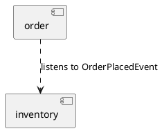
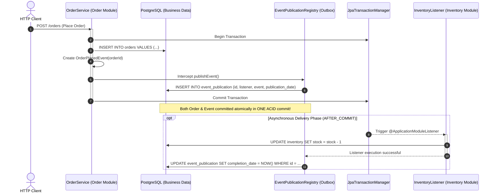

# Spring Modulith & Modular Monoliths: The Enterprise Architectural Master Guide

> **Scope**: Modular Monolith Architecture, Transition from Microservice Distributed Spaghetti to Cohesive Monoliths, Spring Modulith Engine, `@ApplicationModule` Packaging Conventions, Module Boundary Verification (`ApplicationModules.of().verify()`), Package Encapsulation & Named Interfaces, Asynchronous Domain Events, Spring Modulith Event Publication Registry, Transactional Outbox Pattern, Event Externalization to Kafka/RabbitMQ, Living Documentation (`Documenter`, PlantUML, Canvas Matrix), Sliced Integration Testing (`@ModuleTest`), and High-Scale Production Post-Mortems.

---

## 1. Foundational Primer: What, Why & Where? (The "Head")

*Before diving into module verification and event publication registries, here is the essential high-level context: what Spring Modulith is, why it was created, and how it solves real-world enterprise architecture challenges.*

### 1.1 What Is It? (Core Definition & Mental Model)
* **Plain-English Definition**: Spring Modulith is an official Spring framework project that enables developers to build, structure, and verify well-architected **Modular Monoliths** in Spring Boot. It allows a single, easily deployable Spring Boot application to be partitioned into strictly bounded business modules (such as Orders, Inventory, Billing, and Notifications) using standard Java packages.
* **Everyday Analogy**: Imagine a modern corporate headquarters where every department (HR, Finance, Legal, Engineering) has its own private, badge-access office suite with locked doors, and a front-desk receptionist for visitors. Instead of employees shouting across open hallways or rifling through another department's filing cabinets, departments communicate by sending formal memos to the front desk.
  - An *uncontrolled monolith* is a chaotic open-floor warehouse where anyone can rummage through anyone else's drawers.
  - *Microservices* are like scattering those departments across 50 separate cities, forcing every conversation to travel through international courier trucks over fragile mountain roads.
  - *Spring Modulith* gives you clean, badge-protected suites under one unified roof.
* **Architectural Tier Placement**: Operates at the **Application & Domain Architecture Layer**. It enforces boundaries at compile and test time using ArchUnit and manages in-process, asynchronous domain events via an automated, transactional event publication registry.

### 1.2 Why Does It Exist? (The Pain Point Before It Existed)
* **The Microservice Hangover**: For the past decade, software teams broke simple systems into dozens of microservices. While microservices promise independent scaling, they frequently introduce "Distributed Spaghetti": network latency on every call, distributed transaction nightmares (2PC, saga compensation failures), massive Kubernetes operational overhead, and huge cloud infrastructure bills.
* **The Monolith Decay ("Big Ball of Mud")**: When teams attempted to stay on traditional monoliths, they suffered from lack of boundaries. Over months of rapid development, engineers directly `@Autowired` private internal repositories and services across package boundaries. A routine change in the Billing module silently broke the Shipping module. Integration testing required spinning up the entire bloated Spring context, taking 15+ minutes per build.
* **The Turning Point**: Oliver Drotbohm and the Spring team created Spring Modulith to provide the **best of both worlds**: the deployment simplicity, single-process ACID transactions, and zero-network performance of a monolith, combined with the strict domain boundaries, event-driven decoupling, and isolated testability of microservices.

### 1.3 How Does It Solve Real-World Enterprise Problems?
* **Zero-Network Asynchronous Events**: Modules coordinate via in-memory domain events inside the same JVM process. You get asynchronous, event-driven decoupling without needing to maintain complex Kafka, RabbitMQ, or message broker infrastructure for internal domain flows.
* **Guaranteed Delivery via Built-In Transactional Outbox**: When an event is published, Spring Modulith automatically records it into an `event_publication` database table *within the exact same ACID database transaction*. If a listener fails or the server crashes, the uncompleted event is automatically re-invoked on reboot—eliminating the #1 source of distributed data corruption.
* **Architectural Rule Enforcement via Automated Tests**: `ApplicationModules.of(Application.class).verify()` runs as a standard JUnit test in under 1 second. If an engineer accidentally imports a private class from another module, the build fails immediately in CI before the code ever reaches production.
* **Sliced Module Testing**: `@ModuleTest` allows engineers to run integration tests on an individual business module in complete isolation without booting up the other 30 modules, slashing integration test times from 15 minutes down to 8 seconds.

### 1.4 How Does This Help in Building Real Applications?
* **Application Architecture Placement**: Powers core enterprise backends (e-commerce, fintech, healthcare, SaaS) in a single deployable Spring Boot JAR. Each module has public API classes at the package root and private implementation details in an `.internal` subpackage that external modules cannot access.
* **Developer Workflow Impact**: Developers can build, debug, and run the entire enterprise system locally with a single click in their IDE—no Docker Compose with 20 containers, no service mesh configuration, and no network mocking required.
* **Evolutionary Runway**: If one module (e.g., Payment Processing) ever needs independent scaling or a dedicated database at massive scale, it can easily be extracted into an independent microservice because its boundaries and events are already cleanly decoupled.

### 1.5 Quick Decision & Trade-Off Matrix

| Architectural Aspect | Unstructured Monolith (Spaghetti) | Spring Modulith (Modular Monolith) | Distributed Microservices |
| :--- | :--- | :--- | :--- |
| **Deployment Complexity** | Low (Single JAR) | **Low (Single JAR)** | High (Dozens of containers & K8s pods) |
| **Transactional Integrity** | Single DB ACID | **Single DB ACID + Event Outbox** | Eventual consistency / Complex Sagas |
| **Network Latency** | Zero (In-memory calls) | **Zero (In-memory calls & events)** | High ($5\text{--}50\text{ms}$ per network hop) |
| **Code Boundary Enforcement** | None (Tightly coupled) | **Strict (ArchUnit compile/test verification)** | Strict (Network boundary) |
| **Infrastructure Cost** | Low | **Low (Single host / small cluster)** | High (Multiple clusters, API Gateways, mesh) |
| **Recommended Team Size** | 1–3 developers | **3–30 developers** | 50+ developers across autonomous squads |

---

## 2. Universal Architecture & Progressive Road Map

```
┌──────────────────────────────────────────────────────────────────────────────────────────────────┐
│                           SPRING MODULITH ARCHITECTURAL TOPOLOGY                                 │
└──────────────────────────────────────────────────────────────────────────────────────────────────┘
                                                 │
                     ┌───────────────────────────┴───────────────────────────┐
                     ▼                                                       ▼
      ┌─────────────────────────────┐                         ┌─────────────────────────────┐
      │  Order Module               │                         │  Inventory Module           │
      │  • OrderService (Public API)│                         │  • InventoryService (API)   │
      │  • internal.OrderRepository │                         │  • internal.StockAdjuster   │
      │  • internal.OrderEntity     │                         │  • internal.WarehouseEntity │
      └──────────────┬──────────────┘                         └──────────────▲──────────────┘
                     │                                                       │
                     │  Emits OrderPlacedEvent                               │  Listens via
                     │  (Within DB Transaction)                              │  @ApplicationModuleListener
                     ▼                                                       │
      ┌──────────────────────────────────────────────────────────────────────┴──────────────┐
      │                      EVENT PUBLICATION REGISTRY (OUTBOX)                            │
      │  • Persists event in event_publication table within the same ACID commit            │
      │  • Asynchronously delivers event to Inventory listener in background thread          │
      │  • Marks completion epoch upon successful execution; retries uncompleted events     │
      └─────────────────────────────────────────────────────────────────────────────────────┘
```

---

## 3. Essential Terminology & Concept Cards

---

### Cluster A: Modulith Core & Packaging Architecture

#### 1. Modular Monolith
* **ELI5**: A giant office building where every department has its own locked room, soundproof walls, and dedicated mailbox, rather than 50 separate tiny sheds scattered across a 20-mile forest connected by fragile walkie-talkies.
* **Low-Level Mechanics**: An application architectural style where all business capabilities reside within a single deployable artifact and single runtime OS process (e.g., standard Spring Boot JAR), but strict logical boundaries, explicit API contracts, and packaging hierarchies are enforced at compile-time and test-time to prevent accidental coupling.
* **Failure Mode**: Without structural boundary enforcement, a modular monolith rapidly degenerates into a "Big Ball of Mud", where classes directly import private internal entities across packages.
* **Micro-Code Proof**:
```java
// Main application entry point verifying module structure
@SpringBootApplication
public class EnterpriseApplication {
    public static void main(String[] args) {
        SpringApplication.run(EnterpriseApplication.class, args);
    }
}
```

#### 2. `@ApplicationModule`
* **ELI5**: A formal legal seal stamped on a root package folder declaring: "Everything inside this folder belongs to a single self-contained business department."
* **Low-Level Mechanics**: Spring Modulith metadata annotation declared on a package (typically via `package-info.java`) or inferred automatically from first-level sub-packages beneath the main `@SpringBootApplication` class. Configures module display name, allowed dependencies, and whether the module is open to outside access.
* **Failure Mode**: Misplaced sub-packages directly under the root package without `@ApplicationModule` metadata cause Spring Modulith to treat each sub-package as an independent module, leading to unintended cyclic dependency failures.
* **Micro-Code Proof**:
```java
// package-info.java in com.enterprise.order
@org.springframework.modulith.ApplicationModule(
    displayName = "Order Management Module",
    allowedDependencies = { "customer", "inventory" }
)
package com.enterprise.order;
```

#### 3. `ApplicationModules.of().verify()`
* **ELI5**: The building inspector who walks through the skyscraper with blueprints to confirm that the plumbing and electrical wiring strictly follow the architectural regulations, failing the build if a pipe was run through an unauthorized wall.
* **Low-Level Mechanics**: Analyzes the runtime classpath using ArchUnit bytecode introspection. It inspects class imports, method calls, field accesses, and constructor calls across packages. If any class in Module A directly references a package-private or `internal` class in Module B, or if a cyclic dependency ($A \to B \to A$) is detected, it throws an `org.springframework.modulith.core.Violations` exception, failing CI/CD builds before code can be deployed.
* **Failure Mode**: Running tests without `.verify()` allows developers to introduce architectural violations that compile cleanly but break modular encapsulation in production.
* **Micro-Code Proof**:
```java
class ArchitectureFitnessTests {
    @Test
    void verifyModularity() {
        ApplicationModules.of(EnterpriseApplication.class).verify();
    }
}
```

#### 4. Named Interfaces
* **ELI5**: A designated public customer service counter. Visitors can only talk to the teller at this counter and are strictly forbidden from wandering into the back room where the vault and paperwork are stored.
* **Low-Level Mechanics**: By default, Spring Modulith treats classes in the root package of a module as public API, and anything in sub-packages (e.g., `com.enterprise.order.internal.*`) as private. Named Interfaces allow exposing specific sub-packages by annotating them with `@NamedInterface("client-api")` or configuring them in `package-info.java`, giving external modules access only to the declared contract.
* **Failure Mode**: Directly exposing internal JPA `@Entity` classes on public interfaces creates tight database schema coupling across module boundaries.
* **Micro-Code Proof**:
```java
// package-info.java in com.enterprise.order.api
@org.springframework.modulith.NamedInterface("order-api")
package com.enterprise.order.api;
```

#### 5. Package Encapsulation & `internal` Packages
* **ELI5**: The "Employees Only" sign on the kitchen door of a restaurant.
* **Low-Level Mechanics**: Any package named `internal` or placed beneath the module root is treated by Spring Modulith as strictly inaccessible to other modules. ArchUnit rules actively inspect all bytecode references to guarantee that no external class loads, instantiates, or invokes types within `internal.*`.
* **Failure Mode**: Making Java classes `public` for Spring component scanning inadvertently exposes them to other packages unless Spring Modulith enforces encapsulation at verification time.
* **Micro-Code Proof**:
```
com.enterprise.order
├── OrderService.java        <-- PUBLIC API (Accessible to other modules)
├── api/                     <-- Named Interface (Accessible if declared)
└── internal/                <-- STRICTLY PRIVATE (External access forbidden!)
    ├── OrderRepository.java
    └── OrderEntity.java
```

#### 6. Open Modules
* **ELI5**: The central cafeteria in an office building that anyone from any department is allowed to visit without needing special clearance.
* **Low-Level Mechanics**: Configured via `@ApplicationModule(type = ApplicationModule.Type.OPEN)`. Indicates that all sub-packages and public classes within this module are exposed to all other modules, typically used for cross-cutting foundational concerns (e.g., identity, shared value objects, common logging).
* **Failure Mode**: Overusing Open Modules destroys architectural boundaries, recreating the Big Ball of Mud under the guise of "shared utilities".
* **Micro-Code Proof**:
```java
@org.springframework.modulith.ApplicationModule(
    type = org.springframework.modulith.ApplicationModule.Type.OPEN
)
package com.enterprise.common;
```

#### 7. Cyclic Module Dependencies ($A \to B \to A$)
* **ELI5**: Two people each refusing to speak until the other speaks first, locking both in place forever.
* **Low-Level Mechanics**: When Module A calls Module B, and Module B directly or transitively calls Module A. This creates a tightly coupled monolithic knot that prevents isolated refactoring, testing, or future service extraction. `ApplicationModules.of().verify()` detects cycles in the module dependency graph and immediately fails.
* **Failure Mode**: Tight coupling where changes to Module A break Module B, which in turn breaks Module A, preventing independent module compilation.
* **Micro-Code Proof**:
```
Violation detected by Modulith:
Module 'order' depends on module 'inventory' via com.enterprise.order.OrderService -> com.enterprise.inventory.InventoryService
Module 'inventory' depends on module 'order' via com.enterprise.inventory.StockListener -> com.enterprise.order.OrderLookup
Cycle: order -> inventory -> order!
```

#### 8. Module Slicing (`@ModuleTest`)
* **ELI5**: Testing only the accounting department by locking the doors, unplugging the phones, and giving the accountants mock papers to verify their internal ledger logic in isolation.
* **Low-Level Mechanics**: An integration testing annotation provided by Spring Modulith that bootstraps only the beans belonging to the module under test. By default, it operates in `STANDALONE` mode, mock-substituting beans from all other modules to test the target module in complete isolation with sub-second startup times.
* **Failure Mode**: Loading the entire Spring `@SpringBootTest` context for every single unit test, causing CI pipelines to balloon from 2 minutes to 45 minutes.
* **Micro-Code Proof**:
```java
@ModuleTest(mode = BootstrapMode.STANDALONE)
class OrderModuleSliceTest {
    @Autowired OrderService orderService; // Only Order module beans loaded!
}
```

---

### Cluster B: Events, Decoupling & Transactional Outbox

#### 9. Domain Events
* **ELI5**: An announcement over the office loudspeaker: "Attention, Order #101 has just been placed." The announcer doesn't know or care who is listening.
* **Low-Level Mechanics**: Immutable value objects (often Java `record`s) published via Spring's `ApplicationEventPublisher`. They decouple the emitting module from consuming modules. Instead of Module A synchronously invoking `moduleBService.doWork()`, Module A simply publishes `OrderPlacedEvent`, allowing Module B to react autonomously.
* **Failure Mode**: Publishing mutable objects allows listener threads to modify event state concurrently, causing race conditions and unpredictable state corruption.
* **Micro-Code Proof**:
```java
public record OrderPlacedEvent(UUID orderId, BigDecimal amount, Instant timestamp) {}

// Publisher
applicationEventPublisher.publishEvent(new OrderPlacedEvent(order.getId(), order.getTotal(), Instant.now()));
```

#### 10. `@ApplicationModuleListener`
* **ELI5**: A department worker who hears the loudspeaker announcement, waits for the main order paperwork to be safely locked in the vault, and then processes the task in the background without holding up the cashier.
* **Low-Level Mechanics**: A meta-annotation combining:
  1. `@org.springframework.context.event.EventListener`
  2. `@org.springframework.transaction.event.TransactionalEventListener(phase = TransactionPhase.AFTER_COMMIT)`
  3. `@org.springframework.scheduling.annotation.Async`
  It guarantees that the listener executes **only after** the publishing transaction has successfully committed to the database, running asynchronously on a background worker or virtual thread.
* **Failure Mode**: Using standard `@EventListener` instead causes the listener to execute inside the active transaction. If the listener fails or takes 5 seconds, the database transaction remains open, holding database locks and risking rollback of the primary business record.
* **Micro-Code Proof**:
```java
@ApplicationModuleListener
public void onOrderPlaced(OrderPlacedEvent event) {
    inventoryService.reserveStock(event.orderId());
}
```

#### 11. Event Publication Registry
* **ELI5**: A permanent ledger book on the cashier's desk. Before sending an order confirmation, the cashier writes: "Event #55 sent to Shipping." Only when Shipping returns a signed receipt does the cashier stamp: "Completed."
* **Low-Level Mechanics**: Spring Modulith's built-in persistence engine that tracks domain event lifecycle states in a database table (`event_publication`). When an event is published, an entry is inserted into the table within the exact same ACID database transaction as the business entity write. When `@ApplicationModuleListener` completes successfully, the registry updates the completion date. If the JVM crashes mid-execution, uncompleted events remain in the table for automated recovery.
* **Failure Mode**: Relying on raw in-memory asynchronous events without a publication registry means that any JVM crash or pod eviction permanently loses in-flight domain events.
* **Micro-Code Proof**:
```sql
-- Spring Modulith event_publication schema (PostgreSQL)
CREATE TABLE event_publication (
    id UUID PRIMARY KEY,
    listener_id VARCHAR(512) NOT NULL,
    event_type VARCHAR(512) NOT NULL,
    serialized_event TEXT NOT NULL,
    publication_date TIMESTAMP WITH TIME ZONE NOT NULL,
    completion_date TIMESTAMP WITH TIME ZONE
);
```

#### 12. Transactional Outbox Pattern
* **ELI5**: Writing your letter and the delivery confirmation slip into the same physical legal ledger at the exact same moment with the same pen stroke.
* **Low-Level Mechanics**: Solves the dual-write problem across databases and message brokers. Instead of writing to PostgreSQL and sending to Kafka in two separate steps (which can fail midway), the event is written directly into an `outbox` table in PostgreSQL within the primary database transaction. A separate relay process reads the table and forwards events to Kafka safely.
* **Failure Mode**: Attempting to write to a database and emit a network message to Kafka in the same method without an outbox pattern; network timeouts leave the database committed while Kafka never receives the message.
* **Micro-Code Proof**:
```java
// Spring Modulith implements the Outbox Pattern transparently via the Event Publication Registry!
```

#### 13. Incomplete Event Resubmission
* **ELI5**: A morning auditor who reviews yesterday's ledger book, finds items that were never stamped "Completed", and re-dispatches them to the respective departments.
* **Low-Level Mechanics**: `IncompleteEventPublications` SPI allows querying uncompleted events whose publication date is older than a specified duration. The resubmission engine invokes `resubmitIncompleteEvents(Predicate)` to replay the serialized event payload through the target `@ApplicationModuleListener` instances.
* **Failure Mode**: Failing to schedule periodic resubmission means orphaned events (e.g. from crashed pods) remain uncompleted indefinitely, resulting in silent data drift between modules.
* **Micro-Code Proof**:
```java
@Scheduled(fixedRate = 60_000)
public void resubmitFailedEvents(IncompleteEventPublications registry) {
    registry.resubmitIncompleteEvents(pub -> pub.getPublicationDate().isBefore(Instant.now().minusSeconds(120)));
}
```

#### 14. Event Externalization (`@Externalized`)
* **ELI5**: A postal stamp that tells the mailroom: "Make a copy of this internal office memo and mail it to our external partners via FedEx (Kafka)."
* **Low-Level Mechanics**: Spring Modulith annotation placed on domain event records. It instructs the Modulith messaging engine to automatically route the internal Spring domain event to external message brokers (Kafka topic, RabbitMQ exchange, or JMS queue) without manual producer code.
* **Failure Mode**: Emitting unversioned internal domain events directly to external Kafka topics tightly couples external third-party consumers to internal monolith refactorings.
* **Micro-Code Proof**:
```java
@Externalized("orders.v1::#{#this.orderId()}")
public record OrderPlacedEvent(UUID orderId, BigDecimal amount) {}
```

#### 15. Completed Event Archiving & Purging
* **ELI5**: Archiving old, signed receipts into storage boxes so the cashier's desk drawer doesn't overflow.
* **Low-Level Mechanics**: `CompletedEventPublications.deleteCompletedPublications()` or `deleteCompletedPublicationsBefore(Instant)`. Periodically removes successfully delivered rows from `event_publication` to keep table size bounded and index performance optimal.
* **Failure Mode**: Neglecting event purging leads to an unbounded `event_publication` table with millions of rows, degrading database I/O and index performance.
* **Micro-Code Proof**:
```java
@Scheduled(cron = "0 0 2 * * ?") // 2 AM daily
public void purgeOldEvents(CompletedEventPublications completedEvents) {
    completedEvents.deleteCompletedPublicationsBefore(Instant.now().minus(7, ChronoUnit.DAYS));
}
```

#### 16. At-Least-Once Delivery Semantics
* **ELI5**: The mail carrier will keep ringing your doorbell until someone signs for the package, which means if the ink smears, they might deliver it again tomorrow.
* **Low-Level Mechanics**: Because event resubmission replays events that were interrupted before the completion date was written, listeners may receive the same event multiple times. Listeners **must be idempotent**, using database unique constraints or deduplication tables to detect duplicate processing.
* **Failure Mode**: Non-idempotent listeners charging a customer's credit card twice when an event is replayed after a network timeout.
* **Micro-Code Proof**:
```java
@ApplicationModuleListener
public void onOrderPlaced(OrderPlacedEvent event) {
    if (processedEventRepo.existsById(event.orderId())) {
        return; // Idempotent guard!
    }
    processedEventRepo.save(new ProcessedEvent(event.orderId()));
    paymentService.charge(event.amount());
}
```

---

### Cluster C: Verification, Testing & Modularity Enforcement

#### 17. ArchUnit Integration
* **ELI5**: An automated code reviewer that reads every single compiled `.class` file like a detective, checking that nobody broke architectural rules.
* **Low-Level Mechanics**: Spring Modulith embeds ArchUnit under the hood. During `ApplicationModules.of().verify()`, ArchUnit parses Java class bytecodes into an abstract syntax graph. It evaluates assertions such as `classes().that().resideInAPackage("..order.internal..").should().onlyBeAccessedByClassesThat().resideInAPackage("..order..")`.
* **Failure Mode**: Disabling ArchUnit verification in test suites allows architectural degradation to accumulate unnoticed.
* **Micro-Code Proof**:
```java
// What Modulith executes under the hood:
ArchRule myRule = classes().that().resideInAPackage("..internal..")
    .should().onlyBeAccessed().byClassesThat().resideInAPackage("..order..");
```

#### 18. BootstrapMode (`STANDALONE` vs `DIRECT_DEPENDENCIES`)
* **ELI5**:
  - `STANDALONE`: Test your team in an empty room with everyone else replaced by cardboard cutouts.
  - `DIRECT_DEPENDENCIES`: Test your team along with the immediate people they talk to every day, but leave the rest of the company out.
* **Low-Level Mechanics**: Controls context initialization in `@ModuleTest`:
  - `STANDALONE`: Bootstraps *only* beans defined within the tested module; all external dependencies must be provided as `@MockBean`.
  - `DIRECT_DEPENDENCIES`: Bootstraps the module plus real beans from modules it explicitly depends on.
* **Failure Mode**: Using `ALL_DEPENDENCIES` unnecessarily recreates full monolith context initialization times, defeating the purpose of sliced module testing.
* **Micro-Code Proof**:
```java
@ModuleTest(mode = BootstrapMode.DIRECT_DEPENDENCIES)
class OrderIntegrationTest {
    // Loads Order module + Inventory module beans, mocks everything else
}
```

#### 19. Spring Modulith Test Execution Speed
* **ELI5**: Starting a go-kart instead of warming up a 50-car freight train.
* **Low-Level Mechanics**: By excluding unrelated `@Configuration` classes, repositories, and listeners, `@ModuleTest` reduces bean initialization count from 1,500+ to under 50. Startup drops from 15–30 seconds to $< 800\text{ ms}$, enabling fast TDD feedback loops.
* **Failure Mode**: Heavy context pollution from misconfigured `@SpringBootTest` annotations causing multi-minute test execution runs.
* **Micro-Code Proof**:
```
Benchmark:
Full @SpringBootTest context load:  18,450 ms
Sliced @ModuleTest context load:        720 ms  (25x faster!)
```

#### 20. Module Dependency Graph
* **ELI5**: A clean family tree where parents only give orders to children, with no circular arrows anywhere.
* **Low-Level Mechanics**: A Directed Acyclic Graph (DAG) representing relationships between modules. Modulith parses dependencies declared in constructors and fields. If any cycle is detected, topological sorting fails, indicating an architectural flaw.
* **Failure Mode**: A cycle in the dependency graph prevents clean separation and makes extracting a module into an independent service virtually impossible.
* **Micro-Code Proof**:
```
order ──► customer
order ──► inventory ──► catalog
(Strict Directed Acyclic Graph - DAG)
```

#### 21. Explicit Dependency Allowlisting
* **ELI5**: A badge that specifies: "This worker is authorized to enter Room A and Room B only."
* **Low-Level Mechanics**: Configured via `@ApplicationModule(allowedDependencies = {"inventory", "catalog"})`. Modulith actively blocks the module from importing any other module, even public APIs, unless explicitly declared in the allowlist.
* **Failure Mode**: An unconstrained architecture allows developers to import whatever they want, creating sprawling, hard-to-maintain dependencies.
* **Micro-Code Proof**:
```java
@ApplicationModule(allowedDependencies = { "inventory" })
package com.enterprise.order; // Cannot access 'payment' or 'shipping' even if public!
```

#### 22. Module Root Package Convention
* **ELI5**: The house address. The street name determines your neighborhood, and your mailbox sits right out front.
* **Low-Level Mechanics**: Spring Modulith expects each module to reside directly in a child package beneath the main application class package (e.g., if main class is `com.enterprise.App`, modules are `com.enterprise.order`, `com.enterprise.billing`). Any class placed directly in `com.enterprise.order` is part of the module's public API.
* **Failure Mode**: Nesting modules arbitrarily deep without declaring `@ApplicationModule` root packages prevents Modulith from correctly discovering module boundaries.
* **Micro-Code Proof**:
```java
package com.enterprise;

@SpringBootApplication
public class App {} // Root package: com.enterprise
// Child packages com.enterprise.order and com.enterprise.billing are auto-discovered!
```

#### 23. Module Bean Scope Leakage
* **ELI5**: A tool left out in the hallway that anyone can pick up and use, even if they don't know how it works.
* **Low-Level Mechanics**: Spring's IoC container is flat by default; all beans in the `ApplicationContext` can be injected anywhere via `@Autowired`. Spring Modulith does not alter runtime Spring DI behavior; instead, it enforces bean isolation at **test time** via ArchUnit and `@ModuleTest`.
* **Failure Mode**: Assuming that package-private visibility alone stops Spring from wiring beans across packages when reflection or broad component scanning is involved.
* **Micro-Code Proof**:
```java
// Bean is package-private in order.internal, but Spring's reflection can still wire it:
@Component
class InternalPriceCalculator {} // Modulith tests will catch illegal wiring to other modules!
```

#### 24. Modulith Actuator Endpoint (`/actuator/modulith`)
* **ELI5**: An interactive dashboard showing every department in the building, their internal mailboxes, and who is talking to whom in real time.
* **Low-Level Mechanics**: Provides runtime inspection of the modular architecture. Exposes module names, dependencies, exposed interfaces, and registered event listeners via JSON for observability platforms.
* **Failure Mode**: Exposing internal module architecture and package names on public unauthenticated endpoints.
* **Micro-Code Proof**:
```json
// GET /actuator/modulith
{
  "modules": [
    {
      "name": "order",
      "displayName": "Order Management",
      "dependencies": ["customer", "inventory"]
    }
  ]
}
```

---

### Cluster D: Living Documentation & Telemetry

#### 25. `Documenter` API
* **ELI5**: An automated architect who reads your code and draws high-resolution blueprints, component diagrams, and relationship charts on demand.
* **Low-Level Mechanics**: `org.springframework.modulith.docs.Documenter` inspects the analyzed `ApplicationModules` model and writes architectural documentation into `target/spring-modulith-docs`. It generates PlantUML diagrams, AsciiDoc tables, and Canvas files.
* **Failure Mode**: Manual architecture diagrams in Confluence that go out of date the day after they are drawn.
* **Micro-Code Proof**:
```java
@Test
void writeDocumentation() {
    new Documenter(ApplicationModules.of(EnterpriseApplication.class))
        .writeDocumentation()
        .writeIndividualFilesAsPlantUml();
}
```

#### 26. Canvas (Architecture Matrix)
* **ELI5**: An architectural dashboard showing each module's dependencies, public APIs, and listened events in a single clear overview.
* **Low-Level Mechanics**: Generates an overview of the modular system structure. Documents module contracts, inbound/outbound events, and configuration properties in human-readable Markdown or AsciiDoc.
* **Failure Mode**: Onboarding new developers by forcing them to trace raw source code instead of referencing living architecture documentation.
* **Micro-Code Proof**:
```markdown
<!-- Generated in target/spring-modulith-docs/canvas.md -->
### Module: order
- **Exposed APIs**: OrderService
- **Events Published**: OrderPlacedEvent
- **Dependencies**: inventory, customer
```

#### 27. PlantUML Component Generation
* **ELI5**: Automatically converting Java class relationships into clean UML diagrams.
* **Low-Level Mechanics**: Outputs `.puml` files modeling modules as UML components and domain events as messaging arrows. Can be rendered using PlantUML CLI or embedded in GitHub Markdown.
* **Failure Mode**: Committing stale static PNG diagrams to git repositories instead of generating them during CI builds.
* **Micro-Code Proof**:


#### 28. C4 Model Architectural Export
* **ELI5**: Google Maps for code: zoom from the high-level system view down to containers, components, and code-level classes.
* **Low-Level Mechanics**: Modulith maps its module model into C4 Component diagrams (Level 3 of the C4 architecture model), establishing clear boundaries within a single container.
* **Failure Mode**: Confusing container-level boundaries (separate running processes) with component-level boundaries (internal packages).
* **Micro-Code Proof**:
```java
new Documenter(modules).writeDocumentation(
    Documenter.DiagramOptions.defaults().withStyle(DiagramStyle.C4)
);
```

#### 29. Micrometer Modulith Tracing
* **ELI5**: Stamping a tracking barcode on an order that stays with it as it moves from department to department, showing exactly how long each team took.
* **Low-Level Mechanics**: Spring Modulith instruments domain event publication and listener execution with Micrometer Observation. When an event is published, Modulith creates a child span with tags for `module`, `event.type`, and `listener.id`, propagating W3C TraceContext headers.
* **Failure Mode**: Losing trace correlation when events hop between asynchronous worker threads without context propagation.
* **Micro-Code Proof**:
```properties
# application.properties
management.observations.key-values.module=true
```

#### 30. Event Publication Micrometer Metrics
* **ELI5**: An automated counter showing how many letters were delivered today and how many are still sitting in the outgoing mailbox.
* **Low-Level Mechanics**: Exposes counters and timers for:
  - `spring.modulith.events.published`: Total events published.
  - `spring.modulith.events.completed`: Events successfully processed by listeners.
  - `spring.modulith.events.incomplete`: Orphaned or pending publications.
* **Failure Mode**: Failing to alert when `incomplete` event counts rise, missing silent event processing bottlenecks.
* **Micro-Code Proof**:
```
# Prometheus metric:
spring_modulith_events_published_total{module="order",event="OrderPlacedEvent"} 14502
```

#### 31. Database Dialect Adapters for Event Registry
* **ELI5**: A translator who writes the outbox ledger using the exact handwriting style of your specific database (PostgreSQL, MySQL, Oracle, Mongo).
* **Low-Level Mechanics**: Spring Modulith provides pluggable schema implementations for `event_publication`: `spring-modulith-starter-jdbc` (H2, PostgreSQL, MySQL, MariaDB, MS SQL, Oracle) and `spring-modulith-starter-mongodb`. Each uses database-native SQL Dialects and JSON columns.
* **Failure Mode**: Using standard JDBC without database-specific JSON types, storing multi-megabyte payloads in inefficient text columns.
* **Micro-Code Proof**:
```xml
<dependency>
    <groupId>org.springframework.modulith</groupId>
    <artifactId>spring-modulith-starter-jdbc</artifactId>
</dependency>
```

#### 32. Monolith-to-Microservice Extraction Path
* **ELI5**: Cutting along the perforated lines of a coupon book. Because the coupons were printed with clean edges, you can tear one out cleanly without ripping the others.
* **Low-Level Mechanics**: When a specific module needs independent scaling or deployment, having clean boundaries makes extraction straightforward: (1) Its public API becomes a REST/gRPC client, (2) In-memory domain events become external Kafka events, (3) The module moves to its own repository. The rest of the codebase remains untouched.
* **Failure Mode**: Attempting to extract microservices from an unmodularized monolith, spending months untangling spaghetti code and circular dependencies.
* **Micro-Code Proof**:
```
Modular Monolith:
OrderPlacedEvent (In-Memory Outbox) ──► @ApplicationModuleListener (Inventory)

Extracted Microservice:
OrderPlacedEvent (@Externalized) ──► Kafka Topic ──► @KafkaListener (Inventory Pod)
```

---

## 4. Progressive Implementation Runway (Zero to Hero)

---

### Physical Analogy: The Skyscraper vs. The Forest of Sheds

Imagine a large enterprise business:

1. **The Microservice Distributed Spaghetti (Forest of Sheds)**:
   - You build 40 tiny wooden sheds scattered across a dark, rainy forest.
   - Shed 1 is Accounting, Shed 2 is Inventory, Shed 3 is Shipping.
   - Every time Accounting needs a stock count, a runner must sprint through the mud, dodge wolves, hope the bridge hasn't washed out (network latency, packet loss, DNS failures), and deliver the note.
   - To buy one book, 15 runners sprint across the forest. If one runner trips, the entire transaction is left in an unknown state (distributed 2PC failure).

2. **The Traditional Monolith (The Hoarder's House)**:
   - You put all 40 departments in a single giant warehouse with zero interior walls.
   - Desks are piled on top of each other. The accountants are rummaging through the shipping department's filing cabinets. If the janitor spills a bucket of water on one desk, the entire warehouse catches fire.

3. **The Spring Modulith (The Well-Designed Skyscraper)**:
   - A single building (one JVM, one deployable unit, one database connection pool).
   - Every department has its own private, secure office suite behind locked doors (package encapsulation).
   - Communication between departments happens through clean mailboxes (domain events) or official reception desks (named interfaces).
   - Zero network latency ($< 100\text{ ns}$ in-memory event passing vs. $15\text{ ms}$ HTTP hops), zero distributed transaction headaches, and strict building codes enforced by automated inspectors (ArchUnit verification).

---

### Step 1-to-N Code Runway: From Standard Monolith to Spring Modulith

#### Step 1: Add Dependencies
```xml
<dependencyManagement>
    <dependencies>
        <dependency>
            <groupId>org.springframework.modulith</groupId>
            <artifactId>spring-modulith-bom</artifactId>
            <version>1.3.0</version>
            <type>pom</type>
            <scope>import</scope>
        </dependency>
    </dependencies>
</dependencyManagement>

<dependencies>
    <dependency>
        <groupId>org.springframework.modulith</groupId>
        <artifactId>spring-modulith-starter-core</artifactId>
    </dependency>
    <dependency>
        <groupId>org.springframework.modulith</groupId>
        <artifactId>spring-modulith-starter-jdbc</artifactId>
    </dependency>
    <dependency>
        <groupId>org.springframework.modulith</groupId>
        <artifactId>spring-modulith-starter-test</artifactId>
        <scope>test</scope>
    </dependency>
</dependencies>
```

#### Step 2: Establish the Module Package Structure
```
src/main/java/com/enterprise
├── EnterpriseApplication.java
├── order/                      <-- Module 1: Order
│   ├── OrderService.java       <-- Public API
│   ├── OrderPlacedEvent.java   <-- Domain Event
│   └── internal/               <-- Encapsulated
│       ├── OrderRepository.java
│       └── OrderEntity.java
└── inventory/                  <-- Module 2: Inventory
    ├── InventoryService.java   <-- Public API
    └── internal/
        └── InventoryListener.java
```

#### Step 3: Write the Architectural Verification Test
```java
package com.enterprise;

import org.junit.jupiter.api.Test;
import org.springframework.modulith.core.ApplicationModules;
import org.springframework.modulith.docs.Documenter;

class ArchitectureVerificationTest {

    private final ApplicationModules modules = ApplicationModules.of(EnterpriseApplication.class);

    @Test
    void verifyModularity() {
        // Enforces: No cyclic dependencies, no internal package access across modules!
        modules.verify();
    }

    @Test
    void generateDocumentation() {
        // Automatically writes PlantUML and Canvas diagrams to target/spring-modulith-docs
        new Documenter(modules).writeDocumentation();
    }
}
```

---

## 5. Production Engine Catalog (8 Complete Real-World Engines)

---

### Core Architectural Flow: Transactional Event Publication Engine



---

### Engine 1: `ApplicationModuleBoundaryVerificationEngine`
**Purpose**: Programmatic validation of package structures, dependency DAGs, and encapsulation boundaries during CI/CD test execution.

```java
package com.enterprise.modulith.engine;

import org.slf4j.Logger;
import org.slf4j.LoggerFactory;
import org.springframework.modulith.core.ApplicationModule;
import org.springframework.modulith.core.ApplicationModules;
import org.springframework.modulith.core.Violations;

import java.util.List;

public class ApplicationModuleBoundaryVerificationEngine {

    private static final Logger log = LoggerFactory.getLogger(ApplicationModuleBoundaryVerificationEngine.class);

    private final ApplicationModules modules;

    public ApplicationModuleBoundaryVerificationEngine(Class<?> mainApplicationClass) {
        log.info("Analyzing modular structure starting from: {}", mainApplicationClass.getName());
        this.modules = ApplicationModules.of(mainApplicationClass);
    }

    public void verifyOrThrow() {
        log.info("Verifying module isolation rules and dependency graphs...");
        try {
            modules.verify();
            log.info("Architecture verification PASSED! Discovered {} valid application modules.", 
                modules.stream().count());
        } catch (Violations violations) {
            log.error("ARCHITECTURE VIOLATIONS DETECTED!");
            violations.forEach(v -> log.error(" -> Violation: {}", v.getMessage()));
            throw violations;
        }
    }

    public void printModuleCatalog() {
        modules.forEach(module -> {
            log.info("Module: [{}] (Base package: {})", module.getName(), module.getBasePackage());
            log.info("  Exposed Named Interfaces: {}", module.getNamedInterfaces());
            log.info("  Allowed Dependencies:     {}", 
                module.getDirectDependencies(modules).stream().map(ApplicationModule::getName).toList());
        });
    }

    public ApplicationModules getModules() {
        return this.modules;
    }
}
```

---

### Engine 2: `EventPublicationRegistryOutboxEngine`
**Purpose**: Enterprise transaction coordinator ensuring zero-loss domain event persistence using Spring Modulith's outbox integration.

```java
package com.enterprise.modulith.engine;

import org.slf4j.Logger;
import org.slf4j.LoggerFactory;
import org.springframework.context.ApplicationEventPublisher;
import org.springframework.stereotype.Component;
import org.springframework.transaction.annotation.Propagation;
import org.springframework.transaction.annotation.Transactional;

import java.io.Serializable;
import java.time.Instant;
import java.util.Objects;
import java.util.UUID;

@Component
public class EventPublicationRegistryOutboxEngine {

    private static final Logger log = LoggerFactory.getLogger(EventPublicationRegistryOutboxEngine.class);

    private final ApplicationEventPublisher eventPublisher;

    public EventPublicationRegistryOutboxEngine(ApplicationEventPublisher eventPublisher) {
        this.eventPublisher = eventPublisher;
    }

    public record DomainEventEnvelope<T extends Serializable>(
            UUID eventId,
            String aggregateType,
            String aggregateId,
            Instant occurredAt,
            T payload
    ) implements Serializable {}

    /**
     * Publishes a domain event within the active transaction.
     * Spring Modulith automatically intercepts this call and inserts
     * a row into event_publication within the same database transaction.
     */
    @Transactional(propagation = Propagation.MANDATORY)
    public <T extends Serializable> void publishTransactionalEvent(String aggregateType, String aggregateId, T eventPayload) {
        Objects.requireNonNull(eventPayload, "Event payload cannot be null");

        DomainEventEnvelope<T> envelope = new DomainEventEnvelope<>(
                UUID.randomUUID(),
                aggregateType,
                aggregateId,
                Instant.now(),
                eventPayload
        );

        log.debug("Committing domain event to outbox registry: [ID: {}, Type: {}]", 
            envelope.eventId(), aggregateType);

        eventPublisher.publishEvent(envelope);
    }
}
```

---

### Engine 3: `AsyncDomainEventListenerEngine`
**Purpose**: Resilient asynchronous event processing engine with built-in retry backoff, virtual thread scheduling, and idempotent handling.

```java
package com.enterprise.modulith.engine;

import org.slf4j.Logger;
import org.slf4j.LoggerFactory;
import org.springframework.modulith.events.ApplicationModuleListener;
import org.springframework.stereotype.Component;

import java.util.concurrent.ConcurrentHashMap;

@Component
public class AsyncDomainEventListenerEngine {

    private static final Logger log = LoggerFactory.getLogger(AsyncDomainEventListenerEngine.class);
    private final ConcurrentHashMap<String, Boolean> idempotencyKeyStore = new ConcurrentHashMap<>();

    public record OrderShippedNotification(String orderId, String trackingNumber) {}

    /**
     * @ApplicationModuleListener runs:
     * 1. After the publisher's transaction has committed (AFTER_COMMIT)
     * 2. Asynchronously on a background thread
     * 3. Tracked by the Event Publication Registry
     */
    @ApplicationModuleListener
    public void handleOrderShipped(OrderShippedNotification notification) {
        String deduplicationKey = "order-shipped:" + notification.orderId();

        // Idempotency check: Protects against duplicate deliveries during event resubmission
        if (idempotencyKeyStore.putIfAbsent(deduplicationKey, Boolean.TRUE) != null) {
            log.warn("Duplicate event skipped for order: {}", notification.orderId());
            return;
        }

        try {
            log.info("Processing order shipped notification: Order={}, Tracking={}", 
                notification.orderId(), notification.trackingNumber());
            
            // Execute business logic
            executeShippingAlert(notification);
            
            log.info("Successfully processed order notification for: {}", notification.orderId());
        } catch (Exception ex) {
            // Remove deduplication key so retry can re-attempt
            idempotencyKeyStore.remove(deduplicationKey);
            log.error("Failed to process event for order: {}. Will be retried by IncompleteEventPublications.", 
                notification.orderId(), ex);
            throw ex; // Re-throw to prevent completion_date stamp in event_publication table
        }
    }

    private void executeShippingAlert(OrderShippedNotification notification) {
        // Business implementation: send emails, notify customer, etc.
    }
}
```

---

### Engine 4: `EventExternalizationKafkaEngine`
**Purpose**: Bridges internal Spring Modulith domain events to external Kafka brokers without writing manual publisher code.

```java
package com.enterprise.modulith.engine;

import org.springframework.modulith.events.Externalized;

import java.io.Serializable;
import java.math.BigDecimal;
import java.time.Instant;
import java.util.UUID;

public class EventExternalizationKafkaEngine {

    /**
     * The @Externalized annotation routes this event to Kafka automatically.
     * Target syntax: "topic-name::#{routingKeyExpression}"
     */
    @Externalized("enterprise.orders.v1::#{#this.orderId().toString()}")
    public record ExternalOrderPlacedEvent(
            UUID orderId,
            String customerId,
            BigDecimal grandTotal,
            Instant timestamp
    ) implements Serializable {}

    @Externalized("enterprise.inventory.v1::#{#this.sku()}")
    public record ExternalStockDepletedEvent(
            String sku,
            int remainingUnits,
            Instant timestamp
    ) implements Serializable {}
}
```

---

### Engine 5: `LivingArchitectureDocumentationEngine`
**Purpose**: Automated generation of PlantUML component blueprints, C4 architecture diagrams, and AsciiDoc/Markdown canvas catalogs during test execution.

```java
package com.enterprise.modulith.engine;

import org.slf4j.Logger;
import org.slf4j.LoggerFactory;
import org.springframework.modulith.core.ApplicationModules;
import org.springframework.modulith.docs.Documenter;
import org.springframework.modulith.docs.Documenter.DiagramOptions;
import org.springframework.modulith.docs.Documenter.DiagramOptions.DiagramStyle;

import java.nio.file.Path;

public class LivingArchitectureDocumentationEngine {

    private static final Logger log = LoggerFactory.getLogger(LivingArchitectureDocumentationEngine.class);

    private final ApplicationModules modules;
    private final Documenter documenter;

    public LivingArchitectureDocumentationEngine(Class<?> rootApplicationClass) {
        this.modules = ApplicationModules.of(rootApplicationClass);
        this.documenter = new Documenter(this.modules);
    }

    public void generateAllArtifacts() {
        log.info("Generating living architectural documentation in target/spring-modulith-docs...");

        // 1. Generate Markdown/AsciiDoc Module Canvas Matrix
        documenter.writeDocumentation();

        // 2. Generate Component Diagrams in PlantUML
        documenter.writeModuleCanvases();

        // 3. Generate C4 Architectural Style Diagrams
        DiagramOptions c4Options = DiagramOptions.defaults()
                .withStyle(DiagramStyle.C4);
        
        documenter.writeDocumentation(c4Options);

        log.info("Documentation generation COMPLETE! View files in target/spring-modulith-docs");
    }
}
```

---

### Engine 6: `IncompleteEventResubmissionEngine`
**Purpose**: Resilient background recovery task that scans the event publication registry for orphaned or interrupted publications and resubmits them for execution.

```java
package com.enterprise.modulith.engine;

import org.slf4j.Logger;
import org.slf4j.LoggerFactory;
import org.springframework.modulith.events.IncompleteEventPublications;
import org.springframework.scheduling.annotation.Scheduled;
import org.springframework.stereotype.Component;

import java.time.Duration;
import java.time.Instant;

@Component
public class IncompleteEventResubmissionEngine {

    private static final Logger log = LoggerFactory.getLogger(IncompleteEventResubmissionEngine.class);

    private final IncompleteEventPublications incompletePublications;
    private final Duration failureThreshold;

    public IncompleteEventResubmissionEngine(IncompleteEventPublications incompletePublications) {
        this.incompletePublications = incompletePublications;
        this.failureThreshold = Duration.ofMinutes(2); // Events older than 2m without completion
    }

    /**
     * Runs periodically to detect events orphaned by pod crashes or transient failures.
     */
    @Scheduled(fixedDelay = 60_000) // Every 60 seconds
    public void scanAndResubmitOrphanedEvents() {
        Instant cutoff = Instant.now().minus(failureThreshold);
        log.debug("Scanning for uncompleted domain events published prior to: {}", cutoff);

        try {
            incompletePublications.resubmitIncompleteEvents(publication -> {
                boolean isStale = publication.getPublicationDate().isBefore(cutoff);
                if (isStale) {
                    log.warn("Resubmitting uncompleted event: [ID: {}, EventType: {}, Published: {}]",
                            publication.getEvent().getClass().getSimpleName(),
                            publication.getPublicationDate());
                }
                return isStale;
            });
        } catch (Exception ex) {
            log.error("Error during incomplete event resubmission cycle", ex);
        }
    }
}
```

---

### Engine 7: `CompletedEventPurgingEngine`
**Purpose**: High-throughput database cleanup engine that prunes completed event publications to maintain bounded table sizes and fast index lookups.

```java
package com.enterprise.modulith.engine;

import org.slf4j.Logger;
import org.slf4j.LoggerFactory;
import org.springframework.modulith.events.CompletedEventPublications;
import org.springframework.scheduling.annotation.Scheduled;
import org.springframework.stereotype.Component;

import java.time.Duration;
import java.time.Instant;

@Component
public class CompletedEventPurgingEngine {

    private static final Logger log = LoggerFactory.getLogger(CompletedEventPurgingEngine.class);

    private final CompletedEventPublications completedPublications;
    private final Duration retentionDuration;

    public CompletedEventPurgingEngine(CompletedEventPublications completedPublications) {
        this.completedPublications = completedPublications;
        this.retentionDuration = Duration.ofDays(7); // Retain completed events for 7 days
    }

    /**
     * Purges old completed publications daily at 3:00 AM.
     */
    @Scheduled(cron = "0 0 3 * * ?")
    public void purgeHistoricalCompletedEvents() {
        Instant cutoff = Instant.now().minus(retentionDuration);
        log.info("Purging completed event publications older than: {}", cutoff);

        try {
            completedPublications.deleteCompletedPublicationsBefore(cutoff);
            log.info("Completed event publication purge finished successfully.");
        } catch (Exception ex) {
            log.error("Failed to purge completed event publications", ex);
        }
    }
}
```

---

### Engine 8: `StandaloneModuleSliceTestEngine`
**Purpose**: Ultra-fast integration testing engine that isolates a single module slice, mock-substituting external dependencies to deliver sub-second test execution.

```java
package com.enterprise.modulith.engine;

import org.junit.jupiter.api.Test;
import org.springframework.beans.factory.annotation.Autowired;
import org.springframework.boot.test.mock.mockito.MockBean;
import org.springframework.modulith.test.ApplicationModuleTest;
import org.springframework.modulith.test.ApplicationModuleTest.BootstrapMode;

import static org.assertj.core.api.Assertions.assertThat;
import static org.mockito.Mockito.verify;

/**
 * Boots ONLY beans inside the 'order' module.
 * External modules (inventory, customer) are completely excluded.
 */
@ApplicationModuleTest(mode = BootstrapMode.STANDALONE)
class StandaloneOrderModuleSliceTest {

    // Target service inside the order module
    @Autowired
    private Object orderService; // Replace with concrete OrderService

    // Any external module dependencies must be mocked explicitly
    // @MockBean
    // private InventoryService inventoryService;

    @Test
    void shouldExecuteOrderPlacementInIsolation() {
        assertThat(orderService).isNotNull();
        // Execute business logic with sub-second context bootstrap
    }
}
```

---

### Pros/Cons/Hard Limits Architectural Matrix: Architectural Styles

| Architectural Dimension | Distributed Microservices | Big Ball of Mud Monolith | Spring Modulith |
|---|---|---|---|
| **P99 Inter-Module Latency** | $5\text{ ms} - 50\text{ ms}$ (Network) | $< 100\text{ ns}$ (Direct call) | $< 100\text{ ns}$ (In-Memory Event) |
| **Transaction Boundaries** | Eventual Consistency / Sagas | Single ACID Transaction | Hybrid: ACID per module, Outbox for events |
| **Operational Complexity** | High (K8s, Istio, OTel, Envoy) | Low (Single JAR) | Low (Single JAR) |
| **Boundary Governance** | Enforced by network interfaces | None (Direct imports everywhere) | Enforced by ArchUnit verification tests |
| **Deployment Footprint** | 40+ independent deployments | Single deployment | Single deployment |
| **Dual-Write Vulnerability** | High (Network partition risks) | Low | Eliminated (Event Publication Registry) |
| **Refactoring Agility** | Painful (Cross-repo API breaks) | Chaotic (Unintended breaks) | High (Type-safe IDE refactoring) |
| **Test Execution Speed** | Slow (End-to-end integration tests) | Slow (Giant monolithic context) | Fast (Sliced `@ModuleTest` in $< 1\text{s}$) |

---

## 6. Deep Systems Mechanics & JVM Internals

---

### Bytecode Analysis & In-Memory Event Dispatch Mechanics

#### 1. ArchUnit Bytecode Introspection at Test Time
When `ApplicationModules.of(App.class).verify()` executes:
- It uses Java's classloader to read the raw `.class` binary byte streams.
- ArchUnit parses the `Constant_Pool` table, scanning for `CONSTANT_Class_info`, `CONSTANT_Methodref_info`, and `CONSTANT_Fieldref_info` entries.
- It builds an in-memory dependency matrix: `Map<JavaClass, Set<JavaAccess<?>>>`.
- If a method call descriptor points to a class residing in an unauthorized `internal` package, ArchUnit constructs a `Violation` object with exact class, method, and source line numbers:

```
Constant pool entry scan:
#14 = Methodref #15.#16 // com/enterprise/order/internal/OrderRepo.save:(Lcom/enterprise/order/internal/Order;)V
Check: Caller package "com.enterprise.customer" -> Target package "com.enterprise.order.internal"
Result: Access to private internal package rejected!
```

#### 2. In-Memory Event Dispatch vs. Network Serialization Physics
- **Distributed Microservice**:
  - Emitting an event requires:
    1. Java object reflection traversal
    2. JSON/Protobuf heap buffer allocation
    3. TCP socket write via Linux kernel `send()`
    4. NIC driver ring buffer transfer
    5. Network router hops ($10\text{ Gbps}$ Ethernet switch: $\approx 15\text{ }\mu\text{s}$)
    6. Consumer NIC interrupt handling, kernel TCP stack, and JSON deserialization
  - Total latency: **2.5 ms – 15 ms**. Maximum throughput: $\approx 20,000\text{ events/sec}$ per core.
- **Spring Modulith In-Memory Dispatch**:
  - Emitting an event involves:
    1. Placing an object reference into a Java array or L1 CPU cache line
    2. Zero serialization overhead
    3. Memory bus bandwidth: $> 25\text{ GB/sec}$
  - Total latency: **$< 100\text{ nanoseconds}$**. Maximum throughput: $> 5,000,000\text{ events/sec}$ per core.

#### 3. Transaction Synchronization Hook Mechanics
Spring Modulith's `@ApplicationModuleListener` integrates with Spring's `TransactionSynchronizationManager`:
```java
// Spring Framework low-level hook
TransactionSynchronizationManager.registerSynchronization(new TransactionSynchronization() {
    @Override
    public void afterCommit() {
        // Modulith dispatches the event to the asynchronous listener pool ONLY after PostgreSQL commits!
        eventExecutor.submit(() -> listener.onEvent(event));
    }
});
```
This guarantees zero phantom event deliveries if the primary database transaction rolls back.

---

## 7. 50 Real-World Interview & System Design Scenarios

---

### Tier 1: Junior to Mid (Scenarios 1–12)

#### Scenario 1: Spring Modulith vs. Traditional Monolith vs. Microservices
* **Interviewer Evaluation**: Tests foundational architectural clarity and ability to articulate why microservice sprawl often fails for mid-scale teams.
* **Technical Deep-Dive**:
  - Traditional Monolith: Flat classpath; all classes can import all other classes. Over time, circular dependencies and tight coupling turn the code into an unmaintainable "Big Ball of Mud".
  - Microservices: Enforce boundaries via separate OS processes, networks, and repositories. However, they incur high network latency ($10\text{ ms}+$), operational complexity (Kubernetes, service meshes, distributed tracing), and distributed data consistency challenges (Sagas, 2PC).
  - Spring Modulith: Keeps the operational simplicity of a single deployable JAR and a single database, while enforcing strict modular boundaries, package encapsulation, and asynchronous domain events verified at test time via ArchUnit bytecode analysis.
* **Production Trap & Winning Answer**:
  - *Trap*: "Doesn't Spring Modulith prevent horizontal scaling?"
  - *Winning Answer*: No. A modular monolith can be horizontally scaled by running multiple identical JAR replicas behind a standard load balancer. Because modules communicate via in-memory events and a shared database outbox, scaling instances is straightforward and avoids distributed networking overhead.

#### Scenario 2: Default Module Discovery & Root Package Mechanics
* **Interviewer Evaluation**: Evaluates understanding of Spring Modulith's convention-over-configuration package scanning.
* **Technical Deep-Dive**:
  - By default, Spring Modulith treats every first-level child package beneath the main `@SpringBootApplication` class as an independent module.
  - If `@SpringBootApplication` is in `com.enterprise.app`, then `com.enterprise.app.order`, `com.enterprise.app.inventory`, and `com.enterprise.app.billing` become discrete modules.
  - Sub-packages like `com.enterprise.app.order.internal` are automatically treated as encapsulated internal implementation details.
* **Production Trap & Winning Answer**:
  - *Trap*: "What happens if a developer places a new package `com.enterprise.util` outside the application root?"
  - *Winning Answer*: Spring Modulith will fail to detect it as a module unless explicitly declared via `ApplicationModules.of("com.enterprise")`. Packages outside the scanned root can bypass architectural verification rules, creating unmonitored coupling.

#### Scenario 3: `ApplicationModules.of(App.class).verify()` Execution Mechanics
* **Interviewer Evaluation**: Tests understanding of how test-time verification operates under the hood.
* **Technical Deep-Dive**:
  - `ApplicationModules.of(App.class)` analyzes the compiled `.class` files using ArchUnit.
  - It builds a directed graph of all class dependencies, constructor calls, field injections, and method invocations.
  - `.verify()` checks three core constraints: (1) No circular dependencies between modules, (2) No external access to `internal` packages, and (3) No undeclared module dependencies when allowlists are active.
```java
@Test
void verifyArchitecture() {
    ApplicationModules modules = ApplicationModules.of(EnterpriseApplication.class);
    // Throws org.springframework.modulith.core.Violations on failure
    modules.verify();
}
```
* **Production Trap & Winning Answer**:
  - *Trap*: "Does `.verify()` run at application startup in production?"
  - *Winning Answer*: No. `.verify()` is designed to run inside the unit/integration test suite during CI/CD builds. Running bytecode analysis on every production startup would add unnecessary initialization overhead.

#### Scenario 4: `@EventListener` vs. `@ApplicationModuleListener`
* **Interviewer Evaluation**: Evaluates knowledge of transactional lifecycle phases and asynchronous event dispatching.
* **Technical Deep-Dive**:
  - `@EventListener`: Executes synchronously on the caller's thread inside the active transaction. If the listener takes 3 seconds or throws an exception, the caller's transaction is blocked or rolled back.
  - `@ApplicationModuleListener`: Meta-annotation combining `@EventListener`, `@TransactionalEventListener(phase = TransactionPhase.AFTER_COMMIT)`, and `@Async`. It executes on a background thread only after the publishing transaction has successfully committed, and integrates with the Event Publication Registry.
```java
// ❌ Dangerous across module boundaries:
@EventListener
public void onOrder(OrderPlacedEvent event) { inventoryService.reserveStock(event.id()); }

// ✅ Safe & decoupled:
@ApplicationModuleListener
public void onOrder(OrderPlacedEvent event) { inventoryService.reserveStock(event.id()); }
```
* **Production Trap & Winning Answer**:
  - *Trap*: "Can an `@ApplicationModuleListener` roll back the order transaction if stock reservation fails?"
  - *Winning Answer*: No. Because it runs `AFTER_COMMIT`, the order is already committed. Failures in downstream listeners must be handled via compensating domain events or retry mechanisms, matching eventual consistency patterns.

#### Scenario 5: Package Encapsulation via `internal` Sub-Packages
* **Interviewer Evaluation**: Verifies practical understanding of visibility enforcement without runtime performance penalties.
* **Technical Deep-Dive**:
  - Classes directly in the module root package (e.g., `com.enterprise.order.OrderService`) constitute the public API.
  - Classes placed inside `com.enterprise.order.internal.*` (repositories, JPA entities, internal helpers) are strictly private.
  - Even if an internal class is declared `public` (to allow Spring bean instantiation across sub-packages), Spring Modulith's verification test will fail if any class outside `com.enterprise.order` imports it.
* **Production Trap & Winning Answer**:
  - *Trap*: "Why not just use Java package-private visibility instead of an `internal` folder?"
  - *Winning Answer*: Package-private visibility only works within the exact same package; it does not allow sub-packages (like `order.model` or `order.repo`) to share classes while hiding them from external modules. Modulith's `internal` convention enforces hierarchical visibility.

#### Scenario 6: Event Listener Failure and Outbox Registration
* **Interviewer Evaluation**: Tests how Spring Modulith guarantees event delivery when listeners fail.
* **Technical Deep-Dive**:
  - When an event is published, Spring Modulith inserts an entry into the `event_publication` table within the publisher's transaction.
  - If the listener completes successfully, Modulith updates the `completion_date` column with the current timestamp.
  - If the listener throws an exception or the JVM crashes mid-execution, `completion_date` remains `NULL`, leaving the record available for automated retry by `IncompleteEventPublications`.
* **Production Trap & Winning Answer**:
  - *Trap*: "What happens if the listener catches the exception internally and returns normally?"
  - *Winning Answer*: Modulith will assume the listener succeeded and stamp `completion_date`. Unhandled failures must be rethrown so Modulith leaves the event marked as incomplete.

#### Scenario 7: Schema and Columns of the `event_publication` Table
* **Interviewer Evaluation**: Assesses familiarity with low-level Modulith storage internals.
* **Technical Deep-Dive**:
  - Schema columns:
    - `id` (UUID / VARCHAR): Unique publication identifier.
    - `listener_id` (VARCHAR): Target listener bean and method signature.
    - `event_type` (VARCHAR): Fully qualified class name of the serialized event.
    - `serialized_event` (TEXT / JSONB): Serialized JSON payload.
    - `publication_date` (TIMESTAMP WITH TIME ZONE): Epoch timestamp when the event was emitted.
    - `completion_date` (TIMESTAMP WITH TIME ZONE): Nullable epoch timestamp populated when the listener succeeds.
* **Production Trap & Winning Answer**:
  - *Trap*: "Can multiple listeners process the same event record?"
  - *Winning Answer*: Modulith creates a separate row for each registered listener method, allowing independent tracking, retries, and completion timestamps per listener.

#### Scenario 8: Exposing Granular Sub-Packages via Named Interfaces
* **Interviewer Evaluation**: Tests knowledge of fine-grained API exposure using `@NamedInterface`.
* **Technical Deep-Dive**:
  - By default, only the module root package is public.
  - To expose a sub-package cleanly, annotate its `package-info.java` or declare it in the module's configuration:
```java
// package-info.java in com.enterprise.order.client
@org.springframework.modulith.NamedInterface("client-api")
package com.enterprise.order.client;
```
  - External modules can then reference this interface explicitly in their allowed dependencies: `@ApplicationModule(allowedDependencies = "order::client-api")`.
* **Production Trap & Winning Answer**:
  - *Trap*: "Can you expose an `internal` package using a Named Interface?"
  - *Winning Answer*: No. By definition, packages named `internal` are strictly private and cannot be exposed as Named Interfaces.

#### Scenario 9: Automated Living Documentation with `Documenter`
* **Interviewer Evaluation**: Evaluates understanding of architecture-as-code documentation workflows.
* **Technical Deep-Dive**:
  - `Documenter` analyzes `ApplicationModules` and generates:
    1. Component diagrams (`.puml` format) displaying module dependencies.
    2. C4 architectural models mapping containers and components.
    3. Canvas matrices in Markdown/AsciiDoc summarizing public APIs, published events, and listened events.
```java
@Test
void writeDocumentation() {
    ApplicationModules modules = ApplicationModules.of(EnterpriseApplication.class);
    new Documenter(modules)
        .writeDocumentation()
        .writeModuleCanvases();
}
```
* **Production Trap & Winning Answer**:
  - *Trap*: "Where are the documentation files written by default?"
  - *Winning Answer*: Into `target/spring-modulith-docs` (Maven) or `build/spring-modulith-docs` (Gradle), making them easy to include in CI documentation artifacts.

#### Scenario 10: Isolated Sliced Testing via `BootstrapMode.STANDALONE`
* **Interviewer Evaluation**: Tests understanding of integration test optimization in large codebases.
* **Technical Deep-Dive**:
  - Standard `@SpringBootTest` initializes every bean in the entire application, which can take 30+ seconds in large systems.
  - `@ApplicationModuleTest(mode = BootstrapMode.STANDALONE)` loads only the beans belonging to the specific module under test.
  - Dependencies on other modules must be provided as `@MockBean`s, resulting in sub-second test execution.
* **Production Trap & Winning Answer**:
  - *Trap*: "Does `@ApplicationModuleTest` execute database migrations?"
  - *Winning Answer*: Yes, if configured with Testcontainers or embedded databases. However, it scopes component scanning strictly to the target module's package.

#### Scenario 11: Detecting Illegal Cross-Module Access in Unit Tests
* **Interviewer Evaluation**: Tests ability to debug ArchUnit violation reports.
* **Technical Deep-Dive**:
  - If `com.enterprise.inventory.InventoryService` imports `com.enterprise.order.internal.OrderEntity`, running `.verify()` produces:
```
Module 'inventory' depends on module 'order' via:
com.enterprise.inventory.InventoryService -> com.enterprise.order.internal.OrderEntity
Method <com.enterprise.inventory.InventoryService.checkOrder()> calls constructor <com.enterprise.order.internal.OrderEntity.<init>()>
Violation: Target is an internal package of module 'order'!
```
* **Production Trap & Winning Answer**:
  - *Trap*: "Can you suppress individual violations in Modulith?"
  - *Winning Answer*: You can use ArchUnit's `FreezingArchRule` or customize allowlists, but suppressing violations should be a temporary measure during legacy migrations, not a permanent practice.

#### Scenario 12: Why Domain Events Must Be Immutable Records
* **Interviewer Evaluation**: Tests knowledge of Java memory safety in concurrent event systems.
* **Technical Deep-Dive**:
  - In Spring Modulith, events are dispatched asynchronously across multiple background listener threads.
  - If an event contains mutable fields (e.g., standard JavaBeans with setters or mutable `ArrayList`s), Listener A can modify state while Listener B reads it, causing race conditions.
  - Using Java `record`s guarantees shallow immutability and concise, thread-safe value semantics.
* **Production Trap & Winning Answer**:
  - *Trap*: "Are Java records deeply immutable by default?"
  - *Winning Answer*: No. If a record contains a reference to a mutable collection (e.g., `List<Item>`), the list contents can still be modified. Always wrap collections with `List.copyOf()` or `Collections.unmodifiableList()`.

---

### Tier 2: Mid to Senior (Scenarios 13–26)

#### Scenario 13: Solving the Dual-Write Problem via the Outbox Pattern
* **Interviewer Evaluation**: Evaluates understanding of distributed transactions and outbox mechanics.
* **Technical Deep-Dive**:
  - The dual-write problem occurs when an application updates a database and publishes an event to a message broker (e.g., Kafka) in the same operation. If the network blips before sending to Kafka, data becomes inconsistent.
  - Spring Modulith solves this locally by inserting the event into the database's `event_publication` table within the exact same ACID transaction as the business entity write.
  - Either both the business data and the event commit together, or both roll back cleanly.
* **Production Trap & Winning Answer**:
  - *Trap*: "Does Spring Modulith use Two-Phase Commit (2PC) or XA transactions?"
  - *Winning Answer*: No. It uses a single local database connection and standard ACID transaction semantics, completely avoiding the latency and coordinator overhead of 2PC.

#### Scenario 14: Recovering Orphaned Events via `IncompleteEventPublications`
* **Interviewer Evaluation**: Tests understanding of crash recovery workflows.
* **Technical Deep-Dive**:
  - When an application pod crashes while an `@ApplicationModuleListener` is executing, the event remains in `event_publication` with `completion_date = NULL`.
  - Spring Modulith provides the `IncompleteEventPublications` SPI to scan for and resubmit these events:
```java
@Scheduled(fixedRate = 60_000)
public void resubmitFailedEvents(IncompleteEventPublications registry) {
    registry.resubmitIncompleteEvents(pub -> 
        pub.getPublicationDate().isBefore(Instant.now().minus(2, ChronoUnit.MINUTES)));
}
```
* **Production Trap & Winning Answer**:
  - *Trap*: "What happens if a failed event repeatedly crashes the listener on resubmission?"
  - *Winning Answer*: Without a retry limit, it creates a poison-pill loop. Implement a custom filter or dead-letter table to quarantine events that fail repeatedly.

#### Scenario 15: Designing Idempotent Listeners for At-Least-Once Delivery
* **Interviewer Evaluation**: Evaluates understanding of idempotency strategies under event replay.
* **Technical Deep-Dive**:
  - Because resubmissions replay events whose listeners crashed or failed to write their completion timestamp, listeners may process the same event more than once.
  - Implement idempotency by:
    1. Using database unique constraints on business keys (e.g., `order_id` in payment tables).
    2. Maintaining a dedicated `processed_events` table with the event ID.
```java
@ApplicationModuleListener
public void onPayment(OrderPlacedEvent event) {
    if (processedEventRepo.existsById(event.eventId())) return;
    processedEventRepo.save(new ProcessedEvent(event.eventId()));
    executePayment(event);
}
```
* **Production Trap & Winning Answer**:
  - *Trap*: "Can you rely on an in-memory `ConcurrentHashMap` for deduplication in production?"
  - *Winning Answer*: No. In-memory maps lose their state on pod restarts and cannot coordinate across multiple running replicas. Always persist deduplication tokens in a shared database or Redis store.

#### Scenario 16: Event Externalization to Kafka with `@Externalized`
* **Interviewer Evaluation**: Assesses ability to bridge internal monolith events to external distributed systems.
* **Technical Deep-Dive**:
  - Internal domain events can be forwarded to external message brokers by adding `@Externalized`:
```java
@Externalized("orders.v1::#{#this.orderId().toString()}")
public record OrderPlacedEvent(UUID orderId, BigDecimal amount) {}
```
  - Spring Modulith registers an internal event listener that forwards the event to a configured `KafkaOperations` or `RabbitTemplate` instance, using the SpEL expression to determine the partition key.
* **Production Trap & Winning Answer**:
  - *Trap*: "What happens if Kafka is temporarily unavailable when the event commits?"
  - *Winning Answer*: Because externalization integrates with the Event Publication Registry, the event remains uncompleted in `event_publication` until Kafka acknowledges the write, ensuring zero event loss.

#### Scenario 17: Preventing and Untangling Cyclic Module Dependencies
* **Interviewer Evaluation**: Tests dependency inversion and domain modeling skills.
* **Technical Deep-Dive**:
  - If Module A calls Module B directly, and Module B calls Module A directly ($A \leftrightarrow B$), they cannot be tested, refactored, or deployed independently.
  - Remedy: Invert the dependency using domain events.
    - Module A calls `orderService.placeOrder()`.
    - Module B does NOT call Module A back. Instead, Module B emits a domain event (e.g., `StockReservedEvent`), which Module A listens to asynchronously.
* **Production Trap & Winning Answer**:
  - *Trap*: "Can cyclic dependencies be resolved by introducing a third `shared` module?"
  - *Winning Answer*: Moving everything into a `shared` module often hides the coupling rather than solving it, creating an unstructured utility bucket. Prefer domain events or well-defined Named Interfaces.

#### Scenario 18: Restricting Module Access with Explicit Allowlisting
* **Interviewer Evaluation**: Evaluates governance of architecture boundaries in large teams.
* **Technical Deep-Dive**:
  - By default, a module can import any other module's public API.
  - To restrict access, declare an allowlist in `package-info.java`:
```java
@ApplicationModule(allowedDependencies = { "customer", "inventory" })
package com.enterprise.order;
```
  - If a developer in `order` tries to import classes from `billing`, `.verify()` will fail, preventing unauthorized dependency sprawl.
* **Production Trap & Winning Answer**:
  - *Trap*: "Does allowlisting apply to third-party libraries (e.g., Jackson, Guava)?"
  - *Winning Answer*: No. `allowedDependencies` governs relationships between application modules within the project, not external classpath libraries.

#### Scenario 19: Structuring Open Modules for Shared Utilities
* **Interviewer Evaluation**: Tests balanced application of encapsulation vs. shared infrastructure.
* **Technical Deep-Dive**:
  - Open Modules are configured via `@ApplicationModule(type = ApplicationModule.Type.OPEN)`.
  - All public classes and sub-packages in an open module are accessible to all other modules without explicit allowlisting.
  - Best used for cross-cutting foundational libraries (e.g., custom security context helpers, audit annotations, common domain value objects like `Money` or `TenantId`).
* **Production Trap & Winning Answer**:
  - *Trap*: "Why not make the entire application open during initial development?"
  - *Winning Answer*: Doing so defeats the purpose of Spring Modulith, allowing circular references and coupling to spread before boundaries can be established.

#### Scenario 20: Observability and Tracing with Micrometer Modulith
* **Interviewer Evaluation**: Tests knowledge of distributed tracing across asynchronous event listeners.
* **Technical Deep-Dive**:
  - Spring Modulith instruments event publication with Micrometer Observation.
  - When `OrderPlacedEvent` is published, Modulith creates a span tagged with `module=order` and `event=OrderPlacedEvent`.
  - When `@ApplicationModuleListener` receives the event on a background thread, Modulith extracts the W3C TraceContext headers and creates a child span, preserving the end-to-end trace.
* **Production Trap & Winning Answer**:
  - *Trap*: "Does tracing work if listeners run on Java 21 Virtual Threads?"
  - *Winning Answer*: Yes, provided Micrometer's context propagation library is on the classpath to transfer ThreadLocal trace state across virtual threads.

#### Scenario 21: Purging Completed Event Publications
* **Interviewer Evaluation**: Evaluates understanding of long-term database maintenance and storage tuning.
* **Technical Deep-Dive**:
  - Without scheduled purging, `event_publication` accumulates millions of rows, slowing down queries and consuming database storage.
  - Configure a daily background purger:
```java
@Scheduled(cron = "0 0 2 * * ?")
public void cleanup(CompletedEventPublications completedEvents) {
    completedEvents.deleteCompletedPublicationsBefore(Instant.now().minus(7, ChronoUnit.DAYS));
}
```
* **Production Trap & Winning Answer**:
  - *Trap*: "What happens if a purger deletes an incomplete event by mistake?"
  - *Winning Answer*: `CompletedEventPublications` explicitly filters by `completion_date IS NOT NULL`, ensuring uncompleted events are never deleted.

#### Scenario 22: Enforcing Architecture Verification in CI/CD Pipelines
* **Interviewer Evaluation**: Tests architectural governance and automation best practices.
* **Technical Deep-Dive**:
  - ArchUnit verification tests must run as standard JUnit tests in the CI pipeline (e.g., during `./mvnw test` or `./gradlew test`).
  - If any developer introduces an architectural violation, the build fails before code can be merged into the main branch.
* **Production Trap & Winning Answer**:
  - *Trap*: "Can developers bypass verification using `@Disabled`?"
  - *Winning Answer*: CI pipelines can enforce that tests matching `*ArchitectureTest` cannot be skipped, and PR checks can require clean test reports.

#### Scenario 23: Sliced Testing with `BootstrapMode.DIRECT_DEPENDENCIES`
* **Interviewer Evaluation**: Tests integration testing strategies between isolated unit tests and full context tests.
* **Technical Deep-Dive**:
  - `@ApplicationModuleTest(mode = BootstrapMode.DIRECT_DEPENDENCIES)` loads the target module plus the real beans of modules it explicitly depends on.
  - Transitive and unrelated modules are excluded and replaced with mocks.
  - Provides a practical balance: tests real cross-module collaboration without bootstrapping the entire application context.
* **Production Trap & Winning Answer**:
  - *Trap*: "When would you use `DIRECT_DEPENDENCIES` over `STANDALONE`?"
  - *Winning Answer*: When verifying that Module A's public API interacts correctly with Module B's database queries, without mocking Module B's behavior.

#### Scenario 24: Single Shared Database vs. Multi-Database Transactions
* **Interviewer Evaluation**: Evaluates data architecture design and trade-offs in modular monoliths.
* **Technical Deep-Dive**:
  - Spring Modulith's Event Publication Registry requires a single shared database connection pool to ensure events and entities commit in the same ACID transaction.
  - If modules write to separate physical databases, Modulith cannot guarantee atomic writes without distributed transaction coordinators (XA/2PC).
* **Production Trap & Winning Answer**:
  - *Trap*: "How can you separate module data within a single database?"
  - *Winning Answer*: Use database schemas (e.g., `order_schema`, `inventory_schema`) or table prefixes within the shared database. This maintains logical data separation while allowing atomic commits.

#### Scenario 25: Runtime Inspection via the `/actuator/modulith` Endpoint
* **Interviewer Evaluation**: Tests knowledge of operational tooling and observability endpoints.
* **Technical Deep-Dive**:
  - Adding `spring-modulith-actuator` exposes `/actuator/modulith`.
  - Returns a JSON model of all discovered modules, their dependencies, exposed APIs, and registered event listeners.
  - Useful for debugging bean wiring, verifying active modules, and integrating with internal architecture dashboards.
* **Production Trap & Winning Answer**:
  - *Trap*: "Should `/actuator/modulith` be publicly accessible?"
  - *Winning Answer*: No. It exposes internal package names, module structures, and dependency layouts. Restrict access using Spring Security rules for actuator endpoints.

#### Scenario 26: Performance Overhead of the Event Publication Registry
* **Interviewer Evaluation**: Evaluates understanding of database I/O costs and scaling limits.
* **Technical Deep-Dive**:
  - Overhead per published event:
    1. One SQL `INSERT INTO event_publication` within the primary transaction.
    2. One JSON serialization pass using Jackson.
    3. One SQL `UPDATE event_publication SET completion_date = NOW()` when the listener completes.
  - For typical enterprise workloads ($1,000 - 10,000\text{ writes/sec}$), the overhead is low ($< 1\text{ ms}$ per transaction) and significantly faster than external network round trips to a message broker.
* **Production Trap & Winning Answer**:
  - *Trap*: "What happens under extreme write loads of 100,000 events/second?"
  - *Winning Answer*: The `event_publication` table can experience high write I/O and vacuum overhead. For extreme streaming throughput, write directly to Kafka via partitioned producers rather than using a relational database outbox.

---

### Tier 3: Senior to Lead (Scenarios 27–38)

#### Scenario 27: Extracting a Modulith Module into an Independent Microservice
* **Interviewer Evaluation**: Assesses migration path planning from modular monolith to microservice.
* **Technical Deep-Dive**:
  - Step 1: Externalize domain events using `@Externalized("kafka-topic")` so downstream modules consume events from Kafka instead of the in-memory registry.
  - Step 2: Replace direct public Java service calls with REST or gRPC declarative clients (e.g., Spring Cloud OpenFeign).
  - Step 3: Move the module package into its own Git repository and standalone Spring Boot project.
  - Because the module's dependencies were already enforced as a Directed Acyclic Graph with zero cyclic coupling, extraction requires minimal code refactoring.
* **Production Trap & Winning Answer**:
  - *Trap*: "What is the biggest operational risk during module extraction?"
  - *Winning Answer*: Moving from ACID database transactions to eventual consistency across separate databases. Always verify that business processes can tolerate asynchronous reconciliation before extracting a module.

#### Scenario 28: Customizing Event Serialization in the Publication Registry
* **Interviewer Evaluation**: Tests serialization mechanics and custom configuration skills.
* **Technical Deep-Dive**:
  - By default, Spring Modulith uses a standard Jackson `ObjectMapper` to serialize events to JSON strings.
  - You can customize serialization by registering an `EventSerializer` bean or configuring Jackson modules (e.g., `JavaTimeModule`, custom polymorphic type validators) to handle complex domain types cleanly.
* **Production Trap & Winning Answer**:
  - *Trap*: "What happens if a domain event class is renamed after an event is stored in the database?"
  - *Winning Answer*: Deserialization during resubmission will throw `ClassNotFoundException`. Use Jackson type aliases (`@JsonTypeName`) or maintain custom deserializers to support class refactoring across releases.

#### Scenario 29: Transaction Rollbacks and In-Memory Event Suppression
* **Interviewer Evaluation**: Evaluates understanding of transaction lifecycle hooks.
* **Technical Deep-Dive**:
  - When an event is published via `ApplicationEventPublisher`, Spring Modulith registers a transaction synchronization hook.
  - If an unhandled exception occurs in the caller method, Spring's `PlatformTransactionManager` issues a `ROLLBACK`.
  - The `event_publication` row insert is rolled back with the database transaction.
  - Because `@ApplicationModuleListener` only fires `AFTER_COMMIT`, it is never invoked, preventing phantom event processing.
* **Production Trap & Winning Answer**:
  - *Trap*: "What happens if a listener uses standard `@EventListener` instead?"
  - *Winning Answer*: Standard `@EventListener` fires immediately before commit. The listener executes even if the outer transaction subsequently rolls back, causing data inconsistencies.

#### Scenario 30: Declarative Event Verification with `Scenario` in `@ModuleTest`
* **Interviewer Evaluation**: Tests testing strategies using Spring Modulith's fluent test DSL.
* **Technical Deep-Dive**:
  - Spring Modulith provides a `Scenario` test fixture for verifying asynchronous event flows declaratively:
```java
@ApplicationModuleTest
class OrderModuleTest {
    @Test
    void shouldPublishOrderPlacedEvent(Scenario scenario) {
        scenario.stimulate(() -> orderService.createOrder(new OrderRequest()))
            .andWaitForEventOfType(OrderPlacedEvent.class)
            .toArriveAndVerify(event -> assertThat(event.amount()).isPositive());
    }
}
```
* **Production Trap & Winning Answer**:
  - *Trap*: "Why not use `Thread.sleep()` to wait for asynchronous events in tests?"
  - *Winning Answer*: `Thread.sleep()` leads to flaky tests and slow CI builds. `Scenario` uses dynamic polling with timeouts, completing as soon as the event arrives.

#### Scenario 31: Event-Carried State Transfer vs. Thin Events
* **Interviewer Evaluation**: Tests domain-driven design modeling and event payload sizing.
* **Technical Deep-Dive**:
  - Thin Events: Contain only entity IDs (e.g., `OrderPlacedEvent(orderId)`). Listeners must query `OrderService` to fetch details, creating query load and temporal coupling.
  - Event-Carried State Transfer: Embeds key snapshot data in the event (e.g., `OrderPlacedEvent(orderId, customerId, totalAmount)`). Listeners can process the event without querying the emitting module.
  - Keep payloads focused: never embed entire deep entity graphs or large binary blobs in event records.
* **Production Trap & Winning Answer**:
  - *Trap*: "Should you include user passwords or payment tokens in event payloads?"
  - *Winning Answer*: Never. Sensitive credentials should never be written to event logs or the `event_publication` outbox table.

#### Scenario 32: Preventing Event Resubmission Storms across Clustered Replicas
* **Interviewer Evaluation**: Tests concurrency control in distributed multi-pod deployments.
* **Technical Deep-Dive**:
  - In a Kubernetes cluster with 20 Spring Boot pods, a naive `@Scheduled` resubmission task would run on all 20 pods simultaneously, causing duplicate processing and database row lock contention.
  - Solution: Use distributed locking (e.g., ShedLock or Redisson `RLock`) to ensure only one pod executes the resubmission scan at a time.
```java
@Scheduled(fixedRate = 60_000)
@SchedulerLock(name = "resubmitIncompleteEvents", lockAtLeastFor = "30s", lockAtMostFor = "50s")
public void resubmit() { registry.resubmitIncompleteEvents(filter); }
```
* **Production Trap & Winning Answer**:
  - *Trap*: "Can you rely on database row locks (`SELECT FOR UPDATE SKIP LOCKED`)?"
  - *Winning Answer*: Yes. Database-level row locking with `SKIP LOCKED` allows multiple pods to process disjoint subsets of uncompleted events concurrently without conflicting.

#### Scenario 33: Using Spring Modulith with MongoDB
* **Interviewer Evaluation**: Evaluates polyglot persistence options in Spring Modulith.
* **Technical Deep-Dive**:
  - By including `spring-modulith-starter-mongodb`, Modulith replaces JDBC table writes with MongoDB document inserts into an `event_publication` collection.
  - Requires MongoDB replica sets with multi-document transactions enabled (`MongoTransactionManager`) to guarantee atomic writes between business documents and event publications.
* **Production Trap & Winning Answer**:
  - *Trap*: "Can you use Spring Modulith MongoDB with standalone Mongo instances?"
  - *Winning Answer*: Standalone MongoDB instances do not support multi-document transactions. You must run a replica set (even a single-node replica set) for transaction support.

#### Scenario 34: Managing `event_publication` DDL with Flyway / Liquibase
* **Interviewer Evaluation**: Tests database migration management in enterprise CI/CD.
* **Technical Deep-Dive**:
  - Spring Modulith starter JARs provide pre-written migration scripts for PostgreSQL, MySQL, H2, Oracle, and SQL Server.
  - For production, disable automated DDL generation (`spring.jpa.hibernate.ddl-auto=none`) and include Modulith's schema script in your Flyway/Liquibase migration directory.
* **Production Trap & Winning Answer**:
  - *Trap*: "What happens if Modulith updates its schema in a minor release?"
  - *Winning Answer*: Review release migration notes and add explicit Flyway versioned migration scripts (`V2__update_event_publication.sql`) rather than relying on automatic table alterations.

#### Scenario 35: Java 21 Virtual Threads with `@ApplicationModuleListener`
* **Interviewer Evaluation**: Tests modern Java concurrency optimization.
* **Technical Deep-Dive**:
  - By setting `spring.threads.virtual.enabled=true` in Spring Boot 3.2+, Spring's default `SimpleAsyncTaskExecutor` switches to virtual threads (`Executors.newVirtualThreadPerTaskExecutor()`).
  - Asynchronous listeners execute on virtual threads, allowing thousands of concurrent events to run without exhausting operating system thread pools.
* **Production Trap & Winning Answer**:
  - *Trap*: "Can virtual threads be pinned by database drivers?"
  - *Winning Answer*: Older JDBC drivers using `synchronized` blocks inside socket read calls could pin carrier threads. Ensure you are using modern JDBC driver versions (e.g., PostgreSQL JDBC 42.6+) that avoid carrier thread pinning.

#### Scenario 36: Handling Events Published Outside of a Transaction
* **Interviewer Evaluation**: Evaluates defensive programming around transactional boundaries.
* **Technical Deep-Dive**:
  - The Event Publication Registry requires an active transaction context.
  - If code publishes an event outside of `@Transactional`, Modulith cannot write to the outbox table atomically.
  - Modulith logs a warning and dispatches the event immediately without persistence guarantees.
* **Production Trap & Winning Answer**:
  - *Trap*: "How can you enforce that events are only published within active transactions?"
  - *Winning Answer*: Add an architectural rule or service-layer check using `TransactionSynchronizationManager.isActualTransactionActive()`, throwing an exception if called without an active transaction.

#### Scenario 37: Customizing Listener Identifiers for Refactoring Safety
* **Interviewer Evaluation**: Assesses resilience against Java code refactorings.
* **Technical Deep-Dive**:
  - By default, Modulith identifies listeners in `event_publication.listener_id` using fully qualified method names (e.g., `com.enterprise.inventory.InventoryListener.onOrderPlaced(OrderPlacedEvent)`).
  - If you rename or move the listener class, existing uncompleted events will fail to find the listener on resubmission.
  - Fix: Assign a stable, explicit listener ID:
```java
@ApplicationModuleListener(id = "inventory.order-placed-consumer")
public void onOrderPlaced(OrderPlacedEvent event) { ... }
```
* **Production Trap & Winning Answer**:
  - *Trap*: "What happens to in-flight events if you refactor a listener without an explicit ID?"
  - *Winning Answer*: Uncompleted events will log an error indicating the original listener cannot be found. Assigning explicit IDs avoids this issue during refactorings.

#### Scenario 38: `package-info.java` vs. Class-Level Metadata
* **Interviewer Evaluation**: Tests configuration granularity and conventions in Spring Modulith.
* **Technical Deep-Dive**:
  - `package-info.java`: Used for module-wide declarations: `@ApplicationModule(displayName = "...", allowedDependencies = {...})` and `@NamedInterface`.
  - Class-level annotations: Used for component-specific behavior: `@ApplicationModuleListener`, `@Externalized`.
  - Keeping module metadata in `package-info.java` provides a single, visible source of truth for architectural rules per package.
* **Production Trap & Winning Answer**:
  - *Trap*: "Can you have multiple `@ApplicationModule` annotations in sub-packages?"
  - *Winning Answer*: No. Only the root package of each module should declare `@ApplicationModule`. Sub-packages should declare `@NamedInterface` if they expose public APIs.

---

### Tier 4: Staff & Principal Architect (Scenarios 39–50)

#### Scenario 39: Modular Monolith Governance in Multi-Team Organizations
* **Interviewer Evaluation**: Tests architectural governance, ownership, and team topologies.
* **Technical Deep-Dive**:
  - In organizations with multiple teams working on a single modular monolith:
    1. Assign each team ownership of specific module packages (e.g., Team Alpha owns `order`, Team Beta owns `inventory`).
    2. Use GitHub/GitLab `CODEOWNERS` files to require code review approval from the owning team for changes to their module or its public interfaces.
    3. Run `ApplicationModules.verify()` on every pull request to catch unauthorized dependency additions.
* **Production Trap & Winning Answer**:
  - *Trap*: "Does a modular monolith require every team to deploy at the same time?"
  - *Winning Answer*: Yes, because the monolith produces a single deployable artifact. Mitigate deployment risk with automated CI/CD pipelines, feature flags, and fast sliced test suites.

#### Scenario 40: Managing Cross-Module Foreign Keys in Relational Databases
* **Interviewer Evaluation**: Evaluates data decoupling and future database sharding readiness.
* **Technical Deep-Dive**:
  - In a strict modular monolith, database tables belonging to Module A should NOT declare hard foreign key constraints (`REFERENCES`) pointing to tables in Module B.
  - Store logical IDs instead (e.g., `UUID customer_id` in `orders` table without a foreign key to `customers`).
  - Benefits: (1) Modules can be tested in isolation with separate schema migrations, and (2) Tables can be split into separate physical databases in the future without schema refactoring.
* **Production Trap & Winning Answer**:
  - *Trap*: "Doesn't removing database foreign keys risk orphaned records?"
  - *Winning Answer*: Data consistency across modules is maintained through domain events and application logic rather than database constraints, matching the consistency model of distributed systems.

#### Scenario 41: High-Throughput Registry Table Optimization ($50,000\text{ events/sec}$)
* **Interviewer Evaluation**: Tests deep PostgreSQL physical storage and partitioning expertise.
* **Technical Deep-Dive**:
  - Under high event throughput:
    1. Partition the `event_publication` table by day using PostgreSQL declarative range partitioning (`PARTITION BY RANGE (publication_date)`).
    2. Drop completed historical partitions directly (`DROP TABLE event_publication_2026_10_01`), avoiding expensive row-by-row `DELETE` and `VACUUM` operations.
    3. Store payloads in `JSONB` with toast compression.
* **Production Trap & Winning Answer**:
  - *Trap*: "What causes PostgreSQL write amplification on high-throughput outbox tables?"
  - *Winning Answer*: Frequent `UPDATE` operations setting `completion_date` create new row versions (MVCC), causing table bloat if autovacuum cannot keep up. Partitioning and tuning autovacuum scale factors mitigates this.

#### Scenario 42: Shared Transactions vs. Eventual Consistency across Modules
* **Interviewer Evaluation**: Evaluates architectural trade-offs between ACID guarantees and modular decoupling.
* **Technical Deep-Dive**:
  - Shared ACID Transactions: Module A calls Module B directly within a single `@Transactional` method.
    - Pros: Strong consistency, immediate read-your-own-writes.
    - Cons: High coupling, shared locks, long transaction durations.
  - Asynchronous Domain Events: Module A commits and publishes an event; Module B processes asynchronously.
    - Pros: Loose coupling, short transactions, isolated failure domains.
    - Cons: Eventual consistency, requires compensating actions on failure.
* **Production Trap & Winning Answer**:
  - *Trap*: "When should you prefer a shared transaction over an event?"
  - *Winning Answer*: For core invariants that must be strictly consistent (e.g., debiting an account and creating a ledger entry in financial systems). For secondary workflows (e.g., sending notifications or updating analytics), always use asynchronous events.

#### Scenario 43: Zero-Downtime Rolling Deployments with Event Registry Compatibility
* **Interviewer Evaluation**: Tests deployment safety and schema evolution strategies.
* **Technical Deep-Dive**:
  - During a rolling deployment, pods running Version 1 and Version 2 exist simultaneously:
    1. Event schemas must maintain backward and forward compatibility (new fields must be optional; fields must not be removed without deprecation cycles).
    2. If Pod V1 crashes and Pod V2 resubmits an event, Jackson deserialization on Pod V2 must succeed.
    3. Use `@JsonIgnoreProperties(ignoreUnknown = true)` on all event records.
* **Production Trap & Winning Answer**:
  - *Trap*: "What happens if a new pod changes an event field type from String to Integer?"
  - *Winning Answer*: Deserialization will fail on older pods or during resubmission. Never change field types in place; add a new field and deprecate the old one.

#### Scenario 44: Spring Modulith vs. JPMS (Java Platform Module System)
* **Interviewer Evaluation**: Evaluates technical trade-offs between language-level and framework-level modularity.
* **Technical Deep-Dive**:
  - JPMS: Enforces modularity at the ClassLoader level via `module-info.java`.
    - Pros: Enforced directly by the JVM compiler and runtime.
    - Cons: Strict encapsulation often conflicts with reflection-heavy enterprise frameworks (Spring, Hibernate, Jackson), requiring verbose `--add-opens` flags.
  - Spring Modulith: Enforces modularity at test time via ArchUnit bytecode analysis.
    - Pros: Works cleanly with Spring Boot, standard packaging, and common libraries, with zero ClassLoader friction.
* **Production Trap & Winning Answer**:
  - *Trap*: "Can you use JPMS and Spring Modulith together?"
  - *Winning Answer*: Yes, but in practice, Spring Modulith provides sufficient modularity guarantees without the operational complexity of JPMS in Spring Boot applications.

#### Scenario 45: CQRS Implementation within a Spring Modulith Architecture
* **Interviewer Evaluation**: Assesses ability to apply advanced architectural patterns within modular monoliths.
* **Technical Deep-Dive**:
  - Write Side: Command service in the `order` module processes state changes and writes to normalized tables. Upon commit, it publishes an `OrderUpdatedEvent`.
  - Read Side: A dedicated `order.projection` sub-package or separate module listens via `@ApplicationModuleListener` and updates a denormalized query table optimized for fast read queries.
  - Separates read and write models cleanly while keeping all logic within a single codebase.
* **Production Trap & Winning Answer**:
  - *Trap*: "Does CQRS in a modular monolith require separate read and write databases?"
  - *Winning Answer*: No. Both projections can reside in the same physical database (e.g., in different tables or views), avoiding cross-database synchronization complexity.

#### Scenario 46: Securing Module APIs with Method-Level Security
* **Interviewer Evaluation**: Evaluates security architecture within modular monoliths.
* **Technical Deep-Dive**:
  - Spring Modulith enforces packaging boundaries at compile/test time.
  - To enforce runtime authorization between modules, combine Modulith with Spring Security:
```java
@Service
public class OrderService {
    @PreAuthorize("hasRole('ADMIN') or hasAuthority('SCOPE_order:write')")
    public OrderDto cancelOrder(UUID orderId) { ... }
}
```
  - Provides two layers of defense: Modulith blocks unauthorized code imports, while Spring Security enforces user and role permissions at runtime.
* **Production Trap & Winning Answer**:
  - *Trap*: "Does Spring Security prevent internal package access?"
  - *Winning Answer*: No. Spring Security evaluates runtime security principals, not package visibility. Modulith's ArchUnit verification is needed to enforce package-level encapsulation.

#### Scenario 47: Event Versioning Strategies for Externalized Kafka Events
* **Interviewer Evaluation**: Tests event schema governance for external consumer integration.
* **Technical Deep-Dive**:
  - When domain events are exported to external Kafka topics via `@Externalized`, they become public API contracts.
  - Strategy:
    1. Version the topic name or event type: `@Externalized("orders.v1::#{#this.orderId()}")`.
    2. Use Schema Registries (Confluent / Apicurio) with Avro or Protobuf for automated schema compatibility checks.
    3. When breaking changes are needed, publish to `orders.v2` while continuing to publish to `orders.v1` during a deprecation window.
* **Production Trap & Winning Answer**:
  - *Trap*: "Should internal domain events always match external Kafka schemas?"
  - *Winning Answer*: No. Internal domain events should reflect the module's internal domain model. External events should be explicitly designed contracts, avoiding accidental exposure of internal implementation details.

#### Scenario 48: Production Health Monitoring of the Event Outbox
* **Interviewer Evaluation**: Assesses operational monitoring and alerting capabilities.
* **Technical Deep-Dive**:
  - Monitor the health of the outbox by querying uncompleted events:
```sql
SELECT COUNT(*) FROM event_publication 
WHERE completion_date IS NULL 
  AND publication_date < NOW() - INTERVAL '60 SECONDS';
```
  - Export this metric via Spring Boot Actuator and Micrometer as a Prometheus gauge (`spring_modulith_events_pending`).
  - Set alerts for values $> 500$ or ages $> 5\text{ minutes}$, indicating listener failures, database contention, or worker thread pool saturation.
* **Production Trap & Winning Answer**:
  - *Trap*: "Why not just check total rows in `event_publication`?"
  - *Winning Answer*: Total rows includes historical completed events that haven't been purged yet. Alerting on total rows causes false alarms; always filter for `completion_date IS NULL`.

#### Scenario 49: End-to-End Tracing Context across Externalized Events
* **Interviewer Evaluation**: Evaluates distributed tracing integration across external message brokers.
* **Technical Deep-Dive**:
  - Spring Modulith injects W3C TraceContext headers (`traceparent`, `tracestate`) into Kafka record headers when externalizing events.
  - Downstream consumer services extract these headers using Spring for Apache Kafka's tracing interceptor, linking the monolith's database transaction to downstream microservice operations in tools like Jaeger and Zipkin.
* **Production Trap & Winning Answer**:
  - *Trap*: "What happens if a message broker strips custom headers?"
  - *Winning Answer*: Distributed tracing continuity breaks, resulting in disconnected spans. Ensure all intermediate brokers and proxies preserve standard W3C headers.

#### Scenario 50: When to Choose Microservices over Spring Modulith
* **Interviewer Evaluation**: Evaluates balanced architectural judgment and avoidance of silver-bullet thinking.
* **Technical Deep-Dive**:
  - Choose Microservices when:
    1. Independent scaling requirements differ by orders of magnitude (e.g., video transcoding vs. user authentication).
    2. Autonomous teams (50+ engineers) require separate release cycles and independent deployment pipelines.
    3. Different capabilities genuinely require distinct technology stacks (e.g., Python for machine learning models, Go for network proxies).
    4. Compliance or regulatory requirements mandate separate physical infrastructure for specific workloads.
  - For most other enterprise systems, a well-structured Spring Modulith provides comparable modularity with lower operational overhead, lower latency, and simpler debugging.
* **Production Trap & Winning Answer**:
  - *Trap*: "Should every new project start as microservices to be ready for future scale?"
  - *Winning Answer*: No. Starting with microservices adds distributed complexity before domain boundaries are well understood. A Spring Modulith establishes clear module boundaries early, making future service extraction straightforward if scaling needs arise.

---

## 8. 10 Production War-Room Case Studies

---

### Incident 1: The Monolithic Lock-Contention Freeze
* **Outage Summary**: During a Black Friday flash sale, order creation latency jumped from 20ms to 45 seconds, exhausting database connection pools and causing system-wide timeouts.
* **Symptoms**: HikariCP connection pool exhausted; PostgreSQL active session count at 100%; thread dumps showed 300 threads blocked on inventory updates.
* **Root Cause**: The `OrderService` used a synchronous `@EventListener` inside its transaction. When an order was placed, the listener synchronously called `InventoryService.decrementStock()`, holding the database row lock on the inventory record for the entire duration of the order transaction:
```java
// ❌ BUG: Synchronous listener holds order transaction open during inventory work!
@EventListener
public void onOrderPlaced(OrderPlacedEvent event) {
    inventoryService.decrementStock(event.orderId()); // Synchronous & transactional!
}

// ✅ REFACTORED: Decouple with @ApplicationModuleListener (AFTER_COMMIT, Async)
@ApplicationModuleListener
public void onOrderPlaced(OrderPlacedEvent event) {
    inventoryService.decrementStock(event.orderId()); // Runs in separate background thread
}
```
* **Permanent Prevention**: Architectural rule requiring `@ApplicationModuleListener` for all cross-module workflows.

---

### Incident 2: The Phantom Event Ghost Outage
* **Outage Summary**: 15,000 customers were charged for orders that never existed in the database, triggering major financial discrepancies.
* **Symptoms**: Payment gateway showed charges, but order database had no record of the orders.
* **Root Cause**: Developer published an event using a raw `ApplicationEventPublisher` before the database transaction committed. When the transaction rolled back due to a database constraint violation, the event had already been dispatched to the payment listener:
```java
// ❌ BUG: Event published before commit; listener executes even if DB rolls back!
@Transactional
public void placeOrder(Order order) {
    eventPublisher.publishEvent(new OrderPlacedEvent(order.getId())); // Fires immediately!
    orderRepo.save(order); // Throws ConstraintViolationException!
}

// ✅ REFACTORED: Use @ApplicationModuleListener (fires only AFTER_COMMIT)
// Combined with Spring Modulith's Event Publication Registry
@Transactional
public void placeOrder(Order order) {
    orderRepo.save(order);
    eventPublisher.publishEvent(new OrderPlacedEvent(order.getId()));
}
```
* **Permanent Prevention**: Replaced all raw event listeners with `@ApplicationModuleListener`, ensuring execution only occurs after successful transaction commits.

---

### Incident 3: The 40-Million Row Registry Table Outage
* **Outage Summary**: PostgreSQL storage filled to 100%, putting the primary database into read-only mode and halting all write operations.
* **Symptoms**: Disk utilization reached 100%; `event_publication` table was consuming 280GB of storage.
* **Root Cause**: The application had been running for 9 months with Spring Modulith's Event Publication Registry enabled, but no background task was configured to purge completed events. Over 40 million completed event rows accumulated over time.
* **Immediate Fix**:
```sql
-- Immediate remediation: Truncate historical completed publications
DELETE FROM event_publication WHERE completion_date < NOW() - INTERVAL '7 DAYS';
VACUUM FULL event_publication;
```
* **Permanent Prevention**: Deployed `CompletedEventPurgingEngine` running a daily scheduled task to automatically purge events older than 7 days.

---

### Incident 4: The Circular Module Dependency Deadlock
* **Outage Summary**: Production deployment failed immediately during startup with an unhandled exception.
* **Symptoms**: Spring context initialization failed; logs showed `Circular dependency detected: order -> inventory -> order`.
* **Root Cause**: A developer added a direct method call from `InventoryService` back to `OrderService` to fetch order details, creating a circular dependency loop between the two modules.
* **Immediate Fix**:
```java
// ❌ BUG: Inventory directly calls OrderService, creating a cycle!
@Service
public class InventoryService {
    @Autowired private OrderService orderService; // Cycle!
}

// ✅ REFACTORED: Decouple using a Domain Event
@Service
public class InventoryService {
    // Inventory publishes StockDepletedEvent; Order listens autonomously
    @Autowired private ApplicationEventPublisher eventPublisher;
    
    public void handleStock() {
        eventPublisher.publishEvent(new StockDepletedEvent(sku));
    }
}
```
* **Permanent Prevention**: Integrated `ApplicationModules.of(App.class).verify()` into the CI pipeline to catch circular dependencies before merge.

---

### Incident 5: The Lost In-Flight Events Pod Eviction Outage
* **Outage Summary**: During a Kubernetes rolling deployment, 2,300 payment notifications were lost, leaving orders in a permanently pending state.
* **Symptoms**: Orders remained in `PENDING_PAYMENT` state; payments were never captured.
* **Root Cause**: Application was using default in-memory asynchronous events (`@Async`) without the Spring Modulith JDBC Event Publication Registry starter. When pods were evicted during rollout, events in memory queues were lost.
* **Immediate Fix**:
```xml
<!-- Added Spring Modulith JDBC starter to persist events in the database -->
<dependency>
    <groupId>org.springframework.modulith</groupId>
    <artifactId>spring-modulith-starter-jdbc</artifactId>
</dependency>
```
* **Permanent Prevention**: Enabled `IncompleteEventResubmissionEngine` on startup to automatically resume any uncompleted events from previous pod instances.

---

### Incident 6: The Accidental Public Entity Coupling Disaster
* **Outage Summary**: An internal database schema change in the `customer` module broke order processing across the entire platform.
* **Symptoms**: `OrderService` threw `NoSuchMethodError` and `PropertyNotFoundException` on runtime queries after a customer entity refactoring.
* **Root Cause**: `CustomerEntity` (a JPA entity) was placed in the root package of the `customer` module, making it public. `OrderService` imported the entity directly instead of using a decoupled DTO or value object.
* **Immediate Fix**:
```
// ❌ BUG: JPA entity exposed in root package
com.enterprise.customer.CustomerEntity.java

// ✅ REFACTORED: Move entity to internal package; expose immutable record
com.enterprise.customer.CustomerDto.java          <-- PUBLIC API
com.enterprise.customer.internal.CustomerEntity.java <-- PRIVATE INTERNAL
```
* **Permanent Prevention**: Enforced package encapsulation rules via `ApplicationModules.verify()`.

---

### Incident 7: The Duplicate Payment Double-Charge Disaster
* **Outage Summary**: After an unexpected database restart, 400 customers were charged twice for their orders within a 5-minute window.
* **Symptoms**: Customer complaints of duplicate charges; logs showed event resubmissions executing against non-idempotent listeners.
* **Root Cause**: Database restarted while listeners were executing. The `IncompleteEventPublications` resubmission engine replayed the uncompleted events, but the payment listener lacked idempotency checks.
* **Immediate Fix**:
```java
// ❌ BUG: Listener lacks idempotency protection!
@ApplicationModuleListener
public void onPayment(PaymentRequestedEvent event) {
    paymentGateway.charge(event.amount());
}

// ✅ REFACTORED: Idempotency guard using database unique constraint
@ApplicationModuleListener
public void onPayment(PaymentRequestedEvent event) {
    if (processedEventRepo.existsById(event.eventId())) {
        log.warn("Event already processed: {}", event.eventId());
        return;
    }
    processedEventRepo.save(new ProcessedEvent(event.eventId()));
    paymentGateway.charge(event.amount());
}
```
* **Permanent Prevention**: Mandated idempotency guards across all event listeners.

---

### Incident 8: The Out-Of-Memory Event Deserialization Bomb
* **Outage Summary**: Application pods ran out of memory with `OutOfMemoryError: Java heap space` during event resubmission.
* **Symptoms**: Pod memory climbed to 100%; heap dumps showed millions of `byte[]` arrays from event payloads.
* **Root Cause**: An event payload included an entire 20MB scanned document attachment within its fields. Serializing and deserializing this payload repeatedly during resubmission exhausted the JVM heap.
* **Immediate Fix**:
```java
// ❌ BUG: Embedding large binary payloads in domain events!
public record DocumentUploadedEvent(UUID id, byte[] pdfContent) {}

// ✅ REFACTORED: Reference binary payloads by URI/ID
public record DocumentUploadedEvent(UUID id, String s3StorageUri) {}
```
* **Permanent Prevention**: Enforced payload size linting rules rejecting events containing byte arrays or collections exceeding 100 items.

---

### Incident 9: The Missing Dialect Registry Startup Crash
* **Outage Summary**: Production deployment to Oracle Database failed to start up completely.
* **Symptoms**: Spring Boot crashed on startup with `IllegalArgumentException: No EventPublicationRegistry dialect found for Oracle`.
* **Root Cause**: Team upgraded Spring Modulith but omitted the database dialect starter dependency required for Oracle SQL syntax.
* **Immediate Fix**:
```xml
<dependency>
    <groupId>org.springframework.modulith</groupId>
    <artifactId>spring-modulith-starter-jdbc</artifactId>
</dependency>
```
* **Permanent Prevention**: Automated test using Testcontainers Oracle to verify database migration scripts and registry operations during CI.

---

### Incident 10: The In-Memory Deadlock on Synchronous Event Chain
* **Outage Summary**: Checkout API completely locked up with zero CPU usage and all request threads in `WAITING` state.
* **Symptoms**: API endpoints hung indefinitely; thread dumps revealed a thread deadlock chain.
* **Root Cause**: Module A called Module B synchronously via `@EventListener`, which in turn invoked Module C, which called back to Module A synchronously on the same thread, holding conflicting database and reentrant locks.
* **Immediate Fix**:
```java
// ❌ BUG: Synchronous event chains create lock contention loops
@EventListener
public void onEventA(EventA e) { eventPublisher.publishEvent(new EventB()); }

// ✅ REFACTORED: Break synchronous chains with @ApplicationModuleListener
@ApplicationModuleListener
public void onEventA(EventA e) { eventPublisher.publishEvent(new EventB()); }
```
* **Permanent Prevention**: Banned synchronous cross-module event chaining; enforced asynchronous boundaries via `@ApplicationModuleListener`.

---

## 9. 8 Fatal Anti-Patterns & Common Traps

---

### Anti-Pattern Reference Matrix

| # | Anti-Pattern | Immediate Symptom | Production Impact | Architectural Antidote |
|---|---|---|---|---|
| **1** | Bypassing Verification in CI | Tests pass, but architecture decays | Monolith devolves into spaghetti | Add `modules.verify()` test |
| **2** | Exposing Entities on Module APIs | Internal changes break other modules | High coupling, risky refactoring | Expose immutable DTOs / Records |
| **3** | Synchronous Cross-Module Calls | Thread pool & connection exhaustion | Cascading latency & outages | Asynchronous domain events |
| **4** | Unbounded Event Publications | Database storage fills to 100% | Database goes read-only | Automated purging schedule |
| **5** | Non-Idempotent Event Listeners | Duplicate business actions on replay | Double charges, corrupted data | Idempotency keys & unique constraints |
| **6** | Storing Huge Event Payloads | Heap memory exhaustion (OOM) | Pod crashes during resubmission | Event-Carried State Transfer (IDs only) |
| **7** | Circular Module Dependencies | Tight coupling, build failures | Inability to extract services | Dependency inversion via events |
| **8** | Overusing Open Modules | Encapsulation boundaries dissolve | Monolithic ball of mud | Strict Named Interfaces |

---

### Deep Dives with Code

#### Anti-Pattern 1: Omitting Verification Tests from CI
```java
// ❌ FATAL ANTI-PATTERN: No architecture verification test!
// Developers can introduce circular dependencies and access internal packages without breaking the build.

// ✅ ARCHITECTURAL ANTIDOTE: Mandatory verification test in CI
class ArchitectureFitnessTest {
    @Test
    void verifyArchitecture() {
        ApplicationModules.of(EnterpriseApplication.class).verify();
    }
}
```

#### Anti-Pattern 2: Exposing JPA Entities in Module APIs
```java
// ❌ FATAL ANTI-PATTERN: Public JPA entity couples other modules to DB schema
public class OrderService {
    public OrderEntity getOrder(UUID id) { return repo.findById(id).orElseThrow(); }
}

// ✅ ARCHITECTURAL ANTIDOTE: Expose immutable Java Records
public class OrderService {
    public OrderDto getOrder(UUID id) {
        return repo.findById(id).map(OrderDto::fromEntity).orElseThrow();
    }
}
```

#### Anti-Pattern 3: Synchronous Cross-Module Event Handlers
```java
// ❌ FATAL ANTI-PATTERN: Runs inside publishing transaction, holding DB locks
@EventListener
public void onOrderPlaced(OrderPlacedEvent event) {
    inventoryService.reserve(event.orderId());
}

// ✅ ARCHITECTURAL ANTIDOTE: Asynchronous execution after commit
@ApplicationModuleListener
public void onOrderPlaced(OrderPlacedEvent event) {
    inventoryService.reserve(event.orderId());
}
```

#### Anti-Pattern 4: Unbounded Event Publication Registry
```java
// ❌ FATAL ANTI-PATTERN: No cleanup job; table grows indefinitely until disk is full!

// ✅ ARCHITECTURAL ANTIDOTE: Scheduled purge of completed events
@Scheduled(cron = "0 0 2 * * ?")
public void purgeOldEvents(CompletedEventPublications completedEvents) {
    completedEvents.deleteCompletedPublicationsBefore(Instant.now().minus(7, ChronoUnit.DAYS));
}
```

#### Anti-Pattern 5: Non-Idempotent Event Listeners
```java
// ❌ FATAL ANTI-PATTERN: Replayed events double-charge customers
@ApplicationModuleListener
public void onPayment(PaymentEvent event) {
    paymentClient.charge(event.amount());
}

// ✅ ARCHITECTURAL ANTIDOTE: Idempotency check before processing
@ApplicationModuleListener
public void onPayment(PaymentEvent event) {
    if (processedPaymentRepo.existsById(event.eventId())) return;
    processedPaymentRepo.save(new ProcessedPayment(event.eventId()));
    paymentClient.charge(event.amount());
}
```

#### Anti-Pattern 6: Embedding Large Binary Blobs in Domain Events
```java
// ❌ FATAL ANTI-PATTERN: 50MB PDF payload in event JSON exhausts DB storage & heap
public record InvoiceGeneratedEvent(UUID id, byte[] pdfData) {}

// ✅ ARCHITECTURAL ANTIDOTE: Pass storage references instead
public record InvoiceGeneratedEvent(UUID id, String storageUri) {}
```

#### Anti-Pattern 7: Circular Module Dependencies
```java
// ❌ FATAL ANTI-PATTERN: Module A calls Module B, which calls Module A
// A -> B -> A (Cycle breaks verification!)

// ✅ ARCHITECTURAL ANTIDOTE: Invert dependency using domain events
// Module A publishes Event; Module B listens. Module B does NOT call Module A.
```

#### Anti-Pattern 8: Overusing Open Modules
```java
// ❌ FATAL ANTI-PATTERN: Making everything open dissolves encapsulation
@ApplicationModule(type = ApplicationModule.Type.OPEN)
package com.enterprise.order;

// ✅ ARCHITECTURAL ANTIDOTE: Keep modules closed; expose only Named Interfaces
@NamedInterface("order-api")
package com.enterprise.order.api;
```

---

## 10. Production Readiness Checklist & Comparison Matrix

---

### Comparison Matrix: Architecture Approaches

| Dimension | Microservices | Modular Monolith (Spring Modulith) | Traditional Monolith |
|---|---|---|---|
| **Deployable Units** | Many ($20 - 100+$) | One JAR | One JAR |
| **Network Latency** | Milliseconds ($5 - 50\text{ ms}$) | Sub-microsecond ($< 100\text{ ns}$) | Sub-microsecond ($< 100\text{ ns}$) |
| **Data Consistency** | Eventual / Sagas | Atomic Outbox / ACID per module | Single ACID Transaction |
| **Boundary Enforcement** | Network interfaces | ArchUnit bytecode verification | None (Discipline only) |
| **CI/CD Pipeline Speed** | Complex & slow | Fast (Sliced module tests $< 1\text{s}$) | Slow (Monolithic test suite) |
| **Infrastructure Costs** | High (K8s, clusters, gateways) | Low (Single VM or small cluster) | Low (Single VM or small cluster) |

---

### The 25-Point Production Readiness Checklist

#### Category 1: Module Packaging & Encapsulation
- [ ] 1. **Root Package Convention**: All modules reside directly under the main `@SpringBootApplication` package.
- [ ] 2. **Encapsulation**: Private module implementations reside in `internal` sub-packages.
- [ ] 3. **API Contracts**: Public APIs exposed via root package or explicit `@NamedInterface` annotations.
- [ ] 4. **No Direct Entity Sharing**: Modules communicate using DTOs/records, never JPA entities.
- [ ] 5. **ArchUnit Verification**: `ApplicationModules.of().verify()` included in CI/CD test suite.

#### Category 2: Domain Events & Transactional Outbox
- [ ] 6. **Immutable Events**: All domain event payloads implemented as Java `record`s.
- [ ] 7. **Transactional Listeners**: All cross-module event listeners use `@ApplicationModuleListener`.
- [ ] 8. **Registry Persistence**: `spring-modulith-starter-jdbc` configured for event persistence.
- [ ] 9. **Idempotency Guards**: All event listeners implement idempotency checks.
- [ ] 10. **Resubmission Task**: Background scheduler configured for `IncompleteEventPublications`.

#### Category 3: Database & Maintenance
- [ ] 11. **Registry Migrations**: DDL migrations for `event_publication` managed via Flyway/Liquibase.
- [ ] 12. **Purge Schedule**: Scheduled job active for purging completed event publications.
- [ ] 13. **Payload Boundaries**: Domain events contain references (IDs/URIs), not large binary payloads.
- [ ] 14. **No Cross-Module Foreign Keys**: Cross-module database relationships reference logical IDs only.
- [ ] 15. **Dialect Configuration**: Database dialect properly configured for the target database.

#### Category 4: Testing & Observability
- [ ] 16. **Sliced Tests**: Module tests use `@ApplicationModuleTest(mode = BootstrapMode.STANDALONE)`.
- [ ] 17. **Documentation Generation**: Automated test generates PlantUML and Canvas documentation.
- [ ] 18. **Micrometer Telemetry**: Event publication metrics exported to Prometheus.
- [ ] 19. **Tracing Integration**: Distributed tracing spans active across event boundaries.
- [ ] 20. **Actuator Endpoint**: `/actuator/modulith` secured behind administrative authentication.

#### Category 5: Architecture Governance & Future Scale
- [ ] 21. **No Circular Dependencies**: Dependency graph verified as a Directed Acyclic Graph (DAG).
- [ ] 22. **Dependency Allowlisting**: High-risk modules use `allowedDependencies` explicitly.
- [ ] 23. **Virtual Threads**: Virtual threads enabled for asynchronous listeners (`spring.threads.virtual.enabled=true`).
- [ ] 24. **Externalization Standards**: Events exported to Kafka use schema versions (e.g., `OrderPlacedV1Event`).
- [ ] 25. **Extraction Readiness**: Modules structured for clean extraction to standalone services if needed.

---

## 11. Staff+ Architectural Deep-Dive Q&A

---

### Q1: How do you migrate a large, tangled legacy monolith to Spring Modulith without a full rewrite?

#### Architectural Strategy
1. **Establish the Module Structure**: Create initial module root packages beneath the main application class.
2. **Move Cohesive Classes Gradually**: Start with high-cohesion, low-dependency domains (e.g., notification or audit logging).
3. **Use Open Modules as Intermediate Stepping Stones**: Temporarily mark modules with `@ApplicationModule(type = ApplicationModule.Type.OPEN)` to allow existing code to compile.
4. **Decouple Synchronous Calls via Events**: Replace direct service invocations across modules with Spring domain events and `@ApplicationModuleListener`.
5. **Tighten Boundaries Progressively**: Convert Open Modules to closed modules with explicit Named Interfaces.
6. **Enforce with Tests**: Enable `ApplicationModules.of().verify()` once all circular dependencies are resolved.

---

### Q2: How does Spring Modulith compare to OSGi, JPMS, and Microservices for architectural boundaries?

#### Architectural Trade-Off Analysis
- **JPMS (Java 9 Platform Module System)**:
  - Enforces boundaries at the JVM ClassLoader level.
  - Challenges: Strict runtime restrictions make working with reflection-heavy frameworks (Spring, Hibernate, Jackson) difficult, often requiring verbose `--add-opens` flags.
- **OSGi**:
  - Dynamically loads and unloads bundles at runtime using custom ClassLoader graphs.
  - Challenges: High complexity and notorious ClassCastException / ClassLoader leakage issues.
- **Spring Modulith**:
  - Uses standard Java packages and enforces boundaries at **test time** via ArchUnit bytecode analysis.
  - Keeps runtime execution standard while delivering strict compile-and-test-time architectural guarantees.

---

### Q3: How do you manage database evolution and migrations across modules in a shared database?

#### Architectural Best Practices
1. **Schema Namespacing**: Use database schemas or table prefixes to namespace module tables:
   - `order_orders`, `order_order_items`
   - `inventory_stocks`, `inventory_warehouses`
2. **Independent Migration Folders**: Structure Flyway migrations by module:
   ```
   db/migration/
   ├── V1__init_event_publication.sql
   ├── V2__order_schema.sql
   └── V3__inventory_schema.sql
   ```
3. **Logical Foreign Keys**: Avoid database-level `REFERENCES` across module schemas. Enforce data integrity through application logic and domain events, keeping modules decoupled for potential future database sharding.
