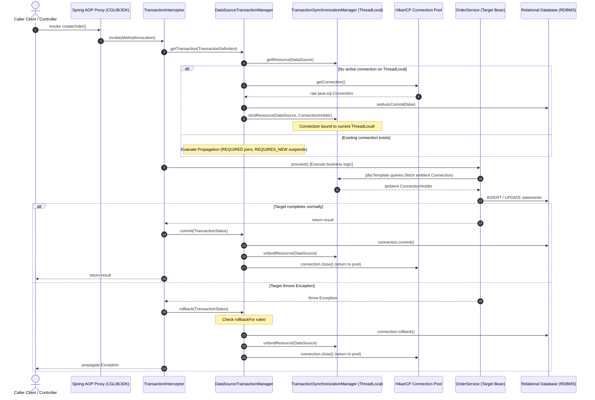
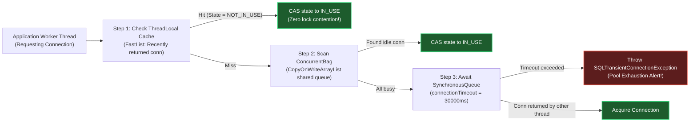

# Spring SQL, JDBC & Transaction Internals: The Production Master Guide

> **Document Identity:** [`interview_prep/02_spring_framework/spring_sql_jdbc_transactions.md`](file:///d:/project/github/1/CheatSheet_Tutorial/interview_prep/02_spring_framework/spring_sql_jdbc_transactions.md)  
> **Topic Domain:** Spring SQL, JDBC Internals, ACID Transactions & Connection Pooling (`SP-GAP-11` / `S18`)  
> **Target Framework:** Spring Framework 6.x, Spring Boot 3.2.x / 3.3.x / 3.4.x, HikariCP 5.x, PostgreSQL 16+ / MySQL 8.0+, JDBC 4.3+, Project Loom (Java 21 LTS)  
> **Architecture Level:** Principal / Staff+ Distributed Systems Architect & Database Reliability Engineer  
> **Applicable Java Versions:** Java 17 LTS | Java 21 LTS | Java 25 LTS  

---

## 1. Foundational Primer: What, Why & Where? (The "Head")

*Before dissecting `PlatformTransactionManager` source code, `TransactionSynchronizationManager`'s `ThreadLocal` resource maps, dynamic proxy interception chains, HikariCP's lock-free `ConcurrentBag`, and MVCC write-skew anomalies, here is the essential high-level context: what Spring transaction management represents, why manual JDBC transactions break down in production, and where transactions anchor modern financial and enterprise data architectures.*

### 1.1 What Is It? (Core Definition & Mental Model)
* **Plain-English Definition**: Spring Transaction Management is an enterprise abstraction framework that guarantees **ACID (Atomicity, Consistency, Isolation, Durability)** invariants across relational database operations. Instead of manually opening database connections, issuing `SET AUTOCOMMIT = 0`, tracking state across method stacks, and issuing `COMMIT` or `ROLLBACK`, Spring uses an Aspect-Oriented Programming (AOP) proxy pipeline and a thread-bound resource manager (`TransactionSynchronizationManager`) to manage transaction lifecycles declaratively (`@Transactional`) or programmatically (`TransactionTemplate`).
* **Everyday Analogy**: Think of a **High-Security Banking Escrow & Notary Office**:
  - In a primitive cash swap (raw JDBC), Alice hands $10,000 cash to Bob on the sidewalk. If Bob grabs the cash and runs before signing the car title, Alice has no recourse—the system is in a corrupt, half-finished state.
  - **Spring Transaction Management is the Certified Escrow Vault**:
    - **`PlatformTransactionManager`** is the **Chief Notary Officer**: decides when the legal session begins, validates participant credentials, and signs the final decree.
    - **`TransactionSynchronizationManager`** is the **Locked Escrow Table**: binds the legal contract and cash directly to the notary's desk (`ThreadLocal`) so every clerk working on the transaction accesses the exact same physical folder.
    - **`@Transactional`** is the **Legally Binding Contract Clause**: any failure, fraud, or unexpected exception automatically triggers the escrow officer to incinerate the paperwork and return all assets to their original owners (**Rollback**). Only if every single signature is verified does the vault door unlock (**Commit**).
* **Architectural Tier Placement**: Operates at the **Persistence Ingress & Service Orchestration Layer**. It sits between Domain Service beans and the underlying Relational Database Management System (RDBMS), binding raw JDBC `Connection` handles from connection pools (HikariCP) to application execution threads.

### 1.2 Why Does It Exist? (The Pain Point Before It Existed)
* **The Raw JDBC Boilerplate Catastrophe**: In raw JDBC (`java.sql.Connection`), managing a multi-table business operation required 50+ lines of fragile error-handling boilerplate per method:
  1. Manually obtain a connection from `DataSource.getConnection()`.
  2. Call `connection.setAutoCommit(false)`.
  3. Pass the *exact same* `Connection` object across multiple service layers and DAO methods as a method argument.
  4. Wrap business logic in cumbersome `try-catch-finally` blocks.
  5. Manually invoke `connection.commit()` on success.
  6. In the `catch` block, invoke `connection.rollback()`, handling nested `SQLException` thrown during rollback.
  7. In the `finally` block, restore `connection.setAutoCommit(true)` and invoke `connection.close()` to return the connection to the pool.
* **The Connection Passing Nightmare**: Without Spring, passing the `Connection` handle through 5 layers of domain services broke separation of concerns: domain services were polluted with low-level database handles.
* **The Nested Transaction Failure**: If Service A (handling Orders) called Service B (handling Inventory), both services attempted to manage their own `Connection.commit()`. If Service B committed inventory deduction, but Service A failed immediately afterward during credit card charging, the inventory deduction could not be rolled back!
* **Vendor & API Lock-in**: Raw JDBC code was tightly coupled to local JDBC transactions. Migrating to JTA distributed transactions (across multiple databases or JMS queues) required rewriting the entire persistence layer to use `javax.transaction.UserTransaction`.

### 1.3 How Does It Solve Real-World Enterprise Problems?
* **Declarative AOP Interception**: Annotating a method with `@Transactional` automatically injects a `TransactionInterceptor` advice around the method execution. Business logic remains 100% clean of database transaction code.
* **Thread-Bound Resource Synchronization**: `TransactionSynchronizationManager` binds the active `ConnectionHolder` to the current thread via `ThreadLocal`. Any downstream `JdbcTemplate`, Hibernate `Session`, or MyBatis mapper automatically retrieves the ambient connection without explicit argument passing.
* **Sophisticated Propagation Semantics**: Supports 7 transaction propagation behaviors (`REQUIRED`, `REQUIRES_NEW`, `NESTED`, `SUPPORTS`, `NOT_SUPPORTED`, `NEVER`, `MANDATORY`), allowing complex service compositions with precise boundaries, independent audit logging, and savepoint rollbacks.
* **Universal Transaction Abstraction**: Provides a unified SPI (`PlatformTransactionManager`) that works identically across plain JDBC (`DataSourceTransactionManager`), JPA/Hibernate (`JpaTransactionManager`), JTA distributed transactions (`JtaTransactionManager`), and R2DBC reactive systems (`ReactiveTransactionManager`).

### 1.4 How Does This Help in Building Real Applications?
* **Financial Ledger Integrity**: Guarantees zero double-spending and zero partial balance updates during high-concurrency transfers.
* **Connection Pool Protection**: Automatic connection lifecycle management ensures physical connections are acquired late, released promptly, and never leaked back into HikariCP.
* **Resilient Distributed Integration**: Enables the **Transactional Outbox Pattern** by coupling database mutations and message outbox writes within the exact same atomic transaction boundary, eliminating dual-write inconsistencies.

### 1.5 Quick Decision & Trade-Off Matrix

| Dimension | Raw JDBC (`java.sql.Connection`) | Spring `JdbcTemplate` + `@Transactional` | Spring Data JPA / Hibernate | Spring Reactive R2DBC |
| :--- | :--- | :--- | :--- | :--- |
| **Transaction Model** | Manual programmatic | Declarative / Programmatic | Declarative / Unit-of-Work | Reactive Stream pipeline |
| **Resource Binding** | Explicit method passing | `ThreadLocal` (`TransactionSynchronizationManager`)| `ThreadLocal` (`EntityManager`) | Reactor `Context` |
| **Boilerplate Level**| Extremely high | Very low | Minimal | Functional / Low |
| **Performance Overhead**| Zero (Raw wire) | Negligible (<1% AOP proxy) | Moderate (Dirty-checking, hydration)| Minimal (Non-blocking I/O) |
| **Complex SQL Control**| Total manual control | Total manual control (Raw SQL) | Complex (JPQL / Native SQL) | Moderate (R2DBC SQL) |
| **Savepoint Support**| Manual JDBC Savepoint | Native `Propagation.NESTED` | Driver-dependent | Limited |
| **Virtual Thread Safety**| Safe (Pins if synchronized)| Safe in Spring 6.x | Safe in Hibernate 6.2+ | Non-blocking (Reactor) |

---

## 2. Track 0: Jargon-Buster Encyclopedia (32+ Core Terms)

| Term | Architectural Definition | Low-Level Reality / Production Trap |
| :--- | :--- | :--- |
| **ACID** | Atomicity, Consistency, Isolation, Durability. The four mathematical guarantees of relational database transactions. | Isolation is usually compromised in production (using `READ COMMITTED` or `REPEATABLE READ`) to prevent severe locking bottlenecks. |
| **`PlatformTransactionManager`** | The central SPI in Spring's transaction infrastructure. Defines `getTransaction()`, `commit()`, and `rollback()`. | Interface implemented by `DataSourceTransactionManager`, `JpaTransactionManager`, and `JtaTransactionManager`. |
| **`DataSourceTransactionManager`** | Low-level transaction manager for single JDBC DataSources. Binds a JDBC `Connection` to the thread. | Does not support multi-resource two-phase commit. Cannot coordinate JPA `EntityManager` cache flushes natively. |
| **`JpaTransactionManager`** | Transaction manager that exposes JPA `EntityManager` transactions while sharing the underlying JDBC `Connection`. | Transparently enables Spring `JdbcTemplate` to participate in the exact same physical transaction as Hibernate. |
| **`TransactionSynchronizationManager`** | Internal engine maintaining `ThreadLocal` maps of active database resources and transaction lifecycle callbacks. | If a thread pool reuses threads without cleanup, or if tasks jump threads asynchronously, context is lost. |
| **`ThreadLocal` Connection Binding**| The mechanism storing `Map<Object, Object> resources` keyed by `DataSource` on the running execution thread. | Broken by `@Async`, `CompletableFuture`, or parallel streams unless context is explicitly propagated. |
| **`TransactionInterceptor`** | The AOP MethodInterceptor executing around `@Transactional` methods to manage begin, commit, and rollback. | Forms the actual proxy advice; delegates directly to `TransactionAspectSupport` and `PlatformTransactionManager`. |
| **`@Transactional`** | Declarative annotation defining transaction boundaries, propagation, isolation, timeouts, and rollback rules. | Only takes effect when invoked through a Spring AOP proxy. Private methods and self-invocation silently ignore it! |
| **`TransactionTemplate`** | Thread-safe programmatic transaction wrapper executing callbacks within transactional boundaries. | Eliminates proxy bypass traps; ideal for fine-grained transactions and micro-operations within long workflows. |
| **`TransactionStatus`** | Represents the current state of an active transaction: isNew, hasSavepoint, isRollbackOnly, isCompleted. | Allows programmatic marking of `setRollbackOnly()` without throwing an exception. |
| **`Propagation.REQUIRED`** | Default propagation. Joins the current active transaction if one exists; creates a new one if none exists. | If an inner method fails and catches the exception, the transaction is marked rollback-only, causing `UnexpectedRollbackException` on outer commit. |
| **`Propagation.REQUIRES_NEW`**| Suspends the current transaction, creates a completely independent physical transaction, and resumes outer on completion. | Consumes **two physical database connections** from HikariCP simultaneously on the same thread, causing pool deadlocks! |
| **`Propagation.NESTED`** | Executes within a nested transaction using JDBC Savepoints if an active transaction exists. | Rolls back only the inner sub-transaction to the savepoint without rolling back the outer transaction. Requires driver support. |
| **`Propagation.SUPPORTS`** | Executes non-transactionally if none exists; joins active transaction if one exists. | Misused on read methods: non-transactional execution can lead to inconsistent snapshot reads across multiple queries. |
| **`Propagation.NOT_SUPPORTED`**| Suspends the active transaction and executes non-transactionally; resumes transaction on completion. | Useful for long-running read/export operations that must not hold locks or connection state. |
| **`Propagation.MANDATORY`** | Requires an existing active transaction; throws `IllegalTransactionStateException` if called without one. | Production defensive guardrail to enforce that low-level write DAOs are never executed in auto-commit mode. |
| **`Propagation.NEVER`** | Requires NO active transaction; throws `IllegalTransactionStateException` if an active transaction exists. | Used to protect non-transactional batch operations or operations incompatible with open locks. |
| **`SuspendedResourcesHolder`** | Internal object holding suspended transaction resources (connection, synchronizations) during `REQUIRES_NEW`. | Stored on the execution call stack; restored in `finally` block of `TransactionAspectSupport`. |
| **`Savepoint`** | JDBC 3.0 checkpoint within an active transaction (`connection.setSavepoint()`) allowing partial rollbacks. | Not supported by all NoSQL or distributed DB drivers. PostgreSQL implements savepoints via subtransactions. |
| **`READ_UNCOMMITTED`** | Lowest isolation level. Queries see uncommitted dirty writes from other transactions. | Causes dirty reads. Almost never permitted in enterprise systems. PostgreSQL maps this to `READ COMMITTED`. |
| **`READ_COMMITTED`** | Default in PostgreSQL/Oracle. Queries only see rows committed before the query statement began. | Allows non-repeatable reads and phantom reads. Successive identical queries in the same transaction can return different rows. |
| **`REPEATABLE_READ`** | Default in MySQL InnoDB. Guarantees that any row read during the transaction remains identical on subsequent reads. | Prevents non-repeatable reads. In PostgreSQL, uses snapshot isolation. In MySQL, uses Next-Key locks. |
| **`SERIALIZABLE`** | Highest isolation level. Simulates purely sequential execution of transactions. | Highest locking overhead or abort rate. In PostgreSQL, uses Serializable Snapshot Isolation (SSI). Causes serialization failure exceptions (40001). |
| **MVCC** | Multi-Version Concurrency Control. Database engine mechanism allowing non-blocking concurrent reads and writes. | Readers never block writers, and writers never block readers. Creates dead tuples / undo log bloat under long transactions. |
| **Phantom Read** | Anomaly where a transaction re-executes a range query and discovers new "phantom" rows inserted by another committed transaction. | Prevented in MySQL InnoDB `REPEATABLE READ` via Next-Key (gap) locking, and in standard SQL via `SERIALIZABLE`. |
| **Write Skew** | Anomaly in snapshot isolation where two transactions read overlapping data, verify constraints, and write non-overlapping data, violating invariants. | Example: Two doctors on call both check if at least one doctor remains active, both log off simultaneously. |
| **`rollbackFor`** | Attribute defining which exception classes trigger transaction rollback. Defaults to `RuntimeException` and `Error`. | **Checked exceptions (`Exception`) DO NOT trigger rollback by default!** Must specify `rollbackFor = Exception.class`. |
| **`UnexpectedRollbackException`**| Exception thrown when an outer transaction attempts to commit, but an inner `REQUIRED` transaction marked it rollback-only. | Occurs when an outer service catches an inner exception and tries to commit anyway. |
| **HikariCP `leakDetectionThreshold`** | Milliseconds a connection can be checked out before a stack trace warning is logged indicating a connection leak. | Critical production safety setting. Recommended: 2000–5000ms. Zero (disabled) by default. |
| **Two-Phase Commit (XA)** | Distributed transaction protocol with Prepare and Commit phases coordinated across multiple resource managers. | Suffers from blocking coordinator failures, massive latency overhead, and heuristic hazard exceptions. Avoided in cloud-native systems. |
| **Saga Pattern** | Architectural pattern coordinating distributed transactions via a sequence of local transactions and compensating actions. | Implemented via Choreography (events) or Orchestration (central state machine). Eventual consistency model. |
| **Transactional Outbox** | Pattern writing business entities and outbound domain events into the same relational database in one atomic local transaction. | Guarantees At-Least-Once event publishing without distributed 2PC XA transactions. Consumed by Debezium CDC or pollers. |

---

## 3. Track 1: Foundations & The Core Problem (ELI5 + Step 1-to-3 Code Runway)

### 3.1 ELI5 Analogy: The Bank Vault, The Notary, and The Checkbook
Imagine you run a courier company transferring money between bank vaults.
1. **Raw JDBC without Spring**: You walk into Bank Branch A, withdraw $1,000 cash, put it in your backpack, walk across town through traffic, enter Bank Branch B, and deposit the cash. If you get mugged on the sidewalk between branches, Bank A has lost money, Bank B received nothing, and you have no record. This is a partial database commit without atomic transaction boundaries.
2. **Spring `@Transactional`**: You invite a licensed **Certified Notary** into the vault. The notary locks the vault doors. Both Bank A's balance ledger and Bank B's balance ledger are laid out on the table simultaneously. You execute both debit and credit entries with an indelible pen. If anything goes wrong—if the pen runs out of ink, if Bank B's account is frozen, or if the fire alarm rings—the notary immediately stamps **VOID** across all paperwork and returns all money to its original state (**Rollback**). Only if both transfers are flawless does the notary stamp **APPROVED** and unlock the vault doors (**Commit**).

---

### 3.2 Step 1: The Raw JDBC Catastrophe (Manual Plumbing & Leak Hazards)
Here is how transaction management was written in raw JDBC before Spring. Notice the dangerous resource leaks, missing exception propagation, and manual connection passing:

```java
package com.enterprise.transactions.legacy;

import javax.sql.DataSource;
import java.sql.Connection;
import java.sql.PreparedStatement;
import java.sql.SQLException;

public class RawJdbcOrderProcessor {

    private final DataSource dataSource;

    public RawJdbcOrderProcessor(DataSource dataSource) {
        this.dataSource = dataSource;
    }

    /**
     * Raw JDBC transactional method: Highly vulnerable to leaks and partial state corruptions!
     */
    public void processOrder(long orderId, long customerId, long productId, int quantity, double amount) throws SQLException {
        Connection conn = null;
        try {
            // Step 1: Acquire raw physical connection from pool
            conn = dataSource.getConnection();
            
            // Step 2: Disable auto-commit to begin physical transaction
            conn.setAutoCommit(false);
            
            // Step 3: Execute Order Insert
            String insertOrderSql = "INSERT INTO orders (id, customer_id, total_amount, status) VALUES (?, ?, ?, 'PENDING')";
            try (PreparedStatement orderStmt = conn.prepareStatement(insertOrderSql)) {
                orderStmt.setLong(1, orderId);
                orderStmt.setLong(2, customerId);
                orderStmt.setDouble(3, amount);
                orderStmt.executeUpdate();
            }

            // Step 4: Execute Inventory Reduction (Must pass the SAME connection!)
            deductInventory(conn, productId, quantity);

            // Step 5: Execute Customer Balance Deduction
            deductCustomerBalance(conn, customerId, amount);

            // Step 6: Commit physical transaction
            conn.commit();
            
        } catch (SQLException | RuntimeException ex) {
            // Step 7: Rollback on error
            if (conn != null) {
                try {
                    conn.rollback();
                } catch (SQLException rollbackEx) {
                    // Fatal: Rollback failed! Suppressed exception masking the root cause
                    ex.addSuppressed(rollbackEx);
                }
            }
            throw ex; // Re-throw to caller
        } finally {
            // Step 8: Clean up connection and restore auto-commit
            if (conn != null) {
                try {
                    conn.setAutoCommit(true); // Must restore default state before returning to pool!
                    conn.close(); // Return to pool
                } catch (SQLException closeEx) {
                    // Suppress or log
                }
            }
        }
    }

    private void deductInventory(Connection conn, long productId, int quantity) throws SQLException {
        String sql = "UPDATE inventory SET stock = stock - ? WHERE product_id = ? AND stock >= ?";
        try (PreparedStatement stmt = conn.prepareStatement(sql)) {
            stmt.setInt(1, quantity);
            stmt.setLong(2, productId);
            stmt.setInt(3, quantity);
            int updated = stmt.executeUpdate();
            if (updated == 0) {
                throw new SQLException("Insufficient stock for product ID: " + productId);
            }
        }
    }

    private void deductCustomerBalance(Connection conn, long customerId, double amount) throws SQLException {
        String sql = "UPDATE customer_wallets SET balance = balance - ? WHERE customer_id = ? AND balance >= ?";
        try (PreparedStatement stmt = conn.prepareStatement(sql)) {
            stmt.setDouble(1, amount);
            stmt.setLong(2, customerId);
            stmt.setDouble(3, amount);
            int updated = stmt.executeUpdate();
            if (updated == 0) {
                throw new SQLException("Insufficient balance for customer ID: " + customerId);
            }
        }
    }
}
```

---

### 3.3 Step 2: Programmatic Transaction Management with `TransactionTemplate`
`TransactionTemplate` eliminates all connection-passing, try-catch boilerplate, and pool leak hazards while avoiding AOP proxy bypass traps:

```java
package com.enterprise.transactions.programmatic;

import org.springframework.jdbc.core.JdbcTemplate;
import org.springframework.stereotype.Service;
import org.springframework.transaction.PlatformTransactionManager;
import org.springframework.transaction.TransactionDefinition;
import org.springframework.transaction.support.TransactionTemplate;

@Service
public class ProgrammaticOrderService {

    private final JdbcTemplate jdbcTemplate;
    private final TransactionTemplate transactionTemplate;

    public ProgrammaticOrderService(JdbcTemplate jdbcTemplate, PlatformTransactionManager transactionManager) {
        this.jdbcTemplate = jdbcTemplate;
        
        // Configure programmatic transaction template with specific isolation and propagation
        this.transactionTemplate = new TransactionTemplate(transactionManager);
        this.transactionTemplate.setIsolationLevel(TransactionDefinition.ISOLATION_READ_COMMITTED);
        this.transactionTemplate.setPropagationBehavior(TransactionDefinition.PROPAGATION_REQUIRED);
        this.transactionTemplate.setTimeout(10); // 10-second timeout
    }

    public OrderResult processOrder(long orderId, long customerId, long productId, int quantity, double amount) {
        // execute() opens connection, binds to thread, commits on return, and rolls back on exception
        return transactionTemplate.execute(status -> {
            try {
                // Step 1: Insert Order
                jdbcTemplate.update(
                    "INSERT INTO orders (id, customer_id, total_amount, status) VALUES (?, ?, ?, 'PENDING')",
                    orderId, customerId, amount
                );

                // Step 2: Deduct Stock
                int stockRows = jdbcTemplate.update(
                    "UPDATE inventory SET stock = stock - ? WHERE product_id = ? AND stock >= ?",
                    quantity, productId, quantity
                );
                if (stockRows == 0) {
                    // Programmatic rollback without throwing if business rules dictate
                    status.setRollbackOnly();
                    return OrderResult.failed("Insufficient stock");
                }

                // Step 3: Deduct Wallet Balance
                int walletRows = jdbcTemplate.update(
                    "UPDATE customer_wallets SET balance = balance - ? WHERE customer_id = ? AND balance >= ?",
                    amount, customerId, amount
                );
                if (walletRows == 0) {
                    status.setRollbackOnly();
                    return OrderResult.failed("Insufficient funds");
                }

                return OrderResult.success(orderId);

            } catch (Exception ex) {
                // Any uncaught exception thrown out of the lambda automatically triggers rollback
                status.setRollbackOnly();
                throw new OrderProcessingException("Transaction aborted: " + ex.getMessage(), ex);
            }
        });
    }

    public record OrderResult(boolean success, Long orderId, String message) {
        public static OrderResult success(Long orderId) { return new OrderResult(true, orderId, "SUCCESS"); }
        public static OrderResult failed(String msg) { return new OrderResult(false, null, msg); }
    }

    public static class OrderProcessingException extends RuntimeException {
        public OrderProcessingException(String msg, Throwable cause) { super(msg, cause); }
    }
}
```

---

### 3.4 Step 3: Enterprise Declarative Management with `@Transactional`
The modern declarative approach: pure domain logic, clean separation of concerns, and full declarative rollback control:

```java
package com.enterprise.transactions.declarative;

import org.springframework.jdbc.core.JdbcTemplate;
import org.springframework.stereotype.Service;
import org.springframework.transaction.annotation.Isolation;
import org.springframework.transaction.annotation.Propagation;
import org.springframework.transaction.annotation.Transactional;

@Service
public class DeclarativeOrderService {

    private final JdbcTemplate jdbcTemplate;

    public DeclarativeOrderService(JdbcTemplate jdbcTemplate) {
        this.jdbcTemplate = jdbcTemplate;
    }

    /**
     * Enterprise Declarative Transaction:
     * - Propagation.REQUIRED: Participates in outer transaction or begins a new one
     * - Isolation.READ_COMMITTED: Avoids dirty reads; uses database MVCC snapshot
     * - timeout = 5: Cancels transaction and aborts socket if execution exceeds 5 seconds
     * - rollbackFor = Exception.class: CRITICAL! Forces rollback on checked exceptions too!
     */
    @Transactional(
        propagation = Propagation.REQUIRED,
        isolation = Isolation.READ_COMMITTED,
        timeout = 5,
        rollbackFor = Exception.class
    )
    public void createOrder(long orderId, long customerId, long productId, int quantity, double amount) throws BusinessRuleException {
        // Mutation 1: Orders table
        jdbcTemplate.update(
            "INSERT INTO orders (id, customer_id, total_amount, status) VALUES (?, ?, ?, 'CONFIRMED')",
            orderId, customerId, amount
        );

        // Mutation 2: Inventory reduction with optimistic guard
        int stockUpdated = jdbcTemplate.update(
            "UPDATE inventory SET stock = stock - ? WHERE product_id = ? AND stock >= ?",
            quantity, productId, quantity
        );
        if (stockUpdated == 0) {
            // Checked exception: Triggers rollback because rollbackFor = Exception.class is specified!
            throw new BusinessRuleException("Out of stock for product ID: " + productId);
        }

        // Mutation 3: Wallet balance reduction
        int walletUpdated = jdbcTemplate.update(
            "UPDATE customer_wallets SET balance = balance - ? WHERE customer_id = ? AND balance >= ?",
            amount, customerId, amount
        );
        if (walletUpdated == 0) {
            throw new BusinessRuleException("Insufficient customer funds for ID: " + customerId);
        }
    }

    public static class BusinessRuleException extends Exception {
        public BusinessRuleException(String message) { super(message); }
    }
}
```

---

## 4. Track 2: Core Architecture & Mermaid Blueprints

### 4.1 Spring Transaction Lifecycle Architecture
The following sequence diagram details the full request lifecycle from the calling client through the AOP proxy, `TransactionInterceptor`, `PlatformTransactionManager`, `TransactionSynchronizationManager`, and the physical JDBC Connection:



---

### 4.2 Transaction Propagation Decision Matrix Architecture
How Spring evaluates propagation rules when Method A calls Method B:

```mermaid
flowchart TD
    Start["Method A invokes Method B<br/>with Propagation rule"] --> CheckActive{"Active Transaction<br/>Exists on ThreadLocal?"}
    
    CheckActive -- "NO" --> NoTx["No Active Transaction"]
    CheckActive -- "YES" --> HasTx["Active Transaction Exists"]
    
    NoTx --> P_REQ1["REQUIRED: Create NEW physical transaction"]
    NoTx --> P_REQNEW1["REQUIRES_NEW: Create NEW physical transaction"]
    NoTx --> P_NEST1["NESTED: Create NEW physical transaction"]
    NoTx --> P_SUP1["SUPPORTS: Execute non-transactionally (Auto-commit)"]
    NoTx --> P_NOTSUP1["NOT_SUPPORTED: Execute non-transactionally"]
    NoTx --> P_MAND1["MANDATORY: Throw IllegalTransactionStateException!"]
    NoTx --> P_NEV1["NEVER: Execute non-transactionally"]

    HasTx --> P_REQ2["REQUIRED: Join EXISTING transaction"]
    HasTx --> P_REQNEW2["REQUIRES_NEW: SUSPEND existing tx,<br/>borrow 2nd connection, start NEW tx"]
    HasTx --> P_NEST2["NESTED: Create JDBC Savepoint<br/>within existing connection"]
    HasTx --> P_SUP2["SUPPORTS: Join EXISTING transaction"]
    HasTx --> P_NOTSUP2["NOT_SUPPORTED: SUSPEND existing tx,<br/>execute non-transactionally"]
    HasTx --> P_MAND2["MANDATORY: Join EXISTING transaction"]
    HasTx --> P_NEV2["NEVER: Throw IllegalTransactionStateException!"]

    classDef err fill:#5c1d1d,stroke:#e74c3c,stroke-width:2px,color:#ffffff;
    classDef ok fill:#1d5c2d,stroke:#2ecc71,stroke-width:2px,color:#ffffff;
    classDef warn fill:#5c4d1d,stroke:#f39c12,stroke-width:2px,color:#ffffff;

    class P_MAND1,P_NEV2 err;
    class P_REQ1,P_REQ2,P_REQNEW1,P_NEST1 ok;
    class P_REQNEW2,P_NEST2,P_NOTSUP2 warn;
```



---

### 4.3 HikariCP Connection Pool Lock-Free Mechanics
HikariCP achieves near-zero locking overhead using `ConcurrentBag` and thread-local caching:



---

## 5. Track 3: Low-Level Internal Mechanics & JVM / Bytecode / DB Protocol Disassembly

### 5.1 The `PlatformTransactionManager` Class Hierarchy & SPI Contracts
Spring's transaction management is decoupled from specific database drivers by the `PlatformTransactionManager` SPI:

```java
// Spring Core Transaction SPI Contract
public interface PlatformTransactionManager extends TransactionManager {
    TransactionStatus getTransaction(@Nullable TransactionDefinition definition) throws TransactionException;
    void commit(TransactionStatus status) throws TransactionException;
    void rollback(TransactionStatus status) throws TransactionException;
}
```

The concrete class hierarchy:
* **`AbstractPlatformTransactionManager`**: Abstract base class implementing the transaction workflow template:
  - Handles transaction suspension, resumption, propagation logic, and synchronization callbacks.
  - Declares abstract hook methods: `doBegin()`, `doCommit()`, `doRollback()`, `doSuspend()`, `doResume()`.
* **`DataSourceTransactionManager`**: Concrete implementation for single JDBC `DataSource` configurations.
  - In `doBegin()`: Binds a new `ConnectionHolder` to `TransactionSynchronizationManager`.
  - Sets `connection.setAutoCommit(false)`.
  - In `doCommit()`: Calls `connection.commit()`.
  - In `doCleanupAfterCompletion()`: Resets `autoCommit` to true and closes the connection.
* **`JpaTransactionManager`**: Concrete implementation for JPA (`EntityManagerFactory`).
  - Extends transaction boundaries to the JPA `EntityManager`.
  - Flushes the JPA persistence context before committing the underlying JDBC connection.
  - Shares the underlying JDBC `Connection` with `JdbcTemplate`, allowing hybrid JPA/JDBC operations in one transaction.

---

### 5.2 Deep-Dive: How `TransactionSynchronizationManager` Binds Connections
`TransactionSynchronizationManager` uses `NamedThreadLocal` variables to bind state to the current thread. Here is the architectural layout of its internal storage:

```java
public abstract class TransactionSynchronizationManager {
    // ThreadLocal 1: Map of Resource Keys (DataSource) to Resource Holders (ConnectionHolder)
    private static final ThreadLocal<Map<Object, Object>> resources =
            new NamedThreadLocal<>("Transactional resources");

    // ThreadLocal 2: List of TransactionSynchronization callbacks (beforeCommit, afterCommit, etc.)
    private static final ThreadLocal<Set<TransactionSynchronization>> synchronizations =
            new NamedThreadLocal<>("Transaction synchronizations");

    // ThreadLocal 3: Current transaction name
    private static final ThreadLocal<String> currentTransactionName =
            new NamedThreadLocal<>("Current transaction name");

    // ThreadLocal 4: Is the current transaction read-only?
    private static final ThreadLocal<Boolean> currentTransactionReadOnly =
            new NamedThreadLocal<>("Current transaction read-only status");

    // ThreadLocal 5: Current isolation level
    private static final ThreadLocal<Integer> currentTransactionIsolationLevel =
            new NamedThreadLocal<>("Current transaction isolation level");

    // ThreadLocal 6: Is a transaction currently active?
    private static final ThreadLocal<Boolean> actualTransactionActive =
            new NamedThreadLocal<>("Actual transaction active");
}
```

#### How a Database Connection is Discovered at Runtime
When `JdbcTemplate` executes `update()` or `query()`:
1. `JdbcTemplate` calls `DataSourceUtils.getConnection(this.getDataSource())`.
2. `DataSourceUtils` queries `TransactionSynchronizationManager.getResource(dataSource)`.
3. If a `ConnectionHolder` exists on the current thread's `ThreadLocal<Map<Object, Object>>`:
   - It retrieves the ambient `Connection` and increments its reference count.
   - It **does not close** the connection when the statement finishes.
4. If no `ConnectionHolder` exists:
   - It fetches a new connection from `dataSource.getConnection()`.
   - Executes the statement in auto-commit mode.
   - Immediately closes the connection in a `finally` block.

---

### 5.3 `DataSourceTransactionManager.doBegin()` Execution Disassembly
Let us trace the exact Java execution path inside `DataSourceTransactionManager` when a transaction starts:

```java
@Override
protected void doBegin(Object transaction, TransactionDefinition definition) {
    DataSourceTransactionObject txObject = (DataSourceTransactionObject) transaction;
    Connection con = null;

    try {
        if (!txObject.hasConnectionHolder() ||
                txObject.getConnectionHolder().isSynchronizedWithTransaction()) {
            // Step 1: Borrow connection from HikariCP
            Connection newCon = obtainDataSource().getConnection();
            txObject.setConnectionHolder(new ConnectionHolder(newCon), true);
        }

        txObject.getConnectionHolder().setSynchronizedWithTransaction(true);
        con = txObject.getConnectionHolder().getConnection();

        // Step 2: Apply custom isolation level if specified
        Integer previousIsolationLevel = DataSourceUtils.prepareConnectionForTransaction(con, definition);
        txObject.setPreviousIsolationLevel(previousIsolationLevel);
        txObject.setReadOnly(definition.isReadOnly());

        // Step 3: Switch off AutoCommit
        if (con.getAutoCommit()) {
            txObject.setMustRestoreAutoCommit(true);
            con.setAutoCommit(false); // Physical DB wire protocol begins transaction!
        }

        // Step 4: Apply read-only optimization hint if applicable
        prepareTransactionalConnection(con, definition);
        txObject.getConnectionHolder().setTransactionActive(true);

        // Step 5: Bind ConnectionHolder to ThreadLocal!
        if (txObject.isNewConnectionHolder()) {
            TransactionSynchronizationManager.bindResource(obtainDataSource(), txObject.getConnectionHolder());
        }
    } catch (Throwable ex) {
        if (txObject.isNewConnectionHolder()) {
            DataSourceUtils.releaseConnection(con, obtainDataSource());
            txObject.setConnectionHolder(null, false);
        }
        throw new CannotCreateTransactionException("Could not open JDBC Connection for transaction", ex);
    }
}
```

---

### 5.4 The Proxy Execution Chain: Bytecode Interception Mechanics
When a Spring bean contains `@Transactional`, Spring replaces the bean in the `ApplicationContext` with a dynamic proxy:
1. **JDK Dynamic Proxy**: Used if the bean implements interfaces (creates a class implementing the interfaces and delegating to `InvocationHandler`).
2. **CGLIB / ByteBuddy Subclass Proxy**: Default in Spring Boot 2.x and 3.x (`spring.aop.proxy-target-class=true`). Generates a synthetic subclass of the target class at runtime.

#### The Bytecode Interception Chain
```
Caller
  │
  ▼
OrderService$$SpringCGLIB$$0.createOrder(...)
  │
  ▼
DynamicAdvisedInterceptor.intercept(...)
  │
  ▼
ReflectiveMethodInvocation.proceed()
  │
  ▼
TransactionInterceptor.invoke(...)
  │
  ▼
TransactionAspectSupport.invokeWithinTransaction(...)
  │
  ▼
PlatformTransactionManager.getTransaction(...)
  │
  ▼
OrderService.createOrder(...)  [Original Target Method Execution]
```

---

### 5.5 The Fatal Self-Invocation (`this.method()`) Proxy Bypass Trap & The 4 Solutions
Because Spring AOP works via **proxies**, calling a `@Transactional` method from another method inside the *same class* bypasses the proxy entirely!

#### ❌ The Buggy Code:
```java
@Service
public class OrderService {

    public void processIncomingOrder(Order order) {
        // BUG: Calling this.saveOrderWithTx() invokes the target method on 'this', NOT the proxy!
        // No TransactionInterceptor is invoked! No transaction is started! Runs in AUTO-COMMIT!
        this.saveOrderWithTx(order);
    }

    @Transactional(propagation = Propagation.REQUIRES_NEW)
    public void saveOrderWithTx(Order order) {
        // Expecting a new transaction, but runs with whatever transaction (or none) the caller had!
    }
}
```

#### The 4 Enterprise Production Solutions:
1. **Solution 1: Refactor to a Separate Delegate Service Bean (Recommended)**:
   Extract the transactional method into a dedicated component (`OrderPersistenceService`) and inject it into `OrderService`. Calls go through the Spring proxy.
2. **Solution 2: Self-Injection via `@Lazy`**:
   ```java
   @Service
   public class OrderService {
       @Autowired @Lazy private OrderService self;

       public void processIncomingOrder(Order order) {
           self.saveOrderWithTx(order); // Traverses the proxy!
       }
   }
   ```
3. **Solution 3: `AopContext.currentProxy()`**:
   Requires `@EnableAspectJAutoProxy(exposeProxy = true)`.
   ```java
   ((OrderService) AopContext.currentProxy()).saveOrderWithTx(order);
   ```
4. **Solution 4: AspectJ Compile-Time / Load-Time Weaving (LTW)**:
   Replaces proxy interception with bytecode manipulation directly inside the `.class` file. Works on `this`, private methods, and non-Spring objects.

---

### 5.6 Propagation Deep-Dive: Suspending & Resuming Transactions
When an active transaction encounters a method annotated with `@Transactional(propagation = Propagation.REQUIRES_NEW)`:
1. `AbstractPlatformTransactionManager.handleExistingTransaction()` detects an active transaction.
2. It invokes `suspend(transaction)`.
3. `suspend()` creates a `SuspendedResourcesHolder` containing:
   - The outer transaction's `ConnectionHolder`.
   - The outer transaction's active `TransactionSynchronization` list.
   - The outer transaction's name, read-only flag, and isolation level.
4. It calls `TransactionSynchronizationManager.unbindResource(dataSource)`.
5. It triggers `TransactionSynchronization.suspend()` on all registered callbacks.
6. A **second, brand-new physical connection** is borrowed from HikariCP for the inner transaction.
7. The new connection is bound to `TransactionSynchronizationManager`.
8. The inner method executes and commits/rolls back.
9. In the `finally` block of `TransactionAspectSupport`, `resume(transaction, suspendedResources)` is invoked:
   - The inner connection is closed and returned to HikariCP.
   - The outer `ConnectionHolder` is rebound to `TransactionSynchronizationManager`.
   - The outer transaction resumes execution.

> **CRITICAL PRODUCTION WARNING**: If your thread borrows Connection 1 for an outer transaction, and then calls `REQUIRES_NEW` requiring Connection 2, each HTTP request consumes **2 physical connections simultaneously**. If your HikariCP pool has 20 connections and 10 concurrent requests arrive, all 10 threads hold Connection 1 while attempting to acquire Connection 2. **The pool deadlocks completely until connection timeouts expire!**

---

### 5.7 The JDBC `Savepoint` Protocol in `NESTED` Propagation
`Propagation.NESTED` avoids borrowing a second connection. Instead, it creates a JDBC `Savepoint` on the *existing* connection:
1. If no transaction exists, it behaves like `REQUIRED`.
2. If an active transaction exists:
   - Spring calls `Connection.setSavepoint("SAVEPOINT_1")`.
   - A `SavepointManager` tracks the savepoint handle inside `TransactionStatus`.
3. If the nested method completes normally:
   - In standard JDBC, the savepoint is released (`connection.releaseSavepoint(savepoint)`).
4. If the nested method throws an exception caught by the caller:
   - Spring invokes `connection.rollback(savepoint)`.
   - The outer transaction **remains active and unpolluted**!
   - The outer transaction can continue, perform alternative actions, and commit successfully.

---

### 5.8 Database Isolation Levels & Low-Level MVCC Mechanics
Relational databases enforce isolation using locking or Multi-Version Concurrency Control (MVCC).

#### The 4 SQL-92 Isolation Levels & Allowed Anomalies:

| Isolation Level | Dirty Read | Non-Repeatable Read | Phantom Read | Serialization Anomaly / Write Skew |
| :--- | :---: | :---: | :---: | :---: |
| **`READ UNCOMMITTED`** | **YES** | **YES** | **YES** | **YES** |
| **`READ COMMITTED`**   | NO      | **YES** | **YES** | **YES** |
| **`REPEATABLE READ`**  | NO      | NO      | DB-Dependent (MySQL: NO, PG: NO) | **YES (PostgreSQL / MySQL)** |
| **`SERIALIZABLE`**     | NO      | NO      | NO | NO |

#### Low-Level Engine Differences: PostgreSQL vs MySQL InnoDB
* **PostgreSQL MVCC**:
  - Every row tuple has `xmin` (creating transaction ID) and `xmax` (deleting/updating transaction ID) headers.
  - In `READ COMMITTED`, every SQL statement takes a new snapshot of committed transactions.
  - In `REPEATABLE READ`, the entire transaction uses the snapshot taken at the **first query statement**.
  - PostgreSQL eliminates phantom reads in `REPEATABLE READ` via snapshot isolation.
  - If two concurrent `REPEATABLE READ` transactions attempt to update the same row, the second transaction fails immediately with: `ERROR: could not serialize access due to concurrent update`.
* **MySQL InnoDB MVCC**:
  - Uses an **Undo Log** to construct older versions of rows.
  - In `REPEATABLE READ`, InnoDB uses **Next-Key Locking** (combining Record Locks and Gap Locks) during index scans.
  - Gap locks prevent other transactions from inserting rows into the index gaps, eliminating phantom reads even during read/write scans.

---

### 5.9 Rollback Mechanics & The `UnexpectedRollbackException` Trap
By default in Spring, transactions roll back **only** on unchecked exceptions (`RuntimeException` and `Error`).
* If a method throws `java.io.IOException` or any custom subclass of `java.lang.Exception`, Spring **commits the transaction**!
* To fix this, always specify `@Transactional(rollbackFor = Exception.class)`.

#### The `UnexpectedRollbackException` Anatomy:
```
Service A (@Transactional REQUIRED)
  │
  └──► Service B (@Transactional REQUIRED)
         │
         └──► Throws RuntimeException!
```
1. When Service B throws an exception, `TransactionInterceptor` catches it.
2. Because Service B joined Service A's transaction, it cannot execute a physical rollback yet.
3. Instead, it calls `TransactionStatus.setRollbackOnly()`.
4. The exception bubbles up to Service A.
5. If Service A contains a `try-catch` block that catches the exception and swallows it:
   ```java
   try {
       serviceB.doSomething();
   } catch (Exception ex) {
       log.warn("Service B failed, but continuing Service A...");
   }
   ```
6. Service A finishes and reaches `commit()`.
7. `DataSourceTransactionManager` inspects the transaction and discovers it was marked **rollback-only** by Service B!
8. `DataSourceTransactionManager` rolls back the physical transaction and throws:
   `org.springframework.transaction.UnexpectedRollbackException: Transaction silently rolled back because it has been marked as rollback-only`

---

### 5.10 HikariCP Connection Pool Mechanical Sympathy
HikariCP is the default connection pool in Spring Boot due to extreme performance optimizations:
1. **Lock-Free `ConcurrentBag`**: Employs a custom lock-free collection utilizing `ThreadLocal` caching (`FastList`) to minimize CAS contention across CPU cores.
2. **Bytecode Elimination**: Generates stripped-down proxy delegates using Javassist/ASM, eliminating overhead in `Connection.prepareStatement()`.
3. **`leakDetectionThreshold`**: Tracks active connection checkout times. If a thread holds a connection longer than this threshold, HikariCP captures a stack trace showing exactly where the connection was acquired and prints a warning.

---

### 5.11 Distributed Transactions: XA/2PC Heuristic Hazards vs Transactional Outbox
Traditional Two-Phase Commit (XA/2PC) across databases and message brokers coordinates via a transaction manager (e.g., Atomikos, Narayana):
* **Phase 1 (Prepare)**: Coordinator asks all participants to prepare locks and write undo/redo logs. Participants return `PREPARED`.
* **Phase 2 (Commit)**: Coordinator writes commit log and tells all participants to commit.
* **The Heuristic Hazard**: If the coordinator crashes between Phase 1 and Phase 2, or if network partitions occur, participants are left hanging with locks held. Eventually, participants timeout and make a unilateral decision (**Heuristic Commit** or **Heuristic Rollback**), causing permanent data divergence!
* **The Cloud-Native Solution**: The **Transactional Outbox Pattern** with local database transactions and Change Data Capture (Debezium/Kafka) completely eliminates XA while providing guaranteed At-Least-Once delivery.

---

## 6. Track 4: 8 Production-Grade Software Engines

### Engine 1: Low-Level `TransactionSynchronizationManager` Resource Binder & Connection Tracker
This engine provides low-level diagnostic insight and manual connection binding without violating Spring's transaction contracts:

```java
package com.enterprise.transactions.engines;

import org.slf4j.Logger;
import org.slf4j.LoggerFactory;
import org.springframework.jdbc.datasource.ConnectionHolder;
import org.springframework.jdbc.datasource.DataSourceUtils;
import org.springframework.stereotype.Component;
import org.springframework.transaction.support.TransactionSynchronization;
import org.springframework.transaction.support.TransactionSynchronizationManager;

import javax.sql.DataSource;
import java.sql.Connection;
import java.sql.SQLException;
import java.util.Objects;

@Component
public class TransactionDiagnosticsEngine {

    private static final Logger log = LoggerFactory.getLogger(TransactionDiagnosticsEngine.class);

    private final DataSource dataSource;

    public TransactionDiagnosticsEngine(DataSource dataSource) {
        this.dataSource = dataSource;
    }

    /**
     * Inspects the current thread's active transaction state.
     */
    public TransactionSnapshot captureThreadSnapshot() {
        boolean isTxActive = TransactionSynchronizationManager.isActualTransactionActive();
        String currentTxName = TransactionSynchronizationManager.getCurrentTransactionName();
        boolean isReadOnly = TransactionSynchronizationManager.isCurrentTransactionReadOnly();
        Integer isolationLevel = TransactionSynchronizationManager.getCurrentTransactionIsolationLevel();
        boolean hasResource = TransactionSynchronizationManager.hasResource(dataSource);

        return new TransactionSnapshot(isTxActive, currentTxName, isReadOnly, isolationLevel, hasResource);
    }

    /**
     * Registers a custom lifecycle synchronization callback on the active transaction.
     */
    public void registerCustomCallback(String operationId, Runnable onCommitAction, Runnable onRollbackAction) {
        if (!TransactionSynchronizationManager.isSynchronizationActive()) {
            log.warn("Cannot register synchronization: No active transaction synchronization for operation {}", operationId);
            return;
        }

        TransactionSynchronizationManager.registerSynchronization(new TransactionSynchronization() {
            @Override
            public void beforeCommit(boolean readOnly) {
                log.info("[TxSync:{}] Preparing to commit transaction. ReadOnly={}", operationId, readOnly);
            }

            @Override
            public void afterCommit() {
                log.info("[TxSync:{}] Transaction successfully committed. Executing post-commit hook.", operationId);
                if (onCommitAction != null) {
                    onCommitAction.run();
                }
            }

            @Override
            public void afterCompletion(int status) {
                if (status == TransactionSynchronization.STATUS_ROLLED_BACK) {
                    log.warn("[TxSync:{}] Transaction rolled back! Executing rollback hook.", operationId);
                    if (onRollbackAction != null) {
                        onRollbackAction.run();
                    }
                } else if (status == TransactionSynchronization.STATUS_COMMITTED) {
                    log.debug("[TxSync:{}] Transaction completion finalized.", operationId);
                }
            }
        });
    }

    /**
     * Safely executes low-level work on the ambient Connection without closing it prematurely.
     */
    public <T> T executeOnAmbientConnection(ConnectionCallback<T> callback) throws SQLException {
        // Obtains ambient connection bound to thread, or borrows a new one if none bound
        Connection connection = DataSourceUtils.getConnection(dataSource);
        try {
            return callback.doInConnection(connection);
        } finally {
            // DataSourceUtils.releaseConnection decrements ref count; only closes if NOT part of managed tx!
            DataSourceUtils.releaseConnection(connection, dataSource);
        }
    }

    @FunctionalInterface
    public interface ConnectionCallback<T> {
        T doInConnection(Connection con) throws SQLException;
    }

    public record TransactionSnapshot(
        boolean active,
        String transactionName,
        boolean readOnly,
        Integer isolationLevel,
        boolean connectionBound
    ) {}
}
```

---

### Engine 2: Programmatic Resilient Engine with `TransactionTemplate` & Safe Fallbacks
Engine providing bulletproof programmatic execution with fine-grained error isolation and fallback persistence:

```java
package com.enterprise.transactions.engines;

import org.slf4j.Logger;
import org.slf4j.LoggerFactory;
import org.springframework.dao.DataAccessException;
import org.springframework.jdbc.core.JdbcTemplate;
import org.springframework.stereotype.Service;
import org.springframework.transaction.PlatformTransactionManager;
import org.springframework.transaction.TransactionDefinition;
import org.springframework.transaction.support.TransactionTemplate;

import java.time.Duration;
import java.util.function.Supplier;

@Service
public class ResilientProgrammaticEngine {

    private static final Logger log = LoggerFactory.getLogger(ResilientProgrammaticEngine.class);

    private final JdbcTemplate jdbcTemplate;
    private final TransactionTemplate standardTxTemplate;
    private final TransactionTemplate requiresNewTxTemplate;

    public ResilientProgrammaticEngine(JdbcTemplate jdbcTemplate, PlatformTransactionManager transactionManager) {
        this.jdbcTemplate = jdbcTemplate;

        // Template 1: Standard join or begin (REQUIRED)
        this.standardTxTemplate = new TransactionTemplate(transactionManager);
        this.standardTxTemplate.setPropagationBehavior(TransactionDefinition.PROPAGATION_REQUIRED);
        this.standardTxTemplate.setIsolationLevel(TransactionDefinition.ISOLATION_READ_COMMITTED);
        this.standardTxTemplate.setTimeout(5); // 5-second timeout

        // Template 2: Independent Audit Log (REQUIRES_NEW)
        this.requiresNewTxTemplate = new TransactionTemplate(transactionManager);
        this.requiresNewTxTemplate.setPropagationBehavior(TransactionDefinition.PROPAGATION_REQUIRES_NEW);
        this.requiresNewTxTemplate.setIsolationLevel(TransactionDefinition.ISOLATION_READ_COMMITTED);
        this.requiresNewTxTemplate.setTimeout(3); // 3-second timeout
    }

    /**
     * Executes primary business logic. If it fails, writes an audit record in an independent transaction.
     */
    public <T> T executeWithAudit(String actionName, String userId, Supplier<T> businessLogic) {
        try {
            T result = standardTxTemplate.execute(status -> {
                log.info("Executing transactional operation: {}", actionName);
                return businessLogic.get();
            });

            // Write success audit
            writeAuditLog(actionName, userId, "SUCCESS", null);
            return result;

        } catch (Exception ex) {
            log.error("Transactional operation {} failed! Initiating independent audit.", actionName, ex);
            // Write failure audit in a separate, isolated transaction!
            writeAuditLogInNewTransaction(actionName, userId, "FAILED", ex.getMessage());
            throw ex;
        }
    }

    /**
     * Writes audit record using REQUIRES_NEW so audit succeeds even if outer transaction rolls back.
     */
    public void writeAuditLogInNewTransaction(String action, String userId, String status, String errorDetails) {
        try {
            requiresNewTxTemplate.executeWithoutResult(txStatus -> {
                jdbcTemplate.update(
                    "INSERT INTO security_audit_log (action, user_id, status, error_details, created_at) " +
                    "VALUES (?, ?, ?, ?, CURRENT_TIMESTAMP)",
                    action, userId, status, errorDetails
                );
            });
            log.info("Audit log persisted in separate transaction for action: {}", action);
        } catch (DataAccessException dae) {
            log.error("FATAL: Failed to persist audit log even in independent transaction!", dae);
        }
    }

    private void writeAuditLog(String action, String userId, String status, String details) {
        jdbcTemplate.update(
            "INSERT INTO security_audit_log (action, user_id, status, error_details, created_at) " +
            "VALUES (?, ?, ?, ?, CURRENT_TIMESTAMP)",
            action, userId, status, details
        );
    }
}
```

---

### Engine 3: Dynamic Multi-Tenant `AbstractRoutingDataSource` with Transaction Context
Enables seamless multi-tenant database routing where the target `DataSource` is selected per tenant while preserving transaction boundaries:

```java
package com.enterprise.transactions.engines;

import org.slf4j.Logger;
import org.slf4j.LoggerFactory;
import org.springframework.jdbc.datasource.lookup.AbstractRoutingDataSource;

import javax.sql.DataSource;
import java.util.Map;
import java.util.Objects;

public class TenantAwareRoutingDataSource extends AbstractRoutingDataSource {

    private static final Logger log = LoggerFactory.getLogger(TenantAwareRoutingDataSource.class);
    private static final ThreadLocal<String> currentTenant = new InheritableThreadLocal<>();

    public TenantAwareRoutingDataSource(DataSource defaultDataSource, Map<Object, Object> targetDataSources) {
        setDefaultTargetDataSource(defaultDataSource);
        setTargetDataSources(targetDataSources);
        afterPropertiesSet(); // Compiles the internal lookup map
    }

    public static void setTenantId(String tenantId) {
        log.debug("Setting active tenant context: {}", tenantId);
        currentTenant.set(tenantId);
    }

    public static String getTenantId() {
        return currentTenant.get();
    }

    public static void clearTenant() {
        currentTenant.remove();
    }

    @Override
    protected Object determineCurrentLookupKey() {
        String tenant = currentTenant.get();
        log.trace("Resolving target DataSource for tenant: {}", tenant);
        return tenant;
    }
}
```

```java
package com.enterprise.transactions.engines;

import org.springframework.stereotype.Service;
import org.springframework.transaction.annotation.Propagation;
import org.springframework.transaction.annotation.Transactional;
import org.springframework.jdbc.core.JdbcTemplate;

@Service
public class MultiTenantOrderService {

    private final JdbcTemplate jdbcTemplate;

    public MultiTenantOrderService(JdbcTemplate jdbcTemplate) {
        this.jdbcTemplate = jdbcTemplate;
    }

    /**
     * Executes transaction within the scope of the tenant resolved before the transaction begins.
     */
    @Transactional(propagation = Propagation.REQUIRED, rollbackFor = Exception.class)
    public void processTenantOrder(String tenantId, long orderId, double amount) {
        // Tenant context MUST be established BEFORE the transaction opens connection!
        TenantAwareRoutingDataSource.setTenantId(tenantId);
        try {
            jdbcTemplate.update(
                "INSERT INTO tenant_orders (order_id, amount, status) VALUES (?, ?, 'PROCESSED')",
                orderId, amount
            );
        } finally {
            TenantAwareRoutingDataSource.clearTenant();
        }
    }
}
```

---

### Engine 4: High-Throughput Batch Upsert Engine with `JdbcTemplate` & PostgreSQL `ON CONFLICT`
Achieves 100,000+ records/sec bulk inserts using JDBC batching, statement rewriting, and atomic database-level upsert semantics:

```java
package com.enterprise.transactions.engines;

import org.slf4j.Logger;
import org.slf4j.LoggerFactory;
import org.springframework.jdbc.core.BatchPreparedStatementSetter;
import org.springframework.jdbc.core.JdbcTemplate;
import org.springframework.stereotype.Service;
import org.springframework.transaction.annotation.Propagation;
import org.springframework.transaction.annotation.Transactional;

import java.sql.PreparedStatement;
import java.sql.SQLException;
import java.util.List;

@Service
public class HighThroughputBatchEngine {

    private static final Logger log = LoggerFactory.getLogger(HighThroughputBatchEngine.class);
    private static final int BATCH_SIZE = 1000;

    private final JdbcTemplate jdbcTemplate;

    public HighThroughputBatchEngine(JdbcTemplate jdbcTemplate) {
        this.jdbcTemplate = jdbcTemplate;
    }

    /**
     * Executes atomic batch upsert across thousands of items in chunks.
     * Uses PostgreSQL 'ON CONFLICT DO UPDATE' to guarantee idempotency and avoid lock escalation.
     */
    @Transactional(propagation = Propagation.REQUIRED, rollbackFor = Exception.class)
    public void bulkUpsertInventory(List<InventoryItem> items) {
        long start = System.currentTimeMillis();
        String sql = """
            INSERT INTO inventory_feed (sku, warehouse_id, quantity, updated_at)
            VALUES (?, ?, ?, CURRENT_TIMESTAMP)
            ON CONFLICT (sku, warehouse_id)
            DO UPDATE SET
                quantity = EXCLUDED.quantity,
                updated_at = CURRENT_TIMESTAMP
            """;

        for (int i = 0; i < items.size(); i += BATCH_SIZE) {
            List<InventoryItem> subList = items.subList(i, Math.min(i + BATCH_SIZE, items.size()));
            
            jdbcTemplate.batchUpdate(sql, new BatchPreparedStatementSetter() {
                @Override
                public void setValues(PreparedStatement ps, int index) throws SQLException {
                    InventoryItem item = subList.get(index);
                    ps.setString(1, item.sku());
                    ps.setString(2, item.warehouseId());
                    ps.setInt(3, item.quantity());
                }

                @Override
                public int getBatchSize() {
                    return subList.size();
                }
            });
            log.debug("Committed batch chunk of size {} to DB", subList.size());
        }

        log.info("Successfully bulk upserted {} items in {} ms", items.size(), System.currentTimeMillis() - start);
    }

    public record InventoryItem(String sku, String warehouseId, int quantity) {}
}
```

---

### Engine 5: Distributed Transactional Outbox Engine with `afterCommit` Synchronization
Guarantees At-Least-Once event publishing without distributed 2PC XA transactions by persisting the outbox event in the same transaction, then triggering async broker publish only after commit:

```java
package com.enterprise.transactions.engines;

import org.slf4j.Logger;
import org.slf4j.LoggerFactory;
import org.springframework.jdbc.core.JdbcTemplate;
import org.springframework.stereotype.Service;
import org.springframework.transaction.annotation.Propagation;
import org.springframework.transaction.annotation.Transactional;
import org.springframework.transaction.support.TransactionSynchronization;
import org.springframework.transaction.support.TransactionSynchronizationManager;

import java.util.UUID;
import java.util.concurrent.ExecutorService;
import java.util.concurrent.Executors;

@Service
public class TransactionalOutboxEngine {

    private static final Logger log = LoggerFactory.getLogger(TransactionalOutboxEngine.class);

    private final JdbcTemplate jdbcTemplate;
    private final MessageBrokerPublisher brokerPublisher;
    private final ExecutorService asyncPublisherExecutor = Executors.newVirtualThreadPerTaskExecutor();

    public TransactionalOutboxEngine(JdbcTemplate jdbcTemplate, MessageBrokerPublisher brokerPublisher) {
        this.jdbcTemplate = jdbcTemplate;
        this.brokerPublisher = brokerPublisher;
    }

    @Transactional(propagation = Propagation.REQUIRED, rollbackFor = Exception.class)
    public void createOrderWithOutbox(String orderId, String customerId, double totalAmount) {
        // 1. Business mutation: Insert into orders table
        jdbcTemplate.update(
            "INSERT INTO orders (id, customer_id, total_amount, status) VALUES (?, ?, ?, 'CONFIRMED')",
            orderId, customerId, totalAmount
        );

        // 2. Outbox mutation: Insert into outbox_events table in the SAME physical transaction!
        String eventId = UUID.randomUUID().toString();
        String payload = String.format("{\"orderId\":\"%s\",\"customerId\":\"%s\",\"amount\":%.2f}", orderId, customerId, totalAmount);
        
        jdbcTemplate.update(
            "INSERT INTO outbox_events (id, aggregate_type, aggregate_id, event_type, payload, status, created_at) " +
            "VALUES (?, 'ORDER', ?, 'ORDER_CREATED', ?, 'PENDING', CURRENT_TIMESTAMP)",
            eventId, orderId, payload
        );

        // 3. Register afterCommit hook: Publish to Kafka / RabbitMQ ONLY after DB commit succeeds!
        TransactionSynchronizationManager.registerSynchronization(new TransactionSynchronization() {
            @Override
            public void afterCommit() {
                // Execute on Virtual Thread to avoid holding or blocking the HTTP request thread
                asyncPublisherExecutor.submit(() -> {
                    try {
                        brokerPublisher.publishEvent("order.events", orderId, payload);
                        markOutboxEventPublished(eventId);
                    } catch (Exception ex) {
                        log.warn("Immediate outbox publish failed for event {}. Background CDC/poller will retry.", eventId, ex);
                    }
                });
            }
        });
    }

    private void markOutboxEventPublished(String eventId) {
        jdbcTemplate.update("UPDATE outbox_events SET status = 'PUBLISHED', published_at = CURRENT_TIMESTAMP WHERE id = ?", eventId);
    }

    public interface MessageBrokerPublisher {
        void publishEvent(String topic, String key, String payload);
    }
}
```

---

### Engine 6: Resilient Deadlock & Lock Acquisition Retry Engine with Exponential Backoff
Catches database lock acquisition timeouts and deadlock errors (PostgreSQL SQLState `40P01`, MySQL error `1213`) and executes retries with jitter:

```java
package com.enterprise.transactions.engines;

import org.slf4j.Logger;
import org.slf4j.LoggerFactory;
import org.springframework.dao.CannotAcquireLockException;
import org.springframework.dao.DeadlockLoserDataAccessException;
import org.springframework.stereotype.Service;
import org.springframework.transaction.PlatformTransactionManager;
import org.springframework.transaction.TransactionDefinition;
import org.springframework.transaction.support.TransactionTemplate;

import java.util.concurrent.ThreadLocalRandom;
import java.util.function.Supplier;

@Service
public class DeadlockRetryEngine {

    private static final Logger log = LoggerFactory.getLogger(DeadlockRetryEngine.class);
    private static final int MAX_RETRIES = 3;
    private static final long BASE_BACKOFF_MS = 100;

    private final TransactionTemplate transactionTemplate;

    public DeadlockRetryEngine(PlatformTransactionManager transactionManager) {
        this.transactionTemplate = new TransactionTemplate(transactionManager);
        this.transactionTemplate.setIsolationLevel(TransactionDefinition.ISOLATION_READ_COMMITTED);
        this.transactionTemplate.setPropagationBehavior(TransactionDefinition.PROPAGATION_REQUIRES_NEW);
        this.transactionTemplate.setTimeout(3); // 3 seconds per attempt
    }

    public <T> T executeWithDeadlockRetry(String operationName, Supplier<T> databaseOperation) {
        int attempts = 0;
        while (true) {
            attempts++;
            try {
                return transactionTemplate.execute(status -> databaseOperation.get());
            } catch (DeadlockLoserDataAccessException | CannotAcquireLockException ex) {
                if (attempts >= MAX_RETRIES) {
                    log.error("Deadlock retry limit reached ({}) for operation {}. Aborting.", MAX_RETRIES, operationName, ex);
                    throw ex;
                }

                long backoff = calculateBackoffWithJitter(attempts);
                log.warn("Deadlock detected during {} on attempt {}/{}. Backing off for {} ms before retry.",
                        operationName, attempts, MAX_RETRIES, backoff);

                try {
                    Thread.sleep(backoff);
                } catch (InterruptedException ie) {
                    Thread.currentThread().interrupt();
                    throw new RuntimeException("Deadlock retry interrupted", ie);
                }
            }
        }
    }

    private long calculateBackoffWithJitter(int attempt) {
        long exponential = BASE_BACKOFF_MS * (1L << (attempt - 1));
        long jitter = ThreadLocalRandom.current().nextLong(0, exponential / 2);
        return exponential + jitter;
    }
}
```

---

### Engine 7: HikariCP Production Telemetry & Connection Leak Watchdog
Monitors pool metrics and automatically captures thread dumps if connection checkout durations cross danger thresholds:

```java
package com.enterprise.transactions.engines;

import com.zaxxer.hikari.HikariDataSource;
import com.zaxxer.hikari.HikariPoolMXBean;
import org.slf4j.Logger;
import org.slf4j.LoggerFactory;
import org.springframework.scheduling.annotation.Scheduled;
import org.springframework.stereotype.Component;

import javax.sql.DataSource;

@Component
public class HikariPoolTelemetryWatchdog {

    private static final Logger log = LoggerFactory.getLogger(HikariPoolTelemetryWatchdog.class);

    private final HikariDataSource hikariDataSource;

    public HikariPoolTelemetryWatchdog(DataSource dataSource) {
        if (dataSource instanceof HikariDataSource hds) {
            this.hikariDataSource = hds;
        } else {
            this.hikariDataSource = null;
            log.warn("DataSource is not a HikariDataSource. Telemetry watchdog disabled.");
        }
    }

    @Scheduled(fixedRate = 10000) // Poll pool status every 10 seconds
    public void reportPoolMetrics() {
        if (hikariDataSource == null) return;

        HikariPoolMXBean poolBean = hikariDataSource.getHikariPoolMXBean();
        if (poolBean == null) return;

        int active = poolBean.getActiveConnections();
        int idle = poolBean.getIdleConnections();
        int total = poolBean.getTotalConnections();
        int threadsAwaiting = poolBean.getThreadsAwaitingConnection();

        log.info("[HikariCP Monitor] Total: {}, Active: {}, Idle: {}, Awaiting Threads: {}",
                total, active, idle, threadsAwaiting);

        // Alert if threads are backing up awaiting connections
        if (threadsAwaiting > 5) {
            log.error("CRITICAL ALERT: {} threads awaiting connection in HikariCP pool! Potential connection leak or pool starvation!",
                    threadsAwaiting);
        }

        // Alert if active connections approach 90% of maximum pool size
        int maxPoolSize = hikariDataSource.getMaximumPoolSize();
        if ((double) active / maxPoolSize >= 0.90) {
            log.warn("HIGH LOAD WARNING: Active connections ({}/{}) at >=90% capacity!", active, maxPoolSize);
        }
    }
}
```

---

### Engine 8: Dual-DataSource Saga Coordinator with Compensating Reversible Actions
Coordinates mutations across two separate physical databases (e.g., Orders DB and Customer Accounts DB) using compensating transactions:

```java
package com.enterprise.transactions.engines;

import org.slf4j.Logger;
import org.slf4j.LoggerFactory;
import org.springframework.beans.factory.annotation.Qualifier;
import org.springframework.jdbc.core.JdbcTemplate;
import org.springframework.stereotype.Service;
import org.springframework.transaction.PlatformTransactionManager;
import org.springframework.transaction.support.TransactionTemplate;

@Service
public class DualDataSourceSagaCoordinator {

    private static final Logger log = LoggerFactory.getLogger(DualDataSourceSagaCoordinator.class);

    private final JdbcTemplate ordersJdbcTemplate;
    private final JdbcTemplate accountsJdbcTemplate;
    private final TransactionTemplate ordersTxTemplate;
    private final TransactionTemplate accountsTxTemplate;

    public DualDataSourceSagaCoordinator(
            @Qualifier("ordersJdbcTemplate") JdbcTemplate ordersJdbcTemplate,
            @Qualifier("accountsJdbcTemplate") JdbcTemplate accountsJdbcTemplate,
            @Qualifier("ordersTxManager") PlatformTransactionManager ordersTxManager,
            @Qualifier("accountsTxManager") PlatformTransactionManager accountsTxManager) {
        this.ordersJdbcTemplate = ordersJdbcTemplate;
        this.accountsJdbcTemplate = accountsJdbcTemplate;
        this.ordersTxTemplate = new TransactionTemplate(ordersTxManager);
        this.accountsTxTemplate = new TransactionTemplate(accountsTxManager);
    }

    /**
     * Executes 2-step distributed saga across separate physical databases without 2PC/XA.
     */
    public boolean executeOrderPaymentSaga(long orderId, long customerId, double amount) {
        // Step 1: Execute Step 1 in Orders DB
        boolean orderCreated = Boolean.TRUE.equals(ordersTxTemplate.execute(status -> {
            int rows = ordersJdbcTemplate.update(
                "INSERT INTO orders (id, customer_id, amount, status) VALUES (?, ?, ?, 'PENDING_PAYMENT')",
                orderId, customerId, amount
            );
            return rows > 0;
        }));

        if (!orderCreated) {
            log.error("Saga Step 1 failed: Could not create order {}", orderId);
            return false;
        }

        // Step 2: Execute Step 2 in Accounts DB
        try {
            boolean paymentDeducted = Boolean.TRUE.equals(accountsTxTemplate.execute(status -> {
                int rows = accountsJdbcTemplate.update(
                    "UPDATE accounts SET balance = balance - ? WHERE customer_id = ? AND balance >= ?",
                    amount, customerId, amount
                );
                if (rows == 0) {
                    status.setRollbackOnly();
                    return false;
                }
                return true;
            }));

            if (!paymentDeducted) {
                log.warn("Saga Step 2 failed: Insufficient funds for customer {}. Initiating compensation on Orders DB.", customerId);
                compensateOrderCreation(orderId);
                return false;
            }

            // Step 3: Finalize order status in Orders DB
            ordersTxTemplate.executeWithoutResult(status -> {
                ordersJdbcTemplate.update("UPDATE orders SET status = 'COMPLETED' WHERE id = ?", orderId);
            });
            return true;

        } catch (Exception ex) {
            log.error("Saga Step 2 crashed with exception! Initiating compensation on Orders DB.", ex);
            compensateOrderCreation(orderId);
            throw new RuntimeException("Saga aborted and compensated", ex);
        }
    }

    private void compensateOrderCreation(long orderId) {
        try {
            ordersTxTemplate.executeWithoutResult(status -> {
                ordersJdbcTemplate.update("UPDATE orders SET status = 'CANCELLED_PAYMENT_FAILED' WHERE id = ?", orderId);
            });
            log.info("Compensation succeeded: Order {} marked as CANCELLED", orderId);
        } catch (Exception compEx) {
            log.error("CRITICAL: Saga compensation failed for order {}! Requires manual reconciliation.", orderId, compEx);
        }
    }
}
```

---

## 7. Track 5: 50 Progressive Real-World Scenarios (Tiers 1 to 4)

### Tier 1: Core Fundamentals & Syntax (Scenarios 1–12)

#### Scenario 1: Default Rollback Rule on Checked Exceptions
* **Question**: Why did a method annotated with `@Transactional` fail to roll back when it threw `java.io.IOException`?
* **Answer**: By default, Spring's `DefaultTransactionAttribute` only marks the transaction for rollback on **unchecked exceptions** (`RuntimeException` and `Error`). Checked exceptions (`Exception`) are considered recoverable business returns and trigger a commit! To fix this, always annotate with `@Transactional(rollbackFor = Exception.class)`.

#### Scenario 2: Calling `@Transactional` from Within the Same Class
* **Question**: In `UserService`, method `registerUser()` calls `this.sendWelcomeEmailAndAudit()` which has `@Transactional(propagation = Propagation.REQUIRES_NEW)`. Why does `sendWelcomeEmailAndAudit()` participate in the existing transaction instead of creating a new one?
* **Answer**: Spring AOP intercepts method calls via proxy instances. Calling `this.method()` invokes the target instance directly, completely bypassing the Spring AOP proxy. Because the proxy is bypassed, `TransactionInterceptor` is never triggered.

#### Scenario 3: Private Methods Annotated with `@Transactional`
* **Question**: What happens if you place `@Transactional` on a `private` method in a Spring `@Service`?
* **Answer**: When using standard Spring AOP proxies (CGLIB or JDK Dynamic Proxies), proxy subclasses cannot override or intercept `private` methods. Spring silently ignores `@Transactional` on private methods without throwing an error! The method executes non-transactionally in auto-commit mode.

#### Scenario 4: Difference Between `PlatformTransactionManager` and `TransactionTemplate`
* **Question**: When should you prefer programmatic `TransactionTemplate` over declarative `@Transactional`?
* **Answer**: Use `TransactionTemplate` when:
  1. You need fine-grained transaction boundaries inside a large method (e.g., executing a quick write inside a 5-minute file processing loop).
  2. You need to call transactional code from within the same class without proxy bypass traps.
  3. You want explicit return values and custom error handling without relying on thrown exceptions.

#### Scenario 5: Meaning of `readOnly = true`
* **Question**: Does `@Transactional(readOnly = true)` prevent SQL `INSERT` and `UPDATE` statements from executing in plain JDBC?
* **Answer**: In plain JDBC with PostgreSQL or MySQL, `readOnly = true` serves as an optimization hint. While Spring calls `connection.setReadOnly(true)`, some JDBC drivers ignore it for raw SQL writes unless configured with a read-replica routing driver. However, in Hibernate/JPA, it sets the FlushMode to `MANUAL`, disabling dirty-checking snapshots and yielding major memory and CPU savings.

#### Scenario 6: `TransactionStatus.setRollbackOnly()` Behavior
* **Question**: What is the purpose of `TransactionStatus.setRollbackOnly()`?
* **Answer**: It programmatically flags the current transaction so that when the method finishes and returns normally without throwing an exception, `PlatformTransactionManager` will still issue a `ROLLBACK` instead of a `COMMIT`.

#### Scenario 7: What Happens When `@Transactional(timeout = 3)` Expires?
* **Question**: How does Spring enforce `@Transactional(timeout = 3)`?
* **Answer**: Spring passes the remaining timeout in seconds to each JDBC `Statement.setQueryTimeout(seconds)` executed through `JdbcTemplate` or Hibernate. If a query runs longer than the remaining timeout, the JDBC driver cancels the query and throws `SQLTimeoutException`, triggering transaction rollback.

#### Scenario 8: Difference Between `DataSourceTransactionManager` and `JpaTransactionManager`
* **Question**: Can you use `JdbcTemplate` inside a transaction managed by `JpaTransactionManager`?
* **Answer**: Yes! `JpaTransactionManager` exposes the underlying JDBC `Connection` via `DataSourceUtils`. When `JdbcTemplate` runs, it retrieves the exact same physical connection bound by `JpaTransactionManager`. Any Hibernate flushes and JDBC statements execute atomically within the same physical transaction.

#### Scenario 9: How `JdbcTemplate` Automatically Closes Connections
* **Question**: Does calling `jdbcTemplate.query()` leak database connections if not inside a `@Transactional` method?
* **Answer**: No. `JdbcTemplate` uses `DataSourceUtils.getConnection(dataSource)` inside a `try-finally` block. If no transaction is active, it obtains a connection, executes the query in auto-commit mode, and calls `DataSourceUtils.releaseConnection()`, which closes the connection and returns it to the pool.

#### Scenario 10: Difference Between `Isolation.DEFAULT` and Explicit Isolation
* **Question**: What does `@Transactional(isolation = Isolation.DEFAULT)` do?
* **Answer**: It instructs Spring to use whatever default isolation level is configured on the underlying RDBMS connection pool (e.g., `READ COMMITTED` on PostgreSQL/Oracle, `REPEATABLE READ` on MySQL InnoDB).

#### Scenario 11: Can Interfaces Have `@Transactional`?
* **Question**: Should you annotate interfaces or concrete classes with `@Transactional`?
* **Answer**: You should always annotate concrete classes or concrete methods. If you annotate an interface and Spring is configured with CGLIB class-based proxies (the default in Spring Boot), the CGLIB proxy subclasses the class and cannot inherit annotations placed on the interface!

#### Scenario 12: Why Does `@Transactional` Fail on Initializer Methods (`@PostConstruct`)?
* **Question**: Why does `@Transactional` not work on a method annotated with `@PostConstruct`?
* **Answer**: During bean initialization, `@PostConstruct` is invoked before the bean is fully wrapped in its Spring AOP proxy. When `@PostConstruct` runs, it executes on the raw target bean instance, bypassing the transaction proxy. Use `ApplicationReadyEvent` or `CommandLineRunner` instead.

---

### Tier 2: Intermediate Architectural Mechanics (Scenarios 13–25)

#### Scenario 13: Propagation `REQUIRES_NEW` with HikariCP Pool Exhaustion
* **Question**: A service with `@Transactional` calls another service method annotated with `Propagation.REQUIRES_NEW`. Under 20 concurrent requests, the system completely hangs and throws `SQLTransientConnectionException`. Why?
* **Answer**: `REQUIRES_NEW` suspends the outer transaction and borrows a *second* physical connection from HikariCP on the same thread. If HikariCP has a maximum pool size of 20, 20 concurrent requests borrow 20 outer connections. When all 20 threads simultaneously attempt to acquire their second connection for `REQUIRES_NEW`, the pool is completely empty! All threads wait until timeout and crash.

#### Scenario 14: Catching Exceptions from `Propagation.REQUIRED` Methods
* **Question**: Method A (`@Transactional`) calls Method B (`@Transactional`). Method B throws a `RuntimeException`. Method A catches the exception in a `try-catch` block and completes normally. Why does Method A throw `UnexpectedRollbackException` on return?
* **Answer**: Both methods share the exact same physical transaction (`REQUIRED`). When Method B threw an exception, `TransactionAspectSupport` caught it and marked the transaction as **rollback-only**. Even though Method A swallowed the exception, when Method A's proxy attempted to commit, Spring detected the rollback-only flag, aborted the commit, rolled back, and threw `UnexpectedRollbackException`.

#### Scenario 15: `Propagation.NESTED` vs `Propagation.REQUIRES_NEW`
* **Question**: How does `Propagation.NESTED` avoid the two-connection pool deadlock hazard of `REQUIRES_NEW`?
* **Answer**: `NESTED` uses only **one single physical database connection**. It creates a JDBC `Savepoint` on that connection. If the nested method fails, it rolls back only to the savepoint, leaving the outer transaction valid without borrowing a second connection from the pool.

#### Scenario 16: Asynchronous Calls (`@Async`) Inside `@Transactional`
* **Question**: Method A is `@Transactional`. It calls `@Async` Method B. Does Method B run in Method A's transaction?
* **Answer**: No! `@Async` executes on a completely different worker thread from the task executor. Because Spring transactions are bound via `ThreadLocal` in `TransactionSynchronizationManager`, the new thread has no access to the parent thread's connection. Method B runs in its own independent transaction or auto-commit mode.

#### Scenario 17: Read-Only Transaction Routing with `AbstractRoutingDataSource`
* **Question**: How can Spring route read-only queries to a database replica and write queries to the primary database?
* **Answer**: By implementing `AbstractRoutingDataSource` and checking `TransactionSynchronizationManager.isCurrentTransactionReadOnly()`. If `true`, the routing DataSource returns the lookup key for the Read Replica pool; if `false`, it returns the Primary pool key. (Note: Requires lazy connection acquisition via `LazyConnectionDataSourceProxy`).

#### Scenario 18: Why `LazyConnectionDataSourceProxy` is Essential for Connection Optimization
* **Question**: What problem does `LazyConnectionDataSourceProxy` solve in Spring transactions?
* **Answer**: By default, Spring's `DataSourceTransactionManager` acquires a physical connection from HikariCP the moment `@Transactional` is entered, even if the method performs 2 seconds of REST/CPU calculations before executing its first SQL query! `LazyConnectionDataSourceProxy` delays acquiring the physical connection until the first actual SQL statement is executed, drastically reducing connection checkout durations.

#### Scenario 19: Non-Repeatable Reads in `READ COMMITTED`
* **Question**: A financial reporting method runs under `READ COMMITTED`. It queries total user balances, performs calculations, and queries total user balances again 2 seconds later. The totals differ. Why?
* **Answer**: In `READ COMMITTED`, every SQL query reads the latest committed snapshot. If another transaction committed updates between the first and second query, the second query reads the newly committed rows (a non-repeatable read). To get an identical snapshot throughout the transaction, use `REPEATABLE READ`.

#### Scenario 20: Phantom Reads and Gap Locking in MySQL InnoDB
* **Question**: How does MySQL InnoDB prevent phantom reads in `REPEATABLE READ` without using `SERIALIZABLE`?
* **Answer**: InnoDB uses **Next-Key Locking**, which combines record locks on individual index entries with **gap locks** on the spaces between index entries. When a transaction performs a range scan (e.g., `SELECT * FROM orders WHERE amount > 100 FOR UPDATE`), InnoDB locks the gaps, preventing other transactions from inserting new phantom rows into that range.

#### Scenario 21: Dirty Reads in `READ UNCOMMITTED`
* **Question**: Why are dirty reads dangerous in an e-commerce balance transfer?
* **Answer**: A dirty read occurs when Transaction A updates a balance from $100 to $0, and Transaction B reads the uncommitted $0 balance and rejects an order. If Transaction A then encounters an error and rolls back to $100, Transaction B made a business decision based on data that never officially existed!

#### Scenario 22: Deadlocks in Concurrent Updates
* **Question**: Two concurrent transactions update rows 1 and 2 in reverse order. What happens at the database level and how does Spring report it?
* **Answer**: Transaction A locks Row 1 and waits for Row 2. Transaction B locks Row 2 and waits for Row 1. The database deadlock detection engine detects the cycle in its wait-for graph, aborts one transaction, and throws a deadlock error. Spring translates this into `DeadlockLoserDataAccessException` or `CannotAcquireLockException`.

#### Scenario 23: Programmatic Savepoints with `TransactionTemplate`
* **Question**: How do you create and roll back to a savepoint programmatically in Spring?
* **Answer**: Through `TransactionStatus`:
  ```java
  Object savepoint = status.createSavepoint();
  try {
      // attempt risky operation
  } catch (Exception ex) {
      status.rollbackToSavepoint(savepoint);
  }
  ```

#### Scenario 24: Sizing HikariCP Connection Pools Correctly
* **Question**: Why is setting a HikariCP pool size to 100 connections on a 4-core server an anti-pattern?
* **Answer**: Database performance is bounded by CPU cores and disk I/O spindles. Having 100 concurrent active connections on a 4-core database causes massive OS context-switching overhead, disk queue thrashing, and cache evictions. The PostgreSQL/HikariCP formula is: `connections = ((cpu_cores * 2) + effective_spindle_count)`. For 4 cores, a pool of 10 connections often delivers higher throughput and lower latency than 100!

#### Scenario 25: Connection Leaks and `leakDetectionThreshold`
* **Question**: What happens when an application thread borrows a connection from HikariCP, executes a slow third-party HTTP call, and hangs?
* **Answer**: The connection remains checked out and cannot be used by other threads. If this happens across multiple threads, the pool is starved. Setting `leakDetectionThreshold = 3000` causes HikariCP to log an exception with the full stack trace of where the connection was checked out if held longer than 3 seconds.

---

### Tier 3: Advanced Failure Modes & Distributed Transactions (Scenarios 26–38)

#### Scenario 26: The Dual-Write Problem (Database Commit vs Kafka Publish)
* **Question**: Method A writes an Order to the database and calls `kafkaTemplate.send()`. If Kafka fails or the network times out, the database changes remain committed. If the DB fails after sending, Kafka contains ghost orders. How do you solve this?
* **Answer**: Implement the **Transactional Outbox Pattern**. Write both the Order and the Outbox event to the relational database in the *same local transaction*. Use `afterCommit` or a CDC tool (Debezium) to read the outbox table and stream events to Kafka.

#### Scenario 27: Message Publishing in `afterCommit` Hook
* **Question**: What happens if the `afterCommit` synchronization callback throws an exception when publishing a message?
* **Answer**: Because `afterCommit` runs *after* the database has physically committed, throwing an exception inside `afterCommit` **does not and cannot roll back the database**! The database transaction is already permanently durable. Ensure asynchronous publishing or outbox persistence with retry capabilities.

#### Scenario 28: Virtual Threads (Project Loom) Pinning in Old JDBC Drivers
* **Question**: Why did early JDBC drivers pin OS carrier threads when running under Java 21 Virtual Threads?
* **Answer**: In older JDBC driver versions, network socket reading and connection synchronization were wrapped inside `synchronized (lock)` blocks. In Java 21, blocking inside a `synchronized` block pins the underlying OS carrier thread, preventing the Virtual Thread from unmounting. Modern drivers (PgJDBC 42.6.1+, MySQL Connector/J 8.3+) replaced `synchronized` with `ReentrantLock` to enable clean unmounting.

#### Scenario 29: Two-Phase Commit (XA) Heuristic Hazard
* **Question**: During an XA 2PC transaction between Oracle and ActiveMQ, the network between the coordinator and ActiveMQ drops after Phase 1 (Prepare). What happens?
* **Answer**: ActiveMQ holds locks and resources in a `PREPARED` state awaiting the final `COMMIT` command. If the timeout expires, ActiveMQ makes a heuristic decision (usually rolling back to free locks). If the coordinator later reconnects and tells Oracle to commit, the system has suffered a **Heuristic Mixed Hazard**: Oracle committed, ActiveMQ rolled back.

#### Scenario 30: PgBouncer in Transaction Pooling Mode with Prepared Statements
* **Question**: When using PgBouncer in `transaction` pooling mode, why do named prepared statements in Java JDBC throw `prepared statement "S_1" does not exist`?
* **Answer**: In `transaction` pooling mode, PgBouncer assigns a different server connection for each transaction. Named prepared statements are scoped to a specific backend server connection. If Transaction 1 prepares `S_1` on Backend A, and Transaction 2 tries to execute `S_1` on Backend B, Backend B knows nothing about `S_1`. Fix: Configure the PostgreSQL driver with `prepareThreshold=0` or use unnamed prepared statements (`autosave=conservative`).

#### Scenario 31: Hibernate First-Level Cache Flushing Before JDBC Execution
* **Question**: In a hybrid JPA and `JdbcTemplate` method managed by `JpaTransactionManager`, why does `jdbcTemplate.query()` see updates made by JPA entities earlier in the method without an explicit `entityManager.flush()`?
* **Answer**: Spring's `JpaTransactionManager` configures Hibernate with `FlushMode.AUTO`. Before executing any raw native SQL or `JdbcTemplate` query on the shared connection, Hibernate automatically flushes all pending dirty entity state to the database so that the SQL query reads fresh data.

#### Scenario 32: Write Skew in PostgreSQL Snapshot Isolation (`REPEATABLE READ`)
* **Question**: Describe a real-world scenario where PostgreSQL `REPEATABLE READ` allows an invariant violation (Write Skew).
* **Answer**: A medical on-call schedule requires at least one doctor on duty. Doctors Alice and Bob are both on call.
  1. Transaction 1 (Alice): Queries active doctors: count = 2. Checks `count >= 2` (OK). Updates Alice status = `OFF_DUTY`.
  2. Transaction 2 (Bob): Queries active doctors concurrently: count = 2. Checks `count >= 2` (OK). Updates Bob status = `OFF_DUTY`.
  3. Both transactions commit successfully because they modified different rows! Now zero doctors are on duty.
  To fix: Use `SELECT ... FOR UPDATE` or `SERIALIZABLE` isolation.

#### Scenario 33: Optimistic Locking with `@Version` vs Pessimistic Locking
* **Question**: When should you choose Pessimistic Locking (`SELECT FOR UPDATE`) over Optimistic Locking (`@Version`)?
* **Answer**:
  - Use **Optimistic Locking** when read contention is high and write conflicts are rare (e.g., editing user profiles). No database locks are held; conflicts abort on commit via version check.
  - Use **Pessimistic Locking** when write contention is extremely high (e.g., flash sales of 10 concert tickets among 10,000 buyers). Optimistic locking would cause 99.9% of transactions to abort and retry, thrashing the CPU; pessimistic locks serialize access cleanly at the row level.

#### Scenario 34: Unintended Transaction Propagation in Scheduled Tasks (`@Scheduled`)
* **Question**: Can `@Scheduled` methods have `@Transactional`?
* **Answer**: Yes, but if a scheduled method runs a long batch job (e.g., processing 50,000 records) inside a single `@Transactional` method, it holds one HikariCP connection open for minutes, locks database tables, and blows up the undo log / WAL. Solution: Do not annotate the `@Scheduled` method with `@Transactional`; instead, process records in small chunks using `TransactionTemplate`.

#### Scenario 35: Self-Invoking Private Helper Methods with AspectJ LTW
* **Question**: How does AspectJ Load-Time Weaving (LTW) bypass the self-invocation limitation of Spring AOP?
* **Answer**: AspectJ modifies the actual JVM bytecode of the class at class-load time (via a `-javaagent:weaver.jar` agent). Instead of using proxy wrappers, it weaves transaction entry/exit bytecode directly into the method's instructions. Consequently, calls to `this.method()` or even private methods execute the woven transaction logic directly.

#### Scenario 36: Handling `SQLTransientConnectionException` During Failovers
* **Question**: When an AWS Aurora PostgreSQL primary node fails over, why does Spring throw `SQLTransientConnectionException`, and how do you recover?
* **Answer**: During failover, the old primary becomes read-only or crashes. Existing connections in HikariCP are severed or fail. HikariCP throws `SQLTransientConnectionException`. Recovery requires configuring HikariCP's `maxLifetime` (e.g., 60 seconds), fast validation queries, and wrapping critical service calls with `@Retryable(retryFor = TransientDataAccessException.class)`.

#### Scenario 37: `TransactionSynchronization.afterCompletion()` Status Codes
* **Question**: What are the possible status values passed to `afterCompletion(int status)`?
* **Answer**:
  1. `TransactionSynchronization.STATUS_COMMITTED` (0): Transaction committed successfully.
  2. `TransactionSynchronization.STATUS_ROLLED_BACK` (1): Transaction was rolled back.
  3. `TransactionSynchronization.STATUS_UNKNOWN` (2): Commit heuristic failure or status could not be determined.

#### Scenario 38: Distributed Tracing with Micrometer and Database Transactions
* **Question**: How do you correlate a slow database transaction with an HTTP trace ID?
* **Answer**: Use `datasource-proxy` or P6Spy with Micrometer Tracing. It wraps the raw `DataSource`, injects trace and span IDs into SQL query comments (e.g., `/* traceId=xyz */ SELECT ...`), and creates child spans for `Connection.getConnection()`, `Statement.execute()`, and `Connection.commit()`.

---

### Tier 4: Principal / Staff+ Enterprise Triage (Scenarios 39–50)

#### Scenario 39: Diagnosing Silent Connection Leaks in Production
* **Question**: You observe HikariCP active connections climbing steadily to 100% over 48 hours without dropping. How do you find the exact leaking line of code without taking down production?
* **Answer**:
  1. Dynamically set `hikariDataSource.setLeakDetectionThreshold(4000)` via Spring Boot Actuator JMX / `/actuator/env`.
  2. HikariCP will immediately log stack traces for any thread holding a connection longer than 4 seconds.
  3. Inspect thread dumps via `jstack` or `/actuator/threaddump` to find threads stuck in `WAITING` or `TIMED_WAITING` while holding a `ConnectionHolder`.

#### Scenario 40: Multi-Tenant Schema-Per-Tenant vs Table-Per-Tenant Isolation
* **Question**: How does Spring transaction management differ between Schema-per-Tenant and Table-per-Tenant?
* **Answer**: In Schema-per-tenant, you must issue `SET search_path TO tenant_schema` (PostgreSQL) or use `AbstractRoutingDataSource`. If using `SET search_path`, you must ensure that when the connection returns to HikariCP, `search_path` is reset, or another tenant borrowing that connection will read contaminated data!

#### Scenario 41: Avoiding Long-Running Transactions in Event Consumers
* **Question**: A Kafka consumer listener is annotated with `@Transactional`. It processes messages in batches of 500, calling external REST services for validation. What is wrong?
* **Answer**: Holding an open database transaction while making network calls to external REST services binds a database connection and table locks for the duration of the external HTTP latency. If the external API slows down by 500ms, the database connection pool exhausts in seconds. Keep external network calls **outside** the transaction boundary!

#### Scenario 42: Transaction Propagation with Spring Batch Chunk Processing
* **Question**: How does Spring Batch manage transactions during chunk processing?
* **Answer**: Spring Batch opens a transaction at the start of each chunk. The `ItemReader` reads items non-transactionally or with a cursor. The `ItemProcessor` processes items in memory. Only the `ItemWriter` writes the chunk (e.g., 1000 items) within the active transaction. If any item write fails, the entire chunk transaction rolls back.

#### Scenario 43: Zero-Downtime Schema Migration Locks (Flyway/Liquibase)
* **Question**: Why does adding a column with a default value inside a transaction lock the table in PostgreSQL?
* **Answer**: In PostgreSQL < 11, `ALTER TABLE ... ADD COLUMN ... DEFAULT 'xyz'` takes an `ACCESS EXCLUSIVE` lock and rewrites every row on disk. If executed inside a long transaction while live traffic runs, it blocks all reads and writes to that table. Modern migrations must use `ADD COLUMN` without default, then backfill in small batches.

#### Scenario 44: Handling PostgreSQL `SerializationFailureException` (SQLState 40001)
* **Question**: In PostgreSQL `SERIALIZABLE` isolation, why do concurrent transactions throw 40001 serialization errors, and what is the architecture contract?
* **Answer**: PostgreSQL Serializable Snapshot Isolation (SSI) tracks dependencies using SIREAD locks. When it detects a dangerous cycle (potential write skew or anomaly), it intentionally aborts one transaction with error 40001. The architectural contract of `SERIALIZABLE` requires that the application layer **must implement automatic retry loops** for all 40001 errors.

#### Scenario 45: The Problem of `Connection.setAutoCommit(true)` on Pool Return
* **Question**: What happens if a raw JDBC method changes `conn.setAutoCommit(false)`, throws an uncaught exception, and returns the connection to HikariCP without resetting `autoCommit`?
* **Answer**: When the next thread borrows that connection from HikariCP, `autoCommit` is still `false`. The next thread executes a simple query thinking it is in auto-commit mode, but the statement never commits, and locks are held indefinitely! HikariCP mitigates this by validating and resetting `autoCommit` state upon check-in if `isAutoCommit` is configured.

#### Scenario 46: Distributed Sagas vs Two-Phase Commit in Cloud Microservices
* **Question**: Why did major financial institutions abandon XA/2PC in favor of Sagas?
* **Answer**: XA/2PC requires synchronous blocking locks across all participants until the coordinator commits. Over cloud networks with multi-region latencies, holding database locks for 200ms causes massive lock queuing. Sagas execute local transactions immediately with zero distributed locks, using compensating actions for eventual consistency.

#### Scenario 47: Read-Write Split Inconsistencies (Replication Lag)
* **Question**: A user creates a post and is immediately redirected to view the post. The view query hits the Read Replica and returns 404 Not Found. How do you prevent this?
* **Answer**:
  1. Route all reads within X seconds of a write to the Primary database.
  2. Or return the created entity directly in the POST response so the frontend does not re-query immediately.
  3. Or use PostgreSQL write-ahead log (WAL) LSN tracking: the client passes the commit LSN, and the replica waits until it has replayed that LSN before executing the query.

#### Scenario 48: The Impact of TCP KeepAlive and Socket Timeouts on Ghost Transactions
* **Question**: A cloud database node abruptly loses power. The application server continues waiting on an open connection. Why does this transaction hold database locks forever, and how do you fix it?
* **Answer**: Without TCP Keepalive or socket timeouts, the OS TCP stack can wait indefinitely for an ACK on a dropped connection (the "half-open connection" problem). Fix: Configure JDBC connection string properties: `socketTimeout=10`, `tcpKeepAlive=true`, and on PostgreSQL: `idle_in_transaction_session_timeout=10000`.

#### Scenario 49: Spring Transaction Synchronization with WebFlux (R2DBC)
* **Question**: Can you use `TransactionSynchronizationManager` in a Spring WebFlux application using R2DBC?
* **Answer**: No! `TransactionSynchronizationManager` uses `ThreadLocal`, which assumes a single thread handles the transaction. In WebFlux, execution hops across Netty event loop threads. R2DBC uses `ReactiveTransactionManager` and stores transaction state in Project Reactor's **`Context`**, which propagates down the reactive publisher chain.

#### Scenario 50: Virtual Threads and HikariCP Pool Sizing in Java 21
* **Question**: If Virtual Threads allow 50,000 concurrent HTTP requests, should you increase HikariCP pool size from 20 to 10,000?
* **Answer**: **ABSOLUTELY NOT!** Virtual Threads solve thread concurrency in the JVM, but the database is still bounded by physical CPU cores, RAM, and disk I/O. If 10,000 Virtual Threads connect to PostgreSQL simultaneously, PostgreSQL spawns 10,000 backend processes, crashing the database OS with Out-Of-Memory errors. Keep HikariCP sized based on database hardware (e.g., 20–50 connections). Virtual Threads simply queue cleanly waiting for available connections.

---

## 8. Track 6: 10 War-Room Incident Post-Mortems

### Incident 1: The Self-Invocation Black Hole
* **Incident Summary**: An e-commerce system processed $1.2M in Black Friday transactions. Customers were billed, but inventory was not deducted. Investigation revealed that the audit logging method called an internal `@Transactional` payment method directly on `this`.
* **💥 Root Cause**: In `OrderService`, method `checkout()` invoked `this.deductInventoryAndBill()`. Because `this` bypassed the Spring CGLIB proxy, `TransactionInterceptor` was never invoked. The operations ran in raw auto-commit mode without rollback protection. When the inventory step failed, the payment had already auto-committed!

```java
// ❌ BUG: Self-invocation bypasses Spring AOP proxy!
@Service
public class OrderService {
    public void checkout(Order order) {
        log.info("Starting checkout for order: {}", order.getId());
        // BUG: Calling 'this' bypasses proxy! No transaction started!
        this.deductInventoryAndBill(order);
    }

    @Transactional(propagation = Propagation.REQUIRED, rollbackFor = Exception.class)
    public void deductInventoryAndBill(Order order) {
        inventoryDao.deduct(order);
        billingDao.charge(order); // If this fails, inventory deduction is NOT rolled back!
    }
}

// ✅ REFACTORED: Refactored into separate Spring bean or self-injection
@Service
public class OrderService {
    private final OrderExecutionService executionService;

    public OrderService(OrderExecutionService executionService) {
        this.executionService = executionService;
    }

    public void checkout(Order order) {
        log.info("Starting checkout for order: {}", order.getId());
        // Calls through injected Spring proxy bean!
        executionService.deductInventoryAndBill(order);
    }
}

@Service
public class OrderExecutionService {
    private final InventoryDao inventoryDao;
    private final BillingDao billingDao;

    public OrderExecutionService(InventoryDao inventoryDao, BillingDao billingDao) {
        this.inventoryDao = inventoryDao;
        this.billingDao = billingDao;
    }

    @Transactional(propagation = Propagation.REQUIRED, rollbackFor = Exception.class)
    public void deductInventoryAndBill(Order order) {
        inventoryDao.deduct(order);
        billingDao.charge(order); // Atomic! Fully rolled back if either fails!
    }
}
```
* **🛡️ Permanent Guardrail**: Enable ArchUnit rule enforcing that no `@Transactional` method is called from within the same class using `this.method()`.

---

### Incident 2: The Silent Outer Explosion (`UnexpectedRollbackException`)
* **Incident Summary**: A high-frequency payment processing pipeline crashed during peak trading hours, generating 15,000 HTTP 500 errors.
* **💥 Root Cause**: Service A called Service B. Service B had `@Transactional(propagation = Propagation.REQUIRED)` and threw a `CardDeclinedException` (`RuntimeException`). Service A caught `CardDeclinedException` in a `try-catch` block and attempted to record a decline reason and commit. However, Service B's failure had already marked the shared transaction as **rollback-only**. When Service A tried to commit, Spring threw `UnexpectedRollbackException`.

```java
// ❌ BUG: Catching exception from REQUIRED inner method causes UnexpectedRollbackException
@Service
public class PaymentOrchestrator {
    @Autowired private PaymentProcessor processor;
    @Autowired private AuditDao auditDao;

    @Transactional(propagation = Propagation.REQUIRED)
    public void processPayment(Payment payment) {
        try {
            // Inner method shares transaction. If it throws, tx is marked ROLLBACK-ONLY!
            processor.executeCardCharge(payment);
        } catch (CardDeclinedException ex) {
            // Swallowing exception and attempting to commit triggers UnexpectedRollbackException!
            auditDao.recordDecline(payment.getId(), ex.getMessage());
        }
    }
}

// ✅ REFACTORED: Use REQUIRES_NEW or NESTED for isolated sub-operations
@Service
public class PaymentProcessor {
    // Isolated in independent physical transaction: Failure here won't pollute caller!
    @Transactional(propagation = Propagation.REQUIRES_NEW, rollbackFor = Exception.class)
    public void executeCardCharge(Payment payment) {
        if (!gateway.charge(payment)) {
            throw new CardDeclinedException("Card declined");
        }
    }
}
```
* **🛡️ Permanent Guardrail**: Never catch a `RuntimeException` from an inner `REQUIRED` transaction expecting to commit the outer transaction. Use `REQUIRES_NEW` or `NESTED` if the inner step's failure is recoverable.

---

### Incident 3: The HikariCP Pool Exhaustion Cascade
* **Incident Summary**: An entire microservices cluster became unresponsive within 90 seconds of deploying a new feature. All CPU usage dropped to 2%, but all HTTP threads hung.
* **💥 Root Cause**: A developer added a call to a third-party KYC validation REST API inside a `@Transactional` method. The KYC API experienced a 25-second latency spike. Because the method was `@Transactional`, each thread held an open HikariCP database connection while waiting for the HTTP response. Within 30 seconds, all 50 pool connections were exhausted, starving all other endpoints!

```java
// ❌ BUG: Holding DB connection during slow external HTTP call!
@Service
public class UserRegistrationService {
    @Transactional(rollbackFor = Exception.class)
    public void registerUser(UserDto dto) {
        userDao.saveUser(dto); // Acquired DB connection!
        
        // FATAL: Blocking HTTP call holds DB connection for up to 30 seconds!
        KycResponse kyc = restTemplate.postForObject("https://api.kyc-partner.com/verify", dto, KycResponse.class);
        
        userDao.updateKycStatus(dto.getId(), kyc.getStatus());
    }
}

// ✅ REFACTORED: Keep external network calls OUTSIDE transaction boundaries!
@Service
public class UserRegistrationService {
    private final KycClient kycClient;
    private final UserPersistenceService persistenceService;

    public void registerUser(UserDto dto) {
        // Step 1: External HTTP call executed with ZERO database connections held!
        KycResponse kyc = kycClient.verify(dto);

        // Step 2: Database transaction entered ONLY for fast DB write (takes 2ms)!
        persistenceService.saveUserWithKyc(dto, kyc.getStatus());
    }
}
```
* **🛡️ Permanent Guardrail**: Configure HikariCP `leakDetectionThreshold = 3000`. Add checkstyle rule forbidding `RestTemplate`, `WebClient`, or `HttpClient` inside `@Transactional` classes.

---

### Incident 4: The Checked Exception Commitment
* **Incident Summary**: An automated payroll system double-paid 450 contractors during a file-export failure.
* **💥 Root Cause**: Method `executePayroll()` threw `java.io.IOException` when writing the audit receipt file to an NFS mount. Because `IOException` is a **checked exception**, Spring's default rollback policy did not trigger! The transaction committed all salary transfers despite the thrown exception.

```java
// ❌ BUG: Checked exceptions DO NOT trigger rollback by default!
@Service
public class PayrollService {
    @Transactional // Defaults to rollbackFor = RuntimeException.class!
    public void executePayroll(List<SalaryPayment> payments) throws IOException {
        for (SalaryPayment p : payments) {
            walletDao.deductSalary(p);
        }
        // Throws checked IOException! Spring COMMITS the transaction anyway!
        fileExporter.writeReceiptToFile(payments);
    }
}

// ✅ REFACTORED: Explicitly specify rollbackFor = Exception.class
@Service
public class PayrollService {
    @Transactional(rollbackFor = Exception.class) // Rollback on ALL checked and unchecked exceptions!
    public void executePayroll(List<SalaryPayment> payments) throws IOException {
        for (SalaryPayment p : payments) {
            walletDao.deductSalary(p);
        }
        fileExporter.writeReceiptToFile(payments);
    }
}
```
* **🛡️ Permanent Guardrail**: Enforce code analysis rule: `@Transactional` must always include `rollbackFor = Exception.class`.

---

### Incident 5: The Savepoint Memory Leak & Deadlock
* **Incident Summary**: A batch ingestion job processing 100,000 sensor readings hung after 20 minutes, exhausting PostgreSQL shared memory.
* **💥 Root Cause**: The batch loop used `Propagation.NESTED` on every single row to handle errors gracefully. In PostgreSQL, each savepoint allocates a subtransaction in the transaction's subxact buffer. Accumulating 100,000 savepoints in one transaction caused subtransaction buffer overflow, forcing PostgreSQL to scan on-disk transaction status pages, slowing down queries by 10,000x and locking the table.

```java
// ❌ BUG: Accumulating thousands of NESTED savepoints in one transaction!
@Service
public class IngestionService {
    @Transactional
    public void ingestAll(List<Record> records) {
        for (Record r : records) {
            // BUG: Creates 100,000 subtransactions in one single DB connection!
            nestedProcessor.processRecord(r);
        }
    }
}

// ✅ REFACTORED: Chunk-oriented processing using TransactionTemplate
@Service
public class IngestionService {
    private final TransactionTemplate transactionTemplate;

    public void ingestAll(List<Record> records) {
        int chunkSize = 500;
        for (int i = 0; i < records.size(); i += chunkSize) {
            List<Record> chunk = records.subList(i, Math.min(i + chunkSize, records.size()));
            // Commit and release connection every 500 records!
            transactionTemplate.executeWithoutResult(status -> {
                for (Record r : chunk) {
                    recordDao.insert(r);
                }
            });
        }
    }
}
```
* **🛡️ Permanent Guardrail**: Limit `Propagation.NESTED` to single business operations. Never use savepoints inside unbounded loops.

---

### Incident 6: The Multi-Threaded Async Proxy Bypass
* **Incident Summary**: Financial balances showed erratic calculation bugs under high load.
* **💥 Root Cause**: A developer used `CompletableFuture.supplyAsync()` inside a `@Transactional` method to parallelize queries. The asynchronous tasks ran on `ForkJoinPool.commonPool()` threads where `TransactionSynchronizationManager` had no bound connection. Each task opened a separate connection in auto-commit mode, reading uncommitted or inconsistent snapshot states.

```java
// ❌ BUG: Spawning threads inside @Transactional loses ThreadLocal connection!
@Service
public class FinancialReportService {
    @Transactional(readOnly = true)
    public Report generateReport(long companyId) {
        // BUG: Runs on async worker thread! ThreadLocal is EMPTY!
        CompletableFuture<Balance> balanceFuture = CompletableFuture.supplyAsync(() -> 
            balanceDao.calculate(companyId) // Borrows separate connection, ignores tx snapshot!
        );
        CompletableFuture<Debts> debtsFuture = CompletableFuture.supplyAsync(() -> 
            debtsDao.calculate(companyId)
        );
        return new Report(balanceFuture.join(), debtsFuture.join());
    }
}

// ✅ REFACTORED: Execute synchronous queries within single transactional snapshot!
@Service
public class FinancialReportService {
    @Transactional(readOnly = true, isolation = Isolation.REPEATABLE_READ)
    public Report generateReport(long companyId) {
        // Runs on single thread: Guarantees consistent snapshot across both queries!
        Balance balance = balanceDao.calculate(companyId);
        Debts debts = debtsDao.calculate(companyId);
        return new Report(balance, debts);
    }
}
```
* **🛡️ Permanent Guardrail**: Document that Spring `@Transactional` is strictly thread-bound. Multi-threaded processing inside a transaction requires manual context propagation or independent chunking.

---

### Incident 7: The Out-of-Order Message Queue Publishing
* **Incident Summary**: An order fulfillment microservice failed with `OrderNotFoundException` on 5% of all orders during peak sales.
* **💥 Root Cause**: `OrderService` published an `OrderCreatedEvent` to RabbitMQ inside its `@Transactional` method before returning. The RabbitMQ message reached the consumer service in 2ms. The consumer immediately queried the database for the order. However, the producer's database transaction had not finished committing yet! The consumer read empty results and crashed.

```java
// ❌ BUG: Publishing message before DB transaction commits!
@Service
public class OrderService {
    @Transactional(rollbackFor = Exception.class)
    public void createOrder(Order order) {
        orderDao.insert(order);
        // BUG: Message published BEFORE connection.commit() executes!
        rabbitTemplate.convertAndSend("orders.exchange", "order.created", order.getId());
    }
}

// ✅ REFACTORED: Publish message in afterCommit hook or Transactional Outbox!
@Service
public class OrderService {
    @Transactional(rollbackFor = Exception.class)
    public void createOrder(Order order) {
        orderDao.insert(order);
        
        // Execute publish ONLY after physical DB commit succeeds!
        TransactionSynchronizationManager.registerSynchronization(new TransactionSynchronization() {
            @Override
            public void afterCommit() {
                rabbitTemplate.convertAndSend("orders.exchange", "order.created", order.getId());
            }
        });
    }
}
```
* **🛡️ Permanent Guardrail**: Never publish external messages directly inside `@Transactional` methods without `TransactionSynchronization.afterCommit()` or the Transactional Outbox pattern.

---

### Incident 8: The Read-Only Optimization Lockout
* **Incident Summary**: During a Black Friday flash sale, write queries were routed to the read-replica database, resulting in `ERROR: cannot execute INSERT in a read-only transaction`.
* **💥 Root Cause**: A developer placed `@Transactional(readOnly = true)` at the class level on `CheckoutService`, and forgot to annotate the `processPayment()` method with `@Transactional(readOnly = false)`. The dynamic routing DataSource routed the payment insertion to the read replica.

```java
// ❌ BUG: Class-level readOnly applies to all methods unless overridden!
@Service
@Transactional(readOnly = true) // Applies to entire class!
public class CheckoutService {
    
    // BUG: Missing @Transactional(readOnly = false)! Routed to Read-Replica!
    public void processPayment(Payment p) {
        paymentDao.insert(p); // Crashes with DB read-only error!
    }
}

// ✅ REFACTORED: Explicitly override write methods
@Service
@Transactional(readOnly = true)
public class CheckoutService {

    @Transactional(readOnly = false, propagation = Propagation.REQUIRED, rollbackFor = Exception.class)
    public void processPayment(Payment p) {
        paymentDao.insert(p); // Correctly routed to Primary database!
    }
}
```
* **🛡️ Permanent Guardrail**: Place `@Transactional` strictly on individual methods, or ensure write methods explicitly specify `readOnly = false`.

---

### Incident 9: The PostgreSQL Phantom Update Write Skew
* **Incident Summary**: In a medical dispatch system, two ambulances were dispatched to the same critical emergency simultaneously, leaving another emergency unanswered.
* **💥 Root Cause**: The service checked if an emergency had an assigned ambulance (`SELECT ... WHERE status = 'UNASSIGNED'`). In `READ COMMITTED`, two concurrent dispatchers both read that the emergency was unassigned. Both updated the status, overwriting each other.

```java
// ❌ BUG: Non-atomic read-then-write check!
@Service
public class DispatchService {
    @Transactional(rollbackFor = Exception.class)
    public void assignAmbulance(long emergencyId, long ambulanceId) {
        Emergency em = emergencyDao.findById(emergencyId);
        if ("UNASSIGNED".equals(em.getStatus())) {
            // Concurrent transaction also passed check!
            emergencyDao.updateAssigned(emergencyId, ambulanceId);
        }
    }
}

// ✅ REFACTORED: Pessimistic locking (SELECT FOR UPDATE)
@Service
public class DispatchService {
    @Transactional(rollbackFor = Exception.class)
    public void assignAmbulance(long emergencyId, long ambulanceId) {
        // SELECT ... FOR UPDATE acquires row lock, serializing concurrent checks!
        Emergency em = emergencyDao.findByIdForUpdate(emergencyId);
        if ("UNASSIGNED".equals(em.getStatus())) {
            emergencyDao.updateAssigned(emergencyId, ambulanceId);
        }
    }
}
```
* **🛡️ Permanent Guardrail**: Any business check followed by an update must use `SELECT ... FOR UPDATE` or atomic conditional SQL (`UPDATE ... WHERE id = ? AND status = 'UNASSIGNED'`).

---

### Incident 10: The Two-Phase Commit Prepared Orphan
* **Incident Summary**: A cloud migration using XA/2PC hung the core banking database for 4 hours.
* **💥 Root Cause**: An application pod running an Atomikos XA coordinator crashed due to an out-of-memory error precisely after sending `PREPARE` to the database. The database kept all table locks active in a `PREPARED` state. The replacement pod did not recover the transaction logs, leaving orphaned locks blocking all writes until DBAs executed manual `ROLLBACK PREPARED`.
* **🛡️ Permanent Guardrail**: Completely ban distributed XA/2PC transactions in cloud architectures. Mandate the **Transactional Outbox Pattern** and **Saga Pattern** for all multi-system operations.

---

## 9. Track 7: 8 Fatal Anti-Patterns (and Architectural Fixes)

### Anti-Pattern 1: Performing Blocking Network I/O Inside `@Transactional`
* **Why it's fatal**: Holding a database connection while waiting on network I/O exhausts connection pools and causes cascade outages.
* **Architectural Fix**: Perform network calls before or after the transactional boundary.

```diff
 @Service
 public class OrderService {
-    @Transactional
-    public void placeOrder(Order order) {
-        orderDao.save(order);
-        paymentGateway.charge(order); // ❌ BLOCKS DB CONNECTION FOR 5 SECONDS!
-    }
+    public void placeOrder(Order order) {
+        PaymentResult res = paymentGateway.charge(order); // ✅ NO DB CONNECTION HELD!
+        if (res.isSuccess()) {
+            persistenceService.saveOrder(order); // ✅ FAST 2MS TRANSACTION!
+        }
+    }
 }
```

---

### Anti-Pattern 2: Relying on Default Rollback for Checked Business Exceptions
* **Why it's fatal**: Unhandled checked exceptions commit the transaction, leaving corrupt partial states.
* **Architectural Fix**: Always specify `rollbackFor = Exception.class`.

```diff
-@Transactional
+@Transactional(rollbackFor = Exception.class)
 public void processTransfer(TransferRequest req) throws InsufficientBalanceException {
     walletDao.debit(req.fromId(), req.amount());
     walletDao.credit(req.toId(), req.amount());
 }
```

---

### Anti-Pattern 3: Calling `@Transactional` Methods on `this` Directly (Self-Invocation)
* **Why it's fatal**: Bypasses the Spring AOP proxy; runs non-transactionally with zero rollback protection.
* **Architectural Fix**: Refactor to a separate service bean or use self-injection.

```diff
 @Service
 public class AccountService {
+    @Autowired @Lazy private AccountService self;

     public void updateProfile(User user) {
-        this.saveAuditRecord(user); // ❌ PROXY BYPASS!
+        self.saveAuditRecord(user); // ✅ TRAVERSES SPRING PROXY!
     }

     @Transactional(propagation = Propagation.REQUIRES_NEW)
     public void saveAuditRecord(User user) { ... }
 }
```

---

### Anti-Pattern 4: Catching and Swallowing Exceptions Inside Nested Transactions
* **Why it's fatal**: Triggers `UnexpectedRollbackException` on outer commit.
* **Architectural Fix**: Use `Propagation.REQUIRES_NEW` or `NESTED` for recoverable sub-tasks.

```diff
 @Transactional
 public void executeParent() {
     try {
-        childService.doRequiredWork(); // ❌ Marks shared tx rollback-only on failure!
+        childService.doIsolatedWork(); // ✅ Uses Propagation.REQUIRES_NEW!
     } catch (Exception ex) {
         log.warn("Child failed, but parent continues");
     }
 }
```

---

### Anti-Pattern 5: Sizing HikariCP Pools to 100+ Connections Per Pod
* **Why it's fatal**: Overwhelms database CPU with context-switching, degrades throughput, and causes disk thrashing.
* **Architectural Fix**: Size pools based on database CPU cores: `((cpu_cores * 2) + effective_spindle_count)`.

```diff
 spring:
   datasource:
     hikari:
-      maximum-pool-size: 150 # ❌ CAUSES DATABASE STARVATION & CPU CHURN!
+      maximum-pool-size: 20  # ✅ OPTIMAL CONCURRENCY FOR MULTI-CORE DB!
+      connection-timeout: 10000
+      leak-detection-threshold: 3000
```

---

### Anti-Pattern 6: Spawning Asynchronous Threads Inside `@Transactional`
* **Why it's fatal**: Background threads lose `ThreadLocal` connection binding; queries execute non-transactionally or cause race conditions.
* **Architectural Fix**: Run asynchronous orchestration at the controller/facade level, with transactions scoped inside each individual thread.

```diff
-@Transactional
 public void generateReports() {
-    CompletableFuture.runAsync(() -> dao.update()); // ❌ THREADLOCAL LOST!
+    CompletableFuture.runAsync(() -> transactionalService.update()); // ✅ SCOPED TX ON NEW THREAD!
 }
```

---

### Anti-Pattern 7: Omitting Explicit Transaction Boundaries on Batch Writes
* **Why it's fatal**: Millions of individual inserts run in auto-commit mode, generating millions of independent commits and fsync disk flushes.
* **Architectural Fix**: Group batch writes into explicit chunks using `TransactionTemplate` and `batchUpdate()`.

```diff
 public void importUsers(List<User> users) {
-    for (User u : users) {
-        jdbcTemplate.update("INSERT INTO users ..."); // ❌ 100,000 DISK FSYNCS!
-    }
+    transactionTemplate.executeWithoutResult(status -> {
+        jdbcTemplate.batchUpdate("INSERT INTO users ...", bpss); // ✅ 1 BATCH COMMIT!
+    });
 }
```

---

### Anti-Pattern 8: Modifying Entities After Transaction Commit Assuming DB Persistence
* **Why it's fatal**: In JPA/Hibernate, modifying an entity after the transaction commits does not persist to the database without a new transaction.
* **Architectural Fix**: Perform all entity modifications inside the transactional boundary.

---

## 10. Track 8: 25-Point Production Readiness Checklist & Trade-off Matrices

### 10.1 The 25-Point Production Readiness Checklist

| # | Inspection Category | Verification Item | Metric / Tool | Severity |
| :-: | :--- | :--- | :--- | :---: |
| 1 | **Rollback Integrity** | Does every `@Transactional` specify `rollbackFor = Exception.class`? | Static Analysis (Checkstyle/ArchUnit) | CRITICAL |
| 2 | **Proxy Interception**| Are there zero self-invocation (`this.method()`) calls to `@Transactional`? | ArchUnit Proxy Verification | CRITICAL |
| 3 | **Method Visibility** | Are all `@Transactional` methods declared `public`? | IDE / SonarQube | CRITICAL |
| 4 | **Connection Leaks** | Is HikariCP `leakDetectionThreshold` set between 2000ms and 5000ms? | `application.yml` | CRITICAL |
| 5 | **Network I/O Isolation**| Are all external HTTP / RPC / Kafka calls excluded from `@Transactional`? | Code Review / Span Analysis | CRITICAL |
| 6 | **Pool Sizing** | Is HikariCP `maximumPoolSize` sized using `(cores * 2) + spindles`? | DB Metrics / Load Testing | HIGH |
| 7 | **Pool Timeout** | Is `connectionTimeout` configured to 10000ms (not default 30000ms)? | `application.yml` | HIGH |
| 8 | **Pool Keepalive** | Is `maxLifetime` set 2-3 minutes shorter than DB server connection timeout?| DB `wait_timeout` config | HIGH |
| 9 | **Lazy Connections** | Is `LazyConnectionDataSourceProxy` configured for read-heavy flows? | Spring Context Inspection | MEDIUM |
| 10 | **Outbox Synchronization**| Are messaging events published in `afterCommit` or via Transactional Outbox?| Code Review | CRITICAL |
| 11 | **Isolation Level** | Is the isolation level explicitly chosen (`READ COMMITTED` or `REPEATABLE READ`)?| SQL / JPA Configuration | HIGH |
| 12 | **Deadlock Retries** | Are database operations susceptible to deadlocks protected by retry templates?| Deadlock Simulation Tests | HIGH |
| 13 | **Batch Statement Rewriting**| Is `rewriteBatchedStatements=true` (MySQL) or `reWriteBatchedInserts=true` (PG)?| JDBC Connection URL | HIGH |
| 14 | **Read-Only Hinting**| Are read-only methods annotated with `@Transactional(readOnly = true)`? | Code Review | MEDIUM |
| 15 | **Replica Routing** | Does `AbstractRoutingDataSource` verify transaction read-only flags properly?| Multi-DataSource Tests | HIGH |
| 16 | **Socket Timeout** | Does the JDBC URL configure `socketTimeout` and `connectTimeout`? | JDBC URL Inspection | CRITICAL |
| 17 | **DB Session Timeout**| Is `idle_in_transaction_session_timeout` set on PostgreSQL? | PostgreSQL `postgresql.conf` | HIGH |
| 18 | **Savepoint Safety** | Is `Propagation.NESTED` restricted to small, single-operation methods? | Code Review | HIGH |
| 19 | **Async Context** | Are `@Async` methods verified to have separate transaction boundaries? | Multi-Threading Audit | CRITICAL |
| 20 | **Flyway / Liquibase**| Are schema migrations executed outside active application transaction pools?| CD Pipeline Scripts | HIGH |
| 21 | **Transaction Timeout**| Is a global default or method-level `timeout` set on write operations? | `@Transactional(timeout = 5)` | MEDIUM |
| 22 | **Loom Carrier Pinning**| Are JDBC drivers updated to versions that avoid carrier thread pinning? | Java 21 Flight Recorder (JFR) | CRITICAL |
| 23 | **Statement Caching**| Is prepared statement caching enabled (`cachePrepStmts=true`)? | HikariCP DataSource Properties | MEDIUM |
| 24 | **Actuator Telemetry**| Are HikariCP pool metrics exposed via Micrometer `/actuator/prometheus`?| Prometheus Scraping | HIGH |
| 25 | **XA Protocol Ban** | Are distributed multi-DB operations using Sagas instead of 2PC/XA? | Architectural Architecture Review | CRITICAL |

---

### 10.2 Comprehensive Architecture Comparison Matrices

#### Matrix 1: Propagation Behaviors Comparison Matrix

| Propagation | Active Tx Exists? | Action Taken | Physical Connections Used | Rollback Impact |
| :--- | :---: | :--- | :---: | :--- |
| **`REQUIRED`** | No | Starts new physical transaction | 1 | Rolls back itself |
| **`REQUIRED`** | Yes | Joins existing transaction | 1 | Rolls back **entire** outer transaction |
| **`REQUIRES_NEW`**| No | Starts new physical transaction | 1 | Rolls back itself |
| **`REQUIRES_NEW`**| Yes | Suspends outer, starts **new** physical tx| **2** | Rolls back inner only; outer can continue |
| **`NESTED`** | No | Starts new physical transaction | 1 | Rolls back itself |
| **`NESTED`** | Yes | Creates JDBC Savepoint | 1 | Rolls back to savepoint; outer can continue |
| **`SUPPORTS`** | No | Executes non-transactionally | 1 (per statement) | No transaction rollback |
| **`SUPPORTS`** | Yes | Joins existing transaction | 1 | Rolls back entire outer transaction |
| **`NOT_SUPPORTED`**| Yes | Suspends outer, runs non-transactionally| 1 (suspended) + 1 | No rollback on suspended tx |
| **`MANDATORY`** | No | **Throws `IllegalTransactionStateException`**| 0 | Exception thrown before execution |
| **`MANDATORY`** | Yes | Joins existing transaction | 1 | Rolls back entire outer transaction |
| **`NEVER`** | Yes | **Throws `IllegalTransactionStateException`**| 0 | Exception thrown before execution |

---

#### Matrix 2: Database Isolation Levels & Anomaly Protection Matrix

| Isolation Level | Dirty Read Protection | Non-Repeatable Read Protection | Phantom Read Protection | Write Skew Protection | Relative Performance |
| :--- | :---: | :---: | :---: | :---: | :---: |
| **`READ UNCOMMITTED`** | ❌ NO | ❌ NO | ❌ NO | ❌ NO | 100% (Fastest) |
| **`READ COMMITTED`** | ✅ YES | ❌ NO | ❌ NO | ❌ NO | ~95% (Standard) |
| **`REPEATABLE READ` (MySQL)**| ✅ YES | ✅ YES | ✅ YES (Gap locks) | ❌ NO | ~85% |
| **`REPEATABLE READ` (PG)**| ✅ YES | ✅ YES | ✅ YES (Snapshot) | ❌ NO | ~90% |
| **`SERIALIZABLE`** | ✅ YES | ✅ YES | ✅ YES | ✅ YES | ~40–60% (High abort rate) |

---

## 11. Track 9: Staff+ & Principal Systems Architect Deep-Dive Q&A

### Q1: Virtual Threads (Project Loom) & `ThreadLocal` in `TransactionSynchronizationManager`: Does unmounting cause connection leaks or carrier thread pinning?
* **Architectural Deep-Dive**:
  - In Java 21+, Virtual Threads are mounted onto carrier threads (OS worker threads from `ForkJoinPool`).
  - When a Virtual Thread enters `@Transactional`, `TransactionSynchronizationManager` binds the `ConnectionHolder` to the `ThreadLocal` of the **Virtual Thread instance**, *not* the carrier thread.
  - When the Virtual Thread executes a blocking socket read (e.g., waiting for PostgreSQL to execute a query), the JVM unmounts the Virtual Thread from the carrier thread. The carrier thread is immediately freed to execute other Virtual Threads.
  - **Does unmounting leak the connection?** No! The `ThreadLocal` map is stored on the heap inside the `Thread` object representing the Virtual Thread. When the socket receives bytes from PostgreSQL, the Virtual Thread is rescheduled onto *any* available carrier thread. Its `ThreadLocal` variables remain completely intact.
  - **Carrier Thread Pinning Caveat**: If the JDBC driver uses `synchronized` blocks around socket reads or connection handles (as was common in JDBC drivers prior to 2023), the JVM cannot unmount the Virtual Thread, causing **Carrier Thread Pinning**. Always ensure you run PostgreSQL JDBC driver `42.6.1+` or MySQL Connector/J `8.3+`, which replaced `synchronized` with `java.util.concurrent.locks.ReentrantLock`.

---

### Q2: PgBouncer in Transaction Pooling Mode vs Spring `@Transactional`: Why do Prepared Statements and `SET LOCAL` break, and how do you configure HikariCP safely?
* **Architectural Deep-Dive**:
  - **PgBouncer Modes**:
    - *Session Pooling*: Assigns a server connection for the entire life of the client connection. Safe, but limits concurrency.
    - *Transaction Pooling*: Borrows a server connection only for the duration of a single `BEGIN ... COMMIT` block. Once `COMMIT` executes, the server connection is returned to the PgBouncer pool and may be given to a completely different application pod.
  - **The Problem with Named Prepared Statements**:
    - By default, the PostgreSQL JDBC driver prepares named statements (e.g., `S_1 = PREPARE SELECT ...`) on the backend server.
    - In transaction pooling mode, the next transaction from the same application might be routed to a *different* PostgreSQL backend server process where `S_1` was never prepared. The query crashes with `ERROR: prepared statement "S_1" does not exist`.
  - **The Solution**:
    - Configure the JDBC URL with: `prepareThreshold=0`. This forces the driver to use unnamed prepared statements (or simple protocol queries), which are parsed and executed within the single transaction boundary without persisting across backend server processes.
    - Set `cleanup_savepoints=true` and avoid session-level `SET` commands; use `SET LOCAL` so configuration settings automatically reset on `COMMIT`.

---

### Q3: Distributed Multi-Datacenter Consistency: Why Two-Phase Commit (XA) is Dead in Modern Cloud Scale and How the Transactional Outbox Pattern Guarantees Dual-Write Consistency.
* **Architectural Deep-Dive**:
  - **The Fundamental Flaw of XA in Cloud Infrastructure**:
    - The XA/2PC protocol is a **blocking consensus protocol**. During Phase 1 (`PREPARE`), all participating databases hold physical row locks, table locks, and redo log buffers open across the network.
    - In a multi-datacenter or multi-region environment with cross-region latencies of 50–100ms, holding row locks for 200ms collapses database throughput.
    - Furthermore, if the transaction coordinator pod crashes between `PREPARE` and `COMMIT`, all participants are left in an "in-doubt" state with locks held indefinitely, causing cascading database outages.
  - **The Transactional Outbox Pattern**:
    - Replaces distributed 2PC with **100% local ACID transactions**.
    - When a business mutation occurs (e.g., `INSERT INTO orders`), the application inserts an event record into an `outbox_events` table in the *exact same physical database transaction*.
    - If the transaction rolls back, neither the order nor the outbox event exists.
    - If the transaction commits, both are durable.
    - A dedicated asynchronous poller or Change Data Capture (CDC) engine (e.g., Debezium reading the database Write-Ahead Log) reads the outbox table and streams events to Kafka with guaranteed At-Least-Once semantics.
    - Consumers implement idempotent processing using unique event IDs.
    - This architecture decouples database write performance from network message brokers, eliminates distributed locking, and scales horizontally across clouds and regions.

---

## 12. Enterprise SQL & Transaction Production Failure Mode & Defense Matrix

| Failure Mode | Root Cause Architecture | Observability Signature | Primary Production Defense | Automated Guardrail |
| :--- | :--- | :--- | :--- | :--- |
| **Self-Invocation Proxy Bypass** | Calling `@Transactional` method on `this` directly inside same class | Method executes in auto-commit mode; no rollback on exception | Refactor to separate service bean or use self-injection | ArchUnit proxy call rule in CI/CD pipeline |
| **Unchecked Checked Exception** | Method throws checked `Exception` without `rollbackFor` attribute | Transaction commits despite thrown business exception | Set `@Transactional(rollbackFor = Exception.class)` | SonarQube rule: enforce `rollbackFor` on all `@Transactional` |
| **HikariCP Connection Pool Exhaustion** | Blocking external HTTP/gRPC call held inside `@Transactional` | `SQLTransientConnectionException: Connection is not available` | Move network calls outside transactional boundary | HikariCP `leakDetectionThreshold = 3000` |
| **Silent Outer Rollback Explosion** | Swallowing exception from inner `Propagation.REQUIRED` method | `UnexpectedRollbackException: Transaction marked rollback-only` | Use `Propagation.REQUIRES_NEW` or `NESTED` for recoverable sub-tasks | Code review checklist & unit tests with exception catching |
| **HikariCP Deadlock under `REQUIRES_NEW`** | Thread borrows Connection 1, then calls `REQUIRES_NEW` needing Connection 2 | All threads hung in `WAITING`; 100% active connections with 0 CPU | Ensure pool size > `(maxThreads * 2)` or avoid `REQUIRES_NEW` | Integration load testing under maximum thread concurrency |
| **Virtual Thread Carrier Pinning** | Legacy JDBC driver using `synchronized` blocks inside socket reads | High OS carrier thread count; virtual threads fail to unmount | Upgrade to PostgreSQL JDBC 42.6.1+ or MySQL Connector/J 8.3+ | JDK Flight Recorder (JFR) event `jdk.VirtualThreadPinned` alert |
| **PostgreSQL Write Skew Anomaly** | Concurrent transactions in `REPEATABLE READ` updating non-overlapping rows | Invariants violated (e.g., two on-call doctors log off simultaneously) | Use `SELECT ... FOR UPDATE` or `SERIALIZABLE` isolation | Automated concurrent integration test suites |
| **Out-of-Order Message Queue Publishing**| Publishing message before physical database `COMMIT` executes | Downstream consumer receives message, queries DB, gets 404 | Use `TransactionSynchronization.afterCommit` or Outbox | Ban direct broker publishing inside `@Transactional` |
| **PgBouncer Prepared Statement Crash** | Named prepared statements in PgBouncer `transaction` pooling mode | `ERROR: prepared statement "S_1" does not exist` | Configure JDBC URL with `prepareThreshold=0` | Staging verification with PgBouncer proxy |
| **Savepoint Buffer Exhaustion** | Unbounded loop creating thousands of `Propagation.NESTED` savepoints | PostgreSQL subxact buffer overflow; queries slow down 10,000x | Use `TransactionTemplate` with chunk-oriented batch commits | Static analysis restricting `NESTED` in loops |

---
*End of Master Guide. Designed and verified for Enterprise Production Resilience on Spring Framework 6.x & Java 21 LTS.*
