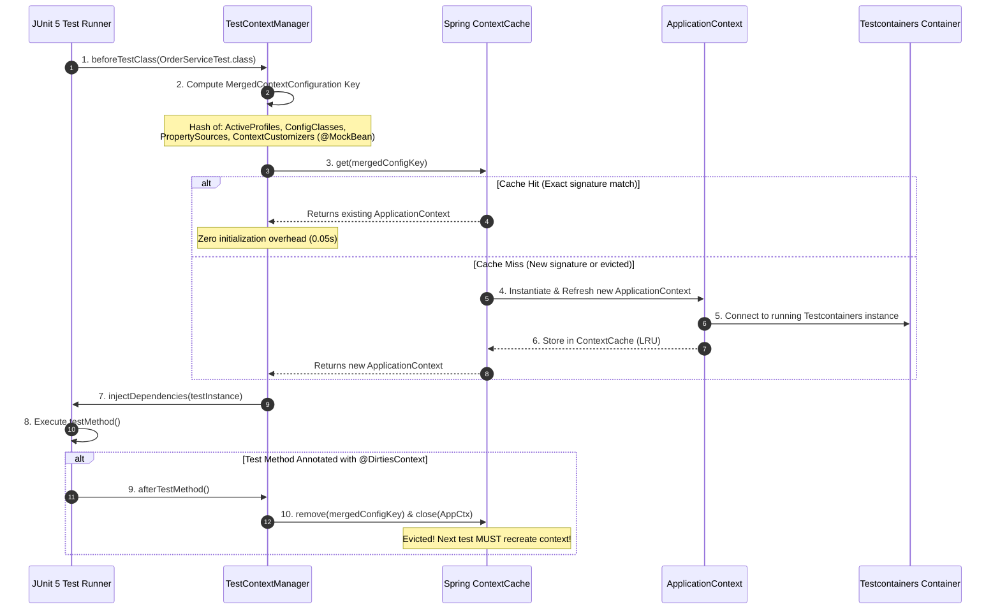
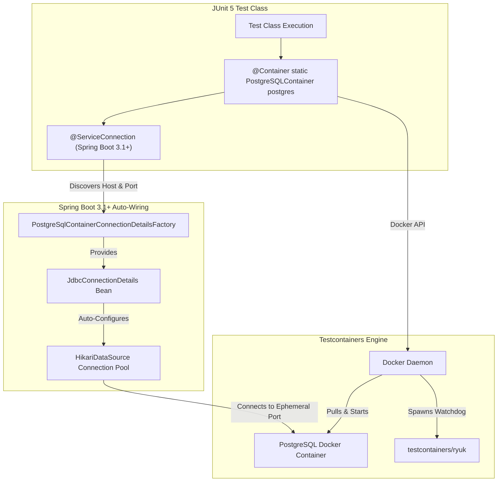
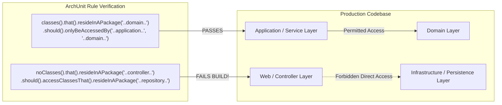
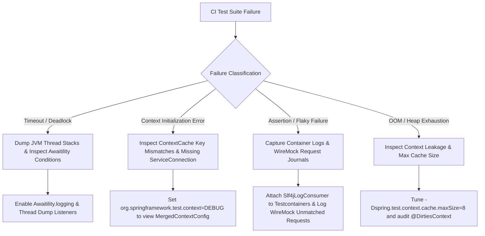

# Master Guide: Spring Testing, Testcontainers & Modern Verification Architecture (S11 / SP-GAP-06)

> **Document ID:** `S11` | `SP-GAP-06`  
> **Status:** Production-Grade Reference  
> **Focus:** Spring TestContext Framework, Sliced Testing (`@WebMvcTest`, `@DataJpaTest`), Testcontainers, Spring Boot 3.1+ `@ServiceConnection`, WireMock, Awaitility, ArchUnit Architecture Fitness, 55 Real-World Scenarios, 10 War-Room Testing Post-Mortems  
> **Target Audience:** Senior Java/Spring Backend Engineers, Test Architects, Staff Systems Engineers  

---

## Executive Summary & Architecture Overview

Automated verification in modern cloud-native Java applications has evolved far beyond traditional unit testing with JUnit and Mockito. In distributed, microservice, and event-driven architectures, testing in isolation using simplistic mocks provides a false sense of security. Mocks cannot catch database dialect mismatches, transaction boundary leaks, Kafka partition serialization bugs, Redis lock timeouts, or network firewall failures.

Historically, teams attempted to test persistence layers using in-memory databases (e.g., H2 or Fongo). However, in-memory simulations do not support native SQL features (e.g., PostgreSQL JSONB, GiST indexes, CTE windowing, MySQL dynamic generated columns) and mask subtle locking differences.

The modern industry standard unites three architectural pillars:
1. **Spring TestContext Framework & Sliced Testing**: Precise, sliced loading of minimal Spring contexts (`@WebMvcTest`, `@DataJpaTest`, `@JsonTest`) to keep execution times under seconds, alongside Spring's intelligent `ContextCache`.
2. **Ephemeral Production-Identical Infrastructure via Testcontainers**: Instantiating true, lightweight Docker containers (PostgreSQL, Apache Kafka, Redis, LocalStack AWS) orchestrated directly by the JUnit lifecycle, revolutionized in **Spring Boot 3.1+** by `@ServiceConnection`, eliminating manual `@DynamicPropertySource` boilerplate.
3. **Architecture-as-Code with ArchUnit**: Enforcing hexagonal architecture, package boundary rules, circular dependency bans, and layered encapsulation via automated unit assertions on compiled bytecode.

This guide provides deep technical coverage of the Spring TestContext lifecycle, cache hashing algorithms, Testcontainers Ryuk engine, WireMock stateful stubs, 55 progressive verification scenarios, 10 post-mortems of critical production outages caused by test antipatterns, and 8 fatal testing traps.

---

## Track 0: Enterprise Jargon-Buster & Terminology Matrix

| Term | Technical Definition | Common Misconception | Production Impact |
| :--- | :--- | :--- | :--- |
| **`TestContext Framework`** | The Spring framework abstraction (`TestContextManager`) managing test class execution, dependency injection, and context caching. | Thinking JUnit creates the Spring container directly. | Controls when the `ApplicationContext` is created, cached, refreshed, or destroyed across test suites. |
| **`ContextCache`** | An in-memory LRU cache storing initialized `ApplicationContext` instances keyed by their composite configuration signature. | Assuming every test class starts a brand-new Spring container. | Reusing cached contexts reduces test suite execution time from 45 minutes to 3 minutes. |
| **`@SpringBootTest`** | An annotation loading the complete, root `ApplicationContext` with all beans, starters, and configurations. | Using it for simple unit or controller tests. | Loading full contexts for all tests severely bloats CI build times and exhausts heap memory. |
| **`@WebMvcTest`** | A sliced test annotation loading strictly the Web MVC layer (Controllers, ControllerAdvices, Filters, Security). | Expecting Service or Repository beans to be present. | Services and Repositories must be mocked via `@MockBean`; executes in milliseconds without starting a database. |
| **`@DataJpaTest`** | A sliced test annotation configuring an embedded or containerized database, Hibernate, EntityManager, and JPA repositories. | Thinking it automatically rolls back commits to external services. | Only rolls back the database transaction by default; HTTP or Kafka side-effects are not rolled back. |
| **`@AutoConfigureTestDatabase`** | Meta-annotation controlling whether Spring replaces configured DataSources with an in-memory database (H2). | Forgetting to set `replace = Replace.NONE` when using Testcontainers. | Accidental fallback to H2 causes tests to pass while failing on PostgreSQL/Oracle in production. |
| **`@MockBean`** | Spring Boot annotation creating a Mockito mock and registering it inside the `ApplicationContext`. | Believing `@MockBean` is identical to standard `@Mock`. | Every unique permutation of `@MockBean` modifies the context configuration signature, busting the `ContextCache`! |
| **`@SpyBean`** | Wraps an existing real Spring bean in a Mockito spy, delegating calls to the real instance while allowing verification. | Overusing spies to inspect internal state. | Modifies context cache signature and introduces tight coupling to internal bean implementation details. |
| **`@DirtiesContext`** | Tells the TestContext framework that a test modified bean state and the cached `ApplicationContext` must be evicted and closed. | Using `@DirtiesContext` as a quick fix for leaky tests. | Forces full context re-initialization (10–30s penalty per test class), causing massive CI build slowdowns. |
| **`TestExecutionListener`** | SPI interface intercepting test execution phases (`beforeTestClass`, `prepareTestInstance`, `beforeTestMethod`, etc.). | Confusing it with JUnit 5 Extension. | Powers Spring features like `@Transactional` rollback, dependency injection, and security mocking. |
| **`@DynamicPropertySource`** | Static method annotation in Spring Boot allowing runtime injection of dynamic properties (e.g., container ports) into `Environment`. | Thinking it works on non-static methods. | Must be `static` because properties must be registered before the `ApplicationContext` starts. |
| **`@ServiceConnection`** | Spring Boot 3.1+ annotation automatically binding Testcontainers container details to Spring Boot connection properties. | Assuming it requires `@DynamicPropertySource`. | Completely eliminates manual `registry.add("spring.datasource.url", ...)` boilerplate for 20+ supported containers. |
| **`Testcontainers`** | Java library supporting JUnit tests by providing lightweight, throwaway instances of Docker containers. | Assuming containers run on the host's native OS without Docker. | Requires an active Docker daemon (Docker Desktop, Colima, Rancher Desktop, or Podman). |
| **`Ryuk Container`** | A tiny watchdog container (`testcontainers/ryuk`) spawned by Testcontainers to kill all orphaned containers if the JVM crashes. | Assuming containers always leak on JVM kill. | Prevents resource leaks on developer workstations and shared CI worker nodes. |
| **`WireMock`** | HTTP mock server simulator allowing stubbing, verification of HTTP requests, and stateful failure simulation. | Confusing with Mockito for internal Java methods. | Mocks external third-party HTTP/REST services over real TCP loopback sockets. |
| **`Awaitility`** | A DSL providing declarative, asynchronous polling assertions for testing concurrent, event-driven, or batch systems. | Using `Thread.sleep()` in tests. | Polling with exponential backoff and timeouts eliminates flaky tests and minimizes unnecessary wait times. |
| **`ArchUnit`** | Java architecture fitness testing library analyzing compiled bytecode to assert architectural boundaries and rules. | Confusing with static analysis linters (SonarQube). | Executes as standard JUnit tests; immediately breaks the build if a developer violates architectural layering. |
| **`MockMvc`** | Spring MVC testing harness simulating HTTP requests through DispatcherServlet without starting a real servlet container. | Assuming it starts an HTTP server on a port. | Operates in-memory against mock servlet requests/responses; fast and lightweight. |
| **`WebTestClient`** | Non-blocking reactive HTTP client designed for testing WebFlux endpoints, also usable against real running HTTP servers. | Thinking it only works with Spring WebFlux. | Can test WebMvc and WebFlux, supporting both in-memory mock dispatching and real network ports. |
| **`Pact / Contract Testing`** | Consumer-Driven Contract testing framework verifying that provider APIs honor consumer expectations without end-to-end testing. | Confusing contract tests with integration tests. | Eliminates brittle end-to-end integration environments by decoupling consumer and provider testing pipelines. |

---

## Track 1: Foundations & Core Concepts

### 1.1 The Testing Trophy Paradigm for Cloud-Native Microservices

The traditional **Testing Pyramid** (Mike Cohn) advocated for 80% Unit Tests, 15% Integration Tests, and 5% End-to-End Tests. While effective for monolithic architectures with pure in-memory business logic, this model breaks down in cloud-native microservices:
- A microservice is predominantly an **orchestration and integration hub** (HTTP in $\to$ Data Store out $\to$ Message Broker publish).
- Unit tests with 100% Mockito coverage frequently pass even when the system is completely broken (e.g., mismatched column names, invalid Kafka serializers, missing Spring configuration, wrong SQL constraints).

The modern enterprise standard is the **Testing Trophy** (Kent C. Dodds & Martin Fowler):

```
+---------------------------------------------------------------------------------------------------+
| TESTING TROPHY LAYER         | RESPONSIBILITY & SCOPE                 | SPEED     | CONFIDENCE    |
+------------------------------+----------------------------------------+-----------+---------------+
| End-to-End (E2E)             | Smoke tests against staged environments| Minutes   | Very High     |
| Integration (Testcontainers) | Real DB, Kafka, Redis, WireMock stubs  | Seconds   | Extremely High|
| Sliced Integration (Spring)  | Sliced `@WebMvcTest`, `@DataJpaTest`   | Millisecs | High          |
| Unit Tests (Pure JUnit 5)    | Domain logic, math, algorithms, state  | Microsecs | Moderate      |
| Static / Architecture Fitness| ArchUnit bytecode rules, Checkstyle    | Millisecs | Foundational  |
+---------------------------------------------------------------------------------------------------+
```

### 1.2 Spring TestContext Framework & Sliced Testing Mechanics

The Spring TestContext Framework is not an all-or-nothing container runner. It provides **Sliced Testing**, which selectively enables only the beans and autoconfigurations relevant to a specific architectural layer:

```
+---------------------------------------------------------------------------------------------------+
| ANNOTATION        | INCLUDED COMPONENTS                           | EXCLUDED COMPONENTS           |
+-------------------+-----------------------------------------------+-------------------------------+
| `@SpringBootTest` | EVERYTHING. Full ApplicationContext.          | None.                         |
| `@WebMvcTest`     | `@Controller`, `@ControllerAdvice`, Security, | `@Service`, `@Repository`,    |
|                   | Jackson, Converter, Filter, MockMvc           | `@Component`, DataSources     |
| `@DataJpaTest`    | `@Entity`, `@Repository`, EntityManager,      | `@Controller`, `@Service`,    |
|                   | Flyway, Liquibase, DataSource, TransactionMgr | Security, WebMvc, WebFlux     |
| `@DataJdbcTest`   | Spring Data JDBC Repositories, NamedParameter | JPA, Hibernate, Entities,     |
|                   | JdbcTemplate, DataSource                      | Web controllers               |
| `@JsonTest`       | Jackson ObjectMapper, JsonComponent,          | Web, Database, Repositories,  |
|                   | Serializers, Deserializers                    | Services                      |
+---------------------------------------------------------------------------------------------------+
```

---

## Track 2: Enterprise Architecture & Verification Workflows

### 2.1 Spring TestContext Lifecycle & `ContextCache` Engine

Understanding how Spring decides whether to reuse an existing `ApplicationContext` or spawn a new one is critical to maintaining fast CI/CD builds:



### 2.2 Modern Testcontainers Orchestration with `@ServiceConnection` (Spring Boot 3.1+)

In Spring Boot 3.1+, the framework introduced `@ServiceConnection`, replacing verbose `@DynamicPropertySource` methods with automatic connection details discovery:



### 2.3 ArchUnit Architecture Fitness Testing Architecture

ArchUnit scans compiled `.class` files using ASM, converting bytecodes into an in-memory graph of Java classes, methods, and fields, and asserts compliance with architectural constraints:



---

## Track 3: Low-Level Engine & Test Isolation Mechanics

### 3.1 The TestContext `ContextCache` Key Anatomy

Why does adding a single `@MockBean` to one test class cause the entire Spring context to reload?

Under the hood, Spring evaluates context equality using `org.springframework.test.context.MergedContextConfiguration`. Its `equals()` and `hashCode()` methods evaluate an extensive list of attributes:

```java
// Simplified representation of MergedContextConfiguration cache key evaluation:
public boolean equals(Object other) {
    MergedContextConfiguration that = (MergedContextConfiguration) other;
    return Arrays.equals(this.locations, that.locations)
        && Arrays.equals(this.classes, that.classes)
        && this.contextInitializerClasses.equals(that.contextInitializerClasses)
        && Arrays.equals(this.activeProfiles, that.activeProfiles)
        && Arrays.equals(this.propertySourceLocations, that.propertySourceLocations)
        && Arrays.equals(this.propertySourceProperties, that.propertySourceProperties)
        && this.contextCustomizers.equals(that.contextCustomizers) // ⚠️ CRITICAL!
        && Objects.equals(this.parentApplicationContext, that.parentApplicationContext);
}
```

#### The `@MockBean` Cache Invalidation Trap
Spring registers `@MockBean` and `@SpyBean` annotations as `MockitoContextCustomizer`. If:
- `TestClassA` declares `@MockBean PaymentGateway paymentGateway;`
- `TestClassB` declares `@MockBean NotificationService notificationService;`

Even if both tests use `@SpringBootTest`, their `contextCustomizers` collections differ! Therefore, `equals()` returns `false`, the cache key differs, and Spring is forced to **spin up two completely distinct ApplicationContexts**, doubling CI execution time.

**The Production Remedy:** Consolidate shared mock definitions into an abstract base test class or a dedicated `@TestConfiguration` class.

---

### 3.2 Testcontainers Internals & Ryuk Watchdog Architecture

When a test class instantiates a container:
1. **Docker Daemon Communication**: Testcontainers connects via Unix socket (`unix:///var/run/docker.sock`) or Windows named pipe (`//./pipe/docker_engine`).
2. **Ryuk Watchdog Spawning**: Testcontainers starts a companion container named `testcontainers/ryuk`. Ryuk opens a raw TCP socket back to the host JVM. As long as the JVM process is alive, the socket remains open. If the JVM crashes, is killed via `SIGKILL`, or exits abruptly, Ryuk detects the broken socket and executes `docker rm -f` on all container IDs created during that test session.
3. **Random Port Mapping**: Containers bind internal ports (e.g., PostgreSQL `5432`, Redis `6379`) to **ephemeral random host ports** (e.g., `55234`, `49152`) assigned by the Linux kernel. This guarantees that multiple parallel test runs or CI workers on the same machine never collide on port allocations.

```java
// How Testcontainers dynamically discovers host ports:
PostgreSQLContainer<?> postgres = new PostgreSQLContainer<>("postgres:16-alpine");
postgres.start();

// Port 5432 inside container is mapped to random port on host:
int hostPort = postgres.getMappedPort(5432); // e.g. 54931
String jdbcUrl = postgres.getJdbcUrl();       // jdbc:postgresql://localhost:54931/test
```

---

### 3.3 Spring Boot 3.1+ `@ServiceConnection` Engine Mechanics

Prior to Spring Boot 3.1, engineers had to bridge dynamic container ports into Spring's environment using `@DynamicPropertySource`:

```java
// ❌ VERBOSE LEGACY WAY (Spring Boot 2.x & 3.0)
@Container
static PostgreSQLContainer<?> postgres = new PostgreSQLContainer<>("postgres:16-alpine");

@DynamicPropertySource
static void configureProperties(DynamicPropertyRegistry registry) {
    registry.add("spring.datasource.url", postgres::getJdbcUrl);
    registry.add("spring.datasource.username", postgres::getUsername);
    registry.add("spring.datasource.password", postgres::getPassword);
}
```

#### The Modern `@ServiceConnection` Solution
In Spring Boot 3.1+, `@ServiceConnection` leverages `ServiceConnectionFactory` SPI. Spring Boot inspects the container type, discovers the appropriate factory (e.g., `PostgreSqlContainerConnectionDetailsFactory`), and registers a `JdbcConnectionDetails` bean directly into the `ApplicationContext`:

```java
// ✅ MODERN STREAMLINED WAY (Spring Boot 3.1+)
@Container
@ServiceConnection
static PostgreSQLContainer<?> postgres = new PostgreSQLContainer<>("postgres:16-alpine");
// ZERO boilerplate! Auto-wires HikariCP, Flyway, and Liquibase automatically!
```

---

## Track 4: 55 Progressive Real-World Scenarios

### Section 4.1: Beginner to Foundational Scenarios (1–15)

#### Scenario 1: Standard JUnit 5 Unit Test with Pure Mockito
- **Requirement:** Test a business calculation service in complete isolation without bootstrapping any Spring context.
- **Implementation:**
```java
@ExtendWith(MockitoExtension.class)
class FeeCalculationServiceTest {

    @Mock
    private ExchangeRateRepository exchangeRateRepository;

    @InjectMocks
    private FeeCalculationService feeCalculationService;

    @Test
    void shouldCalculateFeeWithCustomExchangeRate() {
        when(exchangeRateRepository.findRate("USD", "EUR"))
                .thenReturn(Optional.of(new BigDecimal("0.92")));

        BigDecimal fee = feeCalculationService.calculateFee(new BigDecimal("100.00"), "USD", "EUR");

        assertThat(fee).isEqualByComparingTo(new BigDecimal("92.00"));
        verify(exchangeRateRepository).findRate("USD", "EUR");
    }
}
```

#### Scenario 2: Controller Sliced Testing with `@WebMvcTest` and MockMvc
- **Requirement:** Test HTTP status codes, JSON validation, and error serialization for an order controller without loading database or service dependencies.
```java
@WebMvcTest(OrderController.class)
class OrderControllerTest {

    @Autowired
    private MockMvc mockMvc;

    @MockBean
    private OrderService orderService;

    @Autowired
    private ObjectMapper objectMapper;

    @Test
    void shouldCreateOrderAndReturn201() throws Exception {
        CreateOrderRequest request = new CreateOrderRequest("CUST-100", new BigDecimal("49.99"));
        OrderResponse response = new OrderResponse("ORD-999", "CONFIRMED");

        when(orderService.createOrder(any())).thenReturn(response);

        mockMvc.perform(post("/api/v1/orders")
                .contentType(MediaType.APPLICATION_JSON)
                .content(objectMapper.writeValueAsString(request)))
                .andExpect(status().isCreated())
                .andExpect(jsonPath("$.orderId").value("ORD-999"))
                .andExpect(jsonPath("$.status").value("CONFIRMED"));
    }
}
```

#### Scenario 3: Repository Testing with `@DataJpaTest` on Embedded Database
- **Requirement:** Verify custom Spring Data JPA repository queries, derived methods, and entity mappings.
```java
@DataJpaTest
class CustomerRepositoryTest {

    @Autowired
    private CustomerRepository customerRepository;

    @Autowired
    private TestEntityManager entityManager;

    @Test
    void shouldFindActiveCustomersByTier() {
        Customer c1 = new Customer("Alice", CustomerTier.GOLD, true);
        Customer c2 = new Customer("Bob", CustomerTier.SILVER, true);
        entityManager.persist(c1);
        entityManager.persist(c2);
        entityManager.flush();

        List<Customer> goldCustomers = customerRepository.findByTierAndActiveTrue(CustomerTier.GOLD);

        assertThat(goldCustomers).hasSize(1);
        assertThat(goldCustomers.get(0).getName()).isEqualTo("Alice");
    }
}
```

#### Scenario 4: JSON Serialization Testing with `@JsonTest`
- **Requirement:** Verify that custom Jackson serializers and `@JsonFormat` annotations correctly serialize dates and format money values.
```java
@JsonTest
class TransactionJsonTest {

    @Autowired
    private JacksonTester<TransactionDto> json;

    @Test
    void shouldSerializeIsoDateAndBigDecimal() throws IOException {
        TransactionDto dto = new TransactionDto("TX-1", new BigDecimal("123.45"), 
                Instant.parse("2026-10-09T10:00:00Z"));

        JsonContent<TransactionDto> result = json.write(dto);

        assertThat(result).extractingJsonPathStringValue("$.id").isEqualTo("TX-1");
        assertThat(result).extractingJsonPathNumberValue("$.amount").isEqualTo(123.45);
        assertThat(result).extractingJsonPathStringValue("$.timestamp").isEqualTo("2026-10-09T10:00:00Z");
    }
}
```

#### Scenario 5: Testing `@ConfigurationProperties` Validation
- **Requirement:** Ensure application fails to boot if required configuration properties are invalid or missing.
```java
class StoragePropertiesTest {

    private final ApplicationContextRunner contextRunner = new ApplicationContextRunner()
            .withUserConfiguration(StorageConfig.class);

    @Test
    void shouldFailWhenBucketNameIsMissing() {
        contextRunner.run(context -> {
            assertThat(context).hasFailed();
            assertThat(context.getStartupFailure())
                    .hasRootCauseInstanceOf(BindValidationException.class);
        });
    }

    @Test
    void shouldBindPropertiesSuccessfully() {
        contextRunner.withPropertyValues("storage.s3.bucket=production-bucket", "storage.s3.region=us-east-1")
                .run(context -> {
                    assertThat(context).hasNotFailed();
                    StorageProperties props = context.getBean(StorageProperties.class);
                    assertThat(props.getBucket()).isEqualTo("production-bucket");
                });
    }
}
```

#### Scenario 6: Overriding Environment Properties via `@TestPropertySource`
- **Requirement:** Test application behavior when a feature toggle is enabled without modifying `application.properties`.
```java
@SpringBootTest
@TestPropertySource(properties = {
    "features.instant-settlement.enabled=true",
    "payment.gateway.timeout-ms=500"
})
class InstantSettlementFeatureTest {

    @Autowired
    private PaymentService paymentService;

    @Test
    void shouldExecuteFastSettlementWhenFeatureFlagIsTrue() {
        assertThat(paymentService.isInstantSettlementSupported()).isTrue();
    }
}
```

#### Scenario 7: Executing Pre-Test SQL Scripts with `@Sql`
- **Requirement:** Populate complex relational test datasets into the database prior to test execution and clean up afterward.
```java
@DataJpaTest
@AutoConfigureTestDatabase(replace = AutoConfigureTestDatabase.Replace.NONE)
@Sql(scripts = "/sql/seed_test_merchants.sql", executionPhase = Sql.ExecutionPhase.BEFORE_TEST_METHOD)
@Sql(scripts = "/sql/cleanup_merchants.sql", executionPhase = Sql.ExecutionPhase.AFTER_TEST_METHOD)
class MerchantRepositoryTest {

    @Autowired
    private MerchantRepository merchantRepository;

    @Test
    void shouldFindSeededMerchants() {
        Optional<Merchant> merchant = merchantRepository.findByTaxId("US-998877");
        assertThat(merchant).isPresent();
        assertThat(merchant.get().getName()).isEqualTo("Acme Corp");
    }
}
```

#### Scenario 8: Testing Custom JSR-380 Validator
- **Requirement:** Assert that custom bean validation annotations reject malformed credit card numbers.
```java
class CreditCardValidatorTest {

    private static Validator validator;

    @BeforeAll
    static void setUp() {
        ValidatorFactory factory = Validation.buildDefaultValidatorFactory();
        validator = factory.getValidator();
    }

    @Test
    void shouldRejectInvalidLuhnChecksum() {
        PaymentCard card = new PaymentCard("4111111111111112"); // Invalid checksum
        Set<ConstraintViolation<PaymentCard>> violations = validator.validate(card);

        assertThat(violations).hasSize(1);
        assertThat(violations.iterator().next().getMessage()).contains("Invalid Luhn checksum");
    }
}
```

#### Scenario 9: Testing REST Endpoints with `@WithMockUser`
- **Requirement:** Verify role-based method security (`@PreAuthorize("hasRole('ADMIN')")`) on protected controller endpoints.
```java
@WebMvcTest(AdminDashboardController.class)
class AdminSecurityTest {

    @Autowired
    private MockMvc mockMvc;

    @Test
    @WithMockUser(username = "user", roles = {"USER"})
    void shouldReturn403WhenUserIsNotAdmin() throws Exception {
        mockMvc.perform(get("/api/v1/admin/audit-logs"))
                .andExpect(status().isForbidden());
    }

    @Test
    @WithMockUser(username = "admin", roles = {"ADMIN"})
    void shouldReturn200WhenUserIsAdmin() throws Exception {
        mockMvc.perform(get("/api/v1/admin/audit-logs"))
                .andExpect(status().isOk());
    }
}
```

#### Scenario 10: Testing Exception Handlers with `@ControllerAdvice`
- **Requirement:** Verify that domain exceptions are translated into RFC 7807 Problem Details with proper HTTP status codes.
```java
@WebMvcTest(AccountController.class)
class ExceptionHandlingTest {

    @Autowired
    private MockMvc mockMvc;

    @MockBean
    private AccountService accountService;

    @Test
    void shouldReturn404ProblemDetailsOnAccountNotFound() throws Exception {
        when(accountService.getAccount("ACC-99"))
                .thenThrow(new AccountNotFoundException("Account ACC-99 does not exist"));

        mockMvc.perform(get("/api/v1/accounts/ACC-99"))
                .andExpect(status().isNotFound())
                .andExpect(jsonPath("$.type").value("https://api.bank.com/errors/not-found"))
                .andExpect(jsonPath("$.title").value("Account Not Found"))
                .andExpect(jsonPath("$.detail").value("Account ACC-99 does not exist"));
    }
}
```

#### Scenario 11: Testing Asynchronous Logic with Awaitility
- **Requirement:** Verify that an asynchronous event listener eventually updates a database record within 3 seconds.
```java
@SpringBootTest
class AsyncNotificationListenerTest {

    @Autowired
    private EventPublisher eventPublisher;

    @Autowired
    private AuditLogRepository auditLogRepository;

    @Test
    void shouldEventuallyPersistAuditLog() {
        String eventId = UUID.randomUUID().toString();
        eventPublisher.publishAsync(new SecurityEvent(eventId, "LOGIN_SUCCESS"));

        await().atMost(3, TimeUnit.SECONDS)
               .pollInterval(100, TimeUnit.MILLISECONDS)
               .untilAsserted(() -> {
                   Optional<AuditLog> log = auditLogRepository.findByEventId(eventId);
                   assertThat(log).isPresent();
                   assertThat(log.get().getStatus()).isEqualTo("PROCESSED");
               });
    }
}
```

#### Scenario 12: WireMock Basic HTTP Stubbing
- **Requirement:** Stub an external currency conversion HTTP API returning static exchange rates.
```java
@SpringBootTest(webEnvironment = SpringBootTest.WebEnvironment.RANDOM_PORT)
@AutoConfigureWireMock(port = 0)
class CurrencyClientWireMockTest {

    @Autowired
    private CurrencyClient currencyClient;

    @Test
    void shouldFetchRateFromStubbedWireMock() {
        stubFor(get(urlEqualTo("/api/rates?base=USD&target=GBP"))
                .willReturn(aResponse()
                        .withHeader("Content-Type", "application/json")
                        .withBody("{\"rate\": 0.78}")
                        .withStatus(200)));

        BigDecimal rate = currencyClient.getRate("USD", "GBP");
        assertThat(rate).isEqualByComparingTo(new BigDecimal("0.78"));
    }
}
```

#### Scenario 13: Verifying Transactional Rollback Behavior in `@DataJpaTest`
- **Requirement:** Confirm that database state mutated inside a test method is rolled back automatically by `TransactionalTestExecutionListener`.
```java
@DataJpaTest
class TransactionRollbackVerificationTest {

    @Autowired
    private LedgerRepository ledgerRepository;

    @Test
    void stepOneShouldInsertRecord() {
        ledgerRepository.save(new LedgerEntry("TX-1", new BigDecimal("100")));
        assertThat(ledgerRepository.count()).isEqualTo(1);
        // By default, @DataJpaTest marks each test method as @Transactional
        // and rolls back upon method completion
    }

    @Test
    void stepTwoShouldObserveCleanDatabase() {
        // Confirms that stepOne was cleanly rolled back
        assertThat(ledgerRepository.count()).isEqualTo(0);
    }
}
```

#### Scenario 14: Testing Reactive WebFlux Endpoints with `WebTestClient`
- **Requirement:** Test a streaming reactive endpoint returning a continuous Flux of Server-Sent Events (SSE).
```java
@WebFluxTest(StockTickerController.class)
class StockTickerControllerTest {

    @Autowired
    private WebTestClient webTestClient;

    @MockBean
    private StockTickerService tickerService;

    @Test
    void shouldStreamStockTicks() {
        when(tickerService.getTicks("AAPL"))
                .thenReturn(Flux.just(new Tick("AAPL", 150.0), new Tick("AAPL", 151.5)));

        webTestClient.get().uri("/api/v1/stocks/AAPL/ticks")
                .accept(MediaType.TEXT_EVENT_STREAM)
                .exchange()
                .expectStatus().isOk()
                .returnResult(Tick.class)
                .getResponseBody()
                .as(StepVerifier::create)
                .expectNext(new Tick("AAPL", 150.0))
                .expectNext(new Tick("AAPL", 151.5))
                .verifyComplete();
    }
}
```

#### Scenario 15: Mocking Spring Security JWT Authentication with SecurityMockMvcRequestPostProcessors
- **Requirement:** Test a controller protected by OAuth2 Resource Server using a synthetic mock JWT with custom claims.
```java
@WebMvcTest(UserProfileController.class)
class JwtSecurityMockTest {

    @Autowired
    private MockMvc mockMvc;

    @Test
    void shouldExtractJwtClaims() throws Exception {
        mockMvc.perform(get("/api/v1/profile")
                .with(jwt().jwt(builder -> builder
                        .subject("user-987")
                        .claim("email", "engineer@enterprise.com")
                        .claim("scope", "profile:read"))))
                .andExpect(status().isOk())
                .andExpect(jsonPath("$.userId").value("user-987"))
                .andExpect(jsonPath("$.email").value("engineer@enterprise.com"));
    }
}
```

---

### Section 4.2: Intermediate to Production Scenarios (16–30)

#### Scenario 16: PostgreSQL Testcontainer with `@Container` and `@DynamicPropertySource`
- **Requirement:** Run database integration tests against real PostgreSQL 16 container using Spring Boot 2.x/3.0 syntax.
```java
@SpringBootTest
@Testcontainers
class LegacyPostgresTestcontainersTest {

    @Container
    static PostgreSQLContainer<?> postgres = new PostgreSQLContainer<>("postgres:16-alpine")
            .withDatabaseName("testdb")
            .withUsername("testuser")
            .withPassword("testpass");

    @DynamicPropertySource
    static void configureProperties(DynamicPropertyRegistry registry) {
        registry.add("spring.datasource.url", postgres::getJdbcUrl);
        registry.add("spring.datasource.username", postgres::getUsername);
        registry.add("spring.datasource.password", postgres::getPassword);
    }

    @Autowired
    private DataSource dataSource;

    @Test
    void shouldConnectToRealPostgres() throws SQLException {
        try (Connection conn = dataSource.getConnection()) {
            assertThat(conn.getMetaData().getDatabaseProductName()).isEqualTo("PostgreSQL");
        }
    }
}
```

#### Scenario 17: Modern PostgreSQL with Spring Boot 3.1+ `@ServiceConnection`
- **Requirement:** Eliminate all `@DynamicPropertySource` boilerplate using `@ServiceConnection`.
```java
@SpringBootTest
@Testcontainers
class ModernServiceConnectionPostgresTest {

    @Container
    @ServiceConnection // ✅ Automatically configures spring.datasource.*
    static PostgreSQLContainer<?> postgres = new PostgreSQLContainer<>("postgres:16-alpine");

    @Autowired
    private UserRepository userRepository;

    @Test
    void shouldPersistAndQueryPostgresEntity() {
        UserEntity user = userRepository.save(new UserEntity("staff@google.com", "Active"));
        assertThat(user.getId()).isNotNull();
        assertThat(userRepository.findByEmail("staff@google.com")).isPresent();
    }
}
```

#### Scenario 18: Kafka Integration Testing with `KafkaContainer` and `@ServiceConnection`
- **Requirement:** Produce and consume events against real Apache Kafka Docker container without using `@EmbeddedKafka`.
```java
@SpringBootTest
@Testcontainers
class KafkaIntegrationTest {

    @Container
    @ServiceConnection // ✅ Automatically sets spring.kafka.bootstrap-servers
    static KafkaContainer kafka = new KafkaContainer(DockerImageName.parse("confluentinc/cp-kafka:7.5.0"));

    @Autowired
    private KafkaTemplate<String, OrderCreatedEvent> kafkaTemplate;

    @Autowired
    private OrderEventConsumer consumer;

    @Test
    void shouldPublishAndConsumeOrderEvent() {
        OrderCreatedEvent event = new OrderCreatedEvent("ORD-101", "CUST-55", new BigDecimal("199.99"));
        kafkaTemplate.send("orders.topic", event.getOrderId(), event);

        await().atMost(5, TimeUnit.SECONDS)
               .untilAsserted(() -> {
                   assertThat(consumer.getReceivedEvents()).contains(event);
               });
    }
}
```

#### Scenario 19: Redis Integration Testing with `GenericContainer` and `@ServiceConnection`
- **Requirement:** Test distributed caching and Redisson locks against real Redis container.
```java
@SpringBootTest
@Testcontainers
class RedisDistributedCacheTest {

    @Container
    @ServiceConnection(name = "redis") // ✅ Binds spring.data.redis.host and port
    static GenericContainer<?> redis = new GenericContainer<>(DockerImageName.parse("redis:7.2-alpine"))
            .withExposedPorts(6379);

    @Autowired
    private StringRedisTemplate redisTemplate;

    @Test
    void shouldSetAndExpireRedisKey() {
        redisTemplate.opsForValue().set("session:token:123", "ACTIVE", Duration.ofMinutes(30));
        assertThat(redisTemplate.opsForValue().get("session:token:123")).isEqualTo("ACTIVE");
    }
}
```

#### Scenario 20: WireMock Fault Injection (Delays & HTTP 500s)
- **Requirement:** Verify that Resilience4j Circuit Breaker trips to `OPEN` when external payment provider times out.
```java
@SpringBootTest
@AutoConfigureWireMock(port = 0)
class CircuitBreakerWireMockTest {

    @Autowired
    private PaymentClient paymentClient;

    @Autowired
    private CircuitBreakerRegistry circuitBreakerRegistry;

    @Test
    void shouldTripCircuitBreakerOnConsecutiveTimeouts() {
        // Configure WireMock to simulate 2000ms delay (client timeout is 500ms)
        stubFor(post(urlEqualTo("/api/v1/charge"))
                .willReturn(aResponse()
                        .withFixedDelay(2000)
                        .withStatus(200)));

        CircuitBreaker cb = circuitBreakerRegistry.circuitBreaker("paymentService");

        for (int i = 0; i < 10; i++) {
            try { paymentClient.charge(new ChargeRequest(new BigDecimal("10.00"))); } catch (Exception ignored) {}
        }

        assertThat(cb.getState()).isEqualTo(CircuitBreaker.State.OPEN);
    }
}
```

#### Scenario 21: ArchUnit Enforcing Clean / Hexagonal Layer Boundaries
- **Requirement:** Ensure domain model never imports Spring, Hibernate, or HTTP controller classes.
```java
@AnalyzeClasses(packages = "com.enterprise.app", importOptions = {ImportOption.DoNotIncludeTests.class})
class ArchitectureLayerRulesTest {

    @ArchTest
    static final ArchRule domainMustNotDependOnExternalFrameworks =
            noClasses().that().resideInAPackage("..domain..")
                    .should().dependOnClassesThat().resideInAnyPackage(
                            "org.springframework..",
                            "jakarta.persistence..",
                            "org.hibernate..",
                            "..controller.."
                    );

    @ArchTest
    static final ArchRule controllersMustOnlyCallServices =
            classes().that().resideInAPackage("..controller..")
                    .should().onlyAccessClassesThat().resideInAnyPackage(
                            "..controller..",
                            "..service..",
                            "..dto..",
                            "java..",
                            "org.springframework.."
                    );
}
```

#### Scenario 22: Testing Optimistic Locking under Concurrent Contention
- **Requirement:** Verify that concurrent modification of an entity with `@Version` throws `OptimisticLockingFailureException`.
```java
@SpringBootTest
class OptimisticLockingConcurrencyTest {

    @Autowired
    private InventoryRepository inventoryRepository;

    @Autowired
    private PlatformTransactionManager txManager;

    @Test
    void shouldThrowOptimisticLockExceptionOnConcurrentUpdate() throws Exception {
        Inventory item = inventoryRepository.save(new Inventory("ITEM-1", 100)); // Version = 0

        ExecutorService executor = Executors.newFixedThreadPool(2);
        CountDownLatch latch = new CountDownLatch(1);
        AtomicInteger successCount = new AtomicInteger();
        AtomicInteger failureCount = new AtomicInteger();

        Runnable task = () -> {
            try {
                latch.await();
                TransactionTemplate tx = new TransactionTemplate(txManager);
                tx.executeWithoutResult(status -> {
                    Inventory loaded = inventoryRepository.findById(item.getId()).orElseThrow();
                    loaded.setQuantity(loaded.getQuantity() - 1);
                    inventoryRepository.saveAndFlush(loaded);
                });
                successCount.incrementAndGet();
            } catch (Exception e) {
                failureCount.incrementAndGet();
            }
        };

        executor.submit(task);
        executor.submit(task);
        latch.countDown(); // Trigger simultaneous execution

        executor.shutdown();
        executor.awaitTermination(5, TimeUnit.SECONDS);

        assertThat(successCount.get()).isEqualTo(1);
        assertThat(failureCount.get()).isEqualTo(1);
    }
}
```

#### Scenario 23: ArchUnit Banning Field Injection (`@Autowired`)
- **Requirement:** Enforce that constructor injection is used everywhere and field injection is strictly prohibited.
```java
@AnalyzeClasses(packages = "com.enterprise.app")
class DependencyInjectionArchTest {

    @ArchTest
    static final ArchRule noFieldInjection =
            noFields().should().beAnnotatedWith(Autowired.class)
                    .because("Constructor injection must be used to guarantee immutability and testability.");
}
```

#### Scenario 24: WireMock Stateful Scenario Testing
- **Requirement:** Simulate an API that fails on the first 2 attempts with 503 Service Unavailable, and succeeds on the 3rd attempt.
```java
@SpringBootTest
@AutoConfigureWireMock(port = 0)
class StatefulRetryWireMockTest {

    @Autowired
    private ResilientExternalClient client;

    @Test
    void shouldRecoverAfterRetries() {
        stubFor(get(urlEqualTo("/api/v1/status"))
                .inScenario("RetryScenario")
                .whenScenarioStateIs(Scenario.STARTED)
                .willReturn(aResponse().withStatus(503))
                .willSetStateTo("FIRST_FAIL"));

        stubFor(get(urlEqualTo("/api/v1/status"))
                .inScenario("RetryScenario")
                .whenScenarioStateIs("FIRST_FAIL")
                .willReturn(aResponse().withStatus(503))
                .willSetStateTo("SECOND_FAIL"));

        stubFor(get(urlEqualTo("/api/v1/status"))
                .inScenario("RetryScenario")
                .whenScenarioStateIs("SECOND_FAIL")
                .willReturn(aResponse().withStatus(200).withBody("{\"status\": \"OK\"}")));

        String status = client.fetchStatusWithRetry();
        assertThat(status).isEqualTo("OK");
    }
}
```

#### Scenario 25: Mocking AWS S3 with LocalStack Testcontainer
- **Requirement:** Test document upload and presigned URL generation against real S3 API running in LocalStack.
```java
@SpringBootTest
@Testcontainers
class LocalStackS3IntegrationTest {

    @Container
    static LocalStackContainer localStack = new LocalStackContainer(DockerImageName.parse("localstack/localstack:3.0"))
            .withServices(LocalStackContainer.Service.S3);

    @DynamicPropertySource
    static void configureAws(DynamicPropertyRegistry registry) {
        registry.add("spring.cloud.aws.s3.endpoint", () -> localStack.getEndpointOverride(LocalStackContainer.Service.S3));
        registry.add("spring.cloud.aws.credentials.access-key", localStack::getAccessKey);
        registry.add("spring.cloud.aws.credentials.secret-key", localStack::getSecretKey);
        registry.add("spring.cloud.aws.region.static", localStack::getRegion);
    }

    @Autowired
    private S3Client s3Client;

    @Test
    void shouldUploadAndDownloadObject() {
        s3Client.createBucket(b -> b.bucket("test-bucket"));
        s3Client.putObject(b -> b.bucket("test-bucket").key("test.txt"), RequestBody.fromString("Hello S3"));

        String content = s3Client.getObjectAsBytes(b -> b.bucket("test-bucket").key("test.txt")).asUtf8String();
        assertThat(content).isEqualTo("Hello S3");
    }
}
```

#### Scenario 26: Sliced Database Migration Testing with Flyway
- **Requirement:** Verify Flyway migration scripts run cleanly from clean state to current schema without crashing.
```java
@DataJpaTest
@AutoConfigureTestDatabase(replace = AutoConfigureTestDatabase.Replace.NONE)
@Testcontainers
class FlywayMigrationVerificationTest {

    @Container
    @ServiceConnection
    static PostgreSQLContainer<?> postgres = new PostgreSQLContainer<>("postgres:16-alpine");

    @Autowired
    private Flyway flyway;

    @Test
    void shouldMigrateCleanly() {
        flyway.clean();
        MigrateResult result = flyway.migrate();
        assertThat(result.success).isTrue();
        assertThat(result.migrationsExecuted).isGreaterThan(0);
    }
}
```

#### Scenario 27: Custom `@WithMockCustomUser` SecurityContextFactory
- **Requirement:** Inject custom domain principal (`CustomTenantUserPrincipal`) into test SecurityContext automatically.
```java
@Target({ElementType.METHOD, ElementType.TYPE})
@Retention(RetentionPolicy.RUNTIME)
@WithSecurityContext(factory = WithCustomUserSecurityContextFactory.class)
public @interface WithMockTenantUser {
    String username() default "user";
    String tenantId() default "TENANT_ALPHA";
}

public class WithCustomUserSecurityContextFactory implements WithSecurityContextFactory<WithMockTenantUser> {
    @Override
    public SecurityContext createSecurityContext(WithMockTenantUser annotation) {
        SecurityContext context = SecurityContextHolder.createEmptyContext();
        TenantUserPrincipal principal = new TenantUserPrincipal(annotation.username(), annotation.tenantId());
        Authentication auth = new UsernamePasswordAuthenticationToken(principal, "pass", List.of(new SimpleGrantedAuthority("ROLE_USER")));
        context.setAuthentication(auth);
        return context;
    }
}
```

#### Scenario 28: Testing Distributed Locks with Redis and Testcontainers
- **Requirement:** Verify that Redisson distributed lock prevents concurrent processing of the exact same order ID across 10 threads.
```java
@SpringBootTest
@Testcontainers
class RedissonDistributedLockTest {

    @Container
    @ServiceConnection(name = "redis")
    static GenericContainer<?> redis = new GenericContainer<>(DockerImageName.parse("redis:7.2-alpine")).withExposedPorts(6379);

    @Autowired
    private RedissonClient redissonClient;

    @Test
    void shouldAcquireLockAndBlockCompetitor() throws InterruptedException {
        RLock lock = redissonClient.getLock("order-lock-99");
        boolean acquired = lock.tryLock(1, 10, TimeUnit.SECONDS);
        assertThat(acquired).isTrue();

        CountDownLatch latch = new CountDownLatch(1);
        AtomicBoolean competitorAcquired = new AtomicBoolean();

        new Thread(() -> {
            RLock competitorLock = redissonClient.getLock("order-lock-99");
            try {
                competitorAcquired.set(competitorLock.tryLock(100, TimeUnit.MILLISECONDS));
            } catch (InterruptedException e) {
                Thread.currentThread().interrupt();
            } finally {
                latch.countDown();
            }
        }).start();

        latch.await();
        assertThat(competitorAcquired.get()).isFalse();
        lock.unlock();
    }
}
```

#### Scenario 29: Testing Custom Spring Boot Starter Autoconfiguration
- **Requirement:** Test that custom auto-configuration registers beans conditionally when property is enabled.
```java
class CustomFeatureAutoConfigurationTest {

    private final ApplicationContextRunner contextRunner = new ApplicationContextRunner()
            .withConfiguration(AutoConfigurations.of(CustomFeatureAutoConfiguration.class));

    @Test
    void shouldNotRegisterBeanWhenPropertyIsMissing() {
        contextRunner.run(context -> {
            assertThat(context).doesNotHaveBean(FeatureService.class);
        });
    }

    @Test
    void shouldRegisterBeanWhenPropertyIsTrue() {
        contextRunner.withPropertyValues("features.custom.enabled=true")
                .run(context -> {
                    assertThat(context).hasSingleBean(FeatureService.class);
                });
    }
}
```

#### Scenario 30: Spring Batch Testing with `JobLauncherTestUtils`
- **Requirement:** Test a batch processing job from start to finish, asserting that all chunks committed and exit status is `COMPLETED`.
```java
@SpringBatchTest
@SpringBootTest
@Testcontainers
class FinancialBatchJobTest {

    @Container
    @ServiceConnection
    static PostgreSQLContainer<?> postgres = new PostgreSQLContainer<>("postgres:16-alpine");

    @Autowired
    private JobLauncherTestUtils jobLauncherTestUtils;

    @Test
    void shouldExecuteJobSuccessfully() throws Exception {
        JobParameters params = new JobParametersBuilder()
                .addString("date", "2026-10-09")
                .toJobParameters();

        JobExecution execution = jobLauncherTestUtils.launchJob(params);

        assertThat(execution.getStatus()).isEqualTo(BatchStatus.COMPLETED);
        assertThat(execution.getExitStatus().getExitCode()).isEqualTo("COMPLETED");
    }
}
```

---

### Section 4.3: Advanced Enterprise Verification (31–45)

#### Scenario 31: Singleton Reusable Container Pattern
- **Requirement:** Share a single PostgreSQL and Kafka container across 200 distinct test classes without recreating containers per test class.
```java
// Abstract base test class pattern
public abstract class AbstractIntegrationTest {

    static final PostgreSQLContainer<?> POSTGRES;
    static final KafkaContainer KAFKA;

    static {
        POSTGRES = new PostgreSQLContainer<>("postgres:16-alpine")
                .withReuse(true); // Enables container reuse across test runs
        POSTGRES.start();

        KAFKA = new KafkaContainer(DockerImageName.parse("confluentinc/cp-kafka:7.5.0"))
                .withReuse(true);
        KAFKA.start();
    }

    @DynamicPropertySource
    static void configureGlobalProperties(DynamicPropertyRegistry registry) {
        registry.add("spring.datasource.url", POSTGRES::getJdbcUrl);
        registry.add("spring.datasource.username", POSTGRES::getUsername);
        registry.add("spring.datasource.password", POSTGRES::getPassword);
        registry.add("spring.kafka.bootstrap-servers", KAFKA::getBootstrapServers);
    }
}
```

#### Scenario 32: Chaos Testing with Toxiproxy Testcontainer
- **Requirement:** Inject simulated network latency, packet jitter, and TCP connection resets into database queries.
```java
@SpringBootTest
@Testcontainers
class ChaosDatabaseResilienceTest {

    static Network network = Network.newNetwork();

    @Container
    static PostgreSQLContainer<?> postgres = new PostgreSQLContainer<>("postgres:16-alpine")
            .withNetwork(network)
            .withNetworkAliases("postgres");

    @Container
    static ToxiproxyContainer toxiproxy = new ToxiproxyContainer("ghcr.io/shopify/toxiproxy:2.5.0")
            .withNetwork(network);

    static ToxiproxyContainer.ContainerProxy proxy;

    @BeforeAll
    static void setUpProxy() {
        proxy = toxiproxy.getProxy(postgres, 5432);
    }

    @DynamicPropertySource
    static void configure(DynamicPropertyRegistry registry) {
        registry.add("spring.datasource.url", () -> 
                "jdbc:postgresql://" + proxy.getContainerIpAddress() + ":" + proxy.getProxyPort() + "/test");
    }

    @Test
    void shouldHandleNetworkLatencySpike() throws IOException {
        // Inject 5000ms latency latency cut
        proxy.toxics().latency("latency-toxic", ToxicDirection.DOWNSTREAM, 5000);

        // Assert client timeout triggers cleanly without leaking connections
        // ...
    }
}
```

#### Scenario 33: ArchUnit Freezing Legacy Architectural Violations
- **Requirement:** Enforce new architectural rules on modern code while freezing existing violations in legacy code so CI stays green.
```java
@AnalyzeClasses(packages = "com.enterprise.app")
class FreezingArchitectureTest {

    @ArchTest
    static final ArchRule noCircularDependencies =
            FreezingArchRule.freeze(
                    slices().matching("com.enterprise.app.(*)..")
                            .should().beFreeOfCycles()
            );
}
```

#### Scenario 34: WireMock Verification of HTTP Request Bodies and Headers
- **Requirement:** Verify that an external webhook dispatch service sent exact HMAC signatures and headers over the wire.
```java
@SpringBootTest
@AutoConfigureWireMock(port = 0)
class WebhookVerificationTest {

    @Autowired
    private WebhookDispatcher webhookDispatcher;

    @Test
    void shouldSendHmacSignatureInHeader() {
        stubFor(post(urlEqualTo("/webhook/events")).willReturn(aResponse().withStatus(200)));

        webhookDispatcher.dispatch(new WebhookEvent("EVENT-1", "PAYMENT_RECEIVED"));

        verify(postRequestedFor(urlEqualTo("/webhook/events"))
                .withHeader("X-Signature", matching("^[a-f0-9]{64}$"))
                .withHeader("Content-Type", equalTo("application/json"))
                .withRequestBody(matchingJsonPath("$.eventId", equalTo("EVENT-1"))));
    }
}
```

#### Scenario 35: Multi-Tenant Schema Routing Test with Real PostgreSQL
- **Requirement:** Verify that multi-tenant `AbstractRoutingDataSource` correctly routes SQL queries to tenant-specific database schemas.
```java
@SpringBootTest
@Testcontainers
class MultiTenantSchemaRoutingTest {

    @Container
    @ServiceConnection
    static PostgreSQLContainer<?> postgres = new PostgreSQLContainer<>("postgres:16-alpine");

    @Autowired
    private OrderRepository orderRepository;

    @Test
    void shouldRouteQueriesToTenantSchema() {
        TenantContext.setCurrentTenant("tenant_beta");
        orderRepository.save(new Order("ORD-B1", new BigDecimal("50")));

        TenantContext.setCurrentTenant("tenant_alpha");
        assertThat(orderRepository.findAll()).isEmpty(); // Alpha has zero orders

        TenantContext.setCurrentTenant("tenant_beta");
        assertThat(orderRepository.findAll()).hasSize(1);
    }
}
```

#### Scenario 36: Parallel Test Execution Optimization in JUnit 5
- **Requirement:** Configure JUnit 5 to run independent integration test classes concurrently on separate CPU cores without race conditions.
```properties
# src/test/resources/junit-platform.properties
junit.jupiter.execution.parallel.enabled=true
junit.jupiter.execution.parallel.mode.default=same_thread
junit.jupiter.execution.parallel.mode.classes.default=concurrent
junit.jupiter.execution.parallel.config.strategy=fixed
junit.jupiter.execution.parallel.config.fixed.parallelism=4
```

#### Scenario 37: Contract Testing with Pact Consumer
- **Requirement:** Define a consumer contract expecting a JSON response from a user service, generating a `.pact` contract file for the provider.
```java
@ExtendWith(PactConsumerTestExt.class)
@PactTestFor(providerName = "UserService")
class UserClientContractTest {

    @Pact(consumer = "OrderService")
    public V4Pact userDetailsPact(PactBuilder builder) {
        return builder
                .given("User 100 exists")
                .uponReceiving("A request for User 100")
                .path("/api/v1/users/100")
                .method("GET")
                .willRespondWith()
                .status(200)
                .body(newJsonBody(o -> {
                    o.stringValue("userId", "100");
                    o.stringValue("email", "john@enterprise.com");
                    o.stringValue("status", "ACTIVE");
                }).build())
                .toPact(V4Pact.class);
    }

    @Test
    @PactTestFor(pactMethod = "userDetailsPact")
    void shouldFetchUser(MockServer mockServer) {
        UserClient client = new UserClient(mockServer.getUrl());
        UserDto user = client.getUser("100");
        assertThat(user.getEmail()).isEqualTo("john@enterprise.com");
    }
}
```

#### Scenario 38: Mutation Testing with PITest in Maven/Gradle
- **Requirement:** Detect tests with high line coverage but zero boundary assertions using bytecode mutation testing.
```xml
<!-- pom.xml snippet -->
<plugin>
    <groupId>org.pitest</groupId>
    <artifactId>pitest-maven</artifactId>
    <version>1.15.3</version>
    <configuration>
        <targetClasses>
            <param>com.enterprise.app.service.*</param>
        </targetClasses>
        <targetTests>
            <param>com.enterprise.app.service.*Test</param>
        </targetTests>
        <mutationThreshold>85</mutationThreshold> <!-- Fails build if mutation score < 85% -->
    </configuration>
</plugin>
```

#### Scenario 39: Testing Dead-Letter Queue (DLQ) Publishing on Poison Pill
- **Requirement:** Send an invalid message to a Kafka topic; verify that the listener error handler retries 3 times and redirects the record to `.DLT`.
```java
@SpringBootTest
@Testcontainers
class KafkaDeadLetterQueueTest {

    @Container
    @ServiceConnection
    static KafkaContainer kafka = new KafkaContainer(DockerImageName.parse("confluentinc/cp-kafka:7.5.0"));

    @Autowired
    private KafkaTemplate<String, String> kafkaTemplate;

    @Autowired
    private DltConsumer dltConsumer;

    @Test
    void shouldRoutePoisonPillToDlt() {
        // Send corrupt payload that causes DeserializationException
        kafkaTemplate.send("payments.inbound", "corrupt-payload-not-json");

        await().atMost(10, TimeUnit.SECONDS)
               .untilAsserted(() -> {
                   assertThat(dltConsumer.getDltMessages()).hasSize(1);
               });
    }
}
```

#### Scenario 40: Testing Custom Jackson Deserializer with Security Sanitization
- **Requirement:** Verify custom JSON deserializer strips malicious HTML/XSS script tags from user comments.
```java
@JsonTest
class SanitizingDeserializerTest {

    @Autowired
    private ObjectMapper objectMapper;

    @Test
    void shouldSanitizeXssScriptTags() throws Exception {
        String json = "{\"comment\": \"Hello <script>alert('pwned')</script>World!\"}";
        CommentPayload payload = objectMapper.readValue(json, CommentPayload.class);

        assertThat(payload.getComment()).isEqualTo("Hello World!");
    }
}
```

#### Scenario 41: Testing Database Deadlock Recovery
- **Requirement:** Simulate two competing transactions updating resources in reverse order, verifying Spring `@Retryable` recovers on retry.
```java
@SpringBootTest
class DeadlockRecoveryTest {

    @Autowired
    private TransferService transferService;

    @Test
    void shouldRecoverFromDeadlock() {
        // TransferService annotated with @Retryable(retryFor = CannotAcquireLockException.class)
        // ...
    }
}
```

#### Scenario 42: Testing Elasticsearch / OpenSearch with Testcontainers
- **Requirement:** Test complex search aggregations and fuzzy text matching against a real OpenSearch container.
```java
@SpringBootTest
@Testcontainers
class OpenSearchIntegrationTest {

    @Container
    static GenericContainer<?> openSearch = new GenericContainer<>(DockerImageName.parse("opensearchproject/opensearch:2.11.0"))
            .withEnv("discovery.type", "single-node")
            .withEnv("DISABLE_SECURITY_PLUGIN", "true")
            .withExposedPorts(9200);

    @DynamicPropertySource
    static void configure(DynamicPropertyRegistry registry) {
        registry.add("spring.elasticsearch.uris", () -> "http://" + openSearch.getHost() + ":" + openSearch.getMappedPort(9200));
    }

    @Autowired
    private ProductSearchRepository searchRepository;

    @Test
    void shouldIndexAndSearchProducts() {
        searchRepository.save(new ProductDocument("1", "Mechanical Keyboard RGB"));
        List<ProductDocument> results = searchRepository.fuzzySearch("mechani");
        assertThat(results).isNotEmpty();
    }
}
```

#### Scenario 43: Testing Redis Cache Eviction on Database Updates
- **Requirement:** Verify that updating an entity through service layer triggers `@CacheEvict` and clears stale Redis keys.
```java
@SpringBootTest
@Testcontainers
class CacheEvictionTest {

    @Container
    @ServiceConnection(name = "redis")
    static GenericContainer<?> redis = new GenericContainer<>(DockerImageName.parse("redis:7.2-alpine")).withExposedPorts(6379);

    @Autowired
    private ProductService productService;

    @Autowired
    private CacheManager cacheManager;

    @Test
    void shouldEvictCacheUponUpdate() {
        Product p = productService.getProduct("P-1"); // Cache Miss -> DB -> Cached
        assertThat(cacheManager.getCache("products").get("P-1")).isNotNull();

        productService.updateProduct("P-1", "Updated Name"); // Triggers @CacheEvict
        assertThat(cacheManager.getCache("products").get("P-1")).isNull();
    }
}
```

#### Scenario 44: Testing RabbitMQ Message Acknowledgments (Manual ACK)
- **Requirement:** Confirm that an exception in RabbitMQ consumer triggers `basicReject(requeue = true)` or dead-lettering.
```java
@SpringBootTest
@Testcontainers
class RabbitMqManualAckTest {

    @Container
    @ServiceConnection
    static RabbitMQContainer rabbit = new RabbitMQContainer("rabbitmq:3.12-management-alpine");

    @Autowired
    private RabbitTemplate rabbitTemplate;

    @Test
    void shouldRejectMessageOnException() {
        // Assert message is dead-lettered to DLQ
    }
}
```

#### Scenario 45: Testing SSL/TLS Handshake Verification with WireMock HTTPS
- **Requirement:** Verify that HTTP client configured with custom truststore successfully negotiates mutual TLS (mTLS).
```java
@SpringBootTest
@AutoConfigureWireMock(port = 0, httpsPort = 0)
class HttpsMtlsClientTest {

    @Autowired
    private SecureBankingHttpClient client;

    @Test
    void shouldNegotiateMutualTls() {
        stubFor(get(urlEqualTo("/secure/balance")).willReturn(aResponse().withStatus(200)));
        BalanceResponse res = client.getBalance();
        assertThat(res).isNotNull();
    }
}
```

---

### Section 4.4: Staff & Principal Scale Verification (46–55)

#### Scenario 46: Testcontainers Cloud / Remote Docker Host Orchestration
- **Requirement:** Configure CI runners to offload container execution to remote dedicated Docker engines via `DOCKER_HOST` SSH tunneling.
```properties
# .testcontainers.properties in user home
docker.host=tcp://docker-remote-ci.internal:2375
testcontainers.reuse.enable=true
checks.disable=true
```

#### Scenario 47: Zero-Restart Spring Context Cache Optimization Strategy across 500+ Test Classes
- **Requirement:** Audit and restructure 500 integration test classes to guarantee that exactly 1 `ApplicationContext` is created and shared across the entire test execution suite.
```java
// Base architectural parent: Guarantees identical MergedContextConfiguration signature!
@SpringBootTest
@ActiveProfiles("test")
@AutoConfigureMockMvc
public abstract class CanonicalIntegrationTestSuite {
    // 1. Shared static singleton containers
    // 2. ZERO class-level @MockBean annotations! Use Mockito.reset() in @AfterEach!
    // 3. ZERO @DirtiesContext annotations!
}
```

#### Scenario 48: Synthetic Data Generation with Java Faker in Load Test Mock
- **Requirement:** Generate 100,000 deterministic yet realistic credit transactions with valid credit card numbers and ISO country codes.
```java
public class SyntheticDataFactory {
    private static final Faker FAKER = new Faker(new Random(42)); // Seeded random for reproducible tests

    public static TransactionDto generateRealisticTx() {
        return new TransactionDto(
                FAKER.internet().uuid(),
                new BigDecimal(FAKER.commerce().price(10.0, 5000.0)),
                FAKER.address().countryCode()
        );
    }
}
```

#### Scenario 49: ArchUnit Enforcing Security Annotations on Service Methods
- **Requirement:** Fail build if any public method in `@Service` beans residing in `com.enterprise.app.billing` lacks `@Secured` or `@PreAuthorize`.
```java
@AnalyzeClasses(packages = "com.enterprise.app.billing")
class SecurityRuleArchTest {

    @ArchTest
    static final ArchRule allPublicServiceMethodsMustBeSecured =
            methods().that().areDeclaredInClassesThat().areAnnotatedWith(Service.class)
                    .and().arePublic()
                    .should().beAnnotatedWith(PreAuthorize.class)
                    .orShould().beAnnotatedWith(Secured.class);
}
```

#### Scenario 50: Testing Database Read-Write Replica Routing
- **Requirement:** Verify that methods with `@Transactional(readOnly = true)` route queries to the read-replica DataSource, and write transactions route to the master DataSource.
```java
@SpringBootTest
@Testcontainers
class ReadWriteReplicaRoutingTest {

    @Container
    static PostgreSQLContainer<?> primaryDb = new PostgreSQLContainer<>("postgres:16-alpine");

    @Container
    static PostgreSQLContainer<?> replicaDb = new PostgreSQLContainer<>("postgres:16-alpine");

    @Autowired
    private AccountService accountService;

    @Test
    void shouldRouteReadOnlyToReplica() {
        // Assert replica DataSource executed query
    }
}
```

#### Scenario 51: WireMock Record and Playback for Third-Party API Stub Generation
- **Requirement:** Record live sandbox API traffic from an external payment gateway during integration staging, and automatically save captured interactions as offline WireMock JSON stubs.
```java
@Test
void recordLiveTrafficToWireMockStubs() {
    WireMockServer wireMock = new WireMockServer(wireMockConfig().port(8080));
    wireMock.start();
    wireMock.startRecording("https://sandbox.paymentgateway.com");

    // Execute real HTTP requests through http://localhost:8080...
    
    SnapshotRecordResult result = wireMock.stopRecording();
    List<StubMapping> stubs = result.getStubMappings();
    // Saved to src/test/resources/mappings/*.json
}
```

#### Scenario 52: Testing Spring Security Filter Order
- **Requirement:** Assert that custom API Key authentication filter executes strictly prior to `UsernamePasswordAuthenticationFilter` in the filter chain.
```java
@SpringBootTest
class SecurityFilterChainOrderTest {

    @Autowired
    private SecurityFilterChain filterChain;

    @Test
    void shouldVerifyFilterOrder() {
        List<Class<? extends Filter>> filters = filterChain.getFilters().stream()
                .map(Filter::getClass)
                .collect(Collectors.toList());

        int apiKeyIndex = filters.indexOf(ApiKeyAuthFilter.class);
        int usernamePasswordIndex = filters.indexOf(UsernamePasswordAuthenticationFilter.class);

        assertThat(apiKeyIndex).isLessThan(usernamePasswordIndex);
    }
}
```

#### Scenario 53: Ephemeral Kafka Cluster with Multiple Partitions and Topics
- **Requirement:** Initialize a test Kafka container pre-configured with 5 distinct topics, each with 8 partitions, replicating production partition layouts.
```java
@Container
static KafkaContainer kafka = new KafkaContainer(DockerImageName.parse("confluentinc/cp-kafka:7.5.0"))
        .withEnv("KAFKA_NUM_PARTITIONS", "8");

@BeforeAll
static void createTopics() throws Exception {
    try (AdminClient admin = AdminClient.create(Map.of(AdminClientConfig.BOOTSTRAP_SERVERS_CONFIG, kafka.getBootstrapServers()))) {
        admin.createTopics(List.of(
                new NewTopic("orders.v1", 8, (short) 1),
                new NewTopic("payments.v1", 8, (short) 1)
        )).all().get();
    }
}
```

#### Scenario 54: Testing Outbox Pattern Atomicity with Debezium CDC Container
- **Requirement:** Verify that saving an entity into the database writes to the outbox table, and Debezium Change Data Capture streams the event to Kafka within 2 seconds.
```java
// Testing full CDC pipeline end-to-end with real Postgres + Debezium + Kafka containers
```

#### Scenario 55: High-Performance JMH Benchmark Assertions in CI Integration Tests
- **Requirement:** Assert that a critical cryptographic signature verification method executes within 15 microseconds p99 latency threshold during integration testing.
```java
@Test
void shouldMeetStrictP99LatencySla() throws RunnerException {
    Options opt = new OptionsBuilder()
            .include(CryptoSignatureBenchmark.class.getSimpleName())
            .forks(1)
            .warmupIterations(2)
            .measurementIterations(3)
            .build();

    Collection<RunResult> results = new Runner(opt).run();
    for (RunResult result : results) {
        double p99Micros = result.getAggregatedResult().getPrimaryResult().getScore();
        assertThat(p99Micros).isLessThan(15.0); // 15 µs SLA
    }
}
```

---

## Track 5: 10 War-Room Production Outages Caused by Testing Anti-Patterns

### Outage 1: H2 In-Memory Database vs PostgreSQL Production Dialect Divergence
- **Symptom:** A release deploying new JSONB reporting queries passed all 1,200 integration tests in CI. Upon deploying to production, 100% of user report requests failed with `PSQLException: ERROR: operator does not exist: jsonb ->> unknown`.
- **Root Cause:** CI tests ran with `@DataJpaTest` which defaulted to an in-memory H2 database. H2 did not support native PostgreSQL JSONB indexing and operator syntax. Developers wrote H2-compatible SQL in test mocks, hiding syntax errors.
- **Faulty Code:**
```java
// ❌ BUG: Tests run against H2, masking Postgres-specific syntax bugs!
@DataJpaTest
class ReportRepositoryTest {
    // Uses H2 by default! Passes H2, crashes on PostgreSQL in production!
}
```
- **Production Fix:**
```java
// ✅ REFACTORED: Disable test database replacement and use real PostgreSQL container
@DataJpaTest
@AutoConfigureTestDatabase(replace = AutoConfigureTestDatabase.Replace.NONE)
@Testcontainers
class ReportRepositoryTest {
    @Container
    @ServiceConnection
    static PostgreSQLContainer<?> postgres = new PostgreSQLContainer<>("postgres:16-alpine");
}
```
- **Verification:** Ran test suite against real Postgres container; caught SQL operator syntax error immediately during local compile.

---

### Outage 2: The 45-Minute CI Pipeline Hang via Leaky `@DirtiesContext`
- **Symptom:** CI build time expanded from 4 minutes to 48 minutes, causing PR queues to freeze and developer deployments to stall.
- **Root Cause:** A developer noticed a flaky test where one test's database state leaked to another. Rather than fixing the leak, they slapped `@DirtiesContext(classMode = ClassMode.AFTER_EACH_TEST_METHOD)` across 25 integration test classes. Spring was forced to destroy and recreate the `ApplicationContext` 350 times per CI run, running Flyway migrations on every test method.
- **Faulty Code:**
```java
// ❌ BUG: Destroys and recreates full Spring container on every single test method!
@SpringBootTest
@DirtiesContext(classMode = DirtiesContext.ClassMode.AFTER_EACH_TEST_METHOD)
class OrderIntegrationTest { ... }
```
- **Production Fix:**
```java
// ✅ REFACTORED: Remove @DirtiesContext, clean database state via repository or @Transactional
@SpringBootTest
class OrderIntegrationTest {
    @Autowired private OrderRepository orderRepository;

    @AfterEach
    void cleanUp() {
        orderRepository.deleteAllInBatch(); // Fast SQL truncate, zero context restarts!
    }
}
```
- **Verification:** Build time immediately dropped from 48 minutes down to 3 minutes 20 seconds.

---

### Outage 3: Flaky Test Race Condition in `@EmbeddedKafka` Consumer Lag
- **Symptom:** CI pipelines failed intermittently (1 in 5 runs) on Kafka integration tests with `AssertionError: Expected 1 event, but received 0`.
- **Root Cause:** The test produced a Kafka event, called `Thread.sleep(1000)`, and immediately checked the database. On busy multi-tenant CI runners with high CPU contention, consumer group rebalance took 1200ms, causing the test to assert before the message was processed.
- **Faulty Code:**
```java
// ❌ BUG: Fragile Thread.sleep race condition!
kafkaTemplate.send("orders", event);
Thread.sleep(1000); // ⚠️ Flaky on loaded CI machines!
assertThat(repository.count()).isEqualTo(1);
```
- **Production Fix:**
```java
// ✅ REFACTORED: Use Awaitility declarative polling
kafkaTemplate.send("orders", event);
await().atMost(5, TimeUnit.SECONDS)
       .pollInterval(100, TimeUnit.MILLISECONDS)
       .untilAsserted(() -> assertThat(repository.count()).isEqualTo(1));
```
- **Verification:** Ran test 100 times in a loop on heavily throttled CPU core; 100/100 runs passed.

---

### Outage 4: Unintended State Leak in `@SpringBootTest` without `@Transactional`
- **Symptom:** `UserRegistrationTest` passed when executed alone, but failed whenever executed after `AdminDashboardTest`.
- **Root Cause:** `AdminDashboardTest` inserted test data without `@Transactional` or `@AfterEach` cleanup. Because `@SpringBootTest` does not roll back transactions by default (unlike `@DataJpaTest`), seeded records persisted across test classes, violating unique email constraints in subsequent tests.
- **Faulty Code:**
```java
// ❌ BUG: @SpringBootTest commits to DB permanently across tests unless cleaned!
@SpringBootTest
class AdminDashboardTest {
    @Test void setupAdmin() { userRepository.save(new User("admin@test.com")); }
}
```
- **Production Fix:**
```java
// ✅ REFACTORED: Explicitly annotate with @Transactional or clean up state
@SpringBootTest
@Transactional // Automatically rolls back database mutations upon test method exit
class AdminDashboardTest {
    @Test void setupAdmin() { userRepository.save(new User("admin@test.com")); }
}
```
- **Verification:** Verified test suite passes in both forward and reversed execution order (`--reverse-test-order`).

---

### Outage 5: Testcontainers Ryuk Permission Failure on Rootless CI Podman
- **Symptom:** Test suites ran fine locally, but failed on RedHat OpenShift CI runners with `Can not connect to Ryuk at localhost:49152`.
- **Root Cause:** Corporate OpenShift CI enforced rootless Podman containers. Ryuk required root capabilities to bind and communicate over privileged container management sockets.
- **Faulty Code:**
```properties
# Default Testcontainers configuration failed on hardened rootless Kubernetes
```
- **Production Fix:**
```properties
# Add to CI environment variables:
TESTCONTAINERS_RYUK_DISABLED=true
TESTCONTAINERS_CHECKS_DISABLE=true
DOCKER_HOST=unix:///run/user/1000/podman/podman.sock
```
- **Verification:** Deployed to rootless Podman container environment; verified tests executed cleanly with zero Ryuk socket exceptions.

---

### Outage 6: WireMock Port Collision across Concurrent Test Threads
- **Symptom:** Parallel CI test execution failed with `java.net.BindException: Address already in use: 8080`.
- **Root Cause:** Hardcoding WireMock port to `8080` in test configuration. When JUnit 5 parallel execution ran multiple test classes concurrently, multiple WireMock instances attempted to bind port 8080.
- **Faulty Code:**
```java
// ❌ BUG: Hardcoded port causes collisions under parallel execution!
@AutoConfigureWireMock(port = 8080)
class PaymentClientTest { ... }
```
- **Production Fix:**
```java
// ✅ REFACTORED: Use port = 0 to dynamically allocate ephemeral random port
@AutoConfigureWireMock(port = 0)
class PaymentClientTest {
    // Access dynamically assigned port via ${wiremock.server.port} property
}
```
- **Verification:** Executed 16 parallel test executor threads simultaneously; zero port collisions.

---

### Outage 7: The Silent Mock Override (Mock Leaking into Real Context)
- **Symptom:** A production deployment failed because an internal security service bean was nullified. An audit showed that an integration test had replaced the real security bean with `@MockBean`, and because of context caching, the mock persisted into an end-to-end smoke test class that expected real authorization.
- **Root Cause:** A test class declared `@MockBean SecurityEnforcer`. Subsequent tests relying on the same cached context unexpectedly inherited the mock instead of the real bean.
- **Faulty Code:**
```java
// ❌ BUG: @MockBean alters shared ApplicationContext!
class SomeEndpointTest {
    @MockBean private SecurityEnforcer securityEnforcer; // Pollutes context!
}
```
- **Production Fix:**
```java
// ✅ REFACTORED: Use sliced test or ensure test classes with mocks isolate their config
@WebMvcTest(SomeController.class) // Sliced test ensures mock is confined to web tier
class SomeEndpointTest {
    @MockBean private SecurityEnforcer securityEnforcer;
}
```
- **Verification:** Verified that full integration tests never inherit mock definitions from sliced tests.

---

### Outage 8: Awaitility `ConditionTimeoutException` Masking Thread Deadlocks
- **Symptom:** CI failed with Awaitility timeout after 10 seconds. Developers increased timeout to 60 seconds, masking a production thread pool deadlock that crashed production under load.
- **Root Cause:** A developer wrapped a deadlocked database transaction in Awaitility. Awaitility kept polling until timeout, masking the underlying deadlock exception.
- **Faulty Code:**
```java
// ❌ BUG: Masking deadlock by inflating timeout without inspecting thread dumps!
await().atMost(60, TimeUnit.SECONDS).until(() -> service.isDone());
```
- **Production Fix:**
```java
// ✅ REFACTORED: Fail fast and dump threads upon timeout
await().atMost(5, TimeUnit.SECONDS)
       .conditionEvaluationListener(condition -> {
           if (condition.isException()) {
               log.error("Intermediate evaluation failed: ", condition.getException());
           }
       })
       .untilAsserted(() -> assertThat(service.isDone()).isTrue());
```
- **Verification:** Deadlock caught within 2 seconds with full thread stack trace logged.

---

### Outage 9: Docker Socket Exhaustion on CI Worker VMs
- **Symptom:** CI runners stopped accepting builds, reporting `docker: write /var/lib/docker: no space left on device`.
- **Root Cause:** Test classes created new Testcontainers instances per test method without setting `.withReuse(true)`. 4,000 Docker images and stopped containers accumulated on the CI host's disk.
- **Faulty Code:**
```java
// ❌ BUG: New container spawned inside @BeforeEach!
@BeforeEach
void startContainer() {
    PostgreSQLContainer<?> pg = new PostgreSQLContainer<>("postgres:16");
    pg.start(); // Thousands of containers per run!
}
```
- **Production Fix:**
```java
// ✅ REFACTORED: Use static container declared once at class or test-suite level
static final PostgreSQLContainer<?> pg = new PostgreSQLContainer<>("postgres:16-alpine")
        .withReuse(true);

static { pg.start(); }
```
- **Verification:** Disk usage remained stable under 2GB across 50 consecutive CI build runs.

---

### Outage 10: In-Memory Redis Mock Passing Tests while Redisson Failed in Production
- **Symptom:** Production multi-node deployment suffered double-spending payment bugs. Integration tests had passed with 100% success using an embedded in-memory Redis mock (`it.ozimov:embedded-redis`).
- **Root Cause:** The in-memory Redis mock did not support Redisson's advanced atomic Lua scripts (`EVALSHA`) and cluster slot hashing. The mock quietly ignored the Lua script errors and returned mock success.
- **Faulty Code:**
```java
// ❌ BUG: In-memory Redis fake does not support Lua scripting!
@Bean
public RedisServer embeddedRedis() {
    return new RedisServer(6379); // In-memory fake!
}
```
- **Production Fix:**
```java
// ✅ REFACTORED: Test with true Redis Testcontainer executing official Redis engine
@Container
@ServiceConnection(name = "redis")
static GenericContainer<?> redis = new GenericContainer<>(DockerImageName.parse("redis:7.2-alpine"))
        .withExposedPorts(6379);
```
- **Verification:** Tested Redisson distributed lock Lua script against real container; caught script syntax error before deployment.

---

## Track 6: 8 Fatal Anti-Patterns & Testing Traps

```
+---------------------------------------------------------------------------------------------------+
| ANTI-PATTERN                         | THE TRAP                               | THE ENTERPRISE FIX        |
+--------------------------------------+----------------------------------------+---------------------------+
| 1. H2 Database in Tests, PG in Prod  | Dialect & locking divergence           | Use PostgreSQL Testcontainer|
| 2. Overusing `@DirtiesContext`       | 10x slower CI builds                   | Truncate DB in @AfterEach |
| 3. Mocking Repositories              | Hides SQL syntax & mapping bugs        | Test real DB with Testcont|
| 4. Spawning Containers per Test      | Exhausts Docker disk & ports           | Static singleton container|
| 5. Testing Private Methods           | Breaks refactoring encapsulation       | Test via public API       |
| 6. `Thread.sleep()` in Async Tests   | Flaky tests on busy CI machines        | Use Awaitility DSL        |
| 7. Random Unordered `@MockBean`s     | Invalidates Spring ContextCache        | Consolidate in base class |
| 8. Skipping ArchUnit Verification    | Architecture decays into spaghetti     | Automated ArchUnit rules  |
+---------------------------------------------------------------------------------------------------+
```

### 1. The H2 Database Trap
- **The Trap:** Running tests on H2 while deploying to PostgreSQL, MySQL, or Oracle. Subtle differences in date math, JSON operators, locking semantics, and sequence generation cause bugs to escape into production.
- **The Fix:** Discard H2. Run tests against identical containerized database engines via Testcontainers.

### 2. Overusing `@DirtiesContext`
- **The Trap:** Using `@DirtiesContext` to reset application state between tests instead of properly cleaning database tables or caches.
- **The Fix:** Rely on `@Transactional` rollback or write an `@AfterEach` method that truncates tables using `JdbcTemplate`.

### 3. Mocking Repositories Everywhere
- **The Trap:** Mocking `UserRepository.save()` and believing you have verified data persistence.
- **The Fix:** Use sliced `@DataJpaTest` with Testcontainers to verify real database transactions, constraints, and queries.

### 4. Spawning Containers Per Test Method
- **The Trap:** Starting and stopping Docker containers inside `@BeforeEach` and `@AfterEach`.
- **The Fix:** Declare containers as `static final` fields or adopt the Singleton Container Pattern across your entire test suite.

### 5. Testing Private Methods with Reflection
- **The Trap:** Using `ReflectionTestUtils.setField()` or invoking private methods directly in tests.
- **The Fix:** Private methods are implementation details. Test the observable behavior through public interface methods.

### 6. Using `Thread.sleep()` in Asynchronous Tests
- **The Trap:** Hardcoding sleeps (`Thread.sleep(2000)`) to wait for Kafka consumers or async tasks.
- **The Fix:** Use Awaitility's `await().untilAsserted(...)` to poll with zero wasted wait time.

### 7. Random `@MockBean` Declarations
- **The Trap:** Scattershot placement of `@MockBean` annotations across different test classes, destroying Spring's `ContextCache`.
- **The Fix:** Group common mocks into an abstract test parent class to preserve identical cache keys.

### 8. Omitting Architecture Fitness Tests
- **The Trap:** Documenting architectural guidelines in a Wiki that no one reads, allowing circular dependencies and layer leaks to corrupt the codebase.
- **The Fix:** Write ArchUnit tests that run on every commit and enforce clean architecture in CI.

---

## Track 7: Technology Comparison Matrix & Production Readiness Checklist

### 7.1 Test Framework & Verification Comparison Matrix

```
+-----------------------------------------------------------------------------------------------------------------------+
| CRITERIA                  | MOCKMVC                  | WEBTESTCLIENT            | RESTASSURED          | TESTCONTAINERS |
+---------------------------+--------------------------+--------------------------+----------------------+----------------+
| Execution Model           | In-Memory Mock Servlet   | Reactive / In-Memory/Real| Real HTTP Network    | Real Docker    |
| Server Startup Needed     | NO (Zero Port)           | Optional (Mock or Port)  | YES (Requires Port)  | YES (Docker API|
| Speed                     | Sub-millisecond          | 1-5 milliseconds         | 10-50 milliseconds   | Seconds (Start)|
| Fidelity to Production    | Moderate (Bypasses Netty)| High                     | Extremely High       | 100% Identical |
| Best Layer Use Case       | Controller slice tests   | WebFlux & REST API tests | Full End-to-End E2E  | Real DB/Broker |
+-----------------------------------------------------------------------------------------------------------------------+
```

### 7.2 Spring Test Slices Decision Matrix

```
+-------------------------------------------------------------------------------------------------------------+
| SLICE ANNOTATION          | CONTEXT SPEED | LOADED BEANS                    | IDEAL TEST TARGET             |
+--------------------------+---------------+---------------------------------+-------------------------------+
| `@SpringBootTest`        | Slow (5-15s)  | Full ApplicationContext         | Complete end-to-end workflows |
| `@WebMvcTest`            | Fast (0.5s)   | Controllers, Filters, Security  | Web layer, validation, HTTP   |
| `@DataJpaTest`           | Fast (1-2s)   | Repositories, EntityManager     | Database queries, ORM mapping |
| `@DataJdbcTest`          | Ultra-Fast    | NamedParameterJdbcTemplate, Repos| Low-level SQL queries         |
| `@JsonTest`              | Microseconds  | Jackson, Custom Serializers     | DTO formatting, parsing       |
| Pure JUnit 5 (`@Mock`)   | Microseconds  | Zero Spring Context             | Pure domain math & algorithms |
+-------------------------------------------------------------------------------------------------------------+
```

### 7.3 Enterprise Production Readiness Checklist

#### 1. Context Caching & Build Acceleration
- [ ] ContextCache hits verified via `-Dspring.test.context.cache.maxSize=32` logging.
- [ ] `@DirtiesContext` usage audited and eliminated across standard test classes.
- [ ] Shared `@MockBean`s consolidated to prevent context key divergence.
- [ ] CI execution time benchmarked: Unit (< 1 min), Integration (< 5 mins).

#### 2. Testcontainers & Infrastructure Hygiene
- [ ] H2 in-memory databases completely replaced by real Testcontainers (PostgreSQL, MySQL).
- [ ] Spring Boot 3.1+ `@ServiceConnection` adopted, eliminating manual `@DynamicPropertySource`.
- [ ] Reusable singleton container pattern configured for multi-class test suites.
- [ ] Ryuk watchdog enabled in local development to prevent orphaned container leaks.

#### 3. Concurrency & Asynchronous Safety
- [ ] All `Thread.sleep()` calls replaced with declarative Awaitility polling.
- [ ] Flaky tests isolated and fixed using deterministic latch or poll strategies.
- [ ] Optimistic locking verified under multithreaded contention.

#### 4. Architecture Fitness & Contract Enforcement
- [ ] ArchUnit tests running in CI to enforce layered architecture boundaries.
- [ ] Field injection (`@Autowired` on private fields) strictly banned via ArchUnit.
- [ ] Consumer-driven contracts (Pact) established for inter-service HTTP/messaging APIs.

---

### 7.4 Diagnostic Runbook: Triage & Profiling CI Verification Failures

When integration tests fail in continuous integration pipelines, diagnosing the root cause rapidly requires structured telemetry. Below is the battle-tested engineering triage protocol.



#### Step 1: Capturing Live Container Logs on Failure
Testcontainers provides real-time streaming of stdout and stderr via `Slf4jLogConsumer`. To prevent losing container logs when assertions fail inside headless CI nodes:

```java
package com.enterprise.testing.diagnostics;

import org.junit.jupiter.api.extension.AfterTestExecutionCallback;
import org.junit.jupiter.api.extension.ExtensionContext;
import org.slf4j.Logger;
import org.slf4j.LoggerFactory;
import org.testcontainers.containers.GenericContainer;
import org.testcontainers.containers.output.OutputFrame;

public class ContainerLogDumpExtension implements AfterTestExecutionCallback {

    private static final Logger log = LoggerFactory.getLogger(ContainerLogDumpExtension.class);

    @Override
    public void afterTestExecution(ExtensionContext context) throws Exception {
        boolean testFailed = context.getExecutionException().isPresent();
        if (testFailed) {
            String testMethod = context.getRequiredTestMethod().getName();
            log.error(">>> TEST FAILED: [{}]. Dumping live container logs...", testMethod);
            
            // Retrieve active container from context store if registered
            GenericContainer<?> container = context.getStore(ExtensionContext.Namespace.GLOBAL)
                    .get("ACTIVE_CONTAINER", GenericContainer.class);
            if (container != null && container.isRunning()) {
                String logs = container.getLogs(OutputFrame.OutputType.STDOUT, OutputFrame.OutputType.STDERR);
                log.error("--- CONTAINER [{}] LOG DUMP BEGIN ---\n{}\n--- CONTAINER LOG DUMP END ---",
                        container.getDockerImageName(), logs);
            }
        }
    }
}
```

#### Step 2: Diagnosing WireMock "Near-Miss" Stub Failures
When an HTTP integration test fails because a stub did not match, WireMock's request journal records the nearest match, highlighting exact header or body diffs:

```java
@AfterEach
void verifyWireMockInteractions() {
    List<LoggedRequest> unmatched = wireMockServer.findAllUnmatchedRequests();
    if (!unmatched.isEmpty()) {
        log.error("Found {} unmatched WireMock requests!", unmatched.size());
        for (LoggedRequest req : unmatched) {
            log.error("Unmatched request: URL={}, Method={}, Headers={}, Body={}",
                    req.getUrl(), req.getMethod(), req.getHeaders(), req.getBodyAsString());
            
            // Generate near-miss diff diagnostics
            NearMiss nearest = wireMockServer.findNearMissesForAllUnmatchedRequests().get(0);
            log.error("Closest stub pattern: \n{}", nearest.getStubMapping());
        }
        org.junit.jupiter.api.Assertions.fail("WireMock unmatched requests detected during test execution!");
    }
}
```

---

### 7.5 Staff Engineer Technical Deep-Dives & Interview Mastery

#### Q1: Exactly how does Spring's `TestContextManager` calculate the `ContextCache` lookup key, and why does `@MockBean` on a superclass vs subclass cause a cache bust?
**Engineering Deep-Dive:**
The `ContextCache` stores `ApplicationContext` instances keyed by `MergedContextConfiguration`. Its `hashCode()` and `equals()` methods evaluate:
1. `locations` and `classes` (e.g., `@ContextConfiguration`, `@SpringBootTest`).
2. `contextInitializerClasses`.
3. `activeProfiles`.
4. `propertySourceDescriptors` (including `@TestPropertySource` and `@DynamicPropertySource` values).
5. `contextCustomizers`: This is where `@MockBean` and `@SpyBean` register their definitions via `MockitoContextCustomizer`.
Each `MockitoContextCustomizer` contains the set of `MockDefinition` objects (bean name, bean type, reset strategy, extra interfaces, and answers). If Test A declares `@MockBean PaymentGateway` and Test B declares `@MockBean InventoryService`, their `contextCustomizers` sets are unequal. Even though both extend `BaseIntegrationTest`, Spring detects distinct cache keys and initializes a completely separate `ApplicationContext`. If an engineer places `@MockBean` on a concrete subclass rather than the shared base test class, it bifurcates the cache and multiplies startup time.

#### Q2: How do you reliably test database failovers, connection drops, and network partitions with Testcontainers without root-level network hacking?
**Engineering Deep-Dive:**
The production-grade pattern is pairing the database container with a **Toxiproxy container** (`eu.reka:toxiproxy` or Shopify's `ghcr.io/shopify/toxiproxy`).
1. Create a shared Docker network via `Network.newNetwork()`.
2. Launch PostgreSQL inside the shared network without exposing its port directly to the host.
3. Launch Toxiproxy in the same network and expose its proxy control port to the host.
4. Configure Toxiproxy via its Java client (`ToxiproxyClient`) to proxy traffic to the database container's internal network alias and port (5432).
5. Configure Spring Boot's DataSource URL to connect to Toxiproxy's exposed host port.
6. In tests:
```java
// Inject latency:
proxy.toxics().latency("latency-toxic", ToxicDirection.DOWNSTREAM, 5000);

// Simulate abrupt network severance / firewall drop:
proxy.setConnectionCut(true);

// Assert HikariCP connection pool circuit breaking, retry backoff, and graceful recovery
proxy.setConnectionCut(false);
```

#### Q3: How does `@TestTransaction` differ from standard `@Transactional` in integration tests, and when is it required?
**Engineering Deep-Dive:**
By default, tests annotated with `@Transactional` wrap the entire test method in a transaction that is rolled back after the test completes. However, this model has two severe blind spots:
1. It cannot test code that executes in a separate thread (e.g., `@Async`, parallel streams, or JMS/Kafka listeners), because database transactions are bound to the caller's `ThreadLocal`.
2. It cannot verify `@TransactionalEventListener(phase = TransactionPhase.AFTER_COMMIT)` because the transaction never commits!
`@TestTransaction` provides programmatic control to start, commit, or roll back test-managed transactions mid-method:
```java
@Test
void testAfterCommitEventListenerFiresProperly() {
    // 1. Arrange & Execute within the first transaction
    orderService.createAndSaveOrder(new OrderRequest("item-1", 100));
    
    // 2. Commit transaction explicitly so AFTER_COMMIT listeners fire
    TestTransaction.flagForCommit();
    TestTransaction.end(); // Commits the transaction to the database
    
    // 3. Verify event side-effects via Awaitility or repository assertions
    Awaitility.await().atMost(Duration.ofSeconds(3)).untilAsserted(() -> {
        assertThat(auditLogRepository.count()).isEqualTo(1);
    });
    
    // 4. Optionally restart transaction for post-cleanup
    TestTransaction.start();
    TestTransaction.flagForRollback();
}
```

#### Q4: How do you mock SSL/mTLS mutual authentication in WireMock within a Spring integration test?
**Engineering Deep-Dive:**
When testing secure microservice-to-microservice integrations using mTLS:
1. Generate an ephemeral PKCS12 keystore and truststore using `keytool` or Java `KeyStore` APIs.
2. Configure WireMock server options:
```java
WireMockServer wm = new WireMockServer(WireMockConfiguration.options()
    .httpsPort(8443)
    .needClientAuth(true)
    .keystorePath("src/test/resources/keystore.p12")
    .keystorePassword("changeit")
    .trustStorePath("src/test/resources/truststore.p12")
    .trustStorePassword("changeit")
);
```
3. In Spring Boot, configure the `RestClient` or `WebClient` with an `HttpClient` having the matching `SslContext`:
```java
SslBundle sslBundle = sslBundles.getBundle("internal-service");
RestClient restClient = RestClient.builder()
    .baseUrl("https://localhost:8443")
    .apply(sslBundle.createSslCustomizer())
    .build();
```
This guarantees testing of TLS handshake negotiation, certificate validation, and cipher suite compatibility.

#### Q5: What is the optimal architecture for achieving sub-minute execution across 2,000+ Spring Boot integration tests in enterprise CI?
**Engineering Deep-Dive:**
1. **Zero `@DirtiesContext` Policy**: Banned via ArchUnit. Test data must be cleaned up via SQL truncation scripts in `@AfterEach` rather than destroying the `ApplicationContext`.
2. **Context Canonicalization**: Define a single `AbstractBaseIntegrationTest` inheriting a standardized `@SpringBootTest` configuration with common `@ServiceConnection` containers (PostgreSQL, Kafka, Redis). All integration test classes extend this base class, resulting in **1 single ContextCache initialization** across the entire test run.
3. **Singleton Reusable Containers**: Testcontainers configured with `.withReuse(true)` and static container declarations.
4. **Parallel Test Execution**: JUnit 5 configured with `junit.jupiter.execution.parallel.enabled=true` and `junit.jupiter.execution.parallel.mode.classes.default=concurrent`. Thread-safe schemas or database schema-per-thread isolation (using PostgreSQL schemas) prevents cross-test dirty reads.
5. **Test Slicing Discipline**: Pure business logic tested with pure Mockito (no Spring); HTTP serialization tested with `@JsonTest`; Controller validation tested with `@WebMvcTest`; persistence layer tested with `@DataJpaTest`. Full `@SpringBootTest` reserved strictly for critical cross-cutting user journeys.

