# Spring Web MVC & REST Internals: The Production Master Guide

> **Document Identity:** [`interview_prep/02_spring_framework/spring_web_mvc_rest_internals.md`](file:///d:/project/github/1/CheatSheet_Tutorial/interview_prep/02_spring_framework/spring_web_mvc_rest_internals.md)  
> **Topic Domain:** Spring Web MVC Architecture, DispatcherServlet Pipeline, REST Internals & Async Streaming (`SP-GAP-11` / `S17`)  
> **Target Framework:** Spring Framework 6.x, Spring Boot 3.2.x / 3.3.x / 3.4.x, Tomcat 10.1+ / Undertow, Jackson 2.16+, Project Loom (Java 21 LTS)  
> **Architecture Level:** Principal / Staff+ Distributed Systems Architect & High-Throughput Backend Systems Engineer  
> **Applicable Java Versions:** Java 17 LTS | Java 21 LTS | Java 25 LTS  

---

## 1. Foundational Primer: What, Why & Where? (The "Head")

*Before diving into `DispatcherServlet.doDispatch()` bytecode execution, `HandlerMapping` lookup maps, reflection-based `HandlerMethodArgumentResolver` loops, Jackson streaming zero-copy buffers, and RFC 7807 Problem Details serialization, here is the essential high-level context: what Spring Web MVC represents, why the Front Controller pattern is universal, and where it anchors cloud microservice architectures.*

### 1.1 What Is It? (Core Definition & Mental Model)
* **Plain-English Definition**: Spring Web MVC is the foundational, request-driven HTTP web framework within the Spring Framework. Built around the central **Front Controller pattern** implemented by `DispatcherServlet`, it intercepts incoming HTTP requests, coordinates with a pipeline of specialized components (`HandlerMapping`, `HandlerAdapter`, `HandlerInterceptor`, `HandlerMethodArgumentResolver`, `HttpMessageConverter`), executes controller business logic, and serializes Java domain objects directly into HTTP responses (typically JSON, XML, or binary streams).
* **Everyday Analogy**: Think of a modern international airport terminal:
  - In a chaotic 1950s airport (raw Java Servlets), every passenger walked out onto the runway and knocked on individual airplane cockpit doors (`doGet()` and `doPost()`). Pilots had to manually inspect passports, check baggage weight, read paper tickets, and convert currencies inside the plane.
  - **Spring Web MVC is the modern automated terminal building**:
    - **`DispatcherServlet`** is the Central Terminal Dispatcher: all passengers enter through the main glass revolving doors.
    - **`HandlerMapping`** is the Flight Information Display System: it checks the passenger's ticket destination (`GET /api/v1/orders/99`) and directs them to the exact departure gate (the `@RestController` method).
    - **`HandlerInterceptor`** is Airport Security & Customs: inspecting boarding passes, verifying luggage (authentication, logging, rate limits) before and after the flight.
    - **`HandlerMethodArgumentResolver`** is the Baggage Handler & Porter: translating raw suitcases (HTTP headers, JSON request bodies, cookies, path variables) into neat, organized travel kits (typed Java DTOs, `@PathVariable Long id`, `@AuthenticationPrincipal UserDetails`).
    - **`HttpMessageConverter` (Jackson)** is the Universal Translation Kiosk: taking raw Java memory records and converting them into international standard currency (JSON text bytes) as passengers exit the terminal.
* **Architectural Tier Placement**: Operates at the **HTTP Ingress & Synchronous Application Tier**. Resides directly behind edge reverse proxies (NGINX, AWS ALB, Cloudflare), binding to embedded servlet containers (Apache Tomcat Coyote, Eclipse Jetty, Red Hat Undertow) or Netty.

### 1.2 Why Does It Exist? (The Pain Point Before It Existed)
* **The Raw Servlet API Nightmare (`javax.servlet.http.HttpServlet`)**: Before Spring MVC, developers wrote raw Servlets. A developer handling an HTTP order creation had to:
  1. Extend `HttpServlet` and override `doPost(HttpServletRequest req, HttpServletResponse resp)`.
  2. Manually parse request body byte streams via `req.getInputStream()` with messy byte buffer loops.
  3. Manually parse query parameters and URL paths with error-prone `String.split("/")` operations.
  4. Write dozens of lines of defensive type casting (`Long.parseLong(req.getParameter("id"))`), catching `NumberFormatException` everywhere.
  5. Manually configure response headers, character encodings, and invoke JSON serializers.
  6. Manually wrap code in try-catch blocks to emit HTTP 400 or 500 status codes.
  - A simple 3-field REST API required 150 lines of boilerplate plumbing code, obscuring business logic.
* **Fragile Monolithic URL Mapping (`web.xml`)**: Early web architectures mapped URLs to Servlets via rigid XML configuration files (`web.xml`). As applications grew to hundreds of endpoints, `web.xml` grew to thousands of lines, becoming brittle, difficult to maintain, and prone to merge conflicts.
* **Lack of Content Negotiation**: Enterprise clients require different response formats: browser web pages require HTML, mobile apps require JSON, legacy corporate mainframes require XML, and analytics services require CSV. With raw servlets, developers had to manually inspect `Accept` headers and write separate serialization branches for every format.
* **Inconsistent Error Responses**: When endpoints failed, servers returned ugly HTML 500 error pages with raw stack traces (exposing database passwords and internal package names), confusing mobile clients and creating severe security vulnerabilities.

### 1.3 How Does It Solve Real-World Enterprise Problems?
* **Declarative Controller Mapping**: Replaces thousands of lines of boilerplate with expressive annotations (`@RestController`, `@GetMapping`, `@PostMapping`, `@PathVariable`, `@RequestBody`).
* **Automated Type Conversion & Validation**: Transparently converts incoming HTTP strings into complex typed Java objects, executing Bean Validation (JSR-380 / Hibernate Validator) via `@Valid` before method execution.
* **Pluggable Content Negotiation**: The `ContentNegotiationManager` automatically negotiates the response representation based on the client's `Accept` HTTP header, delegating serialization to the appropriate `HttpMessageConverter` without changing a single line of controller code.
* **Standardized RFC 7807 Problem Details**: In Spring Framework 6 and Spring Boot 3, Spring natively adopts RFC 7807 (`application/problem+json`), providing a machine-readable, standardized JSON format for API errors (`type`, `title`, `status`, `detail`, `instance`).
* **Seamless Virtual Thread Concurrency (Project Loom)**: In Spring Boot 3.2+, setting `spring.threads.virtual.enabled=true` enables Tomcat to handle every HTTP request on a lightweight Virtual Thread. Synchronous blocking operations (database calls, downstream REST calls) unmount from carrier threads, allowing a single Spring MVC node to handle 50,000 concurrent requests with the simplicity of synchronous code.

### 1.4 How Does This Help in Building Real Applications?
* **Application Architecture Placement**: Powers customer-facing REST APIs, B2B partner gateways, internal microservice communication, and admin management dashboards.
* **Developer Productivity**: Developers focus purely on business logic in testable, POJO-like controller methods that take pure domain models and return standard Java records or DTOs.
* **Enterprise Evolutionary Runway**: Allows seamless transition from simple synchronous JSON APIs to asynchronous non-blocking streaming (`DeferredResult`, `SseEmitter`, `ResponseBodyEmitter`) as traffic scales, without rewriting the fundamental architecture.

### 1.5 Quick Decision & Trade-Off Matrix

| Architectural Dimension | Raw Java Servlets | Spring Web MVC (Tomcat/Loom) | Spring WebFlux (Reactive/Netty) |
| :--- | :--- | :--- | :--- |
| **Programming Model** | Imperative / Low-level | **Declarative / Annotation-driven** | Reactive Streams (Mono / Flux) |
| **Concurrency Model** | 1 OS Thread per Request | **1 Virtual Thread per Request (Loom)**| EventLoop (1 Thread per CPU core) |
| **Backpressure** | None (Blocking I/O) | **None (Blocked Virtual Thread)** | **Native Reactive Backpressure** |
| **Learning Curve** | High (Boilerplate heavy) | **Very Low (Standard Java)** | High (Functional reactive thinking) |
| **Debugging / Tracing** | Standard stack traces | **Standard stack traces (Clean)** | Complex (Fragmented async traces) |
| **JDBC / JPA Compatibility**| Blocking | **100% Native & Idiomatic** | Requires R2DBC (No JPA support) |
| **Throughput (I/O Bound)** | Poor ($1,000\text{ req/s}$) | **Massive ($40,000+\text{ req/s}$ with Loom)**| **Massive ($50,000+\text{ req/s}$)** |
| **Recommended Production** | ❌ Deprecated | 🚀 **De Facto Standard for 95% of APIs**| ⚖️ High-scale WebSockets / Streaming |

---

# Track 0: Jargon-Buster Encyclopedia (32 Concepts across 4 Clusters)

```
========================================================================================================================
                                     SPRING WEB MVC & REST INTERNALS TOPOLOGY
========================================================================================================================

  [ Cluster 1: DispatcherServlet & Core Pipeline ] [ Cluster 2: Handlers, Adapters & Resolvers ]
  • Front Controller Pattern                       • HandlerMapping & RequestMappingInfo
  • DispatcherServlet & doDispatch()               • HandlerMethod & Bean Method Reflection
  • HandlerExecutionChain & Interceptor Chain      • HandlerAdapter & RequestMappingHandlerAdapter
  • OncePerRequestFilter vs GenericFilterBean      • HandlerMethodArgumentResolver & Resolvers
  • FilterChainProxy & Servlet Container Boundary  • HandlerMethodReturnValueHandler & Processors
  • ServletContext & WebApplicationContext         • HttpMessageConverter & Jackson 2 Converter
  • DispatcherType (REQUEST, ASYNC, ERROR, FORWARD)• DataBinder & WebDataBinder Property Binding
  • FlashMap & RedirectAttributes                  • PathPatternParser vs AntPathMatcher

                                        │
                                        ▼

  [ Cluster 3: Asynchronous HTTP & Streaming ]     [ Cluster 4: Error Handling & Content Neg ]
  • WebAsyncManager & AsyncWebRequest              • @ControllerAdvice & @ExceptionHandler
  • DeferredResult & Asynchronous Long Polling     • ResponseEntityExceptionHandler Override
  • Callable<T> & Async Execution in TaskExecutor  • RFC 7807 ProblemDetail Specification
  • ResponseBodyEmitter & Chunked HTTP Responses   • ContentNegotiationManager & Strategies
  • SseEmitter (Server-Sent Events MediaType)      • HttpMediaTypeNotAcceptableException
  • StreamingResponseBody & Direct OutputStream    • MethodArgumentNotValidException & JSR-380
  • AsyncListener & Timeout Callbacks              • RequestResponseBodyMethodProcessor
  • Virtual Threads (Project Loom) in Tomcat       • NoHandlerFoundException & 404 Dispatches
========================================================================================================================
```

### Cluster 1: DispatcherServlet & The Core Request Pipeline

1. **Front Controller Pattern**: An architectural pattern where a single centralized entry point (`DispatcherServlet`) intercepts all incoming web requests for an application, enforcing common request processing, security, routing, and logging before delegating to individual controllers.
2. **`DispatcherServlet`**: The core engine of Spring MVC (`org.springframework.web.servlet.DispatcherServlet`). Extends `HttpServletBean` and `FrameworkServlet`. Implements the 10-step request dispatching lifecycle via its central `doDispatch()` method.
3. **`HandlerExecutionChain`**: An object containing the resolved handler object (usually a `HandlerMethod`) and an ordered list of `HandlerInterceptor` instances configured for that request route.
4. **`OncePerRequestFilter`**: An abstract base filter guaranteed to execute exactly once per request dispatch within a single request thread, guarding against duplicate execution during internal asynchronous dispatches, `ERROR` forwards, or include dispatches.
5. **`FilterChain`**: The standard Servlet specification boundary (`jakarta.servlet.FilterChain`). Executes *before* `DispatcherServlet` is reached. Handles cross-cutting infrastructure concerns: security filters, CORS headers, compression filters, and MDC logging correlation.
6. **`WebApplicationContext`**: An extension of Spring's `ApplicationContext` that is web-aware. Accesses the Servlet container's `ServletContext` and manages web-scoped beans (`@RequestScope`, `@SessionScope`).
7. **`DispatcherType`**: Standard Servlet 3.0+ enum (`REQUEST`, `ASYNC`, `FORWARD`, `INCLUDE`, `ERROR`) representing the lifecycle state under which a filter or servlet is invoked.
8. **`FlashMap`**: A mechanism used in the Post-Redirect-Get (PRG) pattern to store attributes temporarily in the HTTP session so they survive a redirect, automatically cleared immediately after the subsequent request.

---

### Cluster 2: Handlers, Adapters & Resolvers

9. **`HandlerMapping`**: The strategy interface responsible for mapping an incoming `HttpServletRequest` to a handler. The default implementation is `RequestMappingHandlerMapping`, which scans `@RequestMapping` annotations on `@Controller` classes.
10. **`RequestMappingInfo`**: The compiled routing condition metadata holding HTTP methods, path patterns, query parameters, and header constraints associated with a controller method.
11. **`HandlerMethod`**: A Spring abstraction encapsulating a specific `@Controller` bean instance and the `java.lang.reflect.Method` to be invoked, along with its method parameters.
12. **`HandlerAdapter`**: An interface that decouples `DispatcherServlet` from the details of invoking the resolved handler. `RequestMappingHandlerAdapter` handles invocation of standard annotated `@RequestMapping` methods.
13. **`HandlerMethodArgumentResolver`**: An SPI interface responsible for resolving method parameters of a `HandlerMethod` into argument values from the `NativeWebRequest`. Examples include `RequestParamMethodArgumentResolver`, `PathVariableMethodArgumentResolver`, and `RequestResponseBodyMethodProcessor`.
14. **`HandlerMethodReturnValueHandler`**: An SPI interface responsible for handling the return value of a controller method. Examples include `RequestResponseBodyMethodProcessor` (for `@ResponseBody`) and `ViewNameMethodReturnValueHandler`.
15. **`HttpMessageConverter`**: Strategy interface that reads Java objects from HTTP request bodies (`read()`) and writes Java objects to HTTP response bodies (`write()`). The standard JSON converter is `MappingJackson2HttpMessageConverter`.
16. **`PathPatternParser`**: High-performance URL path parser introduced in Spring 5.3 and defaulted in Spring 6. Replaces legacy `AntPathMatcher` with an optimized, pre-parsed syntax tree that evaluates route matches up to $4\times$ faster.

---

### Cluster 3: Asynchronous HTTP & Streaming

17. **`WebAsyncManager`**: Central Spring engine coordinating asynchronous HTTP request processing across Servlet 3.0 asynchronous containers.
18. **`DeferredResult<T>`**: A deferred result container allowing an application to complete an HTTP request asynchronously from a separate thread, event listener, or message queue consumer without blocking the container worker thread.
19. **`Callable<T>` Processing**: A controller method returning `Callable<T>`. Spring automatically offloads the execution of the callable to a configured `AsyncTaskExecutor`, freeing the Servlet container thread.
20. **`ResponseBodyEmitter`**: An asynchronous return type allowing a controller to write chunks of data to the HTTP response stream over time across multiple invocations, terminating when `emitter.complete()` is called.
21. **`SseEmitter`**: A specialized subclass of `ResponseBodyEmitter` designed for Server-Sent Events (SSE). Formats output in compliance with the W3C EventSource standard (`data: ...\n\n`) with `text/event-stream` MIME type.
22. **`StreamingResponseBody`**: An interface allowing direct, synchronous writing to the response `OutputStream` on a background worker thread, ideal for large file downloads without loading bytes into the JVM heap.
23. **Async Timeout Callbacks**: Handlers (`onTimeout`, `onError`, `onCompletion`) registered on asynchronous emitters to gracefully close connections or emit HTTP 503 status codes when clients drop or operations exceed deadlines.
24. **Virtual Threads in Spring MVC (Project Loom)**: Available in Java 21+ and Spring Boot 3.2+. Enables embedded Tomcat to spawn a lightweight Virtual Thread for every incoming HTTP request (`spring.threads.virtual.enabled=true`). Virtual threads unmount from carrier OS threads during blocking I/O, combining simple synchronous code with massive scalability.

---

### Cluster 4: Error Handling & Content Negotiation

25. **`@ControllerAdvice`**: A specialized `@Component` that declares cross-cutting `@ExceptionHandler`, `@InitBinder`, and `@ModelAttribute` methods applied across all registered `@Controller` classes.
26. **`ResponseEntityExceptionHandler`**: A convenient base class for `@ControllerAdvice` providing centralized exception handling for all standard Spring MVC exceptions (e.g., `MethodArgumentNotValidException`, `HttpRequestMethodNotSupportedException`).
27. **RFC 7807 `ProblemDetail`**: The IETF standard specification (`application/problem+json`) adopted natively in Spring 6. Represents structured HTTP error payloads with fields: `type` (URI reference), `title`, `status`, `detail`, `instance`, and arbitrary custom properties.
28. **`ContentNegotiationManager`**: Central coordinator determining the requested media types for an HTTP request using strategies: Header strategy (`Accept`), Parameter strategy (`?format=json`), or Path extension strategy.
29. **`HttpMediaTypeNotAcceptableException`**: Thrown when a client requests an `Accept` header that none of the registered `HttpMessageConverter` beans can produce (e.g. client requests `application/xml` but only Jackson JSON converter is registered).
30. **`MethodArgumentNotValidException`**: Thrown when argument validation on a `@Valid` or `@Validated` controller parameter fails. Contains `BindingResult` with all field-level and global validation errors.
31. **`RequestResponseBodyMethodProcessor`**: Dual-purpose processor implementing both `HandlerMethodArgumentResolver` (resolving `@RequestBody` via message converters) and `HandlerMethodReturnValueHandler` (writing `@ResponseBody` via message converters).
32. **`NoHandlerFoundException`**: Thrown when no `HandlerMapping` matches the requested URL, allowing custom 404 error formatting instead of default container white-label pages.

---

## 2. Architectural Map & Request Lifecycle

```mermaid
flowchart TD
    %% End-to-End Request Journey in Spring Web MVC
    subgraph ClientAndOS ["1. Ingress & OS Network Boundary"]
        ClientRequest["Client HTTP Request<br/>(GET /api/v1/orders/42)"]
        TomcatConnector["Tomcat Coyote Connector<br/>(NIO Endpoint / Worker Thread / Virtual Thread)"]
        ClientRequest --> TomcatConnector
    end

    subgraph ServletFilterChain ["2. Standard Servlet Filter Pipeline"]
        CorsFilter["CorsFilter (Access-Control-Allow-Origin)"]
        MdcFilter["Logging MDC Filter (Injects traceId/spanId)"]
        SecurityFilter["SecurityFilterChain (JWT Auth / Authorization)"]
        
        TomcatConnector --> CorsFilter
        CorsFilter --> MdcFilter
        MdcFilter --> SecurityFilter
    end

    subgraph DispatcherServletCore ["3. DispatcherServlet: The Front Controller Engine"]
        Dispatcher["DispatcherServlet.doDispatch()"]
        SecurityFilter --> Dispatcher

        subgraph HandlerResolution ["Handler Mapping Phase"]
            HandlerMapping["RequestMappingHandlerMapping.getHandler()"]
            ExecutionChain["Builds HandlerExecutionChain<br/>(HandlerMethod + Interceptors)"]
            Dispatcher --> HandlerMapping
            HandlerMapping --> ExecutionChain
        end

        subgraph InterceptorPre ["Interceptor Pre-Processing"]
            PreHandle["HandlerInterceptor.preHandle()<br/>(Auth verification, Rate limit, Metrics)"]
            ExecutionChain --> PreHandle
        end

        subgraph AdapterAndResolver ["Handler Adapter & Parameter Resolution"]
            HandlerAdapter["RequestMappingHandlerAdapter.handle()"]
            ArgResolver["HandlerMethodArgumentResolver Pipeline<br/>(Resolves @PathVariable, @RequestBody, @RequestParam)"]
            MessageConverterRead["MappingJackson2HttpMessageConverter.read()<br/>(JSON Bytes -> Java DTO)"]
            
            PreHandle -- "Returns true" --> HandlerAdapter
            HandlerAdapter --> ArgResolver
            ArgResolver --> MessageConverterRead
        end
    end

    subgraph ControllerExecution ["4. Controller Business Domain Tier"]
        Controller["@RestController OrderController.getOrder()"]
        BusinessService["OrderService / Database JPA / Remote RPC"]
        
        MessageConverterRead --> Controller
        Controller --> BusinessService
        BusinessService --> Controller
    end

    subgraph ResponseAndEgress ["5. Return Value Handling & Response Egress"]
        ReturnHandler["HandlerMethodReturnValueHandler Pipeline<br/>(RequestResponseBodyMethodProcessor)"]
        MessageConverterWrite["MappingJackson2HttpMessageConverter.write()<br/>(Java DTO -> JSON Bytes)"]
        PostHandle["HandlerInterceptor.postHandle()"]
        AfterCompletion["HandlerInterceptor.afterCompletion()<br/>(Clean up ThreadLocals / Timer stop)"]
        HttpResponse["HTTP 200 OK Response Stream (application/json)"]

        Controller --> ReturnHandler
        ReturnHandler --> MessageConverterWrite
        MessageConverterWrite --> PostHandle
        PostHandle --> AfterCompletion
        AfterCompletion --> HttpResponse
        HttpResponse --> ClientRequest
    end

    classDef client fill:#1e1e2e,stroke:#89b4fa,stroke-width:2px,color:#cdd6f4;
    classDef filter fill:#1e1e2e,stroke:#f9e2af,stroke-width:2px,color:#cdd6f4;
    classDef dispatcher fill:#1e1e2e,stroke:#a6e3a1,stroke-width:2px,color:#cdd6f4;
    classDef domain fill:#1e1e2e,stroke:#f38ba8,stroke-width:2px,color:#cdd6f4;
    classDef egress fill:#1e1e2e,stroke:#cba6f7,stroke-width:2px,color:#cdd6f4;

    class ClientRequest,TomcatConnector client;
    class CorsFilter,MdcFilter,SecurityFilter filter;
    class Dispatcher,HandlerMapping,ExecutionChain,PreHandle,HandlerAdapter,ArgResolver,MessageConverterRead dispatcher;
    class Controller,BusinessService domain;
    class ReturnHandler,MessageConverterWrite,PostHandle,AfterCompletion,HttpResponse egress;
```



---

## 3. Deep Systems Mechanics & Framework Internals

### 3.1 The 10-Step `DispatcherServlet.doDispatch()` Execution Walkthrough
When an HTTP request enters `DispatcherServlet`, it executes the definitive 10-step dispatching algorithm in `DispatcherServlet.java`:

```java
// Simplified representation of the core doDispatch() execution loop
protected void doDispatch(HttpServletRequest request, HttpServletResponse response) throws Exception {
    HttpServletRequest processedRequest = request;
    HandlerExecutionChain mappedHandler = null;
    boolean multipartRequestParsed = false;
    WebAsyncManager asyncManager = WebAsyncUtils.getAsyncManager(request);

    try {
        ModelAndView mv = null;
        Exception dispatchException = null;

        try {
            // STEP 1: Multipart / File Upload Detection
            processedRequest = checkMultipart(request);
            multipartRequestParsed = (processedRequest != request);

            // STEP 2: Handler Mapping Lookup (Resolves Controller Method)
            mappedHandler = getHandler(processedRequest);
            if (mappedHandler == null) {
                noHandlerFound(processedRequest, response);
                return;
            }

            // STEP 3: Handler Adapter Lookup (Resolves Invocation Mechanism)
            HandlerAdapter ha = getHandlerAdapter(mappedHandler.getHandler());

            // STEP 4: Process HTTP GET Last-Modified Header
            String method = request.getMethod();
            boolean isGet = HttpMethod.GET.matches(method);
            if (isGet || HttpMethod.HEAD.matches(method)) {
                long lastModified = ha.getLastModified(request, mappedHandler.getHandler());
                if (new ServletWebRequest(request, response).checkNotModified(lastModified) && isGet) {
                    return;
                }
            }

            // STEP 5: Execute Interceptor Chain preHandle()
            if (!mappedHandler.applyPreHandle(processedRequest, response)) {
                return; // Interceptor aborted request (e.g. auth failed)
            }

            // STEP 6: Invoke Handler Method via HandlerAdapter (Controller Execution)
            mv = ha.handle(processedRequest, response, mappedHandler.getHandler());

            // STEP 7: Check if Asynchronous Request Started (DeferredResult, Callable)
            if (asyncManager.isConcurrentHandlingStarted()) {
                return;
            }

            applyDefaultViewName(processedRequest, mv);

            // STEP 8: Execute Interceptor Chain postHandle()
            mappedHandler.applyPostHandle(processedRequest, response, mv);
        }
        catch (Exception ex) {
            dispatchException = ex;
        }
        catch (Throwable err) {
            dispatchException = new ServletException("Handler dispatch failed", err);
        }

        // STEP 9: Process Dispatch Result (Render View or Serialize Error)
        processDispatchResult(processedRequest, response, mappedHandler, mv, dispatchException);
    }
    catch (Exception ex) {
        // STEP 10: Trigger afterCompletion() on Interceptor Chain
        triggerAfterCompletion(processedRequest, response, mappedHandler, ex);
    }
}
```

---

### 3.2 HandlerMapping Lookup Mechanics (`RequestMappingHandlerMapping`)
How does Spring resolve `GET /api/v1/orders/123` among 500 controller methods?
1. **Startup Scanning**: During application startup, `RequestMappingHandlerMapping` implements `InitializingBean`. It scans all beans for `@Controller` or `@RequestMapping` annotations.
2. **`MappingRegistry`**: It registers each method into an in-memory `MappingRegistry` containing two key data structures:
   - A direct lookup map: `Map<String, List<T>> urlLookup` for static paths (e.g., `/api/v1/health`).
   - A path pattern lookup: `Map<PathPattern, RequestMappingInfo>` for parameterized routes (`/api/v1/orders/{id}`).
3. **Lookup Resolution**:
   - For an incoming request, it queries `urlLookup`. If found, returns exact match.
   - If not found, it iterates through candidate path patterns using `PathPattern.matches()`.
   - If multiple candidates match, it sorts them using `RequestMappingInfo.compareTo()`:
     - Exact matches beat wildcard paths (`/orders/search` beats `/orders/{id}`).
     - Paths with fewer wildcards beat paths with more wildcards.
     - Specific HTTP methods beat wildcard methods.

---

### 3.3 Argument Resolution Pipeline (`InvocableHandlerMethod`)
When invoking `public ResponseEntity<OrderDTO> createOrder(@PathVariable Long id, @Valid @RequestBody CreateOrderRequest req)`:
1. `InvocableHandlerMethod.getMethodArgumentValues()` iterates through each parameter in the method signature.
2. For each parameter, it iterates through its list of 30+ registered `HandlerMethodArgumentResolver` beans:
   ```java
   public HandlerMethodArgumentResolver getArgumentResolver(MethodParameter parameter) {
       for (HandlerMethodArgumentResolver resolver : this.argumentResolvers) {
           if (resolver.supportsParameter(parameter)) {
               return resolver;
           }
       }
       return null;
   }
   ```
3. Once a matching resolver is found, it calls `resolver.resolveArgument(parameter, mavContainer, webRequest, binderFactory)`:
   - `@PathVariable`: `PathVariableMethodArgumentResolver` extracts the string from URI template variables stored in `HttpServletRequest` attributes and converts it to `Long` using Spring's `ConversionService`.
   - `@RequestBody`: `RequestResponseBodyMethodProcessor` invokes `MappingJackson2HttpMessageConverter`, which reads the input stream, parses JSON into `CreateOrderRequest`, and invokes the `Validator` to evaluate JSR-380 constraints.

---

### 3.4 Jackson Serialization & Streaming Mechanics
When a controller returns a Java object:
1. `RequestResponseBodyMethodProcessor` handles the return value because the controller is annotated with `@ResponseBody` (or `@RestController`).
2. It queries `ContentNegotiationManager` to determine the requested media type from the `Accept` header (e.g. `application/json`).
3. It selects `MappingJackson2HttpMessageConverter`.
4. Jackson writes directly to the Servlet container's `HttpServletResponse.getOutputStream()`.
5. **Zero-Copy & Memory Safety**: Jackson streams JSON tokens incrementally via `JsonGenerator` directly into Tomcat's network socket buffer, preventing massive string allocations in the JVM heap for large response payloads.

---

### 3.5 Virtual Threads (Project Loom) in Spring Boot 3.2+
In traditional Spring MVC:
- Tomcat assigns 1 OS thread from its thread pool (default 200 threads) per request.
- If a thread calls a slow database query (100ms), that OS thread is blocked, consuming $1\text{ MB}$ of OS stack memory and kernel scheduling overhead. 200 slow concurrent requests exhaust the pool.
In Spring Boot 3.2+ with Virtual Threads enabled (`spring.threads.virtual.enabled=true`):
- Tomcat's `TomcatProtocolHandlerCustomizer` configures an executor that spawns a **Virtual Thread** per request.
- When a Virtual Thread hits a blocking I/O call (JDBC, network socket), the JVM unmounts the virtual thread from its underlying OS carrier thread (`ForkJoinPool`).
- The carrier thread immediately executes another virtual thread.
- Memory consumption drops from $1\text{ MB}$ per thread to **$\sim 1\text{ KB}$**, allowing a standard Spring Boot service to sustain **$50,000+$ concurrent connected requests** without rewriting code into reactive WebFlux!

---

## 4. Progressive Implementation Runway (Zero to Hero)

### Step 1: The Bare-Bones Working Example

The simplest working Spring Boot 3 REST controller with DTO validation.

#### Maven Dependencies (`pom.xml`)
```xml
<dependencies>
    <!-- Core Spring Web Starter -->
    <dependency>
        <groupId>org.springframework.boot</groupId>
        <artifactId>spring-boot-starter-web</artifactId>
    </dependency>

    <!-- Bean Validation Starter (Hibernate Validator) -->
    <dependency>
        <groupId>org.springframework.boot</groupId>
        <artifactId>spring-boot-starter-validation</artifactId>
    </dependency>
</dependencies>
```

#### Minimal Controller & DTO
```java
package com.example.web.controller;

import jakarta.validation.Valid;
import jakarta.validation.constraints.NotBlank;
import jakarta.validation.constraints.Positive;
import org.springframework.http.HttpStatus;
import org.springframework.http.ResponseEntity;
import org.springframework.web.bind.annotation.*;

import java.math.BigDecimal;
import java.time.Instant;

@RestController
@RequestMapping("/api/v1/orders")
public class MinimalOrderController {

    public record CreateOrderRequest(
        @NotBlank(message = "Product SKU cannot be blank")
        String productSku,

        @Positive(message = "Quantity must be greater than zero")
        int quantity,

        @Positive(message = "Price must be positive")
        BigDecimal price
    ) {}

    public record OrderResponse(String orderId, String productSku, int quantity, BigDecimal total, Instant createdAt) {}

    @PostMapping
    public ResponseEntity<OrderResponse> createOrder(@Valid @RequestBody CreateOrderRequest request) {
        BigDecimal total = request.price().multiply(BigDecimal.valueOf(request.quantity()));
        OrderResponse response = new OrderResponse("ORD-1001", request.productSku(), request.quantity(), total, Instant.now());
        return ResponseEntity.status(HttpStatus.CREATED).body(response);
    }
}
```

---

### Step 2: Adding Defensive Guards, RFC 7807 Problem Details & Custom Argument Resolver

Hardening the controller with standardized RFC 7807 error formatting and custom parameter resolution.

#### Application Configuration (`application.yml`)
```yaml
spring:
  mvc:
    problemdetails:
      enabled: true # Automatically enables RFC 7807 application/problem+json errors
```

#### Global RFC 7807 Exception Handler
```java
package com.example.web.error;

import org.springframework.http.*;
import org.springframework.web.bind.MethodArgumentNotValidException;
import org.springframework.web.bind.annotation.ExceptionHandler;
import org.springframework.web.bind.annotation.RestControllerAdvice;
import org.springframework.web.context.request.WebRequest;
import org.springframework.web.servlet.mvc.method.annotation.ResponseEntityExceptionHandler;

import java.net.URI;
import java.time.Instant;
import java.util.HashMap;
import java.util.Map;

@RestControllerAdvice
public class GlobalProblemDetailsExceptionHandler extends ResponseEntityExceptionHandler {

    @Override
    protected ResponseEntity<Object> handleMethodArgumentNotValid(
            MethodArgumentNotValidException ex, HttpHeaders headers, HttpStatusCode status, WebRequest request) {

        ProblemDetail problem = ProblemDetail.forStatusAndDetail(
            HttpStatus.BAD_REQUEST, "Validation failed for one or more request fields");
        problem.setTitle("Constraint Violation");
        problem.setType(URI.create("https://api.mycompany.com/errors/validation"));
        problem.setProperty("timestamp", Instant.now());

        Map<String, String> fieldErrors = new HashMap<>();
        ex.getBindingResult().getFieldErrors().forEach(error -> 
            fieldErrors.put(error.getField(), error.getDefaultMessage()));
        problem.setProperty("invalidParams", fieldErrors);

        return ResponseEntity.status(HttpStatus.BAD_REQUEST).body(problem);
    }

    @ExceptionHandler(IllegalArgumentException.class)
    public ProblemDetail handleIllegalArgument(IllegalArgumentException ex) {
        ProblemDetail problem = ProblemDetail.forStatusAndDetail(HttpStatus.BAD_REQUEST, ex.getMessage());
        problem.setTitle("Illegal Argument");
        problem.setProperty("timestamp", Instant.now());
        return problem;
    }
}
```

---

### Step 3: Idiomatic Production Pattern: High-Performance SSE Streaming with Virtual Threads

A complete production-grade service combining Server-Sent Events streaming with Virtual Threads.

#### Application Configuration (`application.yml`)
```yaml
spring:
  threads:
    virtual:
      enabled: true # Enables Project Loom Virtual Threads for all Tomcat workers!
```

#### High-Throughput Streaming Controller
```java
package com.example.web.controller;

import org.slf4j.Logger;
import org.slf4j.LoggerFactory;
import org.springframework.http.MediaType;
import org.springframework.web.bind.annotation.GetMapping;
import org.springframework.web.bind.annotation.PathVariable;
import org.springframework.web.bind.annotation.RequestMapping;
import org.springframework.web.bind.annotation.RestController;
import org.springframework.web.servlet.mvc.method.annotation.SseEmitter;

import java.io.IOException;
import java.time.Duration;
import java.time.Instant;
import java.util.concurrent.Executors;

@RestController
@RequestMapping("/api/v1/stream")
public class LiveLogStreamController {

    private static final Logger log = LoggerFactory.getLogger(LiveLogStreamController.class);

    @GetMapping(value = "/logs/{serviceId}", produces = MediaType.TEXT_EVENT_STREAM_VALUE)
    public SseEmitter streamLogs(@PathVariable String serviceId) {
        // 30-second timeout on streaming emitter
        SseEmitter emitter = new SseEmitter(Duration.ofSeconds(30).toMillis());

        emitter.onTimeout(() -> {
            log.info("SSE Stream timed out for service: {}", serviceId);
            emitter.complete();
        });

        emitter.onError(ex -> log.error("SSE Stream error for service: {}: {}", serviceId, ex.getMessage()));

        // Run streaming producer on a dedicated Virtual Thread
        Thread.startVirtualThread(() -> {
            try {
                for (int i = 1; i <= 10; i++) {
                    Thread.sleep(500); // Non-blocking unmount on Virtual Thread!
                    SseEmitter.SseEventBuilder event = SseEmitter.event()
                        .id(String.valueOf(i))
                        .name("log-event")
                        .data(new LogPayload(serviceId, "Processing step " + i, Instant.now().toString()));
                    emitter.send(event);
                }
                emitter.complete();
            } catch (IOException | InterruptedException ex) {
                emitter.completeWithError(ex);
            }
        });

        return emitter;
    }

    public record LogPayload(String serviceId, String message, String timestamp) {}
}
```

---

## 5. Production Engine Catalog (8 Complete Real-World Engines)

---

### Engine 1: Enterprise `DispatcherServlet` & Handler Interceptor Engine with MDC Correlation
* **Purpose**: Production-grade interceptor capturing request execution time, extracting W3C `traceparent` headers, populating Logback MDC logging context, and recording Prometheus latency timers.
* **Architecture**: Implements `HandlerInterceptor` with thread-local MDC cleanup in `afterCompletion()`.

```java
package com.example.web.engine;

import io.micrometer.core.instrument.MeterRegistry;
import io.micrometer.core.instrument.Timer;
import jakarta.servlet.http.HttpServletRequest;
import jakarta.servlet.http.HttpServletResponse;
import org.slf4j.Logger;
import org.slf4j.LoggerFactory;
import org.slf4j.MDC;
import org.springframework.stereotype.Component;
import org.springframework.web.servlet.HandlerInterceptor;
import org.springframework.web.servlet.ModelAndView;

import java.util.UUID;
import java.util.concurrent.TimeUnit;

@Component
public class EnterpriseTelemetryHandlerInterceptor implements HandlerInterceptor {

    private static final Logger log = LoggerFactory.getLogger(EnterpriseTelemetryHandlerInterceptor.class);
    private static final String START_TIME_ATTR = "X-Execution-Start-Nanos";
    private static final String MDC_TRACE_ID = "traceId";

    private final MeterRegistry meterRegistry;

    public EnterpriseTelemetryHandlerInterceptor(MeterRegistry meterRegistry) {
        this.meterRegistry = meterRegistry;
    }

    @Override
    public boolean preHandle(HttpServletRequest request, HttpServletResponse response, Object handler) {
        long startNanos = System.nanoTime();
        request.setAttribute(START_TIME_ATTR, startNanos);

        // 1. Extract or generate distributed trace ID
        String traceId = request.getHeader("X-Trace-ID");
        if (traceId == null || traceId.isBlank()) {
            traceId = UUID.randomUUID().toString().replace("-", "");
        }
        MDC.put(MDC_TRACE_ID, traceId);
        response.setHeader("X-Trace-ID", traceId);

        log.debug("HTTP {} {} dispatched to handler: {}", request.getMethod(), request.getRequestURI(), handler);
        return true;
    }

    @Override
    public void postHandle(HttpServletRequest request, HttpServletResponse response, Object handler, ModelAndView modelAndView) {
        // Intercepts after controller execution, before view rendering
    }

    @Override
    public void afterCompletion(HttpServletRequest request, HttpServletResponse response, Object handler, Exception ex) {
        try {
            Long startNanos = (Long) request.getAttribute(START_TIME_ATTR);
            if (startNanos != null) {
                long durationNanos = System.nanoTime() - startNanos;
                long durationMillis = TimeUnit.NANOSECONDS.toMillis(durationNanos);

                // Record Prometheus dimensional timer
                Timer.builder("http.server.requests.intercepted")
                    .tag("method", request.getMethod())
                    .tag("status", String.valueOf(response.getStatus()))
                    .tag("uri", request.getRequestURI())
                    .register(meterRegistry)
                    .record(durationNanos, TimeUnit.NANOSECONDS);

                if (ex != null) {
                    log.error("HTTP {} {} failed with error in {} ms: {}", 
                              request.getMethod(), request.getRequestURI(), durationMillis, ex.getMessage());
                } else {
                    log.info("HTTP {} {} completed with status {} in {} ms", 
                             request.getMethod(), request.getRequestURI(), response.getStatus(), durationMillis);
                }
            }
        } finally {
            // CRITICAL: Prevent ThreadLocal memory leaks on container worker threads!
            MDC.remove(MDC_TRACE_ID);
        }
    }
}
```

---

### Engine 2: Custom `HandlerMethodArgumentResolver` Engine (Tenant Context & Security Claims)
* **Purpose**: Dynamically extracts enterprise multi-tenant context and validated claims from encrypted HTTP request headers, injecting strongly-typed `TenantContext` objects directly into controller arguments.
* **Architecture**: Implements `HandlerMethodArgumentResolver`.

```java
package com.example.web.engine;

import org.springframework.core.MethodParameter;
import org.springframework.stereotype.Component;
import org.springframework.web.bind.support.WebDataBinderFactory;
import org.springframework.web.context.request.NativeWebRequest;
import org.springframework.web.method.support.HandlerMethodArgumentResolver;
import org.springframework.web.method.support.ModelAndViewContainer;

import java.lang.annotation.*;

@Component
public class TenantContextArgumentResolverEngine implements HandlerMethodArgumentResolver {

    @Target(ElementType.PARAMETER)
    @Retention(RetentionPolicy.RUNTIME)
    @Documented
    public @interface CurrentTenant {}

    public record TenantContext(String tenantId, String region, boolean premiumTier) {}

    @Override
    public boolean supportsParameter(MethodParameter parameter) {
        return parameter.hasParameterAnnotation(CurrentTenant.class) &&
               parameter.getParameterType().equals(TenantContext.class);
    }

    @Override
    public Object resolveArgument(MethodParameter parameter,
                                  ModelAndViewContainer mavContainer,
                                  NativeWebRequest webRequest,
                                  WebDataBinderFactory binderFactory) {

        String tenantId = webRequest.getHeader("X-Tenant-ID");
        if (tenantId == null || tenantId.isBlank()) {
            throw new IllegalArgumentException("Missing mandatory HTTP header: X-Tenant-ID");
        }

        String region = webRequest.getHeader("X-Tenant-Region");
        if (region == null) {
            region = "us-east-1";
        }

        String tierHeader = webRequest.getHeader("X-Tenant-Tier");
        boolean isPremium = "ENTERPRISE".equalsIgnoreCase(tierHeader);

        return new TenantContext(tenantId, region, isPremium);
    }
}
```

---

### Engine 3: RFC 7807 Problem Details & Global Controller Advice Engine
* **Purpose**: Production exception handling engine enforcing RFC 7807 `application/problem+json` standards, sanitizing internal database errors, and publishing error metrics.
* **Architecture**: Extends `ResponseEntityExceptionHandler` with custom problem property enrichment.

```java
package com.example.web.engine;

import io.micrometer.core.instrument.Counter;
import io.micrometer.core.instrument.MeterRegistry;
import org.slf4j.Logger;
import org.slf4j.LoggerFactory;
import org.springframework.http.HttpStatus;
import org.springframework.http.ProblemDetail;
import org.springframework.http.ResponseEntity;
import org.springframework.web.bind.annotation.ExceptionHandler;
import org.springframework.web.bind.annotation.RestControllerAdvice;
import org.springframework.web.context.request.ServletWebRequest;
import org.springframework.web.context.request.WebRequest;
import org.springframework.web.servlet.mvc.method.annotation.ResponseEntityExceptionHandler;

import java.net.URI;
import java.time.Instant;

@RestControllerAdvice
public class EnterpriseProblemDetailsEngine extends ResponseEntityExceptionHandler {

    private static final Logger log = LoggerFactory.getLogger(EnterpriseProblemDetailsEngine.class);
    private final Counter securityErrorsCounter;
    private final Counter businessErrorsCounter;

    public EnterpriseProblemDetailsEngine(MeterRegistry meterRegistry) {
        this.securityErrorsCounter = Counter.builder("http.errors.security.total")
            .description("Total security access denied errors emitted")
            .register(meterRegistry);
        this.businessErrorsCounter = Counter.builder("http.errors.business.total")
            .description("Total domain validation and business errors emitted")
            .register(meterRegistry);
    }

    public static class EntityNotFoundException extends RuntimeException {
        public EntityNotFoundException(String message) { super(message); }
    }

    public static class AccountLockedException extends RuntimeException {
        public AccountLockedException(String message) { super(message); }
    }

    @ExceptionHandler(EntityNotFoundException.class)
    public ResponseEntity<ProblemDetail> handleEntityNotFound(EntityNotFoundException ex, WebRequest request) {
        businessErrorsCounter.increment();
        ProblemDetail problem = ProblemDetail.forStatusAndDetail(HttpStatus.NOT_FOUND, ex.getMessage());
        problem.setTitle("Resource Not Found");
        problem.setType(URI.create("https://api.mycompany.com/errors/not-found"));
        enrichProblem(problem, request);
        return ResponseEntity.status(HttpStatus.NOT_FOUND).body(problem);
    }

    @ExceptionHandler(AccountLockedException.class)
    public ResponseEntity<ProblemDetail> handleAccountLocked(AccountLockedException ex, WebRequest request) {
        securityErrorsCounter.increment();
        ProblemDetail problem = ProblemDetail.forStatusAndDetail(HttpStatus.FORBIDDEN, ex.getMessage());
        problem.setTitle("Account Locked");
        problem.setType(URI.create("https://api.mycompany.com/errors/account-locked"));
        problem.setProperty("unlockAction", "Contact security administrator at sec@company.com");
        enrichProblem(problem, request);
        return ResponseEntity.status(HttpStatus.FORBIDDEN).body(problem);
    }

    @ExceptionHandler(Exception.class)
    public ResponseEntity<ProblemDetail> handleUncaughtException(Exception ex, WebRequest request) {
        log.error("Uncaught internal server exception occurred: {}", ex.getMessage(), ex);
        ProblemDetail problem = ProblemDetail.forStatusAndDetail(
            HttpStatus.INTERNAL_SERVER_ERROR, "An internal technical error occurred. Our engineers have been alerted.");
        problem.setTitle("Internal Server Error");
        problem.setType(URI.create("https://api.mycompany.com/errors/internal-server-error"));
        enrichProblem(problem, request);
        return ResponseEntity.status(HttpStatus.INTERNAL_SERVER_ERROR).body(problem);
    }

    private void enrichProblem(ProblemDetail problem, WebRequest request) {
        problem.setProperty("timestamp", Instant.now());
        if (request instanceof ServletWebRequest servletWebRequest) {
            problem.setInstance(URI.create(servletWebRequest.getRequest().getRequestURI()));
            problem.setProperty("method", servletWebRequest.getRequest().getMethod());
        }
    }
}
```

---

### Engine 4: High-Throughput Server-Sent Events (`SseEmitter`) & Real-Time Log Streaming Engine
* **Purpose**: High-throughput SSE streaming engine providing reliable event fan-out, client disconnect detection, heartbeat frames, and buffer memory management.
* **Architecture**: Manages concurrent `SseEmitter` instances with a daemon heartbeat thread.

```java
package com.example.web.engine;

import org.slf4j.Logger;
import org.slf4j.LoggerFactory;
import org.springframework.scheduling.annotation.Scheduled;
import org.springframework.stereotype.Component;
import org.springframework.web.servlet.mvc.method.annotation.SseEmitter;

import java.io.IOException;
import java.time.Duration;
import java.util.Map;
import java.util.concurrent.ConcurrentHashMap;

@Component
public class ResilientSseBroadcasterEngine {

    private static final Logger log = LoggerFactory.getLogger(ResilientSseBroadcasterEngine.class);
    private final Map<String, SseEmitter> activeEmitters = new ConcurrentHashMap<>();

    public SseEmitter subscribe(String clientId) {
        // 60-second timeout
        SseEmitter emitter = new SseEmitter(Duration.ofSeconds(60).toMillis());

        activeEmitters.put(clientId, emitter);
        log.info("Client '{}' registered for SSE stream. Total active: {}", clientId, activeEmitters.size());

        emitter.onCompletion(() -> {
            log.info("Client '{}' SSE stream completed.", clientId);
            activeEmitters.remove(clientId);
        });

        emitter.onTimeout(() -> {
            log.info("Client '{}' SSE stream timed out. Evicting.", clientId);
            emitter.complete();
            activeEmitters.remove(clientId);
        });

        emitter.onError(err -> {
            log.warn("Client '{}' SSE stream encountered error: {}", clientId, err.getMessage());
            activeEmitters.remove(clientId);
        });

        return emitter;
    }

    public void broadcastEvent(String eventName, Object payload) {
        activeEmitters.forEach((clientId, emitter) -> {
            try {
                emitter.send(SseEmitter.event()
                    .name(eventName)
                    .data(payload));
            } catch (IOException ex) {
                log.warn("Failed to write to client '{}'. Removing dead emitter.", clientId);
                emitter.complete();
                activeEmitters.remove(clientId);
            }
        });
    }

    /**
     * Heartbeat every 15 seconds to keep intermediate load balancers (ALBs) from dropping idle sockets
     */
    @Scheduled(fixedRate = 15000)
    public void sendHeartbeats() {
        if (activeEmitters.isEmpty()) {
            return;
        }
        activeEmitters.forEach((clientId, emitter) -> {
            try {
                emitter.send(SseEmitter.event().comment("ping"));
            } catch (IOException ex) {
                activeEmitters.remove(clientId);
            }
        });
    }
}
```

---

### Engine 5: Dynamic Content Negotiation & Multi-Format Serializer Engine
* **Purpose**: Flexible content negotiation configuring Jackson JSON, XML (`JacksonXmlModule`), and CSV serializers dynamically based on HTTP `Accept` headers.
* **Architecture**: Implements `WebMvcConfigurer` to configure custom `HttpMessageConverter` beans and `ContentNegotiationConfigurer`.

```java
package com.example.web.engine;

import com.fasterxml.jackson.databind.ObjectMapper;
import com.fasterxml.jackson.dataformat.xml.XmlMapper;
import org.springframework.context.annotation.Configuration;
import org.springframework.http.MediaType;
import org.springframework.http.converter.HttpMessageConverter;
import org.springframework.http.converter.json.MappingJackson2HttpMessageConverter;
import org.springframework.http.converter.xml.MappingJackson2XmlHttpMessageConverter;
import org.springframework.web.servlet.config.annotation.ContentNegotiationConfigurer;
import org.springframework.web.servlet.config.annotation.WebMvcConfigurer;

import java.util.List;

@Configuration(proxyBeanMethods = false)
public class ContentNegotiationConfigEngine implements WebMvcConfigurer {

    @Override
    public void configureContentNegotiation(ContentNegotiationConfigurer configurer) {
        configurer
            // 1. Favor 'Accept' HTTP header
            .favorParameter(false)
            .ignoreAcceptHeader(false)
            // 2. Default to JSON when no Accept header is present
            .defaultContentType(MediaType.APPLICATION_JSON)
            // 3. Registered media type aliases
            .mediaType("json", MediaType.APPLICATION_JSON)
            .mediaType("xml", MediaType.APPLICATION_XML);
    }

    @Override
    public void extendMessageConverters(List<HttpMessageConverter<?>> converters) {
        // Enforce customized Jackson JSON Mapper
        ObjectMapper jsonMapper = new ObjectMapper().findAndRegisterModules();
        converters.add(0, new MappingJackson2HttpMessageConverter(jsonMapper));

        // Add XML serialization support
        XmlMapper xmlMapper = new XmlMapper();
        converters.add(1, new MappingJackson2XmlHttpMessageConverter(xmlMapper));
    }
}
```

---

### Engine 6: Resilient Asynchronous HTTP Engine (`DeferredResult` with ThreadPool & Timeout Guards)
* **Purpose**: Asynchronous long-polling engine processing long-running queries without holding container threads open, featuring non-blocking timeouts and fallback responses.
* **Architecture**: Uses `DeferredResult<T>` with a dedicated bounded `ThreadPoolTaskExecutor`.

```java
package com.example.web.engine;

import org.slf4j.Logger;
import org.slf4j.LoggerFactory;
import org.springframework.http.HttpStatus;
import org.springframework.http.ResponseEntity;
import org.springframework.scheduling.concurrent.ThreadPoolTaskExecutor;
import org.springframework.stereotype.Service;
import org.springframework.web.context.request.async.DeferredResult;

import java.time.Duration;

@Service
public class ResilientDeferredResultEngine {

    private static final Logger log = LoggerFactory.getLogger(ResilientDeferredResultEngine.class);
    private final ThreadPoolTaskExecutor asyncWorkerExecutor;

    public ResilientDeferredResultEngine() {
        this.asyncWorkerExecutor = new ThreadPoolTaskExecutor();
        this.asyncWorkerExecutor.setCorePoolSize(10);
        this.asyncWorkerExecutor.setMaxPoolSize(25);
        this.asyncWorkerExecutor.setQueueCapacity(500);
        this.asyncWorkerExecutor.setThreadNamePrefix("async-deferred-");
        this.asyncWorkerExecutor.initialize();
    }

    public record ComputationResult(String jobId, String status, double computedScore) {}

    public DeferredResult<ResponseEntity<ComputationResult>> executeHeavyComputation(String jobId) {
        // 5-second timeout on asynchronous response
        DeferredResult<ResponseEntity<ComputationResult>> deferredResult = 
            new DeferredResult<>(Duration.ofSeconds(5).toMillis());

        // Fallback response on timeout: HTTP 503 Service Unavailable
        deferredResult.onTimeout(() -> {
            log.warn("Asynchronous job '{}' timed out after 5 seconds", jobId);
            deferredResult.setErrorResult(
                ResponseEntity.status(HttpStatus.SERVICE_UNAVAILABLE)
                    .body(new ComputationResult(jobId, "TIMEOUT_FALLBACK", 0.0))
            );
        });

        deferredResult.onError(throwable -> {
            log.error("Asynchronous job '{}' encountered error: {}", jobId, throwable.getMessage());
            deferredResult.setErrorResult(
                ResponseEntity.status(HttpStatus.INTERNAL_SERVER_ERROR)
                    .body(new ComputationResult(jobId, "INTERNAL_ERROR", 0.0))
            );
        });

        // Offload execution to dedicated thread pool
        asyncWorkerExecutor.execute(() -> {
            try {
                // Simulate intensive calculation
                Thread.sleep(1200);
                ComputationResult result = new ComputationResult(jobId, "COMPLETED", 98.75);
                deferredResult.setResult(ResponseEntity.ok(result));
            } catch (InterruptedException ex) {
                Thread.currentThread().interrupt();
                deferredResult.setErrorResult(ResponseEntity.status(HttpStatus.INTERNAL_SERVER_ERROR).build());
            } catch (Exception ex) {
                deferredResult.setErrorResult(ex);
            }
        });

        return deferredResult;
    }
}
```

---

### Engine 7: High-Speed File Streaming & Chunked Multipart Engine with Zero-Copy NIO
* **Purpose**: Streams multi-gigabyte files to clients without buffering contents in the JVM heap, preventing `OutOfMemoryError` during concurrent downloads.
* **Architecture**: Uses `StreamingResponseBody` writing directly to servlet `OutputStream` with Java NIO `Channels`.

```java
package com.example.web.engine;

import org.springframework.http.HttpHeaders;
import org.springframework.http.MediaType;
import org.springframework.http.ResponseEntity;
import org.springframework.stereotype.Service;
import org.springframework.web.servlet.mvc.method.annotation.StreamingResponseBody;

import java.io.InputStream;
import java.io.OutputStream;
import java.nio.channels.Channels;
import java.nio.channels.ReadableByteChannel;
import java.nio.channels.WritableByteChannel;

@Service
public class ZeroCopyFileStreamingEngine {

    public ResponseEntity<StreamingResponseBody> streamExportFile(InputStream fileSource, String filename, long fileSize) {
        StreamingResponseBody responseBody = outputStream -> {
            // Use Java NIO channels to stream data directly without intermediate heap allocations
            try (ReadableByteChannel inputChannel = Channels.newChannel(fileSource);
                 WritableByteChannel outputChannel = Channels.newChannel(outputStream)) {

                java.nio.ByteBuffer buffer = java.nio.ByteBuffer.allocateDirect(64 * 1024); // 64 KB off-heap buffer
                while (inputChannel.read(buffer) != -1) {
                    buffer.flip();
                    outputChannel.write(buffer);
                    buffer.clear();
                }
            }
        };

        return ResponseEntity.ok()
            .header(HttpHeaders.CONTENT_DISPOSITION, "attachment; filename=\"" + filename + "\"")
            .contentLength(fileSize)
            .contentType(MediaType.APPLICATION_OCTET_STREAM)
            .body(responseBody);
    }
}
```

---

### Engine 8: Virtual-Thread Tuned High-Throughput REST Gateway Engine
* **Purpose**: Maximizes throughput for microservices running on Java 21 LTS by tuning Tomcat embedded container threads and integrating with Micrometer Observation.
* **Architecture**: Implements `TomcatProtocolHandlerCustomizer` configuring virtual thread executors with observability.

```java
package com.example.web.engine;

import io.micrometer.observation.ObservationRegistry;
import org.apache.coyote.ProtocolHandler;
import org.springframework.boot.autoconfigure.condition.ConditionalOnProperty;
import org.springframework.boot.web.embedded.tomcat.TomcatProtocolHandlerCustomizer;
import org.springframework.context.annotation.Bean;
import org.springframework.context.annotation.Configuration;

import java.util.concurrent.Executors;

@Configuration(proxyBeanMethods = false)
public class VirtualThreadTomcatTuningEngine {

    /**
     * Configures Apache Tomcat Coyote protocol handler to dispatch every HTTP socket to a Virtual Thread
     */
    @Bean
    @ConditionalOnProperty(name = "spring.threads.virtual.enabled", havingValue = "true")
    public TomcatProtocolHandlerCustomizer<?> tomcatVirtualThreadsCustomizer() {
        return protocolHandler -> {
            protocolHandler.setExecutor(Executors.newVirtualThreadPerTaskExecutor());
        };
    }
}
```

---

## 6. 50 Real-World Interview & System Design Scenarios

---

### Tier 1: Foundational DispatcherServlet & Lifecycle (Scenarios 1–15)

#### Scenario 1: The `DispatcherServlet` 10-Step Execution Flow
* 🎯 **Direct Architectural Answer**: 1. Multipart check. 2. `getHandler()` scans `HandlerMapping` returning `HandlerExecutionChain`. 3. `getHandlerAdapter()` resolves appropriate adapter. 4. Evaluates `Last-Modified` headers. 5. Interceptor `applyPreHandle()` execution. 6. Controller invocation via `ha.handle()`. 7. Asynchronous handling verification (`WebAsyncManager`). 8. Interceptor `applyPostHandle()`. 9. `processDispatchResult()` renders view or writes response. 10. `triggerAfterCompletion()` on interceptors in reverse order.
* 💡 **Why Simplistic Answers Fail**: Candidates omit interceptor pre/post/after phases or forget that `@ResponseBody` bypasses View resolution during step 6 via message converters.
* 💻 **Working Code Proof**:
  ```java
  // In DispatcherServlet.java:
  if (!mappedHandler.applyPreHandle(processedRequest, response)) { return; }
  mv = ha.handle(processedRequest, response, mappedHandler.getHandler());
  mappedHandler.applyPostHandle(processedRequest, response, mv);
  ```
* ⚠️ **The Production Trap**: Throwing unhandled exceptions inside `preHandle()`, which skips subsequent interceptors and bypasses cleanup unless `afterCompletion()` handles partial execution.

#### Scenario 2: `@RestController` vs. `@Controller`
* 🎯 **Direct Architectural Answer**: `@RestController` is a convenience meta-annotation composed of `@Controller` and `@ResponseBody`. It instructs Spring that every method's return value should be serialized directly to the HTTP response body via an `HttpMessageConverter` rather than being resolved to a view template (JSP/Thymeleaf).
* 💻 **Working Code Proof**:
  ```java
  @Target(ElementType.TYPE)
  @Retention(RetentionPolicy.RUNTIME)
  @Documented
  @Controller
  @ResponseBody
  public @interface RestController {}
  ```
* ⚠️ **The Production Trap**: Annotating a class with `@Controller` and returning a DTO without `@ResponseBody`, causing Spring to throw `Circular view path` error or 404 because it searches for a template named after the DTO.

#### Scenario 3: `Filter` vs. `HandlerInterceptor`
* 🎯 **Direct Architectural Answer**:
  - `Filter`: Part of the Servlet specification (`jakarta.servlet.Filter`). Executes *outside* Spring MVC before `DispatcherServlet`. Operates on raw `HttpServletRequest`. Cannot access Spring `HandlerMethod` metadata.
  - `HandlerInterceptor`: Part of Spring MVC. Executes *inside* `DispatcherServlet`. Operates directly on resolved `HandlerMethod`. Can inspect controller annotations, parameters, and return models.
* 💻 **Working Code Proof**:
  ```java
  public class AuthInterceptor implements HandlerInterceptor {
      @Override
      public boolean preHandle(HttpServletRequest req, HttpServletResponse res, Object handler) {
          if (handler instanceof HandlerMethod hm) {
              return hm.hasMethodAnnotation(AdminOnly.class);
          }
          return true;
      }
  }
  ```
* ⚠️ **The Production Trap**: Attempting to read and modify request body JSON in an `Interceptor`. Request input streams can only be read once; intercepting the body requires wrapping the request in a `Filter` with `ContentCachingRequestWrapper`.

#### Scenario 4: Path Matching: `PathPatternParser` vs `AntPathMatcher`
* 🎯 **Direct Architectural Answer**: `AntPathMatcher` parses strings using regex at runtime on every request. `PathPatternParser` parses URLs at startup into an efficient tokenized tree, matching requests up to $4\times$ faster with significantly lower memory allocation.
* 💻 **Working Code Proof**:
  ```yaml
  spring:
    mvc:
      pathmatch:
        matching-strategy: path_pattern_parser # Default in Spring Boot 3
  ```
* ⚠️ **The Production Trap**: Upgrading to Spring Boot 3 with trailing slash configurations (`/users/` vs `/users`). `PathPatternParser` rejects trailing slash matching by default, breaking legacy API clients.

#### Scenario 5: `@PathVariable` vs. `@RequestParam`
* 🎯 **Direct Architectural Answer**:
  - `@PathVariable`: Extracts values from URI template paths (`/orders/{id}`).
  - `@RequestParam`: Extracts query parameters from the URL (`/orders?id=123`) or form-encoded POST payloads.
* 💻 **Working Code Proof**:
  ```java
  @GetMapping("/orders/{id}")
  public OrderDTO getOrder(@PathVariable Long id, @RequestParam(defaultValue = "false") boolean detailed) {}
  ```
* ⚠️ **The Production Trap**: Using `@RequestParam` when the value is optional without specifying `required = false` or `defaultValue`, resulting in HTTP 400 Bad Request if missing.

#### Scenario 6: Role of `HandlerAdapter` in Decoupling
* 🎯 **Direct Architectural Answer**: `DispatcherServlet` supports arbitrary handler types (annotated `@Controller`, legacy `org.springframework.web.servlet.mvc.Controller` interfaces, or `HttpRequestHandler` instances). `HandlerAdapter` abstracts execution, shielding `DispatcherServlet` from reflection or interface differences.
* 💻 **Working Code Proof**:
  ```java
  public interface HandlerAdapter {
      boolean supports(Object handler);
      ModelAndView handle(HttpServletRequest req, HttpServletResponse res, Object handler) throws Exception;
  }
  ```
* ⚠️ **The Production Trap**: Implementing a custom handler without registering a corresponding `HandlerAdapter`, resulting in `ServletException: No adapter for handler`.

#### Scenario 7: How `@RequestBody` Deserializes JSON
* 🎯 **Direct Architectural Answer**: Handled by `RequestResponseBodyMethodProcessor`. It checks the `Content-Type` header (e.g. `application/json`), iterates through `HttpMessageConverter` list to find `MappingJackson2HttpMessageConverter`, reads the input stream, and invokes Jackson's `ObjectMapper.readValue()`.
* 💻 **Working Code Proof**:
  ```java
  @PostMapping("/users")
  public UserDTO createUser(@RequestBody UserDTO user) { return user; }
  ```
* ⚠️ **The Production Trap**: Sending requests without `Content-Type: application/json`, causing Spring to throw `HttpMediaTypeNotSupportedException` (HTTP 415).

#### Scenario 8: Bean Validation Triggering via `@Valid` vs. `@Validated`
* 🎯 **Direct Architectural Answer**:
  - `@Valid`: Standard JSR-380 / Jakarta Validation annotation. Evaluates constraints on controller parameters.
  - `@Validated`: Spring-specific annotation. Supports validation **groups** (`@Validated(OnCreate.class)`) and can be applied at the class level to validate method arguments in service layers.
* 💻 **Working Code Proof**:
  ```java
  @PostMapping
  public ResponseEntity<Void> create(@Validated(CreateGroup.class) @RequestBody UserDTO dto) {}
  ```
* ⚠️ **The Production Trap**: Omitting `@Validated` on the `@RestController` class when validating `@PathVariable` or `@RequestParam` parameters (`@Min(1) Long id`), causing validation constraints to be silently ignored.

#### Scenario 9: How `BindingResult` Alters Validation Flow
* 🎯 **Direct Architectural Answer**: If `BindingResult` is included immediately following a `@Valid` parameter, Spring suppresses throwing `MethodArgumentNotValidException`, allowing the controller method to inspect validation errors manually. If omitted, Spring automatically throws the exception, caught by `@ControllerAdvice`.
* 💻 **Working Code Proof**:
  ```java
  @PostMapping
  public ResponseEntity<?> create(@Valid @RequestBody DTO dto, BindingResult bindingResult) {
      if (bindingResult.hasErrors()) {
          return ResponseEntity.badRequest().body(bindingResult.getFieldErrors());
      }
      return ResponseEntity.ok().build();
  }
  ```
* ⚠️ **The Production Trap**: Putting another parameter between `@Valid DTO` and `BindingResult`, causing Spring to throw an unexpected exception at startup.

#### Scenario 10: Spring MVC Exception Resolution Hierarchy
* 🎯 **Direct Architectural Answer**: When an exception occurs, `DispatcherServlet` delegates to `HandlerExceptionResolverComposite`:
  1. `ExceptionHandlerExceptionResolver`: Handles `@ExceptionHandler` in `@Controller` or `@ControllerAdvice`.
  2. `ResponseStatusExceptionResolver`: Handles `@ResponseStatus` or `ResponseStatusException`.
  3. `DefaultHandlerExceptionResolver`: Standard Spring MVC error translations (e.g., 400, 404, 405).
* 💻 **Working Code Proof**:
  ```java
  @ExceptionHandler(OrderNotFoundException.class)
  @ResponseStatus(HttpStatus.NOT_FOUND)
  public ErrorResponse handleNotFound(OrderNotFoundException ex) {
      return new ErrorResponse("NOT_FOUND", ex.getMessage());
  }
  ```
* ⚠️ **The Production Trap**: Defining duplicate `@ExceptionHandler` methods for the same exception across multiple `@ControllerAdvice` beans without `@Order`, resulting in non-deterministic error responses.

#### Scenario 11: Mechanics of `ResponseEntity<T>`
* 🎯 **Direct Architectural Answer**: Represents the complete HTTP response: status code (`HttpStatus`), headers (`HttpHeaders`), and body (`T`). `HttpEntityMethodProcessor` reads these components and commits them directly to the underlying `HttpServletResponse`.
* 💻 **Working Code Proof**:
  ```java
  return ResponseEntity.status(HttpStatus.CREATED)
      .header("X-Custom-Header", "Value")
      .body(new OrderDTO("ORD-1"));
  ```
* ⚠️ **The Production Trap**: Modifying headers after the response body has started streaming, causing headers to be silently dropped because HTTP headers must precede response bytes.

#### Scenario 12: Content Negotiation Strategies
* 🎯 **Direct Architectural Answer**: `ContentNegotiationManager` determines requested media type by evaluating:
  1. Header strategy: Checks HTTP `Accept` header.
  2. Parameter strategy: Checks query parameter (`?format=json`).
  3. Default content type: Fallback configuration (`MediaType.APPLICATION_JSON`).
* 💻 **Working Code Proof**:
  ```yaml
  spring:
    mvc:
      contentnegotiation:
        favor-parameter: true
        parameter-name: format
  ```
* ⚠️ **The Production Trap**: Clients sending `Accept: */*`, causing Spring to select the first registered message converter (often JSON), which may conflict with client expectations.

#### Scenario 13: Flash Attributes and PRG Pattern
* 🎯 **Direct Architectural Answer**: Post-Redirect-Get prevents duplicate form submissions. `RedirectAttributes.addFlashAttribute()` stores data in the HTTP session before redirecting. When the GET request arrives, Spring extracts the data and immediately purges it from the session.
* 💻 **Working Code Proof**:
  ```java
  @PostMapping("/submit")
  public String submit(RedirectAttributes redirectAttributes) {
      redirectAttributes.addFlashAttribute("message", "Success");
      return "redirect:/result";
  }
  ```
* ⚠️ **The Production Trap**: Storing large collections in flash attributes in high-traffic applications, causing session state bloat.

#### Scenario 14: CORS Handling: `@CrossOrigin` vs `CorsFilter`
* 🎯 **Direct Architectural Answer**:
  - `@CrossOrigin`: Configured per controller/method. Executed inside `HandlerMapping`. Only triggers if a matching handler is found.
  - `CorsFilter`: Servlet filter executing before `DispatcherServlet`. Handles preflight `OPTIONS` requests globally, even for 404 or unauthenticated routes.
* 💻 **Working Code Proof**:
  ```java
  @Bean
  public CorsFilter corsFilter() {
      CorsConfiguration config = new CorsConfiguration();
      config.setAllowedOrigins(List.of("https://app.company.com"));
      config.setAllowedMethods(List.of("GET", "POST", "PUT", "DELETE"));
      UrlBasedCorsConfigurationSource source = new UrlBasedCorsConfigurationSource();
      source.registerCorsConfiguration("/**", config);
      return new CorsFilter(source);
  }
  ```
* ⚠️ **The Production Trap**: Relying only on `@CrossOrigin` when Spring Security is active; Spring Security intercepts and rejects unauthenticated preflight `OPTIONS` requests before `@CrossOrigin` can process them.

#### Scenario 15: Asynchronous Request Lifecycle in Servlet 3.0+
* 🎯 **Direct Architectural Answer**: When a controller returns `DeferredResult` or `Callable`, `request.startAsync()` is called on `HttpServletRequest`. The container worker thread is returned to the pool immediately. When computation finishes on a background thread, `asyncContext.dispatch()` is invoked, re-entering the filter chain with `DispatcherType.ASYNC` to commit the response.
* 💻 **Working Code Proof**:
  ```java
  @GetMapping("/async")
  public Callable<String> asyncCall() {
      return () -> { Thread.sleep(1000); return "Result"; };
  }
  ```
* ⚠️ **The Production Trap**: Forgetting that filters execute *twice* for asynchronous requests (once on `REQUEST`, once on `ASYNC`) unless extending `OncePerRequestFilter`.

---

### Tier 2: Resolvers, Interceptors & Content Negotiation (Scenarios 16–30)

#### Scenario 16: Interceptor Execution Order with Multiple Interceptors
* 🎯 **Direct Architectural Answer**:
  - `preHandle()`: Executed in registration order ($1 \to 2 \to 3$).
  - `postHandle()`: Executed in reverse order ($3 \to 2 \to 1$).
  - `afterCompletion()`: Executed in reverse order ($3 \to 2 \to 1$) strictly for interceptors that returned `true` in `preHandle()`.
* 💻 **Working Code Proof**:
  ```java
  @Override
  public void addInterceptors(InterceptorRegistry registry) {
      registry.addInterceptor(new FirstInterceptor()).order(1);
      registry.addInterceptor(new SecondInterceptor()).order(2);
  }
  ```
* ⚠️ **The Production Trap**: Assuming `postHandle()` runs when a controller throws an unhandled exception. Only `afterCompletion()` is guaranteed to execute during exceptions.

#### Scenario 17: Request Caching: Re-Reading Request Body in Interceptors
* 🎯 **Direct Architectural Answer**: `HttpServletRequest.getInputStream()` can only be read once. To log or inspect request bodies in an interceptor or filter, wrap the request in `ContentCachingRequestWrapper` in a `Filter` before it reaches `DispatcherServlet`.
* 💻 **Working Code Proof**:
  ```java
  public class CachingFilter extends OncePerRequestFilter {
      @Override
      protected void doFilterInternal(HttpServletRequest req, HttpServletResponse res, FilterChain chain) 
              throws ServletException, IOException {
          ContentCachingRequestWrapper wrapped = new ContentCachingRequestWrapper(req);
          chain.doFilter(wrapped, res);
      }
  }
  ```
* ⚠️ **The Production Trap**: Inspecting `wrapped.getContentAsByteArray()` before the controller executes; the buffer is empty until the message converter actually reads the stream.

#### Scenario 18: Customizing Jackson Serialization via `@JsonView`
* 🎯 **Direct Architectural Answer**: `@JsonView` filters JSON properties dynamically based on views (e.g. `SummaryView` vs `DetailView`). The controller method declares the view interface, and Jackson serializes only properties matching that view.
* 💻 **Working Code Proof**:
  ```java
  @JsonView(Views.Public.class)
  @GetMapping("/user/{id}")
  public UserDTO getUser(@PathVariable Long id) { return userService.find(id); }
  ```
* ⚠️ **The Production Trap**: Forgetting that by default, properties without `@JsonView` annotations are included in all views unless `MapperFeature.DEFAULT_VIEW_INCLUSION` is set to `false`.

#### Scenario 19: Preventing High-Volume Deserialization Attacks
* 🎯 **Direct Architectural Answer**: Attackers can send deeply nested JSON objects or giant arrays to trigger CPU exhaustion or StackOverflowError. Mitigated by configuring Jackson's `StreamReadConstraints`:
  - Limit maximum nesting depth (`maxNestingDepth(100)`).
  - Limit maximum string length (`maxStringLength(20_000_000)`).
* 💻 **Working Code Proof**:
  ```java
  StreamReadConstraints constraints = StreamReadConstraints.builder()
      .maxNestingDepth(100)
      .maxStringLength(5_000_000)
      .build();
  ```
* ⚠️ **The Production Trap**: Allowing unbounded nesting in public APIs, enabling trivial denial-of-service exploits.

#### Scenario 20: Handling Matrix Variables in Spring MVC
* 🎯 **Direct Architectural Answer**: Matrix variables allow key-value pairs inside path segments (e.g., `/cars;color=red;year=2024`). Requires enabling `removeSemicolonContent = false` on `UrlPathHelper`.
* 💻 **Working Code Proof**:
  ```java
  @GetMapping("/cars/{make}")
  public List<Car> getCars(@PathVariable String make, @MatrixVariable String color) {}
  ```
* ⚠️ **The Production Trap**: Matrix variables being silently stripped because Spring Boot disables semicolon content parsing by default for security.

#### Scenario 21: Customizing Jackson Date/Time Formats Globally
* 🎯 **Direct Architectural Answer**: Configure `JavaTimeModule` with `DateTimeFormatter` beans or application YAML properties, avoiding individual `@JsonFormat` annotations on every entity field.
* 💻 **Working Code Proof**:
  ```yaml
  spring:
    jackson:
      date-format: yyyy-MM-dd'T'HH:mm:ss.SSSXXX
      time-zone: UTC
      serialization:
        write-dates-as-timestamps: false
  ```
* ⚠️ **The Production Trap**: Defaulting to timestamps (`write-dates-as-timestamps: true`), sending raw numeric epochs that cause timezone mismatch bugs in JavaScript clients.

#### Scenario 22: Building a Custom `HandlerMethodReturnValueHandler`
* 🎯 **Direct Architectural Answer**: Implement `HandlerMethodReturnValueHandler` to transform custom return types (e.g., wrapping all domain objects in an `Envelope<T>` with metadata) before response serialization.
* 💻 **Working Code Proof**:
  ```java
  public class EnvelopeReturnValueHandler implements HandlerMethodReturnValueHandler {
      @Override
      public boolean supportsReturnType(MethodParameter returnType) {
          return returnType.getParameterType().equals(DomainEntity.class);
      }
      @Override
      public void handleReturnValue(Object returnValue, MethodParameter returnType,
                                    ModelAndViewContainer mavContainer, NativeWebRequest webRequest) {
          mavContainer.setRequestHandled(true);
          // write wrapped envelope to response
      }
  }
  ```
* ⚠️ **The Production Trap**: Forgetting to call `mavContainer.setRequestHandled(true)`, causing Spring to assume a view template is needed and throwing errors.

#### Scenario 23: Preventing HTTP Parameter Pollution (HPP)
* 🎯 **Direct Architectural Answer**: HPP occurs when an attacker passes duplicate query parameters (`/pay?account=123&account=456`). Servlets concatenate values into comma-separated strings or arrays. Mitigated by validating parameter cardinality in a custom filter or binding strictly to single-valued types.
* 💻 **Working Code Proof**:
  ```java
  @GetMapping("/pay")
  public void pay(@RequestParam("account") String account) {
      if (account.contains(",")) {
          throw new IllegalArgumentException("Parameter pollution detected");
      }
  }
  ```
* ⚠️ **The Production Trap**: Assuming `@RequestParam String account` only accepts a single value; if duplicate parameters are passed, Tomcat binds `"123,456"`.

#### Scenario 24: Resolving User Locale via `LocaleResolver`
* 🎯 **Direct Architectural Answer**: Spring determines locale for internationalization (`i18n`) using `LocaleResolver`:
  - `AcceptHeaderLocaleResolver`: Reads `Accept-Language` header (default).
  - `CookieLocaleResolver`: Reads locale cookie.
  - `SessionLocaleResolver`: Reads locale from HTTP session.
* 💻 **Working Code Proof**:
  ```java
  @Bean
  public LocaleResolver localeResolver() {
      AcceptHeaderLocaleResolver resolver = new AcceptHeaderLocaleResolver();
      resolver.setDefaultLocale(Locale.US);
      return resolver;
  }
  ```
* ⚠️ **The Production Trap**: Using `SessionLocaleResolver` in stateless REST microservices, causing user locale preferences to be lost between requests.

#### Scenario 25: Handling GZIP Compression in Spring MVC
* 🎯 **Direct Architectural Answer**: Enable HTTP response compression in embedded Tomcat. It automatically compresses responses when clients supply `Accept-Encoding: gzip` and the payload exceeds the minimum threshold.
* 💻 **Working Code Proof**:
  ```yaml
  server:
    compression:
      enabled: true
      mime-types: application/json,text/html,text/xml,text/plain
      min-response-size: 2048 # 2 KB threshold
  ```
* ⚠️ **The Production Trap**: Compressing small payloads ($< 1\text{ KB}$), where the compression dictionary header overhead makes the response larger than the original payload.

#### Scenario 26: Customizing HTTP Method Conversion with `HiddenHttpMethodFilter`
* 🎯 **Direct Architectural Answer**: HTML forms only support `GET` and `POST`. `HiddenHttpMethodFilter` converts `POST` requests with a hidden `_method=PUT` parameter into real `PUT` requests for Spring MVC controllers.
* 💻 **Working Code Proof**:
  ```yaml
  spring:
    mvc:
      hiddenmethod:
        filter:
          enabled: true
  ```
* ⚠️ **The Production Trap**: Enabling this filter on high-scale JSON REST APIs, which wastes CPU checking form data on every request.

#### Scenario 27: Programmatic URI Construction with `ServletUriComponentsBuilder`
* 🎯 **Direct Architectural Answer**: Avoid hardcoding URL strings when creating `Location` headers for `201 Created` responses. `ServletUriComponentsBuilder.fromCurrentRequest()` extracts the scheme, host, port, and context path dynamically.
* 💻 **Working Code Proof**:
  ```java
  URI location = ServletUriComponentsBuilder.fromCurrentRequest()
      .path("/{id}")
      .buildAndExpand(savedOrder.getId())
      .toUri();
  return ResponseEntity.created(location).body(savedOrder);
  ```
* ⚠️ **The Production Trap**: Constructing HTTP URLs behind an SSL-terminating reverse proxy without `server.forward-headers-strategy=native`, generating `http://` URLs instead of `https://`.

#### Scenario 28: Global Data Binding Customization via `@InitBinder`
* 🎯 **Direct Architectural Answer**: `@InitBinder` customizes the `WebDataBinder` instance for a controller, allowing registration of custom `PropertyEditor` beans, disallowing specific fields, or trimming strings globally.
* 💻 **Working Code Proof**:
  ```java
  @InitBinder
  public void initBinder(WebDataBinder binder) {
      binder.registerCustomEditor(String.class, new StringTrimmerEditor(true));
  }
  ```
* ⚠️ **The Production Trap**: Using `PropertyEditor` in concurrent environments without creating new instances; `PropertyEditor` is stateful and not thread-safe.

#### Scenario 29: Handling `HttpMediaTypeNotSupportedException` (HTTP 415)
* 🎯 **Direct Architectural Answer**: Occurs when a client sends an HTTP request with an unsupported `Content-Type` header (e.g., sending `text/plain` to an endpoint configured with `consumes = MediaType.APPLICATION_JSON_VALUE`).
* 💻 **Working Code Proof**:
  ```java
  @PostMapping(value = "/upload", consumes = MediaType.APPLICATION_JSON_VALUE)
  public void processJson(@RequestBody PayloadDTO dto) {}
  ```
* ⚠️ **The Production Trap**: Forgetting to declare `consumes` on binary upload endpoints, causing JSON message converters to attempt parsing binary files.

#### Scenario 30: Configuring Custom Schedulers for Async MVC Requests
* 🎯 **Direct Architectural Answer**: By default, Spring MVC uses `SimpleAsyncTaskExecutor` (which spawns a new OS thread per task) for `Callable` and `DeferredResult` tasks. Must override `configureAsyncSupport()` to supply a bounded `ThreadPoolTaskExecutor`.
* 💻 **Working Code Proof**:
  ```java
  @Override
  public void configureAsyncSupport(AsyncSupportConfigurer configurer) {
      configurer.setTaskExecutor(customThreadPool());
      configurer.setDefaultTimeout(5000);
  }
  ```
* ⚠️ **The Production Trap**: Leaving default `SimpleAsyncTaskExecutor` in high-throughput applications, creating thousands of unmanaged OS threads and crashing with `OutOfMemoryError: unable to create new native thread`.

---

### Tier 3: Asynchronous Web, Virtual Threads & Streaming (Scenarios 31–42)

#### Scenario 31: `DeferredResult` vs. `CompletableFuture` in Controllers
* 🎯 **Direct Architectural Answer**:
  - `DeferredResult`: Spring-specific container. Allows arbitrary external threads (e.g. JMS consumer, Redis listener) to set the result at any time.
  - `CompletableFuture<T>`: Java standard. Spring 4.2+ natively supports returning `CompletableFuture<T>` from controllers; Spring registers callbacks that bridge directly to `DeferredResult` under the hood.
* 💻 **Working Code Proof**:
  ```java
  @GetMapping("/future")
  public CompletableFuture<UserDTO> getUserAsync() {
      return userService.findUserAsync(); // Non-blocking return!
  }
  ```
* ⚠️ **The Production Trap**: Calling `future.get()` inside the controller method, blocking the Tomcat worker thread and defeating the purpose of asynchronous processing.

#### Scenario 32: Chunked Transfer Encoding Mechanics with `ResponseBodyEmitter`
* 🎯 **Direct Architectural Answer**: When using `ResponseBodyEmitter`, Spring omits the `Content-Length` header and sets `Transfer-Encoding: chunked`. Each call to `emitter.send(data)` writes an HTTP chunk with its byte size, allowing infinite streaming without loading the entire payload into RAM.
* 💻 **Working Code Proof**:
  ```java
  @GetMapping("/stream/numbers")
  public ResponseBodyEmitter streamNumbers() {
      ResponseBodyEmitter emitter = new ResponseBodyEmitter();
      Executors.newSingleThreadScheduledExecutor().scheduleAtFixedRate(() -> {
          try { emitter.send(Math.random() + "\n"); } catch (Exception e) { emitter.complete(); }
      }, 0, 100, TimeUnit.MILLISECONDS);
      return emitter;
  }
  ```
* ⚠️ **The Production Trap**: Holding open thousands of `ResponseBodyEmitter` connections on traditional Tomcat threads without tuning socket limits, exhausting file descriptors.

#### Scenario 33: Graceful Client Disconnect Detection in SSE
* 🎯 **Direct Architectural Answer**: When a browser closes an SSE tab, the server only discovers the disconnect when it attempts to write to the socket and catches an `IOException: Broken pipe` or `Connection reset by peer`. SREs must handle `IOException` by completing the emitter and cleaning up background subscriptions.
* 💻 **Working Code Proof**:
  ```java
  try {
      emitter.send(event);
  } catch (IOException ex) {
      log.info("Client disconnected. Cleaning up stream.");
      emitter.complete();
      cleanupSubscription();
  }
  ```
* ⚠️ **The Production Trap**: Continuing to run background polling threads after a client disconnects, leaking CPU and database query capacity.

#### Scenario 34: Thread-Pinning in Virtual Threads with `synchronized`
* 🎯 **Direct Architectural Answer**: In Java 21, executing blocking I/O inside a `synchronized` block or method **pins** the Virtual Thread to its OS carrier thread, preventing it from unmounting. If many virtual threads hit synchronized blocks during database queries, the carrier thread pool saturates, stalling the application.
* 💡 **Why Simplistic Answers Fail**: Believing Virtual Threads make all blocking code instantly scalable. Legacy libraries using `synchronized` instead of `ReentrantLock` defeat Loom.
* 💻 **Working Code Proof**:
  ```java
  // Run with JVM flag to detect thread pinning:
  // -Djdk.tracePinnedThreads=full
  private final ReentrantLock lock = new ReentrantLock(); // ✅ Replaces synchronized!
  ```
* ⚠️ **The Production Trap**: Using legacy JDBC connection pools or libraries with `synchronized` blocks under Virtual Threads, leading to carrier thread exhaustion under load.

#### Scenario 35: Streaming Large Database Queries via `StreamingResponseBody`
* 🎯 **Direct Architectural Answer**: Combine Spring Data JPA `Stream<T>` with `StreamingResponseBody`. The database query streams rows over a cursor, and Jackson writes rows to the response output stream incrementally, achieving $O(1)$ memory consumption for millions of records.
* 💻 **Working Code Proof**:
  ```java
  @GetMapping("/export")
  @Transactional(readOnly = true)
  public ResponseEntity<StreamingResponseBody> export() {
      Stream<Order> stream = orderRepository.streamAllBy();
      StreamingResponseBody responseBody = out -> {
          try (stream) {
              stream.forEach(order -> writeRowAsJson(order, out));
          }
      };
      return ResponseEntity.ok().contentType(MediaType.APPLICATION_NDJSON).body(responseBody);
  }
  ```
* ⚠️ **The Production Trap**: Calling `repository.findAll()` before streaming, which loads all 2,000,000 records into the JVM heap first, causing an instant `OutOfMemoryError`.

#### Scenario 36: Handling Timeout Cascades in Asynchronous Controllers
* 🎯 **Direct Architectural Answer**: When an async request times out, the container invokes `deferredResult.onTimeout()`. If the background task continues executing without checking cancellation flags, it wastes backend resources. Mitigated by linking `CompletableFuture` cancellation to the timeout handler.
* 💻 **Working Code Proof**:
  ```java
  deferredResult.onTimeout(() -> {
      backgroundFuture.cancel(true); // Sends thread interrupt!
      deferredResult.setErrorResult(ResponseEntity.status(HttpStatus.GATEWAY_TIMEOUT).build());
  });
  ```
* ⚠️ **The Production Trap**: Setting async timeouts shorter than the database query timeout, causing duplicate processing where the user gets an error while the database query completes in the background.

#### Scenario 37: Virtual Thread Pool Sizing for Database Connections (HikariCP)
* 🎯 **Direct Architectural Answer**: Even if Virtual Threads allow 50,000 concurrent web requests, the database connection pool (`HikariCP`) CANNOT be sized to 50,000. PostgreSQL/MySQL collapse with $> 200$ active connections. HikariCP should remain sized to $10\text{--}50$ connections; Virtual Threads will simply queue cheaply waiting for a database connection without consuming OS memory.
* 💻 **Working Code Proof**:
  ```yaml
  spring:
    datasource:
      hikari:
        maximum-pool-size: 30 # Keep database pool compact!
  ```
* ⚠️ **The Production Trap**: Increasing HikariCP `maximum-pool-size` to 5,000 to match Virtual Thread concurrency, crashing the database server with out-of-memory errors.

#### Scenario 38: HTTP/2 Multiplexing Benefits for Spring MVC
* 🎯 **Direct Architectural Answer**: HTTP/2 allows multiplexing hundreds of concurrent requests over a single TCP connection, eliminating head-of-line blocking and reducing TCP connection overhead. Enabled in Spring Boot via `server.http2.enabled=true`.
* 💻 **Working Code Proof**:
  ```yaml
  server:
    http2:
      enabled: true
    ssl:
      enabled: true # HTTP/2 requires TLS (ALPN) in browsers
  ```
* ⚠️ **The Production Trap**: Enabling HTTP/2 behind an ingress load balancer that only communicates via HTTP/1.1 to backend pods, losing end-to-end multiplexing benefits.

#### Scenario 39: Multipart File Upload Streaming to Avoid Disk Thrashing
* 🎯 **Direct Architectural Answer**: By default, Tomcat buffers multipart file uploads to disk in `/tmp` before invoking the controller. For multi-gigabyte uploads, bypass disk buffering by streaming directly from `HttpServletRequest.getInputStream()` using Apache Commons FileUpload streaming API.
* 💻 **Working Code Proof**:
  ```yaml
  spring:
    servlet:
      multipart:
        max-file-size: 100MB
        max-request-size: 100MB
        file-size-threshold: 2MB # Buffer in RAM up to 2MB before writing to disk
  ```
* ⚠️ **The Production Trap**: Uploading hundreds of large files concurrently with low disk IOPS, saturating node disk I/O and slowing down the entire OS.

#### Scenario 40: Context Propagation Across Virtual Threads
* 🎯 **Direct Architectural Answer**: Virtual Threads inherit `InheritableThreadLocal` on creation, but standard `ThreadLocal` variables (e.g. `SecurityContext`, Logback MDC) are NOT inherited by newly spawned background threads. In Spring Boot 3.2+, use `ContextSnapshot` or `TaskDecorator` to capture and restore context.
* 💻 **Working Code Proof**:
  ```java
  public class MdcTaskDecorator implements TaskDecorator {
      @Override
      public Runnable decorate(Runnable runnable) {
          Map<String, String> context = MDC.getCopyOfContextMap();
          return () -> {
              try {
                  if (context != null) MDC.setContextMap(context);
                  runnable.run();
              } finally {
                  MDC.clear();
              }
          };
      }
  }
  ```
* ⚠️ **The Production Trap**: Spawning custom Virtual Threads inside controllers and discovering that downstream database queries lack tenant IDs or security credentials.

#### Scenario 41: Diagnosing Request Smuggling Vulnerabilities in Servlet Containers
* 🎯 **Direct Architectural Answer**: Occurs when front-end reverse proxies and backend Servlet containers disagree on request boundaries due to conflicting `Content-Length` and `Transfer-Encoding: chunked` headers. Modern Tomcat rejects ambiguous requests with HTTP 400 Bad Request by default.
* 💻 **Working Code Proof**:
  ```yaml
  server:
    tomcat:
      reject-illegal-header: true
  ```
* ⚠️ **The Production Trap**: Disabling strict header validation in Tomcat to accommodate legacy clients, opening the application to HTTP request smuggling.

#### Scenario 42: Testing Controller Pipelines with `MockMvc` vs `WebTestClient`
* 🎯 **Direct Architectural Answer**:
  - `MockMvc`: Runs in a mock Servlet environment without starting an HTTP server. Faster, but does not test real network sockets.
  - `WebTestClient`: Can test real HTTP servers over network sockets (`@SpringBootTest(webEnvironment = RANDOM_PORT)`), verifying real TLS, HTTP/2, and container behavior.
* 💻 **Working Code Proof**:
  ```java
  @WebMvcTest(OrderController.class)
  class OrderControllerTest {
      @Autowired private MockMvc mockMvc;
      @Test
      void testGetOrder() throws Exception {
          mockMvc.perform(get("/api/v1/orders/1"))
              .andExpect(status().isOk())
              .andExpect(jsonPath("$.id").value(1));
      }
  }
  ```
* ⚠️ **The Production Trap**: Testing asynchronous endpoints (`DeferredResult`, `SseEmitter`) with standard `MockMvc.perform()` without calling `asyncDispatch()`, leading to false positive test passes.

---

### Tier 4: Staff+ High-Concurrency System Design & Outages (Scenarios 43–50)

#### Scenario 43: Designing a 100,000 RPS Synchronous REST API Gateway
* 🎯 **Direct Architectural Answer**:
  - 20 Spring Boot 3.3 pods on Kubernetes running Java 21 with Virtual Threads (`spring.threads.virtual.enabled=true`).
  - Embedded Tomcat configured with NIO2 or Epoll, socket buffer sizes tuned to 8 KB.
  - Jackson configured with `AfterburnerModule` or `Blackbird` for bytecode-accelerated serialization.
  - Zero disk logging on the critical path; asynchronous logging to memory ring buffer (Logback AsyncAppender).
  - HikariCP connection pool sized conservatively (20 connections per pod) with PgBouncer transaction pooling.
* 💡 **Why Simplistic Answers Fail**: Trying to solve 100K RPS by throwing 500 Tomcat OS threads at each pod, which exhausts OS memory and causes thread context-switching thrashing.
* ⚠️ **The Production Trap**: Retaining standard synchronous file appenders in Logback, where disk write contention blocks Virtual Threads.

#### Scenario 44: Mitigating Slowloris Attacks on Embedded Tomcat
* 🎯 **Direct Architectural Answer**: Slowloris clients send HTTP request headers 1 byte at a time, holding Tomcat connections open until the worker thread pool is depleted. Mitigated by:
  - Setting `connectionTimeout` (time to complete handshake and headers, e.g. 5,000ms).
  - Setting `maxKeepAliveRequests` (limit requests per connection).
  - Placing an edge reverse proxy (Cloudflare, AWS ALB) in front of the service to buffer headers before forwarding.
* 💻 **Working Code Proof**:
  ```yaml
  server:
    tomcat:
      connection-timeout: 5000 # 5s header read timeout
      max-keep-alive-requests: 100
  ```
* ⚠️ **The Production Trap**: Exposing embedded Tomcat directly to the public internet without an edge proxy, leaving it vulnerable to slow-header exhaustion attacks.

#### Scenario 45: Zero-Downtime Graceful Shutdown Mechanics in Kubernetes
* 🎯 **Direct Architectural Answer**: During pod termination:
  1. Kubernetes removes pod from Service endpoints (stops sending new requests).
  2. Spring Boot receives `SIGTERM` and enters graceful shutdown phase (`server.shutdown=graceful`).
  3. Tomcat stops accepting new TCP connections.
  4. Active requests are allowed to complete within a grace period (`spring.lifecycle.timeout-per-shutdown-phase=30s`).
  5. JVM terminates cleanly after in-flight requests finish.
* 💻 **Working Code Proof**:
  ```yaml
  server:
    shutdown: graceful
  spring:
    lifecycle:
      timeout-per-shutdown-phase: 30s
  ```
* ⚠️ **The Production Trap**: Not configuring pre-stop sleep hooks in Kubernetes pods; if Kubernetes terminates iptables routes after sending `SIGTERM`, in-flight network packets are dropped, returning HTTP 502 Bad Gateway to users.

#### Scenario 46: High-Cardinality Prometheus Metric Defense in REST Interceptors
* 🎯 **Direct Architectural Answer**: When recording metrics in interceptors or filters, never tag metrics with raw `request.getRequestURI()`. An attacker requesting `/users/1`, `/users/2` up to `/users/1000000` creates 1,000,000 distinct time-series in Prometheus, crashing Prometheus TSDB. Always tag metrics using the matched route template (`/users/{id}`) extracted from `HandlerMapping.BEST_MATCHING_PATTERN_ATTRIBUTE`.
* 💻 **Working Code Proof**:
  ```java
  String uriTemplate = (String) request.getAttribute(HandlerMapping.BEST_MATCHING_PATTERN_ATTRIBUTE);
  if (uriTemplate == null) uriTemplate = "UNKNOWN_ROUTE";
  Timer.builder("http.server.requests").tag("uri", uriTemplate).register(registry);
  ```
* ⚠️ **The Production Trap**: Tagging metrics with raw request URIs containing query parameters or IDs, leading to memory exhaustion in monitoring infrastructure.

#### Scenario 47: Memory Optimization for Massive JSON Exports
* 🎯 **Direct Architectural Answer**: To export a 500 MB JSON report:
  - Do not build a massive in-memory Java `List<ReportDTO>`.
  - Stream directly from the database cursor into Jackson `SequenceWriter` via `StreamingResponseBody`.
  - Flush chunks periodically to keep heap usage under 20 MB regardless of total export size.
* 💻 **Working Code Proof**:
  ```java
  StreamingResponseBody stream = out -> {
      try (JsonGenerator gen = objectMapper.getFactory().createGenerator(out)) {
          gen.writeStartArray();
          databaseCursor.forEach(item -> objectMapper.writeValue(gen, item));
          gen.writeEndArray();
      }
  };
  ```
* ⚠️ **The Production Trap**: Building a complete JSON string in RAM via `StringBuilder` before writing to the response, causing OutOfMemoryError.

#### Scenario 48: Securing REST APIs Against Server-Side Request Forgery (SSRF)
* 🎯 **Direct Architectural Answer**: When an API endpoint accepts a URL to download remote assets (e.g. webhooks, profile avatars), an attacker can supply `http://169.254.169.254/latest/meta-data/` to steal AWS IAM credentials. Mitigated by:
  - Resolving DNS before connecting.
  - Rejecting private/internal IP ranges (RFC 1918, link-local `169.254.x.x`, loopback `127.0.0.1`).
  - Disabling redirect following on HTTP clients.
* ⚠️ **The Production Trap**: Validating domain names via regex without resolving DNS, allowing attackers to use DNS rebinding attacks to bypass checks.

#### Scenario 49: Large Payload Denial-of-Service Defense (`MaxUploadSizeExceededException`)
* 🎯 **Direct Architectural Answer**: Configure strict limits on HTTP request body sizes at both the web server and container layer. Enforce maximum header sizes and payload sizes to prevent attackers from sending gigabytes of garbage data to exhaust server memory.
* 💻 **Working Code Proof**:
  ```yaml
  server:
    max-http-request-header-size: 8KB
  spring:
    servlet:
      multipart:
        max-file-size: 10MB
        max-request-size: 10MB
  ```
* ⚠️ **The Production Trap**: Allowing unbounded POST body sizes, enabling attackers to transmit multi-gigabyte payloads that freeze worker threads.

#### Scenario 50: Zero-Copy File Upload to Cloud Object Stores (S3 / GCS)
* 🎯 **Direct Architectural Answer**: To upload files without storing them on application server disks:
  - Stream the incoming `HttpServletRequest.getInputStream()` directly into the AWS S3 `TransferManager` or Google Cloud Storage streaming upload channel.
  - Use piped streams or reactive ByteBuffers to transfer bytes from the network socket directly to cloud storage in a single continuous stream.
* ⚠️ **The Production Trap**: Saving the entire uploaded file to `/tmp` on local SSD before uploading to S3, wasting disk I/O and filling the root disk partition.

---

## 7. 10 Production War-Room Case Studies

---

### Incident 1: The Midnight Database Thread Pool Starvation Lockup
* 🚨 **What Happened**: At 11:30 PM, the core checkout REST API experienced a sudden surge in response latency from 150ms to 45 seconds. Within 3 minutes, all 200 Tomcat worker threads were exhausted. Incoming HTTP requests piled up in the TCP backlog, returning HTTP 504 Gateway Timeouts to users.
* 📉 **The Symptoms**: Thread dumps showed 198 Tomcat worker threads blocked in `WAITING` state inside `HikariPool.getConnection()`. CPU usage was at 3%.
* 🔍 **Root Cause**: A developer added a synchronous call to an external payment gateway inside a `@Transactional` controller method. Because `@Transactional` opens a database connection *before* the controller executes, every thread held an open database connection from HikariCP while waiting 5 seconds for the external payment HTTP response. With 50 concurrent payment calls, the entire 50-connection HikariCP pool was depleted, blocking all other read-only endpoints.
* ❌ **The Broken Code**:
  ```java
  // ❌ BUG: Holding DB connection during external HTTP call inside @Transactional!
  @PostMapping("/checkout")
  @Transactional
  public ResponseEntity<OrderDTO> processCheckout(@RequestBody CheckoutRequest request) {
      Order order = orderRepository.createPendingOrder(request);
      // External HTTP call blocks while holding DB connection!
      PaymentResult result = paymentClient.chargeCreditCard(request.getCardToken(), request.getAmount());
      order.setPaid(result.isSuccess());
      return ResponseEntity.ok(orderMapper.toDto(order));
  }
  ```
* ✅ **The Refactored Production Fix**:
  ```java
  // ✅ REFACTORED: Keep transactional boundaries strictly around DB operations
  @PostMapping("/checkout")
  public ResponseEntity<OrderDTO> processCheckout(@RequestBody CheckoutRequest request) {
      // 1. Transaction 1: Create pending order (holds DB connection for 2ms)
      Order pendingOrder = orderService.createPendingOrder(request);

      // 2. Non-transactional external HTTP call (zero DB connections held!)
      PaymentResult result = paymentClient.chargeCreditCard(request.getCardToken(), request.getAmount());

      // 3. Transaction 2: Update status (holds DB connection for 2ms)
      Order completedOrder = orderService.updatePaymentStatus(pendingOrder.getId(), result.isSuccess());

      return ResponseEntity.ok(orderMapper.toDto(completedOrder));
  }
  ```
* 🛡️ **Permanent Guardrail**: ArchUnit rule prohibiting any class annotated with `@Service` or `@Controller` from invoking `RestTemplate`, `RestClient`, or `WebClient` while inside a `@Transactional` method.

---

### Incident 2: The Prometheus TSDB High-Cardinality Crash
* 🚨 **What Happened**: A routine product launch triggered a total failure of the company’s centralized Prometheus and Grafana monitoring infrastructure. The Prometheus server crashed with an OutOfMemoryError, leaving SREs blind during the launch.
* 📉 **The Symptoms**: Prometheus container memory skyrocketed from 12 GB to 64 GB in 15 minutes.
* 🔍 **Root Cause**: A custom `HandlerInterceptor` recorded HTTP latency using Micrometer timers, but tagged the metric with raw `request.getRequestURI()`. During the launch, marketing sent out personalized user links containing UUID path variables (`/api/v1/promotions/b84f-912a-44e2`). Over 2,000,000 unique URLs were requested, creating 2,000,000 unique time-series metrics that overwhelmed Prometheus.
* ❌ **The Broken Code**:
  ```java
  // ❌ BUG: Tagging metric with raw dynamic URI containing user UUIDs!
  @Override
  public void afterCompletion(HttpServletRequest request, HttpServletResponse response, Object handler, Exception ex) {
      Timer.builder("http.requests.latency")
          .tag("uri", request.getRequestURI()) // Generates millions of unique metric keys!
          .register(meterRegistry)
          .record(System.nanoTime() - startTime, TimeUnit.NANOSECONDS);
  }
  ```
* ✅ **The Refactored Production Fix**:
  ```java
  // ✅ REFACTORED: Use normalized URI pattern template from HandlerMapping
  @Override
  public void afterCompletion(HttpServletRequest request, HttpServletResponse response, Object handler, Exception ex) {
      String pattern = (String) request.getAttribute(HandlerMapping.BEST_MATCHING_PATTERN_ATTRIBUTE);
      String safeUri = (pattern != null) ? pattern : "unmatched_route";

      Timer.builder("http.requests.latency")
          .tag("uri", safeUri) // Static: /api/v1/promotions/{promoId}
          .tag("status", String.valueOf(response.getStatus()))
          .register(meterRegistry)
          .record(System.nanoTime() - startTime, TimeUnit.NANOSECONDS);
  }
  ```
* 🛡️ **Permanent Guardrail**: Micrometer `MeterFilter` enforcing a hard limit of maximum 200 distinct URI tags on the `http.requests.latency` metric.

---

### Incident 3: The Broken Pipe SSE Thread Leak Cascade
* 🚨 **What Happened**: A crypto dashboard microservice crashed every 2 hours with `java.lang.OutOfMemoryError: unable to create new native thread`.
* 📉 **The Symptoms**: Thread count climbed steadily from 150 to over 10,000 threads.
* 🔍 **Root Cause**: An SSE controller spawned an unmanaged background thread for every user connection to stream price updates. When users closed browser tabs, the server threw `IOException: Broken pipe` on `emitter.send()`, but caught and logged the exception without breaking out of the loop. The background threads continued spinning and sleeping indefinitely.
* ❌ **The Broken Code**:
  ```java
  // ❌ BUG: Thread continues infinite loop after client disconnects!
  @GetMapping("/stream")
  public SseEmitter streamPrices() {
      SseEmitter emitter = new SseEmitter();
      new Thread(() -> {
          while (true) { // Infinite loop never terminates on disconnect!
              try {
                  emitter.send(fetchPrice());
                  Thread.sleep(1000);
              } catch (Exception ex) {
                  log.error("Failed to send price", ex); // Catches error but loop continues!
              }
          }
      }).start();
      return emitter;
  }
  ```
* ✅ **The Refactored Production Fix**:
  ```java
  // ✅ REFACTORED: Proper termination flag and emitter completion
  @GetMapping("/stream")
  public SseEmitter streamPrices() {
      SseEmitter emitter = new SseEmitter(Duration.ofMinutes(5).toMillis());
      AtomicBoolean active = new AtomicBoolean(true);

      emitter.onCompletion(() -> active.set(false));
      emitter.onTimeout(() -> active.set(false));
      emitter.onError(ex -> active.set(false));

      Thread.startVirtualThread(() -> {
          while (active.get()) {
              try {
                  emitter.send(fetchPrice());
                  Thread.sleep(1000);
              } catch (IOException ex) {
                  log.info("Client disconnected. Terminating price loop.");
                  active.set(false);
                  emitter.complete();
              } catch (InterruptedException ex) {
                  Thread.currentThread().interrupt();
                  active.set(false);
              }
          }
      });
      return emitter;
  }
  ```
* 🛡️ **Permanent Guardrail**: SonarQube linter rule detecting infinite loops inside runnable tasks that reference `SseEmitter`.

---

### Incident 4: The 50-Megabyte Jackson Heap Explosion
* 🚨 **What Happened**: An internal reporting endpoint exporting all transactions crashed the production service with `OutOfMemoryError: Java heap space`.
* 📉 **The Symptoms**: A single HTTP request triggered a 4 GB heap spike and a 12-second stop-the-world GC pause.
* 🔍 **Root Cause**: The controller queried 100,000 transactions from the database and returned them as a standard `List<TransactionDTO>`. Jackson had to instantiate 100,000 objects in memory, serialize the entire collection into an enormous in-memory JSON string buffer, and then write the bytes to the response.
* ❌ **The Broken Code**:
  ```java
  // ❌ BUG: Buffering 100,000 objects into memory for JSON serialization!
  @GetMapping("/transactions/export")
  public List<TransactionDTO> exportAll() {
      return transactionRepository.findAll().stream()
          .map(transactionMapper::toDto)
          .toList();
  }
  ```
* ✅ **The Refactored Production Fix**:
  ```java
  // ✅ REFACTORED: Zero-heap streaming using StreamingResponseBody and database cursor
  @GetMapping("/transactions/export")
  public ResponseEntity<StreamingResponseBody> exportAll() {
      StreamingResponseBody responseBody = out -> {
          try (JsonGenerator generator = objectMapper.getFactory().createGenerator(out);
               Stream<Transaction> stream = transactionRepository.streamAll()) {
              
              generator.writeStartArray();
              stream.forEach(tx -> {
                  try {
                      objectMapper.writeValue(generator, transactionMapper.toDto(tx));
                  } catch (IOException e) {
                      throw new RuntimeException(e);
                  }
              });
              generator.writeEndArray();
          }
      };
      return ResponseEntity.ok()
          .contentType(MediaType.APPLICATION_JSON)
          .body(responseBody);
  }
  ```
* 🛡️ **Permanent Guardrail**: Pagination enforced globally on all Spring Data repositories; unpaged `findAll()` is banned in code review.

---

### Incident 5: The Virtual Thread Carrier Thread Pinning Lockup
* 🚨 **What Happened**: After enabling Virtual Threads (`spring.threads.virtual.enabled=true`) on Java 21, the application suffered complete request starvation during peak load. Latency jumped to 30 seconds.
* 📉 **The Symptoms**: JVM diagnostics showed carrier thread pool (`ForkJoinPool-1`) running at 100% CPU, while virtual threads were blocked.
* 🔍 **Root Cause**: A shared internal caching utility used `synchronized` blocks around an in-memory hash map. When virtual threads encountered blocking I/O while holding the synchronized monitor, the virtual threads became **pinned** to their underlying OS carrier threads. With all 16 carrier threads pinned, no other virtual threads could be scheduled.
* ❌ **The Broken Code**:
  ```java
  // ❌ BUG: Synchronized block pins Virtual Thread to carrier thread during I/O!
  public synchronized UserProfile getProfile(String userId) {
      UserProfile cached = cache.get(userId);
      if (cached == null) {
          // Blocking I/O inside synchronized block causes PINNING!
          cached = remoteClient.fetchProfile(userId);
          cache.put(userId, cached);
      }
      return cached;
  }
  ```
* ✅ **The Refactored Production Fix**:
  ```java
  // ✅ REFACTORED: Replaced synchronized with ReentrantLock (unpins cleanly!)
  private final ReentrantLock lock = new ReentrantLock();

  public UserProfile getProfile(String userId) {
      lock.lock();
      try {
          UserProfile cached = cache.get(userId);
          if (cached == null) {
              cached = remoteClient.fetchProfile(userId);
              cache.put(userId, cached);
          }
          return cached;
      } finally {
          lock.unlock();
      }
  }
  ```
* 🛡️ **Permanent Guardrail**: Running staging test suites with `-Djdk.tracePinnedThreads=full`, failing the build if any pinned thread is logged.

---

### Incident 6: The Unhandled 404 Leaking Raw Stack Traces
* 🚨 **What Happened**: A security penetration test revealed that requesting invalid URLs (e.g. `/api/v1/invalid`) returned raw Tomcat white-label error pages revealing Spring Framework internal versions, Java package names, and server IP addresses.
* 📉 **The Symptoms**: Automated vulnerability scanner flagged CWE-209: Information Exposure Through an Error Message.
* 🔍 **Root Cause**: `throw-exception-if-no-handler-found` was not enabled. When no matching route was found, `DispatcherServlet` bypassed `@ControllerAdvice` and forwarded directly to Tomcat's default error page.
* ❌ **The Broken Code**:
  ```yaml
  # ❌ BUG: Default configuration renders Tomcat white-label error page
  server:
    error:
      include-stacktrace: never
  ```
* ✅ **The Refactored Production Fix**:
  ```yaml
  # ✅ REFACTORED: Force DispatcherServlet to throw exception handled by ControllerAdvice
  spring:
    mvc:
      throw-exception-if-no-handler-found: true
    web:
      resources:
        add-mappings: false
  ```
  ```java
  @ExceptionHandler(NoHandlerFoundException.class)
  public ResponseEntity<ProblemDetail> handleNoHandlerFound(NoHandlerFoundException ex) {
      ProblemDetail problem = ProblemDetail.forStatusAndDetail(
          HttpStatus.NOT_FOUND, "The requested endpoint does not exist.");
      problem.setTitle("Endpoint Not Found");
      return ResponseEntity.status(HttpStatus.NOT_FOUND).body(problem);
  }
  ```
* 🛡️ **Permanent Guardrail**: CI/CD pipeline security scan asserting that requesting non-existent routes returns strictly `application/problem+json` with zero HTML markup.

---

### Incident 7: The MDC ThreadLocal Leak Across Reused Worker Threads
* 🚨 **What Happened**: In a multi-tenant SaaS application, audit logs showed that transactions from Customer A were logged under Customer B's `tenantId`.
* 📉 **The Symptoms**: Intermittent cross-tenant data corruption in log aggregator search queries.
* 🔍 **Root Cause**: A custom `HandlerInterceptor` set the `tenantId` in Logback MDC during `preHandle()`, but only cleared MDC during `postHandle()`. When a controller threw an unhandled exception, `postHandle()` was skipped! The Tomcat worker thread returned to the thread pool with Customer A's `tenantId` still intact. When Customer B's request was processed by that same reused thread, Customer B inherited Customer A's logging context.
* ❌ **The Broken Code**:
  ```java
  // ❌ BUG: postHandle is NOT called if an exception occurs!
  @Override
  public void postHandle(HttpServletRequest req, HttpServletResponse res, Object handler, ModelAndView mv) {
      MDC.clear(); // Leaks if controller throws exception!
  }
  ```
* ✅ **The Refactored Production Fix**:
  ```java
  // ✅ REFACTORED: afterCompletion is ALWAYS guaranteed to execute!
  @Override
  public void afterCompletion(HttpServletRequest req, HttpServletResponse res, Object handler, Exception ex) {
      MDC.clear(); // Guaranteed cleanup regardless of success or failure!
  }
  ```
* 🛡️ **Permanent Guardrail**: ArchUnit rule enforcing that any interceptor calling `MDC.put()` must call `MDC.clear()` or `MDC.remove()` inside `afterCompletion()`.

---

### Incident 8: The Circular View Path Infinite Forward Outage
* 🚨 **What Happened**: A newly deployed microservice threw `ServletException: Circular view path [order]: would dispatch back to the current handler URL` and crashed with 500 errors on every call.
* 📉 **The Symptoms**: Immediate 100% failure rate on a new endpoint.
* 🔍 **Root Cause**: The developer used `@Controller` instead of `@RestController` and returned a `String` representing the order status: `"order"`. Spring MVC interpreted the string as a view template name, and attempted to forward the request to `/order`, which matched the same controller method again, resulting in a circular loop.
* ❌ **The Broken Code**:
  ```java
  // ❌ BUG: @Controller returns String, interpreted as View name instead of JSON!
  @Controller
  @RequestMapping("/order")
  public class OrderController {
      @GetMapping
      public String getStatus() {
          return "order"; // Throws Circular view path!
      }
  }
  ```
* ✅ **The Refactored Production Fix**:
  ```java
  // ✅ REFACTORED: Use @RestController or explicit @ResponseBody
  @RestController
  @RequestMapping("/order")
  public class OrderController {
      @GetMapping
      public String getStatus() {
          return "order"; // Serialized directly to HTTP response body!
      }
  }
  ```
* 🛡️ **Permanent Guardrail**: Enforcing `@RestController` via automated linter on all classes located under `*.controller.rest.*`.

---

### Incident 9: The CORS Preflight Filter Ordering Failure
* 🚨 **What Happened**: Frontend Angular single-page applications suddenly failed with `CORS policy: No 'Access-Control-Allow-Origin' header is present on the requested resource` after adding Spring Security.
* 📉 **The Symptoms**: All cross-origin browser requests failed on preflight `OPTIONS` requests with HTTP 401 Unauthorized.
* 🔍 **Root Cause**: The engineering team configured CORS using `@CrossOrigin` annotations on controllers. However, Spring Security filters execute *before* `DispatcherServlet`. When the browser sent an unauthenticated `OPTIONS` preflight request, Spring Security rejected it with HTTP 401 before `DispatcherServlet` could inspect `@CrossOrigin`.
* ❌ **The Broken Code**:
  ```java
  // ❌ BUG: @CrossOrigin executes AFTER Spring Security filters!
  @CrossOrigin(origins = "https://frontend.company.com")
  @RestController
  public class ApiController {}
  ```
* ✅ **The Refactored Production Fix**:
  ```java
  // ✅ REFACTORED: Configure CorsConfigurationSource directly in Spring Security
  @Bean
  public SecurityFilterChain securityFilterChain(HttpSecurity http) throws Exception {
      http.cors(cors -> cors.configurationSource(request -> {
          CorsConfiguration config = new CorsConfiguration();
          config.setAllowedOrigins(List.of("https://frontend.company.com"));
          config.setAllowedMethods(List.of("GET", "POST", "PUT", "DELETE", "OPTIONS"));
          config.setAllowedHeaders(List.of("*"));
          config.setAllowCredentials(true);
          return config;
      }));
      return http.build();
  }
  ```
* 🛡️ **Permanent Guardrail**: End-to-end integration test verifying that `OPTIONS` requests return HTTP 200 OK with valid CORS headers without requiring bearer tokens.

---

### Incident 10: The Synchronous File Upload Memory Exhaustion Crash
* 🚨 **What Happened**: During end-of-month financial reconciliation, users uploaded large PDF audit files (50 MB each). When 20 users uploaded files simultaneously, the server crashed with an OutOfMemoryError.
* 📉 **The Symptoms**: JVM heap usage spiked instantly to 100%, causing a total container restart.
* 🔍 **Root Cause**: Spring MVC was configured with `file-size-threshold: 100MB`. Multipart files were held entirely in JVM heap memory as raw byte arrays inside `StandardMultipartFile` instead of spooling to disk.
* ❌ **The Broken Code**:
  ```yaml
  # ❌ BUG: Threshold too high, buffering large files directly in RAM!
  spring:
    servlet:
      multipart:
        file-size-threshold: 100MB
  ```
* ✅ **The Refactored Production Fix**:
  ```yaml
  # ✅ REFACTORED: Buffer in RAM up to 1 MB, then stream directly to temp disk
  spring:
    servlet:
      multipart:
        max-file-size: 50MB
        max-request-size: 50MB
        file-size-threshold: 1MB # Spool to disk above 1 MB
  ```
* 🛡️ **Permanent Guardrail**: Automated load test simulating 50 concurrent 50 MB file uploads asserting heap memory remains stable.

---

## 8. 8 Fatal Anti-Patterns & Common Traps

| The Anti-Pattern | Why It Will Hurt You | What You Should Do Instead |
| :--- | :--- | :--- |
| **1. Synchronous I/O in `@Transactional`** | Holding open database connections during external REST/SOAP calls exhausts connection pools under load. | Keep `@Transactional` boundaries minimal; execute external network calls outside transactions. |
| **2. Tagging Metrics with Dynamic Paths** | Tagging Prometheus timers with raw URLs (`/orders/123`) creates millions of time-series, crashing TSDBs. | Tag metrics with route templates (`/orders/{id}`) using `BEST_MATCHING_PATTERN_ATTRIBUTE`. |
| **3. Pinned Virtual Threads with `synchronized`** | Synchronized blocks pin Virtual Threads to OS carrier threads during blocking I/O, defeating Loom. | Replace `synchronized` blocks with `ReentrantLock` or unpinning abstractions in Java 21+. |
| **4. Returning Unbounded Collections** | Returning `List<Entity>` from database queries loads millions of objects into RAM, causing fatal OOMs. | Enforce pagination (`Pageable`) or stream incrementally via `StreamingResponseBody`. |
| **5. Clearing MDC in `postHandle()`** | If a controller throws an exception, `postHandle()` is skipped, leaking ThreadLocal context to subsequent requests. | Always clear MDC context inside `afterCompletion()`, which is guaranteed to execute. |
| **6. Storing Large Payloads in FlashMap** | FlashMap stores redirect attributes in the HTTP session, bloating session memory and breaking statelessness. | Pass minimal record IDs in redirect query parameters and query the database on the subsequent GET. |
| **7. Reading Request InputStreams Twice** | `req.getInputStream()` can only be read once; reading it in an interceptor causes `@RequestBody` to fail. | Wrap requests in `ContentCachingRequestWrapper` in a Servlet Filter before reaching controllers. |
| **8. Omitting JSR-380 `@Valid` on Controllers** | Forgetting `@Valid` on `@RequestBody` parameters causes validation annotations on DTOs to be silently ignored. | Always pair DTO validation annotations with `@Valid` or `@Validated` on method signatures. |

---

## 9. Production Readiness Checklist & Comparison Matrix

---

### 25-Point Pre-Flight Production Checklist

#### Category 1: Dispatcher & Container Tuning
- [ ] 01. **Virtual Threads Enabled**: Verified `spring.threads.virtual.enabled=true` is set on Java 21 LTS deployments.
- [ ] 02. **Path Matching Standard**: Verified `spring.mvc.pathmatch.matching-strategy=path_pattern_parser` is active.
- [ ] 03. **Graceful Shutdown**: Verified `server.shutdown=graceful` with 30s timeout configured for Kubernetes.
- [ ] 04. **Header Buffer Limits**: Verified `server.max-http-request-header-size=8KB` to prevent header buffer attacks.
- [ ] 05. **Connection Timeouts**: Verified Tomcat `connection-timeout` is set to $\le 5,000\text{ms}$ to prevent Slowloris attacks.

#### Category 2: Serialization & Content Negotiation
- [ ] 06. **RFC 7807 Active**: Verified `spring.mvc.problemdetails.enabled=true` for standardized API error formatting.
- [ ] 07. **Jackson Timestamp Tuning**: Verified `write-dates-as-timestamps=false` and ISO-8601 formatting active.
- [ ] 08. **Jackson Nesting Depth Limits**: Verified `StreamReadConstraints` limit maximum JSON nesting depth to $\le 100$.
- [ ] 09. **Content Negotiation Configured**: Verified default content type falls back to `application/json`.
- [ ] 10. **GZIP Compression**: Verified response compression active for JSON payloads $\ge 2\text{ KB}$.

#### Category 3: Security & Input Validation
- [ ] 11. **Global CORS Filter**: Verified CORS is configured via `CorsFilter` or Spring Security, not raw `@CrossOrigin`.
- [ ] 12. **Validation on All Inputs**: Verified all `@RequestBody` parameters have `@Valid` annotations.
- [ ] 13. **No Raw Stack Traces**: Verified `server.error.include-stacktrace=never` to prevent information leakage.
- [ ] 14. **Multipart File Limits**: Verified `max-file-size` and `max-request-size` enforced with low RAM threshold ($1\text{ MB}$).
- [ ] 15. **Anti-Smuggling Controls**: Verified `reject-illegal-header=true` active in embedded Tomcat configuration.

#### Category 4: Asynchronous & Streaming Operations
- [ ] 16. **Bounded Async Task Executors**: Verified custom `ThreadPoolTaskExecutor` configured for async requests.
- [ ] 17. **SSE Heartbeats**: Verified scheduled heartbeat pings active for all long-lived `SseEmitter` connections.
- [ ] 18. **SSE Disconnect Cleanups**: Verified `onCompletion` and `onError` callbacks clean up background worker tasks.
- [ ] 19. **Zero-Copy File Streaming**: Verified large file downloads use `StreamingResponseBody` with NIO channels.
- [ ] 20. **Pinned Thread Detection**: Verified staging tests run with `-Djdk.tracePinnedThreads=full` without warnings.

#### Category 5: Observability & Telemetry
- [ ] 21. **Low-Cardinality Metrics**: Verified metrics use route patterns (`/users/{id}`) rather than raw URLs.
- [ ] 22. **MDC Log Correlation**: Verified distributed `traceId` injected into MDC in `preHandle` and cleared in `afterCompletion`.
- [ ] 23. **Health Probes Active**: Verified `/actuator/health/liveness` and `/readiness` endpoints configured.
- [ ] 24. **Slow Request Alerting**: Verified Prometheus alerts fire on 99th percentile request latency spikes.
- [ ] 25. **HTTP 5xx Error Rate Alarms**: Verified Alertmanager monitors 5xx status rates with multi-window burn rates.

---

### Rapid Comparison Decision Table

| Feature Dimension | Spring Web MVC (Tomcat Default) | Spring Web MVC (Virtual Threads) | Spring WebFlux (Netty Reactive) |
| :--- | :--- | :--- | :--- |
| **Underlying Substrate** | Apache Tomcat / Undertow | Apache Tomcat with Loom | Eclipse Netty EventLoop |
| **Thread Model** | 1 OS Thread per Request | **1 Virtual Thread per Request** | Non-blocking EventLoop (1/core) |
| **Max Concurrent Sockets** | $200\text{--}500$ | **$50,000+$** | **$100,000+$** |
| **I/O Style** | Blocking I/O | Non-blocking unmount on blocking I/O | Non-blocking Reactive Streams |
| **JPA / Hibernate Support**| 100% Native | **100% Native & Fast** | Incompatible (Requires R2DBC) |
| **Spring Security Support**| ThreadLocal SecurityContext | **ThreadLocal SecurityContext** | ReactiveSecurityContextHolder |
| **Debugging / Stack Traces**| Clear, continuous | **Clear, continuous** | Fragmented asynchronous traces |
| **Memory per Connection** | $\sim 1\text{ MB}$ (OS Stack) | **$\sim 1\text{--}2\text{ KB}$ (Virtual Stack)** | **$\sim 1\text{ KB}$ (EventLoop)** |
| **Recommended Production** | Legacy workloads | 🚀 **Preferred Modern Default (Java 21+)** | High-scale WebSockets / Streaming |

---

## 10. Staff+ Architectural Deep-Dive Q&A

---

### Q1: How does Spring 6's RFC 7807 Problem Details implementation harmonize error responses across heterogeneous microservices, and how do you customize it for enterprise audit compliance?

#### Architectural Strategy
1. **RFC 7807 Standardization**:
   - RFC 7807 specifies a standard schema (`application/problem+json`): `type` (absolute URI reference), `title` (short summary), `status` (HTTP status code), `detail` (human-readable explanation), and `instance` (URI of the specific error occurrence).
   - In Spring Framework 6, `ProblemDetail` is a first-class citizen supported across all standard exception handlers.
2. **Enterprise Customization & Audit Enrichment**:
   - Extend `ResponseEntityExceptionHandler` and override `createProblemDetail()`.
   - Inject mandatory enterprise audit attributes: `traceId` (W3C TraceContext), `timestamp` (ISO-8601 UTC), `errorCode` (internal stable taxonomy), and `errorCategory` (e.g. `AUTHENTICATION`, `RESOURCE_NOT_FOUND`).
   - Sanitize all database constraint violation messages to prevent exposing database column names or table schemas.

---

### Q2: What are the exact low-level mechanics of Project Loom Virtual Threads when an HTTP worker blocks on a JDBC query, and what prevents thread exhaustion?

#### Low-Level JVM Mechanics
1. **Virtual Thread Execution**:
   - When Tomcat receives an HTTP request, it invokes `virtualThreadPerTaskExecutor.submit(task)`.
   - The JVM mounts the Virtual Thread onto a Carrier Thread (an OS thread in `ForkJoinPool`).
2. **Blocking I/O Unmount**:
   - When the application invokes `socket.read()` or `connection.prepareStatement().executeQuery()`, the execution path reaches the JDK's internal `VirtualThread.park()`.
   - The JVM saves the Virtual Thread's call stack frames (stored on the Java heap, taking $\sim 1\text{ KB}$) and **unmounts** the virtual thread from the carrier thread.
   - The carrier OS thread is now free to execute other virtual threads immediately.
3. **Completion & Remount**:
   - When the database server returns network bytes, the OS kernel notifies the JVM via `epoll`.
   - The JVM marks the virtual thread as runnable and submits it back to the `ForkJoinPool`.
   - An available carrier thread remounts the virtual thread and resumes execution from the exact instruction where it paused.
4. **Prevention of Exhaustion**:
   - Because virtual threads consume negligible heap ($\sim 1\text{ KB}$) rather than $1\text{ MB}$ of pre-allocated OS stack memory, 50,000 concurrent blocking requests consume only $50\text{ MB}$ of RAM, completely eliminating worker thread exhaustion.

---

### Q3: How do you design an ultra-reliable Server-Sent Events (SSE) notification cluster that survives pod restarts and Kubernetes horizontal autoscaling?

#### Architectural Strategy
1. **Decoupled Messaging Substrate**:
   - SSE connections are terminated at Spring Boot edge gateway pods.
   - Gateway pods do not maintain internal application state; they subscribe to a partitioned Redis Pub/Sub cluster or Apache Kafka topic.
2. **Client-Side Event ID Tracking**:
   - Every SSE event frame emitted includes a monotonic `id:` header (e.g. `id: 1049281`).
   - The client stores the latest received ID in `localStorage`.
3. **Resumption Handshake (`Last-Event-ID`)**:
   - When a gateway pod restarts, the client's `EventSource` automatically reconnects and sends the HTTP header:
     `Last-Event-ID: 1049281`
   - The gateway controller extracts this header, queries a high-speed Redis Stream or cache for missed events since that ID, replays them to the client, and seamlessly resumes real-time streaming without dropping a single event.

---

[👉 Return to Master Index](../../README.md)
