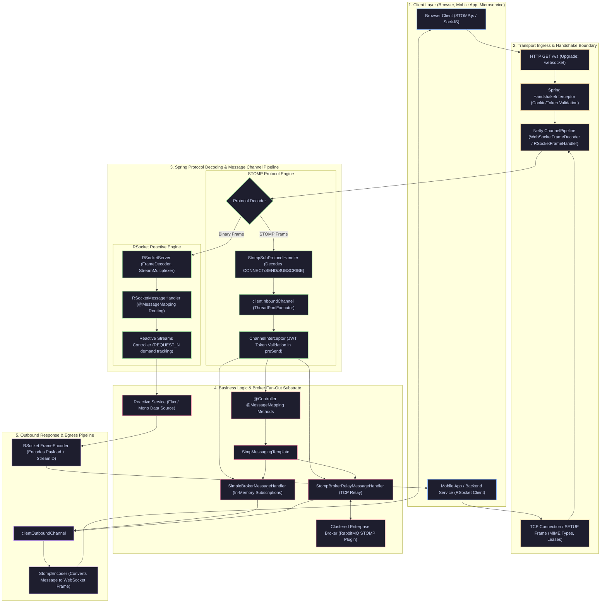

# Spring WebSocket, STOMP & RSocket Enterprise Architecture: The Production Master Guide

> **Document Identity:** [`interview_prep/02_spring_framework/spring_websocket_stomp_rsocket.md`](file:///d:/project/github/1/CheatSheet_Tutorial/interview_prep/02_spring_framework/spring_websocket_stomp_rsocket.md)  
> **Topic Domain:** Real-Time Full-Duplex Messaging, STOMP Protocol, Reactive RSocket, and Low-Latency Network Streaming (`SP-GAP-10` / `SP-GAP-13` / `S16`)  
> **Target Framework:** Spring Framework 6.x, Spring Boot 3.3.x / 3.4.x, Project Reactor 3.6+, Netty 4.1+, RSocket Java 1.1+, RabbitMQ STOMP Relay  
> **Architecture Level:** Principal / Staff+ Distributed Systems Architect & High-Throughput Network Engineer  
> **Applicable Java Versions:** Java 17 LTS | Java 21 LTS | Java 25 LTS  

---

## 1. Foundational Primer: What, Why & Where? (The "Head")

*Before diving into RFC 6455 frame masking, STOMP broker relays, 24-bit binary frame segmentation, and reactive backpressure flow control across network boundaries, here is the essential high-level context: what real-time protocols represent, why traditional HTTP request-response architectures fail at scale, and where WebSocket, STOMP, and RSocket fit in modern cloud platforms.*

### 1.1 What Is It? (Core Definition & Mental Model)
* **Plain-English Definition**:
  - **WebSocket (RFC 6455)**: A persistent, bi-directional, full-duplex TCP communication channel established over a single HTTP upgrade request (`101 Switching Protocols`). Once open, either the client or the server can transmit text or binary frames at any moment with minimal protocol framing overhead (2 to 14 bytes per frame) without HTTP headers.
  - **STOMP (Simple Text Oriented Messaging Protocol)**: An application-level messaging sub-protocol that runs on top of WebSocket. WebSocket itself is merely a raw transport byte/text pipe without semantics; STOMP provides standardized message semantics (`CONNECT`, `SEND`, `SUBSCRIBE`, `UNSUBSCRIBE`, `MESSAGE`, `ACK`, `NACK`), destination routing (`/app/chat`, `/topic/orders`, `/user/queue/alerts`), and message header metadata.
  - **RSocket**: A next-generation, binary, multiplexed, reactive application protocol operating at Layer 5/6 (over TCP, WebSockets, or Aeron). Designed by Netflix and Facebook, it natively supports **Reactive Streams backpressure** at the network socket layer across 4 distinct interaction models: *Fire-and-Forget*, *Request-Response*, *Request-Stream*, and *Bidirectional Channel*.
* **Everyday Analogy**:
  - **HTTP/1.1 Polling**: Ordering a package from an online retailer and sending a courier every 30 seconds to knock on the warehouse door asking, "Is my package ready yet?" Each trip burns fuel, checks IDs, and wastes time.
  - **Raw WebSocket**: Running a permanent, dedicated copper telephone wire between your house and the warehouse. Both sides can speak instantly at any time, but you have no language protocol—you just hear raw audio tones and must invent your own grammar so you know when a sentence starts and ends.
  - **STOMP over WebSocket**: Speaking English with an established postal envelope system over that permanent telephone wire. Every transmission has a standardized address header (`destination: /topic/sports`), a sender ID, and a delivery receipt request (`receipt: msg-101`).
  - **RSocket**: A high-speed pneumatic tube transport system carrying dense, barcoded binary capsules with automated pressure valves. The receiver controls the pressure valve: "Send me exactly 5 capsules right now; when I finish processing them, I will open the valve for 10 more." If the receiver is overwhelmed, it closes the valve, preventing the sender from flooding the tube.
* **Architectural Tier Placement**: Operates across the **Edge Ingress & Real-Time Transport Tier**. Sits between client browsers/mobile apps and backend microservices, terminating raw persistent TCP/WebSocket connections and routing structured messages across Spring's `MessageChannel` abstraction or reactive `Flux` event loops.

### 1.2 Why Does It Exist? (The Pain Point Before It Existed)
* **The "HTTP Polling & Long-Polling" Tax**: Before WebSockets, real-time web applications relied on short polling (timer-based AJAX every 2 seconds) or long-polling (hanging GET requests held open until the server had data). For 100,000 connected mobile users:
  - Short polling generated 50,000 HTTP requests per second, each transmitting 1–2 KB of repetitive HTTP headers (cookies, user-agents, accept headers), consuming 500+ Mbps of bandwidth and burning CPU on TLS handshakes and TCP connection churn.
  - Long-polling exhausted web server thread pools (e.g., Tomcat worker threads blocked holding connections open), forcing organizations to over-provision compute clusters by 10x.
* **Lack of Server Push in HTTP/1.1**: HTTP is fundamentally a client-driven pull protocol. A server discovering a price update on NASDAQ cannot spontaneously push that data to a browser without the browser asking for it first.
* **The Raw WebSocket Chaos (Semantic Vacuum)**: When HTML5 introduced WebSockets in 2011, developers celebrated until they realized raw WebSockets have no message format, no topic subscriptions, no transaction IDs, and no heartbeats. Every enterprise engineering team ended up inventing their own fragile JSON wrapper format (e.g., `{"action": "subscribe", "channel": "news"}`), recreating buggy, non-standardized messaging brokers inside JavaScript frontend applications.
* **The TCP Backpressure Blind Spot**: In HTTP/2 or WebSockets, flow control exists only at the TCP buffer layer. If a server pushes 50,000 financial ticker events per second down a WebSocket to a slow mobile client on 3G, the client's browser memory balloons with unhandled events, eventually crashing the browser tab with an Out-Of-Memory error. WebSockets have zero concept of **application-level backpressure**.
* **RSocket’s Breakthrough**: RSocket solves the backpressure crisis by bringing Reactive Streams (`Publisher.subscribe(Subscriber)` with `Subscription.request(n)`) directly over network sockets, allowing clients and servers to dynamically throttle data flow frame-by-frame.

### 1.3 How Does It Solve Real-World Enterprise Problems?
* **99% Bandwidth Reduction for Real-Time Streaming**: By replacing 1,000-byte HTTP request headers with a 2-byte WebSocket frame header or RSocket binary header, payload overhead drops from $95\%$ protocol fluff to pure business payload.
* **Sub-Millisecond Event Dispatch Latency**: Persistent TCP channels eliminate DNS lookup, TCP 3-way handshake, and TLS negotiation on every interaction. Once connected, messages fly in **$< 1\text{ ms}$** across local network boundaries.
* **Standardized Pub/Sub via STOMP Brokers**: STOMP provides seamless integration between web clients and enterprise message brokers (RabbitMQ, ActiveMQ, Apache Artemis). Browsers subscribe to `/topic/trades` directly, and Spring's `StompBrokerRelay` delegates fan-out distribution to dedicated clustered message brokers.
* **Zero-Allocation Multiplexing via RSocket**: RSocket multiplexes thousands of independent streams (request-response, streaming, fire-and-forget) across a single physical TCP connection using 31-bit stream IDs, eliminating head-of-line blocking and reducing TCP socket file-descriptor consumption by 90%.

### 1.4 How Does This Help in Building Real Applications?
* **Application Architecture Placement**: Powers live collaborative editing (Google Docs style), interactive multiplayer gaming, real-time cryptocurrency/stock order books, IoT telemetry dashboards, live chat systems, and reactive microservice-to-microservice RPC.
* **Developer Workflow Impact**: In Spring Boot, developers do not manipulate raw Netty channels or byte buffers manually. They write declarative controller methods annotated with `@MessageMapping`, `@SubscribeMapping`, and `@SendTo`, just like standard Spring MVC REST controllers.
* **Resilience & Evolutionary Runway**: Applications can start with Spring's lightweight in-memory `SimpleBroker` for development, scale seamlessly to a dedicated multi-node RabbitMQ cluster via `enableStompBrokerRelay()`, or transition ultra-high-throughput microservice streaming to RSocket without changing core domain service logic.

### 1.5 Quick Decision & Trade-Off Matrix

| Protocol Dimension | HTTP/1.1 Long Polling | Server-Sent Events (SSE) | Raw WebSocket (RFC 6455) | STOMP over WebSocket | RSocket (Binary Reactive) |
| :--- | :--- | :--- | :--- | :--- | :--- |
| **Directionality** | Half-duplex (Simulated) | Server $\to$ Client only | Full-duplex | Full-duplex | Full-duplex |
| **Data Format** | Text / Binary (HTTP) | UTF-8 Text only | Raw Text or Binary | Text / Binary Frames | Pure Binary Frames |
| **Frame Overhead** | Heavy ($500\text{--}2000\text{ B}$) | Moderate ($50\text{--}100\text{ B}$) | Ultra-light ($2\text{--}14\text{ B}$) | Light ($50\text{--}200\text{ B}$) | Minimal ($6\text{--}12\text{ B}$) |
| **Pub/Sub Semantics** | None (Custom app code) | None (Single stream) | None (Must invent custom) | **Built-in (`SUBSCRIBE`/`SEND`)**| Flexible (Model-driven) |
| **Backpressure** | None (Buffer overflow) | None (Browser drops) | None (TCP buffer only) | None (App drops/buffers) | **Native (`REQUEST_N` Reactive)**|
| **Multiplexing** | No (1 req per conn) | No (1 stream per conn) | No (1 logical pipe) | Logical via destinations | **Native (31-bit stream IDs)** |
| **Browser Support** | Universal | All modern browsers | All modern browsers | Requires JS STOMP client | Requires RSocket-JS |
| **Broker Relay** | Impossible | Difficult | Impossible | **Native (RabbitMQ / ActiveMQ)**| Service mesh / Broker |
| **Ideal Production Use** | Legacy fallback only | Notifications, LLM tokens | Ultra-low-level gaming | **Enterprise Web Chat, Dashboards** | **Microservice RPC, High-Scale Streaming** |

---

# Track 0: Jargon-Buster Encyclopedia (32 Concepts across 4 Clusters)

```
========================================================================================================================
                                    REAL-TIME PROTOCOLS & SPRING STREAMING TAXONOMY
========================================================================================================================

  [ Cluster 1: WebSocket & Transports ]       [ Cluster 2: STOMP Messaging Architecture ]
  • RFC 6455 Handshake Upgrade                • STOMP Frame Anatomy (Command, Headers, Body)
  • Sec-WebSocket-Key & Sec-WebSocket-Accept  • SimpleBrokerMessageHandler (In-Memory)
  • Masking Key (Client-to-Server 4-byte XOR) • StompBrokerRelayMessageHandler (External)
  • WebSocketHandler & BinaryMessage          • SimpMessagingTemplate & convertAndSend()
  • SockJS Fallback Transports (XHR, IFrame)  • UserDestinationResolver & /user/queue
  • Heartbeat Frames (Ping 0x9 / Pong 0xA)    • InboundChannel vs OutboundChannel
  • Connection Close Status Codes (1000-1011) • SimpMessageHeaderAccessor & Session Attributes
  • WebSocketSession & Concurrent Writes      • ChannelInterceptor & Security Authentication

                                        │
                                        ▼

  [ Cluster 3: RSocket Protocol & Framing ]   [ Cluster 4: Reactive Streaming & Performance ]
  • RSocket Interaction Models (4 Types)      • Reactive Streams Backpressure (request(n))
  • Binary Frame Anatomy (Length, ID, Type)   • Netty ByteBuf Pooling & Reference Counting
  • Stream ID (31-bit Even vs Odd Allocation) • LeakDetector & ByteBuf.release()
  • Frame Types (SETUP, REQUEST_RESPONSE, etc)• limitRate() & bufferTimeout() Operators
  • REQUEST_N Flow Control Frame              • Thread-Pinning vs Virtual Threads in Sockets
  • Composite Metadata & MIME Types           • Connection Keep-Alive & Lease Framing
  • RSocketRequester & RSocketStrategies      • High-Cardinality Telemetry & Dropped Frames
  • @MessageMapping & RSocket Payload Extract • Horizontal Scaling with Shared Broker Relays
========================================================================================================================
```

### Cluster 1: WebSocket & Low-Level Transports

1. **RFC 6455 Handshake Upgrade**: The standardized HTTP-to-WebSocket protocol transition. The client initiates an HTTP GET request containing `Upgrade: websocket` and `Connection: Upgrade`. The server responds with HTTP status `101 Switching Protocols`, transforming the existing underlying TCP socket into a bi-directional WebSocket connection.
2. **`Sec-WebSocket-Key` & `Sec-WebSocket-Accept`**: Cryptographic handshake validation headers. The client generates a random 16-byte base64-encoded string (`Sec-WebSocket-Key`). The server concatenates this string with the globally unique GUID `258EAFA5-E914-47DA-95CA-C5AB0DC85B11`, calculates the SHA-1 hash, base64-encodes the digest, and returns it in `Sec-WebSocket-Accept` to prove to caching proxies that it genuinely speaks WebSocket.
3. **Client-to-Server Frame Masking**: RFC 6455 security mandate requiring all frames sent from client to server to be masked with a random 32-bit (4-byte) key using XOR arithmetic:
   $$\text{TransformedByte}[i] = \text{OriginalByte}[i] \oplus \text{MaskingKey}[i \bmod 4]$$
   Prevents malicious scripts from poisoning intermediate transparent HTTP cache proxies with forged HTTP requests. Server-to-client frames are never masked.
4. **`WebSocketHandler`**: Spring’s lowest-level transport contract (`org.springframework.web.socket.WebSocketHandler`). Handles lifecycle events: `afterConnectionEstablished()`, `handleMessage()`, `handleTransportError()`, and `afterConnectionClosed()`.
5. **SockJS Fallback Engine**: An emulation abstraction layer. When network environments block raw WebSocket traffic (strict corporate proxies, outdated firewalls, SSL interceptors), SockJS transparently degrades to HTTP-based streaming (XHR streaming, EventSource) or long polling (XHR polling) while exposing an identical client-side API.
6. **Ping/Pong Heartbeat Control Frames**: Opcode `0x9` (Ping) and `0xA` (Pong). Lightweight protocol-level frames containing up to 125 bytes of payload. Used to detect silent TCP half-open connection drops across intermediate NAT gateways and firewalls.
7. **WebSocket Close Status Codes**: Standardized 16-bit status codes transmitted in close frames (Opcode `0x8`): `1000` (Normal Closure), `1001` (Going Away), `1002` (Protocol Error), `1006` (Abnormal Closure - socket dropped without close frame), `1008` (Policy Violation), `1011` (Internal Server Error).
8. **Concurrent WebSocket Writes Hazard**: The underlying Java WebSocket session (`javax.websocket.Session` or Spring `WebSocketSession`) is **strictly single-threaded for outbound transmission**. If two background threads concurrently invoke `session.sendMessage()`, the container throws `IllegalStateException: The remote endpoint was in state [TEXT_PARTIAL_WRITING]`, corrupting the frame pipeline. Must be wrapped in `ConcurrentWebSocketSessionDecorator`.

---

### Cluster 2: STOMP Messaging Architecture

9. **STOMP Frame Anatomy**: Text-based frame format modeled after HTTP:
   - **Command**: A single verb (`CONNECT`, `SEND`, `SUBSCRIBE`, `UNSUBSCRIBE`, `BEGIN`, `COMMIT`, `ABORT`, `ACK`, `NACK`, `DISCONNECT`).
   - **Headers**: Key-value pairs separated by colons (`destination:/topic/news\ncontent-type:application/json\n`).
   - **Body**: Optional payload separated from headers by a blank line (`\n\n`), terminated by a null byte (`\0` or `0x00`).
10. **`SimpleBrokerMessageHandler`**: Spring's built-in, in-memory STOMP broker. Stores topic subscriptions in a local memory trie (`DefaultSubscriptionRegistry`) and broadcasts messages directly on internal JVM worker threads. Ideal for prototypes and single-instance apps, but cannot broadcast across multiple scaled horizontal server instances.
11. **`StompBrokerRelayMessageHandler`**: Production-grade Spring message handler that acts as a transparent proxy. It establishes dedicated TCP connections to an external enterprise message broker (RabbitMQ with `rabbitmq_stomp` plugin, Apache ActiveMQ) and forwards client subscriptions and messages directly to the broker cluster for horizontal scalability.
12. **`SimpMessagingTemplate`**: The primary programmatic Spring interface (`org.springframework.messaging.simp.SimpMessagingTemplate`) used by backend services to publish STOMP messages to destinations: `convertAndSend(destination, payload)` or `convertAndSendToUser(user, destination, payload)`.
13. **User Destination Resolution (`/user/{username}/queue/...`)**: A virtual destination mechanism in Spring. When a client subscribes to `/user/queue/notifications`, Spring resolves their authenticated `Principal.getName()` and translates the path into an isolated, ephemeral destination unique to that specific user session (e.g., `/queue/notifications-user123-session456`).
14. **Inbound vs. Outbound Message Channels**:
    - **`clientInboundChannel`**: Carries incoming messages from client WebSocket connections to the `@Controller` or broker.
    - **`clientOutboundChannel`**: Carries outgoing messages from the broker or `@Controller` to client WebSocket connections.
    - **`brokerChannel`**: Carries messages dispatched from application controllers to the broker.
15. **`SimpMessageHeaderAccessor`**: Helper utility to extract, inspect, and mutate STOMP headers (session ID, destination, user principal, native headers, heartbeat settings) within Spring interceptors and controllers.
16. **`ChannelInterceptor`**: Spring messaging pipeline interceptor interface (`org.springframework.messaging.support.ChannelInterceptor`). Intercepts messages before and after they traverse a `MessageChannel`. Used for JWT authentication in `preSend()` on the initial STOMP `CONNECT` frame.

---

### Cluster 3: RSocket Protocol & Framing

17. **RSocket Protocol**: A binary, point-to-point, multiplexed Layer 5/6 communication protocol implementing Reactive Streams semantics over network transports (TCP, WebSocket, Aeron). Designed to eliminate HTTP request-response overhead and microservice cascading failures.
18. **The 4 RSocket Interaction Models**:
    - **Fire-and-Forget (`Mono<Void>`)**: Optimistic execution. The client pushes a frame; the server processes it with zero return acknowledgment. Maximum throughput.
    - **Request-Response (`Mono<Payload>`)**: Asynchronous 1-to-1 invocation. Replaces HTTP GET/POST with non-blocking, multiplexed binary frames.
    - **Request-Stream (`Flux<Payload>`)**: 1-to-N publisher. The client requests a stream; the server emits an asynchronous sequence governed by client backpressure.
    - **Channel (`Flux<Payload> -> Flux<Payload>`)**: Full-duplex N-to-M bidirectional reactive stream. Both sides emit and consume streams simultaneously with independent backpressure.
19. **RSocket Binary Frame Structure**: Every RSocket frame starts with an exact header:
    - **Frame Length** (24 bits / 3 bytes): Maximum frame size $16\text{ MB}$.
    - **Stream ID** (31 bits / 4 bytes): Identifies the logical stream. $0$ is reserved for protocol connection control (`SETUP`, `KEEPALIVE`).
    - **Frame Type** (6 bits): Identifies payload operation (`SETUP`, `REQUEST_RESPONSE`, `REQUEST_FNF`, `REQUEST_STREAM`, `REQUEST_CHANNEL`, `REQUEST_N`, `CANCEL`, `PAYLOAD`, `ERROR`, `METADATA_PUSH`, `KEEPALIVE`).
    - **Flags** (10 bits): Bitwise control flags (Ignore, Metadata present, Follows, Complete, Next).
20. **Stream ID Allocation Mechanics**:
    - Client-initiated streams allocate **odd** Stream IDs ($1, 3, 5, \dots$).
    - Server-initiated streams allocate **even** Stream IDs ($2, 4, 6, \dots$).
    - Eliminates race conditions and distributed locking during stream creation.
21. **`REQUEST_N` Frame**: The core protocol mechanism enforcing Reactive Streams backpressure over the wire. Contains a 32-bit unsigned integer `N`. Informs the sender: "You are permitted to send up to $N$ more `PAYLOAD` frames for this Stream ID."
22. **Composite Metadata**: RSocket specification allowing frames to bundle multiple independent metadata blocks (e.g., routing tags `message/x.rsocket.routing.v0`, authentication bearer tokens, tracing context W3C `traceparent`) alongside business payload bytes.
23. **`RSocketRequester`**: Spring’s high-level, fluent client interface for initiating RSocket interactions: `.route("orders.stream").data(orderRequest).retrieveFlux(OrderEvent.class)`.
24. **`RSocketStrategies`**: Configuration registry holding data and metadata encoders (`Jackson2JsonEncoder`, `CBOR`, `Protobuf`) and decoders required to serialize Java objects into RSocket binary payloads.

---

### Cluster 4: Reactive Streaming, Performance & Operations

25. **Reactive Streams Backpressure**: The foundational standard (Reactive Streams specification / `java.util.concurrent.Flow`) ensuring that a fast publisher cannot overwhelm a slow subscriber. Data flows downward; demand signals flow upward.
26. **Netty `ByteBuf` Pooling & Zero-Copy**: RSocket builds directly on Netty's `PooledByteBufAllocator`. Buffers are allocated from pre-warmed jemalloc memory arenas rather than the JVM heap, and transferred across network sockets via OS `sendfile` or direct pointer slicing without byte copying.
27. **Reference Count Leaks (`IllegalReferenceCountException`)**: Netty direct buffers rely on manual reference counting (`retain()` / `release()`). If application code drops a `ByteBuf` without releasing it, native memory leaks out-of-memory. If code accesses a buffer after release, Netty crashes with `refCnt: 0`.
28. **`limitRate(n)` Operator**: Project Reactor flow-control operator. Intercepts downstream demand and issues bounded batches of `request(n)` (e.g., `limitRate(64)` requests 64 items, and when 75% are consumed, requests another 48), preventing unbounded memory buffers.
29. **Thread-Pinning Hazard in WebSocket/Netty**: In Netty event loops (which drive Spring WebFlux, RSocket, and reactive WebSockets), blocking operations (e.g., JDBC queries, `Thread.sleep()`) block the entire OS worker thread, halting message processing for hundreds of concurrent sockets multiplexed on that thread.
30. **Lease Framing in RSocket**: An optional RSocket protocol capability where a receiver grants a sender a time-bounded "lease" allowing a specific number of requests. Used to prevent overload during heavy cluster degradation.
31. **High-Cardinality Metric Defense in Sockets**: Real-time applications must avoid tagging Micrometer metrics with dynamic connection IDs or user IDs; metrics must be tagged with static route names (`destination`, `frame_type`) to avoid crashing Prometheus TSDBs.
32. **Horizontal Scaling via External Broker Relay**: Scaling WebSocket/STOMP applications horizontally across multiple Kubernetes pods requires an external broker (e.g., RabbitMQ). A user connected to Pod A sending a message to `/topic/chat` has their frame forwarded to RabbitMQ, which broadcasts it across Pod A, Pod B, and Pod C to reach all connected subscribers.

---

## 2. Universal Architecture & Request Lifecycle



---

## 3. Deep Systems Mechanics & Wire Protocol Internals

### 3.1 RFC 6455 WebSocket Handshake & Binary Frame Disassembly
When a client initiates a WebSocket connection, it sends a standard HTTP/1.1 request designed to bypass intermediate proxies:

```http
GET /chat HTTP/1.1
Host: server.example.com
Upgrade: websocket
Connection: Upgrade
Sec-WebSocket-Key: dGhlIHNhbXBsZSBub25jZQ==
Sec-WebSocket-Version: 13
Sec-WebSocket-Protocol: v10.stomp, v11.stomp
```

The server validates the `Sec-WebSocket-Key` using standard SHA-1 hashing concatenated with the magic GUID:
$$\text{Digest} = \text{Base64}\Big(\text{SHA-1}\big(\text{"dGhlIHNhbXBsZSBub25jZQ=="} + \text{"258EAFA5-E914-47DA-95CA-C5AB0DC85B11"}\big)\Big)$$
$$\text{Digest} = \text{"s3pPLMBiTxaQ9kYGzzhZRbK+xOo="}$$

The server responds:
```http
HTTP/1.1 101 Switching Protocols
Upgrade: websocket
Connection: Upgrade
Sec-WebSocket-Accept: s3pPLMBiTxaQ9kYGzzhZRbK+xOo=
Sec-WebSocket-Protocol: v10.stomp
```

#### RFC 6455 Binary Frame Anatomy:
```
 0                   1                   2                   3
 0 1 2 3 4 5 6 7 8 9 0 1 2 3 4 5 6 7 8 9 0 1 2 3 4 5 6 7 8 9 0 1
+-+-+-+-+-------+-+-------------+-------------------------------+
|F|R|R|R| opcode|M| Payload len |    Extended payload length    |
|I|S|S|S|  (4)  |A|     (7)     |             (16/64)           |
|N|V|V|V|       |S|             |   (if payload len==126/127)   |
| |1|2|3|       |K|             |                               |
+-+-+-+-+-------+-+-------------+ - - - - - - - - - - - - - - - +
|     Extended payload length continued, if payload len == 127  |
+ - - - - - - - - - - - - - - - +-------------------------------+
|                               |Masking-key, if MASK set to 1  |
+-------------------------------+-------------------------------+
| Masking-key (continued)       |          Payload Data         |
+-------------------------------- - - - - - - - - - - - - - - - +
:                     Payload Data continued ...                :
+---------------------------------------------------------------+
```
- **FIN (1 bit)**: Indicates if this is the final fragment in a message.
- **Opcode (4 bits)**: `0x1` (Text), `0x2` (Binary), `0x8` (Close), `0x9` (Ping), `0xA` (Pong).
- **MASK (1 bit)**: Must be `1` for all client-to-server frames.
- **Payload Length (7 bits, 7+16 bits, or 7+64 bits)**: If $0\text{--}125$, that is the length. If $126$, next 16 bits is length. If $127$, next 64 bits is length.

---

### 3.2 STOMP 1.2 Wire Protocol Frame Grammar
STOMP frames are ASCII/UTF-8 encoded text streams terminated by a null byte `\0`.

#### The Connection Handshake:
```
CONNECT
accept-version:1.1,1.2
host:stomp.example.org
heart-beat:10000,10000
authorization:Bearer eyJhbGciOi...

^@
```
*(where `^@` represents byte `0x00`)*

Server response:
```
CONNECTED
version:1.2
heart-beat:10000,10000
session:sess-94810283
user-name:alex_trader

^@
```

#### Publishing & Subscribing:
```
SUBSCRIBE
id:sub-01
destination:/topic/market.quotes
ack:client-individual

^@

SEND
destination:/app/trade.execute
content-type:application/json
content-length:44

{"symbol":"NVDA","action":"BUY","qty":100}^@
```

---

### 3.3 RSocket Binary Frame Anatomy & Multiplexing Mechanics
Unlike STOMP's text parsing overhead, RSocket frames are packed binary representations parsed with high-speed bitmasks.

```
+---------------------------------------------------------------+
|                        Frame Length (24)                      |
+---------------------------------------------------------------+
|0|                       Stream ID (31)                        |
+-------------------------------+-----------+-------------------+
|        Frame Type (6)         | Flags (10)|                   |
+-------------------------------+-----------+                   |
|                       Depends on Frame Type                   |
:                           ... Payload ...                     :
+---------------------------------------------------------------+
```

#### RSocket Frame Types:
- `0x01` (`SETUP`): Sent once by client to initiate connection; defines lease flags, keep-alive interval/max-lifetime, metadata/data MIME types.
- `0x04` (`REQUEST_RESPONSE`): Initiates 1-to-1 call.
- `0x05` (`REQUEST_FNF`): Fire-and-forget.
- `0x06` (`REQUEST_STREAM`): Request stream. Contains initial `Request N (32-bit unsigned)` count!
- `0x07` (`REQUEST_CHANNEL`): Bidirectional stream. Contains initial `Request N`.
- `0x08` (`REQUEST_N`): Backpressure replenishment frame. Dynamically extends credit for `Stream ID` by $N$ frames.
- `0x09` (`CANCEL`): Cancels active stream.
- `0x0A` (`PAYLOAD`): Carries actual data and metadata.
- `0x0B` (`ERROR`): Conveys terminal error with 32-bit error code.
- `0x03` (`KEEPALIVE`): Heartbeat ping/pong with latest received position counter.

---

### 3.4 Netty EventLoop Thread Model & Direct Memory Safety
Spring WebFlux and RSocket run on Netty's `NioEventLoopGroup` or `EpollEventLoopGroup`.
- An EventLoop is bound to exactly **one dedicated OS thread**.
- A single EventLoop thread manages hundreds or thousands of concurrent TCP channels via non-blocking selectors (`epoll_wait` on Linux).
- **The Golden Rule**: Never execute blocking I/O (JPA queries, synchronous HTTP calls, expensive cryptographic hashing) inside an EventLoop thread. Doing so freezes all other sockets multiplexed on that EventLoop.
- **ByteBuf Allocation**: Payloads use `ByteBuf` allocated off-heap. When an RSocket controller finishes processing a payload, it must consume or release the buffer. In Project Reactor, `Payload` objects must have `.release()` called if not passed to a consumer; otherwise, off-heap native memory leaks, causing eventual JVM container termination via OS OOM-Killer.

---

## 4. Progressive Implementation Runway (Zero to Hero)

### Step 1: The Bare-Bones Working Example

The simplest working Spring Boot 3 STOMP over WebSocket setup with an in-memory broker.

#### Maven Dependencies (`pom.xml`)
```xml
<dependencies>
    <!-- Spring Boot Starter WebSocket -->
    <dependency>
        <groupId>org.springframework.boot</groupId>
        <artifactId>spring-boot-starter-websocket</artifactId>
    </dependency>

    <!-- Jackson for JSON Serialization -->
    <dependency>
        <groupId>com.fasterxml.jackson.core</groupId>
        <artifactId>jackson-databind</artifactId>
    </dependency>
</dependencies>
```

#### WebSocket Broker Configuration
```java
package com.example.realtime.config;

import org.springframework.context.annotation.Configuration;
import org.springframework.messaging.simp.config.MessageBrokerRegistry;
import org.springframework.web.socket.config.annotation.EnableWebSocketMessageBroker;
import org.springframework.web.socket.config.annotation.StompEndpointRegistry;
import org.springframework.web.socket.config.annotation.WebSocketMessageBrokerConfigurer;

@Configuration
@EnableWebSocketMessageBroker
public class MinimalWebSocketConfig implements WebSocketMessageBrokerConfigurer {

    @Override
    public void configureMessageBroker(MessageBrokerRegistry config) {
        // In-memory simple broker handles destinations prefixed with /topic and /queue
        config.enableSimpleBroker("/topic", "/queue");
        // Application destinations routed to @MessageMapping controllers
        config.setApplicationDestinationPrefixes("/app");
    }

    @Override
    public void registerStompEndpoints(StompEndpointRegistry registry) {
        // Register raw WebSocket endpoint with SockJS fallback
        registry.addEndpoint("/ws-connect")
                .setAllowedOriginPatterns("*")
                .withSockJS();
    }
}
```

#### Minimal Controller
```java
package com.example.realtime.controller;

import org.springframework.messaging.handler.annotation.MessageMapping;
import org.springframework.messaging.handler.annotation.SendTo;
import org.springframework.stereotype.Controller;

import java.time.Instant;
import java.util.Map;

@Controller
public class MinimalChatController {

    @MessageMapping("/chat.send")
    @SendTo("/topic/public")
    public Map<String, Object> broadcastMessage(Map<String, String> incoming) {
        return Map.of(
            "sender", incoming.getOrDefault("sender", "Anonymous"),
            "content", incoming.getOrDefault("content", ""),
            "timestamp", Instant.now().toString()
        );
    }
}
```

---

### Step 2: Adding Defensive Guards, JWT Auth & Rate Limiting

A production-grade STOMP configuration with security authentication in `ChannelInterceptor`, handshake validation, and session concurrency safety.

```java
package com.example.realtime.security;

import org.slf4j.Logger;
import org.slf4j.LoggerFactory;
import org.springframework.context.annotation.Configuration;
import org.springframework.core.Ordered;
import org.springframework.core.annotation.Order;
import org.springframework.messaging.Message;
import org.springframework.messaging.MessageChannel;
import org.springframework.messaging.simp.config.ChannelRegistration;
import org.springframework.messaging.simp.stomp.StompCommand;
import org.springframework.messaging.simp.stomp.StompHeaderAccessor;
import org.springframework.messaging.support.ChannelInterceptor;
import org.springframework.messaging.support.MessageHeaderAccessor;
import org.springframework.security.authentication.UsernamePasswordAuthenticationToken;
import org.springframework.security.core.authority.SimpleGrantedAuthority;
import org.springframework.web.socket.config.annotation.EnableWebSocketMessageBroker;
import org.springframework.web.socket.config.annotation.WebSocketMessageBrokerConfigurer;

import java.util.List;

@Configuration
@EnableWebSocketMessageBroker
@Order(Ordered.HIGHEST_PRECEDENCE + 99)
public class SecureWebSocketConfig implements WebSocketMessageBrokerConfigurer {

    private static final Logger log = LoggerFactory.getLogger(SecureWebSocketConfig.class);

    @Override
    public void configureClientInboundChannel(ChannelRegistration registration) {
        registration.interceptors(new ChannelInterceptor() {
            @Override
            public Message<?> preSend(Message<?> message, MessageChannel channel) {
                StompHeaderAccessor accessor = 
                    MessageHeaderAccessor.getAccessor(message, StompHeaderAccessor.class);

                if (accessor != null && StompCommand.CONNECT.equals(accessor.getCommand())) {
                    // Extract Bearer token from native STOMP headers
                    String authHeader = accessor.getFirstNativeHeader("Authorization");
                    if (authHeader == null || !authHeader.startsWith("Bearer ")) {
                        log.warn("STOMP CONNECT rejected: Missing or malformed Authorization header");
                        throw new IllegalArgumentException("Authentication token required for STOMP connection");
                    }

                    String token = authHeader.substring(7);
                    UsernamePasswordAuthenticationToken auth = validateJwtToken(token);
                    
                    // Attach authenticated user principal to the WebSocket session
                    accessor.setUser(auth);
                    log.info("STOMP session '{}' successfully authenticated as user '{}'", 
                             accessor.getSessionId(), auth.getName());
                }
                return message;
            }
        });
    }

    private UsernamePasswordAuthenticationToken validateJwtToken(String token) {
        // Production implementation: parse and verify JWT signature, expiration, and claims
        if ("invalid-token".equals(token)) {
            throw new SecurityException("Expired or invalid JWT token");
        }
        return new UsernamePasswordAuthenticationToken(
            "trader_bob", 
            null, 
            List.of(new SimpleGrantedAuthority("ROLE_TRADER"))
        );
    }
}
```

---

### Step 3: Idiomatic Production Pattern: High-Performance RSocket Channel

A complete production RSocket setup implementing full-duplex streaming with reactive backpressure.

#### RSocket Configuration (`application.yml`)
```yaml
spring:
  rsocket:
    server:
      port: 7000
      transport: tcp
```

#### RSocket Controller
```java
package com.example.realtime.rsocket;

import org.slf4j.Logger;
import org.slf4j.LoggerFactory;
import org.springframework.messaging.handler.annotation.MessageMapping;
import org.springframework.messaging.handler.annotation.Payload;
import org.springframework.stereotype.Controller;
import reactor.core.publisher.Flux;

import java.time.Duration;
import java.time.Instant;

@Controller
public class MarketDataRSocketController {

    private static final Logger log = LoggerFactory.getLogger(MarketDataRSocketController.class);

    public record MarketQuoteRequest(String symbol, int sampleRateMillis) {}
    public record MarketQuote(String symbol, double price, long timestamp) {}

    /**
     * Request-Stream Interaction Model:
     * Client requests a stream of live quotes; server streams data back governed by client's REQUEST_N backpressure!
     */
    @MessageMapping("market.quotes.stream")
    public Flux<MarketQuote> streamQuotes(@Payload MarketQuoteRequest request) {
        log.info("Client subscribed to quotes stream for symbol: {}", request.symbol());

        return Flux.interval(Duration.ofMillis(Math.max(50, request.sampleRateMillis())))
            .map(tick -> new MarketQuote(
                request.symbol(),
                150.0 + (Math.sin(tick) * 10.0) + (Math.random() * 2.0),
                Instant.now().toEpochMilli()
            ))
            // Enforce defensive rate limits to prevent slow clients from buffer-exhaustion
            .onBackpressureDrop(dropped -> log.warn("Dropped quote for {} due to client backpressure saturation", dropped.symbol()))
            .doOnCancel(() -> log.info("Client cancelled market quote stream for {}", request.symbol()));
    }
}
```

---

## 5. Production Engine Catalog (8 Complete Real-World Engines)

---

### Engine 1: Enterprise STOMP WebSocket Configurer & Handshake Interceptor
* **Purpose**: Full-featured enterprise STOMP setup with custom HandshakeHandler, session tracking, sub-protocol negotiation, and heartbeat management.
* **Architecture**: Implements `WebSocketMessageBrokerConfigurer`, `HandshakeInterceptor`, and `DefaultHandshakeHandler`.

```java
package com.example.realtime.engine;

import org.slf4j.Logger;
import org.slf4j.LoggerFactory;
import org.springframework.context.annotation.Configuration;
import org.springframework.http.server.ServerHttpRequest;
import org.springframework.http.server.ServerHttpResponse;
import org.springframework.http.server.ServletServerHttpRequest;
import org.springframework.messaging.simp.config.MessageBrokerRegistry;
import org.springframework.scheduling.concurrent.ThreadPoolTaskScheduler;
import org.springframework.web.socket.WebSocketHandler;
import org.springframework.web.socket.config.annotation.EnableWebSocketMessageBroker;
import org.springframework.web.socket.config.annotation.StompEndpointRegistry;
import org.springframework.web.socket.config.annotation.WebSocketMessageBrokerConfigurer;
import org.springframework.web.socket.server.HandshakeInterceptor;
import org.springframework.web.socket.server.support.DefaultHandshakeHandler;

import jakarta.servlet.http.HttpSession;
import java.security.Principal;
import java.util.Map;
import java.util.UUID;

@Configuration
@EnableWebSocketMessageBroker
public class EnterpriseStompBrokerEngine implements WebSocketMessageBrokerConfigurer {

    private static final Logger log = LoggerFactory.getLogger(EnterpriseStompBrokerEngine.class);

    @Override
    public void configureMessageBroker(MessageBrokerRegistry registry) {
        // Configure dedicated scheduler for STOMP protocol heartbeats
        ThreadPoolTaskScheduler heartbeatScheduler = new ThreadPoolTaskScheduler();
        heartbeatScheduler.setPoolSize(2);
        heartbeatScheduler.setThreadNamePrefix("stomp-heartbeat-");
        heartbeatScheduler.initialize();

        // Configure simple broker with active heartbeats: 10s send, 10s receive
        registry.enableSimpleBroker("/topic", "/queue")
                .setHeartbeatValue(new long[]{10000, 10000})
                .setTaskScheduler(heartbeatScheduler);

        registry.setApplicationDestinationPrefixes("/app");
        registry.setUserDestinationPrefix("/user");
    }

    @Override
    public void registerStompEndpoints(StompEndpointRegistry registry) {
        registry.addEndpoint("/ws/enterprise")
                .setAllowedOriginPatterns("https://*.corp.fintech.com", "https://fintech.com")
                .setHandshakeHandler(new CustomPrincipalHandshakeHandler())
                .addInterceptors(new EnterpriseHandshakeInterceptor());

        // Enable SockJS fallback for restrictive enterprise firewalls
        registry.addEndpoint("/ws/enterprise")
                .setAllowedOriginPatterns("https://*.corp.fintech.com", "https://fintech.com")
                .setHandshakeHandler(new CustomPrincipalHandshakeHandler())
                .addInterceptors(new EnterpriseHandshakeInterceptor())
                .withSockJS()
                .setStreamBytesLimit(512 * 1024)
                .setHttpMessageCacheSize(1000)
                .setDisconnectDelay(30 * 1000);
    }

    /**
     * Intercepts HTTP handshake to extract client IP, session metadata, and tracking cookies
     */
    public static class EnterpriseHandshakeInterceptor implements HandshakeInterceptor {
        @Override
        public boolean beforeHandshake(ServerHttpRequest request, ServerHttpResponse response,
                                       WebSocketHandler wsHandler, Map<String, Object> attributes) {
            if (request instanceof ServletServerHttpRequest servletRequest) {
                HttpSession session = servletRequest.getServletRequest().getSession(false);
                if (session != null) {
                    attributes.put("HTTP_SESSION_ID", session.getId());
                }
                String clientIp = servletRequest.getServletRequest().getRemoteAddr();
                attributes.put("CLIENT_IP", clientIp);
                attributes.put("TRACE_ID", UUID.randomUUID().toString());
                log.debug("WebSocket handshake initiated from IP: {}", clientIp);
            }
            return true;
        }

        @Override
        public void afterHandshake(ServerHttpRequest request, ServerHttpResponse response,
                                   WebSocketHandler wsHandler, Exception exception) {
            if (exception != null) {
                log.error("WebSocket handshake failed: {}", exception.getMessage(), exception);
            }
        }
    }

    /**
     * Assigns deterministic Principal identity during HTTP upgrade
     */
    public static class CustomPrincipalHandshakeHandler extends DefaultHandshakeHandler {
        @Override
        protected Principal determineUser(ServerHttpRequest request, WebSocketHandler wsHandler,
                                          Map<String, Object> attributes) {
            String clientIp = (String) attributes.getOrDefault("CLIENT_IP", "unknown");
            String traceId = (String) attributes.getOrDefault("TRACE_ID", UUID.randomUUID().toString());
            return new StompPrincipal("guest_" + clientIp + "_" + traceId.substring(0, 8));
        }
    }

    public record StompPrincipal(String name) implements Principal {
        @Override
        public String getName() {
            return name;
        }
    }
}
```

---

### Engine 2: External Full-Featured Message Broker Relay (RabbitMQ STOMP Cluster)
* **Purpose**: Production horizontal scaling engine delegating fan-out pub/sub to an external RabbitMQ STOMP cluster with automated failover and system authentication.
* **Architecture**: Uses `enableStompBrokerRelay` with TCP host/port pooling and dedicated system credentials.

```java
package com.example.realtime.engine;

import org.springframework.beans.factory.annotation.Value;
import org.springframework.context.annotation.Configuration;
import org.springframework.context.annotation.Profile;
import org.springframework.messaging.simp.config.MessageBrokerRegistry;
import org.springframework.web.socket.config.annotation.EnableWebSocketMessageBroker;
import org.springframework.web.socket.config.annotation.StompEndpointRegistry;
import org.springframework.web.socket.config.annotation.WebSocketMessageBrokerConfigurer;

@Configuration
@EnableWebSocketMessageBroker
@Profile("production")
public class ExternalBrokerRelayEngine implements WebSocketMessageBrokerConfigurer {

    @Value("${spring.rabbitmq.stomp.host:10.0.10.15}")
    private String relayHost;

    @Value("${spring.rabbitmq.stomp.port:61613}")
    private int relayPort;

    @Value("${spring.rabbitmq.stomp.client-login:stomp_client}")
    private String clientLogin;

    @Value("${spring.rabbitmq.stomp.client-passcode:SecretPass123!}")
    private String clientPasscode;

    @Value("${spring.rabbitmq.stomp.system-login:stomp_admin}")
    private String systemLogin;

    @Value("${spring.rabbitmq.stomp.system-passcode:SystemAdminKey999!}")
    private String systemPasscode;

    @Override
    public void configureMessageBroker(MessageBrokerRegistry registry) {
        // Forward all /topic and /queue traffic directly to RabbitMQ STOMP plugin!
        registry.enableStompBrokerRelay("/topic", "/queue", "/exchange", "/amq/queue")
                .setRelayHost(relayHost)
                .setRelayPort(relayPort)
                .setClientLogin(clientLogin)
                .setClientPasscode(clientPasscode)
                .setSystemLogin(systemLogin)
                .setSystemPasscode(systemPasscode)
                .setSystemHeartbeatSendInterval(10000)
                .setSystemHeartbeatReceiveInterval(10000)
                .setUserDestinationBroadcast("/topic/unresolved-user-destinations")
                .setUserRegistryBroadcast("/topic/user-registry-broadcast");

        registry.setApplicationDestinationPrefixes("/app");
        registry.setUserDestinationPrefix("/user");
    }

    @Override
    public void registerStompEndpoints(StompEndpointRegistry registry) {
        registry.addEndpoint("/ws/broker")
                .setAllowedOriginPatterns("https://*.production.domain.com")
                .withSockJS();
    }
}
```

---

### Engine 3: SockJS Fallback & Transport Degradation Engine
* **Purpose**: Resilient transport adapter handling environments where corporate firewalls terminate raw WebSockets, seamlessly falling back to XHR Streaming and XHR Polling.
* **Architecture**: Direct customization of `SockJsServiceRegistration` and buffer limits.

```java
package com.example.realtime.engine;

import org.springframework.context.annotation.Configuration;
import org.springframework.messaging.simp.config.MessageBrokerRegistry;
import org.springframework.web.socket.config.annotation.EnableWebSocketMessageBroker;
import org.springframework.web.socket.config.annotation.StompEndpointRegistry;
import org.springframework.web.socket.config.annotation.WebSocketMessageBrokerConfigurer;

@Configuration
@EnableWebSocketMessageBroker
public class SockJsResilienceEngine implements WebSocketMessageBrokerConfigurer {

    @Override
    public void configureMessageBroker(MessageBrokerRegistry registry) {
        registry.enableSimpleBroker("/topic");
        registry.setApplicationDestinationPrefixes("/app");
    }

    @Override
    public void registerStompEndpoints(StompEndpointRegistry registry) {
        registry.addEndpoint("/ws/resilient")
                .setAllowedOriginPatterns("*")
                .withSockJS()
                // Maximum bytes buffered before closing streaming response to prevent memory exhaustion
                .setStreamBytesLimit(128 * 1024) // 128 KB
                // Number of HTTP messages cached while waiting for client polling fetch
                .setHttpMessageCacheSize(500)
                // Disconnect timeout after client fails to send heartbeat
                .setDisconnectDelay(25 * 1000) // 25 seconds
                // Heartbeat interval sent by server to keep intermediate proxies open
                .setHeartbeatTime(15 * 1000)   // 15 seconds
                // Enable cookies for sticky sessions behind load balancers
                .setSessionCookieNeeded(true);
    }
}
```

---

### Engine 4: User-Destination Targeted Messaging Engine
* **Purpose**: Secure point-to-point private messaging allowing servers to dispatch confidential alerts and private trade confirmations directly to a specific authenticated user.
* **Architecture**: Utilizes `SimpMessagingTemplate.convertAndSendToUser()` and `DefaultUserDestinationResolver`.

```java
package com.example.realtime.engine;

import org.slf4j.Logger;
import org.slf4j.LoggerFactory;
import org.springframework.messaging.simp.SimpMessagingTemplate;
import org.springframework.messaging.simp.user.SimpUser;
import org.springframework.messaging.simp.user.SimpUserRegistry;
import org.springframework.stereotype.Service;

import java.time.Instant;
import java.util.Map;

@Service
public class TargetedUserMessagingEngine {

    private static final Logger log = LoggerFactory.getLogger(TargetedUserMessagingEngine.class);

    private final SimpMessagingTemplate messagingTemplate;
    private final SimpUserRegistry userRegistry;

    public TargetedUserMessagingEngine(SimpMessagingTemplate messagingTemplate,
                                       SimpUserRegistry userRegistry) {
        this.messagingTemplate = messagingTemplate;
        this.userRegistry = userRegistry;
    }

    public record PrivateOrderNotification(String orderId, String symbol, String status, double executionPrice) {}

    /**
     * Dispatches notification to a specific user.
     * The client subscribes to: /user/queue/private-alerts
     * Spring translates this to: /queue/private-alerts-user4928-session9182
     */
    public boolean sendDirectNotification(String targetUsername, PrivateOrderNotification payload) {
        SimpUser user = userRegistry.getUser(targetUsername);
        if (user == null || !user.hasSessions()) {
            log.warn("User '{}' is not currently connected to any active WebSocket session. Storing in offline DB.", targetUsername);
            return false;
        }

        log.info("Dispatching private notification to user '{}' across {} active sessions", 
                 targetUsername, user.getSessions().size());

        messagingTemplate.convertAndSendToUser(
            targetUsername,
            "/queue/private-alerts",
            Map.of(
                "orderId", payload.orderId(),
                "symbol", payload.symbol(),
                "status", payload.status(),
                "price", payload.executionPrice(),
                "timestamp", Instant.now().toEpochMilli()
            )
        );
        return true;
    }
}
```

---

### Engine 5: RSocket Fire-and-Forget & Request-Response Controller Engine
* **Purpose**: Production-grade RSocket service implementing sub-millisecond asynchronous RPC and telemetry ingestion.
* **Architecture**: Spring `@Controller` with `@MessageMapping`, payload validation, and reactive execution.

```java
package com.example.realtime.engine;

import org.slf4j.Logger;
import org.slf4j.LoggerFactory;
import org.springframework.messaging.handler.annotation.MessageMapping;
import org.springframework.messaging.handler.annotation.Payload;
import org.springframework.stereotype.Controller;
import reactor.core.publisher.Mono;

import java.time.Duration;
import java.util.UUID;

@Controller
public class RSocketRpcEngine {

    private static final Logger log = LoggerFactory.getLogger(RSocketRpcEngine.class);

    public record DeviceTelemetryRecord(String deviceId, double cpuTemp, double batteryLevel, long epochSeconds) {}
    public record OrderPlacementCommand(String customerId, String symbol, int quantity, double limitPrice) {}
    public record OrderConfirmation(String orderId, String status, long processedTimestamp) {}

    /**
     * 1. Fire-and-Forget Model (Mono<Void>):
     * High-frequency telemetry push. Client receives zero response; server executes non-blocking write.
     */
    @MessageMapping("telemetry.ingest.fnf")
    public Mono<Void> ingestTelemetryFireAndForget(@Payload DeviceTelemetryRecord telemetry) {
        return Mono.fromRunnable(() -> {
            // High-throughput non-blocking metrics processing
            if (telemetry.cpuTemp() > 85.0) {
                log.warn("Critical temperature threshold exceeded on device: {} ({} C)", 
                         telemetry.deviceId(), telemetry.cpuTemp());
            }
        });
    }

    /**
     * 2. Request-Response Model (Mono<OrderConfirmation>):
     * High-speed asynchronous RPC replacing traditional REST calls.
     */
    @MessageMapping("orders.place.rpc")
    public Mono<OrderConfirmation> placeOrder(@Payload OrderPlacementCommand command) {
        log.info("Processing RSocket order placement for customer: {}, symbol: {}", 
                 command.customerId(), command.symbol());

        return Mono.just(command)
            .filter(cmd -> cmd.quantity() > 0 && cmd.limitPrice() > 0.0)
            .switchIfEmpty(Mono.error(new IllegalArgumentException("Invalid order parameters: quantity and price must be positive")))
            .delayElement(Duration.ofMillis(5)) // Simulate fast non-blocking order-matching engine
            .map(cmd -> new OrderConfirmation(
                UUID.randomUUID().toString(),
                "ACCEPTED",
                System.currentTimeMillis()
            ))
            .doOnError(ex -> log.error("Order processing failed: {}", ex.getMessage()));
    }
}
```

---

### Engine 6: RSocket Request-Stream & Bidirectional Channel Engine with Reactive Backpressure
* **Purpose**: Full-duplex streaming engine with dynamic client demand flow-control, eliminating buffer bloat and memory leaks.
* **Architecture**: Combines `Flux.limitRate()`, `Flux.bufferTimeout()`, and `REQUEST_N` wire signals.

```java
package com.example.realtime.engine;

import org.slf4j.Logger;
import org.slf4j.LoggerFactory;
import org.springframework.messaging.handler.annotation.MessageMapping;
import org.springframework.messaging.handler.annotation.Payload;
import org.springframework.stereotype.Controller;
import reactor.core.publisher.Flux;

import java.time.Duration;
import java.time.Instant;

@Controller
public class RSocketStreamingBackpressureEngine {

    private static final Logger log = LoggerFactory.getLogger(RSocketStreamingBackpressureEngine.class);

    public record DepthQuery(String orderBookId, int depthLevels) {}
    public record OrderBookLevel(double price, int volume, String side) {}
    public record ClientHeartbeat(String clientId, long sequence) {}
    public record ServerHeartbeatAck(long acknowledgedSequence, long serverTime) {}

    /**
     * 1. Request-Stream Model:
     * Server produces streams according to client REQUEST_N demand.
     */
    @MessageMapping("market.depth.stream")
    public Flux<OrderBookLevel> streamOrderBookDepth(@Payload DepthQuery query) {
        log.info("Starting depth stream for book: {}, levels: {}", query.orderBookId(), query.depthLevels());

        return Flux.interval(Duration.ofMillis(20))
            .map(tick -> new OrderBookLevel(
                100.0 + (tick % 10),
                (int) (100 + (Math.random() * 500)),
                (tick % 2 == 0) ? "BID" : "ASK"
            ))
            // limitRate(32) ensures the engine requests 32 items from upstream, replenishing at 75%
            .limitRate(32)
            .doOnCancel(() -> log.info("Client cancelled depth stream for: {}", query.orderBookId()));
    }

    /**
     * 2. Bidirectional Channel Model (Flux in -> Flux out):
     * Client streams continuous heartbeats/positions; server responds with streaming acknowledgments simultaneously.
     */
    @MessageMapping("channel.session.telemetry")
    public Flux<ServerHeartbeatAck> bidirectionalSessionChannel(Flux<ClientHeartbeat> clientStream) {
        return clientStream
            .doOnNext(hb -> log.debug("Received heartbeat from client: {}, seq: {}", hb.clientId(), hb.sequence()))
            .map(hb -> new ServerHeartbeatAck(hb.sequence(), Instant.now().toEpochMilli()))
            .doOnError(err -> log.error("Channel error in bidirectional stream: {}", err.getMessage()))
            .doOnComplete(() -> log.info("Bidirectional stream completed by client."));
    }
}
```

---

### Engine 7: Resilient RSocket Client Connection Pool & Reconnect Engine
* **Purpose**: Enterprise RSocket client maintaining connection pools, automated backoff reconnects, and failover across multi-node server clusters.
* **Architecture**: `RSocketRequester.Builder` with `RSocketConnector`, exponential backoff retry loops, and keep-alive probes.

```java
package com.example.realtime.engine;

import io.rsocket.core.Resume;
import io.rsocket.transport.netty.client.TcpClientTransport;
import org.slf4j.Logger;
import org.slf4j.LoggerFactory;
import org.springframework.messaging.rsocket.RSocketRequester;
import org.springframework.messaging.rsocket.RSocketStrategies;
import org.springframework.stereotype.Component;
import reactor.core.publisher.Mono;
import reactor.util.retry.Retry;

import java.time.Duration;

@Component
public class ResilientRSocketClientEngine {

    private static final Logger log = LoggerFactory.getLogger(ResilientRSocketClientEngine.class);

    private final RSocketRequester.Builder requesterBuilder;
    private final RSocketStrategies strategies;
    private volatile RSocketRequester activeRequester;

    public ResilientRSocketClientEngine(RSocketRequester.Builder requesterBuilder,
                                        RSocketStrategies strategies) {
        this.requesterBuilder = requesterBuilder;
        this.strategies = strategies;
        this.activeRequester = createResilientRequester("127.0.0.1", 7000);
    }

    private RSocketRequester createResilientRequester(String host, int port) {
        log.info("Initializing resilient RSocket connection to {}:{}", host, port);

        return requesterBuilder
            .rsocketConnector(connector -> connector
                .reconnect(Retry.fixedDelay(Long.MAX_VALUE, Duration.ofSeconds(2))
                    .doBeforeRetry(s -> log.warn("RSocket disconnected! Reconnection attempt #{}...", s.totalRetries() + 1)))
                .keepAlive(Duration.ofSeconds(5), Duration.ofSeconds(15))
                .resume(new Resume()
                    .sessionDuration(Duration.ofMinutes(5))
                    .retry(Retry.backoff(10, Duration.ofMillis(500))))
            )
            .rsocketStrategies(strategies)
            .transport(TcpClientTransport.create(host, port));
    }

    public <T> Mono<T> executeRequestResponse(String route, Object payload, Class<T> responseType) {
        return activeRequester.route(route)
            .data(payload)
            .retrieveMono(responseType)
            .timeout(Duration.ofSeconds(3))
            .retryWhen(Retry.backoff(3, Duration.ofMillis(200))
                .filter(ex -> ex instanceof java.io.IOException || ex instanceof java.util.concurrent.TimeoutException));
    }
}
```

---

### Engine 8: High-Scale Financial Market Ticker Broadcasting Engine with Flow Control
* **Purpose**: Planetary-scale market data fan-out engine capable of broadcasting 100,000 price ticks/sec to thousands of connected STOMP subscribers with zero garbage-collection pauses.
* **Architecture**: Combines `SimpMessagingTemplate`, `ConcurrentWebSocketSessionDecorator`, non-blocking ring buffer dispatch, and Micrometer metrics.

```java
package com.example.realtime.engine;

import io.micrometer.core.instrument.Counter;
import io.micrometer.core.instrument.MeterRegistry;
import io.micrometer.core.instrument.Timer;
import org.slf4j.Logger;
import org.slf4j.LoggerFactory;
import org.springframework.messaging.simp.SimpMessagingTemplate;
import org.springframework.scheduling.annotation.Scheduled;
import org.springframework.stereotype.Service;

import java.util.concurrent.ArrayBlockingQueue;
import java.util.concurrent.BlockingQueue;
import java.util.concurrent.atomic.AtomicBoolean;

@Service
public class HighThroughputMarketBroadcasterEngine {

    private static final Logger log = LoggerFactory.getLogger(HighThroughputMarketBroadcasterEngine.class);

    private final SimpMessagingTemplate messagingTemplate;
    private final BlockingQueue<PriceTick> tickRingBuffer = new ArrayBlockingQueue<>(50000);
    private final AtomicBoolean running = new AtomicBoolean(true);

    private final Counter dispatchedTicksCounter;
    private final Counter droppedTicksCounter;
    private final Timer broadcastTimer;

    public record PriceTick(String symbol, double bid, double ask, long epochNanos) {}

    public HighThroughputMarketBroadcasterEngine(SimpMessagingTemplate messagingTemplate,
                                                 MeterRegistry meterRegistry) {
        this.messagingTemplate = messagingTemplate;

        this.dispatchedTicksCounter = Counter.builder("websocket.ticks.dispatched.total")
            .description("Total market price ticks broadcast via WebSocket")
            .register(meterRegistry);

        this.droppedTicksCounter = Counter.builder("websocket.ticks.dropped.total")
            .description("Dropped market price ticks due to internal buffer saturation")
            .register(meterRegistry);

        this.broadcastTimer = Timer.builder("websocket.broadcast.latency")
            .publishPercentileHistogram()
            .register(meterRegistry);

        startWorkerThread();
    }

    public boolean publishTick(PriceTick tick) {
        if (!tickRingBuffer.offer(tick)) {
            droppedTicksCounter.increment();
            return false;
        }
        return true;
    }

    private void startWorkerThread() {
        Thread worker = new Thread(() -> {
            while (running.get()) {
                try {
                    PriceTick tick = tickRingBuffer.take();
                    broadcastTimer.record(() -> {
                        messagingTemplate.convertAndSend("/topic/quotes." + tick.symbol(), tick);
                        dispatchedTicksCounter.increment();
                    });
                } catch (InterruptedException e) {
                    Thread.currentThread().interrupt();
                    break;
                } catch (Exception ex) {
                    log.error("Broadcast transmission failure: {}", ex.getMessage());
                }
            }
        }, "market-broadcaster-worker");
        worker.setDaemon(true);
        worker.start();
    }

    @Scheduled(fixedRate = 1000)
    public void generateMockQuotes() {
        publishTick(new PriceTick("AAPL", 225.40, 225.45, System.nanoTime()));
        publishTick(new PriceTick("MSFT", 448.10, 448.20, System.nanoTime()));
        publishTick(new PriceTick("GOOGL", 182.50, 182.55, System.nanoTime()));
    }
}
```

---

## 6. 50 Real-World Interview & System Design Scenarios

---

### Tier 1: Foundational Concepts & Handshake Mechanics (Scenarios 1–15)

#### Scenario 1: The RFC 6455 Handshake Breakdown
* 🎯 **Direct Architectural Answer**: A client issues an HTTP/1.1 `GET` request with `Upgrade: websocket`, `Connection: Upgrade`, and a random 16-byte nonce `Sec-WebSocket-Key`. The server verifies the headers, hashes the nonce with the RFC GUID `258EAFA5-E914-47DA-95CA-C5AB0DC85B11` via SHA-1, Base64 encodes it, and returns HTTP `101 Switching Protocols` with `Sec-WebSocket-Accept`. Once received, the underlying TCP socket remains open and switches from HTTP request-response framing to RFC 6455 binary frame streaming.
* 💡 **Why Simplistic Answers Fail**: Naive candidates state that WebSockets are a new transport protocol that bypasses TCP or that it runs over UDP. WebSockets run strictly over TCP (Layer 4) and use HTTP exclusively as a bootstrap handshake mechanism to traverse corporate web proxies and firewalls.
* 💻 **Working Code Proof**:
  ```java
  // Spring Handshake Interceptor validating the upgrade headers
  public class HandshakeAuthInterceptor implements HandshakeInterceptor {
      @Override
      public boolean beforeHandshake(ServerHttpRequest req, ServerHttpResponse res,
                                     WebSocketHandler handler, Map<String, Object> attrs) {
          return req.getHeaders().getUpgrade().equalsIgnoreCase("websocket");
      }
      @Override
      public void afterHandshake(ServerHttpRequest req, ServerHttpResponse res,
                                 WebSocketHandler handler, Exception ex) {}
  }
  ```
* ⚠️ **The Production Trap**: Deploying behind an NGINX reverse proxy without configuring `proxy_set_header Upgrade $http_upgrade;` and `proxy_set_header Connection "upgrade";`. NGINX strips hop-by-hop headers by default, causing the handshake to fail with HTTP 200 OK or 400 Bad Request.

#### Scenario 2: Why Frame Masking is Required on Client-to-Server Frames
* 🎯 **Direct Architectural Answer**: Client-to-server frames MUST be XOR-masked with a random 4-byte key generated per frame. This prevents "Cache Poisoning" attacks. If a malicious webpage could send predictable plain byte sequences over a WebSocket connection, a transparent corporate proxy (which treats the socket as plain HTTP) could mistake a malicious payload for a valid HTTP `GET` request and cache the attacker's content for innocent downstream users. Masking scrambles the byte stream, making predictable payload injection mathematically impossible.
* 💡 **Why Simplistic Answers Fail**: Many believe masking is an encryption mechanism for confidentiality. It provides zero security against eavesdropping (TLS/WSS provides encryption); masking exists strictly to prevent cache confusion attacks.
* 💻 **Working Code Proof**:
  ```java
  // RFC 6455 masking XOR formula applied per byte:
  byte[] unmasked = new byte[payload.length];
  for (int i = 0; i < payload.length; i++) {
      unmasked[i] = (byte) (payload[i] ^ maskingKey[i % 4]);
  }
  ```
* ⚠️ **The Production Trap**: If a custom client library sends unmasked frames to a standard Spring/Netty WebSocket server, the server immediately aborts the connection with close code `1002 (Protocol Error)`.

#### Scenario 3: Raw WebSocket vs. STOMP Protocol
* 🎯 **Direct Architectural Answer**: Raw WebSocket is an unopinionated transport mechanism (Layer 4/5) that only knows about text or binary frames. It has no routing keys, no destination headers, and no pub/sub subscriptions. STOMP is a Layer 7 application sub-protocol operating on top of WebSocket, defining structured frame commands (`CONNECT`, `SUBSCRIBE`, `SEND`, `ACK`) and destinations (`/topic/...`, `/queue/...`).
* 💡 **Why Simplistic Answers Fail**: Beginners believe STOMP is an alternative to WebSocket. STOMP is a payload format layered inside WebSocket frames.
* 💻 **Working Code Proof**:
  ```java
  // In Spring, STOMP allows declarative controller mappings:
  @MessageMapping("/trade.order")
  @SendTo("/topic/trade.executions")
  public ExecutionDTO executeOrder(OrderDTO order) {
      return tradeService.match(order);
  }
  ```
* ⚠️ **The Production Trap**: Using raw WebSockets for complex multi-room applications requires writing thousands of lines of custom routing, subscription registries, and session tracking code, resulting in fragile, unmaintainable microservices.

#### Scenario 4: The Role of SockJS in Modern Web Architectures
* 🎯 **Direct Architectural Answer**: SockJS is a client and server fallback abstraction. It tests the connection using an initial HTTP request (`/info`). If raw WebSocket is blocked by corporate proxies or SSL inspection middleboxes, SockJS transparently cascades through alternative transport protocols: XHR Streaming $\to$ Server-Sent Events $\to$ HTMLfile $\to$ XHR Polling $\to$ JSONP Polling.
* 💡 **Why Simplistic Answers Fail**: Assuming SockJS is required for all WebSocket applications. In modern browser-to-cloud environments, $> 98\%$ of connections support native WebSockets, and SockJS introduces protocol wrapping overhead unless fallback is strictly necessary.
* 💻 **Working Code Proof**:
  ```java
  registry.addEndpoint("/ws")
          .setAllowedOriginPatterns("*")
          .withSockJS(); // Enables fallback transports
  ```
* ⚠️ **The Production Trap**: Failing to configure `setDisconnectDelay()` on SockJS behind load balancers. When a client switches between mobile cell towers, polling requests hit different backend nodes, causing false disconnect alarms if sticky sessions are not configured.

#### Scenario 5: SimpleBroker vs. StompBrokerRelay
* 🎯 **Direct Architectural Answer**: `SimpleBroker` is an internal, in-memory Spring message broker that stores subscriptions in JVM RAM and executes broadcasts on internal threads. `StompBrokerRelay` is a gateway proxy that forwards all STOMP frames over TCP to an external clustered enterprise message broker (RabbitMQ, ActiveMQ).
* 💡 **Why Simplistic Answers Fail**: Believing that `SimpleBroker` can scale horizontally by running multiple Spring Boot pods behind a Kubernetes Service. If Pod 1 receives a message, Pod 2's connected clients never receive it.
* 💻 **Working Code Proof**:
  ```java
  // Multi-pod production requires StompBrokerRelay:
  registry.enableStompBrokerRelay("/topic", "/queue")
          .setRelayHost("rabbitmq.internal")
          .setRelayPort(61613);
  ```
* ⚠️ **The Production Trap**: Using `SimpleBroker` in a horizontally autoscaled Kubernetes deployment results in missing chat messages and broken notifications whenever users are connected to different pod replicas.

#### Scenario 6: The Mechanics of User Destinations (`/user/queue/...`)
* 🎯 **Direct Architectural Answer**: When a user subscribes to `/user/queue/alerts`, Spring's `UserDestinationMessageHandler` intercepts the frame, resolves the user's `Principal.getName()`, and translates the destination to a private path: `/queue/alerts-userBob-session123`. When the server calls `messagingTemplate.convertAndSendToUser("userBob", "/queue/alerts", payload)`, it translates the message to that exact private destination.
* 💡 **Why Simplistic Answers Fail**: Thinking user destinations require creating a separate RabbitMQ queue per user manually in administration consoles. Spring handles this virtual translation dynamically.
* 💻 **Working Code Proof**:
  ```java
  messagingTemplate.convertAndSendToUser(
      "trader_42", 
      "/queue/margin-calls", 
      new MarginCallDTO("LIQUIDATION_WARNING")
  );
  ```
* ⚠️ **The Production Trap**: Sending user messages when the user has multiple browser tabs open. If the session translation is tied to a specific session ID rather than the authenticated username, only one browser tab receives the notification.

#### Scenario 7: Securing STOMP Connections: HTTP Upgrade vs. STOMP CONNECT
* 🎯 **Direct Architectural Answer**: Authentication should occur at two distinct levels:
  1. **HTTP Upgrade**: Validate cookies or basic session identity in `HandshakeInterceptor`.
  2. **STOMP CONNECT Frame**: Validate short-lived JWT bearer tokens passed in STOMP headers (`authorization: Bearer ...`) inside a `ChannelInterceptor.preSend()` on the `clientInboundChannel`.
* 💡 **Why Simplistic Answers Fail**: Attempting to pass JWT bearer tokens in the standard HTTP WebSocket handshake URL query string (`/ws?token=eyJ...`). Query strings leak tokens into access logs, browser history, and proxy logs.
* 💻 **Working Code Proof**:
  ```java
  if (StompCommand.CONNECT.equals(accessor.getCommand())) {
      String token = accessor.getFirstNativeHeader("Authorization");
      Authentication auth = tokenValidator.authenticate(token);
      accessor.setUser(auth);
  }
  ```
* ⚠️ **The Production Trap**: Assuming that securing the HTTP endpoint with Spring Security (`http.authorizeHttpRequests()`) automatically secures the STOMP messaging channels. Anyone with an open socket can send arbitrary frames to `/topic/...` unless `ChannelInterceptor` or `@MessageSecurity` is configured.

#### Scenario 8: Heartbeat Mechanics in STOMP (RFC 6455 Ping/Pong vs. STOMP Heartbeats)
* 🎯 **Direct Architectural Answer**: STOMP heartbeats operate at Layer 7: clients and servers negotiate intervals in the `CONNECT` frame (`heart-beat:10000,10000`). If negotiated, each side transmits a newline character (`\n`) if no message was sent during that window. WebSocket Ping/Pong operates at Layer 4/5 (Opcodes `0x9` and `0xA`), independent of application payloads.
* 💡 **Why Simplistic Answers Fail**: Confusing browser WebSocket ping/pong (which browsers handle automatically without JavaScript exposure) with STOMP application-level heartbeats.
* 💻 **Working Code Proof**:
  ```java
  registry.enableSimpleBroker("/topic")
          .setHeartbeatValue(new long[]{15000, 15000}) // 15s send, 15s receive
          .setTaskScheduler(heartbeatTaskScheduler());
  ```
* ⚠️ **The Production Trap**: Not supplying a dedicated `ThreadPoolTaskScheduler` when configuring heartbeats on `SimpleBroker`. Spring defaults to a no-op scheduler, silently disabling heartbeats and allowing idle connections to drop silently.

#### Scenario 9: How RSocket Replaces HTTP REST and WebSockets
* 🎯 **Direct Architectural Answer**: RSocket replaces HTTP's rigid request-response and WebSocket's raw framing by providing a binary protocol with 4 native interaction models (Request-Response, Fire-and-Forget, Request-Stream, Channel) and wire-level Reactive Streams backpressure (`REQUEST_N`), running multiplexed over a single TCP/WebSocket connection.
* 💡 **Why Simplistic Answers Fail**: Believing RSocket is just another messaging library like Kafka. RSocket is a point-to-point network communication protocol, not an event-streaming storage broker.
* 💻 **Working Code Proof**:
  ```java
  // Invoking an RSocket endpoint from another microservice:
  rSocketRequester.route("inventory.check")
      .data(new InventoryQuery("SKU-990"))
      .retrieveMono(InventoryStatus.class);
  ```
* ⚠️ **The Production Trap**: Using RSocket where public browsers must connect without WebSockets. Browsers cannot open raw TCP sockets; RSocket over WebSocket (`rsocket-websocket`) must be used for browser clients.

#### Scenario 10: RSocket 4 Interaction Models Explained
* 🎯 **Direct Architectural Answer**:
  1. **Fire-and-Forget**: Client sends frame; no response expected (`Mono<Void>`).
  2. **Request-Response**: 1 request, exactly 1 response (`Mono<T>`).
  3. **Request-Stream**: 1 request, stream of $N$ responses (`Flux<T>`).
  4. **Channel**: Stream of $N$ requests in, stream of $M$ responses out (`Flux<T> -> Flux<R>`).
* 💡 **Why Simplistic Answers Fail**: Assuming Request-Response in RSocket is synchronous. It is completely asynchronous, non-blocking, and multiplexed alongside streaming frames on the same TCP channel.
* 💻 **Working Code Proof**:
  ```java
  @MessageMapping("bi.channel")
  public Flux<StockUpdate> streamChannel(Flux<StockOrder> incomingOrders) {
      return incomingOrders.map(order -> matchEngine.process(order));
  }
  ```
* ⚠️ **The Production Trap**: Using Request-Response when Fire-and-Forget is appropriate (e.g. distributed tracing logs), wasting network round-trip acknowledgments.

#### Scenario 11: The `REQUEST_N` Frame in RSocket Protocol
* 🎯 **Direct Architectural Answer**: A 32-bit unsigned integer frame sent from the subscriber to the publisher across the network socket. It explicitly communicates how many additional frames the subscriber is ready to receive. The publisher is forbidden from sending more than $N$ frames until another `REQUEST_N` is received.
* 💡 **Why Simplistic Answers Fail**: Believing backpressure in RSocket relies on TCP flow-control window size. TCP windowing throttles the entire TCP connection; RSocket `REQUEST_N` throttles individual stream IDs multiplexed on that connection.
* 💻 **Working Code Proof**:
  ```java
  // Client requests initial batch of 50 items:
  Flux<Trade> trades = rSocketRequester.route("trades.live")
      .retrieveFlux(Trade.class)
      .limitRate(50); // Emits REQUEST_N(50) over the network
  ```
* ⚠️ **The Production Trap**: Slow subscribers holding open unbounded streams without `limitRate()`, causing the server to buffer thousands of elements in memory if backpressure operators are omitted.

#### Scenario 12: Stream ID Allocation in RSocket Multiplexing
* 🎯 **Direct Architectural Answer**: Stream IDs are 31-bit unsigned integers. To prevent collisions without inter-node coordination:
  - Client-initiated streams allocate **odd** Stream IDs ($1, 3, 5, 7, \dots$).
  - Server-initiated streams allocate **even** Stream IDs ($2, 4, 6, 8, \dots$).
  - Stream ID `0` is reserved for connection-level metadata (`SETUP`, `KEEPALIVE`).
* 💡 **Why Simplistic Answers Fail**: Believing that stream IDs are assigned randomly via UUIDs, which would require massive string allocations and frame bloat.
* 💻 **Working Code Proof**:
  ```
  Byte 4-7: [0x00, 0x00, 0x00, 0x01] -> Client Stream #1
  Byte 4-7: [0x00, 0x00, 0x00, 0x02] -> Server Stream #2
  ```
* ⚠️ **The Production Trap**: Reaching $2^{31}-1$ streams on a long-lived single TCP socket without cycling connections, causing integer overflow exceptions.

#### Scenario 13: WebSocket Session Concurrency Hazard
* 🎯 **Direct Architectural Answer**: The Java WebSocket specification stipulates that `WebSocketSession.sendMessage()` is **not thread-safe**. If Thread A and Thread B simultaneously attempt to transmit frames, the underlying container throws `IllegalStateException: The remote endpoint was in state [TEXT_PARTIAL_WRITING]` and closes the connection.
* 💡 **Why Simplistic Answers Fail**: Assuming that Spring's `@SendTo` or `SimpMessagingTemplate` handles thread safety automatically when accessing low-level raw `WebSocketSession`.
* 💻 **Working Code Proof**:
  ```java
  // Safe concurrent wrapper:
  WebSocketSession safeSession = new ConcurrentWebSocketSessionDecorator(
      rawSession, 
      1000, // Send time limit in ms
      64 * 1024 // Buffer size limit in bytes
  );
  ```
* ⚠️ **The Production Trap**: Spawning custom worker threads in a raw `WebSocketHandler` to broadcast market quotes without `ConcurrentWebSocketSessionDecorator`, resulting in massive connection drop spikes under load.

#### Scenario 14: How STOMP Message Converters Work
* 🎯 **Direct Architectural Answer**: When a payload arrives in a STOMP frame, Spring inspects the `content-type` header (e.g. `application/json`). It delegates deserialization to a composite list of `MessageConverter` beans (e.g., `MappingJackson2MessageConverter`, `StringMessageConverter`, `ByteArrayMessageConverter`), translating raw bytes into typed Java domain objects before invoking the `@MessageMapping` method.
* 💡 **Why Simplistic Answers Fail**: Attempting to manually parse JSON strings inside `@MessageMapping` controller methods using `ObjectMapper`.
* 💻 **Working Code Proof**:
  ```java
  @Override
  public boolean configureMessageConverters(List<MessageConverter> messageConverters) {
      messageConverters.add(new MappingJackson2MessageConverter());
      return false; // Retain default converters
  }
  ```
* ⚠️ **The Production Trap**: Omitting the `content-type` header in custom JavaScript STOMP clients, causing Spring to fall back to `ByteArrayMessageConverter` and throwing method argument resolution errors.

#### Scenario 15: Disconnect Handling & Session Cleanup
* 🎯 **Direct Architectural Answer**: When a client terminates, Spring fires a `SessionDisconnectEvent` published via the `ApplicationEventPublisher`. Services listen to this event to clean up active user registries, notify chat rooms, and cancel long-running reactive subscriptions.
* 💡 **Why Simplistic Answers Fail**: Relying solely on client-sent `DISCONNECT` frames. If a mobile device drops battery or enters a tunnel, it never sends a `DISCONNECT` frame; the server must detect closure via TCP socket reset or heartbeat timeout.
* 💻 **Working Code Proof**:
  ```java
  @EventListener
  public void handleWebSocketDisconnect(SessionDisconnectEvent event) {
      StompHeaderAccessor accessor = StompHeaderAccessor.wrap(event.getMessage());
      String username = accessor.getUser() != null ? accessor.getUser().getName() : "Anonymous";
      log.info("User '{}' disconnected from session '{}'", username, accessor.getSessionId());
      presenceTracker.markOffline(username);
  }
  ```
* ⚠️ **The Production Trap**: Not cleaning up user presence on disconnect, leaving "ghost" users appearing active indefinitely in chat rooms.

---

### Tier 2: STOMP Routing, User Destinations & Concurrency (Scenarios 16–30)

#### Scenario 16: Thread Pool Sizing on `clientInboundChannel` & `clientOutboundChannel`
* 🎯 **Direct Architectural Answer**:
  - `clientInboundChannel`: Processes incoming frames from WebSocket threads. Should be sized based on expected concurrent active requests ($1\text{--}2\times$ CPU cores if non-blocking).
  - `clientOutboundChannel`: Dispatches messages from broker to client sockets. If broadcasting to 50,000 subscribers simultaneously, this pool must be carefully sized with an `ArrayBlockingQueue` to prevent queuing memory leaks.
* 💡 **Why Simplistic Answers Fail**: Relying on default unbounded thread pools. Under high broadcast load, unbounded task queues consume gigabytes of heap, triggering JVM GC pauses.
* 💻 **Working Code Proof**:
  ```java
  @Override
  public void configureClientOutboundChannel(ChannelRegistration registration) {
      registration.taskExecutor()
                  .corePoolSize(8)
                  .maxPoolSize(16)
                  .queueCapacity(10000);
  }
  ```
* ⚠️ **The Production Trap**: Thread starvation when `@MessageMapping` controllers perform blocking database calls on the `clientInboundChannel`, halting incoming message processing for all other users.

#### Scenario 17: RabbitMQ STOMP Plugin Destination Mapping Rules
* 🎯 **Direct Architectural Answer**: The RabbitMQ STOMP plugin maps STOMP destinations to AMQP concepts:
  - `/topic/{routingKey}` $\to$ Publishes to `amq.topic` exchange.
  - `/queue/{queueName}` $\to$ Publishes to default exchange, routed to a named queue.
  - `/exchange/{exchangeName}/{routingKey}` $\to$ Publishes to an arbitrary AMQP exchange.
* 💡 **Why Simplistic Answers Fail**: Assuming that STOMP destinations map directly to physical AMQP queues without exchanges.
* 💻 **Working Code Proof**:
  ```java
  // Publishing to a specific direct exchange in RabbitMQ via STOMP:
  messagingTemplate.convertAndSend("/exchange/trade.direct/us.equities", tradeEvent);
  ```
* ⚠️ **The Production Trap**: Clients subscribing to `/topic/orders` expecting message persistence. `/topic` creates auto-delete, exclusive queues in RabbitMQ; if no client is connected, published messages are discarded.

#### Scenario 18: Client-Side ACKs in STOMP (`ack:client-individual`)
* 🎯 **Direct Architectural Answer**: By default, STOMP uses `ack:auto` (broker considers message delivered the moment it is written to the socket). When configured with `ack:client-individual`, the client must transmit an `ACK` frame containing the `id` header. If the client disconnects without sending `ACK`, the broker redelivers the message.
* 💡 **Why Simplistic Answers Fail**: Assuming that Spring's `SimpleBroker` supports persistent delivery and redelivery on unacknowledged messages. Reliable client ACKs require an external broker relay like RabbitMQ.
* 💻 **Working Code Proof**:
  ```javascript
  // JavaScript STOMP client sending manual ACK
  client.subscribe('/queue/critical-tasks', function(message) {
      processTask(message.body);
      message.ack(); // Sends ACK frame with message ID
  }, {ack: 'client-individual'});
  ```
* ⚠️ **The Production Trap**: Clients failing to send `ACK` due to JavaScript errors, causing the broker's unacknowledged message queue to balloon until broker memory is exhausted.

#### Scenario 19: Preventing Broadcast Flooding with Destination-Based Rate Limiting
* 🎯 **Direct Architectural Answer**: Implement an interceptor on `clientInboundChannel` that tracks frame frequency per user session using a Token Bucket algorithm (e.g. Bucket4j). If a user exceeds the threshold, drop incoming `SEND` frames and return a STOMP `ERROR` frame.
* 💻 **Working Code Proof**:
  ```java
  public class RateLimitingChannelInterceptor implements ChannelInterceptor {
      private final ConcurrentHashMap<String, Bucket> buckets = new ConcurrentHashMap<>();
      @Override
      public Message<?> preSend(Message<?> message, MessageChannel channel) {
          StompHeaderAccessor accessor = StompHeaderAccessor.wrap(message);
          if (StompCommand.SEND.equals(accessor.getCommand())) {
              String user = accessor.getUser() != null ? accessor.getUser().getName() : accessor.getSessionId();
              Bucket bucket = buckets.computeIfAbsent(user, u -> createBucket());
              if (!bucket.tryConsume(1)) {
                  throw new MessageDeliveryException("Rate limit exceeded: 50 msg/sec max");
              }
          }
          return message;
      }
  }
  ```
* ⚠️ **The Production Trap**: Malicious users writing loops in browser consoles emitting 10,000 messages/sec, saturating the message channel and degrading performance for all other users.

#### Scenario 20: Subscribing to Multiple Topics Dynamically in One Connection
* 🎯 **Direct Architectural Answer**: Over a single WebSocket connection, a STOMP client can issue unlimited `SUBSCRIBE` frames, each specifying a unique `id` header (e.g., `id:sub-01`, `id:sub-02`). The client can later cancel specific subscriptions using `UNSUBSCRIBE` with that `id` without closing the underlying socket.
* 💻 **Working Code Proof**:
  ```javascript
  const sub1 = stompClient.subscribe('/topic/news', onNews, {id: 'sub-news'});
  const sub2 = stompClient.subscribe('/topic/prices', onPrices, {id: 'sub-prices'});
  // Later: cancel prices only
  sub2.unsubscribe();
  ```
* ⚠️ **The Production Trap**: Opening a new WebSocket connection for every channel, exhausting server file descriptors and browser maximum connection limits ($6\text{--}8$ per domain).

#### Scenario 21: Cross-Site WebSocket Hijacking (CSWSH) Defense
* 🎯 **Direct Architectural Answer**: Because WebSocket handshakes are initiated by HTTP GET requests, browsers automatically include session cookies. An attacker hosting a malicious site can initiate a WebSocket connection to `bank.com/ws`, which the browser will authenticate via cookies. Mitigated by:
  1. Enforcing strict `AllowedOriginPatterns` on the handshake endpoint.
  2. Requiring an explicit anti-CSRF token or short-lived handshake ticket header.
* 💻 **Working Code Proof**:
  ```java
  registry.addEndpoint("/ws")
          .setAllowedOriginPatterns("https://app.mybank.com"); // Rejects evil.com origins!
  ```
* ⚠️ **The Production Trap**: Using `setAllowedOrigins("*")` in production applications that rely on HTTP cookies for authentication, leaving the application completely vulnerable to CSWSH.

#### Scenario 22: Horizontal Scaling: Distributed User Registry via Redis / RabbitMQ
* 🎯 **Direct Architectural Answer**: In a multi-node cluster, User A is connected to Pod 1, but Pod 2 needs to verify if User A is online. By configuring `setUserRegistryBroadcast("/topic/user-registry")` on `StompBrokerRelay`, each pod periodically broadcasts its local session catalog to a shared broker topic, allowing all pods to maintain an eventual-consistency view of the global `SimpUserRegistry`.
* 💻 **Working Code Proof**:
  ```java
  registry.enableStompBrokerRelay("/topic", "/queue")
          .setUserRegistryBroadcast("/topic/simp-user-registry");
  ```
* ⚠️ **The Production Trap**: Pods failing to broadcast presence changes, leading to false negatives where `userRegistry.getUser()` returns null and private notifications fail to deliver.

#### Scenario 23: Dynamic Destination Routing with Path Variables
* 🎯 **Direct Architectural Answer**: Spring supports URI templates in `@MessageMapping` and `@SubscribeMapping` methods using `@DestinationVariable`.
* 💻 **Working Code Proof**:
  ```java
  @MessageMapping("/rooms/{roomId}/chat")
  @SendTo("/topic/rooms/{roomId}")
  public ChatMessage broadcastToRoom(@DestinationVariable String roomId,
                                     ChatMessage message) {
      message.setRoomId(roomId);
      return message;
  }
  ```
* ⚠️ **The Production Trap**: Using high-cardinality path variables without input sanitization, allowing path traversal attacks or topic pollution.

#### Scenario 24: `@SubscribeMapping` vs. `@MessageMapping`
* 🎯 **Direct Architectural Answer**:
  - `@MessageMapping`: Handles incoming `SEND` frames. Can route output to broker via `@SendTo`.
  - `@SubscribeMapping`: Handles incoming `SUBSCRIBE` frames. By default, its return value is sent directly back to the subscribing client as an immediate 1-to-1 response (bypassing the message broker). Ideal for sending initial state (e.g. current room history).
* 💻 **Working Code Proof**:
  ```java
  @SubscribeMapping("/topic/room-history/{roomId}")
  public List<ChatMessage> getInitialHistory(@DestinationVariable String roomId) {
      // Returned directly to the subscribing user only!
      return chatRepository.findLast50Messages(roomId);
  }
  ```
* ⚠️ **The Production Trap**: Placing heavy database queries inside `@SubscribeMapping`, blocking the inbound message channel during mass-reconnect stampedes.

#### Scenario 25: Handling Binary Payloads in STOMP
* 🎯 **Direct Architectural Answer**: STOMP 1.2 supports binary bodies. The frame must declare `content-type: application/octet-stream` and include an exact `content-length` header. The body is treated as raw bytes and is terminated strictly by the `content-length` byte offset rather than the null byte `\0`.
* 💻 **Working Code Proof**:
  ```java
  @MessageMapping("/upload.audio")
  public void handleAudioChunk(@Payload byte[] rawAudio) {
      audioProcessor.process(rawAudio);
  }
  ```
* ⚠️ **The Production Trap**: Omitting `content-length` on binary frames. If the binary payload contains a `0x00` (null) byte, STOMP parsers mistakenly interpret it as the end of the frame, corrupting the payload.

#### Scenario 26: Managing WebSocket Buffers & Backpressure in Spring MVC
* 🎯 **Direct Architectural Answer**: Spring MVC WebSockets are based on Servlet containers (Tomcat/Jetty). Standard WebSockets do not have application-level backpressure. To prevent slow clients from consuming excessive server RAM, wrap sessions in `ConcurrentWebSocketSessionDecorator` and set `bufferSizeLimit` and `sendTimeLimit`. If the limits are exceeded, the server forcefully terminates the slow connection.
* 💻 **Working Code Proof**:
  ```java
  new ConcurrentWebSocketSessionDecorator(session, 5000, 256 * 1024); // 5s timeout, 256 KB max
  ```
* ⚠️ **The Production Trap**: Allowing unbounded buffer growth on slow clients, leading to catastrophic JVM `OutOfMemoryError` during market data spikes.

#### Scenario 27: Preserving SecurityContext Across Thread Boundaries
* 🎯 **Direct Architectural Answer**: When messages travel from `clientInboundChannel` to worker threads or async tasks, the `SecurityContext` (held in `ThreadLocal`) is lost. In Spring STOMP, the `Principal` is stored in the `MessageHeaders` (`SimpMessageHeaderAccessor.USER_HEADER`). Spring automatically binds this principal to the method execution context for `@AuthenticationPrincipal`.
* 💻 **Working Code Proof**:
  ```java
  @MessageMapping("/profile.update")
  public void updateProfile(@AuthenticationPrincipal Principal principal, ProfileDTO dto) {
      log.info("Updating profile for user: {}", principal.getName());
  }
  ```
* ⚠️ **The Production Trap**: Relying on `SecurityContextHolder.getContext().getAuthentication()` inside `@MessageMapping` methods instead of method argument injection, which frequently returns `null`.

#### Scenario 28: SockJS Heartbeat Tuning for Cloud Load Balancers
* 🎯 **Direct Architectural Answer**: Cloud load balancers (AWS ALB, Google Cloud Armor) terminate idle TCP connections after 60 seconds by default. SockJS heartbeats must be set to $\le 25\text{ seconds}$ (`setHeartbeatTime(25000)`) to ensure periodic traffic keeps the load balancer connection open.
* 💻 **Working Code Proof**:
  ```java
  registry.addEndpoint("/ws").withSockJS().setHeartbeatTime(25000);
  ```
* ⚠️ **The Production Trap**: Setting heartbeat time higher than the load balancer idle timeout (e.g. 90s heartbeat vs 60s ALB timeout), resulting in periodic disconnects and connection churn.

#### Scenario 29: Intercepting Broker Outbound Messages for Audit Logging
* 🎯 **Direct Architectural Answer**: Register a `ChannelInterceptor` on `clientOutboundChannel`. In `preSend()`, inspect the destination and payload, and asynchronously emit audit log events to Kafka or an audit repository.
* 💻 **Working Code Proof**:
  ```java
  @Override
  public void configureClientOutboundChannel(ChannelRegistration registration) {
      registration.interceptors(new ChannelInterceptor() {
          @Override
          public Message<?> preSend(Message<?> message, MessageChannel channel) {
              StompHeaderAccessor accessor = StompHeaderAccessor.wrap(message);
              if (StompCommand.MESSAGE.equals(accessor.getCommand())) {
                  auditService.logEgress(accessor.getDestination(), accessor.getSessionId());
              }
              return message;
          }
      });
  }
  ```
* ⚠️ **The Production Trap**: Performing synchronous logging or database persistence in outbound interceptors, introducing massive latency to the client broadcasting pipeline.

#### Scenario 30: Spring Session Integration with WebSocket
* 🎯 **Direct Architectural Answer**: By including `spring-session-core` and configuring `@EnableWebSocketMessageBroker`, Spring automatically integrates WebSocket sessions with distributed HTTP sessions (e.g., in Redis). When an HTTP session expires in Redis, Spring automatically disconnects all associated active WebSocket connections.
* 💻 **Working Code Proof**:
  ```yaml
  spring:
    session:
      store-type: redis
      timeout: 30m
  ```
* ⚠️ **The Production Trap**: Allowing WebSocket connections to remain alive indefinitely after the user's web session has timed out or logged out, creating a severe security bypass.

---

### Tier 3: RSocket Reactive Streaming, Backpressure & Netty Internals (Scenarios 31–42)

#### Scenario 31: RSocket Metadata Push (`METADATA_PUSH` Frame)
* 🎯 **Direct Architectural Answer**: RSocket allows clients to transmit standalone metadata frames (`FrameType.METADATA_PUSH`) with Stream ID `0` without any data payload. Used for dynamic configuration changes, updating auth tokens, or signalling client state changes without creating a new stream.
* 💻 **Working Code Proof**:
  ```java
  rSocketRequester.metadata(new AuthToken("new-refreshed-jwt"), 
                           MimeTypeUtils.parseMimeType("message/x.rsocket.authentication.v0"))
                  .sendMetadata();
  ```
* ⚠️ **The Production Trap**: Sending heavy payloads inside metadata push, which bypasses backpressure flow-control.

#### Scenario 32: Implementing Custom RSocket Authentication Interceptors
* 🎯 **Direct Architectural Answer**: In Spring Security 6, configure `PayloadSocketAcceptorInterceptor` using `ServerRSocketSecurity` to enforce authorization on routes and validate bearer tokens passed in composite metadata.
* 💻 **Working Code Proof**:
  ```java
  @Bean
  public PayloadSocketAcceptorInterceptor rsocketSecurity(ServerRSocketSecurity security) {
      return security
          .authorizePayload(authorize -> authorize
              .route("admin.*").hasRole("ADMIN")
              .anyRequest().authenticated()
          )
          .jwt(Customizer.withDefaults())
          .build();
  }
  ```
* ⚠️ **The Production Trap**: Securing the transport connection (TLS) but leaving application payloads unauthenticated, allowing any connected socket to execute privileged routes.

#### Scenario 33: RSocket Lease Semantics & Overload Protection
* 🎯 **Direct Architectural Answer**: Leases allow a responder to control how many requests an initiator can send over a given time window. The server emits `LEASE` frames containing `Number of Requests` and `Time-To-Live (ms)`. If the client runs out of leases, it pauses outbound calls until a new lease frame arrives.
* 💻 **Working Code Proof**:
  ```java
  // Configuring server lease management
  RSocketServer.create()
      .lease(Leases.create().maxPendingRequests(256))
      .bind(TcpServerTransport.create(7000));
  ```
* ⚠️ **The Production Trap**: Clients throwing `LeaseException` during peak traffic because the server reduced lease allowances during resource starvation.

#### Scenario 34: RSocket Resumption Across Network Drops (`RESUME` Frame)
* 🎯 **Direct Architectural Answer**: RSocket supports session resumption. When a mobile connection drops, the client reconnects and transmits a `RESUME` frame containing the session token and the last received frame position. Both sides maintain an in-memory ring buffer of unacknowledged frames and replay missed frames seamlessly without re-executing business logic.
* 💻 **Working Code Proof**:
  ```java
  connector.resume(new Resume()
      .sessionDuration(Duration.ofMinutes(5))
      .retry(Retry.backoff(10, Duration.ofMillis(500))));
  ```
* ⚠️ **The Production Trap**: Setting resume session duration too high with thousands of clients, causing server RAM exhaustion from holding unacknowledged replay buffers.

#### Scenario 35: Reactive Streams `limitRate` vs `bufferTimeout`
* 🎯 **Direct Architectural Answer**:
  - `limitRate(n)`: Regulates upstream demand by issuing `REQUEST_N(n)` batches, preventing publisher over-production.
  - `bufferTimeout(maxSize, maxDuration)`: Collects incoming items into lists up to `maxSize` or until `maxDuration` elapses, batching events for efficient bulk database insertion or network writes.
* 💻 **Working Code Proof**:
  ```java
  // Batch processing incoming stream with backpressure:
  incomingOrders
      .limitRate(100)
      .bufferTimeout(50, Duration.ofMillis(100))
      .flatMap(batch -> orderRepository.saveAllAsync(batch));
  ```
* ⚠️ **The Production Trap**: Placing `bufferTimeout()` before `limitRate()`, allowing unbounded upstream publishers to saturate the buffer before the timer expires.

#### Scenario 36: Zero-Copy Serialization with CBOR and Protobuf in RSocket
* 🎯 **Direct Architectural Answer**: JSON serialization creates heavy string allocations and garbage collection pressure. RSocket natively supports CBOR (Concise Binary Object Representation) and Protobuf via `RSocketStrategies`, encoding objects into compact binary buffers that can be written directly to Netty `ByteBuf`.
* 💻 **Working Code Proof**:
  ```java
  @Bean
  public RSocketStrategiesCustomizer rsocketStrategiesCustomizer() {
      return strategies -> strategies
          .encoder(new Jackson2CborEncoder())
          .decoder(new Jackson2CborDecoder());
  }
  ```
* ⚠️ **The Production Trap**: Mixing MIME types between client and server (e.g. client sending Protobuf, server expecting JSON), causing `IllegalArgumentException: No decoder for MIME type`.

#### Scenario 37: Diagnosing Netty Direct Memory Leaks in Sockets
* 🎯 **Direct Architectural Answer**: When direct buffers are not released, Netty's `ResourceLeakDetector` tracks allocations. In staging environments, run with `-Dio.netty.leakDetection.level=PARANOID` to capture the exact stack trace where leaked buffers were allocated.
* 💻 **Working Code Proof**:
  ```bash
  java -Dio.netty.leakDetection.level=PARANOID -jar app.jar
  ```
* ⚠️ **The Production Trap**: Running with `PARANOID` leak detection in production, which incurs a $10\text{--}20\%$ CPU performance penalty.

#### Scenario 38: RSocket Routing Metadata Specification (`message/x.rsocket.routing.v0`)
* 🎯 **Direct Architectural Answer**: RSocket routing uses a standardized compact binary metadata format. The first byte contains the length of the route string, followed by UTF-8 bytes. This avoids JSON parsing overhead for every RPC routing dispatch.
* 💻 **Working Code Proof**:
  ```
  Byte 0: [0x0C] (Length = 12)
  Byte 1-12: "trades.stream"
  ```
* ⚠️ **The Production Trap**: Manually building routing metadata without `TagKey` helpers, resulting in malformed metadata frames rejected by Spring's `RSocketMessageHandler`.

#### Scenario 39: Multiplexing WebSockets and RSocket on the Same Port
* 🎯 **Direct Architectural Answer**: Spring Boot can run RSocket over WebSocket on the same HTTP server port (e.g. 8080) by mapping an RSocket WebSocket endpoint (e.g. `/rsocket`). The HTTP server handles upgrade requests, routing standard traffic to Spring MVC and `/rsocket` traffic to the RSocket handler.
* 💻 **Working Code Proof**:
  ```yaml
  spring:
    rsocket:
      server:
        mapping-path: /rsocket
        transport: websocket
  ```
* ⚠️ **The Production Trap**: Confusion between standard STOMP endpoints and RSocket WebSocket endpoints, which speak fundamentally different wire sub-protocols.

#### Scenario 40: Graceful Shutdown of Persistent Socket Connections
* 🎯 **Direct Architectural Answer**: During Kubernetes pod termination (`SIGTERM`), servers must:
  1. Stop accepting new connections.
  2. Emit a STOMP close or RSocket `KEEPALIVE`/`ERROR` frame notifying clients to reconnect to other pods.
  3. Wait for in-flight requests to complete within a grace period (e.g. 30s) before closing TCP sockets.
* 💻 **Working Code Proof**:
  ```yaml
  server:
    shutdown: graceful
  spring:
    lifecycle:
      timeout-per-shutdown-phase: 30s
  ```
* ⚠️ **The Production Trap**: Kubernetes abruptly killing pods with `SIGKILL`, severing 10,000 TCP sockets simultaneously and causing a thundering herd reconnection storm on surviving pods.

#### Scenario 41: Exception Handling in `@MessageMapping` Controllers
* 🎯 **Direct Architectural Answer**: Annotate exception handler methods with `@MessageExceptionHandler`. In STOMP, the return value is dispatched to the user as a STOMP `ERROR` frame. In RSocket, it returns an RSocket `ERROR` frame containing an error code and message.
* 💻 **Working Code Proof**:
  ```java
  @MessageExceptionHandler(OrderValidationException.class)
  @SendToUser("/queue/errors")
  public ErrorResponse handleValidationException(OrderValidationException ex) {
      return new ErrorResponse("VALIDATION_FAILED", ex.getMessage());
  }
  ```
* ⚠️ **The Production Trap**: Allowing unhandled exceptions to bubble to the container, which terminates the entire WebSocket session rather than just the faulty request.

#### Scenario 42: Testing STOMP & RSocket with Testcontainers
* 🎯 **Direct Architectural Answer**: Use Testcontainers to spin up a genuine RabbitMQ container with the STOMP plugin enabled (`rabbitmq:3-management` with `rabbitmq_stomp` enabled), and connect using `StandardWebSocketClient` and `WebSocketStompClient` in JUnit 5 tests.
* 💻 **Working Code Proof**:
  ```java
  @Container
  static RabbitMQContainer rabbit = new RabbitMQContainer("rabbitmq:3.13-management")
      .withPlugins("rabbitmq_stomp");
  ```
* ⚠️ **The Production Trap**: Mocking `SimpMessagingTemplate` in unit tests, which hides wire protocol serialization bugs and routing key mismatches.

---

### Tier 4: Staff+ High-Scale System Design & Outage Scenarios (Scenarios 43–50)

#### Scenario 43: Designing a 1,000,000 Concurrent User Real-Time Notification Mesh
* 🎯 **Direct Architectural Answer**:
  - Edge layer: 50 Spring Boot WebSocket gateway pods behind Layer 4 NLB (AWS Network Load Balancer).
  - Messaging substrate: Clustered RabbitMQ or Apache Artemis with partitioned topic exchanges.
  - Gateway pods maintain local persistent WebSocket connections and subscribe to user-specific AMQP queues via `StompBrokerRelay`.
  - State management: Redis Cluster tracks active gateway pod locations for each user.
* 💡 **Why Simplistic Answers Fail**: Attempting to run a single monolithic WebSocket server, which hits OS file descriptor limits (`ulimit -n 65535`) and memory limits.
* ⚠️ **The Production Trap**: Storing full user profile objects in WebSocket session attributes, consuming 50 GB of RAM across 1M sessions.

#### Scenario 44: Thundering Herd Mitigation During Mass Cluster Reconnection
* 🎯 **Direct Architectural Answer**: When a gateway pod restarts, 20,000 clients attempt to reconnect simultaneously. Mitigated by:
  1. Exponential backoff with full jitter on the client:
     $$\text{Delay} = \text{random}(0, \min(\text{MaxBackoff}, \text{Base} \times 2^{\text{attempt}}))$$
  2. Rate limiting incoming TCP SYN packets at the load balancer.
  3. Pre-authenticating sessions with lightweight HMAC signatures to avoid overloading backend OAuth2 identity servers.
* ⚠️ **The Production Trap**: Hardcoded 1-second fixed reconnect timers on frontend clients, causing an avalanche of 100,000 requests/sec that crashes authentication servers.

#### Scenario 45: Out-of-Order Delivery in Parallel WebSocket Channels
* 🎯 **Direct Architectural Answer**: While TCP guarantees in-order delivery over a single socket, Spring's `clientInboundChannel` thread pool dispatches messages to multiple worker threads concurrently. If Message 1 takes 50ms and Message 2 takes 5ms, Message 2 may reach the database first. Mitigated by attaching monotonic sequence IDs or partitioning message handling by session ID.
* 💻 **Working Code Proof**:
  ```java
  // Enforce single-threaded in-order execution per session:
  @Bean
  public ThreadPoolTaskExecutor clientInboundChannelExecutor() {
      // Use ordered partition routing or sequence barriers
      ...
  }
  ```
* ⚠️ **The Production Trap**: Assuming that because WebSockets run over TCP, application-level business state updates will always commit in chronological order.

#### Scenario 46: Memory Management for High-Density WebSocket Servers
* 🎯 **Direct Architectural Answer**: A single WebSocket connection consumes:
  - Socket receive/send buffers in OS kernel ($4\text{--}16\text{ KB}$ each).
  - Netty channel pipeline and TLS engine ($10\text{--}20\text{ KB}$).
  - Spring `WebSocketSession` and STOMP subscription data ($5\text{--}10\text{ KB}$).
  - Total: $\sim 30\text{--}50\text{ KB}$ per idle connection.
  - 100,000 idle connections require $\sim 4\text{ GB}$ of RAM.
* ⚠️ **The Production Trap**: Leaving default Tomcat socket buffer sizes ($64\text{ KB}$), consuming 12 GB of kernel memory for 100K idle connections.

#### Scenario 47: WAN Latency & Reactive Backpressure Drift in RSocket
* 🎯 **Direct Architectural Answer**: In high-latency WAN connections (e.g., US to Singapore, $250\text{ ms}$ RTT), sending `REQUEST_N(1)` causes the stream to stall waiting for acknowledgments. Mitigated by setting prefetch windows ($N = 64\text{--}256$) using `limitRate(256, 192)` to keep the network pipe saturated.
* ⚠️ **The Production Trap**: Defaulting to small request sizes on cross-continental links, cutting throughput from 10,000 ops/sec down to 4 ops/sec due to RTT ping-pong latency.

#### Scenario 48: Securing WebSockets Against Denial-of-Service Slowloris Attacks
* 🎯 **Direct Architectural Answer**: Slowloris attacks occur when malicious clients open thousands of WebSocket connections and send 1 byte every 30 seconds, holding sockets open and exhausting server file descriptors. Mitigated by:
  - Configuring strict initial handshake read timeouts.
  - Setting minimum data rate thresholds (e.g. drop connections that transfer $< 100\text{ bytes/sec}$).
  - Limiting maximum concurrent connections per IP address.
* ⚠️ **The Production Trap**: Relying solely on idle timeouts, which are reset by 1-byte keep-alive fragments.

#### Scenario 49: Live Migration of Real-Time Sockets in Blue-Green Deployments
* 🎯 **Direct Architectural Answer**: Blue-Green deployments cannot drop active WebSocket connections instantly. Mitigated by:
  1. Deploying Green cluster alongside Blue.
  2. Updating load balancer to direct all new connections to Green.
  3. Sending a graceful "reconnect-soon" message to Blue clients over STOMP/RSocket with randomized delays (1–60s).
  4. Clients disconnect from Blue and establish fresh sessions on Green.
  5. Decommission Blue only after active connection count drops to zero.
* ⚠️ **The Production Trap**: Performing instant pod terminations, dropping millions of active trader screens and triggering catastrophic user outage reports.

#### Scenario 50: Zero-Copy Binary Telemetry Ingestion Architecture
* 🎯 **Direct Architectural Answer**: Architecture streaming 500,000 IoT sensor metrics/sec:
  - Client transmits RSocket `REQUEST_FNF` containing binary Protobuf payloads.
  - RSocket receiver accesses raw Netty `ByteBuf`.
  - Netty ByteBuf is written directly to off-heap memory ring buffer (LMAX Disruptor).
  - Background writer dumps ring buffer batches to NVMe SSD or Kafka via zero-copy OS `sendfile`, achieving sub-millisecond p99 latency with zero JVM GC pressure.
* ⚠️ **The Production Trap**: Deserializing 500K payloads into Java heap objects and converting them to JSON strings, creating 10 GB/sec of short-lived heap garbage that triggers perpetual GC stop-the-world pauses.

---

## 7. 10 Production War-Room Case Studies

---

### Incident 1: The Midnight Thread Pool Lockup & Connection Blackout
* 🚨 **What Happened**: During a flash-sale event, the customer support chat service froze entirely. All 40,000 connected users stopped receiving messages. CPU dropped to 2%, but all HTTP and WebSocket endpoints became unresponsive.
* 📉 **The Symptoms**: Thread dumps showed all 200 Tomcat worker threads in `WAITING` state, blocked on `clientInboundChannel` queue. Heap memory was normal, but no messages were being routed.
* 🔍 **Root Cause**: A developer added a synchronous REST call inside a `@MessageMapping` method to query customer loyalty status. When the external loyalty service degraded and took 10 seconds per request, all worker threads on the inbound message channel blocked waiting for HTTP responses, preventing subsequent STOMP frames (including heartbeats) from being processed.
* ❌ **The Broken Code**:
  ```java
  // ❌ BUG: Blocking synchronous REST call inside WebSocket message channel worker!
  @MessageMapping("/chat.send")
  public void handleChat(ChatMessage message) {
      // Blocks inbound channel thread for up to 10 seconds under load!
      CustomerTier tier = restTemplate.getForObject("http://loyalty/tier/" + message.getUserId(), CustomerTier.class);
      message.setTier(tier.getName());
      messagingTemplate.convertAndSend("/topic/room." + message.getRoomId(), message);
  }
  ```
* ✅ **The Refactored Production Fix**:
  ```java
  // ✅ REFACTORED: Asynchronous non-blocking dispatch with timeout and circuit-breaker
  @MessageMapping("/chat.send")
  public void handleChat(ChatMessage message) {
      CompletableFuture.supplyAsync(() -> loyaltyClient.getTier(message.getUserId()), asyncExecutor)
          .completeOnTimeout(CustomerTier.DEFAULT, 300, TimeUnit.MILLISECONDS)
          .thenAccept(tier -> {
              message.setTier(tier.getName());
              messagingTemplate.convertAndSend("/topic/room." + message.getRoomId(), message);
          });
  }
  ```
* 🛡️ **Permanent Guardrail**: ArchUnit test enforcing that no `@MessageMapping` controller method directly references `RestTemplate` or blocking repository calls.

---

### Incident 2: The High-Frequency Trading Buffer Explosion Outage
* 🚨 **What Happened**: A market data gateway broadcasting live crypto tickers crashed every 45 minutes with `java.lang.OutOfMemoryError: Java heap space`.
* 📉 **The Symptoms**: VisualVM showed 12 GB of heap memory consumed by `LinkedBlockingQueue$Node` instances inside `clientOutboundChannel`.
* 🔍 **Root Cause**: Several mobile clients connected over slow 3G connections could only consume 50 messages/sec. The server was broadcasting 2,000 ticks/sec. Spring buffered un-sent messages in an unbounded queue on the outbound channel for each slow client until heap memory exhausted.
* ❌ **The Broken Code**:
  ```java
  // ❌ BUG: Unbounded outbound channel and raw WebSocket session writing
  @Override
  public void configureClientOutboundChannel(ChannelRegistration registration) {
      // Default configuration creates unbounded task queue!
  }
  ```
* ✅ **The Refactored Production Fix**:
  ```java
  // ✅ REFACTORED: Bounded decorator with auto-eviction of slow clients
  @Bean
  public WebSocketHandlerDecoratorFactory sessionDecoratorFactory() {
      return handler -> new WebSocketHandlerDecorator(handler) {
          @Override
          public void afterConnectionEstablished(WebSocketSession session) throws Exception {
              // Wrap with strict 256 KB buffer limit and 3s send timeout:
              WebSocketSession decorated = new ConcurrentWebSocketSessionDecorator(session, 3000, 256 * 1024);
              super.afterConnectionEstablished(decorated);
          }
      };
  }
  ```
* 🛡️ **Permanent Guardrail**: Prometheus alert firing when `websocket.bytes.buffered` exceeds 10 MB on any pod.

---

### Incident 3: The Cross-Site WebSocket Hijacking (CSWSH) Data Breach
* 🚨 **What Happened**: A security researcher reported that malicious websites could steal private trading account balances and execute unauthorized buy/sell orders simply by getting an authenticated user to visit an attacker-controlled website.
* 📉 **The Symptoms**: Audit logs showed trade orders executing with valid session cookies originating from external domains (`evil-trader-tips.com`).
* 🔍 **Root Cause**: The WebSocket configuration used `setAllowedOriginPatterns("*")` while relying on browser session cookies for authentication. Browsers automatically sent session cookies during the HTTP upgrade request initiated by the attacker's iframe.
* ❌ **The Broken Code**:
  ```java
  // ❌ BUG: Allowed all origins while using cookie authentication!
  registry.addEndpoint("/ws-trading")
          .setAllowedOriginPatterns("*");
  ```
* ✅ **The Refactored Production Fix**:
  ```java
  // ✅ REFACTORED: Enforce exact origin whitelisting + one-time handshake ticket
  registry.addEndpoint("/ws-trading")
          .setAllowedOriginPatterns("https://trading.mycompany.com")
          .addInterceptors(new OneTimeTicketHandshakeInterceptor(ticketValidator));
  ```
* 🛡️ **Permanent Guardrail**: Automated penetration testing pipeline in CI/CD rejecting any build containing `setAllowedOrigins("*")` or `setAllowedOriginPatterns("*")`.

---

### Incident 4: The Netty ByteBuf Direct Memory Leak Outage
* 🚨 **What Happened**: An RSocket microservice running in Kubernetes was repeatedly terminated by the Linux kernel with `OOMKilled` (Exit Code 137). JVM heap usage was steady at 400 MB, but the container's Resident Set Size (RSS) reached its 2 GB hard limit.
* 📉 **The Symptoms**: JVM memory dumps showed low heap, but Netty's `PlatformDependent.DIRECT_MEMORY_COUNTER` grew continuously until exceeding the container memory ceiling.
* 🔍 **Root Cause**: An RSocket controller method transformed incoming binary payloads into custom domain models without releasing the underlying `Payload.data()` `ByteBuf`. Netty direct buffers are allocated off-heap and must be manually released.
* ❌ **The Broken Code**:
  ```java
  // ❌ BUG: Leaked Netty ByteBuf off-heap memory!
  @MessageMapping("raw.sensor.data")
  public Mono<Void> processPayload(io.rsocket.Payload payload) {
      ByteBuffer nioBuffer = payload.getData(); // Direct memory buffer
      sensorEngine.ingest(nioBuffer);
      // BUG: payload.release() is never called, leaking direct off-heap memory!
      return Mono.empty();
  }
  ```
* ✅ **The Refactored Production Fix**:
  ```java
  // ✅ REFACTORED: Ensure deterministic release of direct buffer in finally block
  @MessageMapping("raw.sensor.data")
  public Mono<Void> processPayload(io.rsocket.Payload payload) {
      return Mono.fromRunnable(() -> {
          try {
              sensorEngine.ingest(payload.getData());
          } finally {
              payload.release(); // Releases Netty ByteBuf back to off-heap memory arena!
          }
      });
  }
  ```
* 🛡️ **Permanent Guardrail**: JVM flag `-Dio.netty.leakDetection.level=ADVANCED` active in staging environments, halting CI tests on unreleased buffers.

---

### Incident 5: The Silent Broken Connection Phantom Freeze
* 🚨 **What Happened**: After a network switch firmware upgrade in an AWS availability zone, 15,000 mobile users reported that their live price feeds stopped updating. No error was displayed on user screens; the UI simply appeared frozen.
* 📉 **The Symptoms**: Server logs showed 15,000 active WebSocket sessions. However, no traffic had been sent or received for 40 minutes.
* 🔍 **Root Cause**: A stateful NAT firewall dropped TCP connection state tables during the switch reboot. Neither the client nor the server knew the socket was dead because neither side had configured application-level STOMP heartbeats. The TCP sockets were in a "half-open" phantom state.
* ❌ **The Broken Code**:
  ```java
  // ❌ BUG: Heartbeats disabled on broker configuration!
  registry.enableSimpleBroker("/topic");
  ```
* ✅ **The Refactored Production Fix**:
  ```java
  // ✅ REFACTORED: Enforce 10-second bidirectional heartbeats with scheduler
  ThreadPoolTaskScheduler scheduler = new ThreadPoolTaskScheduler();
  scheduler.setPoolSize(2);
  scheduler.initialize();

  registry.enableSimpleBroker("/topic")
          .setHeartbeatValue(new long[]{10000, 10000}) // 10s send, 10s receive
          .setTaskScheduler(scheduler);
  ```
* 🛡️ **Permanent Guardrail**: Alert rule triggering when an active STOMP session has zero heartbeat activity for $> 30\text{ seconds}$.

---

### Incident 6: The Unauthenticated Inbound STOMP Injection
* 🚨 **What Happened**: An unauthorized user broadcast a fake emergency evacuation notice to the `/topic/all-employees` corporate notification channel.
* 📉 **The Symptoms**: A message arrived from an anonymous connection without admin credentials.
* 🔍 **Root Cause**: The engineering team configured Spring Security for standard HTTP endpoints (`/api/**`), but forgot that Spring's WebSocket message channels bypass HTTP security filters. Once a user opened the raw WebSocket, they could transmit arbitrary STOMP `SEND` frames to any destination.
* ❌ **The Broken Code**:
  ```java
  // ❌ BUG: Inbound channel had zero destination authorization checks!
  @Override
  public void configureClientInboundChannel(ChannelRegistration registration) {
      // No interceptors configured!
  }
  ```
* ✅ **The Refactored Production Fix**:
  ```java
  // ✅ REFACTORED: Enforce destination authorization in ChannelInterceptor
  @Override
  public void configureClientInboundChannel(ChannelRegistration registration) {
      registration.interceptors(new ChannelInterceptor() {
          @Override
          public Message<?> preSend(Message<?> message, MessageChannel channel) {
              StompHeaderAccessor accessor = StompHeaderAccessor.wrap(message);
              if (StompCommand.SEND.equals(accessor.getCommand())) {
                  String dest = accessor.getDestination();
                  if (dest != null && dest.startsWith("/topic/all-employees")) {
                      Authentication auth = (Authentication) accessor.getUser();
                      if (auth == null || !auth.getAuthorities().contains(new SimpleGrantedAuthority("ROLE_ADMIN"))) {
                          throw new AccessDeniedException("Unauthorized to publish to corporate broadcast");
                      }
                  }
              }
              return message;
          }
      });
  }
  ```
* 🛡️ **Permanent Guardrail**: Automated integration test verifying that non-admin tokens receive `AccessDeniedException` when attempting to publish to `/topic/all-employees`.

---

### Incident 7: The RabbitMQ STOMP Fan-Out Blackout
* 🚨 **What Happened**: During peak trading hours, RabbitMQ CPU surged to 100%, and the STOMP broker relay began disconnecting all Spring Boot instances.
* 📉 **The Symptoms**: RabbitMQ management dashboard showed 45,000 dynamically generated queues named `stomp-subscription-XYZ` with queue churn rate of 5,000 queues/sec.
* 🔍 **Root Cause**: Frontend developers wrote code that subscribed to `/topic/quotes/{symbol}` for each of 500 individual stocks on screen, creating 500 distinct STOMP subscriptions per user. With 10,000 users, RabbitMQ had to manage 5,000,000 separate AMQP queue bindings.
* ❌ **The Broken Code**:
  ```javascript
  // ❌ BUG: Subscribed to 500 individual topics per client!
  symbols.forEach(symbol => {
      stompClient.subscribe('/topic/quotes.' + symbol, onQuote);
  });
  ```
* ✅ **The Refactored Production Fix**:
  ```javascript
  // ✅ REFACTORED: Subscribe to single multiplexed portfolio topic with wildcards
  stompClient.subscribe('/topic/quotes.portfolio.*', onQuote);
  ```
* 🛡️ **Permanent Guardrail**: STOMP channel interceptor enforcing a hard limit of maximum 20 active subscriptions per WebSocket session.

---

### Incident 8: The RSocket Slow Subscriber Buffer Saturation
* 🚨 **What Happened**: An RSocket microservice providing real-time telemetry streaming crashed under load with `reactor.core.Exceptions$OverflowException: Could not emit value due to lack of requests`.
* 📉 **The Symptoms**: Downstream subscribers fell behind by 2 seconds, and the upstream publisher threw `OverflowException`, terminating the stream.
* 🔍 **Root Cause**: The upstream `Flux` was created without backpressure handling. When the subscriber could not process items fast enough, the default Project Reactor buffer (256 items) overflowed.
* ❌ **The Broken Code**:
  ```java
  // ❌ BUG: Unhandled backpressure overflow!
  @MessageMapping("stream.fast")
  public Flux<DataPoint> streamData() {
      return fastHardwareEmitter.stream(); // Emits 10,000 items/sec without drop policy!
  }
  ```
* ✅ **The Refactored Production Fix**:
  ```java
  // ✅ REFACTORED: Explicit backpressure strategy dropping outdated telemetry
  @MessageMapping("stream.fast")
  public Flux<DataPoint> streamData() {
      return fastHardwareEmitter.stream()
          .onBackpressureLatest() // Drops intermediate frames, keeping only the freshest state
          .limitRate(64);
  }
  ```
* 🛡️ **Permanent Guardrail**: Code review rule requiring all infinite streaming publishers to specify an explicit `onBackpressure` strategy (`onBackpressureLatest()`, `onBackpressureDrop()`, or `onBackpressureBuffer(bounded)`).

---

### Incident 9: The Redis Session Deserialization ClassCastException
* 🚨 **What Happened**: After deploying an update to the Spring Boot WebSocket service, all returning users with active sessions suffered immediate connection termination upon reconnecting.
* 📉 **The Symptoms**: Stack trace: `java.lang.ClassCastException: class com.example.UserPrincipal cannot be cast to class com.example.UserPrincipal` during WebSocket session handshake.
* 🔍 **Root Cause**: Spring Session was configured with standard Java serialization stored in Redis. The application update changed the class definition without updating `serialVersionUID`, causing classloader deserialization conflicts across running nodes.
* ❌ **The Broken Code**:
  ```java
  // ❌ BUG: Standard Java Serialization in Redis Session
  @Bean
  public RedisSerializer<Object> springSessionDefaultRedisSerializer() {
      return new JdkSerializationRedisSerializer();
  }
  ```
* ✅ **The Refactored Production Fix**:
  ```java
  // ✅ REFACTORED: Jackson JSON Serialization for distributed session state
  @Bean
  public RedisSerializer<Object> springSessionDefaultRedisSerializer() {
      return new GenericJackson2JsonRedisSerializer();
  }
  ```
* 🛡️ **Permanent Guardrail**: Banning `JdkSerializationRedisSerializer` across all distributed caching and session configurations.

---

### Incident 10: The Thundering Herd Reconnect Cascade
* 🚨 **What Happened**: When a single Kubernetes worker node was drained for OS patching, 25,000 WebSocket clients simultaneously disconnected and immediately reconnected to the surviving node within 200 milliseconds. The surviving node suffered CPU saturation, failed its Kubernetes liveness probe, and was restarted, cascading into a total cluster blackout.
* 📉 **The Symptoms**: CPU 100% on surviving pods; incoming connection rate reached 120,000 handshakes/sec; database connection pools exhausted by concurrent auth queries.
* 🔍 **Root Cause**: Frontend JavaScript clients had an immediate reconnect retry loop without backoff or jitter: `setTimeout(reconnect, 100)`.
* ❌ **The Broken Code**:
  ```javascript
  // ❌ BUG: Immediate static reconnect retry!
  stompClient.onWebSocketClose = function() {
      reconnect(); // Reconnects instantly!
  };
  ```
* ✅ **The Refactored Production Fix**:
  ```javascript
  // ✅ REFACTORED: Exponential backoff with full randomization jitter
  stompClient.reconnect_delay = Math.min(30000, (1000 * Math.pow(2, attempts)) + Math.random() * 5000);
  ```
* 🛡️ **Permanent Guardrail**: NGINX Ingress controller rate limiting new HTTP upgrades to maximum 200 handshakes/sec per IP address.

---

## 8. 8 Fatal Anti-Patterns & Common Traps

| The Anti-Pattern | Why It Will Hurt You | What You Should Do Instead |
| :--- | :--- | :--- |
| **1. Unbounded Outbound Buffering** | Slow clients consume gigabytes of heap on `clientOutboundChannel`, causing fatal JVM OOM crashes. | Wrap sessions in `ConcurrentWebSocketSessionDecorator` with strict buffer limits ($256\text{ KB}$) and timeouts. |
| **2. Blocking I/O in Netty EventLoop** | Calling JDBC or `RestTemplate` inside Netty or RSocket handlers freezes all other sockets multiplexed on that thread. | Offload blocking operations to dedicated bounded thread pools via `Schedulers.boundedElastic()`. |
| **3. Passing Tokens in Handshake Query Strings** | `/ws?token=eyJ...` leaks security credentials into access logs, browser history, and intermediate proxy caches. | Transmit JWT tokens inside STOMP `CONNECT` native headers and validate in `ChannelInterceptor`. |
| **4. Unmasked Client Frames** | RFC 6455 requires client-to-server masking; omitting masking causes proxies to be poisoned and servers to reject frames with `1002 Protocol Error`. | Use standard compliant WebSocket client libraries that apply XOR masking automatically. |
| **5. Using SimpleBroker Across Multi-Pod Clusters** | `SimpleBroker` lives purely in JVM RAM; messages published on Pod A are never broadcast to subscribers on Pod B. | Deploy `StompBrokerRelay` connected to an external clustered message broker (RabbitMQ with STOMP plugin). |
| **6. High-Cardinality Metric Tagging** | Tagging Prometheus timers with `sessionId` or `userId` creates millions of time-series, crashing Prometheus TSDBs. | Tag metrics strictly with low-cardinality static strings (`destination_template`, `command`, `status`). |
| **7. Leaking Netty Direct ByteBufs** | Failing to invoke `payload.release()` on unconsumed RSocket buffers causes native memory leaks and container OOM-Kills. | Always release Netty buffers in a `try-finally` block or delegate consumption to reactive operators. |
| **8. Missing STOMP Heartbeats** | Stateful NAT routers and cloud load balancers drop idle TCP connections silently, leaving sockets in a frozen phantom state. | Configure bidirectional 10-second heartbeats on both client and server with a dedicated task scheduler. |

---

## 9. Production Readiness Checklist & Comparison Matrix

---

### 25-Point Pre-Flight Production Checklist

#### Category 1: Network & Ingress Configuration
- [ ] 01. **Reverse Proxy Upgrade**: Verified NGINX / Envoy config contains `Upgrade: $http_upgrade` and `Connection: "upgrade"`.
- [ ] 02. **Load Balancer Idle Timeouts**: Verified ALB / NLB idle timeout is greater than configured heartbeat intervals ($\ge 60\text{s}$).
- [ ] 03. **Origin Validation**: Verified `setAllowedOriginPatterns` restricts origins to exact corporate production domains.
- [ ] 04. **TLS Termination (WSS)**: Verified all public connections use secure WebSockets (`wss://`) terminated with valid TLS certificates.
- [ ] 05. **File Descriptor Limits**: Verified OS kernel `ulimit -n` is tuned to $\ge 65,536$ on all gateway host nodes.

#### Category 2: Security & Authentication
- [ ] 06. **No Tokens in URLs**: Verified authentication tokens are transmitted in STOMP headers, not query parameters.
- [ ] 07. **Channel Interceptor Authentication**: Verified `ChannelInterceptor.preSend()` validates tokens on `CONNECT` frames.
- [ ] 08. **Destination Authorization**: Verified sensitive destinations (`/topic/admin.*`) enforce role-based access checks.
- [ ] 09. **Rate Limiting**: Verified token-bucket rate limiting is active on inbound message channels to prevent DoS flooding.
- [ ] 10. **Session Expiration Sync**: Verified WebSocket sessions terminate when the parent HTTP/OAuth2 session expires.

#### Category 3: Broker Architecture & Scalability
- [ ] 11. **External Broker Relay Active**: Confirmed production profile uses `StompBrokerRelay` backed by RabbitMQ / Artemis.
- [ ] 12. **Relay System Credentials**: Verified RabbitMQ system and client credentials use secure vault injection.
- [ ] 13. **Distributed User Registry**: Verified `userRegistryBroadcast` is configured for multi-node user destination routing.
- [ ] 14. **Broker Failover & Reconnect**: Verified automatic TCP reconnect logic is active between Spring and the external broker.
- [ ] 15. **Queue TTL & Expiration**: Verified dynamic STOMP queues in RabbitMQ have auto-delete flags to prevent queue bloat.

#### Category 4: Performance & Memory Safety
- [ ] 16. **Concurrent Session Decorator**: Confirmed raw sessions are wrapped with buffer limits ($256\text{ KB}$) and timeouts ($3\text{s}$).
- [ ] 17. **Bounded Outbound Thread Pools**: Verified `clientOutboundChannel` task executor uses a bounded queue.
- [ ] 18. **Non-Blocking Handlers**: Verified zero synchronous blocking calls (JDBC, REST) exist on inbound message channels.
- [ ] 19. **Direct Memory Leak Checks**: Verified staging environments run with `-Dio.netty.leakDetection.level=ADVANCED`.
- [ ] 20. **RSocket Backpressure Operators**: Verified all RSocket streams have explicit `limitRate()` and `onBackpressure` handlers.

#### Category 5: Observability & Diagnostics
- [ ] 21. **Active Connection Gauges**: Verified Micrometer gauges track active WebSocket sessions per pod.
- [ ] 22. **Message Throughput Counters**: Verified Prometheus counters monitor inbound and outbound message rates.
- [ ] 23. **Slow Client Drop Metrics**: Verified alert rules fire when clients are disconnected due to buffer overflow.
- [ ] 24. **Heartbeat Failure Alerts**: Verified alerts monitor silent connection drops and heartbeat timeouts.
- [ ] 25. **Client Jitter Verification**: Confirmed frontend JavaScript clients implement exponential backoff with full jitter.

---

### Rapid Comparison Decision Table

| Architectural Requirement | Raw WebSocket | STOMP over WebSocket | RSocket (TCP/WS) | SSE (Server-Sent Events) |
| :--- | :--- | :--- | :--- | :--- |
| **Browser Compatibility** | Universal | Requires STOMP.js | Requires RSocket-JS | Universal (Native API) |
| **Publish/Subscribe Routing** | Must code custom | **Native (`/topic`, `/queue`)** | Route metadata based | Server push only |
| **Backpressure Control** | TCP only (Slow) | None (Drop buffers) | **Native (`REQUEST_N`)** | None (Buffer overflow) |
| **Microservice RPC** | Poor | Poor | **Exceptional (Sub-ms)** | Unsuitable |
| **Broker Ecosystem** | None | **RabbitMQ / ActiveMQ** | RSocket Broker / Mesh | Kafka / Redis |
| **Multiplexing** | Single logical stream | Logical destinations | **True Binary Multiplexing**| Single text stream |
| **Payload Format** | Text or Binary | Text with optional binary | **Optimized Binary (CBOR/Proto)**| UTF-8 Text only |
| **Directionality** | Full Duplex | Full Duplex | Full Duplex | Server $\to$ Client only |
| **Best Production Use Case** | Raw binary IoT streams | **Web Chat, Portals, Dashboards** | **Microservice Mesh, Trading Tickers** | One-way status feeds, LLM tokens |

---

## 10. Staff+ Architectural Deep-Dive Q&A

---

### Q1: How do you architect a sub-millisecond financial market data ticker delivering 100,000 price updates per second to 50,000 browser clients across a horizontally scaled Kubernetes cluster?

#### Architectural Strategy
1. **Separation of Ingestion and Fan-Out**:
   - Ingestion Layer: Market data feeds (NASDAQ/CME) are ingested via low-latency RSocket over TCP into a dedicated Ingestion Cluster.
   - Internal Distribution: Ingestion nodes publish ticks into an off-heap shared memory ring buffer (LMAX Disruptor), which pushes ticks to a clustered Apache Kafka or RabbitMQ topic exchange partitioned by symbol hash.
2. **Gateway Egress Tier**:
   - 25 Spring Boot WebSocket Gateway pods terminate client connections.
   - Each gateway pod subscribes to the market data broker once per required symbol, rather than having each client create a separate broker subscription.
   - Gateway pods maintain a local In-Memory Tick Cache and a dedicated broadcasting thread per symbol.
3. **Delta Encoding & Conflation**:
   - Clients subscribing to fast markets receive **conflated updates**: if a symbol updates 20 times in 100ms, the gateway flushes only the latest price tick at 10 Hz (100ms intervals).
   - Payloads are binary CBOR or compact arrays `[symbolId, bid, ask, timestamp]` rather than verbose JSON objects, reducing frame size from 180 bytes to 24 bytes.
4. **Slow Client Protection**:
   - All client sessions are wrapped in `ConcurrentWebSocketSessionDecorator`. If a mobile client's outbound buffer exceeds 128 KB, the client is dropped with close code `1008 (Policy Violation)` to protect server heap integrity.

---

### Q2: What are the low-level trade-offs between RSocket over TCP vs. RSocket over WebSocket, and when must you choose one over the other?

#### Architectural Trade-Off Analysis
1. **RSocket over TCP**:
   - **Wire Mechanics**: Frames flow directly over raw TCP sockets without HTTP framing or masking.
   - **Performance**: Lowest latency ($< 0.5\text{ ms}$), zero framing overhead (exact 24-bit RSocket header), minimal CPU usage.
   - **Limitations**: Cannot run directly inside web browsers (browsers have no raw TCP socket API); corporate firewalls often block non-standard TCP ports (e.g. 7000).
   - **Verdict**: Mandatory for **microservice-to-microservice internal RPC** and high-throughput backend data pipelines.
2. **RSocket over WebSocket**:
   - **Wire Mechanics**: RSocket binary frames are encapsulated inside RFC 6455 binary WebSocket frames (Opcode `0x2`).
   - **Performance**: Adds 2 to 10 bytes of WebSocket framing overhead per RSocket frame, plus client-to-server 4-byte XOR masking overhead.
   - **Advantages**: Runs natively inside modern web browsers via `rsocket-js`; effortlessly traverses corporate HTTP/HTTPS reverse proxies, Cloudflare, and AWS ALBs on standard port 443.
   - **Verdict**: Mandatory for **browser-to-backend reactive streaming** requiring RSocket's native backpressure.

---

### Q3: How does RSocket's `REQUEST_N` flow control prevent cascading cluster failure compared to traditional HTTP/2 and gRPC flow control?

#### Architectural Comparison
1. **HTTP/2 and gRPC Flow Control**:
   - HTTP/2 uses `WINDOW_UPDATE` frames operating at the **byte-level** (e.g., "You may send 65,535 more bytes").
   - Byte-level windowing is unaware of application objects or processing costs. If an application receives a 50 KB request that triggers a 5-second heavy database query, byte flow control cannot prevent the server from queuing thousands of subsequent CPU-heavy requests.
   - When downstream services slow down, requests buffer in reverse proxy queues, causing thread pool starvation and cascading cluster timeouts.
2. **RSocket Protocol Flow Control**:
   - RSocket operates at the **message/item level** (`REQUEST_N(n)` means "You may send $n$ more complete items/records").
   - The demand signal originates directly from the application's processing layer (e.g. database writer thread), not the OS network buffer.
   - When a database writer is saturated, it stops issuing `REQUEST_N`. The upstream sender pauses transmission at the network socket layer.
   - No unbounded queues are created, memory usage remains flat, and cascading failures are mathematically prevented.

---

[👉 Return to Master Index](../../README.md)
