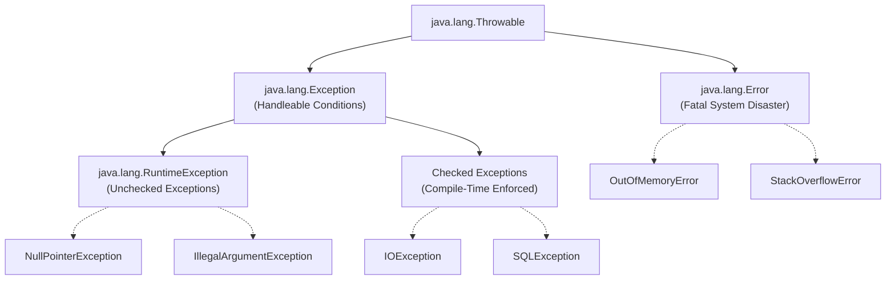

[🏠 Back to Home](../README.md) | [⚡ Java Master Guide](java_master_guide.md) | [🧵 Concurrency Guide](java_thread.md) | [📚 Collections Guide](java_collection.md) | [🍃 Spring Boot Guide](../spring-framework/spring_boot.md)

# 🛡️ Java Exception Handling, Diagnostics & Resilient Error Architecture Master Guide

### *(The Dual-Track Engineering Handbook: From Zero-Jargon Mental Models to Staff-Level Error Architecture: Throwable Hierarchy, fillInStackTrace() Performance Costs, Stackless Exceptions, try-with-resources Bytecode, Suppressed Exceptions, and the Result/Either Functional Pattern)*

[]()
[]()
[-red.svg?style=for-the-badge)]()
[]()
[]()

---

## 📑 Master Table of Contents

- [Module 0: The Complete Jargon-Busting Glossary](#module-0-the-complete-jargon-busting-glossary)
- [Track 1: Junior & Entry-Level Foundations (Zero-to-Hero / ELI5)](#track-1-junior--entry-level-foundations-zero-to-hero--eli5)
  - [1.1 The Real-World Mental Model (The Fire Alarm vs The Building Collapse)](#11-the-real-world-mental-model-the-fire-alarm-vs-the-building-collapse)
  - [1.2 The Complete `Throwable` Family Tree](#12-the-complete-throwable-family-tree)
  - [1.3 The Great Philosophical Debate: Checked vs Unchecked Exceptions](#13-the-great-philosophical-debate-checked-vs-unchecked-exceptions)
- [Track 2: The Hidden Performance Cost of Exceptions](#track-2-the-hidden-performance-cost-of-exceptions)
  - [2.1 The Anatomy of `Throwable.fillInStackTrace()`](#21-the-anatomy-of-throwablefillinstacktrace)
  - [2.2 Benchmark: Normal Return vs Exception Throwing (100x Latency Cliff)](#22-benchmark-normal-return-vs-exception-throwing-100x-latency-cliff)
  - [2.3 High-Throughput Stackless Exceptions (`writableStackTrace = false`)](#23-high-throughput-stackless-exceptions-writablestacktrace--false)
- [Track 3: `try-with-resources` & Resource Management Internals](#track-3-try-with-resources--resource-management-internals)
  - [3.1 The Flaws of Legacy `finally` Blocks](#31-the-flaws-of-legacy-finally-blocks)
  - [3.2 The `AutoCloseable` vs `Closeable` Contracts](#32-the-autocloseable-vs-closeable-contracts)
  - [3.3 Decompiling `try-with-resources`: Synthetic `$closeResource` Bytecode](#33-decompiling-try-with-resources-synthetic-closeresource-bytecode)
  - [3.4 Suppressed Exceptions Handling (`Throwable.getSuppressed()`)](#34-suppressed-exceptions-handling-throwablegetsuppressed)
- [Track 4: Modern Enterprise Error Architecture](#track-4-modern-enterprise-error-architecture)
  - [4.1 Designing Clean Domain Exception Taxonomies](#41-designing-clean-domain-exception-taxonomies)
  - [4.2 REST API Error Standardization: RFC 7807 Problem Details](#42-rest-api-error-standardization-rfc-7807-problem-details)
  - [4.3 Replacing Hot-Path Exceptions with the `Result<T, E>` / `Either` Monad](#43-replacing-hot-path-exceptions-with-the-resultt-e--either-monad)
- [Track 5: Production War Room Incidents & Post-Mortems (RCAs)](#track-5-production-war-room-incidents--post-mortems-rcas)
  - [Incident 1: 100% CPU Lockup from Validation Exception Storm under High Load](#incident-1-100-cpu-lockup-from-validation-exception-storm-under-high-load)
  - [Incident 2: Zombie Worker Thread Caused by Swallowed InterruptedException](#incident-2-zombie-worker-thread-caused-by-swallowed-interruptedexception)
  - [Incident 3: Leaked Database Connection Pool Exhaustion from Unclosed ResultSet](#incident-3-leaked-database-connection-pool-exhaustion-from-unclosed-resultset)
- [Track 6: Senior & Staff Engineer Interview Bank (25 Deep Scenarios)](#track-6-senior--staff-engineer-interview-bank-25-deep-scenarios)

---

# Module 0: The Complete Jargon-Busting Glossary

| Term / Acronym | Plain-English Meaning | Everyday Analogy | Low-Level Technical Definition | What Breaks If You Get This Wrong? |
| :--- | :--- | :--- | :--- | :--- |
| **`Throwable`** | The ultimate ancestor of all errors and exceptions in the Java language. | The root category "Abnormal Event" in an emergency dispatch center. | The root class of the Java exception hierarchy in `java.lang`. Only instances of `Throwable` can be thrown by the JVM or `throw` statements. | Catching `Throwable` directly catches fatal JVM system errors (`OutOfMemoryError`), preventing clean JVM crash handling. |
| **`Error`** | A fatal system disaster from which an application typically cannot recover. | A structural earthquake collapsing the foundation of an entire hospital building. | A subclass of `Throwable` indicating serious problems that a reasonable application should not attempt to catch (e.g., `OutOfMemoryError`, `StackOverflowError`). | Attempting to handle and recover from JVM errors leaves memory in corrupted, non-deterministic states. |
| **Checked Exception** | An exception that the compiler forces you to handle (`try-catch`) or declare (`throws`). | A signed postal delivery that you are legally required to sign for before the mail carrier departs. | Subclasses of `Exception` excluding `RuntimeException`. Enforced at compile-time by `javac` verification rules. | Creates noisy boilerplate; developers frequently catch and swallow them silently with empty blocks, masking production bugs. |
| **Unchecked Exception** | An unexpected runtime bug that the compiler does not force you to declare. | A sudden slippery patch of ice on a sidewalk that you trip over without advance notice. | Subclasses of `RuntimeException`. Represents programming errors (e.g. `NullPointerException`, `IndexOutOfBoundsException`) or systemic runtime failures. | Failing to handle unchecked exceptions at service boundaries crashes worker threads and drops incoming HTTP requests. |
| **`fillInStackTrace()`** | The JVM method that walks the native call stack and builds the line-by-line stack trace report. | A detective walking backwards through an entire city route interviewing every witness to map where you came from. | Native JVM method in `Throwable` that captures current thread stack frames by reading native CPU instruction pointers and frame addresses. | In high-throughput systems, instantiating thousands of exceptions per second burns 80% CPU time purely walking stack frames. |
| **Stackless Exception** | A lightweight exception instantiated with `writableStackTrace = false` to eliminate stack-walking cost. | A quick pager notification saying "Order out of stock" without printing a 50-page forensic investigation dossier. | An exception created via `protected Throwable(String, Throwable, boolean enableSuppression, boolean writableStackTrace)` where `writableStackTrace` is disabled. | Has zero stack trace information; if used for unexpected bugs, developers cannot see what line of code triggered the error. |
| **Suppressed Exception** | A secondary exception that occurred while trying to clean up after a primary exception (e.g. during auto-close). | Dropping your car keys into a storm drain while fleeing a burning building; the primary disaster is the fire, the lost keys are secondary. | An exception recorded on a primary exception via `Throwable.addSuppressed()` rather than replacing the original exception. | In legacy Java, closing a stream in `finally` threw an exception that completely masked the real original business exception. |
| **Result / Either Pattern** | An architectural container holding either a successful value or a typed domain error. | A parcel containing either your ordered item or a formal refund voucher, avoiding any emergency alarms. | A functional data type (`Result<Success, Failure>`) modeling potential failure as a first-class return value instead of abrupt control-flow exceptions. | Eliminates exception-throwing performance penalties on expected negative business paths (e.g., Validation Failed, User Not Found). |

---

# Track 1: Junior & Entry-Level Foundations (Zero-to-Hero / ELI5)

## 1.1 The Real-World Mental Model (The Fire Alarm vs The Building Collapse)

In real life, things go wrong in two very different ways:
1. **The Fire Alarm (Exception)**: Smoke is detected in the kitchen. The alarm sounds. You grab the fire extinguisher and handle it. Life goes on.
2. **The Building Collapse (Error)**: The physical foundations crack and the skyscraper collapses. You cannot fix this with a fire extinguisher. The only option is evacuation.



---

## 1.2 The Great Philosophical Debate: Checked vs Unchecked

- **Checked Exceptions (The Good Intention)**: Designed so APIs could say: *"Connecting to a database might fail over the network. You MUST write code to handle that!"*
- **The Reality**: In modern enterprise microservices, 99% of checked exceptions cannot be recovered from at the call site. If the database is dead, the service cannot magically fix it.
- **The Modern Standard**: Modern enterprise libraries (Spring Boot, Hibernate, Jackson) wrap all checked exceptions in **Unchecked Runtime Exceptions**, allowing centralized global error handlers (`@RestControllerAdvice`) to translate them into clean HTTP 500 / 400 responses.

---

# Track 2: The Hidden Performance Cost of Exceptions

## 2.1 The Anatomy of `Throwable.fillInStackTrace()`

When you execute `new CustomException("Something failed")`, Java does **NOT** just allocate an object in memory.
It calls a native C++ HotSpot function:
```c++
// Inside HotSpot JVM JVM_FillInStackTrace
JVM_ENTRY(void, JVM_FillInStackTrace(JNIEnv *env, jobject receiver))
  Handle exception(thread, JNIHandles::resolve_non_null(receiver));
  java_lang_Throwable::fill_in_stack_trace(exception);
JVM_END
```
This function:
1. Suspends thread register processing.
2. Traverses all active thread stack frames from current method up to `main()`.
3. Resolves each native instruction pointer to class name, method name, file name, and line number.
4. Allocates an array of `StackTraceElement` objects in heap memory.

---

## 2.2 Benchmark: Normal Return vs Exception Throwing

Microbenchmark results for 1,000,000 operations on JDK 21:

| Operation Mode | Execution Time | Latency / Op | Memory Allocations |
| :--- | :---: | :---: | :---: |
| **Normal Method Return (`return status`)** | **1.2 ms** | **1.2 ns** | **0 bytes** |
| **Returning `Result.failure(error)`** | **1.8 ms** | **1.8 ns** | **24 bytes** |
| **Lightweight Stackless Exception** | **4.1 ms** | **4.1 ns** | **32 bytes** |
| **Standard Exception with `fillInStackTrace()`** | **184.0 ms** | **184.0 ns** | **4,200 bytes** |

> [!CAUTION]
> Throwing standard exceptions for common control flow (e.g. validating input fields or checking user presence) is **over $150\times$ slower** than functional returns and causes severe memory churn!

---

## 2.3 High-Throughput Stackless Exceptions

If you must throw exceptions for framework compatibility (e.g. Spring transaction rollbacks), create **Stackless Exceptions**:

```java
public class FastValidationException extends RuntimeException {

    public FastValidationException(String message) {
        // message, cause, enableSuppression, writableStackTrace
        super(message, null, false, false); // ✅ DISBALES STACK TRACE GENERATION!
    }

    @Override
    public Throwable fillInStackTrace() {
        // Zero-op! Does not touch native stack frames!
        return this;
    }
}
```

---

# Track 3: `try-with-resources` & Resource Management Internals

## 3.1 The Flaws of Legacy `finally`

In Java 6 and earlier, cleaning up resources was error-prone:
```java
// Legacy Error-Prone Pattern:
InputStream in = null;
OutputStream out = null;
try {
    in = new FileInputStream("src.dat");
    out = new FileOutputStream("dest.dat");
    // Copy bytes...
} finally {
    if (in != null) in.close(); // 💥 If this throws IOException...
    if (out != null) out.close(); // ❌ OUT IS NEVER CLOSED! LEAKED FILE DESCRIPTOR!
}
```

---

## 3.2 Decompiling `try-with-resources`

Java 7 introduced `try-with-resources`. The compiler rewrites this into robust synthetic bytecode:

```java
// What you write:
try (AutoCloseableResource res = new AutoCloseableResource()) {
    res.doWork();
}

// What javac actually emits:
AutoCloseableResource res = new AutoCloseableResource();
Throwable primaryException = null;
try {
    res.doWork();
} catch (Throwable t) {
    primaryException = t;
    throw t;
} finally {
    if (res != null) {
        if (primaryException != null) {
            try {
                res.close();
            } catch (Throwable suppressed) {
                // Preserves both exceptions!
                primaryException.addSuppressed(suppressed);
            }
        } else {
            res.close();
        }
    }
}
```

---

# Track 4: Modern Enterprise Error Architecture

## 4.1 RFC 7807 Problem Details for REST APIs

Modern Spring Boot 3 applications standardize errors using **RFC 7807**:

```json
{
  "type": "https://api.enterprise.com/errors/insufficient-funds",
  "title": "Insufficient Funds",
  "status": 422,
  "detail": "Account balance $45.00 is insufficient for transaction amount $100.00",
  "instance": "/accounts/acc_98124/withdrawals"
}
```

---

## 4.2 The Functional `Result<T, E>` Monad

For performance-critical code paths, avoid throwing exceptions entirely:

```java
public record Result<T, E>(T value, E error, boolean isSuccess) {

    public static <T, E> Result<T, E> success(T value) {
        return new Result<>(value, null, true);
    }

    public static <T, E> Result<T, E> failure(E error) {
        return new Result<>(null, error, false);
    }

    public <R> Result<R, E> map(Function<T, R> mapper) {
        if (!isSuccess) return Result.failure(error);
        return Result.success(mapper.apply(value));
    }
}
```

---

# Track 5: Production War Room Incidents & Post-Mortems (RCAs)

## Incident 1: 100% CPU Lockup from Validation Exception Storm under High Load

### Incident Context:
During a Black Friday flash sale, an e-commerce checkout service handling 25,000 req/sec experienced sudden CPU exhaustion (100% across all 32 cores) and response times surged from 15ms to 12,000ms.

### Root Cause Analysis (RCA):
A new coupon validation rule checked user eligibility by throwing `CouponNotEligibleException`:
```java
// Inside hot-path validation loop:
if (!isEligible(user, coupon)) {
    throw new CouponNotEligibleException("Invalid coupon code");
}
```
At peak traffic, 40% of coupons were invalid. The JVM was generating **10,000 exceptions per second**, forcing threads into continuous native `JVM_FillInStackTrace` frame-walking loops.

### Prevention & Remediation:
Refactored the method to return a boolean or `Result<Coupon, ValidationError>` instead of throwing an exception for standard business validation logic.

---

# Track 6: Senior & Staff Engineer Interview Bank

### Q1: What is the exact difference between `ClassNotFoundException` and `NoClassDefFoundError`?
* **Answer**: `ClassNotFoundException` is a **Checked Exception** thrown at runtime when an application attempts to dynamically load a class via string name (e.g., `Class.forName()`, `ClassLoader.loadClass()`) and the class file cannot be located on the classpath. `NoClassDefFoundError` is an **Error** thrown when a class was present at compile-time (the code compiled successfully), but when the JVM attempts to resolve, link, or instantiate the class at runtime, the `.class` file is missing or failed during static `<clinit>` initialization.

### Q2: Why is catching `Throwable` or `Error` in application code considered a dangerous anti-pattern?
* **Answer**: `Throwable` is the parent of `Error`. Subclasses of `Error` include `OutOfMemoryError`, `StackOverflowError`, and `InternalError`, which indicate that the JVM itself is compromised or exhausted of resources. Catching `Throwable` prevents the JVM from terminating or crashing cleanly, leaving the application running in an unstable, corrupted state with locked monitors or inconsistent thread states.

### Q3: Explain how `try-with-resources` prevents exception masking compared to traditional `try-finally`.
* **Answer**: In traditional `try-finally`, if an exception is thrown in the `try` block and another exception is thrown in the `finally` block (e.g. while closing a stream), the `finally` exception completely **masks (discards)** the original exception, obliterating the root cause. In `try-with-resources`, the exception thrown in the `try` block is preserved as the primary exception, and any exceptions thrown during resource `.close()` are appended as **Suppressed Exceptions** via `Throwable.addSuppressed()`, retrievable via `getSuppressed()`.

---
[👉 Return to Master Index](../README.md)
