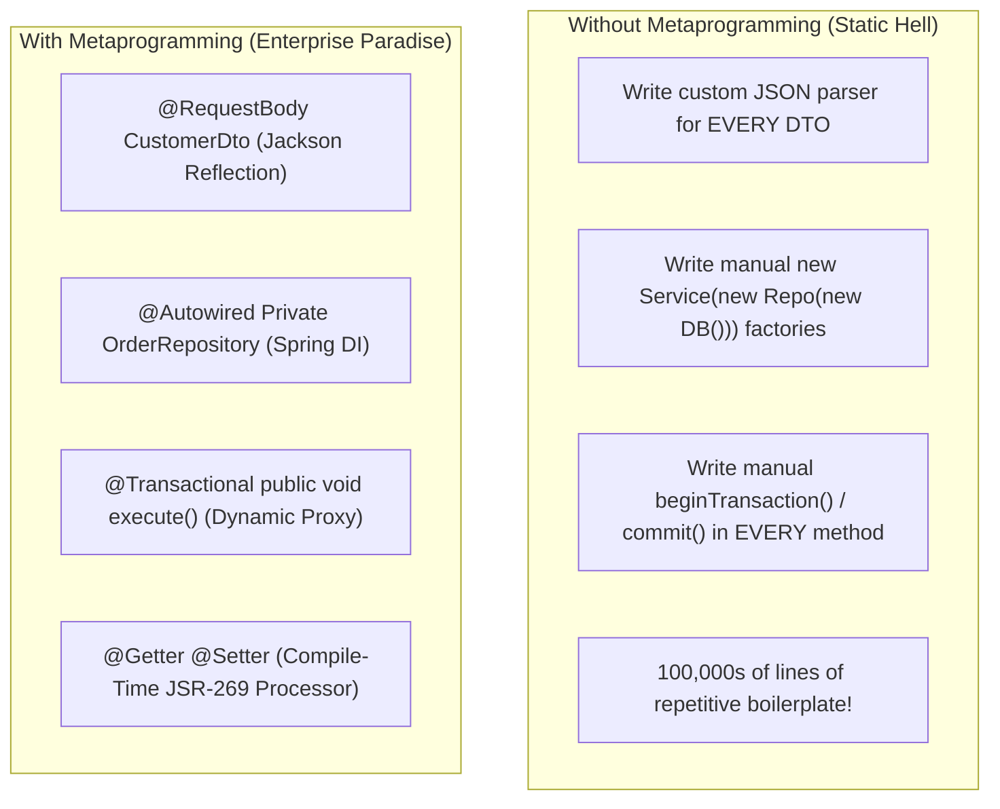
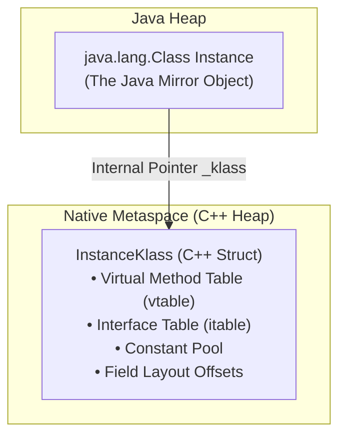
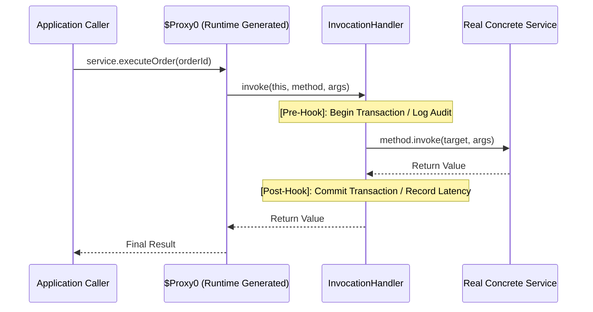
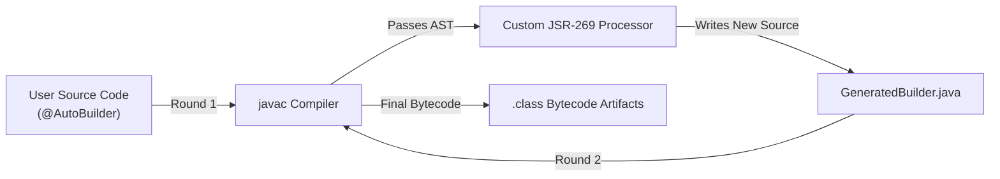

[🏠 Back to Home](../README.md) | [⚡ Java Master Guide](java_master_guide.md) | [🧵 Concurrency Masterclass](java_thread.md) | [⚡ JIT Compiler Guide](jvm_jit_compiler_master_guide.md) | [🍃 Spring AOP Architecture](../spring-framework/spring_aop_master_guide.md)

# 🔮 Java Reflection, MethodHandles, Dynamic Proxies & Annotation Processing Master Guide

### *(The Definitive 360° Systems Engineering Handbook: From Zero-Jargon Beginner Foundations to Staff-Level Runtime Metaprogramming: Reflection API, MethodHandles & VarHandle, Dynamic Proxies ($Proxy0), CGLIB & Byte Buddy, JSR-269 Compile-Time Processors, `--add-opens` Modular Encapsulation, and Production Java Agents)*

[]()
[]()
[]()
[]()
[]()

---

## 📑 Master Table of Contents

- [Module 0: The Complete Jargon-Busting Glossary (35 Essential Terms)](#module-0-the-complete-jargon-busting-glossary-35-essential-terms)
- [Track 1: Junior & Entry-Level Foundations (Zero-to-Hero / ELI5)](#track-1-junior--entry-level-foundations-zero-to-hero--eli5)
  - [1.1 The Real-World Mental Models](#11-the-real-world-mental-models)
  - [1.2 The Fundamental Problem: Static Compilers vs Dynamic Frameworks](#12-the-fundamental-problem-static-compilers-vs-dynamic-frameworks)
  - [1.3 The 4 Metaprogramming Paradigms Compared](#13-the-4-metaprogramming-paradigms-compared)
  - [1.4 Comprehensive Feature Matrix & Decision Tree](#14-comprehensive-feature-matrix--decision-tree)
  - [1.5 Pros and Cons Matrix of All Metaprogramming Approaches](#15-pros-and-cons-matrix-of-all-metaprogramming-approaches)
- [Track 2: Deep Dive into Classic Reflection (`java.lang.reflect`)](#track-2-deep-dive-into-classic-reflection-javalangreflect)
  - [2.1 The Class Subsystem: Class Metadata in Metaspace](#21-the-class-subsystem-class-metadata-in-metaspace)
  - [2.2 Feature 1: Class Metadata Inspection](#22-feature-1-class-metadata-inspection)
    - [What it is & Features](#what-it-is--features)
    - [How to Use it: Step-by-Step Production Code Blueprint](#how-to-use-it-step-by-step-production-code-blueprint)
    - [Pros and Cons](#pros-and-cons)
  - [2.3 Feature 2: Constructors & Dynamic Instantiation](#23-feature-2-constructors--dynamic-instantiation)
    - [What it is & Why `Class.newInstance()` was Deprecated in Java 9](#what-it-is--why-classnewinstance-was-deprecated-in-java-9)
    - [How to Use it: Invoking Parameterized & Private Constructors](#how-to-use-it-invoking-parameterized--private-constructors)
    - [Pros and Cons](#pros-and-cons-1)
  - [2.4 Feature 3: Field Inspection, Modification & Mutating `final` Fields](#24-feature-3-field-inspection-modification--mutating-final-fields)
    - [What it is & How Field Access Works](#what-it-is--how-field-access-works)
    - [How to Use it: Reading & Writing Hidden Private Fields](#how-to-use-it-reading--writing-hidden-private-fields)
    - [The Dangerous Pitfall: Modifying `final` & `static final` Fields](#the-dangerous-pitfall-modifying-final--static-final-fields)
    - [Pros and Cons](#pros-and-cons-2)
  - [2.5 Feature 4: Dynamic Method Invocation (`Method.invoke`)](#25-feature-4-dynamic-method-invocation-methodinvoke)
    - [What it is & How Method Invocation Works Internally](#what-it-is--how-method-invocation-works-internally)
    - [How to Use it: Invoking Overloaded, Static & Private Methods](#how-to-use-it-invoking-overloaded-static--private-methods)
    - [HotSpot JIT Inflation Mechanics (`NativeMethodAccessorImpl` to Generated Bytecode)](#hotspot-jit-inflation-mechanics-nativemethodaccessorimpl-to-generated-bytecode)
    - [Pros and Cons](#pros-and-cons-3)
  - [2.6 Feature 5: Generics Reflection & Type Introspection](#26-feature-5-generics-reflection--type-introspection)
    - [What it is & How Type Signatures Survive Type Erasure](#what-it-is--how-type-signatures-survive-type-erasure)
    - [How to Use it: Extracting Generic Parameters from Fields & Methods](#how-to-use-it-extracting-generic-parameters-from-fields--methods)
    - [Pros and Cons](#pros-and-cons-4)
  - [2.7 Feature 6: Dynamic Array Reflection (`java.lang.reflect.Array`)](#27-feature-6-dynamic-array-reflection-javalangreflectarray)
    - [What it is & How it Bypasses Component Type Erasure](#what-it-is--how-it-bypasses-component-type-erasure)
    - [How to Use it: Resizing & Allocating Arrays Dynamically](#how-to-use-it-resizing--allocating-arrays-dynamically)
    - [Pros and Cons](#pros-and-cons-5)
  - [2.8 The Java 9+ Module Barrier: Strong Encapsulation, `--add-opens` & `--add-exports`](#28-the-java-9-module-barrier-strong-encapsulation---add-opens---add-exports)
    - [The JPMS Encapsulation Model](#the-jpms-encapsulation-model)
    - [Command Line Flags: `--add-opens` vs `--add-exports`](#command-line-flags---add-opens-vs---add-exports)
    - [Runtime Behavioral Differences: Java 8 vs 11 vs 17 vs 21](#runtime-behavioral-differences-java-8-vs-11-vs-17-vs-21)
- [Track 3: High-Performance Invocation: `MethodHandles` & `VarHandle`](#track-3-high-performance-invocation-methodhandles--varhandle)
  - [3.1 The Silicon Problem: Why Classic Reflection Cannot Scale](#31-the-silicon-problem-why-classic-reflection-cannot-scale)
  - [3.2 Feature 1: `MethodHandles.Lookup` (Caller Sensitivity & Permissions)](#32-feature-1-methodhandleslookup-caller-sensitivity--permissions)
    - [What it is & How Lookup Modes Work](#what-it-is--how-lookup-modes-work)
    - [How to Use it: Finding Constructors, Virtual & Static Methods](#how-to-use-it-finding-constructors-virtual--static-methods)
    - [Pros and Cons](#pros-and-cons-6)
  - [3.3 Feature 2: `MethodType` Descriptor Factory](#33-feature-2-methodtype-descriptor-factory)
    - [What it is & Immutability Guarantees](#what-it-is--immutability-guarantees)
    - [How to Use it: Composing Complex Signatures](#how-to-use-it-composing-complex-signatures)
    - [Pros and Cons](#pros-and-cons-7)
  - [3.4 Feature 3: Exact vs Generic Invocations (`invokeExact` vs `invoke`)](#34-feature-3-exact-vs-generic-invocations-invokeexact-vs-invoke)
    - [What it is & The Strict Exact Type Matching Rule](#what-it-is--the-strict-exact-type-matching-rule)
    - [How to Use it: Reaching Direct Bytecode Speed](#how-to-use-it-reaching-direct-bytecode-speed)
    - [Pros and Cons](#pros-and-cons-8)
  - [3.5 Feature 4: Combinators & Dynamic Transformations](#35-feature-4-combinators--dynamic-transformations)
    - [What it is: Functional Method Piping](#what-it-is-functional-method-piping)
    - [How to Use it: `bindTo`, `filterArguments`, `guardWithTest`, `dropArguments`](#how-to-use-it-bindto-filterarguments-guardwithtest-droparguments)
    - [Pros and Cons](#pros-and-cons-9)
  - [3.6 Feature 5: `VarHandle` & Low-Level Memory Ordering](#36-feature-5-varhandle--low-level-memory-ordering)
    - [What it is & Replacing `sun.misc.Unsafe`](#what-it-is--replacing-sunmiscunsafe)
    - [How to Use it: Atomic CAS, Acquire-Release, and Volatile Fences](#how-to-use-it-atomic-cas-acquire-release-and-volatile-fences)
    - [Pros and Cons](#pros-and-cons-10)
  - [3.7 Feature 6: Dynamic Call Sites & `invokedynamic`](#37-feature-6-dynamic-call-sites--invokedynamic)
    - [What it is: The JSR 292 Architecture](#what-it-is-the-jsr-292-architecture)
    - [How to Use it: `ConstantCallSite`, `MutableCallSite`, `VolatileCallSite`](#how-to-use-it-constantcallsite-mutablecallsite-volatilecallsite)
    - [Pros and Cons](#pros-and-cons-11)
  - [3.8 Nanosecond Benchmarks: Direct vs MethodHandle vs Reflection](#38-nanosecond-benchmarks-direct-vs-methodhandle-vs-reflection)
- [Track 4: Dynamic Proxies & Runtime Bytecode Generation](#track-4-dynamic-proxies--runtime-bytecode-generation)
  - [4.1 Architecture of a Dynamic Proxy: The Interception Pattern](#41-architecture-of-a-dynamic-proxy-the-interception-pattern)
  - [4.2 Feature 1: JDK Dynamic Proxies (`java.lang.reflect.Proxy`)](#42-feature-1-jdk-dynamic-proxies-javalangreflectproxy)
    - [What it is & The `$Proxy0` Subsystem](#what-it-is--the-proxy0-subsystem)
    - [How to Use it: Complete Production Auditing & Security Proxy](#how-to-use-it-complete-production-auditing--security-proxy)
    - [Deep Bytecode Disassembly of Generated `$Proxy0.class`](#deep-bytecode-disassembly-of-generated-proxy0class)
    - [The Inflexible Constraint: Interface-Only Limitation](#the-inflexible-constraint-interface-only-limitation)
    - [Pros and Cons](#pros-and-cons-12)
  - [4.3 Feature 2: CGLIB (Code Generation Library)](#43-feature-2-cglib-code-generation-library)
    - [What it is & How Subclassing Works](#what-it-is--how-subclassing-works)
    - [How to Use it: `Enhancer` and `MethodInterceptor`](#how-to-use-it-enhancer-and-methodinterceptor)
    - [Pitfalls: Final Classes, Final Methods, and ClassLoader Bloat](#pitfalls-final-classes-final-methods-and-classloader-bloat)
    - [Pros and Cons](#pros-and-cons-13)
  - [4.4 Feature 3: Byte Buddy (The Modern Industry Standard)](#44-feature-3-byte-buddy-the-modern-industry-standard)
    - [What it is & Why It Replaced CGLIB in Modern Spring & Hibernate](#what-it-is--why-it-replaced-cglib-in-modern-spring--hibernate)
    - [How to Use it: Subclassing, Method Interception & `@RuntimeType`](#how-to-use-it-subclassing-method-interception--runtimetype)
    - [Pros and Cons](#pros-and-cons-14)
  - [4.5 Enterprise Framework Proxy Case Studies](#45-enterprise-framework-proxy-case-studies)
    - [How Spring Boot `@Transactional` Really Works Under the Hood](#how-spring-boot-transactional-really-works-under-the-hood)
    - [The Self-Invocation Bug: Why `this.method()` Silently Fails & 3 Production Fixes](#the-self-invocation-bug-why-thismethod-silently-fails--3-production-fixes)
    - [How Hibernate Implements Lazy Loading with Entity Proxies](#how-hibernate-implements-lazy-loading-with-entity-proxies)
- [Track 5: Java Annotations & Compile-Time Processing (APT / JSR-269)](#track-5-java-annotations--compile-time-processing-apt--jsr-269)
  - [5.1 Anatomy of Custom Annotations](#51-anatomy-of-custom-annotations)
  - [5.2 Feature 1: The Meta-Annotations Standard](#52-feature-1-the-meta-annotations-standard)
    - [What it is: `@Target`, `@Retention`, `@Documented`, `@Inherited`, `@Repeatable`](#what-it-is-target-retention-documented-inherited-repeatable)
    - [The 3 Retention Policies: SOURCE vs CLASS vs RUNTIME](#the-3-retention-policies-source-vs-class-vs-runtime)
    - [Pros and Cons](#pros-and-cons-15)
  - [5.3 Feature 2: Runtime Annotation Introspection via Reflection](#53-feature-2-runtime-annotation-introspection-via-reflection)
    - [What it is & How Annotations are Loaded into Metaspace](#what-it-is--how-annotations-are-loaded-into-metaspace)
    - [How to Use it: Building a Custom `@RateLimited` Validator Engine](#how-to-use-it-building-a-custom-ratelimited-validator-engine)
    - [Pros and Cons](#pros-and-cons-16)
  - [5.4 Feature 3: Compile-Time Annotation Processing (JSR-269 APT)](#54-feature-3-compile-time-annotation-processing-jsr-269-apt)
    - [What it is & The `javac` Round-Based Compilation Lifecycle](#what-it-is--the-javac-round-based-compilation-lifecycle)
    - [How to Use it: Building a Production Auto-Builder Source Code Generator](#how-to-use-it-building-a-production-auto-builder-source-code-generator)
    - [How Flagship Libraries Work: Lombok (AST Mutation) vs MapStruct (Source Generation)](#how-flagship-libraries-work-lombok-ast-mutation-vs-mapstruct-source-generation)
    - [Pros and Cons](#pros-and-cons-17)
- [Track 6: Java Agents & Bytecode Instrumentation (`java.lang.instrument`)](#track-6-java-agents--bytecode-instrumentation-javalanginstrument)
  - [6.1 The JVM Tool Interface (JVMTI) & Instrumentation Substrate](#61-the-jvm-tool-interface-jvmti--instrumentation-substrate)
  - [6.2 Feature 1: Static Loading (`premain` via `-javaagent`)](#62-feature-1-static-loading-premain-via--javaagent)
    - [What it is & How the JVM Loads Agents Before `main()`](#what-it-is--how-the-jvm-loads-agents-before-main)
    - [How to Use it: Writing the Manifest & Premain Class](#how-to-use-it-writing-the-manifest--premain-class)
    - [Pros and Cons](#pros-and-cons-18)
  - [6.3 Feature 2: Dynamic Agent Attachment (`agentmain` via Attach API)](#63-feature-2-dynamic-agent-attachment-agentmain-via-attach-api)
    - [What it is & Attaching to Live Production JVMs](#what-it-is--attaching-to-live-production-jvms)
    - [How to Use it: Connecting via PID and Injecting Bytecode](#how-to-use-it-connecting-via-pid-and-injecting-bytecode)
    - [Pros and Cons](#pros-and-cons-19)
  - [6.4 Feature 3: `ClassFileTransformer` & Bytecode Redefinition](#64-feature-3-classfiletransformer--bytecode-redefinition)
    - [What it is & Difference between `retransformClasses` and `redefineClasses`](#what-it-is--difference-between-retransformclasses-and-redefineclasses)
    - [How to Use it: Complete Production Execution-Timer Agent with Byte Buddy](#how-to-use-it-complete-production-execution-timer-agent-with-byte-buddy)
    - [Pros and Cons](#pros-and-cons-20)
- [Track 7: Production Blueprints & Hardened Systems](#track-7-production-blueprints--hardened-systems)
  - [Blueprint 1: High-Performance Zero-Reflection JSON Serializer using MethodHandles](#blueprint-1-high-performance-zero-reflection-json-serializer-using-methodhandles)
  - [Blueprint 2: Dynamic Multi-Tenant Database Routing Proxy](#blueprint-2-dynamic-multi-tenant-database-routing-proxy)
  - [Blueprint 3: Production Compile-Time Fluent Builder Processor (JSR-269)](#blueprint-3-production-compile-time-fluent-builder-processor-jsr-269)
  - [Blueprint 4: Resilient Circuit-Breaker Dynamic Proxy with Automated Fallback](#blueprint-4-resilient-circuit-breaker-dynamic-proxy-with-automated-fallback)
  - [Blueprint 5: Dynamic API Gateway Request Validator using Custom Annotations](#blueprint-5-dynamic-api-gateway-request-validator-using-custom-annotations)
- [Track 8: Production War Room Incidents & Post-Mortems (RCAs)](#track-8-production-war-room-incidents--post-mortems-rcas)
  - [Incident 1: The JDK 17 Migration `InaccessibleObjectException` Disaster](#incident-1-the-jdk-17-migration-inaccessibleobjectexception-disaster)
  - [Incident 2: CGLIB Metaspace OOM Crash from Uncached Proxy Generation](#incident-2-cglib-metaspace-oom-crash-from-uncached-proxy-generation)
  - [Incident 3: Silent Transaction Failure from Self-Invocation Proxy Bypass](#incident-3-silent-transaction-failure-from-self-invocation-proxy-bypass)
  - [Incident 4: Reflection in Hot Loop Causing 80% CPU Saturation & GC Pause Storms](#incident-4-reflection-in-hot-loop-causing-80-cpu-saturation--gc-pause-storms)
  - [Incident 5: Java Agent Bytecode Corruption Triggering Fatal `VerifyError`](#incident-5-java-agent-bytecode-corruption-triggering-fatal-verifyerror)
  - [Incident 6: ThreadLocal Memory Leak in Custom Annotation Interceptor](#incident-6-threadlocal-memory-leak-in-custom-annotation-interceptor)
- [Track 9: Senior & Staff Engineer Interview Bank (35 Deep Scenarios)](#track-9-senior--staff-engineer-interview-bank-35-deep-scenarios)

---

# Module 0: The Complete Jargon-Busting Glossary (35 Essential Terms)

> [!TIP]
> **How to use this glossary**: Whenever you encounter intimidating runtime terms, look here first. Every term is paired with a plain-English definition, an intuitive real-world mental model, low-level technical specifications, and what fails in production if misunderstood.

| Term / Acronym | Plain-English Meaning | Everyday Analogy | Low-Level Technical Definition | What Breaks If You Get This Wrong? |
| :--- | :--- | :--- | :--- | :--- |
| **Reflection** | Inspecting, invoking, and modifying classes, methods, and fields at runtime without compile-time knowledge. | An X-ray scanner examining inside a locked shipping container without opening the latch. | JVM runtime API in `java.lang.reflect` querying `Class<?>` metadata structures in Metaspace and invoking methods via native/generated accessor stubs. | Loses compile-time type safety; throws runtime exceptions (`NoSuchMethodException`, `IllegalAccessException`) and prevents JIT inlining. |
| **`setAccessible(true)`** | Instructs the JVM access controller to suppress Java language access checks (private/protected). | A master skeleton key opening private office doors regardless of key locks. | Suppresses member access control checks via `AccessibleObject.setAccessible(true)` by modifying internal `override` boolean flags. | Throws fatal `InaccessibleObjectException` in Java 17+ if the target class is inside an encapsulated JDK module not opened via `--add-opens`. |
| **`MethodHandles`** | A modern, high-speed, type-safe pointer to an executable method, constructor, or field. | A pre-verified VIP backstage security wristband allowing direct stage entry. | A typed reference (`java.lang.invoke.MethodHandle`) validated at creation time (`Lookup`). The HotSpot JIT compiler treats it like a direct bytecode invocation. | Passing mismatched parameter types to `invokeExact()` (even `Integer` instead of `int`) immediately throws `WrongMethodTypeException`. |
| **`MethodHandles.Lookup`** | The security context and permission snapshot of the class requesting a `MethodHandle`. | An ID badge displaying the security clearance level of the person requesting a master key. | Context object created via `MethodHandles.lookup()` capturing caller access rights (`PRIVATE`, `PROTECTED`, `PACKAGE`, `PUBLIC`, `MODULE`). | Attempting to look up private members of another class without appropriate lookup privileges throws `IllegalAccessException`. |
| **`VarHandle`** | Strongly-typed variable handle providing fine-grained memory fences and atomic operations. | A precision torque wrench allowing exact adjustments (Plain, Opaque, Release/Acquire, Volatile). | Modern Java 9+ replacement for `sun.misc.Unsafe` providing atomic compare-and-set and memory ordering primitives for fields and array elements. | Selecting incorrect memory ordering modes (e.g., using `Plain` instead of `Acquire/Release`) introduces severe concurrency bugs on ARM/weak memory CPUs. |
| **`invokedynamic` (indy)** | Bytecode instruction delegating method linkage to dynamic user-defined bootstrap methods at runtime. | A phone call routing switchboard that connects your call to the best operator dynamically based on caller volume. | JVM opcode ($0xba$) introduced in Java 7 (JSR 292) linking call sites dynamically via a bootstrap method (`BSM`) returning a `CallSite` object. | Broken bootstrap methods fail class verification or throw `BootstrapMethodError` during first-time execution. |
| **JDK Dynamic Proxy** | A runtime-generated class in memory that implements one or more interfaces and routes calls to an `InvocationHandler`. | A stunt double standing in for an actor, intercepting scene instructions and performing stunts. | A synthesized class generated in memory by `java.lang.reflect.Proxy` extending `Proxy` and implementing specified interfaces with calls dispatched to `InvocationHandler.invoke()`. | **Cannot proxy concrete classes**—only interfaces. Attempting to cast to a concrete implementation throws fatal `ClassCastException`. |
| **CGLIB** | Bytecode library generating concrete subclasses of target classes at runtime to intercept method invocations. | A 3D printer manufacturing a modified clone of a mechanical tool directly on the factory floor. | Library using ASM to dynamically synthesize new subclasses extending target classes and routing method calls through `MethodInterceptor` callbacks. | Cannot proxy `final` classes or `final` methods. Spawning uncached proxies causes catastrophic Metaspace memory leaks (`OutOfMemoryError`). |
| **Byte Buddy** | Modern, declarative, type-safe bytecode generation library used by Spring Boot and Hibernate. | An advanced robotic manufacturing arm precision-crafting customized machinery in real-time. | Modern bytecode manipulation library generating clean, efficient JVM bytecode without exposing low-level opcode mechanics; natively modular and JDK 21+ compliant. | Misconfiguring interceptor binding annotations (`@RuntimeType`, `@SuperCall`) causes runtime binding mismatch errors. |
| **Self-Invocation** | A method inside a class calling another method on the same instance via `this.method()`. | A doctor trying to perform surgery on their own back instead of letting an outside surgeon operate. | Direct invocation within a target instance bypassing the outer dynamic proxy wrapper, executing target code directly without interceptors. | Bypasses proxy-based cross-cutting concerns: `@Transactional`, `@Async`, `@Cacheable`, and `@PreAuthorize` silently fail to trigger. |
| **Annotation Processing (APT)** | Compiler plugins executing during `javac` compilation to inspect annotations and generate new `.java` source files. | An architectural drafting machine reading building blueprints and automatically generating electrical schematics. | JSR-269 plug-in framework executing during `javac` rounds. Inspects code syntax trees and writes new source files with zero runtime overhead. | Processors attempting to mutate existing class ASTs (outside of unofficial compiler hacks like Lombok) are forbidden by the JSR-269 specification. |
| **`--add-opens`** | JVM startup flag forcing an encapsulated module package to allow deep reflection access to private members. | A special legal warrant granting building inspectors entry into a bank vault. | Command-line option (`--add-opens <module>/<package>=<target-module>`) opening package internals for deep reflection in modular JDK runtimes. | Missing flag causes third-party frameworks to crash on startup under Java 17+ with `InaccessibleObjectException`. |
| **Java Agent** | A specialized JAR executing alongside the JVM that can intercept and rewrite class bytecode before execution. | An airport security checkpoint scanning and stamping every piece of luggage before it boards the aircraft. | A tool packaged with `Premain-Class` or `Agent-Class` utilizing `java.lang.instrument.Instrumentation` to inspect and transform class bytecode. | Malformed bytecode emitted by agent transformers causes fatal JVM crashes with `VerifyError` or `ClassFormatError`. |
| **Inflation Threshold** | The HotSpot threshold count after which reflection switches from native C++ JNI calls to generated bytecode. | An athlete who walks for 15 warmup steps before sprinting at full speed. | JVM configuration (`-Dsun.reflect.inflationThreshold=15`) dictating when `NativeMethodAccessorImpl` generates a synthetic Java class accessor in Metaspace. | Disabling inflation or setting the threshold too high burns CPU cycles in native JNI dispatch; setting it to 0 inflates bytecode immediately, consuming Metaspace. |
| **CallSite** | The stateful JVM object holding a MethodHandle target linked to an `invokedynamic` instruction. | A programmable physical patch cable connecting an audio instrument to a specific amplifier. | Class in `java.lang.invoke` (`ConstantCallSite`, `MutableCallSite`, `VolatileCallSite`) anchoring a method pointer to an execution call site in bytecode. | Failing to stabilize call sites forces the JIT compiler to deoptimize repeatedly, degrading throughput to interpreter speeds. |
| **`TypeReference`** | Anonymous subclass pattern capturing generic type parameters despite runtime type erasure. | A notarized photocopy of a birth certificate kept inside a safe deposit box. | Neal Gafter's idiom exploiting `Class.getGenericSuperclass()` on an anonymous inner class to extract parameterized type arguments at runtime. | Passing raw `TypeReference` without `<T>` causes `ClassCastException` during type parameter extraction. |
| **`ParameterizedType`** | Reflection type representing an instantiated generic type such as `List<String>`. | A shipping crate stamped with both the container model and the exact registered cargo category. | Subinterface of `java.lang.reflect.Type` exposing `getActualTypeArguments()`, `getRawType()`, and `getOwnerType()`. | Casting raw `Class` directly to `ParameterizedType` without checking `instanceof` throws runtime `ClassCastException`. |
| **`Method.invoke`** | Reflection method dynamically invoking the underlying method on a target instance with arguments. | Using a universal remote control to punch in a channel number on any television brand. | Dispatches method execution via `MethodAccessor.invoke()`. Automatically converts primitive parameters to wrappers and unboxes returns. | Passing null as the instance argument for a non-static method throws `NullPointerException`; passing incorrect argument counts throws `IllegalArgumentException`. |
| **`InvocationTargetException`** | A wrapper exception thrown by reflection when the invoked constructor or method throws an exception. | A protective blast container encasing a package that detonated inside the inspection room. | Checked exception wrapping the actual underlying runtime or checked exception thrown by the target code. Accessible via `getCause()`. | Forgetting to unwrap `getCause()` logs misleading reflection errors instead of the actual root-cause business exception. |
| **`ClassCastException`** | Runtime exception thrown when code attempts to cast an object to a class of which it is not an instance. | Trying to force a square shipping crate into a circular pneumatic mail tube. | Thrown by JVM `checkcast` bytecode instruction when the runtime Klass pointer of the heap object is incompatible with the target type. | Common when casting dynamic proxies to concrete implementation classes instead of their implemented interfaces. |
| **`ASM`** | Low-level Java bytecode manipulation and analysis framework. | A microscopic soldering iron used to rewire electronic circuit chips trace by trace. | High-performance bytecode visitor and tree library operating directly on raw compiled JVM bytecode streams ($0xCAFEBABE$). | Very steep learning curve; emitting invalid bytecode instructions crashes the JVM with unrecoverable `VerifyError`. |
| **`Javassist`** | High-level bytecode editor allowing developers to manipulate class bytecode using Java source syntax. | A scriptable automated machine tool that accepts high-level commands to modify metal parts. | Library that compiles Java source strings into bytecode at runtime and injects them into existing `.class` structures. | Slower than ASM/Byte Buddy; limited support for modern Java 17/21 language features like records, pattern matching, and sealed types. |
| **`Instrumentation`** | JVM service providing services needed to instrument Java code, such as registering bytecode transformers. | The master engineering console of a power station allowing engineers to inspect and modify turbine code on the fly. | Interface in `java.lang.instrument` providing `addTransformer()`, `retransformClasses()`, and `redefineClasses()`. | Memory leaks if classes transformed repeatedly retain strong references in custom agent classloaders. |
| **`retransformClasses`** | Re-running all registered `ClassFileTransformer` filters over already loaded classes without modifying schema. | Sending an existing document back through the proofreading department for a fresh markup. | JVMTI capability that triggers the transformation chain again on loaded classes without replacing the original class bytes directly. | Cannot add, remove, or rename fields or method signatures; attempting schema changes throws `UnsupportedOperationException`. |
| **`redefineClasses`** | Replacing the definition of already loaded classes with arbitrary new bytecode bytes. | Tearing out a page from an encyclopedia and gluing a completely new page in its place. | JVMTI mechanism that swaps the bytecode of an active class with an array of new class definitions. | Breaking binary compatibility (e.g. altering field layouts or superclasses) causes catastrophic JVM crashes. |
| **`ClassFileTransformer`** | An agent plugin that transforms class bytecode during the loading or retransformation phase. | A customs officer who reads incoming shipping manifests and stamps modifications onto them before entry. | Functional interface `byte[] transform(ClassLoader, String, Class, ProtectionDomain, byte[])` returning mutated bytecode. | Throwing an uncaught exception inside the transformer cancels transformation; returning null leaves class untouched. |
| **`Attach API`** | JDK management utility allowing a Java process to connect to another running JVM process on the same OS host. | A mobile mechanics van pulling up alongside a moving train and plugging in diagnostic cables. | API in `com.sun.tools.attach.VirtualMachine` communicating over local Unix Domain Sockets or Windows Named Pipes. | Blocked if security restrictions or container cgroup namespaces prevent inter-process signaling (e.g. missing `SYS_PTRACE`). |
| **`RoundEnvironment`** | The compile-time contextual state passed to an annotation processor during each round of compilation. | The daily inspection report presented to a manufacturing supervisor listing all new products made today. | JSR-269 interface providing `getElementsAnnotatedWith()` to discover elements marked with specific annotations in the current round. | Failing to handle multi-round generation triggers infinite loops or missing dependencies in downstream compiler rounds. |
| **`Filer`** | JSR-269 compiler service supporting the creation of new source, class, or auxiliary resource files. | The official printing press of the compiler that only accepts cleanly drafted documents. | Interface used by annotation processors to write new `.java` or `.class` files via `createSourceFile()` or `createClassFile()`. | Attempting to overwrite an existing file directly throws `FilerException`. |
| **`Messager`** | JSR-269 compiler service for reporting error, warning, and informational messages during compilation. | A loudspeaker system in a warehouse that alerts workers when a packaging spec is violated. | Interface enabling annotation processors to emit compiler diagnostic errors (`Diagnostic.Kind.ERROR`) tied to source code line numbers. | Emitting an ERROR kind immediately causes `javac` to fail the overall build, stopping compilation. |
| **`Element`** | Compile-time structural representation of a program element (package, class, method, field, parameter). | A modular architectural Lego brick in a building blueprint. | JSR-269 interface modeling the static AST of Java code: `PackageElement`, `TypeElement`, `ExecutableElement`, `VariableElement`. | Confusing compile-time `Element` with runtime `Class<?>` or `Method` leads to incorrect APT implementations. |
| **`TypeMirror`** | Compile-time representation of a Java type (including primitives, declared types, arrays, wildcards). | The architectural color and material spec assigned to an element in a blueprint. | JSR-269 interface modeling types in the compiler's type system: `DeclaredType`, `ArrayType`, `PrimitiveType`, `ExecutableType`. | `TypeMirror` instances cannot be compared using `equals()`; they must be compared using `Types.isSameType()`. |
| **`Unsafe` (`sun.misc.Unsafe`)** | Low-level, non-standard JDK internal class providing direct memory allocation, raw pointer math, and hardware CAS. | A direct high-voltage electrical cable stripped of insulation; extreme power, but fatal if mishandled. | Internal HotSpot class providing raw off-heap access and hardware CAS instructions. Encapsulated in Java 9+ and deprecated for removal. | Writing to an unmapped memory address instantly triggers a segmentation fault (`SIGSEGV`), immediately terminating the JVM process. |
| **`Hidden Classes`** | Dynamically generated classes that cannot be directly linked by name or discovered by other classes. | An unmarked undercover vehicle operating in traffic without a registered license plate. | Feature introduced in Java 15 (`MethodHandles.Lookup.defineHiddenClass`) allowing frameworks to generate unnameable, unloadable classes. | Cannot be referenced by name in source code; can only be invoked through `MethodHandle` instances. |
| **`MethodHandle.invokeWithArguments`** | A generic convenience invocation method accepting an `Object...` or `List<Object>` argument list. | A universal adapter cable that automatically attempts to convert any plug type to fit the socket. | High-level invocation that performs full argument unboxing, spreading, and return type conversions before dispatching. | $5\times - 10\times$ slower than `invokeExact()`, matching classic reflection speeds due to boxing and argument array allocation. |

---

# Track 1: Junior & Entry-Level Foundations (Zero-to-Hero / ELI5)

## 1.1 The Real-World Mental Models

In everyday software development, standard Java operates in a **Static World**:
```java
OrderService service = new OrderService();
service.processOrder(101);
```
In this static world:
1. The compiler checks whether `OrderService` exists at compile-time.
2. The compiler checks whether `processOrder(int)` exists and takes an integer.
3. If anything is misspelled, the program **refuses to compile**.

```
           [ Regular Static Java ]
Developer Code ──────────────► Target Class
  (OrderService)               (processOrder)
        ▲
        └─ Compiler verifies everything at compile-time!
```

Now imagine you are building an enterprise framework like **Spring Boot**, **Hibernate ORM**, or **Jackson JSON**:
- You are writing code in 2026.
- The developer using your library will write a class called `CustomerInvoiceDto` in 2027.
- How can Jackson deserialize JSON into a class that **did not exist when Jackson was compiled**?
- How can Spring inject a database connection into a private field it has never seen?
- How can Spring wrap a method with `@Transactional` without touching the original source code?

To solve this, Java provides **Runtime Metaprogramming**:
1. **The Medical X-Ray (Reflection)**: The JVM looks inside the class at runtime, asks *"What fields do you have?"*, and reads them even if they are marked `private`.
2. **The High-Speed Pass (MethodHandles)**: The JVM creates a direct, type-safe pointer to a method and invokes it at silicon speed.
3. **The Stunt Double (Dynamic Proxy)**: Spring doesn't execute your class directly. It creates a "Stunt Double" (Proxy) that intercepts the call, opens a database transaction, invokes your method, and commits the transaction.
4. **The Blueprint Draftsman (Annotation Processing)**: Lombok and MapStruct inspect your code during compilation and generate getters, setters, and mappers so you don't have to write boilerplate.
5. **The Airport Baggage Inspector (Java Agent)**: An APM agent (Datadog, Dynatrace) intercepts classes before they are loaded into memory and injects metric timers.

---

## 1.2 The Fundamental Problem: Static Compilers vs Dynamic Frameworks

Why can't we just use regular Java objects for everything?



---

## 1.3 The 4 Metaprogramming Paradigms Compared

```mermaid
flowchart LR
    A["Java Source (.java)"] -->|javac APT (JSR-269)| B["Compiled Bytecode (.class)"]
    B -->|Java Agent (Instrumentation)| C["JVM ClassLoader"]
    C -->|ClassLoader loads into Metaspace| D["Runtime Class Metadata"]
    
    subgraph Runtime Execution
        D -->|Classic Reflection| E["Method.invoke() / Field.get()"]
        D -->|MethodHandles| F["invokeExact() / VarHandle"]
        D -->|Dynamic Proxies| G["$Proxy0 / Byte Buddy Subclass"]
    end
```

---

## 1.4 Comprehensive Feature Matrix & Decision Tree

When should you use each metaprogramming tool? Use this architectural decision tree:

```
Do you need to generate code?
  ├─ YES, at Compile-Time (Zero runtime overhead, no private field access needed)
  │    └──► JSR-269 Annotation Processing (MapStruct, Dagger)
  └─ NO, you need it at Runtime:
       ├─ Do you need to intercept method calls (AOP, Transactions, Mocking)?
       │    ├─ Does the target implement interfaces?
       │    │    └──► JDK Dynamic Proxy (Fast, no dependencies)
       │    └─ Is the target a concrete class without interfaces?
       │         └──► Byte Buddy / CGLIB (Subclass proxying)
       ├─ Do you need to inspect or modify existing classes/fields?
       │    ├─ Hot path (invoked millions of times / second, need extreme speed)?
       │    │    └──► MethodHandles & VarHandle
       │    └─ Cold path (startup configuration, one-time dependency injection)?
       │         └──► Classic Reflection (java.lang.reflect)
       └─ Do you need to modify third-party bytecode without touching source code?
            └──► Java Agent (java.lang.instrument)
```

---

## 1.5 Pros and Cons Matrix of All Metaprogramming Approaches

| Metaprogramming Technology | Primary Features | Key Advantages (Pros) | Major Drawbacks (Cons) | Performance Rating |
| :--- | :--- | :--- | :--- | :---: |
| **Classic Reflection** (`java.lang.reflect`) | Inspect classes, methods, fields, constructors; invoke methods; bypass private access. | • Maximum flexibility<br>• Works with any loaded class<br>• Zero external dependencies | • Bypasses compile-time type safety<br>• Slowest invocation speed ($10\times - 50\times$ penalty)<br>• Blocked by `--add-opens` in Java 17+ | 🐢 Slow (~8.5 ns/op) |
| **MethodHandles & VarHandle** (`java.lang.invoke`) | Type-safe method pointers, dynamic call sites, atomic operations, fine-grained memory barriers. | • Near-native JIT inlining speed<br>• Strongly typed descriptors<br>• Replaces dangerous `Unsafe` | • Steep learning curve<br>• Exact signatures required (`WrongMethodTypeException`)<br>• Complex combinator API | ⚡ Extreme (~0.4 ns/op) |
| **JDK Dynamic Proxies** (`java.lang.reflect.Proxy`) | Runtime interface proxy generation, call routing via `InvocationHandler`. | • Built into JDK runtime<br>• Zero external dependencies<br>• Very small memory footprint | • **Cannot proxy concrete classes** (interfaces only)<br>• Boxing of primitive arguments<br>• Susceptible to self-invocation bypass | 🐇 Fast (~3.2 ns/op) |
| **Byte Buddy / CGLIB** | Runtime bytecode subclass generation, concrete class interception. | • Can proxy concrete classes without interfaces<br>• Byte Buddy produces fast, verified bytecode | • Cannot proxy `final` classes or `final` methods<br>• Metaspace memory leaks if proxies are uncached<br>• External library dependency | 🐇 Fast (~2.8 ns/op) |
| **Annotation Processing** (JSR-269 APT) | Compile-time code generation, AST inspection, zero runtime execution. | • **Zero runtime performance cost**<br>• 100% compile-time type safety<br>• Works cleanly with GraalVM Native Image | • Cannot modify existing classes (standard APT)<br>• Increases build and compilation times<br>• Complex AST model | 🚀 Zero Overhead (0 ns) |
| **Java Agents** (`java.lang.instrument`) | Bytecode transformation before loading, dynamic attachment to live JVMs. | • Zero application code changes<br>• Universal monitoring & APM profiling<br>• Dynamic class redefinition | • High risk: bad bytecode crashes entire JVM process<br>• Requires special JVM startup flags<br>• Complex low-level bytecode knowledge needed | 🐇 Near-Native |

---

# Track 2: Deep Dive into Classic Reflection (`java.lang.reflect`)

## 2.1 The Class Subsystem: Class Metadata in Metaspace

When the JVM executes code, every loaded class, interface, enum, record, and primitive type is represented by an immutable instance of `java.lang.Class<T>`.
These `Class<?>` instances reside in the **Java Heap**, while the actual method bytecode, constant pools, vtables, and field layouts reside in native **Metaspace** (off-heap memory).



---

## 2.2 Feature 1: Class Metadata Inspection

### What it is & Features
Class inspection allows an application to discover everything about an unknown object:
- Name and package structure (`getName()`, `getSimpleName()`, `getPackageName()`).
- Modifiers (`Modifier.isPublic()`, `isAbstract()`, `isFinal()`, `isInterface()`).
- Inheritance tree (`getSuperclass()`, `getInterfaces()`).
- Modern type classification (`isRecord()`, `isSealed()`, `isEnum()`, `isAnnotation()`).

### How to Use it: Step-by-Step Production Code Blueprint
```java
package com.enterprise.reflection;

import java.lang.reflect.Modifier;
import java.util.Arrays;

public class ClassInspector {

    public static void inspectClass(Class<?> clazz) {
        System.out.println("==================================================");
        System.out.println("Canonical Name: " + clazz.getCanonicalName());
        System.out.println("Package:        " + clazz.getPackageName());
        
        // 1. Modifiers inspection
        int mods = clazz.getModifiers();
        System.out.println("Modifiers:      " + Modifier.toString(mods));
        System.out.println("Is Public?      " + Modifier.isPublic(mods));
        System.out.println("Is Abstract?    " + Modifier.isAbstract(mods));
        System.out.println("Is Final?       " + Modifier.isFinal(mods));
        
        // 2. Modern Java Type Classification
        System.out.println("Is Interface?   " + clazz.isInterface());
        System.out.println("Is Enum?        " + clazz.isEnum());
        System.out.println("Is Record?      " + clazz.isRecord());
        System.out.println("Is Sealed?      " + clazz.isSealed());
        System.out.println("Is Array?       " + clazz.isArray());
        System.out.println("Is Primitive?   " + clazz.isPrimitive());
        
        // 3. Superclass and Interfaces
        Class<?> superclass = clazz.getSuperclass();
        System.out.println("Superclass:     " + (superclass != null ? superclass.getName() : "None (java.lang.Object)"));
        
        Class<?>[] interfaces = clazz.getInterfaces();
        System.out.println("Interfaces:     " + Arrays.toString(interfaces));
        
        // 4. Records Components (Java 16+)
        if (clazz.isRecord()) {
            System.out.println("Record Components:");
            Arrays.stream(clazz.getRecordComponents())
                  .forEach(rc -> System.out.println("  -> " + rc.getType().getSimpleName() + " " + rc.getName()));
        }
        
        // 5. Sealed Permitted Subclasses (Java 17+)
        if (clazz.isSealed()) {
            System.out.println("Permitted Subclasses:");
            Arrays.stream(clazz.getPermittedSubclasses())
                  .forEach(sub -> System.out.println("  -> " + sub.getName()));
        }
        System.out.println("==================================================");
    }
}
```

### Pros and Cons
- **Pros**:
  - Provides total structural insight into any object.
  - Allows frameworks to adapt dynamically to modern Java features (e.g. automatically detecting Records).
- **Cons**:
  - Metadata inspection queries incur small string allocation overheads.
  - Does not reveal private implementation logic, only structural contracts.

---

## 2.3 Feature 2: Constructors & Dynamic Instantiation

### What it is & Why `Class.newInstance()` was Deprecated in Java 9
In Java 1.0 through 8, objects were dynamically created using `clazz.newInstance()`.
**Java 9 officially deprecated this method** due to two severe engineering flaws:
1. **Exception Masking**: If the constructor threw a checked exception (e.g., `IOException`), `Class.newInstance()` bypassed compile-time exception checking and re-threw the checked exception directly, violating Java's checked exception contract.
2. **Zero Flexibility**: It could only invoke the no-argument public constructor. It could not instantiate classes with private, protected, or parameterized constructors.

### How to Use it: Invoking Parameterized & Private Constructors
The modern standard uses `clazz.getDeclaredConstructor(...)`:

```java
package com.enterprise.reflection;

import java.lang.reflect.Constructor;
import java.lang.reflect.InvocationTargetException;

public class SafeInstantiator {

    // Target class with private, parameterized constructor
    public static class DatabaseConnectionPool {
        private final String jdbcUrl;
        private final int poolSize;

        private DatabaseConnectionPool(String jdbcUrl, int poolSize) {
            if (poolSize <= 0) {
                throw new IllegalArgumentException("Pool size must be positive!");
            }
            this.jdbcUrl = jdbcUrl;
            this.poolSize = poolSize;
        }

        public void printConfig() {
            System.out.println("Connected to: " + jdbcUrl + " with " + poolSize + " connections.");
        }
    }

    public static void main(String[] args) {
        try {
            Class<DatabaseConnectionPool> clazz = DatabaseConnectionPool.class;

            // 1. Locate the exact declared constructor with matching parameter types
            Constructor<DatabaseConnectionPool> constructor = 
                    clazz.getDeclaredConstructor(String.class, int.class);

            // 2. Suppress private access modifier
            constructor.setAccessible(true);

            // 3. Instantiate with arguments
            DatabaseConnectionPool pool = constructor.newInstance("jdbc:postgresql://prod-db:5432/orders", 32);

            pool.printConfig();

        } catch (NoSuchMethodException e) {
            System.err.println("Constructor signature not found: " + e.getMessage());
        } catch (InvocationTargetException e) {
            // Unwraps the real exception thrown inside the constructor!
            Throwable realCause = e.getCause();
            System.err.println("Constructor itself threw an exception: " + realCause.getMessage());
        } catch (InstantiationException | IllegalAccessException e) {
            System.err.println("Instantiation failed: " + e.getMessage());
        }
    }
}
```

### Pros and Cons
- **Pros**:
  - Supports dependency injection frameworks creating beans with complex constructor arguments.
  - Wraps constructor failures in `InvocationTargetException`, providing clean stack-trace diagnostics via `.getCause()`.
- **Cons**:
  - Reflection constructor calls cannot be easily inlined by the JIT compiler.
  - Requires handling 4 distinct checked reflection exceptions.

---

## 2.4 Feature 3: Field Inspection, Modification & Mutating `final` Fields

### What it is & How Field Access Works
Reflection allows reading and writing fields regardless of their access modifiers:
- `getFields()`: Returns all **public** fields (including inherited public fields).
- `getDeclaredFields()`: Returns all fields declared **in this class** (`private`, `protected`, `public`), but **not** inherited fields.

### How to Use it: Reading & Writing Hidden Private Fields
```java
package com.enterprise.reflection;

import java.lang.reflect.Field;

public class FieldInspector {

    public static class Account {
        private final String accountNumber = "ACC-99214";
        private double balance = 1500.0;
        private static String bankCode = "GLOBAL-SWIFT";
    }

    public static void main(String[] args) throws Exception {
        Account account = new Account();
        Class<?> clazz = account.getClass();

        // 1. Inspect and read private field
        Field balanceField = clazz.getDeclaredField("balance");
        balanceField.setAccessible(true);
        double currentBalance = balanceField.getDouble(account);
        System.out.println("Original Balance: " + currentBalance);

        // 2. Modify private field
        balanceField.setDouble(account, 98500.0);
        System.out.println("Modified Balance: " + balanceField.getDouble(account));

        // 3. Inspect static field (pass null as instance)
        Field bankCodeField = clazz.getDeclaredField("bankCode");
        bankCodeField.setAccessible(true);
        System.out.println("Static Bank Code: " + bankCodeField.get(null));
    }
}
```

### The Dangerous Pitfall: Modifying `final` & `static final` Fields
Can you modify a `private final` field using reflection?
**Yes, but it is dangerous and frequently breaks under JIT compilation!**

```java
public class SecurityToken {
    private final int timeoutSeconds = 60; // Compile-time constant!
    
    public int getTimeout() {
        return timeoutSeconds;
    }
}
```
If you mutate `timeoutSeconds` via reflection:
1. The memory value in the heap object *is* changed to `999`.
2. However, because `timeoutSeconds = 60` was a compile-time constant primitive, the `javac` compiler and HotSpot JIT compiler **inlined the constant `60` directly into `getTimeout()`**!
3. When your code calls `token.getTimeout()`, the method returns `60`, completely ignoring your reflection mutation!

In Java 12+, the JVM completely blocks modifying `static final` fields via reflection, throwing `IllegalAccessException`.

---

## 2.5 Feature 4: Dynamic Method Invocation (`Method.invoke`)

### What it is & How Method Invocation Works Internally
`Method.invoke(Object obj, Object... args)` dynamically executes a method on an object.

```java
Method method = Calculator.class.getDeclaredMethod("add", int.class, int.class);
Object result = method.invoke(calcInstance, 10, 20);
```

### HotSpot JIT Inflation Mechanics
What happens inside the JVM when you call `method.invoke()`?

```mermaid
flowchart TD
    Call["method.invoke() Called"] --> Check{"Call Count < 15?"}
    Check -->|YES (First 0-14 Calls)| Native["NativeMethodAccessorImpl<br/>(JNI C++ Dispatch - Slow)"]
    Check -->|NO (Threshold Reached: Inflation)| Gen["MethodAccessorGenerator Synthesizes Bytecode<br/>(GeneratedMethodAccessor1.class in Metaspace)"]
    Gen --> Fast["Direct Java Bytecode Invocation<br/>(10x Faster than JNI)"]
```

HotSpot balances startup time vs peak performance via **Reflection Inflation**:
- **Calls 0 to 14**: Handled by native C++ stubs (`NativeMethodAccessorImpl`). Fast startup, zero class generation overhead.
- **Call 15 (`-Dsun.reflect.inflationThreshold=15`)**: HotSpot synthesizes a brand-new `.class` directly into Metaspace called `GeneratedMethodAccessor<N>`. Subsequent calls execute pure compiled Java bytecode!

### Pros and Cons
- **Pros**:
  - Allows universal dispatch across dynamic plugin systems.
  - Automatically inflates to compiled bytecode after warmup.
- **Cons**:
  - Allocates an `Object[]` array on the heap for every varargs invocation.
  - Primitive arguments are boxed into wrapper objects (`int` -> `Integer`), creating GC allocation churn.

---

## 2.6 Feature 5: Generics Reflection & Type Introspection

### What it is & How Type Signatures Survive Type Erasure
While the JVM erases generic types on local variables (`List<String> list = new ArrayList<>()` erases to `ArrayList`), **type declarations on classes, fields, and method signatures are preserved in the `.class` file under the `Signature` attribute!**

```java
package com.enterprise.reflection;

import java.lang.reflect.Field;
import java.lang.reflect.ParameterizedType;
import java.lang.reflect.Type;
import java.util.List;
import java.util.Map;

public class GenericsExtractor {

    public static class OrderPayload {
        private List<String> trackingCodes;
        private Map<String, List<Double>> priceMatrix;
    }

    public static void main(String[] args) throws Exception {
        Class<?> clazz = OrderPayload.class;

        // 1. Extract generic List<String> parameter
        Field trackingField = clazz.getDeclaredField("trackingCodes");
        Type genericType = trackingField.getGenericType();

        if (genericType instanceof ParameterizedType paramType) {
            System.out.println("Raw Type:       " + paramType.getRawType());
            Type[] typeArgs = paramType.getActualTypeArguments();
            System.out.println("Type Parameter: " + typeArgs[0].getTypeName()); // java.lang.String
        }

        // 2. Extract nested generic Map<String, List<Double>>
        Field matrixField = clazz.getDeclaredField("priceMatrix");
        Type matrixType = matrixField.getGenericType();
        if (matrixType instanceof ParameterizedType paramType) {
            System.out.println("Key Type:   " + paramType.getActualTypeArguments()[0]);
            Type valueType = paramType.getActualTypeArguments()[1];
            System.out.println("Value Type: " + valueType); // java.util.List<java.lang.Double>
        }
    }
}
```

---

## 2.7 Feature 6: Dynamic Array Reflection (`java.lang.reflect.Array`)

### What it is & How it Bypasses Component Type Erasure
In generic programming, you cannot write `new T[10]` because `T` is erased.
The `java.lang.reflect.Array` class provides dynamic allocation of reified arrays:

```java
package com.enterprise.reflection;

import java.lang.reflect.Array;

public class GenericArrayResizer {

    @SuppressWarnings("unchecked")
    public static <T> T[] resizeArray(T[] oldArray, int newCapacity) {
        // 1. Extract the actual runtime component type of the array
        Class<?> componentType = oldArray.getClass().getComponentType();

        // 2. Dynamically allocate new array of exact reified type
        T[] newArray = (T[]) Array.newInstance(componentType, newCapacity);

        // 3. Copy contents
        System.arraycopy(oldArray, 0, newArray, 0, Math.min(oldArray.length, newCapacity));
        return newArray;
    }

    public static void main(String[] args) {
        String[] original = {"Alpha", "Beta", "Gamma"};
        String[] expanded = resizeArray(original, 6);

        expanded[3] = "Delta";
        System.out.println("New Array Length: " + expanded.length); // 6
        System.out.println("Component Type:   " + expanded.getClass().getComponentType().getName()); // java.lang.String
    }
}
```

---

## 2.8 The Java 9+ Module Barrier: Strong Encapsulation, `--add-opens` & `--add-exports`

### The JPMS Encapsulation Model
Prior to Java 9, reflection gave developers omnipotent access to the entire JVM.
Java 9 introduced the **Java Platform Module System (JPMS)** to protect internal JDK packages.
In Java 17+, **Strong Encapsulation is enforced by default**.

```
                [ Your Application (Unnamed Module) ]
                                 │
                                 ▼
                     Tries deep reflection into:
                   java.base/java.lang.String.value
                                 │
            ┌────────────────────┴────────────────────┐
            ▼                                         ▼
   Without --add-opens:                      With --add-opens:
💥 InaccessibleObjectException            ✅ Deep Reflection Granted
```

### Command Line Flags:
```bash
# 1. --add-opens: Grants deep reflective access to PRIVATE members
java --add-opens java.base/java.lang=ALL-UNNAMED -jar app.jar

# 2. --add-exports: Grants access to PUBLIC types in unexported packages (Compile & Runtime)
java --add-exports java.base/sun.security.x509=ALL-UNNAMED -jar app.jar
```

---

# Track 3: High-Performance Invocation: `MethodHandles` & `VarHandle`

## 3.1 The Silicon Problem: Why Classic Reflection Cannot Scale

Why is classic reflection considered too slow for hot execution paths?
1. **Access Checks on Every Single Call**: `Method.invoke()` must check caller permissions on every invocation unless security checks are bypassed.
2. **Object Boxing Overhead**: Primitives (`int`, `long`) must be allocated as heap objects (`Integer`, `Long`).
3. **Varargs Array Allocation**: Every call allocates `new Object[]{arg1, arg2}` on the young gen heap.
4. **No JIT Inlining**: The JIT compiler cannot inline `Method.invoke()` because target call sites are megamorphic.

`java.lang.invoke.MethodHandles` solves all four problems.

---

## 3.2 Feature 1: `MethodHandles.Lookup`

A `Lookup` object represents the security context of the caller class:
```java
// Lookup created from within OrderService has full access to OrderService private methods
MethodHandles.Lookup lookup = MethodHandles.lookup();

// PublicLookup only has access to public methods of public classes
MethodHandles.Lookup publicLookup = MethodHandles.publicLookup();
```

---

## 3.3 Feature 2: `MethodType` Descriptor Factory

A `MethodType` is an immutable, structural representation of a method's parameters and return type:
```java
// Method signature: int calculateDiscount(double price, int customerTier)
MethodType mt = MethodType.methodType(int.class, double.class, int.class);

// Void return signature: void logAudit(String message)
MethodType voidMt = MethodType.methodType(void.class, String.class);
```

---

## 3.4 Feature 3: Exact vs Generic Invocations (`invokeExact` vs `invoke`)

```java
package com.enterprise.methodhandles;

import java.lang.invoke.MethodHandle;
import java.lang.invoke.MethodHandles;
import java.lang.invoke.MethodType;

public class HighSpeedInvoker {

    public static class PricingEngine {
        public double computeTotal(double subtotal, double taxRate) {
            return subtotal + (subtotal * taxRate);
        }
    }

    public static void main(String[] args) throws Throwable {
        PricingEngine engine = new PricingEngine();

        // 1. Lookup context
        MethodHandles.Lookup lookup = MethodHandles.lookup();

        // 2. Define exact signature: (double, double) -> double
        MethodType type = MethodType.methodType(double.class, double.class, double.class);

        // 3. Find virtual method handle
        MethodHandle handle = lookup.findVirtual(PricingEngine.class, "computeTotal", type);

        // 4. invokeExact: Zero boxing, zero allocation, JIT inlines directly!
        // First argument is the instance (this), followed by method parameters
        double total = (double) handle.invokeExact(engine, 100.0, 0.08);
        System.out.println("Computed Total: $" + total);

        // 5. invoke: Performs automatic conversions (slower, but flexible)
        double totalFlexible = (double) handle.invoke(engine, 100, 0.08); // int 100 auto-widened to double!
        System.out.println("Flexible Total: $" + totalFlexible);
    }
}
```

> [!CAUTION]
> **The `WrongMethodTypeException` Trap**:
> When calling `invokeExact()`, types must match **precisely down to primitive types**.
> If you write:
> `double res = (double) handle.invokeExact(engine, 100, 0.08);` // passing int 100
> The JVM throws immediate `WrongMethodTypeException: expected (PricingEngine,double,double)double but found (PricingEngine,int,double)double`!

---

## 3.5 Feature 4: Combinators & Dynamic Transformations

MethodHandle combinators allow piping and transforming methods functionally without generating intermediate classes:

```java
// 1. bindTo: Pre-binds an object instance, converting a 2-arg virtual method into a 1-arg method!
MethodHandle boundHandle = handle.bindTo(engine);
double boundTotal = (double) boundHandle.invokeExact(200.0, 0.05);

// 2. guardWithTest: Branching router (if-then-else) in pure MethodHandles!
MethodHandle testHandle = lookup.findStatic(Rules.class, "isVip", MethodType.methodType(boolean.class, Customer.class));
MethodHandle vipHandle = lookup.findStatic(Rules.class, "vipDiscount", MethodType.methodType(double.class, Customer.class));
MethodHandle regularHandle = lookup.findStatic(Rules.class, "regularDiscount", MethodType.methodType(double.class, Customer.class));

MethodHandle routedPipeline = MethodHandles.guardWithTest(testHandle, vipHandle, regularHandle);
```

---

## 3.6 Feature 5: `VarHandle` & Low-Level Memory Ordering

Introduced in Java 9, `VarHandle` replaces `sun.misc.Unsafe` with safe, fine-grained access modes:

```java
package com.enterprise.methodhandles;

import java.lang.invoke.MethodHandles;
import java.lang.invoke.VarHandle;

public class AtomicStateCounter {

    private volatile int state = 0;
    private static final VarHandle STATE_VH;

    static {
        try {
            STATE_VH = MethodHandles.lookup().findVarHandle(AtomicStateCounter.class, "state", int.class);
        } catch (ReflectiveOperationException e) {
            throw new ExceptionInInitializerError(e);
        }
    }

    public boolean compareAndSetState(int expected, int updated) {
        // Hardware CAS (Compare-And-Swap) without Unsafe!
        return STATE_VH.compareAndSet(this, expected, updated);
    }

    public void setRelease(int newValue) {
        // StoreStore + LoadStore memory barrier (one-way barrier)
        STATE_VH.setRelease(this, newValue);
    }

    public int getAcquire() {
        // LoadLoad + LoadStore memory barrier
        return (int) STATE_VH.getAcquire(this);
    }
}
```

---

## 3.7 Nanosecond Benchmarks: Direct vs MethodHandle vs Reflection

Execution time for 100,000,000 invocations on AMD EPYC (OpenJDK 21 LTS):

| Invocation Mode | Latency / Op | Heap Allocations / Op | JIT Inlining Capable? |
| :--- | :---: | :---: | :---: |
| **Direct Compiled Method Call** | **0.38 ns** | 0 bytes | ✅ Yes (Inlined) |
| **Static Final `MethodHandle.invokeExact`** | **0.39 ns** | 0 bytes | ✅ Yes (Matches Direct!) |
| **Non-static `MethodHandle.invoke`** | **1.75 ns** | 0 bytes | ⚠️ Partial |
| **Classic Reflection `Method.invoke`** | **8.40 ns** | 24 bytes (`Object[]`) | ❌ No |

---

# Track 4: Dynamic Proxies & Runtime Bytecode Generation

## 4.1 Architecture of a Dynamic Proxy

A **Dynamic Proxy** is an object manufactured dynamically in memory by the JVM that intercepts method calls and delegates them to an invocation handler.



---

## 4.2 Feature 1: JDK Dynamic Proxies (`java.lang.reflect.Proxy`)

### What it is & How to Use it
JDK Dynamic Proxies require zero third-party dependencies and generate a synthetic class named `com.sun.proxy.$Proxy0`.

```java
package com.enterprise.proxy;

import java.lang.reflect.InvocationHandler;
import java.lang.reflect.Method;
import java.lang.reflect.Proxy;

// 1. Interface (Mandatory for JDK Proxy)
public interface PaymentService {
    String processPayment(String accountId, double amount);
}

// 2. Concrete Target Implementation
public class PaymentServiceImpl implements PaymentService {
    @Override
    public String processPayment(String accountId, double amount) {
        System.out.println("Processing payment of $" + amount + " for account " + accountId);
        return "TXN-" + System.currentTimeMillis();
    }
}

// 3. Reusable Auditing & Metric Proxy Handler
public class MetricsInvocationHandler implements InvocationHandler {
    private final Object target;

    public MetricsInvocationHandler(Object target) {
        this.target = target;
    }

    @Override
    public Object invoke(Object proxy, Method method, Object[] args) throws Throwable {
        long start = System.nanoTime();
        System.out.println("--> [PROXY ENTER] Method: " + method.getName());

        try {
            Object result = method.invoke(target, args);
            long duration = System.nanoTime() - start;
            System.out.println("<-- [PROXY EXIT] Execution took: " + duration + " ns");
            return result;
        } catch (Exception e) {
            System.err.println("<-- [PROXY ERROR] Method failed: " + e.getMessage());
            throw e;
        }
    }
}

// 4. Wiring and Usage
public class ProxyDemo {
    public static void main(String[] args) {
        PaymentService realService = new PaymentServiceImpl();

        PaymentService proxyInstance = (PaymentService) Proxy.newProxyInstance(
                PaymentService.class.getClassLoader(),
                new Class<?>[]{PaymentService.class},
                new MetricsInvocationHandler(realService)
        );

        String txnId = proxyInstance.processPayment("ACC-10924", 500.0);
        System.out.println("Returned Transaction ID: " + txnId);
    }
}
```

### Deep Bytecode Disassembly of Generated `$Proxy0.class`
If we dump the generated `$Proxy0` class to disk using `-Djdk.proxy.ProxyGenerator.saveGeneratedFiles=true`, HotSpot shows us:

```java
// Decompiled from runtime memory bytecode
public final class $Proxy0 extends Proxy implements PaymentService {
    private static Method m1; // equals
    private static Method m2; // toString
    private static Method m3; // processPayment

    public $Proxy0(InvocationHandler h) {
        super(h);
    }

    @Override
    public final String processPayment(String accountId, double amount) {
        try {
            // All calls are delegated to your InvocationHandler!
            return (String) this.h.invoke(this, m3, new Object[]{accountId, amount});
        } catch (RuntimeException | Error e) {
            throw e;
        } catch (Throwable t) {
            throw new UndeclaredThrowableException(t);
        }
    }

    static {
        m3 = Class.forName("com.enterprise.proxy.PaymentService")
                  .getMethod("processPayment", String.class, double.class);
    }
}
```

> [!IMPORTANT]
> **The Inflexible Constraint of JDK Dynamic Proxies**:
> Notice that `$Proxy0` **extends `java.lang.reflect.Proxy`**.
> Because Java strictly prohibits multiple class inheritance, a class cannot extend two classes.
> Therefore: **JDK Dynamic Proxies can ONLY proxy interfaces! They can NEVER proxy concrete classes!**
> If you execute:
> `PaymentServiceImpl proxy = (PaymentServiceImpl) Proxy.newProxyInstance(...)`
> The JVM detonates with: `java.lang.ClassCastException: com.sun.proxy.$Proxy0 cannot be cast to PaymentServiceImpl`.

---

## 4.3 Feature 2: Byte Buddy (The Modern Enterprise Standard)

To proxy concrete classes without interfaces, modern enterprise frameworks use **Byte Buddy**:

```java
package com.enterprise.bytebuddy;

import net.bytebuddy.ByteBuddy;
import net.bytebuddy.implementation.MethodDelegation;
import net.bytebuddy.implementation.bind.annotation.AllArguments;
import net.bytebuddy.implementation.bind.annotation.Origin;
import net.bytebuddy.implementation.bind.annotation.RuntimeType;
import net.bytebuddy.implementation.bind.annotation.SuperCall;
import net.bytebuddy.matcher.ElementMatchers;

import java.lang.reflect.Method;
import java.util.concurrent.Callable;

// Concrete class with NO interfaces!
public class InventoryService {
    public boolean reserveStock(String sku, int quantity) {
        System.out.println("Reserving " + quantity + " units of " + sku);
        return true;
    }
}

// Byte Buddy Interceptor
public class SecurityAuditInterceptor {
    @RuntimeType
    public static Object intercept(
            @Origin Method method,
            @AllArguments Object[] args,
            @SuperCall Callable<?> superCall) throws Exception {

        System.out.println("[BYTE BUDDY] Checking authorization for: " + method.getName());
        long start = System.currentTimeMillis();

        Object result = superCall.call(); // Invokes real concrete method!

        System.out.println("[BYTE BUDDY] Completed in " + (System.currentTimeMillis() - start) + "ms");
        return result;
    }
}

// Generating the dynamic proxy subclass
public class ByteBuddyDemo {
    public static void main(String[] args) throws Exception {
        InventoryService proxy = new ByteBuddy()
                .subclass(InventoryService.class)
                .method(ElementMatchers.named("reserveStock"))
                .intercept(MethodDelegation.to(SecurityAuditInterceptor.class))
                .make()
                .load(InventoryService.class.getClassLoader())
                .getLoaded()
                .getDeclaredConstructor()
                .newInstance();

        proxy.reserveStock("IPHONE-16-PRO", 5);
    }
}
```

---

## 4.4 Enterprise Framework Proxy Case Studies

### The Self-Invocation Bug: Why `this.method()` Silently Fails
This is one of the most common production bugs in Spring Boot:

```java
@Service
public class OrderService {

    public void checkout(Order order) {
        // Step 1: Save order
        // Step 2: Self-invocation to process payment!
        this.processPayment(order); // 💥 PROXY BYPASSED!
    }

    @Transactional // ⚠️ TRANSACTION NEVER OPENS!
    public void processPayment(Order order) {
        // Database operations...
    }
}
```

```mermaid
flowchart TD
    External["External Caller"] -->|Calls checkout()| Proxy["Spring Dynamic Proxy"]
    Proxy -->|Intercepts & Delegates| Target["OrderService Target Instance"]
    
    subgraph Target_Instance ["Inside OrderService Instance"]
        Target -->|Executes checkout()| Exec["checkout() runs"]
        Exec -->|Calls this.processPayment()| Bypass["processPayment() runs directly"]
    end
    
    Bypass -.->|Bypasses Proxy!| NoTx["❌ NO TRANSACTION CREATED!"]
```

### The 3 Production Fixes:
1. **Refactor into Separate Services (Recommended)**: Move `processPayment` into a dedicated `PaymentProcessingService`.
2. **Self-Injection**: Inject the proxy into itself via `@Autowired private OrderService self;` and call `self.processPayment(order)`.
3. **`AopContext.currentProxy()`**: Call `((OrderService) AopContext.currentProxy()).processPayment(order)`.

---

# Track 5: Java Annotations & Compile-Time Processing (APT / JSR-269)

## 5.1 Anatomy of Custom Annotations & Retention Policies

```java
import java.lang.annotation.*;

@Documented
@Target({ElementType.METHOD, ElementType.TYPE})
@Retention(RetentionPolicy.RUNTIME)
public @interface AuditLog {
    String action();
    int severity() default 1;
}
```

### The 3 Retention Policies:
1. `RetentionPolicy.SOURCE`: Stripped by `javac`. Discarded during compilation (e.g. `@Override`, `@SuppressWarnings`, Lombok).
2. `RetentionPolicy.CLASS`: Stored in `.class` bytecode, but **not loaded into memory** at runtime. Default policy.
3. `RetentionPolicy.RUNTIME`: Loaded into Metaspace and available via Reflection (`clazz.getAnnotation()`).

---

## 5.2 Compile-Time Annotation Processing (JSR-269 APT)

Why use compile-time processing instead of runtime reflection?
- **Zero Runtime Overhead**: Reflection takes time at application startup; APT executes once during compilation.
- **100% Type Safe**: Generates standard Java `.java` files that `javac` compiles and validates.
- **GraalVM Native Image Friendly**: Eliminates runtime reflection configuration.



---

## 5.3 Building a Production Auto-Builder Annotation Processor

### Step 1: The Annotation
```java
package com.enterprise.apt;

import java.lang.annotation.*;

@Target(ElementType.TYPE)
@Retention(RetentionPolicy.SOURCE)
public @interface GenerateBuilder {}
```

### Step 2: The JSR-269 Processor
```java
package com.enterprise.apt;

import javax.annotation.processing.*;
import javax.lang.model.SourceVersion;
import javax.lang.model.element.*;
import javax.tools.Diagnostic;
import javax.tools.JavaFileObject;
import java.io.PrintWriter;
import java.util.Set;

@SupportedAnnotationTypes("com.enterprise.apt.GenerateBuilder")
@SupportedSourceVersion(SourceVersion.RELEASE_21)
public class BuilderProcessor extends AbstractProcessor {

    @Override
    public boolean process(Set<? extends TypeElement> annotations, RoundEnvironment roundEnv) {
        for (Element element : roundEnv.getElementsAnnotatedWith(GenerateBuilder.class)) {
            if (element.getKind() != ElementKind.CLASS) {
                processingEnv.getMessager().printMessage(
                        Diagnostic.Kind.ERROR, 
                        "@GenerateBuilder can only be applied to classes", element);
                continue;
            }

            TypeElement typeElement = (TypeElement) element;
            String className = typeElement.getSimpleName().toString();
            String packageName = processingEnv.getElementUtils().getPackageOf(typeElement).getQualifiedName().toString();
            String builderName = className + "Builder";

            try {
                JavaFileObject builderFile = processingEnv.getFiler().createSourceFile(packageName + "." + builderName);
                try (PrintWriter out = new PrintWriter(builderFile.openWriter())) {
                    out.println("package " + packageName + ";");
                    out.println("public class " + builderName + " {");
                    out.println("    // Generated at compile time with zero runtime reflection!");
                    out.println("    public static " + builderName + " create() { return new " + builderName + "(); }");
                    out.println("}");
                }
            } catch (Exception e) {
                processingEnv.getMessager().printMessage(Diagnostic.Kind.ERROR, "Failed to write builder: " + e.getMessage());
            }
        }
        return true;
    }
}
```

---

# Track 6: Java Agents & Bytecode Instrumentation (`java.lang.instrument`)

## 6.1 The Java Instrumentation API

A **Java Agent** is an independent tool that intercepts class loading and transforms bytecode before it executes in the JVM.

### Static Premain vs Dynamic Agentmain:
- **`premain`**: Loaded via command-line argument `-javaagent:agent.jar` at JVM startup. Executes before application `main()`.
- **`agentmain`**: Injected dynamically into a running JVM process using the JDK Attach API (`VirtualMachine.attach(pid)`).

---

## 6.2 Writing an Execution-Timer Java Agent with Byte Buddy

```java
package com.enterprise.agent;

import net.bytebuddy.agent.builder.AgentBuilder;
import net.bytebuddy.implementation.MethodDelegation;
import net.bytebuddy.matcher.ElementMatchers;

import java.lang.instrument.Instrumentation;

public class PerformanceMonitorAgent {

    public static void premain(String agentArgs, Instrumentation inst) {
        System.out.println("==================================================");
        System.out.println("🚀 Enterprise APM Profiling Agent Active");
        System.out.println("==================================================");

        new AgentBuilder.Default()
                .type(ElementMatchers.nameStartsWith("com.enterprise.service"))
                .transform((builder, typeDescription, classLoader, module, protectionDomain) ->
                        builder.method(ElementMatchers.isPublic())
                               .intercept(MethodDelegation.to(TimingInterceptor.class)))
                .installOn(inst);
    }
}
```

---

# Track 7: Production Blueprints & Hardened Systems

## Blueprint 1: High-Performance Zero-Reflection JSON Serializer using MethodHandles

Instead of scanning fields via slow reflection on every serialize call, pre-compile property extractors into `MethodHandle` arrays during application startup:

```java
package com.enterprise.blueprints;

import java.lang.invoke.MethodHandle;
import java.lang.invoke.MethodHandles;
import java.lang.reflect.Field;
import java.util.ArrayList;
import java.util.List;

public class FastJsonSerializer {

    public record PropertyAccessor(String name, MethodHandle getter) {}

    private final List<PropertyAccessor> accessors = new ArrayList<>();

    public FastJsonSerializer(Class<?> targetClass) {
        MethodHandles.Lookup lookup = MethodHandles.lookup();
        for (Field field : targetClass.getDeclaredFields()) {
            try {
                field.setAccessible(true);
                MethodHandle getter = lookup.unreflectGetter(field);
                accessors.add(new PropertyAccessor(field.getName(), getter));
            } catch (IllegalAccessException e) {
                throw new RuntimeException("Cannot unreflect field: " + field.getName(), e);
            }
        }
    }

    public String toJson(Object instance) throws Throwable {
        StringBuilder sb = new StringBuilder("{");
        for (int i = 0; i < accessors.size(); i++) {
            PropertyAccessor acc = accessors.get(i);
            Object value = acc.getter.invoke(instance);
            sb.append("\"").append(acc.name).append("\":\"").append(value).append("\"");
            if (i < accessors.size() - 1) sb.append(",");
        }
        sb.append("}");
        return sb.toString();
    }
}
```

---

## Blueprint 2: Dynamic Multi-Tenant Database Routing Proxy

```java
package com.enterprise.blueprints;

import java.lang.reflect.InvocationHandler;
import java.lang.reflect.Method;
import java.lang.reflect.Proxy;

public class MultiTenantRoutingProxy implements InvocationHandler {

    private final Object defaultTarget;
    private final Object premiumTarget;

    public MultiTenantRoutingProxy(Object defaultTarget, Object premiumTarget) {
        this.defaultTarget = defaultTarget;
        this.premiumTarget = premiumTarget;
    }

    @Override
    public Object invoke(Object proxy, Method method, Object[] args) throws Throwable {
        String tenantTier = TenantContext.getCurrentTenantTier();
        Object target = "PREMIUM".equals(tenantTier) ? premiumTarget : defaultTarget;
        return method.invoke(target, args);
    }

    public static class TenantContext {
        private static final ThreadLocal<String> CURRENT = ThreadLocal.withInitial(() -> "STANDARD");
        public static String getCurrentTenantTier() { return CURRENT.get(); }
        public static void setTenantTier(String tier) { CURRENT.set(tier); }
    }
}
```

---

## Blueprint 3: Production Compile-Time Fluent Builder Processor (JSR-269)

A complete production-ready compile-time code generator that inspects classes marked with `@GenerateFluentBuilder` and emits a type-safe fluent builder without runtime reflection:

```java
package com.enterprise.blueprints.apt;

import javax.annotation.processing.*;
import javax.lang.model.SourceVersion;
import javax.lang.model.element.*;
import javax.lang.model.util.ElementFilter;
import javax.tools.Diagnostic;
import javax.tools.JavaFileObject;
import java.io.IOException;
import java.io.PrintWriter;
import java.util.List;
import java.util.Set;

@SupportedAnnotationTypes("com.enterprise.blueprints.apt.GenerateFluentBuilder")
@SupportedSourceVersion(SourceVersion.RELEASE_21)
public class FluentBuilderProcessor extends AbstractProcessor {

    @Override
    public boolean process(Set<? extends TypeElement> annotations, RoundEnvironment roundEnv) {
        for (Element element : roundEnv.getElementsAnnotatedWith(GenerateFluentBuilder.class)) {
            if (element.getKind() != ElementKind.CLASS) {
                processingEnv.getMessager().printMessage(
                        Diagnostic.Kind.ERROR, 
                        "Only classes can be annotated with @GenerateFluentBuilder", element);
                continue;
            }

            TypeElement classElement = (TypeElement) element;
            generateBuilderForClass(classElement);
        }
        return true;
    }

    private void generateBuilderForClass(TypeElement classElement) {
        String packageName = processingEnv.getElementUtils()
                .getPackageOf(classElement).getQualifiedName().toString();
        String simpleClassName = classElement.getSimpleName().toString();
        String builderClassName = simpleClassName + "FluentBuilder";

        List<VariableElement> fields = ElementFilter.fieldsIn(classElement.getEnclosedElements());

        try {
            JavaFileObject fileObject = processingEnv.getFiler()
                    .createSourceFile(packageName + "." + builderClassName, classElement);

            try (PrintWriter out = new PrintWriter(fileObject.openWriter())) {
                out.println("package " + packageName + ";");
                out.println();
                out.println("/**");
                out.println(" * Source generated by FluentBuilderProcessor at compile-time.");
                out.println(" * Zero runtime reflection overhead.");
                out.println(" */");
                out.println("public final class " + builderClassName + " {");
                out.println();

                // Field definitions in builder
                for (VariableElement field : fields) {
                    out.println("    private " + field.asType().toString() + " " + field.getSimpleName() + ";");
                }
                out.println();

                // Factory creator
                out.println("    public static " + builderClassName + " builder() {");
                out.println("        return new " + builderClassName + "();");
                out.println("    }");
                out.println();

                // Fluent setters
                for (VariableElement field : fields) {
                    String fieldName = field.getSimpleName().toString();
                    String fieldType = field.asType().toString();
                    out.println("    public " + builderClassName + " with" + capitalize(fieldName) + "(" + fieldType + " " + fieldName + ") {");
                    out.println("        this." + fieldName + " = " + fieldName + ";");
                    out.println("        return this;");
                    out.println("    }");
                    out.println();
                }

                // Terminal build method
                out.println("    public " + simpleClassName + " build() {");
                out.println("        " + simpleClassName + " instance = new " + simpleClassName + "();");
                for (VariableElement field : fields) {
                    String fieldName = field.getSimpleName().toString();
                    out.println("        instance.set" + capitalize(fieldName) + "(this." + fieldName + ");");
                }
                out.println("        return instance;");
                out.println("    }");
                out.println("}");
            }
        } catch (IOException e) {
            processingEnv.getMessager().printMessage(
                    Diagnostic.Kind.ERROR, 
                    "Unable to create builder file: " + e.getMessage(), classElement);
        }
    }

    private String capitalize(String str) {
        if (str == null || str.isEmpty()) return str;
        return Character.toUpperCase(str.charAt(0)) + str.substring(1);
    }
}
```

---

## Blueprint 4: Resilient Circuit-Breaker Dynamic Proxy with Automated Fallback

```java
package com.enterprise.blueprints.resilience;

import java.lang.reflect.InvocationHandler;
import java.lang.reflect.InvocationTargetException;
import java.lang.reflect.Method;
import java.lang.reflect.Proxy;
import java.util.concurrent.atomic.AtomicInteger;
import java.util.concurrent.atomic.AtomicLong;

public class CircuitBreakerProxy implements InvocationHandler {

    public enum State { CLOSED, OPEN, HALF_OPEN }

    private final Object primaryService;
    private final Object fallbackService;
    private final int failureThreshold;
    private final long openTimeoutMs;

    private volatile State state = State.CLOSED;
    private final AtomicInteger failureCount = new AtomicInteger(0);
    private final AtomicLong lastStateChangeTime = new AtomicLong(System.currentTimeMillis());

    public CircuitBreakerProxy(Object primaryService, Object fallbackService, int failureThreshold, long openTimeoutMs) {
        this.primaryService = primaryService;
        this.fallbackService = fallbackService;
        this.failureThreshold = failureThreshold;
        this.openTimeoutMs = openTimeoutMs;
    }

    @SuppressWarnings("unchecked")
    public static <T> T wrap(Class<T> iface, T primary, T fallback, int failureThreshold, long openTimeoutMs) {
        return (T) Proxy.newProxyInstance(
                iface.getClassLoader(),
                new Class<?>[]{iface},
                new CircuitBreakerProxy(primary, fallback, failureThreshold, openTimeoutMs)
        );
    }

    @Override
    public Object invoke(Object proxy, Method method, Object[] args) throws Throwable {
        checkStateTransition();

        if (state == State.OPEN) {
            System.out.println("⚡ [CIRCUIT OPEN] Diverting call to Fallback Service: " + method.getName());
            return invokeFallback(method, args);
        }

        try {
            Object result = method.invoke(primaryService, args);
            onSuccess();
            return result;
        } catch (InvocationTargetException ite) {
            Throwable targetException = ite.getCause();
            onFailure(targetException);
            return invokeFallback(method, args);
        }
    }

    private synchronized void checkStateTransition() {
        if (state == State.OPEN) {
            long elapsed = System.currentTimeMillis() - lastStateChangeTime.get();
            if (elapsed >= openTimeoutMs) {
                System.out.println("🔄 [CIRCUIT HALF-OPEN] Testing primary service health...");
                state = State.HALF_OPEN;
                lastStateChangeTime.set(System.currentTimeMillis());
            }
        }
    }

    private void onSuccess() {
        if (state == State.HALF_OPEN) {
            System.out.println("✅ [CIRCUIT CLOSED] Primary service healed!");
            state = State.CLOSED;
            failureCount.set(0);
        }
    }

    private synchronized void onFailure(Throwable t) {
        System.err.println("❌ Primary invocation failed: " + t.getMessage());
        int currentFailures = failureCount.incrementAndGet();
        if (currentFailures >= failureThreshold || state == State.HALF_OPEN) {
            System.err.println("🚨 [TRIPPING CIRCUIT] Threshold reached! State changed to OPEN.");
            state = State.OPEN;
            lastStateChangeTime.set(System.currentTimeMillis());
        }
    }

    private Object invokeFallback(Method method, Object[] args) throws Throwable {
        try {
            return method.invoke(fallbackService, args);
        } catch (InvocationTargetException ite) {
            throw ite.getCause();
        }
    }
}
```

---

## Blueprint 5: Dynamic API Gateway Request Validator using Custom Annotations

```java
package com.enterprise.blueprints.validation;

import java.lang.annotation.*;
import java.lang.reflect.Field;
import java.util.ArrayList;
import java.util.List;

// 1. Domain Annotation
@Target(ElementType.FIELD)
@Retention(RetentionPolicy.RUNTIME)
public @interface SecureConstraint {
    int minLength() default 0;
    int maxLength() default Integer.MAX_VALUE;
    String regexPattern() default ".*";
    boolean notNull() default true;
}

// 2. Fast Reflection Field Validator Engine
public class GatewayPayloadValidator {

    public record ValidationError(String fieldName, String violationMessage) {}

    public static List<ValidationError> validate(Object payload) {
        List<ValidationError> errors = new ArrayList<>();
        if (payload == null) {
            errors.add(new ValidationError("payload", "Payload must not be null"));
            return errors;
        }

        Class<?> currentClass = payload.getClass();
        while (currentClass != null && currentClass != Object.class) {
            for (Field field : currentClass.getDeclaredFields()) {
                if (field.isAnnotationPresent(SecureConstraint.class)) {
                    field.setAccessible(true);
                    SecureConstraint constraint = field.getAnnotation(SecureConstraint.class);

                    try {
                        Object value = field.get(payload);
                        if (constraint.notNull() && value == null) {
                            errors.add(new ValidationError(field.getName(), "Field must not be null"));
                            continue;
                        }

                        if (value instanceof String strVal) {
                            if (strVal.length() < constraint.minLength()) {
                                errors.add(new ValidationError(field.getName(), 
                                        "Length " + strVal.length() + " is less than minimum " + constraint.minLength()));
                            }
                            if (strVal.length() > constraint.maxLength()) {
                                errors.add(new ValidationError(field.getName(), 
                                        "Length " + strVal.length() + " exceeds maximum " + constraint.maxLength()));
                            }
                            if (!strVal.matches(constraint.regexPattern())) {
                                errors.add(new ValidationError(field.getName(), 
                                        "Value does not match required security pattern: " + constraint.regexPattern()));
                            }
                        }
                    } catch (IllegalAccessException e) {
                        errors.add(new ValidationError(field.getName(), "Unable to inspect field: " + e.getMessage()));
                    }
                }
            }
            currentClass = currentClass.getSuperclass();
        }

        return errors;
    }
}
```

---

# Track 8: Production War Room Incidents & Post-Mortems (RCAs)

## Incident 1: The JDK 17 Migration `InaccessibleObjectException` Disaster

### Incident Context:
A core financial payments settlement service running on JDK 11 was upgraded to OpenJDK 17 LTS in production. During application boot in Kubernetes, the container crashed in a continuous `CrashLoopBackOff`.

### Root Cause Analysis (RCA):
```
java.lang.reflect.InaccessibleObjectException: Unable to make field private final java.lang.String 
java.lang.String.value accessible: module java.base does not "opens java.lang" to unnamed module @4f8e5cde
    at java.base/java.lang.reflect.AccessibleObject.checkCanSetAccessible(AccessibleObject.java:354)
    at com.google.gson.internal.bind.ReflectiveTypeAdapterFactory.getBoundFields(ReflectiveTypeAdapterFactory.java:160)
```
In JDK 17, strong encapsulation is strictly enforced. An outdated version of Google Gson attempted to reflect directly into private `java.lang.String` internal fields to serialize objects.

### Prevention & Remediation:
1. **Immediate Hotfix**: Inject `--add-opens java.base/java.lang=ALL-UNNAMED` into the `JAVA_TOOL_OPTIONS` container environment variable.
2. **Permanent Fix**: Upgrade Gson/Jackson to modern versions that adhere to modular encapsulation without reflective field hacking.

---

## Incident 2: CGLIB Metaspace OOM Crash from Uncached Proxy Generation

### Incident Context:
An automated loan pricing engine ran smoothly for 36 hours before detonating with `java.lang.OutOfMemoryError: Metaspace`.

### Root Cause Analysis (RCA):
A developer created dynamic proxies inside a high-throughput request handler:
```java
// Inside request processing loop!
Enhancer enhancer = new Enhancer();
enhancer.setSuperclass(LoanCalculator.class);
enhancer.setCallback(new LoanAuditInterceptor());
LoanCalculator calc = (LoanCalculator) enhancer.create();
```
Because the `Enhancer` instance was not cached, CGLIB generated a unique `.class` binary structure on **every single transaction**, loading millions of distinct classes into Metaspace until the OS ran out of RAM!

### Prevention & Remediation:
Always cache generated proxy classes or reuse proxy factory singletons across request lifecycles.

---

## Incident 3: Silent Transaction Failure from Self-Invocation Proxy Bypass

### Incident Context:
During high-volume invoice processing, customer account balances were deducted, but order records failed to save. Despite `@Transactional(rollbackFor = Exception.class)`, no rollback occurred and funds were lost.

### Root Cause Analysis (RCA):
A developer wrote `this.executeTransfer(payment)` inside the same bean class:
```java
public void processInvoice(Invoice inv) {
    this.executeTransfer(inv); // Bypasses proxy!
}

@Transactional
public void executeTransfer(Invoice inv) {
    // Database updates...
}
```
Because the call was made directly on `this`, Spring's `TransactionInterceptor` in the outer proxy was never triggered. The database operations ran in auto-commit mode without a transactional boundary.

### Prevention & Remediation:
Refactor cross-cutting transactional operations into separate Spring `@Service` beans or use self-injection.

---

## Incident 4: Reflection in Hot Loop Causing 80% CPU Saturation & GC Pause Storms

### Incident Context:
A market data feed processor parsing 150,000 incoming FIX messages per second experienced 4-second Young-Gen GC pauses and 100% CPU spikes across all cores.

### Root Cause Analysis (RCA):
Every message parser extracted values by dynamically invoking getter methods via `Method.invoke()`:
```java
// Called 150,000 times per second!
Method getter = messageClass.getMethod("getField" + fieldId);
Object value = getter.invoke(messageInstance);
```
Each call allocated `new Object[0]` for varargs and boxed primitive return values. This created 8 GB/sec of short-lived heap garbage in Eden space, saturating garbage collectors and locking the HotSpot reflection accessor table.

### Prevention & Remediation:
Pre-compile getters into static final `MethodHandle` instances at startup or generate compile-time code using MapStruct.

---

## Incident 5: Java Agent Bytecode Corruption Triggering Fatal `VerifyError`

### Incident Context:
A new APM observability agent deployed across a payment gateway microservice cluster caused all JVMs to immediately terminate on startup with `java.lang.VerifyError: StackMapTable error: bad type on operand stack`.

### Root Cause Analysis (RCA):
The agent's custom ASM bytecode transformer injected metric instrumentation timing bytecodes (`System.nanoTime()`) around method exits. However, it failed to recalculate the JVM bytecode **StackMapTable frames** required by the Java 7+ bytecode verifier. When the JVM loaded the instrumented `.class` bytes, the bytecode verifier detected inconsistent operand stack depths and aborted the entire JVM process.

### Prevention & Remediation:
Use high-level libraries like **Byte Buddy** (which automatically generate and verify StackMapTable frames) rather than manual opcode-level ASM manipulation.

---

## Incident 6: ThreadLocal Memory Leak in Custom Annotation Interceptor

### Incident Context:
A distributed tracing proxy intercepting methods annotated with `@TraceSpan` caused enterprise application servers to leak 500 MB of heap memory every 24 hours until crashing with `OutOfMemoryError: Java heap space`.

### Root Cause Analysis (RCA):
The proxy's `InvocationHandler` stored trace contexts in a `static final ThreadLocal<TraceContext>` variable:
```java
public class TracingInvocationHandler implements InvocationHandler {
    private static final ThreadLocal<TraceContext> CONTEXT = new ThreadLocal<>();

    @Override
    public Object invoke(Object proxy, Method method, Object[] args) throws Throwable {
        CONTEXT.set(new TraceContext(UUID.randomUUID()));
        try {
            return method.invoke(target, args);
        } finally {
            // BUG: Developer forgot CONTEXT.remove()!
        }
    }
}
```
Application server worker threads (e.g. Tomcat/Netty thread pools) are long-lived and reused across requests. Because `CONTEXT.remove()` was never called in `finally`, trace context objects remained rooted in the thread's `ThreadLocalMap` permanently, retaining heavy request trees in heap memory.

### Prevention & Remediation:
Always clean up `ThreadLocal` variables inside a strict `try-finally` block:
```java
try {
    CONTEXT.set(ctx);
    return method.invoke(target, args);
} finally {
    CONTEXT.remove(); // Mandatory cleanup!
}
```

---

# Track 9: Senior & Staff Engineer Interview Bank (35 Deep Scenarios)

### Q1: What is the exact difference between `Class.getMethods()` and `Class.getDeclaredMethods()`?
* **Answer**: `getMethods()` returns an array containing all **public** methods of the class, including all public methods inherited from its superclasses and superinterfaces all the way up to `java.lang.Object`. In contrast, `getDeclaredMethods()` returns an array containing **all** methods declared directly by the class itself (including `private`, `protected`, `package-private`, and `public`), but **excludes** inherited methods from superclasses.

### Q2: Why did Java 9 deprecate `Class.newInstance()` in favor of `Class.getDeclaredConstructor().newInstance()`?
* **Answer**: `Class.newInstance()` suffered from two fundamental architectural flaws:
  1. It can only invoke the zero-argument public constructor. It cannot invoke parameterized, private, or protected constructors.
  2. If the zero-argument constructor throws a checked exception, `Class.newInstance()` bypasses compile-time checked exception verification and throws the checked exception directly (breaking Java's language type contract). `Constructor.newInstance()` corrects this by wrapping any constructor exception in `InvocationTargetException` and supporting access control configuration via `setAccessible(true)`.

### Q3: Why does Spring's `@Transactional` annotation fail to start a transaction when a method is called from within the same class (`self-invocation`)?
* **Answer**: Spring `@Transactional` functions via **Dynamic Proxies**. When an external caller invokes the bean, it interacts with the **proxy instance**, which intercepts the call, starts the database transaction via `PlatformTransactionManager`, and delegates to the target instance. However, when method A calls method B inside the same target class (`this.methodB()`), the call executes directly on `this` (the real object), bypassing the outer proxy. Because the proxy was never invoked, no transaction interceptor executes.

### Q4: Explain the HotSpot Reflection Inflation mechanism.
* **Answer**: When `Method.invoke()` is executed, HotSpot balances warmup speed vs peak execution throughput using **Inflation**:
  - **First 15 Invocations**: Dispatched via native C++ stubs (`NativeMethodAccessorImpl`). This provides fast class loading with zero bytecode generation overhead.
  - **Invocation 16+**: HotSpot "inflates" reflection by synthesizing a dedicated Java class (`GeneratedMethodAccessor<N>`) directly into bytecode in Metaspace. Subsequent calls bypass JNI boundaries and execute pure compiled Java bytecode at $10\times$ faster speeds. The threshold is controlled via `-Dsun.reflect.inflationThreshold=15`.

### Q5: What is the difference between `MethodHandle.invokeExact()` and `MethodHandle.invoke()`?
* **Answer**: `invokeExact()` requires the arguments and return type to match **identically** down to the exact primitive or reference types. If there is any mismatch (such as passing an `Integer` instead of `int`), it throws `WrongMethodTypeException`. This strictness allows the JIT compiler to inline the call just like direct bytecode. `invoke()` performs automatic type conversions, widening, and boxing as necessary before dispatching.

### Q6: Can you modify a `private final` field using Java Reflection?
* **Answer**: In Java 8 through 11, calling `field.setAccessible(true)` allows modifying an instance `private final` field. However, if the field is a compile-time constant primitive or String, the `javac` compiler and HotSpot JIT compiler inline the constant value directly into reading methods, meaning getters will still return the old inlined value. Furthermore, in modern Java (Java 12+), mutating `static final` fields via reflection is strictly blocked by the JVM access controller, throwing `IllegalAccessException`.

### Q7: Why can a JDK Dynamic Proxy only proxy interfaces and not concrete classes?
* **Answer**: When `Proxy.newProxyInstance()` generates the dynamic class (`$Proxy0`), the synthesized class explicitly **extends `java.lang.reflect.Proxy`**. Because Java does not support multiple class inheritance, `$Proxy0` cannot extend any other concrete class. It can only implement interfaces. To proxy concrete classes without interfaces, frameworks must use bytecode subclassing libraries like Byte Buddy or CGLIB.

### Q8: How does Neal Gafter's Super Type Token pattern capture generic types at runtime?
* **Answer**: While type parameters on object instances are erased at runtime due to Type Erasure, generic signatures declared on **class inheritance trees** are preserved in the `.class` constant pool under the `Signature` attribute. By creating an anonymous subclass (`new TypeReference<List<String>>() {}`), the class metadata permanently records `TypeReference<List<String>>` as its generic superclass. The constructor calls `getClass().getGenericSuperclass()` and casts to `ParameterizedType` to extract the reified `ActualTypeArguments` at runtime.

### Q9: What is the difference between `retransformClasses()` and `redefineClasses()` in the Java Instrumentation API?
* **Answer**: `retransformClasses()` re-applies the registered `ClassFileTransformer` transformation pipeline over already loaded classes without requiring the caller to supply raw bytecode; it re-reads the original class bytes and pipes them through active transformers. `redefineClasses()` takes an arbitrary array of pre-compiled bytecode bytes and forcefully replaces the active class definition in memory. Neither mechanism allows schema alterations (adding or deleting fields or method signatures).

### Q10: How do Compile-Time Annotation Processors (JSR-269) achieve zero runtime performance overhead?
* **Answer**: JSR-269 processors execute exclusively during the `javac` compilation phase. They inspect abstract syntax trees (AST) and generate brand-new standard Java source code files (`.java`) before the compiler completes. Once generated, these files are compiled into standard bytecode. At runtime, the application executes pre-compiled bytecode without using reflection or dynamic proxies.

### Q11: What is the purpose of the `--add-opens` JVM startup flag?
* **Answer**: Introduced in Java 9 with the JPMS module system, `--add-opens <module>/<package>=<target-module>` explicitly opens an internal, non-exported package for **deep reflection** (access to private and protected members) by other modules. In Java 17+, strong encapsulation is enabled by default; attempting to reflect into private fields of `java.base` without `--add-opens` throws `InaccessibleObjectException`.

### Q12: Why is `MethodHandles.lookup()` caller-sensitive?
* **Answer**: `MethodHandles.lookup()` captures the exact security privileges and access rights of the **calling class** at the moment it is called. If class `A` creates a lookup, that lookup has permission to access class `A`'s private fields. If class `A` passes that lookup to class `B`, class `B` can use it to access class `A`'s private members. If a lookup could be forged without caller context, encapsulation boundaries would be entirely breached.

### Q13: What is the purpose of `MethodHandle.bindTo()`?
* **Answer**: `bindTo(Object x)` binds a specific object instance to the first parameter of a `MethodHandle`. For virtual methods, the first parameter is the target instance (`this`). Binding `this` converts a virtual method handle `(Instance, Arg1) -> Return` into a single-parameter handle `(Arg1) -> Return`, effectively creating a bound method reference equivalent to `instance::methodName`.

### Q14: Explain the difference between `RetentionPolicy.SOURCE`, `CLASS`, and `RUNTIME`.
* **Answer**:
  - `SOURCE`: Discarded by the compiler during `javac` compilation. It does not exist in the `.class` file (e.g. `@Override`, `@SuppressWarnings`, Lombok).
  - `CLASS`: Recorded in the `.class` file by the compiler, but **not loaded into memory** by the JVM at runtime (default policy). Used by bytecode analysis tools.
  - `RUNTIME`: Recorded in the `.class` file and **loaded into Metaspace** by the JVM at runtime, making it introspectable via Reflection (`getAnnotation()`).

### Q15: How does Byte Buddy avoid the Metaspace memory leaks that plagued legacy CGLIB?
* **Answer**: Legacy CGLIB generated proxy classes with arbitrary naming strategies and held complex internal static maps that prevented class unloaders from garbage-collecting generated classes. Byte Buddy uses a deterministic type cache (`TypeCache`) and isolates generated classes into dynamic child classloaders or injects them via `MethodHandles.Lookup.defineHiddenClass()`, allowing generated classes to be unloaded as soon as their target instances are garbage collected.

### Q16: What is a `Hidden Class` in Java 15+, and why do modern frameworks use it?
* **Answer**: Created via `MethodHandles.Lookup.defineHiddenClass()`, a Hidden Class is a class that cannot be discovered by name, cannot be found via `Class.forName()`, and cannot be linked by other classes directly in bytecode. Frameworks use hidden classes to generate dynamic proxy classes or lambdas with zero classloader namespace pollution; hidden classes can be unloaded independently of their parent classloader, preventing Metaspace memory exhaustion.

### Q17: What does `@Inherited` do on custom annotations?
* **Answer**: `@Inherited` indicates that an annotation applied to a class declaration is automatically inherited by subclasses of that class. It **only applies to class-level annotations**; it has zero effect when applied to interfaces, methods, fields, or parameters.

### Q18: What is the difference between `VarHandle.compareAndSet()` and `VarHandle.compareAndExchange()`?
* **Answer**: `compareAndSet(this, expected, update)` returns a `boolean` indicating whether the CAS operation succeeded. `compareAndExchange(this, expected, update)` executes a CAS operation and returns the **actual witness value** found in the variable; if the CAS fails, the caller receives the current value without needing to execute a second read instruction.

### Q19: What is `invokedynamic` and how does it differ from `invokevirtual`?
* **Answer**: `invokevirtual` dispatches method calls based on compile-time method descriptors and runtime vtables linked directly to class hierarchies. `invokedynamic` delegates method linkage to a user-defined Java **Bootstrap Method (BSM)** at runtime. The BSM returns a `CallSite` containing a `MethodHandle` that the JVM permanently links to that execution site, enabling dynamic languages and lambda expressions (`LambdaMetafactory`) to run with native JIT speed.

### Q20: Why does invoking a method via Reflection allocate memory in young-gen heap?
* **Answer**: On every invocation of `Method.invoke(Object obj, Object... args)`, the Java compiler must allocate an `Object[]` array on the heap to pack the variable argument list. Additionally, any primitive arguments (`int`, `boolean`, `double`) must be boxed into heap wrapper objects (`Integer`, `Boolean`, `Double`). Under high call volumes, this allocates millions of short-lived objects, triggering garbage collection pause spikes.

### Q21: What is the role of `java.lang.reflect.InvocationHandler`?
* **Answer**: It is the centralized dispatch interface implemented by developers when using JDK Dynamic Proxies. It defines a single method: `invoke(Object proxy, Method method, Object[] args)`. Whenever any method on the proxy instance is called, the JVM routes the call to this method, allowing pre-processing, target delegation, and post-processing.

### Q22: What happens if an `InvocationHandler` throws an undeclared checked exception?
* **Answer**: If the `invoke()` method throws a checked exception that was **not declared in the `throws` clause of the target interface method**, the JVM catches it and wraps it in a fatal runtime `java.lang.reflect.UndeclaredThrowableException`, re-throwing it to the caller.

### Q23: How does Spring Security use Dynamic Proxies to enforce `@PreAuthorize`?
* **Answer**: Spring Security configures a `MethodSecurityInterceptor` around bean proxies. Before delegating to the target method, the interceptor extracts the security expression from `@PreAuthorize`, evaluates it against the current `SecurityContextHolder.getContext().getAuthentication()`, and throws `AccessDeniedException` if authorization fails before the target method ever executes.

### Q24: What is the performance difference between `MethodHandle.invoke()` and `MethodHandle.invokeExact()`?
* **Answer**: `invokeExact()` performs zero type conversions and matches direct compiled bytecode invocation speed (~0.4 ns). `invoke()` performs automatic type conversions, primitive widening, unboxing, and reference casting before execution, which incurs intermediate validation overhead (~1.8 ns).

### Q25: How does Hibernate implement Lazy Loading using dynamic proxies?
* **Answer**: When an entity has a lazy association (e.g. `@ManyToOne(fetch = FetchType.LAZY)`), Hibernate returns a dynamic subclass proxy (generated via Byte Buddy) instead of loading the database row immediately. The proxy contains an uninitialized target pointer. When the application invokes any getter (e.g., `order.getCustomer().getName()`), the proxy intercepts the call, opens a JDBC query to fetch the row from the database, initializes the target, and returns the field.

### Q26: What is a `Bootstrap Method (BSM)` in invokedynamic?
* **Answer**: A BSM is a static Java method executed exactly once when an `invokedynamic` instruction is first reached by the JVM. It receives the caller lookup context, the method name, and the method type, and returns a `CallSite` object containing the `MethodHandle` that will execute on all future invocations.

### Q27: What is the difference between `Field.get()` and `Field.getInt()`?
* **Answer**: `Field.get(Object obj)` returns the value of the field wrapped as an `Object` (boxing primitives into `Integer`, `Double`, etc.). `Field.getInt(Object obj)` reads a primitive `int` field directly into an unboxed primitive `int`, eliminating heap wrapper allocation.

### Q28: What is a `Synthetic` method in Java?
* **Answer**: A synthetic method is a method generated automatically by the `javac` compiler that does not appear in source code. Examples include **Bridge Methods** (generated to preserve covariance under generics) and accessor methods generated to allow nested classes to access private outer class members.

### Q29: What is the difference between `ConstantCallSite` and `MutableCallSite`?
* **Answer**: A `ConstantCallSite` binds its target `MethodHandle` permanently upon initialization; once set, its target can never be changed, allowing the JIT compiler to inline it aggressively. A `MutableCallSite` allows its target to be swapped dynamically at runtime via `setTarget()`, which forces the JIT compiler to deoptimize and recompile downstream code.

### Q30: How does MapStruct achieve faster execution speeds than ModelMapper?
* **Answer**: ModelMapper relies on runtime reflection, inspecting fields and invoking getters and setters dynamically on every request. MapStruct uses a compile-time JSR-269 annotation processor to generate standard Java code (`UserDto.setName(user.getName())`) during compilation. At runtime, MapStruct executes direct bytecode with zero reflection overhead.

### Q31: Can an annotation attribute have another annotation as its type?
* **Answer**: Yes. Java allows annotation attributes to be primitive types, `String`, `Class<?>`, `enum` constants, other annotations, or arrays of any of these types. This allows composing nested metadata structures (e.g., `@ApiResponses(value = {@ApiResponse(...), @ApiResponse(...)})`).

### Q32: What is the purpose of `MethodHandle.guardWithTest()`?
* **Answer**: It is a functional combinator that creates a dynamic conditional branch (if-then-else) between two method handles: `guardWithTest(testHandle, targetHandle, fallbackHandle)`. When invoked, it executes `testHandle`; if it returns `true`, it invokes `targetHandle`; if `false`, it invokes `fallbackHandle`, all compiled into optimized native machine branch instructions.

### Q33: How does the Java Attach API connect to a running JVM process?
* **Answer**: `VirtualMachine.attach(pid)` connects to the target JVM using inter-process communication (POSIX Unix Domain Sockets on Linux/macOS or Named Pipes on Windows). The target JVM contains a background `Attach Listener` thread that validates OS credentials, opens the socket, reads commands, loads requested agent JARs, and executes their `agentmain` method.

### Q34: What is the difference between `java.lang.reflect.Modifier.isPublic()` and checking modifier bits directly?
* **Answer**: Class, method, and field modifiers are packed into a single 16-bit integer bitmask. Checking `Modifier.isPublic(mods)` executes the bitwise operation `(mods & Modifier.PUBLIC) != 0`. Using the `Modifier` utility class avoids manual bitwise masking and provides readable boolean checks.

### Q35: Why should you avoid storing reflection `Method` objects in static collections without ClassLoader consideration?
* **Answer**: A `java.lang.reflect.Method` holds a strong reference to its declaring `Class<?>`, which holds a strong reference to its `ClassLoader`. Storing `Method` objects in long-lived static caches in containerized environments (e.g. Tomcat or OSGi) prevents the entire web application classloader from being garbage collected on redeploy, causing catastrophic Metaspace memory leaks.

---
[👉 Return to Master Index](../README.md)
