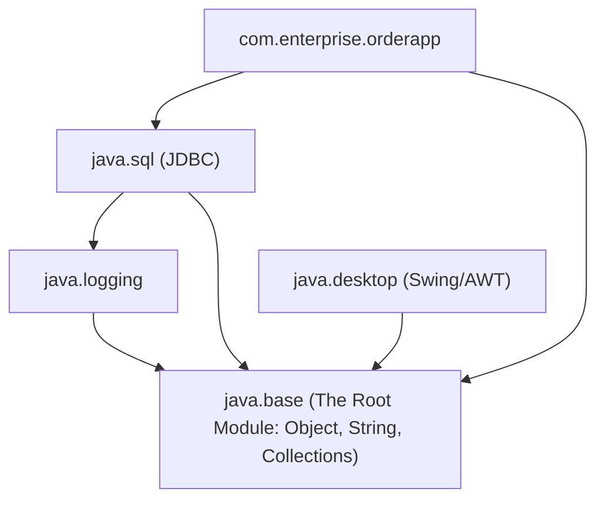

[🏠 Back to Home](../README.md) | [⚡ Java Master Guide](java_master_guide.md) | [🔍 Reflection & Proxies Guide](java_reflection_annotations_proxies_master_guide.md) | [📦 Maven Guide](maven_master_guide.md) | [🐘 Gradle Guide](gradle_master_guide.md)

# 🧩 Java Platform Module System (JPMS / Project Jigsaw) Master Guide

### *(The Dual-Track Engineering Handbook: From Zero-Jargon Foundations to Staff-Level Modular Architecture: module-info.java, Strong Encapsulation, exports vs opens, ServiceLoader, jlink Slim Container Runtimes, and InaccessibleObjectException Battlegrounds)*

[]()
[]()
[]()
[]()
[]()

---

## 📑 Master Table of Contents

- [Module 0: The Complete Jargon-Busting Glossary](#module-0-the-complete-jargon-busting-glossary)
- [Track 1: Junior & Entry-Level Foundations (Zero-to-Hero / ELI5)](#track-1-junior--entry-level-foundations-zero-to-hero--eli5)
  - [1.1 The Nightmare of the Legacy Classpath (JAR Hell & Shadowing)](#11-the-nightmare-of-the-legacy-classpath-jar-hell--shadowing)
  - [1.2 Why `public` in Java Was Never Truly Public](#12-why-public-in-java-was-never-truly-public)
  - [1.3 The Project Jigsaw Vision: Modularizing the JDK Monolith](#13-the-project-jigsaw-vision-modularizing-the-jdk-monolith)
- [Track 2: The Directives Deep Dive: Every JPMS Keyword & Syntax](#track-2-the-directives-deep-dive-every-jpms-keyword--syntax)
  - [2.1 `requires` vs `requires transitive` (Implied Readability)](#21-requires-vs-requires-transitive-implied-readability)
  - [2.2 `requires static` (Optional Compile-Time Dependencies)](#22-requires-static-optional-compile-time-dependencies)
  - [2.3 `exports` vs Qualified Exports (`exports ... to ...`)](#23-exports-vs-qualified-exports-exports--to-)
  - [2.4 `opens` vs `open module` (Reflection Permeability)](#24-opens-vs-open-module-reflection-permeability)
  - [2.5 Service Provider Interfaces: `uses` and `provides ... with ...`](#25-service-provider-interfaces-uses-and-provides--with-)
- [Track 3: The 3 Module Universes & Migration Architecture](#track-3-the-3-module-universes--migration-architecture)
  - [3.1 Explicit Named Modules](#31-explicit-named-modules)
  - [3.2 Automatic Modules (Legacy JARs on Module-Path)](#32-automatic-modules-legacy-jars-on-module-path)
  - [3.3 The Unnamed Module (The Classpath Ghetto)](#33-the-unnamed-module-the-classpath-ghetto)
  - [3.4 The Dreaded Split Package Disaster](#34-the-dreaded-split-package-disaster)
- [Track 4: Command-Line Flags, Reflection Penetration & Build Tools](#track-4-command-line-flags-reflection-penetration--build-tools)
  - [4.1 Cracking Strong Encapsulation: `--add-opens` and `--add-exports`](#41-cracking-strong-encapsulation---add-opens-and---add-exports)
  - [4.2 Runtime Patching: `--patch-module` and `--add-reads`](#42-runtime-patching---patch-module-and---add-reads)
  - [4.3 Maven and Gradle Multi-Module JPMS Setup](#43-maven-and-gradle-multi-module-jpms-setup)
- [Track 5: Creating Ultra-Slim 35MB Cloud Native Runtimes with `jlink`](#track-5-creating-ultra-slim-35mb-cloud-native-runtimes-with-jlink)
  - [5.1 Why Ship a 500MB JDK When You Only Need 35MB?](#51-why-ship-a-500mb-jdk-when-you-only-need-35mb)
  - [5.2 Step-by-Step `jlink` Production Packaging Pipeline](#52-step-by-step-jlink-production-packaging-pipeline)
  - [5.3 Dockerfile Integration for Micro-Containers](#53-dockerfile-integration-for-micro-containers)
- [Track 6: Complete Production Modular Framework from Scratch](#track-6-complete-production-modular-framework-from-scratch)
  - [6.1 Service Interface Module (`core.api`)](#61-service-interface-module-coreapi)
  - [6.2 Service Provider Module (`provider.crypto`)](#62-service-provider-module-providercrypto)
  - [6.3 Application Consumer Module (`app.runner`)](#63-application-consumer-module-apprunner)
- [Track 7: Pros, Cons, Trade-offs & Anti-Patterns Matrix](#track-7-pros-cons-trade-offs--anti-patterns-matrix)
- [Track 8: Production War Room Incidents & Post-Mortems (RCAs)](#track-8-production-war-room-incidents--post-mortems-rcas)
  - [Incident 1: Java 17 InaccessibleObjectException Crashed Production Serialization](#incident-1-java-17-inaccessibleobjectexception-crashed-production-serialization)
  - [Incident 2: Transitive Split Package Locked Maven Build in CI/CD](#incident-2-transitive-split-package-locked-maven-build-in-cicd)
  - [Incident 3: Missing `uses` Directive Caused Silent ServiceLoader Empty Set](#incident-3-missing-uses-directive-caused-silent-serviceloader-empty-set)
- [Track 9: Senior & Staff Engineer Interview Bank (30 Deep Scenarios)](#track-9-senior--staff-engineer-interview-bank-30-deep-scenarios)

---

# Module 0: The Complete Jargon-Busting Glossary

| Term / Acronym | Plain-English Meaning | Everyday Analogy | Low-Level Technical Definition | What Breaks If You Get This Wrong? |
| :--- | :--- | :--- | :--- | :--- | :--- |
| **JPMS** | Java Platform Module System (Project Jigsaw introduced in Java 9). | Replacing an open-air flea market where anyone grabs anything with secure, locked shipping containers with custom access keys. | The module system defined in JSR 376 that introduces a fundamental new abstraction above packages: named, version-independent modules with strong boundaries. | Trying to use internal JDK classes like `sun.misc.Unsafe` or reflection across boundaries without explicit permissions triggers runtime security exceptions. |
| **`module-info.java`** | The module declaration descriptor file placed at the root of a Java package hierarchy. | The customs declaration manifest stamped on the outside of an international shipping crate. | A compiled class file (`module-info.class`) in the root directory containing module attributes (requires, exports, opens, provides, uses) processed by `javac` and the JVM. | If placed in a subdirectory or syntax is invalid, compiler rejects the entire compilation unit as non-modular. |
| **Strong Encapsulation** | Types in a module are inaccessible to other modules unless explicitly exported or opened, even if marked `public`. | A VIP lounge where having a public passport still doesn't get you past the private security gate unless you're on the guest list. | The JVM enforcement rule where `public` access modifier only grants accessibility if the enclosing package is explicitly exported by its module to the reading module. | Reflection libraries (Spring, Jackson, Hibernate) throw `InaccessibleObjectException` when attempting `setAccessible(true)` on non-opened types. |
| **`exports` vs `opens`** | `exports` allows compile-time and runtime public access; `opens` allows runtime deep reflection access to private members. | `exports` is opening the front storefront door to customers; `opens` is letting health inspectors into the private kitchen. | `exports` exposes public types for standard compilation and invocation; `opens` allows `java.lang.reflect` access to all members (including private fields) without allowing compile-time linkage. | Exporting a package containing domain entities still fails Jackson serialization if Jackson needs access to private fields and the package is not `open`! |
| **`requires transitive`** | Tells consumers of your module that they automatically read the required dependency as well (implied readability). | If you buy a phone, you automatically get access to the battery inside it without signing a separate battery contract. | A dependency directive where any module that reads Module A also automatically reads Module B without needing an explicit `requires B` in its own descriptor. | Consumers calling methods that return types from a transitive dependency fail to compile unless `requires transitive` is declared. |
| **Split Package** | When two different modules contain classes within the exact same package name. | Two different families claiming ownership of the exact same house address number on a street. | A violation of the JPMS uniqueness invariant where a package of the same name exists in multiple modules on the module-path. | The JVM refuses to start, immediately crashing with `LayerInstantiationException: Package X in module A is also in module B`. |
| **Automatic Module** | A traditional non-modular JAR placed on the `--module-path` instead of `--class-path`. | An immigrant traveler given a temporary working visa at the airport based on their passport name. | A JAR without `module-info.class` that the JVM treats as a module whose name is derived from `Automatic-Module-Name` manifest header or filename; exports all packages and reads all modules. | Unpredictable module naming if filename changes, causing fragile builds across build servers. |
| **`jlink`** | The Java Linker tool that bundles only the required JDK modules and application code into a custom, stripped runtime image. | Assembling a customized pocket toolkit containing only a screwdriver and pliers instead of lugging around a 50-pound master toolbox. | A tool introduced in JDK 9 that links modular JARs and their transitive dependencies directly into a minimal standalone runtime image without needing an installed JDK on the target server. | Incompatible with legacy classpath JARs; all components must be valid modular JARs or explicit modules to link. |

---

# Track 1: Junior & Entry-Level Foundations (Zero-to-Hero / ELI5)

## 1.1 The Nightmare of the Legacy Classpath (JAR Hell & Shadowing)

Prior to Java 9, the JVM loaded classes via a flat, linear string: the **Classpath** (`-cp` or `-classpath`).

```
                THE LEGACY CLASSPATH "FLAT SOUP"
 ┌─────────────────────────────────────────────────────────────┐
 │ libA.jar (contains com.google.common.base.Strings v18)      │
 │ libB.jar (contains com.google.common.base.Strings v32)      │
 │ app.jar  (calls Strings.lenientFormat(...) -> Only in v32!) │
 └─────────────────────────────────────────────────────────────┘
                               │
               JVM loads first class found in list!
             If libA.jar is ordered first in Classpath:
       💥 CRASH: java.lang.NoSuchMethodError at 2:00 AM!
```

### The 3 Core Problems of Classpath:
1. **Accidental Class Shadowing**: If two JARs contain the same class, whichever appears first on the classpath wins silently. The other is masked.
2. **Missing Dependencies Discovered at Runtime**: If your app is missing a transitive JAR, Java does not fail at startup; it runs happily until a user hits a specific code path hours later and crashes with `NoClassDefFoundError`.
3. **No Internal Boundaries**: Every `public` class in every library was accessible to every other class on the classpath. Libraries could not hide their internal utility classes (e.g. `com.sun.*` or `internal.*`).

---

## 1.2 Why `public` in Java Was Never Truly Public

In Java 1.0 through 8:
```java
package com.mycompany.internals;

// Developer wanted this to only be used inside their library
public class SecretCryptoAlgorithm {
    public static void decrypt() { ... }
}
```
Because the class was marked `public`, **any developer in any company** could call `SecretCryptoAlgorithm.decrypt()` directly from their code. When the library author refactored or deleted that internal class in version 2.0, millions of downstream applications broke.

JPMS solves this forever: **`public` now means "public within my module" unless explicitly exported in `module-info.java`!**

---

## 1.3 The Project Jigsaw Vision: Modularizing the JDK Monolith

Before Java 9, the runtime was a giant 60-megabyte binary file named `rt.jar`. Even if your microservice only used `System.out.println()`, you had to ship the entire GUI desktop stack (`java.desktop` / AWT / Swing), XML parsing, CORBA, and JDBC drivers.

With JPMS, the JDK was fractured into ~90 distinct modules:



Every module in Java implicitly requires `java.base`.

---

# Track 2: The Directives Deep Dive: Every JPMS Keyword & Syntax

## 2.1 `requires` vs `requires transitive` (Implied Readability)

### Standard `requires`:
```java
module com.enterprise.orders {
    requires java.sql; // Only com.enterprise.orders can see java.sql types
}
```
If `com.enterprise.app` requires `com.enterprise.orders`, `app` **cannot** see `java.sql` classes unless it explicitly adds `requires java.sql` itself.

### `requires transitive` (Implied Readability):
```java
module com.enterprise.orders {
    requires transitive java.sql; // Anyone reading 'orders' automatically reads 'java.sql'!
}
```
Use `requires transitive` whenever your module's public method signatures **return or accept types** from that dependency:
```java
// If OrderService exposes Connection, transitive is MANDATORY:
public Connection getOrderDbConnection() { ... }
```

---

## 2.2 `requires static` (Optional Compile-Time Dependencies)

Equivalent to Gradle's `compileOnly` or Maven's `<scope>provided</scope>`:
```java
module com.enterprise.logging {
    requires static org.slf4j; // Required at compile-time, optional at runtime!
}
```
At runtime, if `org.slf4j` is not on the module-path, the JVM starts up without throwing `ModuleNotFoundError`. Your code must safely check for class availability before invoking it.

---

## 2.3 `exports` vs Qualified Exports (`exports ... to ...`)

### Public Export:
```java
module com.enterprise.payment {
    exports com.enterprise.payment.api; // Accessible to ALL other modules
    // com.enterprise.payment.internal is NOT exported -> STRONGLY ENCAPSULATED!
}
```

### Qualified Export (Friend Modules Only):
```java
module com.enterprise.payment {
    // Only payment.test and payment.admin modules can access internal utilities!
    exports com.enterprise.payment.internal to com.enterprise.payment.test, com.enterprise.payment.admin;
}
```

---

## 2.4 `opens` vs `open module` (Reflection Permeability)

When frameworks like Spring, Hibernate, or Jackson inspect private fields via reflection:
- `exports` allows compile-time access to public members only.
- `opens` allows runtime **deep reflection** access to private members (`setAccessible(true)`), but forbids compile-time linkage!

```java
module com.enterprise.user {
    // Allows Jackson to reflectively serialize UserDto private fields
    opens com.enterprise.user.dto to com.fasterxml.jackson.databind;
}
```

### The Nuclear Option: `open module`
If you have an entire legacy module with hundreds of DTO packages requiring reflection:
```java
open module com.enterprise.legacy.entities {
    // All packages in this module are opened for runtime reflection to ALL frameworks!
    requires java.persistence;
}
```

---

## 2.5 Service Provider Interfaces: `uses` and `provides ... with ...`

JPMS revolutionizes the `java.util.ServiceLoader` API by enforcing compile-time validation of plugin interfaces:

### 1. Consumer Module Declaration:
```java
module com.enterprise.app {
    uses com.enterprise.crypto.api.CipherService; // Declares that app consumes this service
}
```

### 2. Provider Module Declaration:
```java
module com.enterprise.crypto.aes {
    requires com.enterprise.crypto.api;
    provides com.enterprise.crypto.api.CipherService 
        with com.enterprise.crypto.aes.AesCipherServiceImpl; // Registers implementation
}
```

---

# Track 3: The 3 Module Universes & Migration Architecture

```
                    ┌────────────────────────────────────────────────────────┐
                    │               THE 3 JPMS MODULE UNIVERSES              │
                    └────────────────────────────────────────────────────────┘
                                                 │
         ┌───────────────────────────────────────┼───────────────────────────────────────┐
         ▼                                       ▼                                       ▼
┌─────────────────────────────┐ ┌─────────────────────────────┐ ┌─────────────────────────────┐
│ 1. Explicit Named Modules   │ │ 2. Automatic Modules        │ │ 3. The Unnamed Module       │
│                             │ │                             │ │                             │
│ • Contains module-info.java │ │ • Legacy JAR placed on      │ │ • Everything on Classpath   │
│ • Strong encapsulation      │ │   --module-path             │ │   (-cp / -classpath)        │
│ • Explicit requires/exports │ │ • Derives name from JAR     │ │ • All packages exported     │
│ • Does NOT read Unnamed     │ │ • Exports ALL packages      │ │ • Reads ALL modules         │
│   Module!                   │ │ • Reads ALL modules!        │ │ • No encapsulation!         │
└─────────────────────────────┘ └─────────────────────────────┘ └─────────────────────────────┘
```

> [!CRITICAL]
> **The Golden Trap of Named Modules**: A Named Module **CANNOT read classes from the Unnamed Module (Classpath)**! If your modular code depends on a legacy library, that legacy library MUST be placed on the `--module-path` (making it an Automatic Module), not on the classpath!

---

## 3.4 The Dreaded Split Package Disaster

In JPMS, **no two modules may declare or contain the same package name**.

If `order-service.jar` has `com.enterprise.util.StringUtils` and `payment-service.jar` has `com.enterprise.util.CurrencyUtils`:
```
💥 FATAL ERROR AT BOOTSTRAP:
java.lang.LayerInstantiationException: Package com.enterprise.util in module 
order.service cannot be exported from module payment.service
```

### How to Fix Split Packages:
1. **Refactor Packages**: Move classes into distinct package namespaces (`com.enterprise.order.util` and `com.enterprise.payment.util`).
2. **Patch Module (Temporary Hack)**: Use `--patch-module payment.service=order-service.jar`.

---

# Track 4: Command-Line Flags, Reflection Penetration & Build Tools

When migrating legacy applications to Java 17+, you frequently encounter `InaccessibleObjectException`. JPMS provides escape-hatch CLI flags:

## 4.1 Cracking Strong Encapsulation: `--add-opens` and `--add-exports`

```bash
# Allow Spring/CGLIB to reflectively access java.lang internals:
java --add-opens java.base/java.lang=ALL-UNNAMED \
     --add-opens java.base/java.util=ALL-UNNAMED \
     -jar myapp.jar
```

| CLI Flag | Purpose | Lifetime |
| :--- | :--- | :--- |
| `--add-opens <module>/<package>=<target-module>` | Grants deep reflection access (`setAccessible(true)`) to private members. | Runtime only |
| `--add-exports <module>/<package>=<target-module>` | Grants public compile/runtime access to non-exported public members. | Compile & Runtime |
| `--add-reads <module>=<target-module>` | Forces a module to read another module without editing `module-info.java`. | Compile & Runtime |
| `--patch-module <module>=<file-path>` | Merges classes/JARs into an existing module (resolves split packages). | Compile & Runtime |

---

# Track 5: Creating Ultra-Slim 35MB Cloud Native Runtimes with `jlink`

## 5.1 Why Ship a 500MB JDK When You Only Need 35MB?

A standard Docker container using `eclipse-temurin:21-jdk` weighs **450 MB - 600 MB**. 
By using `jlink`, the linker analyzes your modular application, discards all unreferenced JDK modules (desktop, corba, xml-binding, management), and packages a bespoke custom JRE that weighs **~35 MB - 45 MB**!

---

## 5.2 Step-by-Step `jlink` Production Packaging Pipeline

```bash
# 1. Compile modular JAR
javac -d out/core.api $(find core.api -name "*.java")
jar --create --file libs/core-api-1.0.jar -C out/core.api .

# 2. Analyze required modules using jdeps
jdeps --module-path libs --print-module-deps libs/app-1.0.jar
# Output: java.base,java.sql,java.net.http

# 3. Create Custom Stripped JRE with jlink
jlink \
  --module-path $JAVA_HOME/jmods:libs \
  --add-modules com.enterprise.app \
  --launcher startApp=com.enterprise.app/com.enterprise.app.Main \
  --compress=2 \
  --no-header-files \
  --no-man-pages \
  --strip-debug \
  --output custom-runtime

# 4. Run application from custom runtime!
./custom-runtime/bin/startApp
```

---

# Track 6: Complete Production Modular Framework from Scratch

### 6.1 Service Interface Module (`core.api`)
`src/core.api/module-info.java`:
```java
module com.enterprise.crypto.api {
    exports com.enterprise.crypto.api;
}
```

`src/core.api/com/enterprise/crypto/api/CipherService.java`:
```java
package com.enterprise.crypto.api;

public interface CipherService {
    String algorithmName();
    byte[] encrypt(byte[] plainText, byte[] key);
    byte[] decrypt(byte[] cipherText, byte[] key);
}
```

---

### 6.2 Service Provider Module (`provider.aes`)
`src/provider.aes/module-info.java`:
```java
module com.enterprise.crypto.aes {
    requires com.enterprise.crypto.api;
    provides com.enterprise.crypto.api.CipherService
        with com.enterprise.crypto.aes.AesCipherServiceImpl;
}
```

`src/provider.aes/com/enterprise/crypto/aes/AesCipherServiceImpl.java`:
```java
package com.enterprise.crypto.aes;

import com.enterprise.crypto.api.CipherService;
import javax.crypto.Cipher;
import javax.crypto.spec.SecretKeySpec;

public class AesCipherServiceImpl implements CipherService {
    @Override
    public String algorithmName() {
        return "AES/ECB/PKCS5Padding";
    }

    @Override
    public byte[] encrypt(byte[] plainText, byte[] key) {
        try {
            Cipher cipher = Cipher.getInstance(algorithmName());
            cipher.init(Cipher.ENCRYPT_MODE, new SecretKeySpec(key, "AES"));
            return cipher.doFinal(plainText);
        } catch (Exception e) {
            throw new RuntimeException("Encryption failed", e);
        }
    }

    @Override
    public byte[] decrypt(byte[] cipherText, byte[] key) {
        try {
            Cipher cipher = Cipher.getInstance(algorithmName());
            cipher.init(Cipher.DECRYPT_MODE, new SecretKeySpec(key, "AES"));
            return cipher.doFinal(cipherText);
        } catch (Exception e) {
            throw new RuntimeException("Decryption failed", e);
        }
    }
}
```

---

### 6.3 Application Consumer Module (`app.runner`)
`src/app.runner/module-info.java`:
```java
module com.enterprise.app {
    requires com.enterprise.crypto.api;
    uses com.enterprise.crypto.api.CipherService;
}
```

`src/app.runner/com/enterprise/app/Main.java`:
```java
package com.enterprise.app;

import com.enterprise.crypto.api.CipherService;
import java.nio.charset.StandardCharsets;
import java.util.ServiceLoader;

public class Main {
    public static void main(String[] args) {
        System.out.println("🚀 [JPMS APP] Loading CipherService via ServiceLoader...");

        ServiceLoader<CipherService> loader = ServiceLoader.load(CipherService.class);
        CipherService cipher = loader.findFirst()
                .orElseThrow(() -> new IllegalStateException("No CipherService implementation found on module path!"));

        System.out.println("Discovered Service Provider: " + cipher.algorithmName());
        byte[] key = "1234567890123456".getBytes(StandardCharsets.UTF_8);
        byte[] secret = cipher.encrypt("Secret JPMS Payload".getBytes(StandardCharsets.UTF_8), key);
        System.out.println("Encrypted bytes length: " + secret.length);
        byte[] decrypted = cipher.decrypt(secret, key);
        System.out.println("Decrypted Text: " + new String(decrypted, StandardCharsets.UTF_8));
    }
}
```

---

# Track 7: Pros, Cons, Trade-offs & Anti-Patterns Matrix

| Dimension | JPMS (Project Jigsaw) | OSGi Framework | Flat Classpath (-cp) |
| :--- | :--- | :--- | :--- |
| **Enforcement Layer** | Native JVM & Compiler level | User-space custom ClassLoader hierarchy | None (Flat, unvalidated) |
| **Startup Overhead** | Extremely fast (validates graph at boot) | Slower (starts dynamic bundle bundles) | Fast but fragile |
| **Dynamic Reloading** | No (Module graph is immutable after boot) | Yes (Hot module install/uninstall) | No |
| **`jlink` Slim Image** | Supported natively | Unsupported directly | Unsupported directly |
| **Migration Cost** | High (Split packages, reflection blockers) | Extremely high (Complex manifests) | Zero upfront cost |
| **Reflection Compatibility** | Requires explicit `opens` | Permissive within bundles | Permissive everywhere |

---

# Track 8: Production War Room Incidents & Post-Mortems (RCAs)

## Incident 1: Java 17 InaccessibleObjectException Crashed Production Serialization

### Incident Context:
An enterprise banking application was upgraded from Java 11 to Java 17. The build succeeded, and the service started. However, during the first live transaction, payment processing failed with:
`java.lang.reflect.InaccessibleObjectException: Unable to make field private final byte[] java.lang.String.value accessible: module java.base does not "opens java.lang" to unnamed module @0x5b37e0d2`.

### Root Cause Analysis (RCA):
In Java 16+, JEP 396 strongly encapsulated JDK internals by default. In Java 17, JEP 403 made it permanent, disallowing `--illegal-access=permit`. A legacy serialization library used reflection to access the internal `value` array of `java.lang.String`.

### Prevention & Remediation:
1. Short-term operational workaround: add JVM start flag `--add-opens java.base/java.lang=ALL-UNNAMED`.
2. Permanent architectural fix: replace the legacy serializer with standard Java records or Jackson 2.15+ which avoids reflecting JDK internal private fields.

---

# Track 9: Senior & Staff Engineer Interview Bank (30 Deep Scenarios)

### Q1: What is the exact difference between `exports` and `opens` in `module-info.java`?
* **Answer**: `exports` makes public types in the package accessible at compile-time and runtime for standard method invocation, but denies reflective access to non-public fields and methods. `opens` forbids compile-time linkage while permitting deep reflection (`setAccessible(true)`) to all package types and members at runtime.

### Q2: Why can a Named Module not read classes residing on the legacy Classpath?
* **Answer**: Classes on the classpath belong to the Unnamed Module. By specification, Named Modules cannot declare `requires <unnamed>` because the Unnamed Module has no stable name. This intentional design prevents modular architectures from silently depending on chaotic, unvalidated classpath libraries.

### Q3: What is an Automatic Module, and how does the JVM determine its module name?
* **Answer**: An Automatic Module is a traditional JAR (without a `module-info.class`) placed on the `--module-path`. Its name is resolved first by checking the `Automatic-Module-Name` attribute in `META-INF/MANIFEST.MF`. If absent, the JVM synthesizes a name from the JAR filename by stripping trailing version numbers and converting non-alphanumeric characters to dots.

### Q4: Explain the "Split Package" constraint in JPMS.
* **Answer**: JPMS mandates that a package can only be defined in a single module within a module layer. If two modules contain classes in the same package (e.g. `com.company.util`), the JVM aborts startup with a `LayerInstantiationException`. This eliminates class shadowing bugs.

### Q5: What is the purpose of the `requires transitive` directive?
* **Answer**: It establishes implied readability. Any module reading the declaring module implicitly reads the transitively required module as well. This is mandatory when an exported API exposes types from that dependency in public method return types or parameters.

### Q6: How does `jlink` create a custom runtime image, and what are its key flags?
* **Answer**: `jlink` traces the module dependency tree starting from root modules, collects the compiled `.jmod` files from the JDK and application, strips debugging symbols (`--strip-debug`), compresses bytecode (`--compress=2`), and outputs a self-contained executable directory containing only the necessary modules and a minimal JVM.

### Q7: What does the `--add-opens` command-line flag do, and when should it be used?
* **Answer**: `--add-opens <source-module>/<package>=<target-module>` dynamically opens a package for deep reflection at runtime. It is used as a migration bridge for legacy reflection frameworks (like older Spring, Hibernate, or Kryo) running on Java 17+ before code can be rewritten.

### Q8: What is the difference between `requires` and `requires static`?
* **Answer**: `requires` declares a mandatory dependency required both at compile time and runtime. `requires static` declares an optional compile-time dependency; the compiler validates against it, but the JVM will start normally if the dependency is omitted from the runtime module path.

### Q9: How does JPMS enhance the security of the Java runtime?
* **Answer**: By enforcing strong encapsulation at the JVM bytecode verification layer. Internal JDK packages (such as `sun.misc.*` and `jdk.internal.*`) are completely hidden and uninvokable from application modules, preventing accidental dependencies on private JVM implementation details.

### Q10: Can an `open module` declare `opens` directives inside its descriptor?
* **Answer**: No. An `open module` opens *all* of its packages unconditionally to deep reflection. Adding explicit `opens` directives inside an `open module` causes a compilation error.

### Q11: How does `ServiceLoader` work in a modular application compared to Java 8?
* **Answer**: In Java 8, `ServiceLoader` looked up text files in `META-INF/services/`. In JPMS, consumer modules declare `uses <Interface>`, provider modules declare `provides <Interface> with <Implementation>`, and the JVM validates service provider wiring at module resolution time without filesystem searches.

### Q12: What is the Unnamed Module, and what are its properties?
* **Answer**: The Unnamed Module encompasses all classes loaded from the traditional Classpath (`-cp`). It exports all of its packages unconditionally, reads all loaded modules, and provides zero encapsulation.

### Q13: What happens if an Automatic Module depends on another library?
* **Answer**: An Automatic Module automatically reads all other modules on the module-path and can read the Unnamed Module, acting as a flexible bridge between explicit modular code and legacy classpath code.

### Q14: How does `--patch-module` work, and what is its primary use case?
* **Answer**: `--patch-module <module>=<path>` injects classes from a directory or JAR into an existing module. Its primary use case is unit testing (injecting test classes into the main application module package) and hot-fixing split package conflicts in third-party libraries.

### Q15: Why is `java.base` never explicitly declared with `requires java.base` in `module-info.java`?
* **Answer**: `java.base` contains fundamental JVM types (`java.lang.Object`, `java.lang.String`). Every module automatically and implicitly requires `java.base`. Explicitly declaring it is redundant.

### Q16: What is a Qualified Export, and why would an enterprise use it?
* **Answer**: A Qualified Export (`exports com.foo to com.bar`) restricts accessibility of a package to specific named modules. Enterprises use it in multi-module monorepos to expose internal APIs to sister modules while preventing external third-party consumers from using them.

### Q17: What does the `jdeps` tool do, and how does it assist in JPMS migration?
* **Answer**: `jdeps` is the Java Dependency Analysis tool. It scans class files or JARs and reports package-level and module-level dependencies, identifies internal JDK API usage, and outputs recommended `module-info.java` descriptor templates.

### Q18: What is the difference between `--module-path` and `--class-path`?
* **Answer**: `--module-path` tells the JVM where to look for modular JARs, JMODs, and Automatic Modules, enforcing strong encapsulation and module graph validation. `--class-path` loads classes into the flat Unnamed Module without encapsulation or dependency checks.

### Q19: Can you have cyclic dependencies between modules in JPMS?
* **Answer**: No. The module graph must be a Directed Acyclic Graph (DAG) at compile-time. If Module A requires Module B and Module B requires Module A, `javac` rejects compilation.

### Q20: How do you handle circular dependencies during legacy migration?
* **Answer**: Merge the two cyclical modules into a single module, break the cycle by extracting a shared interface into a third `api` module, or use dynamic dependency inversion via `ServiceLoader`.

### Q21: What are `.jmod` files, and how do they differ from `.jar` files?
* **Answer**: `.jmod` files are packaging formats introduced in JDK 9 that can contain native code libraries, C header files, and configuration files in addition to class files. They are used exclusively by `jlink` at link time and cannot be executed directly with `java -jar`.

### Q22: What happens if an application tries to access an unexported public method via reflection without `--add-opens`?
* **Answer**: The reflection call throws `java.lang.reflect.InaccessibleObjectException` with a message identifying the module, package, and caller.

### Q23: Why does `Class.forName(name)` behave differently in modular Java?
* **Answer**: In JPMS, `Class.forName(String)` uses the caller's module classloader. If the requested class is in another module that the caller does not read, or if the package is encapsulated, classloading will fail unless the overloaded `Class.forName(Module, String)` is used.

### Q24: What is a Module Layer, and can applications create custom layers at runtime?
* **Answer**: A Module Layer is an execution context containing resolved modules and their classloader mappings. Applications (such as plugin containers and app servers) can dynamically create custom module layers at runtime via `ModuleLayer.defineModulesWithOneLoader()`.

### Q25: How does Maven handle JPMS compilation?
* **Answer**: Maven Compiler Plugin detects `module-info.java` in `src/main/java`. Dependencies in `pom.xml` that are modular are automatically placed on `--module-path`, while non-modular dependencies are placed on `--module-path` as Automatic Modules or on `--class-path`.

### Q26: Can a module declare multiple service implementations for the same interface?
* **Answer**: Yes. A module can declare `provides Service with Impl1, Impl2;`, and `ServiceLoader.load(Service.class)` will return instances of both implementations.

### Q27: How does JPMS prevent security attacks based on ClassLoader hijacking?
* **Answer**: Because module definitions are verified at bootstrap and bound to specific module layers, malicious code cannot dynamically inject classes into an existing package namespace to access package-private members.

### Q28: What is the purpose of `--add-modules` CLI flag?
* **Answer**: It forces the JVM to resolve and load specific root modules into the module graph that would otherwise not be loaded because they are not transitively referenced by the main module.

### Q29: Can you compile a modular application for Java 8 using `--release 8`?
* **Answer**: If `module-info.java` is present, compiling with `--release 8` fails because Java 8 does not recognize `module-info.java`. Modular projects targeting legacy runtimes use multi-release JARs (`MRJAR`) or separate build profiles.

### Q30: What is the Staff Engineer's evaluation on when to adopt JPMS in enterprise applications?
* **Answer**: "Adopt JPMS if you are building an extensible SDK, a high-security framework, or distributing containerized microservices where `jlink` reduces image size by 90%. If you are maintaining a standard Spring Boot web microservice deployed on Kubernetes, stick to standard packaging unless strong encapsulation or runtime size reduction offers measurable business value."

---
[👉 Return to Master Index](../README.md)
