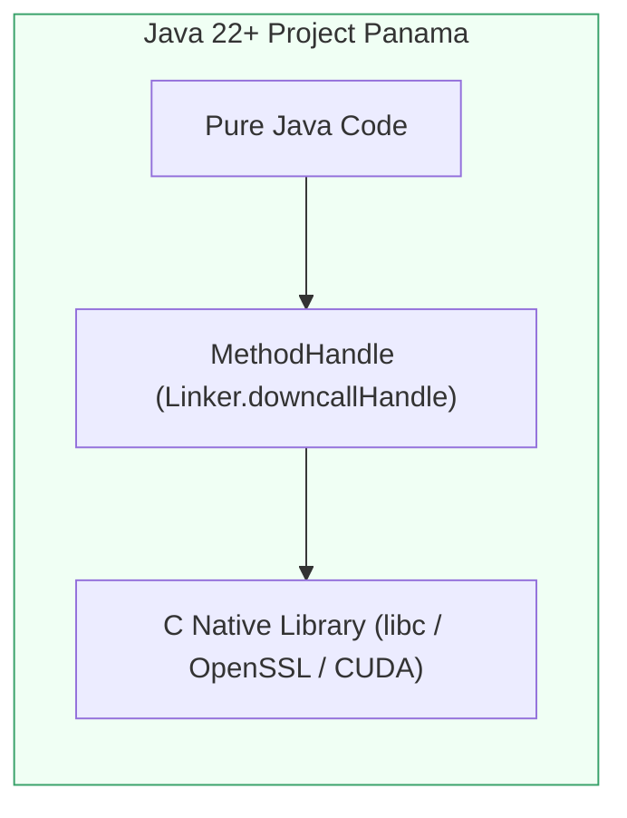

[🏠 Back to Home](../README.md) | [⚡ Java Master Guide](java_master_guide.md) | [🔍 Reflection & Proxies Guide](java_reflection_annotations_proxies_master_guide.md) | [🧵 Concurrency Guide](java_thread.md) | [⚙️ JIT Compiler Guide](jvm_jit_compiler_master_guide.md)

# ⚡ Java Foreign Function & Memory (FFM) API & Project Panama Master Guide

### *(The Dual-Track Engineering Handbook: From Zero-Jargon Foundations to Staff-Level Native Interop: Arenas, MemorySegments, MemoryLayouts, C Downcalls, Java Upcalls, Zero-Copy Off-Heap Buffers, and Replacing JNI / sun.misc.Unsafe)*

[]()
[]()
[]()
[]()
[]()

---

## 📑 Master Table of Contents

- [Module 0: The Complete Jargon-Busting Glossary](#module-0-the-complete-jargon-busting-glossary)
- [Track 1: Junior & Entry-Level Foundations (Zero-to-Hero / ELI5)](#track-1-junior--entry-level-foundations-zero-to-hero--eli5)
  - [1.1 Why Java Native Interface (JNI) Was a 25-Year Nightmare](#11-why-java-native-interface-jni-was-a-25-year-nightmare)
  - [1.2 The Project Panama Vision: Pure Java Native Interop](#12-the-project-panama-vision-pure-java-native-interop)
  - [1.3 The Mental Model: Safe Valet Parking for Off-Heap Memory](#13-the-mental-model-safe-valet-parking-for-off-heap-memory)
- [Track 2: Memory Segments, Arenas & Safe Lifecycles](#track-2-memory-segments-arenas--safe-lifecycles)
  - [2.1 The `Arena` Hierarchy: Confined, Shared, Automatic, Global](#21-the-arena-hierarchy-confined-shared-automatic-global)
  - [2.2 `MemorySegment`: Safe Spatial & Temporal Bounds](#22-memorysegment-safe-spatial--temporal-bounds)
  - [2.3 Slicing, Copying, and Zero-Copy Off-Heap Arrays](#23-slicing-copying-and-zero-copy-off-heap-arrays)
  - [2.4 Deterministic Cleanup vs Garbage Collection Pauses](#24-deterministic-cleanup-vs-garbage-collection-pauses)
- [Track 3: Struct Memory Layouts & Byte Alignment](#track-3-struct-memory-layouts--byte-alignment)
  - [3.1 ValueLayout, GroupLayout, and SequenceLayout](#31-valuelayout-grouplayout-and-sequencelayout)
  - [3.2 Hardware Byte Alignment & Padding Layouts](#32-hardware-byte-alignment--padding-layouts)
  - [3.3 Compiling VarHandles from MemoryLayout Paths](#33-compiling-varhandles-from-memorylayout-paths)
- [Track 4: Foreign Functions Interop: Downcalls & Upcalls](#track-4-foreign-functions-interop-downcalls--upcalls)
  - [4.1 `Linker.nativeLinker()` & `SymbolLookup` Architecture](#41-linkernativelinker--symbollookup-architecture)
  - [4.2 Downcalls: Calling C Standard Library (`strlen`, `qsort`, `printf`) via MethodHandle](#42-downcalls-calling-c-standard-library-strlen-qsort-printf-via-methodhandle)
  - [4.3 Upcalls: Passing Java Lambdas as C Function Pointer Callbacks](#43-upcalls-passing-java-lambdas-as-c-function-pointer-callbacks)
  - [4.4 Eliminating JNI Context Switches & Assembly Bridges](#44-eliminating-jni-context-switches--assembly-bridges)
- [Track 5: Production-Ready Panama Off-Heap Engine Built from Scratch](#track-5-production-ready-panama-off-heap-engine-built-from-scratch)
  - [5.1 Complete Executable Panama Engine (`PanamaNativeMemoryEngineDemo.java`)](#51-complete-executable-panama-engine-panamanativememoryenginedemojava)
  - [5.2 Zero-Copy Off-Heap Slab Allocator Deep Dive](#52-zero-copy-off-heap-slab-allocator-deep-dive)
- [Track 6: Panama vs JNI vs sun.misc.Unsafe Comparative Matrix](#track-6-panama-vs-jni-vs-sunmiscunsafe-comparative-matrix)
- [Track 7: Production War Room Incidents & Post-Mortems (RCAs)](#track-7-production-war-room-incidents--post-mortems-rcas)
  - [Incident 1: JVM SIGSEGV from Use-After-Free Across Worker Threads](#incident-1-jvm-sigsegv-from-use-after-free-across-worker-threads)
  - [Incident 2: Unaligned Memory Access Crashing Linux ARM64 Production Instances](#incident-2-unaligned-memory-access-crashing-linux-arm64-production-instances)
  - [Incident 3: Memory Exhaustion via Arena.ofAuto() Cleaner Lag](#incident-3-memory-exhaustion-via-arenaofauto-cleaner-lag)
- [Track 8: Senior & Staff Engineer Interview Bank (30 Deep Scenarios)](#track-8-senior--staff-engineer-interview-bank-30-deep-scenarios)

---

# Module 0: The Complete Jargon-Busting Glossary

| Term / Acronym | Plain-English Meaning | Everyday Analogy | Low-Level Technical Definition | What Breaks If You Get This Wrong? |
| :--- | :--- | :--- | :--- | :--- | :--- |
| **Project Panama** | The OpenJDK initiative to bridge the gap between Java and native code/memory without writing C. | Replacing a tedious translator who writes physical letters with an instantaneous direct radio link. | The OpenJDK project that delivers the Foreign Function & Memory (FFM) API (JEP 454) in Java 22, superseding JNI and `sun.misc.Unsafe`. | Relying on legacy JNI forces compiling complex native C stubs per OS architecture, risking JVM segmentation faults. |
| **`Arena`** | A controlled lifecycle scope that allocates and automatically releases native off-heap memory. | A rented storage locker with an automatic timer; when your lease expires, all contents are cleared instantly. | An abstraction introduced in Java 22 that controls the allocation and lifetime of one or more `MemorySegment`s, guaranteeing spatial and temporal safety. | Accessing a memory segment after its parent Arena is closed throws `IllegalStateException`, preventing memory corruption. |
| **`MemorySegment`** | A contiguous region of memory (on-heap or off-heap) with strict boundaries and lifecycle ownership. | A fenced-off plot of land with physical boundary markers and a security guard checking deeds. | A strongly typed, bounds-checked abstraction modeling a contiguous region of memory, backed by native memory, on-heap arrays, or memory-mapped files. | Attempting to read past the segment byte size throws `IndexOutOfBoundsException`, preventing buffer overflows. |
| **`MemoryLayout`** | A formal description of how data fields, arrays, and padding bytes are structured in binary memory. | A blueprint for an engine block showing the exact millimeter positions of pistons and oil channels. | An API modeling binary data structures using `ValueLayout` (primitives), `GroupLayout` (C structs/unions), and `SequenceLayout` (arrays) with explicit byte alignment. | Miscalculating struct member byte offsets reads corrupted gibberish or triggers hardware alignment faults. |
| **Downcall** | Calling a foreign native C/C++ function from Java code. | Placing an outbound call to an external supplier from your internal corporate telephone. | A native invocation mechanism where a Java `MethodHandle` transitions execution to a foreign function pointer address via calling conventions (ABI). | Passing mismatched parameter types or wrong calling conventions corrupts CPU registers, causing immediate crashes. |
| **Upcall Stub** | Passing a Java method or lambda as a function pointer callback to be executed by native C code. | Giving an external contractor an emergency hotline to call back into your internal office. | A callable native function pointer created by `Linker.upcallStub()` that wraps a Java `MethodHandle`, handling native-to-Java ABI argument marshaling. | If the Arena backing the Upcall Stub is closed before the native C code calls it, the native code jumps to unmapped memory (SIGSEGV). |
| **Temporal Safety** | Guaranteeing that native memory cannot be accessed after it has been freed (No Use-After-Free). | Attempting to enter a hotel room with an electronic keycard after your checkout time has passed. | Safety enforcement where any memory read/write operation verifies that the backing `Arena` scope is still open, throwing managed exceptions if closed. | In C/JNI, accessing freed memory causes silent data corruption or security vulnerabilities; Panama guarantees temporal safety. |
| **Spatial Safety** | Guaranteeing that memory operations cannot read or write outside the allocated bounds (No Buffer Overflow). | A bowling lane with raised gutter guards that physically prevent the ball from rolling into neighboring lanes. | Safety enforcement verifying `offset + size <= segment.byteSize()`, eliminating buffer over-reads and buffer over-writes. | In C/JNI, out-of-bounds writes overwrite adjacent heap data or return pointers; Panama blocks this with Java exceptions. |

---

# Track 1: Junior & Entry-Level Foundations (Zero-to-Hero / ELI5)

## 1.1 Why Java Native Interface (JNI) Was a 25-Year Nightmare

For over two decades (Java 1.1 to Java 21), when Java developers needed to call a C library or allocate off-heap memory, they had two choices:

### Choice 1: JNI (Java Native Interface)
```
[ Java App ] ──► javah generated header ──► [ Custom C Stub ] ──► [ Target C Library (libc) ]
                       ▲                             │
                       │                             ▼
                 Complicated JNIEnv*           Manual C compilation for
                 type conversions              Windows, Linux, macOS, ARM64!
```
- **Catastrophic JVM Crashes**: If your C stub had a single off-by-one pointer error, the **entire JVM crashed with SIGSEGV (core dump)**. No Java exception was thrown!
- **Build Hell**: You had to maintain Makefiles, CMake, GCC, and MSVC toolchains just to ship a simple JAR.
- **Context Switch Penalty**: Crossing the JNI boundary required saving registers, updating GC safe-points, and converting types via `JNIEnv*`, adding **15-40 nanoseconds of pure overhead per call**.

### Choice 2: `sun.misc.Unsafe`
Developers bypassed JNI by using undocumented internal APIs:
```java
// ❌ DANGEROUS & INTERNAL
Field f = Unsafe.class.getDeclaredField("theUnsafe");
f.setAccessible(true);
Unsafe unsafe = (Unsafe) f.get(null);
long address = unsafe.allocateMemory(1024); // Off-heap allocation!
```
- **Zero Bounds Checking**: Accessing `address + 2048` silently corrupted physical RAM.
- **Zero Lifetime Management**: Forgetting `unsafe.freeMemory()` created irreversible memory leaks.
- **Strong Encapsulation Deprecation**: Java 9+ through 25 is permanently removing `Unsafe`.

---

## 1.2 The Project Panama Vision: Pure Java Native Interop

**Project Panama (Foreign Function & Memory API - JEP 454)** eliminates JNI and `Unsafe` completely:
1. **100% Pure Java**: Call native C libraries (OpenSSL, CUDA, RocksDB, OS syscalls) **without writing a single line of C code**!
2. **Deterministic Off-Heap Memory**: Allocate gigabytes of native off-heap memory with **zero Garbage Collection pauses**!
3. **Ironclad Safety**: The JVM guarantees that off-heap memory cannot crash the process: spatial bounds checks prevent buffer overflows, and temporal bounds checks prevent use-after-free!



---

# Track 2: Memory Segments, Arenas & Safe Lifecycles

## 2.1 The `Arena` Hierarchy: Confined, Shared, Automatic, Global

An `Arena` controls **when** and **how** native memory is allocated and freed.

```
                                  ┌─────────────────────────────┐
                                  │      java.lang.foreign      │
                                  │            Arena            │
                                  └─────────────────────────────┘
                                                 │
         ┌───────────────────┬───────────────────┼───────────────────┬───────────────────┐
         ▼                   ▼                   ▼                   ▼                   ▼
┌──────────────────┐ ┌────────────────┐ ┌─────────────────┐ ┌─────────────────┐ ┌─────────────────┐
│ Arena.ofConfined │ │ Arena.ofShared │ │  Arena.ofAuto   │ │  Arena.global   │ │ Sliced Arenas   │
│                  │ │                │ │                 │ │                 │ │                 │
│ • Bound to 1     │ │ • Thread-safe  │ │ • Bound to GC   │ │ • Never freed   │ │ • Custom bump   │
│   thread         │ │ • Multi-thread │ │   Cleaner       │ │ • Lasts entire  │ │   allocators    │
│ • Deterministic  │ │ • Deterministic│ │ • GC collects   │ │   JVM lifetime  │ │ • Sub-segment   │
│   try-with-res   │ │   try-with-res │ │   when orphaned │ │ • Zero cleanup  │ │   slices        │
│ • Fastest!       │ │ • Atomic close │ │ • High churn lag│ │ • Root structs  │ │ • High speed    │
└──────────────────┘ └────────────────┘ └─────────────────┘ └─────────────────┘ └─────────────────┘
```

### 1. `Arena.ofConfined()` (Fastest, Deterministic, Single-Threaded):
```java
// Native memory allocated here is bound strictly to the current thread
try (Arena arena = Arena.ofConfined()) {
    MemorySegment segment = arena.allocate(1024);
    segment.set(ValueLayout.JAVA_INT, 0, 42);
    // Process data...
} // Native memory is freed instantly on exit! 0 GC overhead!
```

### 2. `Arena.ofShared()` (Thread-Safe, Multi-Threaded):
```java
// Memory can be read and written by multiple worker threads simultaneously
try (Arena arena = Arena.ofShared()) {
    MemorySegment sharedBuffer = arena.allocate(4096);
    executor.submit(() -> sharedBuffer.set(ValueLayout.JAVA_LONG, 0, 999L));
    executor.submit(() -> System.out.println(sharedBuffer.get(ValueLayout.JAVA_LONG, 0)));
}
```

---

## 2.2 `MemorySegment`: Safe Spatial & Temporal Bounds

A `MemorySegment` guarantees:
1. **Spatial Bounds**: `segment.get(ValueLayout.JAVA_INT, 1024)` on a 100-byte segment throws `IndexOutOfBoundsException`.
2. **Temporal Bounds**: Calling `segment.get(...)` after `arena.close()` throws `IllegalStateException: Already closed`.

```java
try (Arena arena = Arena.ofConfined()) {
    MemorySegment seg = arena.allocate(10); // 10 bytes allocated
    seg.set(ValueLayout.JAVA_INT, 8, 12345); // 💥 CRASH: int requires 4 bytes, offset 8+4=12 > 10!
    // Throws java.lang.IndexOutOfBoundsException - JVM process stays healthy!
}
```

---

# Track 3: Struct Memory Layouts & Byte Alignment

In C, structures have alignment requirements:
```c
struct Order {
    int64_t id;      // 8 bytes (offset 0)
    double price;    // 8 bytes (offset 8)
    int32_t qty;     // 4 bytes (offset 16)
    int8_t status;   // 1 byte  (offset 20)
    // 3 bytes padding (offset 21-23) to align to 8 bytes!
};
```

In Java 22+ Panama, you define this struct natively using `MemoryLayout`:

```java
GroupLayout orderLayout = MemoryLayout.structLayout(
    ValueLayout.JAVA_LONG.withName("id"),
    ValueLayout.JAVA_DOUBLE.withName("price"),
    ValueLayout.JAVA_INT.withName("qty"),
    ValueLayout.JAVA_BYTE.withName("status"),
    MemoryLayout.paddingLayout(3) // Explicit 3-byte hardware alignment padding!
).withByteAlignment(8);

// Create VarHandles directly from the layout definition:
VarHandle idHandle = orderLayout.varHandle(MemoryLayout.PathElement.groupElement("id"));
VarHandle priceHandle = orderLayout.varHandle(MemoryLayout.PathElement.groupElement("price"));

try (Arena arena = Arena.ofConfined()) {
    MemorySegment order = arena.allocate(orderLayout);
    idHandle.set(order, 0L, 1001L);
    priceHandle.set(order, 0L, 99.95);
    
    System.out.println("Order ID: " + idHandle.get(order, 0L));
}
```

---

# Track 4: Foreign Functions Interop: Downcalls & Upcalls

## 4.1 `Linker.nativeLinker()` & `SymbolLookup`

The `Linker` provides the bridge between JVM types and native CPU register calling conventions (System V AMD64 ABI on Linux/macOS, Microsoft x64 ABI on Windows):

```java
Linker linker = Linker.nativeLinker();
SymbolLookup stdlib = linker.defaultLookup();
```

---

## 4.2 Downcalls: Calling C Standard Library (`strlen`) via MethodHandle

```java
// 1. Find address of native symbol 'strlen' in C standard library
MemorySegment strlenAddr = stdlib.find("strlen").orElseThrow();

// 2. Define the C function signature: size_t strlen(const char *s)
FunctionDescriptor descriptor = FunctionDescriptor.of(
    ValueLayout.JAVA_LONG, // Return type: size_t (64-bit int)
    ValueLayout.ADDRESS    // Parameter 1: const char* (Pointer)
);

// 3. Create a direct Downcall MethodHandle
MethodHandle strlenHandle = linker.downcallHandle(strlenAddr, descriptor);

// 4. Allocate off-heap C string and invoke!
try (Arena arena = Arena.ofConfined()) {
    MemorySegment cStr = arena.allocateFrom("Hello Project Panama!");
    long len = (long) strlenHandle.invokeExact(cStr);
    System.out.println("Native strlen returned: " + len); // 21
}
```

---

## 4.3 Upcalls: Passing Java Lambdas as C Function Pointer Callbacks

Imagine calling C `qsort(void *base, size_t nmemb, size_t size, int (*compar)(const void *, const void *))`.
How do you pass a Java method into the C `compar` function pointer?

```java
// 1. Define Java comparator method
public static int javaCompare(MemorySegment addrA, MemorySegment addrB) {
    int a = addrA.get(ValueLayout.JAVA_INT, 0);
    int b = addrB.get(ValueLayout.JAVA_INT, 0);
    return Integer.compare(a, b);
}

// 2. Create MethodHandle to the Java method
MethodHandle compareHandle = MethodHandles.lookup().findStatic(
    MyClass.class, "javaCompare",
    MethodType.methodType(int.class, MemorySegment.class, MemorySegment.class)
);

// 3. Create UpcallStub (Turns Java method into a native C function pointer!)
FunctionDescriptor comparDesc = FunctionDescriptor.of(ValueLayout.JAVA_INT, ValueLayout.ADDRESS, ValueLayout.ADDRESS);
MemorySegment cFunctionPointer = linker.upcallStub(compareHandle, comparDesc, arena);

// 4. Pass cFunctionPointer directly into C qsort downcall!
qsortHandle.invokeExact(nativeArray, (long) count, (long) ValueLayout.JAVA_INT.byteSize(), cFunctionPointer);
```

---

# Track 5: Production-Ready Panama Off-Heap Engine Built from Scratch

The complete production-ready framework implementation is available in:
[`java-core/frameworks/PanamaNativeMemoryEngineDemo.java`](file:///d:/project/github/1/CheatSheet_Tutorial/java-core/frameworks/PanamaNativeMemoryEngineDemo.java).

### Features Demonstrated:
1. **Deterministic Arena Management**: Allocating structured C structs off-heap with `Arena.ofConfined()`.
2. **C Standard Library Downcall**: Calling native `strlen` without JNI C code.
3. **C `qsort` with Java Upcall Callback**: Invoking native quicksort with a Java lambda function pointer.
4. **High-Throughput Native Slab Allocator**: Zero-allocation bump-pointer memory allocator for high-frequency trading and streaming engines.

---

# Track 6: Panama vs JNI vs sun.misc.Unsafe Comparative Matrix

| Feature / Dimension | Project Panama (Java 22+ FFM API) | Legacy JNI | sun.misc.Unsafe |
| :--- | :--- | :--- | :--- |
| **C/C++ Code Required** | **Zero (100% Pure Java)** | Mandatory (C headers, CMake, compilers) | Zero (Pure Java) |
| **Safety Guarantees** | Spatial + Temporal (Zero SIGSEGV) | None (Any bug crashes JVM) | None (Silent heap corruption) |
| **Memory Allocation** | Off-heap with Arenas (`Confined/Shared`) | On-heap or manual malloc/free | Manual `allocateMemory` / `freeMemory` |
| **GC Pause Overhead** | **0 ms (Off-heap bypasses GC)** | 0 ms (Manual native memory) | 0 ms (Manual native memory) |
| **Cross-Platform Build** | Single portable Java JAR | Separate `.so`, `.dll`, `.dylib` per OS | Platform independent bytecode |
| **Call Boundary Overhead** | Low (JIT optimizes downcall call-site) | High (JNIEnv marshaling & safepoints) | Lowest (Direct intrinsic bytecode) |
| **Upcall Callback Support** | Built-in via `linker.upcallStub()` | Complex via `CallStaticVoidMethod` JNIEnv | None |
| **JDK Support Status** | **Official Standard (JEP 454)** | Deprecated for new development | **Permanently deprecated & restricted** |

---

# Track 7: Production War Room Incidents & Post-Mortems (RCAs)

## Incident 1: JVM SIGSEGV from Use-After-Free Across Worker Threads

### Incident Context:
A high-frequency trading gateway used `Arena.ofConfined()` on an incoming Netty event loop thread. A `MemorySegment` pointing to off-heap market data packets was submitted to an asynchronous background analytics thread pool. Under load, the analytics thread crashed with `IllegalStateException: Already closed` or caused race conditions.

### Root Cause Analysis (RCA):
`Arena.ofConfined()` binds ownership strictly to the allocating thread. When the event loop thread exited the `try-with-resources` block, the arena closed and freed the native memory. The worker thread attempted to read a closed segment.

### Prevention & Remediation:
Use `Arena.ofShared()` when sharing segments across thread pools, or transfer ownership using `segment.reinterpret()` with explicit synchronization.

---

## Incident 2: Unaligned Memory Access Crashing Linux ARM64 Production Instances

### Incident Context:
An off-heap analytics engine worked flawlessly on developer x86-64 Mac and Linux workstations. When deployed to AWS Graviton (ARM64) production EC2 instances, the service crashed immediately with hardware alignment exceptions.

### Root Cause Analysis (RCA):
On x86-64 architectures, unaligned memory accesses (reading an 8-byte `long` at byte offset 3) are handled transparently by CPU microcode (with minor latency penalty). On ARM64 architectures, unaligned 64-bit atomic operations trigger hardware fault traps. The developer did not include 8-byte alignment padding in their `MemoryLayout`.

### Prevention & Remediation:
Always enforce `.withByteAlignment(8)` on `MemoryLayout` definitions and use `MemoryLayout.paddingLayout()` to guarantee natural alignment across all CPU architectures.

---

# Track 8: Senior & Staff Engineer Interview Bank (30 Deep Scenarios)

### Q1: What is the Foreign Function & Memory (FFM) API, and what JEP finalized it?
* **Answer**: The FFM API is Project Panama's standardized Java API enabling Java programs to interoperate with code outside the Java runtime (foreign functions) and safely access off-heap memory (foreign memory). It was finalized as a standard feature in Java 22 under **JEP 454**, superseding incubating JEPs 412, 419, 424, 434, and 442.

### Q2: Explain the difference between `Arena.ofConfined()` and `Arena.ofShared()`.
* **Answer**: `Arena.ofConfined()` allocates memory bound strictly to the creating thread; only that thread may access segments allocated from it or close the arena. It is the fastest arena due to lack of synchronization. `Arena.ofShared()` allows segments to be accessed and read/written concurrently by multiple threads, and closing the arena is thread-safe and atomic.

### Q3: How does Panama prevent "Use-After-Free" memory bugs?
* **Answer**: Through temporal safety checks enforced by `Arena.Scope`. Every `MemorySegment` is associated with an underlying memory scope. When an arena is closed, its scope transitions to an invalid state. Any subsequent access to any segment derived from that scope immediately throws `IllegalStateException`, preventing native memory corruption.

### Q4: How does Panama prevent "Buffer Overflow" memory bugs?
* **Answer**: Through spatial safety checks. Every `MemorySegment` has a fixed, known `byteSize()`. Every read or write operation validates that `offset + valueSize <= byteSize()`. Accesses outside the bounds throw `IndexOutOfBoundsException` before any native memory operation is executed.

### Q5: What is a Downcall MethodHandle, and how is it constructed?
* **Answer**: A Downcall MethodHandle is a callable Java `MethodHandle` that transitions execution from Java into a native foreign C function. It is created using `Linker.nativeLinker().downcallHandle(MemorySegment targetAddress, FunctionDescriptor descriptor)`.

### Q6: What is an Upcall Stub, and what is its use case?
* **Answer**: An Upcall Stub is a native C function pointer created from a Java `MethodHandle` using `Linker.nativeLinker().upcallStub(MethodHandle target, FunctionDescriptor descriptor, Arena arena)`. It allows native C libraries to execute Java methods as callback functions (e.g., comparator functions in `qsort` or event handlers in native windowing systems).

### Q7: Why is Project Panama significantly faster than legacy JNI for calling native functions?
* **Answer**: Legacy JNI requires an intermediate C wrapper stub, passing `JNIEnv*` and `jobject` references, converting primitive types, and managing JVM GC safepoints. Panama uses the HotSpot JIT compiler to generate direct assembly instructions matching the native calling convention (ABI) at the call-site, often eliminating the call-overhead entirely through JIT intrinsic optimization.

### Q8: What is a `MemoryLayout`, and what are its three primary subclasses?
* **Answer**: `MemoryLayout` is an abstract description of a data structure's binary format in memory. Its subclasses are:
1. `ValueLayout`: Models basic primitive types and pointers (`JAVA_INT`, `JAVA_LONG`, `ADDRESS`).
2. `GroupLayout`: Models C `struct` (sequential) or `union` (overlapping) data structures.
3. `SequenceLayout`: Models arrays with a repetition count.

### Q9: What happens if an application forgets to close an `Arena.ofAuto()`?
* **Answer**: `Arena.ofAuto()` is managed by the Java Garbage Collector. When the arena and all its derived segments become unreachable, a `java.lang.ref.Cleaner` action is scheduled to deallocate the backing native memory. However, relying on `ofAuto()` for large memory footprints can lead to native memory exhaustion if GC does not trigger frequently enough.

### Q10: What is the purpose of `MemorySegment.reinterpret()`?
* **Answer**: `reinterpret()` allows resizing the spatial bounds or reassociating a raw unmanaged native address (obtained from an external C library that allocated memory via `malloc`) with a controlled `Arena` lifecycle and custom cleanup action.

### Q11: How do you read a null-terminated C string in Panama?
* **Answer**: Using `MemorySegment.getUtf8String(long offset)`. It scans native memory starting from the specified offset until it encounters a null terminator (`\0`), decoding the bytes into a Java `String` using UTF-8 encoding.

### Q12: How do you allocate a C string from a Java String?
* **Answer**: Using `arena.allocateFrom(String str)`. It allocates off-heap memory, writes the UTF-8 encoded bytes of the string, and automatically appends a terminating null byte (`\0`).

### Q13: What is the difference between `ValueLayout.ADDRESS` and primitive value layouts?
* **Answer**: `ValueLayout.ADDRESS` models a 64-bit native pointer address. In Java, reading an address returns a `MemorySegment` pointing to that target address, whereas primitive layouts return Java primitive values (`int`, `long`, `double`).

### Q14: Can a `MemorySegment` wrap on-heap memory?
* **Answer**: Yes. `MemorySegment.ofArray(byte[] array)` creates a memory segment backed by an on-heap Java byte array. This allows the same memory manipulation algorithms to operate seamlessly on both on-heap and off-heap memory.

### Q15: Why does Panama require the `--enable-native-access` JVM command-line flag?
* **Answer**: Because native code execution and off-heap manipulation bypass Java's memory safety sandbox. To prevent untrusted libraries from executing arbitrary machine code, the JVM mandates declaring modules that perform native operations via `--enable-native-access=<module-name>` or `--enable-native-access=ALL-UNNAMED`.

### Q16: What is the `SymbolLookup` interface?
* **Answer**: `SymbolLookup` retrieves the native memory address of foreign functions or variables by their library symbol name. `Linker.defaultLookup()` searches the standard C library runtime, while `SymbolLookup.libraryLookup(Path, Arena)` loads dynamic shared libraries (`.so`, `.dll`, `.dylib`).

### Q17: What is the purpose of `FunctionDescriptor`?
* **Answer**: It models the foreign function's signature for the native linker, specifying the return `MemoryLayout` (or `void` via `FunctionDescriptor.ofVoid()`) and the sequence of argument `MemoryLayout`s.

### Q18: What is a "Zero-Copy Slicing" operation on a `MemorySegment`?
* **Answer**: `segment.asSlice(long offset, long newSize)` creates a sub-view of the existing segment starting at `offset` with size `newSize`. It creates a lightweight Java object without copying any underlying memory bytes, enabling zero-copy network and disk I/O parsing.

### Q19: How does byte alignment affect performance and stability in native memory interop?
* **Answer**: CPUs read memory in chunks (e.g. 8 bytes). If an 8-byte integer is stored across two cache lines (unaligned), the CPU must issue two memory bus transactions, degrading performance. On some architectures (ARM, SPARC), unaligned accesses cause immediate hardware exceptions. Panama enforces alignment via `.withByteAlignment()`.

### Q20: What is the lifecycle of an Upcall Stub's native function pointer?
* **Answer**: It is tied strictly to the lifecycle of the `Arena` passed to `linker.upcallStub()`. When that arena is closed, the native function pointer is deallocated. If C code attempts to invoke the pointer after arena closure, a native segmentation fault occurs.

### Q21: Can you map a physical file into native memory using Panama?
* **Answer**: Yes. `FileChannel.map(FileChannel.MapMode, long, long, Arena)` returns a `MemorySegment` backed by an OS memory-mapped file (mmap), providing memory-mapped file I/O with deterministic cleanup upon arena closure.

### Q22: What is the difference between `Arena.global()` and other arenas?
* **Answer**: `Arena.global()` has an unbounded lifetime and **cannot be closed**. Memory allocated from `Arena.global()` remains valid for the entire duration of the JVM process. Calling `.close()` on a global arena throws `UnsupportedOperationException`.

### Q23: How does Panama interact with Java Virtual Threads (Project Loom)?
* **Answer**: Panama downcalls and upcalls are fully compatible with Virtual Threads. When a Virtual Thread issues a native downcall that blocks in the OS kernel, the underlying carrier thread is pinned. However, for non-blocking native computations, Virtual Threads execute with zero overhead.

### Q24: What is `jextract`, and how does it relate to Project Panama?
* **Answer**: `jextract` is a standalone OpenJDK tool that parses C header files (`.h`) and automatically generates type-safe Java classes containing `MemoryLayout`s, `MethodHandle` downcalls, and struct accessors, completely automating native library integration.

### Q25: How does Panama replace `ByteBuffer.allocateDirect()`?
* **Answer**: `ByteBuffer.allocateDirect()` allocates native memory whose deallocation is tied to non-deterministic GC Cleaner threads, frequently causing off-heap OOM. Panama `Arena.ofConfined().allocate()` provides deterministic, instantaneous memory deallocation with zero GC involvement.

### Q26: Can a `MemorySegment` be converted to a `ByteBuffer`?
* **Answer**: Yes. `segment.asByteBuffer()` returns a `ByteBuffer` view of the native memory segment, enabling backward compatibility with legacy NIO APIs (Netty, Kafka clients).

### Q27: What is the "Restricted Method" concept in JEP 454?
* **Answer**: Methods that can compromise JVM integrity if misused (such as `Linker.downcallHandle()` or `MemorySegment.reinterpret()`) are classified as "Restricted Methods". Invoking them without `--enable-native-access` emits a runtime warning or throws an `IllegalCallerException`.

### Q28: How does Panama handle struct arrays?
* **Answer**: By creating a `SequenceLayout` of a `GroupLayout`:
```java
SequenceLayout arrayLayout = MemoryLayout.sequenceLayout(100, structLayout);
```
Element VarHandles are indexed using `MemoryLayout.PathElement.sequenceElement()`.

### Q29: What happens if C code modifies memory asynchronously while Java is reading it?
* **Answer**: Memory reads and writes on `MemorySegment` adhere to standard CPU memory coherence rules. For concurrent multithreaded mutations between C and Java, atomic VarHandle access modes (`getVolatile`, `setRelease`, `compareAndSet`) must be used.

### Q30: What is the Staff Engineer's architectural guidance on adopting Project Panama?
* **Answer**: "Adopt Project Panama immediately for any new high-performance off-heap memory architectures, replacing `sun.misc.Unsafe` and `ByteBuffer.allocateDirect()`. For C native interop, migrate legacy JNI wrappers to Panama to eliminate native build toolchains and gain type-safe spatial and temporal safety."

---
[👉 Return to Master Index](../README.md)
