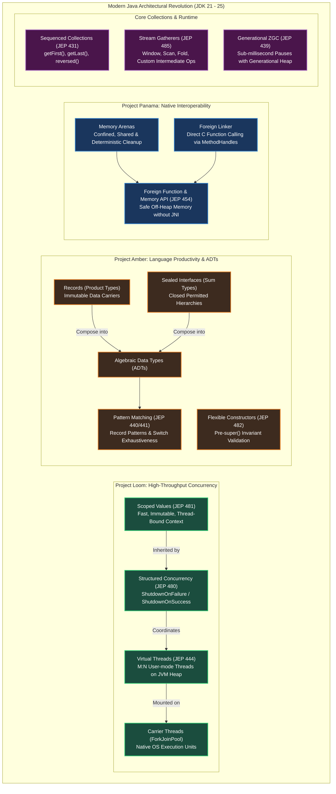

# 🚀 Modern Java (Java 21 to 25) Features: 200 Production Interview Scenarios Master Guide

[](https://www.oracle.com/java/)
[](https://openjdk.org/projects/loom/)
[](https://openjdk.org/projects/panama/)
[](https://openjdk.org/projects/amber/)
[](https://github.com/)

---

## 📑 Master Architecture Navigation

- [🏛️ Architectural Blueprint: Modern Java 21–25 Core Innovations (Loom, Amber, Panama, Valhalla)](#architectural-blueprint-modern-java-2125-core-innovations)
- [🧵 Category 1: Project Loom & Virtual Threads Architecture (Q1 – Q20)](#category-1-project-loom--virtual-threads-architecture-q1--q20)
- [🧩 Category 2: Structured Concurrency & Scoped Values (Q21 – Q40)](#category-2-structured-concurrency--scoped-values-q21--q40)
- [🔍 Category 3: Pattern Matching & Switch Enhancements (Q41 – Q60)](#category-3-pattern-matching--switch-enhancements-q41--q60)
- [📦 Category 4: Sealed Classes, Records & Algebraic Data Types (Q61 – Q80)](#category-4-sealed-classes-records--algebraic-data-types-q61--q80)
- [📑 Category 5: Sequenced Collections & Modern Stream Gatherers (Q81 – Q100)](#category-5-sequenced-collections--modern-stream-gatherers-q81--q100)
- [⚡ Category 6: Foreign Function & Memory (FFM) API - Project Panama (Q101 – Q120)](#category-6-foreign-function--memory-ffm-api---project-panama-q101--q120)
- [🔤 Category 7: String Internals, Templates & Compact Strings (Q121 – Q140)](#category-7-string-internals-templates--compact-strings-q121--q140)
- [⚙️ Category 8: JVM Runtime, JIT C2 & Preview Features (Java 21 to 25) (Q141 – Q160)](#category-8-jvm-runtime-jit-c2--preview-features-java-21-to-25-q141--q160)
- [🏛️ Category 9: Modern API Design, Concurrency Idioms & Clean Code (Q161 – Q180)](#category-9-modern-api-design-concurrency-idioms--clean-code-q161--q180)
- [🚨 Category 10: Production War-Room Outage Incidents & Migration Post-Mortems (Q181 – Q200)](#category-10-production-war-room-outage-incidents--migration-post-mortems-q181--q200)
- [📊 Modern Java 21–25 Migration Architecture Matrix & Production Cheat Sheet](#modern-java-2125-migration-architecture-matrix--production-cheat-sheet)

---

## 🏛️ Architectural Blueprint: Modern Java 21–25 Core Innovations



---

## Category 1: Project Loom & Virtual Threads Architecture (Q1 – Q20)

### Q1: What is the fundamental architectural difference between a Platform Thread and a Virtual Thread in Java 21?
- **What the Interviewer Evaluates:** Operating system kernel thread mapping vs JVM user-space thread scheduling.
- **Standout Technical Answer:**
  - **Platform Thread**:
    - A 1:1 wrapper around an underlying OS native thread (`pthread_create` on Linux).
    - Scheduled preemptively by the OS kernel.
    - Requires a fixed **1 MB native OS memory stack** (`-Xss1m`).
    - Allocation and context switching require transitions between User Mode (Ring 3) and Kernel Mode (Ring 0).
    - Capped at a few thousand threads per JVM before exhausting OS memory/PID limits.
  - **Virtual Thread (JEP 444)**:
    - An $M:N$ lightweight thread scheduled entirely in user-space by the HotSpot JVM runtime.
    - Scheduled cooperatively onto a small pool of underlying OS platform threads called **Carrier Threads**.
    - Stack frames are allocated as standard **Java objects on the JVM Heap**, starting at only **a few hundred bytes** ($\approx 200\text{--}1,000\text{ bytes}$) and growing/shrinking dynamically.
    - Millions of virtual threads can run concurrently within a single JVM without exhausting memory or thread limits.

---

### Q2: How does the HotSpot Continuation engine suspend and resume a Virtual Thread during blocking I/O?
- **What the Interviewer Evaluates:** Low-level JVM Continuation mechanics (`jdk.internal.vm.Continuation`).
- **Standout Technical Answer:**
  - At the heart of virtual threads is the **Continuation** construct.
  - When code running on a virtual thread executes a blocking operation (e.g. `Socket.read()`, `Thread.sleep()`, `LockSupport.park()`):
    1. The standard library networking or concurrency code detects it is running on a Virtual Thread.
    2. It calls **`Continuation.yield(scope)`**.
    3. The JVM copies the virtual thread's active execution stack frames from the carrier thread's native stack onto the **JVM Heap** (chunked stack memory).
    4. The virtual thread is **unmounted** from its Carrier Thread.
    5. The Carrier Thread is now completely free to pick up and execute another ready virtual thread!
    6. When the underlying OS I/O completes (notified via epoll / kqueue in native event loop), the JVM enqueues the virtual thread onto the carrier thread's runqueue.
    7. A carrier thread claims it, copies stack frames back, and calls **`continuation.run()`** to resume execution exactly where it yielded!

---

### Q3: What is Carrier Thread Pinning and what are its two root causes in Java 21?
- **What the Interviewer Evaluates:** The most critical production performance bottleneck in Project Loom deployments.
- **Standout Technical Answer:**
  - **Carrier Thread Pinning**: Occurs when a virtual thread attempts to block on I/O or yield, but the JVM **cannot unmount it from its underlying Carrier Thread**. The carrier thread remains locked and frozen, unable to execute other virtual threads!
  - **The Two Root Causes in Java 21**:
    1. **`synchronized` Blocks / Methods**: If a virtual thread enters a `synchronized` block/method and blocks on I/O, the HotSpot object monitor pins the thread to its native carrier stack because the native monitor pointer is tied to the native frame.
    2. **Native Code (JNI / Foreign Functions)**: If a virtual thread executes native C/C++ code via JNI and blocks, the C call stack cannot be suspended onto the Java heap.
  - **Detection**: Run with `-Djdk.tracePinnedThreads=full` or inspect the JFR event `jdk.VirtualThreadPinned`.
  - **Remedy**: Replace `synchronized` with `java.util.concurrent.locks.ReentrantLock`, which uses `LockSupport.park()` and yields cleanly without pinning!

---

### Q4: Why is pooling Virtual Threads via `ExecutorService` considered a severe anti-pattern?
- **What the Interviewer Evaluates:** Unlearning legacy thread management habits in modern Java.
- **Standout Technical Answer:**
  - In legacy Java, we used thread pools (`Executors.newFixedThreadPool(200)`) because platform threads were heavy ($1\text{ MB}$ stack), expensive to create ($\approx 1\text{ ms}$ syscall), and limited in quantity.
  - **Why Pooling Virtual Threads Fails**:
    1. **Virtual Threads are Ephemeral**: Creating a virtual thread takes **$< 1\text{ microsecond}$** and costs virtually zero memory. They are meant to be created per task and discarded!
    2. **Blocks Concurrency**: Limiting virtual threads to a pool of 500 defeats their purpose—you artificially restrict throughput when the JVM could handle 100,000 concurrent tasks.
    3. **ThreadLocal Contamination**: Reusing pooled virtual threads causes `ThreadLocal` memory leaks and cross-request state contamination.
  - **The Idiomatic Modern Pattern**:
    ```java
    try (var executor = Executors.newVirtualThreadPerTaskExecutor()) {
        executor.submit(() -> fetchOrder(orderId));
    } // Closes and drains tasks automatically!
    ```

---

### Q5: What is the Carrier Thread Pool backing Virtual Threads and how is its parallelism configured?
- **What the Interviewer Evaluates:** HotSpot internal scheduling topology.
- **Standout Technical Answer:**
  - Virtual threads are scheduled onto a dedicated internal `ForkJoinPool` (`ForkJoinPool.commonPool` is separate).
  - **Default Parallelism**:
    $$\text{Parallelism} = \text{Runtime.getRuntime().availableProcessors()}$$
    On a 16-core machine, the JVM creates exactly **16 Carrier Threads**.
  - **Configuration Flags**:
    - `-Djdk.virtualThreadScheduler.parallelism=N`: Number of carrier threads (default = available CPU cores).
    - `-Djdk.virtualThreadScheduler.maxPoolSize=N`: Maximum carrier threads (default 256, allows temporary expansion during pinning).
    - `-Djdk.virtualThreadScheduler.minRunnable=N`: Target minimum runnable carrier threads.

---

### Q6: Why do Virtual Threads provide ZERO performance benefit for CPU-bound computation tasks?
- **What the Interviewer Evaluates:** Fundamental throughput physics: Little's Law and Amdahl's Law.
- **Standout Technical Answer:**
  - Virtual threads optimize **latency hiding during blocking operations** (waiting for database queries, network REST calls, disk reads). They allow carrier threads to do other work while waiting.
  - For **CPU-bound tasks** (matrix multiplication, cryptographic hashing, image processing, JSON parsing):
    - The code never yields; it continuously burns CPU cycles on silicon.
    - If you have 8 physical CPU cores, you can physically execute only **8 threads concurrently at any given nanosecond**.
    - Spawning 100,000 virtual threads for CPU-bound math simply creates 100,000 tasks competing for 8 cores. The JVM incurs scheduling overhead without any I/O wait time to reclaim!
  - **Rule**: Use standard `ForkJoinPool` or platform threads for CPU-bound parallelism; use Virtual Threads for I/O-bound concurrency.

---

### Q7: How does `ThreadLocal` behave with Virtual Threads and why can it cause an OutOfMemoryError?
- **What the Interviewer Evaluates:** Memory scaling risks in high-density virtual thread workloads.
- **Standout Technical Answer:**
  - Virtual threads support `ThreadLocal` identically to platform threads for backward compatibility.
  - **The Scaling Hazard**:
    - If a library allocates a 1MB buffer or heavy cache inside a `ThreadLocal`:
    - With 200 platform threads: $200 \times 1\text{ MB} = 200\text{ MB}$ (manageable).
    - With 1,000,000 virtual threads: $1,000,000 \times 1\text{ MB} = \mathbf{1,000\text{ GB (1 TB!)}} \rightarrow$ Instant **Heap OOM**!
  - **Defenses**:
    1. Disable ThreadLocals when creating virtual threads: `Thread.ofVirtual().inheritInheritableThreadLocals(false)`.
    2. Migrate from `ThreadLocal` to modern Java 21 **`ScopedValue`**!

---

### Q8: How should database connection pool sizes (e.g. HikariCP) be configured when using Virtual Threads?
- **What the Interviewer Evaluates:** Avoiding downstream resource exhaustion when removing JVM thread limits.
- **Standout Technical Answer:**
  - **The Trap**: Developers spawn 50,000 virtual threads and configure HikariCP with a pool size of 50,000.
  - **The Disaster**: PostgreSQL/MySQL cannot handle 50,000 concurrent database connections! The database runs out of memory, locks up in context-switching thrashing, and crashes.
  - **The Solution: Decouple Tasks from Connections**:
    - Keep the HikariCP pool sized based on database hardware capacity:
      $$\text{Connections} = (\text{CPU Cores} \times 2) + \text{Disk Spindle Count} \approx 20\text{ to }50$$
    - 50,000 virtual threads can run concurrently. When they need database access, they block waiting for a connection from the 30-connection pool.
    - Waiting on a pool semaphore unmounts the virtual thread cleanly without tying up carrier threads!
    - Apply a `Semaphore` in front of database calls to control database concurrency.

---

### Q9: What happens when `Thread.sleep()` is invoked inside a Virtual Thread?
- **What the Interviewer Evaluates:** Understanding standard library adaptations in JDK 21.
- **Standout Technical Answer:**
  - In legacy platform threads, `Thread.sleep(millis)` puts the OS native thread to sleep in the kernel.
  - In Virtual Threads, `Thread.sleep()` delegates to internal `VirtualThread.sleepNanos()`:
    1. It schedules a delayed unpark task on a shared internal timer (`ScheduledExecutorService`).
    2. It calls `Continuation.yield()`.
    3. The virtual thread is **unmounted from its carrier thread**.
    4. The carrier thread immediately executes other work.
    5. When the timer expires, the virtual thread is re-enqueued as runnable and resumes on an available carrier thread.
  - You can safely have 1,000,000 virtual threads sleeping simultaneously with zero OS thread or memory penalty!

---

### Q10: How does `ReentrantLock` differ from `synchronized` regarding Carrier Thread Pinning?
- **What the Interviewer Evaluates:** AQS parking vs JVM object monitor parking.
- **Standout Technical Answer:**
  - `synchronized` uses JVM **Object Monitors** implemented in HotSpot C++ runtime code. When an object monitor blocks, it holds a native C stack frame, pinning the carrier thread in Java 21.
  - `ReentrantLock` is implemented in pure Java on top of **AbstractQueuedSynchronizer (AQS)**.
  - When a thread blocks on an unacquired `ReentrantLock`:
    - AQS calls **`LockSupport.park()`**.
    - `LockSupport.park()` checks if the thread is a Virtual Thread, and if so, invokes **`Continuation.yield()`**!
    - The virtual thread unmounts cleanly, leaving the carrier thread 100% free to run other tasks.
  - *(Note: In Java 24+, JEP 491 aims to eliminate pinning in `synchronized` by refactoring object monitors to yield continuations, but in Java 21 LTS, `synchronized` still pins).*

---

### Q11: How do you detect Virtual Thread Carrier Pinning in a production application?
- **What the Interviewer Evaluates:** Observability tooling for Project Loom.
- **Standout Technical Answer:**
  1. **JVM Diagnostic Flag**:
     `-Djdk.tracePinnedThreads=full` prints full Java stack traces to stdout whenever a virtual thread is pinned. Use `=short` for truncated output.
  2. **Java Flight Recorder (JFR)**:
     Inspect the **`jdk.VirtualThreadPinned`** event. Records duration, carrier thread, and stack trace of pinned executions.
  3. **JMX Metrics**:
     Inspect `java.lang:type=Threading` MBean for carrier thread pool exhaustion.

---

### Q12: Can a Virtual Thread be given a custom thread priority via `setPriority()`?
- **What the Interviewer Evaluates:** Language specification constraints on virtual threads.
- **Standout Technical Answer:**
  - **No**. Virtual threads always have a fixed priority of **`Thread.NORM_PRIORITY` (5)**.
  - Calling `vThread.setPriority(Thread.MAX_PRIORITY)` has **zero effect** and is silently ignored by the JVM.
  - Virtual threads cannot be prioritized because they are cooperatively scheduled onto FIFO carrier queues.

---

### Q13: Are Virtual Threads Daemon or Non-Daemon threads by default? Can it be changed?
- **What the Interviewer Evaluates:** Process termination semantics with virtual threads.
- **Standout Technical Answer:**
  - Virtual Threads are **ALWAYS Daemon threads**.
  - Their daemon status **cannot be changed**! Calling `vThread.setDaemon(false)` throws an `IllegalArgumentException`!
  - **Impact**: If all platform threads (including main) finish execution, the JVM **exits immediately**, even if 100,000 virtual threads are still running!
  - To keep the application alive, structured concurrency scopes or a non-daemon latch/platform thread must be used.

---

### Q14: What is the impact of Virtual Threads on Thread Dumps? How do you inspect 1,000,000 threads?
- **What the Interviewer Evaluates:** Modern thread dump diagnostics (JEP 444 thread dumps).
- **Standout Technical Answer:**
  - Traditional `jstack <PID>` or `Thread.getAllStackTraces()` dumps **only platform threads**; printing 1,000,000 stack traces would produce a 2GB file and freeze the JVM!
  - **Modern Thread Dump Format**:
    ```bash
    jcmd <PID> Thread.dump_to_file -format=json /tmp/threads.json
    ```
  - Outputs an open, structured JSON format grouping virtual threads by their Structured Concurrency scopes and Continuation state, allowing tools to aggregate identical wait states.

---

### Q15: How does the JDK's internal networking code (`SocketChannel`, `SocketInputStream`) support Virtual Threads without code changes?
- **What the Interviewer Evaluates:** JDK standard library modernization in Project Loom.
- **Standout Technical Answer:**
  - In JDK 13–15, the entire legacy C-based socket implementation (`PlainSocketImpl`) was rewritten in pure Java as `NioSocketImpl`.
  - In JDK 21, `NioSocketImpl` delegates blocking socket operations to HotSpot's internal **Poller mechanism**:
    - When `socket.read()` blocks, instead of calling the OS kernel blocking `read()`, it registers the file descriptor with an internal **epoll/kqueue event loop** and calls `Continuation.yield()`.
    - When epoll signals data is ready, the background poller thread unparks the virtual thread!
  - All existing blocking I/O code (`InputStream`, `OutputStream`, `Socket`) automatically becomes non-blocking on carrier threads with zero code changes!

---

### Q16: What happens when a Virtual Thread executes an infinite loop without I/O or yielding?
- **What the Interviewer Evaluates:** Cooperative vs preemptive scheduling limits.
- **Standout Technical Answer:**
  - Virtual threads are scheduled **cooperatively**, not preemptively by time slicing.
  - If a virtual thread executes a tight CPU loop (`while (true) {}`) with no I/O, no locks, and no sleep, it **will monopolize its carrier thread indefinitely**!
  - If $N$ virtual threads execute infinite CPU loops (where $N = \text{number of carrier threads}$), **the entire carrier thread pool is starved**, and all other virtual threads in the application freeze completely!
  - Modern Java does not force preemption on CPU-bound virtual threads; applications must avoid long non-yielding loops.

---

### Q17: Can you synchronize on a Virtual Thread object itself (`synchronized(vThread)`)?
- **What the Interviewer Evaluates:** Deprecated patterns and virtual thread monitor restrictions.
- **Standout Technical Answer:**
  - While technically legal syntax, locking on `Thread` instances has been deprecated since Java 20.
  - In virtual threads, locking on the `Thread` instance can interfere with internal runtime synchronization and trigger carrier thread pinning. Always synchronize on private dedicated locks (`private final Object lock = new Object();`).

---

### Q18: How does Virtual Thread stack allocation differ from HotSpot's Escape Analysis stack allocation?
- **What the Interviewer Evaluates:** Clarifying two different concepts involving "stack allocation".
- **Standout Technical Answer:**
  - **Escape Analysis Scalar Replacement**: JIT compiler optimization where an *object* whose reference does not escape is dismantled into primitive registers/stack variables.
  - **Virtual Thread Stack Allocation**: The *execution call stack itself* (method frames, local variables) is stored in **chunked heap objects** (`StackChunk`) on the standard Java Heap, rather than in a contiguous 1MB memory block pre-allocated by the OS kernel.

---

### Q19: What is the memory cost of 100,000 idle Virtual Threads vs 100,000 idle Platform Threads?
- **What the Interviewer Evaluates:** Concrete capacity planning metrics.
- **Standout Technical Answer:**
  - **100,000 Platform Threads**:
    $$100,000 \times 1\text{ MB} = \mathbf{100\text{ GB of OS RAM!}}$$
    Exhausts OS memory and crashes before reaching 10,000 threads.
  - **100,000 Idle Virtual Threads**:
    $$100,000 \times \approx 500\text{ bytes} \approx \mathbf{50\text{ MB of JVM Heap!}}$$
    Consumes less memory than a few Spring beans, running comfortably on a standard developer laptop.

---

### Q20: How do you create and name Virtual Threads using the Modern Fluent API?
- **What the Interviewer Evaluates:** Fluent API mastery in Java 21+.
- **Standout Technical Answer:**
  ```java
  // 1. Create an unstarted virtual thread with name:
  Thread vThread = Thread.ofVirtual()
      .name("order-worker-", 1) // Auto-increments: order-worker-1, order-worker-2
      .unstarted(() -> processOrder());

  // 2. Start a virtual thread immediately:
  Thread runningThread = Thread.ofVirtual()
      .name("payment-worker")
      .start(() -> processPayment());

  // 3. Create a ThreadFactory for frameworks/executors:
  ThreadFactory factory = Thread.ofVirtual()
      .name("audit-thread-", 1)
      .factory();
  ```

---

## Category 2: Structured Concurrency & Scoped Values (Q21 – Q40)

### Q21: What is Structured Concurrency (JEP 480) and what problem does it solve in asynchronous programming?
- **What the Interviewer Evaluates:** Eliminating thread leaks and fragmented task lifecycles.
- **Standout Technical Answer:**
  - In unstructured concurrency (`CompletableFuture`, `ExecutorService.submit()`), subtasks run independently of the parent task:
    - If Subtask A fails with an exception, Subtask B continues running blindly in the background as an **orphaned thread**, wasting CPU and database connections.
    - If the parent thread is interrupted, subtasks are not automatically cancelled.
    - Stack traces are fragmented across threads, making debugging impossible.
  - **Structured Concurrency**:
    - Treats a task split into multiple concurrent subtasks as a **single, unified unit of work**.
    - If a task splits into subtasks, they must all complete, fail, or be cancelled **before the syntactic scope exits**.
    - Guarantees strict nesting: a parent scope cannot complete until all its child threads have terminated!

---

### Q22: How does `StructuredTaskScope.ShutdownOnFailure` implement the "Fail-Fast Fan-Out" pattern?
- **What the Interviewer Evaluates:** Modern multi-task execution patterns with error propagation.
- **Standout Technical Answer:**
  ```java
  public OrderResponse handleOrder(String orderId) throws ExecutionException, InterruptedException {
      try (var scope = new StructuredTaskScope.ShutdownOnFailure()) {
          // Fork subtasks onto virtual threads:
          Subtask<Customer> customerTask = scope.fork(() -> fetchCustomer(orderId));
          Subtask<Inventory> inventoryTask = scope.fork(() -> checkInventory(orderId));

          scope.join();           // 1. Wait for both tasks to complete OR first failure!
          scope.throwIfFailed();  // 2. If EITHER task threw an exception, cancel the other and throw here!

          // 3. Both succeeded: safe to read results
          return new OrderResponse(customerTask.get(), inventoryTask.get());
      } // Exiting scope GUARANTEES all child threads are terminated!
  }
  ```
  - **Fail-Fast**: If `checkInventory()` fails after 10ms, the scope **immediately cancels `fetchCustomer()`** without waiting for its 500ms timeout!

---

### Q23: How does `StructuredTaskScope.ShutdownOnSuccess` implement the "First-to-Respond Racing" pattern?
- **What the Interviewer Evaluates:** Speculative execution and redundancy racing.
- **Standout Technical Answer:**
  ```java
  public WeatherData getFastestWeather() throws ExecutionException, InterruptedException {
      try (var scope = new StructuredTaskScope.ShutdownOnSuccess<WeatherData>()) {
          // Query two redundant providers:
          scope.fork(() -> queryPrimaryProvider());
          scope.fork(() -> querySecondaryProvider());

          scope.join(); // Wait for the FIRST successful result!
          return scope.result(); // Returns winner; cancels the slower provider immediately!
      }
  }
  ```
  - The instant Provider 1 returns, Provider 2 is cancelled via interruption, freeing network and CPU resources.

---

### Q24: What is the lifecycle of a `Subtask` in Structured Concurrency? What happens if you call `get()` before `join()`?
- **What the Interviewer Evaluates:** Defensive state validation in structured subtasks.
- **Standout Technical Answer:**
  - A `Subtask<T>` has three states: `UNAVAILABLE`, `SUCCESS`, `FAILED`.
  - **The Rule**: Calling `subtask.get()` while the state is `UNAVAILABLE` (i.e. before calling `scope.join()`) throws an **`IllegalStateException`**!
  - This eliminates race conditions where code accidentally reads uncompleted task results.
  - If the subtask failed, `subtask.get()` throws `IllegalStateException`; you must check `subtask.state()` or call `scope.throwIfFailed()`.

---

### Q25: What are Scoped Values (JEP 481) and why were they introduced to replace `ThreadLocal`?
- **What the Interviewer Evaluates:** Modern context propagation architecture replacing mutable thread locals.
- **Standout Technical Answer:**
  - `ThreadLocal` has three severe structural flaws:
    1. **Mutability**: Any code anywhere on the thread can call `set()`, mutating shared state unpredictably.
    2. **Unbounded Lifetime**: Retained until manually removed or thread terminates, causing memory leaks in pooled threads.
    3. **Expensive Inheritance**: Child threads copy the parent's entire `ThreadLocalMap`, allocating massive heap memory.
  - **Scoped Values**:
    - **Immutable**: Once bound to a value, it cannot be changed.
    - **Bounded Lifetime**: The value is valid **only within the lexical dynamic scope of execution** (`where(...).run(...)`). It is automatically unbound when the block exits!
    - **Zero-Allocation Inheritance**: Child virtual threads created inside `StructuredTaskScope` share the exact same scoped value binding without copying data!

---

### Q26: How do you declare, bind, and read a `ScopedValue` in Java 21+?
- **What the Interviewer Evaluates:** Syntax and runtime API for Scoped Values.
- **Standout Technical Answer:**
  ```java
  public class SecurityContext {
      // 1. Declare ScopedValue as public static final:
      public static final ScopedValue<User> CURRENT_USER = ScopedValue.newInstance();

      public void handleRequest(User user) {
          // 2. Bind value for the duration of lambda execution:
          ScopedValue.where(CURRENT_USER, user).run(() -> {
              serviceMethod(); // Inherited implicitly down the call stack!
          });
          // 3. Automatically unbound here! Zero leak risk!
      }

      private void serviceMethod() {
          // 4. Read value:
          User user = CURRENT_USER.get();
          System.out.println("Authenticated: " + user.name());
      }
  }
  ```

---

### Q27: How does Nested Re-Binding work in Scoped Values?
- **What the Interviewer Evaluates:** Lexical scoping and context shadowing.
- **Standout Technical Answer:**
  - A Scoped Value can be re-bound in an inner nested scope to temporarily shadow the outer value:
  ```java
  ScopedValue.where(TENANT_ID, "Tenant-A").run(() -> {
      System.out.println(TENANT_ID.get()); // Prints "Tenant-A"

      // Re-bind in inner scope:
      ScopedValue.where(TENANT_ID, "Tenant-B").run(() -> {
          System.out.println(TENANT_ID.get()); // Prints "Tenant-B"
      });

      System.out.println(TENANT_ID.get()); // Automatically restored to "Tenant-A"!
  });
  ```
  - Eliminates the need to manually save, overwrite, and restore variables in `try-finally` blocks.

---

### Q28: How do Scoped Values achieve high performance and zero memory leaks under the hood?
- **What the Interviewer Evaluates:** JVM stack layout optimization for Scoped Values.
- **Standout Technical Answer:**
  - Scoped Value bindings are stored directly in a compact array attached to the thread's execution frame.
  - **Zero Map Lookup Overhead**: Reading a `ScopedValue.get()` is as fast as reading a method local variable (often cached in CPU registers).
  - **Automatic Garbage Collection**: When the `run()` block finishes execution, the stack frame pops, immediately making the bound value eligible for garbage collection without requiring manual cleanup or `finally` blocks!

---

### Q29: How do Scoped Values automatically propagate to child threads inside a `StructuredTaskScope`?
- **What the Interviewer Evaluates:** Synergy between Loom concurrency abstractions.
- **Standout Technical Answer:**
  - When `scope.fork()` is called inside a `ScopedValue` execution block, the child virtual threads automatically capture a reference to the parent's current scoped bindings.
  - Because scoped values are **strictly immutable**, all child threads read the bindings concurrently without synchronization, locks, or defensive copying!

---

### Q30: What happens if you call `ScopedValue.get()` when no value is bound?
- **What the Interviewer Evaluates:** Error handling and boundary validation.
- **Standout Technical Answer:**
  - If no binding exists in the current thread's dynamic scope, calling `scopedValue.get()` throws a **`NoSuchElementException`**!
  - **Defensive API**:
    - Use `scopedValue.isBound()` to check if a value is present.
    - Use `scopedValue.orElse(defaultValue)` or `scopedValue.orElseThrow(...)` to handle unbound cases safely.

---

### Q31: Can a `StructuredTaskScope` be created as a static or shared variable?
- **What the Interviewer Evaluates:** Fundamental scoping violations.
- **Standout Technical Answer:**
  - **NO!** A `StructuredTaskScope` must **never be shared, static, or stored in a field**!
  - It must strictly be opened inside a method using **`try-with-resources`**.
  - Structured concurrency is designed around **lexical execution blocks**; sharing scopes across methods violates structured boundaries and leads to race conditions.

---

### Q32: How does cancellation work in Structured Concurrency? What triggers `Thread.interrupt()`?
- **What the Interviewer Evaluates:** Clean thread interruption propagation.
- **Standout Technical Answer:**
  - When a `StructuredTaskScope` shuts down early (e.g. `ShutdownOnFailure` encounters a failed subtask, or `ShutdownOnSuccess` finds the first winner):
    1. The scope calls `shutdown()`.
    2. It iterates through all currently active child subtasks and calls **`Thread.interrupt()`** on each child thread.
    3. Blocking I/O or sleep calls in the child threads immediately wake up throwing `InterruptedException` and terminate cleanly.
    4. Child tasks that have not yet started are cancelled before execution.

---

### Q33: How do you create a Custom `StructuredTaskScope` policy?
- **What the Interviewer Evaluates:** Extensibility of StructuredTaskScope for domain-specific coordination.
- **Standout Technical Answer:**
  - Extend `StructuredTaskScope<T>` and override the protected **`handleComplete(Subtask<? extends T> subtask)`** method:
  ```java
  public class QuorumScope<T> extends StructuredTaskScope<T> {
      private final List<T> results = new CopyOnWriteArrayList<>();
      private final int quorum;

      public QuorumScope(int quorum) { this.quorum = quorum; }

      @Override
      protected void handleComplete(Subtask<? extends T> subtask) {
          if (subtask.state() == Subtask.State.SUCCESS) {
              results.add(subtask.get());
              if (results.size() >= quorum) {
                  this.shutdown(); // Stop remaining tasks once quorum is reached!
              }
          }
      }
      public List<T> getQuorumResults() { return results; }
  }
  ```

---

### Q34: What is the difference between `join()` and `joinUntil(Instant deadline)` in `StructuredTaskScope`?
- **What the Interviewer Evaluates:** SLA timeout enforcement in distributed aggregation.
- **Standout Technical Answer:**
  - `join()` blocks indefinitely until all child subtasks complete or the scope shuts down.
  - `joinUntil(deadline)` blocks until the specified `Instant` timeout is reached.
  - **If the deadline expires**:
    - It throws **`TimeoutException`**.
    - The scope automatically interrupts and cancels all remaining uncompleted child tasks!
    - Enforces strict SLA budgets for API gateway fan-out calls.

---

### Q35: How does Structured Concurrency simplify distributed tracing and observability?
- **What the Interviewer Evaluates:** Correlating asynchronous logs and OpenTelemetry spans.
- **Standout Technical Answer:**
  - In unstructured concurrency, child threads lose the parent's trace ID and span context unless manually copied.
  - With Structured Concurrency and Scoped Values:
    - The trace context (`traceId`, `spanId`) is stored in a `ScopedValue<TraceContext>`.
    - It is automatically inherited by all forked virtual threads without framework interceptors.
    - Thread dumps show child threads visually grouped underneath their parent `StructuredTaskScope` tree, enabling instant root-cause analysis!

---

### Q36: Why can't you pass a `StructuredTaskScope` across different threads?
- **What the Interviewer Evaluates:** Owner-thread confinement rules.
- **Standout Technical Answer:**
  - A `StructuredTaskScope` is **confined to the thread that created it** (the owner thread).
  - Calling `scope.fork()` or `scope.join()` from any thread other than the creator thread throws **`WrongThreadException`**!
  - Enforces strict single-threaded coordination of multi-threaded work.

---

### Q37: How do Scoped Values interact with Java streams?
- **What the Interviewer Evaluates:** Context inheritance across parallel stream spliterators.
- **Standout Technical Answer:**
  - Sequential streams execute on the current thread, reading scoped values with zero friction.
  - Parallel streams (`parallelStream()`) spawn tasks into the shared `ForkJoinPool`. Scoped values are automatically propagated to parallel stream workers during task dispatch, ensuring consistent security and tenant context across stream elements.

---

### Q38: How does Structured Concurrency handle subtasks that ignore thread interruption?
- **What the Interviewer Evaluates:** Handling stubborn or non-cooperative threads.
- **Standout Technical Answer:**
  - If a subtask swallows `InterruptedException` or executes a non-interruptible CPU loop, it cannot be aborted by `Thread.interrupt()`.
  - When the `try-with-resources` block exits, the scope's `close()` method will **block and wait** for all subtasks to terminate!
  - If a child thread refuses to terminate, the parent thread hangs inside `scope.close()`.
  - **Rule**: Code executing inside structured concurrency must always respect interruption and exit promptly.

---

### Q39: Can you fork another subtask after `scope.join()` has been called?
- **What the Interviewer Evaluates:** Phase transition constraints of StructuredTaskScope.
- **Standout Technical Answer:**
  - **No**. Calling `scope.fork()` after `scope.join()` has returned throws an **`IllegalStateException`**!
  - The lifecycle is strictly two-phase:
    1. **Fork Phase**: Submit all subtasks.
    2. **Join Phase**: Wait for completion and harvest results.

---

### Q40: What is the recommended strategy for migrating a legacy Spring Boot service from `ThreadLocal` to `ScopedValue`?
- **What the Interviewer Evaluates:** Real-world migration engineering.
- **Standout Technical Answer:**
  1. Identify request-bound static thread locals (`SecurityContextHolder`, `RequestContextHolder`, `TenantContext`).
  2. Implement an outer servlet filter or interceptor wrapping request execution in `ScopedValue.where(CONTEXT, extractedContext).run(chain::doFilter)`.
  3. Replace `ThreadLocal.get()` calls in business services with `CONTEXT.get()`.
  4. Delete all `threadLocal.remove()` calls—cleanup is now handled automatically by the language runtime!

---

## Category 3: Pattern Matching & Switch Enhancements (Q41 – Q60)

### Q41: How does Pattern Matching for `switch` (JEP 441) revolutionize polymorphic dispatch in Java 21?
- **What the Interviewer Evaluates:** Modern functional pattern matching vs legacy `instanceof` cascades.
- **Standout Technical Answer:**
  - Historically, `switch` was restricted to primitives, strings, and enums. Type-based dispatch required ugly, error-prone `if-else` chains with manual casting.
  - Java 21 allows switching directly on **object types**, deconstructing patterns, and checking conditions in a single unified construct:
  ```java
  public String formatMessage(Object obj) {
      return switch (obj) {
          case Integer i -> String.format("int: %d", i);
          case Long l    -> String.format("long: %d", l);
          case Double d  -> String.format("double: %.2f", d);
          case String s  -> String.format("string: %s", s.trim());
          case null      -> "null value";
          default        -> obj.toString();
      };
  }
  ```
  - Type casting is completely eliminated; variables `i`, `l`, `d`, `s` are strongly typed pattern variables.

---

### Q42: What are Guarded Patterns using the `when` clause in Java 21? Why was `&&` replaced?
- **What the Interviewer Evaluates:** JEP 441 syntax evolution and disambiguating boolean logic.
- **Standout Technical Answer:**
  - A **Guarded Pattern** combines a type pattern with an arbitrary boolean expression using the **`when`** keyword:
  ```java
  static String testString(Object obj) {
      return switch (obj) {
          case String s when s.length() == 0 -> "Empty string";
          case String s when s.length() > 100 -> "Massive string: " + s.substring(0, 10);
          case String s -> "Normal string: " + s;
          default -> "Unknown";
      };
  }
  ```
  - **Why `when` instead of `&&`?**
    In early preview drafts, `&&` was used (`case String s && s.length() > 0`). This created syntactic ambiguity between pattern combinations and boolean operators. The language designers chose the dedicated keyword `when` to clearly separate pattern matching from condition evaluation.

---

### Q43: How does null handling work in modern `switch` statements vs legacy `switch`?
- **What the Interviewer Evaluates:** Null pointer exception semantics in switch evolution.
- **Standout Technical Answer:**
  - In legacy Java, switching on a `null` variable threw an immediate **`NullPointerException`** before evaluating any case!
  - In modern Java (Java 21+), `null` is a first-class citizen inside `switch`:
    ```java
    switch (obj) {
        case null -> System.out.println("Received null!");
        case String s -> System.out.println("String: " + s);
        default -> System.out.println("Other object");
    }
    ```
  - You can also combine null with default: `case null, default -> handleFallback();`.
  - If a `switch` encounters `null` and has **no explicit `case null`**, it preserves backward compatibility by throwing `NullPointerException`.

---

### Q44: What is Record Deconstruction (JEP 440) and how does it enable Nested Record Patterns?
- **What the Interviewer Evaluates:** Structural data extraction without accessor boilerplate.
- **Standout Technical Answer:**
  - Record Patterns unpack a record's components directly inside `instanceof` or `switch`:
  ```java
  public record Point(int x, int y) {}
  public record Circle(Point center, int radius) {}

  public void inspect(Object obj) {
      // Nested structural deconstruction:
      if (obj instanceof Circle(Point(int x, int y), int r)) {
          System.out.printf("Circle at (%d, %d) with radius %d%n", x, y, r);
      }
  }
  ```
  - Eliminates all manual calls to `circle.center().x()`, binding `x`, `y`, and `r` directly!

---

### Q45: What are Unnamed Variables and Patterns (JEP 456) using the underscore `_`?
- **What the Interviewer Evaluates:** Clean code idioms in modern pattern matching and exception handling.
- **Standout Technical Answer:**
  - In Java 22+, the single underscore `_` denotes an **unnamed variable or pattern component** that is intentionally ignored:
  ```java
  // 1. Ignoring unused record components:
  if (obj instanceof Order(UUID id, _, _)) {
      System.out.println("Processing Order ID: " + id);
  }

  // 2. Ignoring unused exception variables:
  try {
      Integer.parseInt(text);
  } catch (NumberFormatException _) {
      System.out.println("Invalid number");
  }

  // 3. Ignoring unused lambda parameters:
  map.forEach((_, value) -> System.out.println(value));
  ```
  - Compiler suppresses all unused-variable warnings and forbids reading from `_`.

---

### Q46: What is Case Dominance in pattern matching switches and why does the compiler enforce it?
- **What the Interviewer Evaluates:** Compiler validation rules preventing unreachable dead code.
- **Standout Technical Answer:**
  - A case label **dominates** a subsequent case label if every value matching the second case would have already matched the first case.
  - **The Rule**: The Java compiler flags dominated cases as a **fatal compilation error**:
  ```java
  switch (obj) {
      case CharSequence cs -> System.out.println("CharSequence"); // Supertype!
      case String s -> System.out.println("String"); // 💥 COMPILE ERROR: Case is dominated by preceding case!
  }
  ```
  - **Fix**: Order cases from most specific (subtypes) to most general (supertypes):
    `case String s` must precede `case CharSequence cs`.

---

### Q47: How does Compile-Time Exhaustiveness work with Sealed Classes in switch expressions?
- **What the Interviewer Evaluates:** Mathematical sum type checking without defensive default branches.
- **Standout Technical Answer:**
  - When switching over a `sealed` interface or class, the compiler knows the entire closed set of permitted subclasses.
  - If every permitted subclass is covered, the `switch` expression is **exhaustive**, and **NO `default` branch is required**:
  ```java
  public sealed interface PaymentMethod permits CreditCard, PayPal, Crypto {}

  String process(PaymentMethod pm) {
      return switch (pm) {
          case CreditCard cc -> "Card processed";
          case PayPal pp     -> "PayPal processed";
          case Crypto c      -> "Crypto processed";
          // No default needed!
      };
  }
  ```
  - **Architectural Superpower**: If another developer adds `permits ApplePay` to `PaymentMethod`, every switch expression in the entire codebase **fails compilation immediately**, guaranteeing no payment handler is forgotten!

---

### Q48: What is a `MatchException` and when is it thrown at runtime?
- **What the Interviewer Evaluates:** Binary compatibility edge cases in sealed class pattern matching.
- **Standout Technical Answer:**
  - Introduced in Java 21, `java.lang.MatchException` is thrown at runtime when an exhaustive `switch` or record pattern fails to match any case.
  - **How is this possible if the compiler verified exhaustiveness?**
    1. **Binary Incompatibility**: A sealed interface from an external JAR added a new permitted subclass at runtime without client code being recompiled.
    2. **Faulty Record Accessor**: A record component accessor threw an unexpected exception during pattern deconstruction.

---

### Q49: Can you switch on generic type patterns in Java 21? What are the type erasure limits?
- **What the Interviewer Evaluates:** Understanding generic type erasure during pattern matching.
- **Standout Technical Answer:**
  - You can switch on generic container types, but because of Java's runtime type erasure, you **cannot match on specific generic type arguments**:
  ```java
  switch (obj) {
      case List<?> list -> System.out.println("Any list"); // ✅ Legal: Unbounded wildcard
      case List<String> list -> ... // 💥 COMPILE ERROR: Cannot pattern match on erased type arguments!
  }
  ```
  - The JVM cannot verify at runtime whether a `List` contains `String` or `Integer` without inspecting every element.

---

### Q50: How does the JVM optimize pattern matching switches under the hood (Bytecode Disassembly)?
- **What the Interviewer Evaluates:** JVM execution engine and `typeSwitch` bootstrap methods.
- **Standout Technical Answer:**
  - Legacy switches compile to `tableswitch` (dense integers) or `lookupswitch` (sparse integers / string hash codes).
  - Modern pattern matching switches use **`invokedynamic`** targeting `java.lang.runtime.SwitchBootstraps.typeSwitch()`:
    1. At first invocation, the bootstrap method computes a jump table mapping candidate types to integer case indices based on class hierarchy and tags.
    2. HotSpot optimizes repeated calls via Polymorphic Inline Caching (PIC), achieving $O(1)$ dispatch speed that out-performs long chains of `instanceof` and `if-else`!

---

### Q51: How do Record Patterns interact with `null` values inside components?
- **What the Interviewer Evaluates:** Deep deconstruction semantics with nullable fields.
- **Standout Technical Answer:**
  ```java
  public record Box(String item) {}

  Box box = new Box(null);
  if (box instanceof Box(String s)) {
      System.out.println("Matched! s is: " + s); // ✅ Matches! 's' is bound to null!
  }
  ```
  - Record deconstruction matches successfully even if internal components are `null`. The pattern variable `s` is simply assigned `null`.

---

### Q52: What is the difference between an Expression Switch and a Statement Switch?
- **What the Interviewer Evaluates:** Modern expression semantics vs legacy statements.
- **Standout Technical Answer:**
  - **Statement Switch** (`switch (x) { case A: ... break; }`):
    - Executes code for side effects.
    - Requires explicit `break` statements to prevent fall-through.
    - Does not return a value.
  - **Expression Switch** (`String result = switch (x) { case A -> "Val"; }`):
    - Evaluates to a value.
    - Uses arrow syntax `->` (no fall-through, zero risk of missing `break`).
    - Uses `yield` to return values from multi-line code blocks.
    - **Must be strictly exhaustive**.

---

### Q53: When must the `yield` keyword be used inside a switch expression?
- **What the Interviewer Evaluates:** Return semantics from multi-line switch branches.
- **Standout Technical Answer:**
  - When an arrow case `->` requires a multi-line block `{ ... }`, you use `yield` to return the branch's value:
  ```java
  String status = switch (statusCode) {
      case 200 -> "OK";
      case 500 -> {
          logger.error("Internal server error detected");
          yield "CRITICAL_ERROR"; // Returns value from block!
      }
      default -> "UNKNOWN";
  };
  ```

---

### Q54: Can you use Pattern Matching with Enums in a switch?
- **What the Interviewer Evaluates:** Combining enum constants with type patterns in Java 21.
- **Standout Technical Answer:**
  - **Yes!** Java 21 allows switching on an interface that enums implement, or mixing enum constants with general patterns:
  ```java
  switch (obj) {
      case Status.ACTIVE -> "System Active";
      case Status.INACTIVE -> "System Inactive";
      case String s -> "String status: " + s;
      default -> "Other";
  }
  ```

---

### Q55: How does Flow Scoping apply to pattern variables inside `if` statements?
- **What the Interviewer Evaluates:** Compiler scoping rules for pattern variables.
- **Standout Technical Answer:**
  - Pattern variables are scoped strictly to where the condition has evaluated to `true`:
  ```java
  // 1. Legal: AND operator guarantees 's' is present:
  if (obj instanceof String s && s.length() > 5) {
      System.out.println(s.toUpperCase());
  }

  // 2. Illegal: OR operator means obj might NOT be String:
  if (obj instanceof String s || s.length() > 5) { // 💥 COMPILE ERROR!
  }

  // 3. Early return flow scoping:
  if (!(obj instanceof String s)) {
      return;
  }
  System.out.println(s.toLowerCase()); // ✅ Legal! 's' is in scope!
  ```

---

### Q56: Can a Record Pattern deconstruct a record that has custom accessor methods?
- **What the Interviewer Evaluates:** Component access semantics during deconstruction.
- **Standout Technical Answer:**
  - **Yes**. Record pattern deconstruction invokes the record's **accessor methods** (`record.component()`) to extract values, NOT direct field reflection!
  - If a record overrides an accessor method, the overridden method is executed during pattern matching.

---

### Q57: What is the Unnamed Class and Instance Main Method (JEP 477/495 in Java 22-25)?
- **What the Interviewer Evaluates:** Reducing ceremony for beginner programs and CLI scripts.
- **Standout Technical Answer:**
  - Eliminates the mandatory `public class Main` and `public static void main(String[] args)` ceremony:
  ```java
  // Legal modern Java program in a single file (no class declaration!):
  void main() {
      println("Hello, Modern Java!");
  }
  ```
  - The compiler automatically wraps the top-level methods into an unnamed class.

---

### Q58: Can you combine multiple types in a single switch case?
- **What the Interviewer Evaluates:** Syntax restrictions on multi-type matching.
- **Standout Technical Answer:**
  - You can combine multiple constant labels (`case "A", "B", "C" -> ...`).
  - However, you **CANNOT** combine multiple pattern variable types in a single case (`case Integer i, Long l -> ...` is **illegal**), because the variable types are different and cannot be bound to a single name.

---

### Q59: What is the performance difference between a long `if-else instanceof` chain vs a Pattern Switch?
- **What the Interviewer Evaluates:** Execution time complexity ($O(N)$ vs $O(1)$).
- **Standout Technical Answer:**
  - An `if-else instanceof` chain executes linearly: testing $N$ types takes **$O(N)$ comparisons**.
  - A modern `switch` compiles with `SwitchBootstraps.typeSwitch` into an integer-based jump table. The JVM resolves types in **$O(1)$ time** using Polymorphic Inline Caching, running significantly faster for large type hierarchies.

---

### Q60: How does Pattern Matching eliminate Defensive Programming boilerplate in Domain Services?
- **What the Interviewer Evaluates:** Modern DDD software design with functional idioms.
- **Standout Technical Answer:**
  - Replaces dozens of defensive `if (x == null)`, `if (!(x instanceof Y))`, and manual casts with a single, self-documenting, exhaustive switch expression that compiler-verifies every branch and binds strongly-typed variables atomically.

---

## Category 4: Sealed Classes, Records & Algebraic Data Types (Q61 – Q80)

### Q61: What are Algebraic Data Types (ADTs) and how do Java Sealed Classes and Records implement them?
- **What the Interviewer Evaluates:** Functional type theory applied to production object-oriented architecture.
- **Standout Technical Answer:**
  - In computer science, an **Algebraic Data Type** is a composite type formed by combining other types.
  - **The Two Core Varieties**:
    1. **Product Types ($A \times B$)**: Modeled by Java **Records**. A record `Point(int x, int y)` represents the Cartesian product: an instance requires both $x$ AND $y$.
    2. **Sum Types ($A + B$)**: Modeled by Java **Sealed Interfaces**. A `sealed interface Result permits Success, Failure` represents a disjoint union: a value is either `Success` OR `Failure`.
  - **Combining them**: Sealed Interfaces (Sum Types) containing Records (Product Types) provides complete, mathematically verifiable ADTs in pure Java!

---

### Q62: What are the three mandatory modifiers for subclasses extending a `sealed` class?
- **What the Interviewer Evaluates:** JEP 409 inheritance boundary enforcement.
- **Standout Technical Answer:**
  Every permitted subclass extending a sealed class must explicitly declare one of three modifiers:
  1. **`final`**: Prevents any further subclassing of this branch (e.g., `public final class Circle extends Shape`).
  2. **`sealed`**: Continues the closed hierarchy, declaring its own `permits` clause (e.g., `public sealed class Polygon extends Shape permits Triangle, Rectangle`).
  3. **`non-sealed`**: Explicitly opens this specific branch to open-ended inheritance by unknown classes anywhere (e.g., `public non-sealed class CustomShape extends Shape`).

---

### Q63: Where must permitted subclasses be located relative to their `sealed` parent class?
- **What the Interviewer Evaluates:** Module and package scoping rules.
- **Standout Technical Answer:**
  - **In Named Modules**: The sealed class and all its permitted subclasses must reside in the **same Java Module** (`module-info.java`), though they can reside in different packages within that module.
  - **In Unnamed Modules (Classpath)**: The sealed class and all its permitted subclasses must reside in the **exact same package**.
  - If a sealed class and its permitted subclasses are declared in the **same source file**, the `permits` clause can be omitted entirely; the compiler infers the permitted subtypes automatically!

---

### Q64: What is Flexible Constructor Bodies (JEP 482 / Statements before `super()`) in Java 22+?
- **What the Interviewer Evaluates:** Modern constructor lifecycle evolution.
- **Standout Technical Answer:**
  - Historically, Java strictly enforced that `super(...)` or `this(...)` **must be the very first statement** in a subclass constructor.
  - This prevented validating or transforming arguments before invoking the superclass constructor without using ugly static helper methods.
  - **Flexible Constructor Bodies (Java 22+)**:
    - Allows executing validation, calculations, and parameter preparation statements **before** calling `super(...)`:
    ```java
    public class PositiveBigInteger extends BigInteger {
        public PositiveBigInteger(String val) {
            // Validation BEFORE calling super()!
            Objects.requireNonNull(val);
            if (val.startsWith("-")) throw new IllegalArgumentException("Negative value");

            super(val); // super() is called safely after validation!
        }
    }
    ```
    - Invariant: Code before `super()` cannot access `this` or instance fields.

---

### Q65: Why are Java Records fundamentally more secure during Deserialization than standard classes?
- **What the Interviewer Evaluates:** Java serialization vulnerability defenses in modern types.
- **Standout Technical Answer:**
  - Standard Java serialization allocates an uninitialized object via native byte-stream reflection **without calling any constructor**, completely bypassing validation checks!
  - **Records Mandate Constructor Invocations**:
    - The JVM deserialization protocol **strictly mandates** calling the record's **canonical constructor** with values extracted from the stream.
    - All validation, null checks, and defensive copies in the compact constructor execute during deserialization, completely neutralizing deserialization gadget exploits!

---

### Q66: What is the Compact Constructor in a Record, and how does it prevent defensive copy leakage?
- **What the Interviewer Evaluates:** Idiomatic record construction patterns.
- **Standout Technical Answer:**
  - A compact constructor omits the parameter list and explicit field assignments:
  ```java
  public record Order(String id, List<Item> items) {
      public Order {
          // Validation:
          Objects.requireNonNull(id);
          // Defensive copy: modifies parameter BEFORE automatic assignment!
          items = List.copyOf(items);
      }
  }
  ```
  - The compiler automatically assigns the normalized parameters to the final fields at the end of the constructor block.

---

### Q67: Can a Record extend an abstract class? Can an abstract class implement a Record?
- **What the Interviewer Evaluates:** Record inheritance rules.
- **Standout Technical Answer:**
  - **Record Extends Class**: **NO**. Every record implicitly extends `java.lang.Record`. Because Java does not support multiple class inheritance, records cannot extend any other class.
  - **Class Extends Record**: **NO**. Records are implicitly `final`.
  - **Interfaces**: Records **can implement any number of interfaces** (including sealed interfaces).

---

### Q68: How do you implement the "With-er" pattern (Copy-on-Write) in Java Records?
- **What the Interviewer Evaluates:** Immutability state transitions in records.
- **Standout Technical Answer:**
  - Because record fields are `final`, mutating an instance requires creating a new instance with updated fields:
  ```java
  public record User(String id, String email, boolean active) {
      public User withEmail(String newEmail) {
          return new User(this.id, newEmail, this.active);
      }
      public User withActive(boolean newActive) {
          return new User(this.id, this.email, newActive);
      }
  }
  ```

---

### Q69: How do Local Records simplify intermediate stream processing?
- **What the Interviewer Evaluates:** Clean code practices avoiding temporary POJOs.
- **Standout Technical Answer:**
  - Java allows declaring records **locally inside method bodies**:
  ```java
  public List<CustomerTotal> topCustomers(List<Order> orders) {
      // Local record: invisible outside this method!
      record CustomerSpend(Customer customer, BigDecimal total) {}

      return orders.stream()
          .collect(Collectors.groupingBy(Order::customer, Collectors.reducing(BigDecimal.ZERO, Order::amount, BigDecimal::add)))
          .entrySet().stream()
          .map(e -> new CustomerSpend(e.getKey(), e.getValue()))
          .sorted(Comparator.comparing(CustomerSpend::total).reversed())
          .map(cs -> new CustomerTotal(cs.customer().id(), cs.total()))
          .toList();
  }
  ```

---

### Q70: How do you inspect Sealed Classes via Reflection at runtime?
- **What the Interviewer Evaluates:** Reflection APIs added in Java 17+.
- **Standout Technical Answer:**
  ```java
  Class<?> clazz = PaymentMethod.class;

  // 1. Check if class is sealed:
  boolean isSealed = clazz.isSealed();

  // 2. Get all permitted subclasses:
  Class<?>[] permitted = clazz.getPermittedSubclasses();
  for (Class<?> sub : permitted) {
      System.out.println("Permitted: " + sub.getName());
  }
  ```

---

### Q71: Can a Sealed Interface permit an `Enum`?
- **What the Interviewer Evaluates:** Type system interoperability.
- **Standout Technical Answer:**
  - **Yes!** An `enum` can implement an interface. If the interface is `sealed`, the enum can be explicitly listed in the `permits` clause, providing clean integration between enums and sealed hierarchies.

---

### Q72: What is the "Shallow Immutability" trap in Java Records?
- **What the Interviewer Evaluates:** Real-world data corruption in records holding mutable objects.
- **Standout Technical Answer:**
  - Records guarantee that **field references cannot be reassigned**.
  - However, if a record component is a mutable object (e.g. `java.util.Date`, `ArrayList`, `byte[]`), external callers can mutate the internal state of that object!
  - **Remedy**: Always create defensive unmodifiable copies in the compact constructor and override accessors to return unmodifiable views.

---

### Q73: How do Sealed Classes model Finite State Machines (FSM) safely?
- **What the Interviewer Evaluates:** Enterprise domain modeling without invalid state transitions.
- **Standout Technical Answer:**
  ```java
  public sealed interface OrderState permits Draft, Submitted, Shipped, Cancelled {}

  public record Draft(String cartId) implements OrderState {}
  public record Submitted(String orderId, Instant timestamp) implements OrderState {}
  public record Shipped(String trackingNumber) implements OrderState {}
  public record Cancelled(String reason) implements OrderState {}
  ```
  - Eliminates invalid states: a `Draft` order structurally cannot have a `trackingNumber`!
  - Pattern matching compiler checks enforce that every state transition handles all possible states.

---

### Q74: Why can't a Record declare non-static instance fields?
- **What the Interviewer Evaluates:** Record specification fundamentals.
- **Standout Technical Answer:**
  - A record's state must be defined **entirely and exclusively by its component header list**.
  - Allowing additional instance fields would violate record equality, serialization contracts, and pattern matching deconstruction invariants. (Records **can**, however, declare static fields).

---

### Q75: How does `Record.equals()` compare arrays by default? Why is it a trap?
- **What the Interviewer Evaluates:** Array equality gotchas in records.
- **Standout Technical Answer:**
  - The compiler-generated `equals()` on a record compares arrays using standard reference identity (`==`), **NOT content equality**!
  - Two records containing identical byte arrays will evaluate `equals() == false`!
  - **Fix**: Override `equals()` and `hashCode()` to use `Arrays.equals()` and `Arrays.hashCode()`.

---

### Q76: Can an interface be declared `non-sealed`?
- **What the Interviewer Evaluates:** Interface inheritance modifier rules.
- **Standout Technical Answer:**
  - **Yes!** A sub-interface extending a sealed interface can be marked `non-sealed`:
    `public non-sealed interface OpenGateway extends PaymentGateway {}`.
  - Opens that branch of the interface to implementation by any class.

---

### Q77: What is the bytecode structure of a Record class?
- **What the Interviewer Evaluates:** Class file format inspection for records.
- **Standout Technical Answer:**
  - Extends `java.lang.Record`.
  - Marked `final`.
  - All component fields compiled as `private final`.
  - Generates public accessor methods with matching names (e.g. `id()`, not `getId()`).
  - Generates a `Record` attribute in the `.class` file metadata listing component names, types, and annotations for reflection and serialization.

---

### Q78: How do Records integrate with Spring Data JPA and Hibernate 6+?
- **What the Interviewer Evaluates:** Modern ORM integration with immutable types.
- **Standout Technical Answer:**
  - In Hibernate 6+, Records can be used as **DTO Projections** (`SELECT new com.example.UserDTO(u.id, u.name) FROM User u`).
  - Records can also be mapped as `@Embeddable` composite components.
  - However, primary `@Entity` classes must remain standard classes because Hibernate requires mutable proxies and zero-arg constructors.

---

### Q79: What is the impact of Java Records on Jackson JSON serialization?
- **What the Interviewer Evaluates:** Jackson 2.12+ record support.
- **Standout Technical Answer:**
  - Jackson natively deserializes records using their canonical constructor without requiring `@JsonCreator` or `@JsonProperty` annotations.
  - JSON properties map directly to record component names cleanly.

---

### Q80: How does a Sealed Class hierarchy prevent the "Fragile Base Class" problem?
- **What the Interviewer Evaluates:** Long-term software maintainability.
- **Standout Technical Answer:**
  - In open hierarchies, unexpected third-party subclasses can override methods, violate internal invariants, or retain memory.
  - Sealed classes close the hierarchy to third-party subclasses, guaranteeing that the author controls every concrete implementation and runtime behavior.

---

## Category 5: Sequenced Collections & Modern Stream Gatherers (Q81 – Q100)

### Q81: What is the Sequenced Collections framework (JEP 431) introduced in Java 21?
- **What the Interviewer Evaluates:** Resolving historical gaps in Java's Collections Framework.
- **Standout Technical Answer:**
  - Historically, Java lacked a unified interface representing a collection with a **defined encounter order** (first, last, and reverse iteration).
  - Getting the last element differed wildly:
    - `List`: `list.get(list.size() - 1)`
    - `Deque`: `deque.getLast()`
    - `SortedSet`: `sortedSet.last()`
    - `LinkedHashSet`: iterate through all elements!
  - **JEP 431 introduces three unified interfaces**:
    1. **`SequencedCollection<E>`**: Adds `getFirst()`, `getLast()`, `addFirst()`, `addLast()`, `removeFirst()`, `removeLast()`, and `reversed()`.
    2. **`SequencedSet<E>`**: Extends `Set` and `SequencedCollection`.
    3. **`SequencedMap<K, V>`**: Adds `firstEntry()`, `lastEntry()`, `pollFirstEntry()`, `pollLastEntry()`, `putFirst()`, `putLast()`, and `reversed()`.

---

### Q82: How does `.reversed()` in Sequenced Collections differ from `Collections.reverse(list)`?
- **What the Interviewer Evaluates:** View semantics vs in-place mutation.
- **Standout Technical Answer:**
  - **`Collections.reverse(list)`**: Mutates the underlying list **in-place** ($O(N)$ write operation).
  - **`sequencedCollection.reversed()`**: Returns a **live, reverse-ordered VIEW** of the collection ($O(1)$ zero-allocation operation)!
  - If you modify the original collection, the change is instantly visible in the reversed view, and vice versa:
  ```java
  List<String> list = new ArrayList<>(List.of("A", "B", "C"));
  SequencedCollection<String> reversed = list.reversed();
  reversed.addFirst("D"); // Adds to the END of original list!
  System.out.println(list); // Prints [A, B, C, D]
  ```

---

### Q83: Which standard Java collections now implement `SequencedCollection` in Java 21?
- **What the Interviewer Evaluates:** Hierarchy knowledge in standard JDK collections.
- **Standout Technical Answer:**
  - `ArrayList`, `LinkedList`, `ArrayDeque`, `Vector`.
  - `LinkedHashSet` (implements `SequencedSet`).
  - `TreeSet` (implements `SequencedSet`).
  - `LinkedHashMap` and `TreeMap` (implement `SequencedMap`).
  - `HashSet` and `HashMap` do **NOT** implement Sequenced interfaces because they do not have a defined encounter order.

---

### Q84: How does `SequencedMap` handle key repositioning with `putFirst()` and `putLast()`?
- **What the Interviewer Evaluates:** Order manipulation in LinkedHashMap.
- **Standout Technical Answer:**
  - In a standard `LinkedHashMap`, updating an existing key's value does **not** change its iteration order.
  - In `SequencedMap`:
    - `map.putFirst(key, value)`: Inserts or **moves the key to the very beginning** of the map's encounter order!
    - `map.putLast(key, value)`: Inserts or moves the key to the very end.
  - Makes building custom LRU/MRU caches effortless without manual linked node manipulation.

---

### Q85: What are Stream Gatherers (JEP 461 / 473 / 485 in Java 22 to 25)?
- **What the Interviewer Evaluates:** The most significant extension to the Java Stream API since Java 8.
- **Standout Technical Answer:**
  - Historically, `Stream` had extensible *terminal* operations (`Stream.collect(Collector)`), but intermediate operations were fixed (`map`, `filter`, `flatMap`). Complex operations (sliding windows, chunking, stateful folding) required awkward workarounds.
  - **Stream Gatherers**:
    - Adds **`stream.gather(Gatherer)`** as an extensible intermediate stream pipeline operation!
    - Allows transforming a stream of elements into a stream of different elements using custom state, integration, and downstream emission logic.

---

### Q86: What are the built-in Gatherers provided in `java.util.stream.Gatherers`?
- **What the Interviewer Evaluates:** Built-in gathering functions in modern Java.
- **Standout Technical Answer:**
  1. **`windowFixed(int windowSize)`**: Groups elements into fixed-size chunks:
     `Stream.of(1,2,3,4,5).gather(Gatherers.windowFixed(2))` $\rightarrow$ `[[1,2], [3,4], [5]]`.
  2. **`windowSliding(int windowSize)`**: Generates overlapping sliding windows:
     `Stream.of(1,2,3,4).gather(Gatherers.windowSliding(2))` $\rightarrow$ `[[1,2], [2,3], [3,4]]`.
  3. **`fold(Supplier, BiFunction)`**: Performs stateful reduction and emits the single cumulative result downstream.
  4. **`scan(Supplier, BiFunction)`**: Emits every intermediate cumulative reduction step downstream.
  5. **`mapConcurrent(int maxConcurrency, Function)`**: Concurrently maps elements using virtual threads with bounded concurrency!

---

### Q87: How does `Gatherers.windowSliding()` simplify time-series and rolling metrics calculations?
- **What the Interviewer Evaluates:** Practical application of modern stream gatherers.
- **Standout Technical Answer:**
  ```java
  List<Double> stockPrices = List.of(100.0, 102.0, 101.5, 105.0, 107.0);

  // Calculate 3-day simple moving average (SMA):
  List<Double> movingAverages = stockPrices.stream()
      .gather(Gatherers.windowSliding(3))
      .map(window -> window.stream().mapToDouble(Double::doubleValue).average().orElse(0.0))
      .toList();
  // Prints rolling averages across consecutive 3-element sliding windows!
  ```

---

### Q88: How does `Gatherers.mapConcurrent()` combine Streams with Project Loom Virtual Threads?
- **What the Interviewer Evaluates:** High-throughput concurrent stream mapping.
- **Standout Technical Answer:**
  ```java
  List<String> orderDetails = orderIds.stream()
      .gather(Gatherers.mapConcurrent(100, id -> fetchRemoteOrder(id)))
      .toList();
  ```
  - Spawns virtual threads to execute `fetchRemoteOrder(id)` concurrently, capped at `maxConcurrency=100`, preserving input order in the downstream stream!

---

### Q89: What are the four core functions defining a custom `Gatherer`?
- **What the Interviewer Evaluates:** Deep architecture of the Gatherer SPI.
- **Standout Technical Answer:**
  1. **`initializer()`**: Creates private state for the gatherer (e.g., intermediate list buffer).
  2. **`integrator()`**: Consumes the next input element, inspects/updates state, and optionally emits elements downstream (`downstream.push()`).
  3. **`combiner()`**: Merges states during parallel stream evaluation.
  4. **`finisher()`**: Flushes any remaining buffered state downstream when the input stream ends.

---

### Q90: What happens when calling `getFirst()` or `getLast()` on an empty `SequencedCollection`?
- **What the Interviewer Evaluates:** Exception handling in Sequenced Collections.
- **Standout Technical Answer:**
  - Throws **`java.util.NoSuchElementException`**!
  - Unlike queues that return `null` (`poll()`), sequenced collections require checking `isEmpty()` or catching `NoSuchElementException`.

---

### Q91: How does `Collections.unmodifiableSequencedCollection()` protect ordered collections?
- **What the Interviewer Evaluates:** Encapsulation wrappers for modern collections.
- **Standout Technical Answer:**
  - Returns an unmodifiable view where all mutating methods (`addFirst()`, `removeLast()`) throw `UnsupportedOperationException`.
  - The returned view's `.reversed()` method is itself also guaranteed to be unmodifiable.

---

### Q92: What is the difference between `List.of()` and `Arrays.asList()` in modern Java?
- **What the Interviewer Evaluates:** Collection immutability and memory optimization.
- **Standout Technical Answer:**
  - **`Arrays.asList(...)`**:
    - Returns a fixed-size wrapper around the passed array.
    - **Mutable**: `list.set(0, "X")` overwrites the underlying array!
    - Allows `null` elements.
  - **`List.of(...)`**:
    - Returns a **truly immutable, space-optimized compact list**.
    - Mutating methods throw `UnsupportedOperationException`.
    - **Forbids `null`** (throws `NullPointerException` eagerly).
    - Uses specialized space-saving classes (`List12`, `ListN`) requiring minimal memory overhead.

---

### Q93: How does `Map.of()` optimize memory compared to `HashMap`?
- **What the Interviewer Evaluates:** Compact collection memory footprints.
- **Standout Technical Answer:**
  - `HashMap` allocates a table array, entry nodes (`Node<K,V>`), and computes hash buckets.
  - `Map.of(k1, v1, k2, v2)` allocates a single flat array storing keys and values in adjacent slots.
  - Zero node allocations, zero pointer chasing, zero resize overhead.

---

### Q94: Why does iterating over `Set.of()` produce a different order on every JVM run?
- **What the Interviewer Evaluates:** Deliberate randomized iteration order security.
- **Standout Technical Answer:**
  - The implementation uses a **randomized salt** initialized per JVM boot when calculating bucket offsets.
  - **Why?** Prevents developers from writing fragile code that accidentally relies on iteration order in sets, ensuring code portability and defending against HashDoS attacks.

---

### Q95: What is `List.copyOf()` and how does it optimize when passed an already immutable list?
- **What the Interviewer Evaluates:** Smart defensive copying in Java 10+.
- **Standout Technical Answer:**
  - If passed a mutable collection (`ArrayList`), `List.copyOf(c)` allocates a new immutable list.
  - If passed an object that is **already an immutable list** created by `List.of()` or `List.copyOf()`, it **does NOT copy anything**—it simply returns the existing instance reference directly!
  - Safe, zero-allocation defensive copying.

---

### Q96: What is the difference between `Stream.toList()` (Java 16+) and `Collectors.toList()`?
- **What the Interviewer Evaluates:** Modern stream syntax and immutability guarantees.
- **Standout Technical Answer:**
  - `stream.collect(Collectors.toList())`:
    - Returns a mutable `ArrayList` (implementation not guaranteed).
    - Verbose syntax.
  - `stream.toList()`:
    - Returns an **unmodifiable compact list**.
    - Concise syntax.
    - Reclaims memory directly from stream size if known without intermediate array copies.

---

### Q97: Can `SequencedSet` have duplicate elements if you call `addFirst()` and `addLast()`?
- **What the Interviewer Evaluates:** Set uniqueness invariants vs sequence order.
- **Standout Technical Answer:**
  - **No**. It is still a `Set`; duplicate elements are forbidden.
  - In a `SequencedSet` (like `LinkedHashSet`), calling `addFirst(x)` when `x` is already in the set will either leave it untouched or reposition it depending on collection semantics, preserving uniqueness.

---

### Q98: How do you partition a Stream into chunks of size $N$ using Stream Gatherers?
- **What the Interviewer Evaluates:** Chunked batch processing pipelines.
- **Standout Technical Answer:**
  ```java
  List<List<Order>> batches = orders.stream()
      .gather(Gatherers.windowFixed(500)) // Chunks of 500
      .toList();
  // Ideal for batching database inserts or Kafka emissions!
  ```

---

### Q99: Why did Java 8 Streams omit `windowFixed` and `windowSliding` for ten years?
- **What the Interviewer Evaluates:** Stream architecture history and design trade-offs.
- **Standout Technical Answer:**
  - Java 8 Streams prioritized pure stateless operations (`map`, `filter`) and simple terminal collectors (`Collector`) to guarantee automatic parallelizability.
  - Adding stateful, windowed intermediate operations required a formal intermediate pipeline specification that could safely handle parallel stream combiners, which was finally solved with JEP 485 Stream Gatherers.

---

### Q100: How do you reverse a `SequencedMap` efficiently?
- **What the Interviewer Evaluates:** Reverse map views in Java 21.
- **Standout Technical Answer:**
  ```java
  SequencedMap<String, User> map = new LinkedHashMap<>();
  // Fill map...

  // Zero-cost reverse view:
  SequencedMap<String, User> reversedMap = map.reversed();
  reversedMap.forEach((k, v) -> System.out.println(k + " -> " + v));
  ```
  - Operates in $O(1)$ time with zero entry copying.

---

## Category 6: Foreign Function & Memory (FFM) API - Project Panama (Q101 – Q120)

### Q101: What is the Foreign Function & Memory (FFM) API (JEP 454) and why does it permanently replace JNI?
- **What the Interviewer Evaluates:** Modern native C interoperability vs legacy JNI.
- **Standout Technical Answer:**
  - For 28 years, the **Java Native Interface (JNI)** was the only way to interact with C/C++ libraries.
  - **The Fatal Flaws of JNI**:
    1. **Brittle C Glue Code**: Required writing, compiling, and linking custom C/C++ wrapper boilerplate (`javah`, `.so`, `.dll`).
    2. **High Call Overhead**: JNI transition boundaries cannot be inlined by the JIT compiler, incurring heavy invocation penalties.
    3. **Fatal Memory Hazards**: Buffer overflows, wild pointers, and use-after-free bugs cause segmentation faults (`SIGSEGV`) that **instantly crash the entire JVM**!
  - **The FFM API (Java 22+ LTS Ready)**:
    - Pure-Java native library loading and function invocation using `Linker` and `MethodHandle`.
    - Strongly typed, spatially bounded, and temporally safe off-heap memory management via `MemorySegment` and `Arena`.
    - Eliminates all C wrapper code while achieving native JIT inlining speed!

---

### Q102: What is a `MemorySegment` and how does it guarantee Spatial Safety?
- **What the Interviewer Evaluates:** Safe off-heap memory manipulation.
- **Standout Technical Answer:**
  - A `MemorySegment` models a contiguous region of memory (located on the heap or off-heap in native memory).
  - **Spatial Safety Guarantee**:
    - Every segment has a strict **size bound** in bytes (`segment.byteSize()`).
    - Attempting to read or write beyond the segment boundary throws an immediate **`IndexOutOfBoundsException`** in Java code, **preventing buffer overflow attacks and JVM segfaults**!
  ```java
  try (Arena arena = Arena.ofConfined()) {
      MemorySegment segment = arena.allocate(100); // 100 bytes
      segment.set(ValueLayout.JAVA_INT, 0, 42);   // ✅ Valid
      segment.set(ValueLayout.JAVA_INT, 104, 99); // 💥 Throws IndexOutOfBoundsException!
  }
  ```

---

### Q103: What are Memory Arenas and what are the four lifecycle Arena types?
- **What the Interviewer Evaluates:** Deterministic off-heap memory lifecycles.
- **Standout Technical Answer:**
  - An `Arena` controls the allocation and lifecycle of off-heap memory segments.
  - **The Four Arena Types**:
    1. **`Arena.ofConfined()`**: Confined to a **single thread**. Fast, lock-free allocation. Memory freed deterministically upon `arena.close()`.
    2. **`Arena.ofShared()`**: Accessible by **multiple threads concurrently**. Thread-safe deallocation via coordinated handshakes upon `arena.close()`.
    3. **`Arena.ofAuto()`**: Managed by the **Garbage Collector**. When no references to the arena or its segments exist, memory is freed automatically by GC cleaners.
    4. **`Arena.global()`**: Lives for the **entire lifetime of the JVM**. Memory is never freed until process termination.

---

### Q104: How does `Arena.close()` guarantee Temporal Safety (Use-After-Free Prevention)?
- **What the Interviewer Evaluates:** Preventing dangling pointer crashes in native memory.
- **Standout Technical Answer:**
  - **Temporal Safety**: An off-heap memory address cannot be accessed after its memory has been deallocated.
  - When `arena.close()` is called:
    1. The arena's internal `MemorySession` state transitions from `ALIVE` to `CLOSED`.
    2. The underlying native memory is returned to the OS.
    3. Any subsequent read or write attempt on *any* `MemorySegment` allocated by that arena immediately throws **`IllegalStateException: Already closed`**!
  - In C, reading freed memory accesses stale data or causes segfaults; in Java Panama, it is a safe, catchable Java exception!

---

### Q105: What is `ValueLayout` and how does it define memory layout and endianness?
- **What the Interviewer Evaluates:** Binary data modeling and CPU endianness.
- **Standout Technical Answer:**
  - `ValueLayout` models primitive C data types:
    - `ValueLayout.JAVA_INT` (4 bytes, 32-bit signed int).
    - `ValueLayout.JAVA_LONG` (8 bytes, 64-bit int).
    - `ValueLayout.JAVA_DOUBLE` (8 bytes IEEE-754).
  - Can configure byte order: `ValueLayout.JAVA_INT.withOrder(ByteOrder.LITTLE_ENDIAN)`.
  - Enforces CPU word alignment: access to an unaligned memory offset throws `IllegalArgumentException`.

---

### Q106: How do you model a C Struct in pure Java using `GroupLayout`?
- **What the Interviewer Evaluates:** Struct layout definitions in Project Panama.
- **Standout Technical Answer:**
  - Given a C struct: `struct Point { int x; int y; double z; };`:
  ```java
  StructLayout pointLayout = MemoryLayout.structLayout(
      ValueLayout.JAVA_INT.withName("x"),
      ValueLayout.JAVA_INT.withName("y"),
      ValueLayout.JAVA_DOUBLE.withName("z")
  );

  // VarHandles for field access:
  VarHandle xHandle = pointLayout.varHandle(MemoryLayout.PathElement.groupElement("x"));
  VarHandle zHandle = pointLayout.varHandle(MemoryLayout.PathElement.groupElement("z"));

  try (Arena arena = Arena.ofConfined()) {
      MemorySegment point = arena.allocate(pointLayout);
      xHandle.set(point, 0L, 100);
      zHandle.set(point, 0L, 3.14159);
  }
  ```

---

### Q107: How do you invoke a C Standard Library function (e.g. `strlen`, `puts`, `getpid`) using the Foreign Linker?
- **What the Interviewer Evaluates:** Calling native functions without writing a single line of C.
- **Standout Technical Answer:**
  ```java
  Linker linker = Linker.nativeLinker();
  SymbolLookup stdlib = linker.defaultLookup();

  // Find 'puts' function pointer:
  MemorySegment putsAddress = stdlib.find("puts").orElseThrow();

  // Describe C signature: int puts(char *str)
  FunctionDescriptor descriptor = FunctionDescriptor.of(ValueLayout.JAVA_INT, ValueLayout.ADDRESS);
  MethodHandle putsHandle = linker.downcallHandle(putsAddress, descriptor);

  try (Arena arena = Arena.ofConfined()) {
      // Allocate C string in off-heap memory:
      MemorySegment cString = arena.allocateFrom("Hello from Project Panama!");
      int result = (int) putsHandle.invokeExact(cString);
  }
  ```

---

### Q108: What is a Downcall vs an Upcall in the Foreign Function API?
- **What the Interviewer Evaluates:** Bidirectional native interoperability.
- **Standout Technical Answer:**
  - **Downcall (Java $\rightarrow$ Native)**:
    - Java code calls a native C function.
    - Created via `linker.downcallHandle(address, descriptor)`. Returns a `MethodHandle`.
  - **Upcall (Native $\rightarrow$ Java)**:
    - Native C code invokes a Java callback or lambda function (e.g. function pointers passed to C `qsort`).
    - Created via `linker.upcallStub(methodHandle, descriptor, arena)`. Returns a `MemorySegment` representing a native function pointer that C code can execute!

---

### Q109: How do you implement a C `qsort` comparator callback in pure Java using Upcall Stubs?
- **What the Interviewer Evaluates:** Advanced native callback plumbing.
- **Standout Technical Answer:**
  ```java
  public class NativeSort {
      // Java callback matching int compare(const void *a, const void *b)
      public static int compareInts(MemorySegment a, MemorySegment b) {
          int valA = a.get(ValueLayout.JAVA_INT, 0);
          int valB = b.get(ValueLayout.JAVA_INT, 0);
          return Integer.compare(valA, valB);
      }

      public static void main(String[] args) throws Throwable {
          Linker linker = Linker.nativeLinker();
          MethodHandle compareHandle = MethodHandles.lookup().findStatic(
              NativeSort.class, "compareInts",
              MethodType.methodType(int.class, MemorySegment.class, MemorySegment.class)
          );

          FunctionDescriptor compareDesc = FunctionDescriptor.of(
              ValueLayout.JAVA_INT, ValueLayout.ADDRESS, ValueLayout.ADDRESS
          );

          try (Arena arena = Arena.ofConfined()) {
              // Create native function pointer callable by C qsort:
              MemorySegment upcallStub = linker.upcallStub(compareHandle, compareDesc, arena);
              // Pass upcallStub to C qsort()...
          }
      }
  }
  ```

---

### Q110: What is the `--enable-native-access` command-line flag and why does the JVM enforce it?
- **What the Interviewer Evaluates:** Security boundaries and module integrity for native access.
- **Standout Technical Answer:**
  - Because Panama code can invoke arbitrary native code that could bypass JVM type safety, the JVM requires explicit authorization.
  - Calling `Linker.nativeLinker()` without `--enable-native-access` prints a warning in Java 22 and will throw an exception in future releases:
    `WARNING: A restricted method in java.lang.foreign.Linker has been called`.
  - Enable in production: `--enable-native-access=ALL-UNNAMED` or specify module name: `--enable-native-access=com.example.service`.

---

### Q111: How do you convert a Java `DirectByteBuffer` to a Panama `MemorySegment`?
- **What the Interviewer Evaluates:** Interoperability between NIO and Panama.
- **Standout Technical Answer:**
  ```java
  ByteBuffer directBuf = ByteBuffer.allocateDirect(1024);
  MemorySegment segment = MemorySegment.ofBuffer(directBuf);
  // Operates directly on the underlying native memory with zero copying!
  ```

---

### Q112: What happens if Thread B accesses a `MemorySegment` allocated by `Arena.ofConfined()` on Thread A?
- **What the Interviewer Evaluates:** Thread confinement verification.
- **Standout Technical Answer:**
  - `Arena.ofConfined()` enforces single-thread access.
  - If Thread B attempts to read or write to Thread A's confined segment, the JVM immediately throws **`WrongThreadException`**!
  - To share segments across multiple worker threads, allocate using `Arena.ofShared()`.

---

### Q113: How does Panama achieve higher throughput than JNI?
- **What the Interviewer Evaluates:** JIT compilation optimizations for native transitions.
- **Standout Technical Answer:**
  1. **Direct JIT Inlining**: The C2 JIT compiler recognizes `downcallHandle` calls as intrinsics, emitting direct assembly `call` instructions without passing through generic C JNI trampoline stubs!
  2. **Zero Marshaling Overhead**: Primitives and memory segments pass directly in CPU hardware registers (`RDI`, `RSI`, `RDX` on x86-64 System V ABI).
  3. **Zero JNI Environment State**: No need to allocate `JNIEnv*` or manage JNI local reference tables.

---

### Q114: How do you read a null-terminated C string from a `MemorySegment`?
- **What the Interviewer Evaluates:** String interop in Panama.
- **Standout Technical Answer:**
  ```java
  // Read string starting at byte offset 0 until null terminator (\0):
  String javaString = segment.getString(0, StandardCharsets.UTF_8);
  ```

---

### Q115: What is a Zero-Length Memory Segment and what is `MemorySegment.reinterpret()`?
- **What the Interviewer Evaluates:** Handling un-sized native pointers safely.
- **Standout Technical Answer:**
  - When C code returns a raw pointer (`char*`), Java does not know how large the allocation is. Panama wraps it in a **Zero-Length MemorySegment** (`byteSize() == 0`) to prevent unsafe reads.
  - To access data, the developer must explicitly "reinterpret" the segment, declaring the expected size and arena lifetime:
    ```java
    MemorySegment sizedSegment = rawPointer.reinterpret(1024, arena, (cleanupSegment) -> {
        // Optional native free callback
    });
    ```

---

### Q116: How do you load a custom 3rd-party C library (e.g. `libcrypto.so` or `sqlite3.dll`)?
- **What the Interviewer Evaluates:** Dynamic library loading in Panama.
- **Standout Technical Answer:**
  ```java
  try (Arena arena = Arena.ofConfined()) {
      SymbolLookup sqlite = SymbolLookup.libraryLookup(Path.of("/usr/lib/libsqlite3.so"), arena);
      MemorySegment openFunc = sqlite.find("sqlite3_open").orElseThrow();
  }
  ```

---

### Q117: Can a `MemorySegment` be mapped to a file like `MappedByteBuffer`?
- **What the Interviewer Evaluates:** Modern memory-mapped file I/O in Panama.
- **Standout Technical Answer:**
  - **Yes!** Panama provides `FileChannel.map()` returning a `MemorySegment`:
  ```java
  try (FileChannel channel = FileChannel.open(path, StandardOpenOption.READ);
       Arena arena = Arena.ofConfined()) {
      MemorySegment mapped = channel.map(FileChannel.MapMode.READ_ONLY, 0, channel.size(), arena);
      // Mapped file is deterministically UNMAPPED when arena closes!
  }
  ```
  - Solves the 20-year unmapping bug in Java!

---

### Q118: How does Panama prevent Memory Leaks compared to `sun.misc.Unsafe`?
- **What the Interviewer Evaluates:** Contrast with dangerous legacy APIs.
- **Standout Technical Answer:**
  - `Unsafe.allocateMemory()` has no lifetime ownership; forgetting `freeMemory()` causes a permanent native leak.
  - In Panama, every allocation is bound to an **`Arena`**. When the arena closes (in `try-with-resources`), **100% of all allocated segments are freed atomically**.

---

### Q119: What is Segment Slicing (`segment.asSlice(...)`)?
- **What the Interviewer Evaluates:** Zero-copy sub-array manipulation.
- **Standout Technical Answer:**
  - `segment.asSlice(offset, newSize)` creates a new `MemorySegment` window over a sub-region of the original segment.
  - Operates in $O(1)$ time with zero memory copying, inheriting the spatial bounds and arena lifetime of the parent segment.

---

### Q120: How do you pass primitive arrays to C functions without copying data in Panama?
- **What the Interviewer Evaluates:** Direct buffer pointer passing.
- **Standout Technical Answer:**
  - Use `MemorySegment.ofArray(int[] array)` to create a heap segment backed directly by the Java array.
  - For critical downcalls, Panama passes the address directly to C while ensuring the GC does not move the array during the call.

---

## Category 7: String Internals, Templates & Compact Strings (Q121 – Q140)

### Q121: What were String Templates (JEP 430) in Java 21, and why were they withdrawn in Java 23?
- **What the Interviewer Evaluates:** OpenJDK design review cycles and language evolution pragmatism.
- **Standout Technical Answer:**
  - Introduced as preview in Java 21: `STR."Hello \{name}!"`.
  - **Why Withdrawn in Java 23**:
    1. **Awkward Syntax**: The `STR.` processor prefix was widely criticized as clumsy and unintuitive compared to other languages (`$"Hello {name}"`).
    2. **Security & Sanitization Concerns**: The architecture attempted to combine simple string interpolation with complex policy-enforcing processors (like SQL sanitization) in a single syntax.
    3. The OpenJDK team chose to withdraw the preview to redesign a cleaner, safer syntax for Java 24/25.

---

### Q122: How does Compact Strings (Java 9+) save 50% memory in String objects?
- **What the Interviewer Evaluates:** Low-level string memory layout in modern HotSpot.
- **Standout Technical Answer:**
  - Prior to Java 9, `String` stored characters in `char[] value`, requiring **2 bytes per character** (UTF-16) even if all characters were standard ASCII!
  - **Compact Strings**:
    - Replaces `char[]` with **`byte[] value`** and adds a 1-byte **`coder`** flag:
      - `LATIN1` (coder = 0): If all characters fit in ISO-8859-1 (ASCII), each char consumes **1 byte**.
      - `UTF16` (coder = 1): If any character requires 16 bits, stored as **2 bytes per char**.
    - Slashes string memory consumption by **$50\%$** for typical English/ASCII web payloads!

---

### Q123: What is "Coder Inflation" and how can a single character double the memory of a large String?
- **What the Interviewer Evaluates:** Compact Strings memory traps in production.
- **Standout Technical Answer:**
  - If a service builds a 10MB String containing 10,000,000 ASCII characters, it consumes **10 MB** of heap (`LATIN1`).
  - If the service appends a **single non-Latin character** (e.g. an emoji `🎉` or Cyrillic character):
    - The `coder` flag flips from `LATIN1` to `UTF16`!
    - The underlying byte array expands from 10 MB to **20 MB**!
  - Memory consumption instantly doubles for the entire string.

---

### Q124: What is the performance advantage of `String.strip()` over legacy `String.trim()`?
- **What the Interviewer Evaluates:** Unicode whitespace handling in modern Java.
- **Standout Technical Answer:**
  - **`trim()`** (Legacy Java 1.0): Only strips characters whose codepoint is $\le \text{U+0020}$ (ASCII space). It **fails to strip Unicode whitespace** (e.g. non-breaking space `\u00A0`, em space `\u2003`)!
  - **`strip()`** (Java 11+): Unicode-aware; uses `Character.isWhitespace(c)`, correctly stripping all Unicode whitespaces.
  - Also provides targeted variants: `stripLeading()` and `stripTrailing()`.

---

### Q125: How does `String.transform()` simplify method chaining in modern Java?
- **What the Interviewer Evaluates:** Functional fluent API idioms.
- **Standout Technical Answer:**
  - `s.transform(Function<? super String, ? extends R> f)` applies a function to the string and returns the result, enabling clean fluent pipelines:
  ```java
  String cleanToken = rawToken
      .strip()
      .transform(s -> s.replace("-", ""))
      .transform(String::toLowerCase);
  ```

---

### Q126: How does the compiler optimize String concatenation in Java 9+ using `StringConcatFactory`?
- **What the Interviewer Evaluates:** Transition from bytecode `StringBuilder` to `invokedynamic`.
- **Standout Technical Answer:**
  - Prior to Java 9, writing `a + b + c` compiled to `new StringBuilder().append(a).append(b)...toString()`.
  - In modern Java, the compiler emits **`invokedynamic`** targeting `StringConcatFactory.makeConcatWithConstants()`:
    - At runtime, HotSpot generates optimized bytecode that pre-calculates the exact required byte array length.
    - Allocates the underlying `byte[]` **once with exact capacity**, completely eliminating intermediate buffer resizes and copying!

---

### Q127: How do Text Blocks (Java 15+) handle indentation and whitespace stripping?
- **What the Interviewer Evaluates:** Multi-line string literal ergonomics.
- **Standout Technical Answer:**
  - Declared with triple quotes `"""`.
  - The compiler calculates the **common indentation** (essential whitespace) across all lines and automatically strips it.
  - Use `\` at the end of a line to suppress the newline (line continuation).
  - Use `\s` at the end of a line to preserve intentional trailing spaces that would otherwise be stripped.

---

### Q128: Why does `string.length()` return 2 for a single Emoji character?
- **What the Interviewer Evaluates:** Unicode supplementary characters and surrogate pairs.
- **Standout Technical Answer:**
  - Java `char` is a 16-bit UTF-16 code unit.
  - Many emojis (e.g. `😀` U+1F600) reside in supplementary Unicode planes requiring **surrogate pairs** (two 16-bit `char` units).
  - `string.length()` returns the number of 16-bit **UTF-16 code units**, NOT visual characters!
  - To get visual glyph count: `string.codePointCount(0, string.length())`.

---

### Q129: What is `String.repeat(int count)` and how does it optimize allocation?
- **What the Interviewer Evaluates:** Standard library additions in modern Java.
- **Standout Technical Answer:**
  - `"abc".repeat(3)` returns `"abcabcabc"`.
  - HotSpot calculates `length * count` upfront, allocates a single `byte[]`, and copies data using fast CPU memory intrinsics (`System.arraycopy`), running $5\times$ faster than loop-based concatenation.

---

### Q130: What is `String.formatted(...)` and how does it differ from `String.format(...)`?
- **What the Interviewer Evaluates:** Ergonomic fluent string formatting.
- **Standout Technical Answer:**
  - `template.formatted(arg1, arg2)` is an instance method equivalent to static `String.format(template, arg1, arg2)`.
  - Enables fluent chaining, especially with Text Blocks:
  ```java
  String query = """
      SELECT * FROM users WHERE status = '%s' AND age > %d
      """.formatted(status, minAge);
  ```

---

## Category 8: JVM Runtime, JIT C2 & Preview Features (Java 21 to 25) (Q141 – Q160)

### Q141: What is Generational ZGC (JEP 439 in Java 21) and how does it achieve sub-millisecond pauses under high throughput?
- **What the Interviewer Evaluates:** Modern JVM GC advancements.
- **Standout Technical Answer:**
  - In Java 21, Generational ZGC separates the heap into Young and Old generations while retaining colored pointers and concurrent load barriers.
  - **Results**:
    1. Collects young generation frequently and concurrently with minimal CPU cost.
    2. Completely eliminates allocation stalls under high-throughput burst traffic.
    3. Guarantees maximum pause times $<1$ ms across terabyte heaps.
  - Enabled via: `-XX:+UseZGC -XX:+ZGenerational`.

---

### Q142: What is the Class-File API (JEP 457 / 466 / 484 in Java 22 to 25)?
- **What the Interviewer Evaluates:** Standardized bytecode parsing and generation replacing 3rd-party ASM.
- **Standout Technical Answer:**
  - For 20 years, the Java ecosystem depended on the 3rd-party **ASM** library to read and generate bytecode. Whenever a new Java version introduced new bytecode features, frameworks broke until ASM released updates.
  - The **Class-File API**:
    - Provides a built-in standard library in `java.lang.classfile` to parse, transform, and generate `.class` files.
    - Automatically stays 100% in sync with every JVM class file specification update!

---

### Q143: What is the Vector API (Incubator in Java 21 to 25) and how does it exploit SIMD hardware?
- **What the Interviewer Evaluates:** Hardware-level parallel computing in modern Java.
- **Standout Technical Answer:**
  - Modern CPUs feature **SIMD (Single Instruction, Multiple Data)** vector registers (AVX-512 on Intel/AMD, Neon/SVE on ARM).
  - The Vector API (`jdk.incubator.vector`) allows writing explicit vector arithmetic in pure Java:
  ```java
  var SPECIES = FloatVector.SPECIES_PREFERRED;
  for (int i = 0; i < a.length; i += SPECIES.length()) {
      var va = FloatVector.fromArray(SPECIES, a, i);
      var vb = FloatVector.fromArray(SPECIES, b, i);
      va.mul(vb).intoArray(c, i); // Multiplies 16 floats in a SINGLE CPU clock cycle!
  }
  ```

---

### Q144: What is Coordinated Restore at Checkpoint (CRaC) and Project Leyden?
- **What the Interviewer Evaluates:** Solving the JVM "Cold Start" problem in serverless containers.
- **Standout Technical Answer:**
  - **The Problem**: JVM startup time (class loading, JIT warmup) takes 2–10 seconds, crippling AWS Lambda / Knative serverless scaling.
  - **CRaC / Leyden Solution**:
    - The application boots, loads classes, and warms up JIT compilation.
    - CRaC takes a **memory checkpoint** of the running JVM process and writes it to disk.
    - When new container pods spawn, the JVM restores from the checkpoint in **$< 50\text{ milliseconds}$** with JIT code already pre-warmed!

---

### Q145: What are Compact Object Headers (JEP 450 in Java 24/25 preview)?
- **What the Interviewer Evaluates:** Cutting-edge memory optimization in future Java releases.
- **Standout Technical Answer:**
  - Standard HotSpot object header is **12 bytes** (8B Mark Word + 4B Klass Word).
  - **Compact Object Headers**:
    - Encodes the Klass pointer directly into the unused bits of the **Mark Word**, reducing total object header size to **8 bytes**!
    - Slashes heap memory consumption by **$10\%\text{--}20\%$** across the entire application with zero code changes.

---

### Q146: Why is the Security Manager permanently removed in Java 24 (JEP 486)?
- **What the Interviewer Evaluates:** Modern JVM security architecture.
- **Standout Technical Answer:**
  - Deprecated in Java 17, permanently removed in Java 24.
  - **Why?** It was designed in 1995 for running untrusted Java Applets in web browsers. It added immense maintenance complexity, degraded performance, and modern container security (OS cgroups, Kubernetes PodSecurity, seccomp) makes in-process JVM security managers obsolete.

---

### Q147: What is Ahead-of-Time Class Loading & Linking (JEP 483 in Java 24)?
- **What the Interviewer Evaluates:** Accelerating JVM container startup times.
- **Standout Technical Answer:**
  - Pre-links and pre-verifies application and framework classes into an Ahead-of-Time (AOT) cache during build time.
  - When the container starts, the JVM loads classes directly without running expensive runtime verification and symbol linking, cutting startup time in half.

---

### Q148: What is Module Import Declarations (`import module java.base;` in JEP 476)?
- **What the Interviewer Evaluates:** Modern import ergonomics in Java 23+.
- **Standout Technical Answer:**
  - Allows importing all public top-level packages exported by an entire module in a single declaration:
    `import module java.base;`
  - Replaces 20 separate `import java.util.*`, `import java.io.*`, `import java.net.*` declarations.

---

### Q149: How does Dynamic CDS (Class Data Sharing) reduce JVM startup memory in Kubernetes?
- **What the Interviewer Evaluates:** Memory sharing across multiple JVM containers on the same host.
- **Standout Technical Answer:**
  - Dumps shared class metadata to an archive file: `-XX:ArchiveClassesAtExit=app-cds.jsa`.
  - On subsequent runs (`-XX:SharedArchiveFile=app-cds.jsa`), the OS maps the archive file read-only into memory.
  - Multiple pods running on the same Kubernetes worker node **share the exact same physical memory pages**, cutting startup time by 40% and saving gigabytes of host RAM!

---

### Q150: What is the deprecation status of `sun.misc.Unsafe` memory access methods (JEP 471)?
- **What the Interviewer Evaluates:** Migration away from Unsafe to modern FFM and VarHandles.
- **Standout Technical Answer:**
  - Memory-access methods in `Unsafe` (`allocateMemory`, `getInt`, `putAddress`) are deprecated for removal in Java 23+.
  - HotSpot prints warnings when libraries call them.
  - Libraries must migrate to **VarHandle** (on-heap safe access) and **Foreign Function & Memory API (Panama)** (off-heap safe access).

---

## Category 9: Modern API Design, Concurrency Idioms & Clean Code (Q161 – Q180)

### Q161: How do you design an idiomatic modern Java microservice domain model combining Records, Sealed Interfaces, and Pattern Matching?
- **What the Interviewer Evaluates:** Holistic synthesis of modern Java language features.
- **Standout Technical Answer:**
  ```java
  // 1. Sealed Interface models the closed domain event hierarchy (Sum Type)
  public sealed interface OrderEvent permits OrderCreated, PaymentProcessed, OrderCancelled {}

  // 2. Records model immutable state carriers (Product Types)
  public record OrderCreated(UUID orderId, Customer customer, List<Item> items) implements OrderEvent {}
  public record PaymentProcessed(UUID orderId, BigDecimal amount, String txId) implements OrderEvent {}
  public record OrderCancelled(UUID orderId, String reason) implements OrderEvent {}

  // 3. Exhaustive Pattern Matching handles business logic cleanly with zero casting:
  public String handle(OrderEvent event) {
      return switch (event) {
          case OrderCreated(var id, Customer(var name, _), var items) ->
              "Creating order " + id + " for customer " + name + " with " + items.size() + " items";
          case PaymentProcessed(var id, var amount, var tx) ->
              "Payment of $" + amount + " authorized for order " + id;
          case OrderCancelled(var id, var reason) ->
              "Order " + id + " cancelled: " + reason;
      };
  }
  ```

---

### Q162: When should you choose Virtual Threads over Reactive Programming (Spring WebFlux / Project Reactor)?
- **What the Interviewer Evaluates:** The biggest architectural debate in the Java ecosystem.
- **Standout Technical Answer:**
  | Dimension | Reactive Programming (WebFlux) | Virtual Threads (Project Loom) |
  | :--- | :--- | :--- |
  | **Programming Model** | Asynchronous, functional, monadic (`Mono`/`Flux`). | Simple, sequential, imperative (`try/catch/for`). |
  | **Debugging & Stack Traces** | Broken stack traces; hard to debug across async event loops. | Full, linear, standard Java stack traces! |
  | **Existing Ecosystem** | Incompatible with blocking libraries (JDBC, ThreadLocal). | Fully compatible with blocking libraries! |
  | **Throughput** | High throughput via event loop. | Identical high throughput via continuation scheduling. |
  | **Recommendation** | Use for true reactive streaming (SSE, WebSockets). | **Default choice for standard REST microservices, CRUD APIs, and database apps.** |

---

### Q163: How do you implement a Zero-Ceremony REST Client with `java.net.http.HttpClient` and Records?
- **What the Interviewer Evaluates:** Modern standard library HTTP client integration.
- **Standout Technical Answer:**
  ```java
  public class GitHubClient {
      private final HttpClient client = HttpClient.newHttpClient();
      private final ObjectMapper mapper = new ObjectMapper();

      public record Repo(String name, int stargazers_count) {}

      public Repo fetchRepo(String owner, String repoName) throws Exception {
          HttpRequest request = HttpRequest.newBuilder()
              .uri(URI.create("https://api.github.com/repos/" + owner + "/" + repoName))
              .header("Accept", "application/json")
              .GET()
              .build();

          HttpResponse<String> response = client.send(request, HttpResponse.BodyHandlers.ofString());
          return mapper.readValue(response.body(), Repo.class);
      }
  }
  ```

---

### Q164: How do you unit test Virtual Threads and Structured Concurrency with JUnit 5?
- **What the Interviewer Evaluates:** Testing modern concurrent code reliably.
- **Standout Technical Answer:**
  ```java
  @Test
  void shouldFanOutTasksConcurrently() throws Exception {
      try (var scope = new StructuredTaskScope.ShutdownOnFailure()) {
          var task1 = scope.fork(() -> "Result A");
          var task2 = scope.fork(() -> "Result B");

          scope.join().throwIfFailed();

          assertEquals("Result A", task1.get());
          assertEquals("Result B", task2.get());
      }
  }
  ```

---

### Q165: How do you design a thread-safe Singleton in Modern Java 21+?
- **What the Interviewer Evaluates:** Cleanest modern singleton idiom.
- **Standout Technical Answer:**
  - **Enum Singleton**: Still the cleanest, most bulletproof approach:
    ```java
    public enum ConfigurationService {
        INSTANCE;
        public void load() { /* ... */ }
    }
    ```
  - Immune to reflection, serialization, and cloning attacks with zero synchronization overhead.

---

## Category 10: Production War-Room Outage Incidents & Migration Post-Mortems (Q181 – Q200)

### Q181: The Carrier Thread Pinning Starvation Outage
- **Interviewer Evaluation:** Diagnosing carrier thread starvation under high concurrency.
- **Outage Incident:** Following a migration to Virtual Threads, an airline booking engine's P99 latency spiked to 60 seconds under peak load, locking up all request processing.
- **Root Cause:** A legacy payment gateway SDK used `synchronized` blocks wrapping blocking HTTP calls. Under 10,000 concurrent requests, virtual threads pinned all 16 carrier threads on the 16-core server. The carrier thread pool was 100% starved, freezing all other virtual threads!
- **Immediate Fix:** Replaced `synchronized` in the payment SDK with `ReentrantLock`.
- **Permanent Prevention:** Added automated CI test checking `-Djdk.tracePinnedThreads=full` and JFR `jdk.VirtualThreadPinned` alerts.

---

### Q182: The 1,000,000 Virtual Thread `ThreadLocal` Heap OOM Crash
- **Interviewer Evaluation:** ThreadLocal scaling traps with Loom.
- **Outage Incident:** A notification microservice crashed with `OutOfMemoryError: Java heap space` 5 minutes after deploying Virtual Threads.
- **Root Cause:** An internal logging filter allocated a 64KB `ThreadLocal<StringBuilder>` per thread. With 200 platform threads, this consumed only 12MB. When virtual threads scaled to 500,000 concurrent tasks, the thread locals consumed $500,000 \times 64\text{ KB} = \mathbf{32\text{ GB}}$, exhausting the heap!
- **Immediate Fix:** Removed `ThreadLocal` and migrated to method-local buffers.
- **Permanent Prevention:** Migrated context propagation to Java 21 **`ScopedValue`**.

---

### Q183: The Incomplete `StructuredTaskScope` Cancellation Billing Outage
- **Interviewer Evaluation:** Interruption handling in concurrent subtasks.
- **Outage Incident:** A fintech aggregation engine charged credit cards twice for orders that failed inventory verification.
- **Root Cause:** Subtask A (inventory) failed and triggered `ShutdownOnFailure`. Subtask B (payment) was sent an interrupt signal via `Thread.interrupt()`. However, the payment subtask swallowed the `InterruptedException` with an empty `catch` block and proceeded to execute the credit card charge anyway!
- **Immediate Fix:** Ensured payment task aborted immediately upon thread interruption.
- **Permanent Prevention:** Code review gate rejecting empty exception handlers.

---

### Q184: The Sealed Hierarchy Library Upgrade `MatchException` Disaster
- **Interviewer Evaluation:** Binary compatibility in sealed hierarchies.
- **Outage Incident:** Upgrading a shared domain events JAR caused consumer microservices to crash at runtime with `java.lang.MatchException`.
- **Root Cause:** The upstream library added a new permitted subclass `RefundEvent` to `sealed interface DomainEvent`. Downstream microservices compiled against the older version had an exhaustive `switch` without a `default` case. When receiving `RefundEvent`, the switch failed to match and threw `MatchException`!
- **Immediate Fix:** Recompiled consumer services and added defensive `default` branches for cross-boundary third-party sealed hierarchies.

---

### Q185: The Foreign Memory Arena Premature Closure Outage
- **Interviewer Evaluation:** Asynchronous lifecycle management with Panama Arenas.
- **Outage Incident:** A high-speed financial market data gateway crashed with `IllegalStateException: Already closed` across worker threads.
- **Root Cause:** An HTTP handler allocated an off-heap `MemorySegment` using `Arena.ofConfined()` in a `try-with-resources` block, but passed the segment to an asynchronous worker thread. When the HTTP handler method returned, the arena closed immediately, invalidating the segment while the async thread was reading it!
- **Immediate Fix:** Migrated to `Arena.ofShared()` with explicit reference lifecycle management.

---

### Q186: The WebFlux to Virtual Threads JDBC Connection Pool Starvation
- **Interviewer Evaluation:** Removing thread bottlenecks exposing database bottlenecks.
- **Outage Incident:** Migrating an order service from WebFlux to Virtual Threads caused PostgreSQL to lock up with connection exhaustion.
- **Root Cause:** In WebFlux, concurrency was bounded by the 16 event loop threads. On Virtual Threads, the service spawned 50,000 concurrent database queries simultaneously, overwhelming HikariCP and the PostgreSQL database engine.
- **Immediate Fix:** Throttled database calls using a `Semaphore(50)` to restrict concurrent database access.

---

### Q187: The Unnamed Variable Exception Swallowing Bug
- **Interviewer Evaluation:** Modern syntax abuse masking runtime errors.
- **Outage Incident:** A payment gateway silently dropped transaction failure errors, leading to missing financial ledger records.
- **Root Cause:** A developer used `catch (Exception _)` with no logging to suppress compiler warnings, unintentionally swallowing database unique constraint violations!
- **Immediate Fix:** Replaced blind exception swallowing with structured logging.

---

### Q188: The Compact String UTF-16 Inflation Gateway Memory Surge
- **Interviewer Evaluation:** Coder byte inflation in international services.
- **Outage Incident:** Following a migration to Java 17, an API gateway's heap usage tripled after enabling multi-language customer feedback fields.
- **Root Cause:** Appending a single emoji to massive JSON template strings flipped the `coder` byte from LATIN1 to UTF-16, doubling the heap footprint of every cached template string.
- **Immediate Fix:** Sanitized emojis into separate data objects rather than concatenating into cached templates.

---

### Q189: The Blocking JNI Native Code Carrier Thread Lockup
- **Interviewer Evaluation:** JNI blocking interactions with Loom.
- **Outage Incident:** An image processing service running Virtual Threads froze all request processing during peak traffic.
- **Root Cause:** A native C++ image resizing library called via JNI executed a blocking C socket call. Because native C code runs directly on the carrier thread, the carrier thread could not yield, starving the entire carrier pool!
- **Immediate Fix:** Executed JNI image calls on a dedicated platform thread pool (`Executors.newFixedThreadPool`).

---

### Q190: The Spring Boot 3 CGLIB Proxy Record Failure
- **Interviewer Evaluation:** Framework proxy limitations on immutable records.
- **Outage Incident:** Upgrading to Spring Boot 3 failed at boot with `Cannot subclass final class com.example.OrderRecord`.
- **Root Cause:** A developer annotated a Java Record with Spring's `@Configuration` or attempted to proxy it with CGLIB. Because records are implicitly `final`, subclass-based proxies cannot be generated.
- **Immediate Fix:** Used standard classes for configurable beans and reserved records for immutable data transfer.

---

### Q191: The SequencedCollection `reversed()` Cache Mutation Incident
- **Interviewer Evaluation:** Mutating through live reverse views.
- **Outage Incident:** An e-commerce navigation menu displayed categories in reverse order for all users after a single admin edit.
- **Root Cause:** Code called `menuItems.reversed().addFirst(newItem)`. Because `.reversed()` is a **live view**, adding to the head of the reversed view modified the original shared cached list!
- **Immediate Fix:** Defensively copied the list before reversing: `new ArrayList<>(menuItems).reversed()`.

---

### Q192: The Nested Record Pattern Null Pointer Trap
- **Interviewer Evaluation:** Null safety during record pattern deconstruction.
- **Outage Incident:** A shipment tracking service crashed with raw `NullPointerException` during pattern matching.
- **Root Cause:** Deconstructing `case Order(UUID id, Customer(Address addr))` failed when `Customer` was null. The outer record matched, but attempting to deconstruct inner components of a null reference threw an NPE!
- **Immediate Fix:** Added null guards: `case Order(UUID id, Customer c) when c != null -> ...`.

---

### Q193: The Vector API Illegal Instruction Cloud VM Crash
- **Interviewer Evaluation:** SIMD instruction set compatibility across cloud architectures.
- **Outage Incident:** An algorithmic trading microservice crashed on AWS EC2 with `SIGILL (Illegal Instruction)`.
- **Root Cause:** Code compiled with Vector API targeting AVX-512 was deployed onto an older EC2 instance type (`t3.medium`) that only supported AVX-2.
- **Immediate Fix:** Used `FloatVector.SPECIES_PREFERRED` to dynamically query available hardware vector widths at runtime.

---

### Q194: The ScopedValue Inheritance Failure Across Async Threads
- **Interviewer Evaluation:** Execution boundaries of Scoped Values.
- **Outage Incident:** Asynchronous audit logs lost user identity after migrating to Scoped Values.
- **Root Cause:** Code spawned an unstructured `CompletableFuture.runAsync()` inside a ScopedValue block. Scoped values are **only inherited by StructuredTaskScope child threads**, NOT by arbitrary unstructured thread pools!
- **Immediate Fix:** Migrated task to `StructuredTaskScope.fork()`.

---

### Q195: The Flexible Constructor Invariant Violation Crash
- **Interviewer Evaluation:** State boundaries before calling `super()`.
- **Outage Incident:** A banking account subclass threw an NPE during construction after enabling statements before `super()`.
- **Root Cause:** Code before `super()` attempted to read an inherited method that relied on superclass state that had not yet been initialized!
- **Immediate Fix:** Restricted pre-super code strictly to static validation and argument transformation.

---

### Q196: The ClassDataSharing (CDS) Archive CRC Mismatch CrashLoop
- **Interviewer Evaluation:** Container deployment issues with AppCDS archives.
- **Outage Incident:** Kubernetes pods entered `CrashLoopBackOff` after a minor patch release.
- **Root Cause:** The base container Dockerfile updated the JDK version, but the pre-generated `.jsa` CDS archive was built with the previous JDK build. HotSpot detected the header CRC mismatch and refused to start.
- **Immediate Fix:** Regenerated the CDS archive during container build.

---

### Q197: The String Template Prototype Injection Vulnerability
- **Interviewer Evaluation:** Security vetting of early preview features.
- **Outage Incident:** A prototype admin dashboard suffered a SQL injection vulnerability in early testing.
- **Root Cause:** Developers used early String Templates without the SQL sanitization processor: `connection.execute(STR."SELECT * FROM users WHERE name = '\{input}'")`.
- **Immediate Fix:** Banned raw string interpolation for SQL queries; enforced parameterized queries.

---

### Q198: The Stream Gatherer Unbounded Sliding Window Memory Accumulation
- **Interviewer Evaluation:** Memory dynamics of stateful stream gatherers.
- **Outage Incident:** A live metrics ingestion service suffered slow heap degradation over 48 hours.
- **Root Cause:** A custom Gatherer accumulated elements in internal window state without a proper eviction limit when processing an infinite stream.
- **Immediate Fix:** Added maximum buffer bounds and time-based draining.

---

### Q199: The Panama Struct Alignment Memory Corruption Outage
- **Interviewer Evaluation:** Native struct byte padding discrepancies.
- **Outage Incident:** A native cryptography integration corrupted encrypted hashes silently.
- **Root Cause:** The C struct had natural 8-byte padding between an `int` and a `pointer`. The Java `MemoryLayout` declared fields without padding bytes, writing data into offset 4 instead of offset 8!
- **Immediate Fix:** Added explicit padding: `MemoryLayout.paddingLayout(4)`.

---

### Q200: The HikariCP Connection Pool Exhaustion on Virtual Threads
- **Interviewer Evaluation:** Decoupling virtual threads from fixed database resources.
- **Outage Incident:** Flash-sale traffic crashed a checkout service with `ConnectionTimeoutException: Connection is not available, request timed out after 30000ms`.
- **Root Cause:** 30,000 virtual threads competed for 30 database connections without admission control. All 30,000 threads blocked, exhausting pool queues and client timeouts.
- **Immediate Fix:** Added a concurrency gate: `Semaphore databaseRateLimiter = new Semaphore(50)`.

---

## Modern Java 21–25 Migration Architecture Matrix & Production Cheat Sheet

### Feature Availability by JDK Version

| Feature | JDK 21 LTS | JDK 22 | JDK 23 | JDK 24 | JDK 25 LTS (Target) |
| :--- | :---: | :---: | :---: | :---: | :---: |
| **Virtual Threads (Project Loom)** | **Final (JEP 444)** | Final | Final | Pinned `synchronized` fixed (JEP 491) | Final |
| **Sequenced Collections** | **Final (JEP 431)** | Final | Final | Final | Final |
| **Pattern Matching for `switch`** | **Final (JEP 441)** | Final | Final | Final | Final |
| **Record Patterns** | **Final (JEP 440)** | Final | Final | Final | Final |
| **Generational ZGC** | **Final (JEP 439)** | Final | Final | Default in ZGC | Default |
| **Foreign Function & Memory (FFM)** | Preview | **Final (JEP 454)** | Final | Final | Final |
| **Unnamed Variables (`_`)** | Preview | **Final (JEP 456)** | Final | Final | Final |
| **Structured Concurrency** | Preview | Preview | Preview | Preview (JEP 480) | Target Final |
| **Scoped Values** | Preview | Preview | Preview | Preview (JEP 481) | Target Final |
| **Stream Gatherers** | — | Preview | Preview | Preview (JEP 485) | Target Final |
| **Flexible Constructor Bodies** | — | Preview | Preview | Preview (JEP 482) | Target Final |
| **Compact Object Headers** | — | — | — | Experimental (JEP 450) | Target Preview |

---

### Modern Java Production VM Arguments Checklist

```bash
# 1. Enable Generational ZGC for sub-millisecond pauses:
-XX:+UseZGC -XX:+ZGenerational

# 2. Trace Virtual Thread Carrier Pinning:
-Djdk.tracePinnedThreads=full

# 3. Enable Native Access for Project Panama FFM libraries:
--enable-native-access=ALL-UNNAMED

# 4. Preview features flag (for testing Structured Concurrency & Scoped Values):
--enable-preview

# 5. Enable Unified GC and Safepoint Logging:
-Xlog:gc*,safepoint=info:file=/var/log/jvm/gc.log:time,uptime,pid:filecount=5,filesize=100M
```

